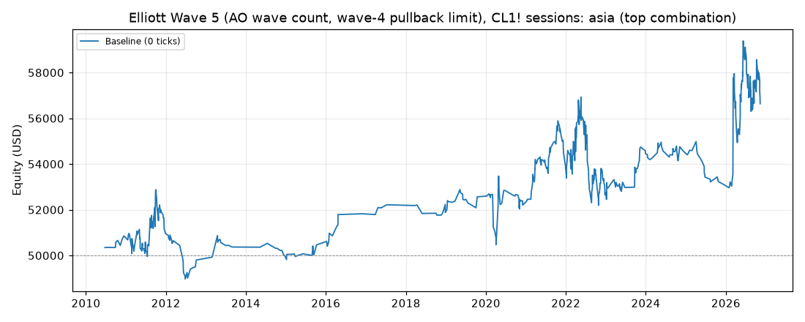
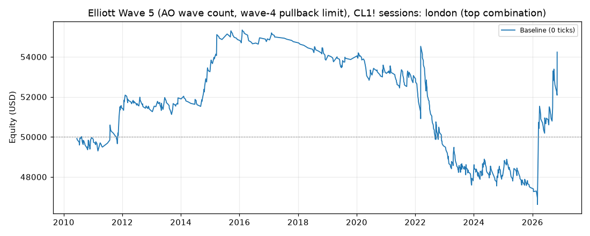
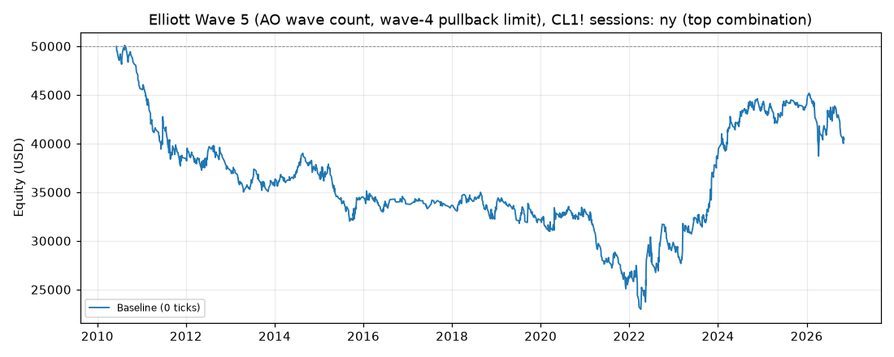

# Elliott Wave 5 (AO wave count, wave-4 pullback limit), CL1! sessions: results

Generated 2026-11-11 18:40 UTC by `python -m tvtester.cli test elliott_wave`.

Spec and sources: [README.md](README.md). Waves are counted on the Awesome Oscillator (AO = SMA5(hl2) -
SMA34(hl2), 1m) as in "10 Seconds Elliott Wave" (iTradeAIMS, after Bill Williams); the Fibonacci levels come
from that book and markokrivokapic.com. Long side below; the short side is the mirror.

- **Wave 3.** The tallest AO peak of the last `window` bars (the book's 100-140 bar rule) is green, taller than
  the deepest red AO in that window, and belongs to the current AO hump.
- **Wave 4 confirmed.** AO crosses below zero. Decision at that 1m close, inside the session only.
- **Anchors.** Top = the hump's highest high, which must be the current owner 1m swing high
  ([`indicators/structure_swings.pine`](../../../indicators/structure_swings.pine)). Base = lowest low of the
  window. L = top - base, at least `min_len` ticks.
- **Entry: limit only.** Buy limit at top - `entry_r` x L (or the signal close if lower), working from the next
  bar. Skipped when the pullback has already touched the stop level.
- **Exits.** Stop at top - `stop_r` x L (the book: a wave 4 deeper than about 62 % truncates wave 5). Target
  = limit + `tp_x` x L (the book's Target Zones 1 / 2: 61.8 % / 100 %). Flat at the session end.
- An unfilled limit is cancelled when a 1m close finds the target touched, at the session end, and on the
  contract's last bar. One position or working order at a time.

| Variant | Session (own time zone) | Malaysia time (UTC+8) | Flat at |
|---|---|---|---|
| asia | 09:00 Asia/Shanghai | 09:00 | 15:00 Asia/Shanghai |
| london | 08:00 Europe/London | 15:00 / 16:00 (UK summer / winter) | 13:00 London |
| ny | 09:00 America/New_York | 21:00 / 22:00 (US summer / winter) | 14:30 New York |

Commission $2.01 per order, no slippage (limit entries). In-sample: the grid's best of 32 per session on all
available bars, including the reserved 2024+ interval. A runnable Pine v6 twin is in
[`strategies/elliott_wave.pine`](../../../strategies/elliott_wave.pine).

## Test settings (TradingView Properties)

| Setting | Value |
|---|---|
| Symbol | CL1! (NYMEX Light Crude Oil, front month), 1-minute bars |
| Data | 2010-06-07 00:00:00+00:00 to 2026-11-10 08:27:00+00:00 UTC, 5,680,278 bars (manifest written 2026-11-04T02:31:15+00:00) |
| Initial capital | 50,000.00 USD |
| Order size | 1 contract |
| Commission | 2.01 USD per contract per order (4.02 USD round trip) |
| Execution | Limit entries; commission included; no added slippage |
| Pyramiding | 0 (one position) |
| Fills | TradingView broker emulator, Bar Magnifier off, limits fill on touch |
| Roll rule | position closed at the last bar of a contract (exit reason `roll`) |

## How the top combination was chosen

Every variant ran all 32 combinations of the grid below with commission included. The combination with the highest **net profit** is the top combination (ties: higher profit factor, then grid order). This reference is retained for compatibility. Thirteen separate metric winners are also selected, with a declared minimum trade count; their values, settings and trade lists are linked below. No slippage stress runs are performed.

| Parameter | Values |
|---|---|
| `window` | 100, 140 |
| `entry_r` | 0.382, 0.5 |
| `stop_r` | 0.618, 0.786 |
| `tp_x` | 0.618, 1.0 |
| `min_len` | 20, 40 |

> **Read this first.** The top combination is the best of 32 tries on the same data it is reported on (in-sample). Picking the best of many tries makes the result look better than what the same rules can be expected to earn on new data. Treat these numbers as an upper bound, not as a forecast.

## Summary: top combination per variant

| Variant | Parameters | Net profit | Trades | % profitable | Profit factor | Max DD |
|---|---|---|---|---|---|---|
| asia | window=100.0, entry_r=0.382, stop_r=0.786, tp_x=1.0, min_len=40.0 | 6,637.04 USD | 548 | 43.07% | 1.104 | 4,729.04 USD |
| london | window=140.0, entry_r=0.5, stop_r=0.618, tp_x=0.618, min_len=40.0 | 4,237.66 USD | 717 | 21.20% | 1.085 | 8,809.30 USD |
| ny | window=100.0, entry_r=0.382, stop_r=0.618, tp_x=0.618, min_len=40.0 | -9,557.04 USD | 1,452 | 30.58% | 0.953 | 27,463.62 USD |

## Variant: asia

**Top combination:** `session=asia`, `window=100.0`, `entry_r=0.382`, `stop_r=0.786`, `tp_x=1.0`, `min_len=40.0`

Files: [grid](../../../results/elliott_wave/asia/grid.csv), [trades 0 ticks](../../../results/elliott_wave/asia/trades_slippage0.csv), [summary](../../../results/elliott_wave/asia/summary.json)

### Results after commission

#### Overview

| Metric | Value |
|---|---|
| Net profit | 6,637.04 USD (13.27%) |
| Total closed trades | 548 |
| Percent profitable | 43.07% |
| Profit factor | 1.104 |
| Max equity drawdown | 4,729.04 USD (9.46%) |
| Avg trade | 12.11 USD |
| Avg # bars in trades | 102 |

#### Performance

| Metric | All | Long | Short |
|---|---|---|---|
| Net profit | 6,637.04 USD (13.27%) | 8,060.58 USD (16.12%) | -1,423.54 USD (-2.85%) |
| Gross profit | 70,591.28 USD (141.18%) | 37,777.70 USD (75.56%) | 32,813.58 USD (65.63%) |
| Gross loss | 63,954.24 USD (127.91%) | 29,717.12 USD (59.43%) | 34,237.12 USD (68.47%) |
| Commission paid | 2,202.96 USD | 1,089.42 USD | 1,113.54 USD |

| Account | Value |
|---|---|
| Initial capital | 50,000.00 USD |
| Buy & hold return (TV-style, all capital at the first entry) | 5,018.73 USD (10.04%) |
| Max equity run-up (intrabar) | 10,656.32 USD (21.31%) |
| Max equity drawdown (intrabar) | 4,729.04 USD (9.46%) |
| Open P&L | 0.00 USD |
| Max contracts held | 1 |

#### Trades analysis

| Metric | All | Long | Short |
|---|---|---|---|
| Total closed trades | 548 | 271 | 277 |
| Winning trades | 236 | 115 | 121 |
| Losing trades | 312 | 156 | 156 |
| Even trades | 0 | 0 | 0 |
| Percent profitable | 43.07% | 42.44% | 43.68% |
| Avg P&L | 12.11 USD | 29.74 USD | -5.14 USD |
| Avg P&L % | 0.03% | 0.02% | 0.05% |
| Avg winning trade | 299.12 USD | 328.50 USD | 271.19 USD |
| Avg losing trade | 204.98 USD | 190.49 USD | 219.47 USD |
| Ratio avg win / avg loss | 1.459 | 1.724 | 1.236 |
| Largest winning trade | 4,225.98 USD | 4,225.98 USD | 1,705.98 USD |
| Largest winning trade % | 12.99% | 3.90% | 12.99% |
| Largest losing trade | 1,324.02 USD | 694.02 USD | 1,324.02 USD |
| Largest losing trade % | 4.63% | 3.15% | 4.63% |
| Avg # bars in trades | 102 | 102 | 101 |
| Avg # bars in winning trades | 140 | 148 | 133 |
| Avg # bars in losing trades | 73 | 68 | 77 |

#### Risk/performance ratios

| Metric | Value |
|---|---|
| Sharpe ratio | -0.094 |
| Sortino ratio | -0.138 |
| Profit factor | 1.104 |
| Margin calls | 0 |

#### List of trades (last 10, newest first; full list in the trades CSV)

| Trade # | Type | Signal | Date/Time (UTC) | Price | Contracts | Profit | Cum. profit | Run-up | Drawdown |
|---|---|---|---|---|---|---|---|---|---|
| 548 | Exit short | Exit | 2026-11-10 05:34 | 86.14 | 1 | -274.02 USD (-0.32%) | 6,637.04 USD | 240.00 USD | 270.00 USD |
|  | Entry short | Short | 2026-11-10 03:58 | 85.87 | 1 |  |  |  |  |
| 547 | Exit long | Exit | 2026-11-09 01:10 | 90.30 | 1 | -264.02 USD (-0.29%) | 6,911.06 USD | 0.00 USD | 260.00 USD |
|  | Entry long | Long | 2026-11-09 01:05 | 90.56 | 1 |  |  |  |  |
| 546 | Exit short | Exit | 2026-11-06 06:00 | 91.91 | 1 | -474.02 USD (-0.52%) | 7,175.08 USD | 70.00 USD | 470.00 USD |
|  | Entry short | Short | 2026-11-06 05:41 | 91.44 | 1 |  |  |  |  |
| 545 | Exit long | Exit | 2026-11-06 04:57 | 91.51 | 1 | -344.02 USD (-0.37%) | 7,649.10 USD | 310.00 USD | 340.00 USD |
|  | Entry long | Long | 2026-11-06 03:57 | 91.85 | 1 |  |  |  |  |
| 544 | Exit short | Session end | 2026-10-29 07:00 | 101.43 | 1 | 305.98 USD (0.30%) | 7,993.12 USD | 720.00 USD | 80.00 USD |
|  | Entry short | Short | 2026-10-29 02:34 | 101.74 | 1 |  |  |  |  |
| 543 | Exit long | Exit | 2026-10-26 05:56 | 100.97 | 1 | -194.02 USD (-0.19%) | 7,687.14 USD | 90.00 USD | 190.00 USD |
|  | Entry long | Long | 2026-10-26 05:41 | 101.16 | 1 |  |  |  |  |
| 542 | Exit long | Exit | 2026-10-22 06:57 | 99.03 | 1 | -214.02 USD (-0.22%) | 7,881.16 USD | 40.00 USD | 210.00 USD |
|  | Entry long | Long | 2026-10-22 06:51 | 99.24 | 1 |  |  |  |  |
| 541 | Exit short | Session end | 2026-10-19 07:00 | 96.93 | 1 | 335.98 USD (0.35%) | 8,095.18 USD | 370.00 USD | 50.00 USD |
|  | Entry short | Short | 2026-10-19 06:16 | 97.27 | 1 |  |  |  |  |
| 540 | Exit long | Exit | 2026-10-16 02:04 | 97.32 | 1 | -224.02 USD (-0.23%) | 7,759.20 USD | 0.00 USD | 220.00 USD |
|  | Entry long | Long | 2026-10-16 01:57 | 97.54 | 1 |  |  |  |  |
| 539 | Exit long | Exit | 2026-10-15 06:08 | 93.97 | 1 | -194.02 USD (-0.21%) | 7,983.22 USD | 50.00 USD | 190.00 USD |
|  | Entry long | Long | 2026-10-15 05:54 | 94.16 | 1 |  |  |  |  |

#### By year (extra, not a TV tab)

| Year | Trades | Net profit | % profitable | Profit factor |
|---|---|---|---|---|
| 2010 | 9 | 783.82 USD | 66.67% | 3.595 |
| 2011 | 76 | 174.48 USD | 42.11% | 1.021 |
| 2012 | 22 | -1,158.44 USD | 31.82% | 0.551 |
| 2013 | 10 | 569.80 USD | 50.00% | 1.890 |
| 2014 | 9 | -386.18 USD | 33.33% | 0.327 |
| 2015 | 11 | 475.78 USD | 45.45% | 1.657 |
| 2016 | 9 | 1,363.82 USD | 77.78% | 5.157 |
| 2017 | 4 | 393.92 USD | 50.00% | 9.200 |
| 2018 | 12 | -338.24 USD | 66.67% | 0.600 |
| 2019 | 14 | 683.72 USD | 42.86% | 1.758 |
| 2020 | 32 | -358.64 USD | 43.75% | 0.926 |
| 2021 | 53 | 1,596.94 USD | 49.06% | 1.356 |
| 2022 | 116 | -1,076.32 USD | 40.52% | 0.935 |
| 2023 | 35 | 1,719.30 USD | 54.29% | 1.756 |
| 2024 | 25 | 129.50 USD | 32.00% | 1.061 |
| 2025 | 19 | -1,486.38 USD | 21.05% | 0.354 |
| 2026 | 92 | 3,550.16 USD | 40.22% | 1.222 |

#### Exit reasons (extra)

| Reason | Trades |
|---|---|
| close | 254 |
| stop | 241 |
| limit | 53 |

- Session-end exits more than 5 minutes after the flat time (missing bars / early closes): 0.
- Roll exits: 0.

### Best settings by metric

Each winner needs at least 30 closed trades. Undefined values are excluded. Ties: higher net profit, higher profit factor, then grid order. Ruin loss threshold: 25,000.00 USD from starting capital. All selections are in-sample. MAE/MFE objectives use the mean of the per-trade maxima.

| Metric | Goal | Best value | Grid order | Trades | Eligible settings | Parameters |
|---|---|---|---|---|---|---|
| Net profit | max | 6,637.04 USD | [8](../../../results/elliott_wave/asia/metric_winners/order_8/trades_slippage0.csv) | 548 | 32 | window=100.0, entry_r=0.382, stop_r=0.786, tp_x=1.0, min_len=40.0 |
| Win rate | max | 44.73% | [22](../../../results/elliott_wave/asia/metric_winners/order_22/trades_slippage0.csv) | 503 | 32 | window=140.0, entry_r=0.382, stop_r=0.786, tp_x=0.618, min_len=40.0 |
| Expectancy | max | 13.38 USD | [16](../../../results/elliott_wave/asia/metric_winners/order_16/trades_slippage0.csv) | 450 | 32 | window=100.0, entry_r=0.5, stop_r=0.786, tp_x=1.0, min_len=40.0 |
| Profit factor | max | 1.130 | [16](../../../results/elliott_wave/asia/metric_winners/order_16/trades_slippage0.csv) | 450 | 32 | window=100.0, entry_r=0.5, stop_r=0.786, tp_x=1.0, min_len=40.0 |
| Payoff ratio | max | 4.379 | [11](../../../results/elliott_wave/asia/metric_winners/order_11/trades_slippage0.csv) | 1168 | 32 | window=100.0, entry_r=0.5, stop_r=0.618, tp_x=1.0, min_len=20.0 |
| Risk of ruin (estimate) | min | 0.05% | [16](../../../results/elliott_wave/asia/metric_winners/order_16/trades_slippage0.csv) | 450 | 32 | window=100.0, entry_r=0.5, stop_r=0.786, tp_x=1.0, min_len=40.0 |
| Maximum drawdown | min | 3,905.02 USD | [12](../../../results/elliott_wave/asia/metric_winners/order_12/trades_slippage0.csv) | 394 | 32 | window=100.0, entry_r=0.5, stop_r=0.618, tp_x=1.0, min_len=40.0 |
| Consecutive losses | min | 9.000 | [18](../../../results/elliott_wave/asia/metric_winners/order_18/trades_slippage0.csv) | 466 | 32 | window=140.0, entry_r=0.382, stop_r=0.618, tp_x=0.618, min_len=40.0 |
| Sharpe ratio | max | -0.094 | [8](../../../results/elliott_wave/asia/metric_winners/order_8/trades_slippage0.csv) | 548 | 32 | window=100.0, entry_r=0.382, stop_r=0.786, tp_x=1.0, min_len=40.0 |
| Sortino ratio | max | -0.138 | [8](../../../results/elliott_wave/asia/metric_winners/order_8/trades_slippage0.csv) | 548 | 32 | window=100.0, entry_r=0.382, stop_r=0.786, tp_x=1.0, min_len=40.0 |
| R-multiple | max | 0.063 | [16](../../../results/elliott_wave/asia/metric_winners/order_16/trades_slippage0.csv) | 450 | 14 | window=100.0, entry_r=0.5, stop_r=0.786, tp_x=1.0, min_len=40.0 |
| Maximum adverse excursion (MAE) | min | 39.48 USD | [9](../../../results/elliott_wave/asia/metric_winners/order_9/trades_slippage0.csv) | 1070 | 32 | window=100.0, entry_r=0.5, stop_r=0.618, tp_x=0.618, min_len=20.0 |
| Maximum favorable excursion (MFE) | max | 252.81 USD | [8](../../../results/elliott_wave/asia/metric_winners/order_8/trades_slippage0.csv) | 548 | 32 | window=100.0, entry_r=0.382, stop_r=0.786, tp_x=1.0, min_len=40.0 |

- **Net profit:** Sum of closed-trade profit after commission; excludes open P&L.
- **Win rate:** Winning closed trades divided by all closed trades, including breakevens.
- **Expectancy:** Mean net profit per closed trade, including losses and breakevens.
- **Profit factor:** Gross winning profit divided by gross losing profit, both after commission. Undefined without losses.
- **Payoff ratio:** Average net winning trade divided by the absolute average net losing trade. Requires wins and losses.
- **Risk of ruin (estimate):** Infinite-horizon diffusion estimate of losing the declared amount from starting capital. Assumes independent, stationary, fixed-size net trade P&L; ignores intratrade losses and margin.
- **Maximum drawdown:** Largest equity drawdown under the tester's intrabar TradingView convention, including an open trade at the end.
- **Consecutive losses:** Longest streak of losing closed trades in execution order. A win or breakeven resets the streak.
- **Sharpe ratio:** Monthly marked-to-market excess return divided by population standard deviation, using 2% annual risk-free rate; not annualized.
- **Sortino ratio:** Monthly marked-to-market excess return divided by downside deviation about the risk-free rate; not annualized.
- **R-multiple:** Mean net trade profit / initial stop risk in dollars. Risk is actual fill to initial stop, before costs. Requires positive initial risk for every closed trade; R standard deviation and mean / standard deviation describe consistency.
- **Maximum adverse excursion (MAE):** Mean of each closed trade's maximum adverse price excursion in dollars, before commission; only the exposed intrabar path counts.
- **Maximum favorable excursion (MFE):** Mean of each closed trade's maximum favorable price excursion in dollars, before commission; only the exposed intrabar path counts. Unrealized opportunity, not realized profit.

Full selection metadata: [metric_winners.json](../../../results/elliott_wave/asia/metric_winners.json).

### Top 10 combinations

| # | window | entry_r | stop_r | tp_x | min_len | Net profit | Trades | % profitable | Profit factor | Max DD |
|---|---|---|---|---|---|---|---|---|---|---|
| 1 | 100.0 | 0.382 | 0.786 | 1.0 | 40.0 | 6,637.04 USD | 548 | 43.07% | 1.104 | 4,729.04 USD |
| 2 | 100.0 | 0.5 | 0.786 | 1.0 | 40.0 | 6,021.00 USD | 450 | 38.67% | 1.130 | 5,359.24 USD |
| 3 | 100.0 | 0.382 | 0.786 | 0.618 | 40.0 | 3,363.22 USD | 539 | 43.97% | 1.055 | 5,979.04 USD |
| 4 | 100.0 | 0.5 | 0.786 | 1.0 | 20.0 | 1,762.00 USD | 1,400 | 32.79% | 1.019 | 6,567.04 USD |
| 5 | 100.0 | 0.382 | 0.618 | 1.0 | 40.0 | 1,458.14 USD | 493 | 31.85% | 1.031 | 5,249.68 USD |
| 6 | 100.0 | 0.382 | 0.786 | 1.0 | 20.0 | 1,025.24 USD | 1,638 | 36.63% | 1.008 | 8,945.48 USD |
| 7 | 100.0 | 0.5 | 0.618 | 1.0 | 40.0 | 726.12 USD | 394 | 20.81% | 1.029 | 3,905.02 USD |
| 8 | 100.0 | 0.382 | 0.618 | 0.618 | 40.0 | 602.36 USD | 482 | 32.99% | 1.013 | 4,479.58 USD |
| 9 | 100.0 | 0.5 | 0.786 | 0.618 | 40.0 | -374.38 USD | 419 | 37.95% | 0.991 | 5,430.94 USD |
| 10 | 140.0 | 0.382 | 0.618 | 0.618 | 40.0 | -833.32 USD | 466 | 35.19% | 0.980 | 5,773.20 USD |

Profitable combinations: 8 of 32.

## Variant: london

**Top combination:** `session=london`, `window=140.0`, `entry_r=0.5`, `stop_r=0.618`, `tp_x=0.618`, `min_len=40.0`

Files: [grid](../../../results/elliott_wave/london/grid.csv), [trades 0 ticks](../../../results/elliott_wave/london/trades_slippage0.csv), [summary](../../../results/elliott_wave/london/summary.json)

### Results after commission

#### Overview

| Metric | Value |
|---|---|
| Net profit | 4,237.66 USD (8.48%) |
| Total closed trades | 717 |
| Percent profitable | 21.20% |
| Profit factor | 1.085 |
| Max equity drawdown | 8,809.30 USD (17.62%) |
| Avg trade | 5.91 USD |
| Avg # bars in trades | 24 |

#### Performance

| Metric | All | Long | Short |
|---|---|---|---|
| Net profit | 4,237.66 USD (8.48%) | -314.84 USD (-0.63%) | 4,552.50 USD (9.10%) |
| Gross profit | 53,908.96 USD (107.82%) | 23,566.54 USD (47.13%) | 30,342.42 USD (60.68%) |
| Gross loss | 49,671.30 USD (99.34%) | 23,881.38 USD (47.76%) | 25,789.92 USD (51.58%) |
| Commission paid | 2,882.34 USD | 1,374.84 USD | 1,507.50 USD |

| Account | Value |
|---|---|
| Initial capital | 50,000.00 USD |
| Buy & hold return (TV-style, all capital at the first entry) | 6,832.13 USD (13.66%) |
| Max equity run-up (intrabar) | 7,769.10 USD (15.54%) |
| Max equity drawdown (intrabar) | 8,809.30 USD (17.62%) |
| Open P&L | 0.00 USD |
| Max contracts held | 1 |

#### Trades analysis

| Metric | All | Long | Short |
|---|---|---|---|
| Total closed trades | 717 | 342 | 375 |
| Winning trades | 152 | 73 | 79 |
| Losing trades | 565 | 269 | 296 |
| Even trades | 0 | 0 | 0 |
| Percent profitable | 21.20% | 21.35% | 21.07% |
| Avg P&L | 5.91 USD | -0.92 USD | 12.14 USD |
| Avg P&L % | -0.00% | 0.00% | -0.00% |
| Avg winning trade | 354.66 USD | 322.83 USD | 384.08 USD |
| Avg losing trade | 87.91 USD | 88.78 USD | 87.13 USD |
| Ratio avg win / avg loss | 4.034 | 3.636 | 4.408 |
| Largest winning trade | 3,615.98 USD | 1,105.98 USD | 3,615.98 USD |
| Largest winning trade % | 2.94% | 2.20% | 2.94% |
| Largest losing trade | 374.02 USD | 344.02 USD | 374.02 USD |
| Largest losing trade % | 1.34% | 0.45% | 1.34% |
| Avg # bars in trades | 24 | 20 | 27 |
| Avg # bars in winning trades | 57 | 49 | 64 |
| Avg # bars in losing trades | 15 | 13 | 18 |

#### Risk/performance ratios

| Metric | Value |
|---|---|
| Sharpe ratio | -0.115 |
| Sortino ratio | -0.212 |
| Profit factor | 1.085 |
| Margin calls | 0 |

#### List of trades (last 10, newest first; full list in the trades CSV)

| Trade # | Type | Signal | Date/Time (UTC) | Price | Contracts | Profit | Cum. profit | Run-up | Drawdown |
|---|---|---|---|---|---|---|---|---|---|
| 717 | Exit short | Session end | 2026-11-04 13:00 | 94.58 | 1 | 1,045.98 USD (1.09%) | 4,237.66 USD | 1,200.00 USD | 100.00 USD |
|  | Entry short | Short | 2026-11-04 11:06 | 95.63 | 1 |  |  |  |  |
| 716 | Exit short | Exit | 2026-11-04 10:26 | 94.87 | 1 | 1,105.98 USD (1.15%) | 3,191.68 USD | 1,110.00 USD | 160.00 USD |
|  | Entry short | Short | 2026-11-04 09:36 | 95.98 | 1 |  |  |  |  |
| 715 | Exit long | Exit | 2026-11-03 12:21 | 97.78 | 1 | -194.02 USD (-0.20%) | 2,085.70 USD | 80.00 USD | 190.00 USD |
|  | Entry long | Long | 2026-11-03 12:20 | 97.97 | 1 |  |  |  |  |
| 714 | Exit short | Exit | 2026-10-28 09:04 | 101.82 | 1 | -134.02 USD (-0.13%) | 2,279.72 USD | 260.00 USD | 130.00 USD |
|  | Entry short | Short | 2026-10-28 08:42 | 101.69 | 1 |  |  |  |  |
| 713 | Exit long | Exit | 2026-10-19 10:39 | 97.38 | 1 | -204.02 USD (-0.21%) | 2,413.74 USD | 330.00 USD | 200.00 USD |
|  | Entry long | Long | 2026-10-19 10:38 | 97.58 | 1 |  |  |  |  |
| 712 | Exit short | Exit | 2026-10-07 07:51 | 90.11 | 1 | -94.02 USD (-0.10%) | 2,617.76 USD | 0.00 USD | 90.00 USD |
|  | Entry short | Short | 2026-10-07 07:51 | 90.02 | 1 |  |  |  |  |
| 711 | Exit short | Exit | 2026-10-05 11:47 | 90.37 | 1 | -134.02 USD (-0.15%) | 2,711.78 USD | 60.00 USD | 130.00 USD |
|  | Entry short | Short | 2026-10-05 11:40 | 90.24 | 1 |  |  |  |  |
| 710 | Exit short | Exit | 2026-10-01 11:12 | 92.26 | 1 | -204.02 USD (-0.22%) | 2,845.80 USD | 40.00 USD | 200.00 USD |
|  | Entry short | Short | 2026-10-01 11:07 | 92.06 | 1 |  |  |  |  |
| 709 | Exit short | Exit | 2026-09-30 07:45 | 89.46 | 1 | -174.02 USD (-0.19%) | 3,049.82 USD | 70.00 USD | 170.00 USD |
|  | Entry short | Short | 2026-09-30 07:42 | 89.29 | 1 |  |  |  |  |
| 708 | Exit short | Exit | 2026-09-28 07:14 | 94.20 | 1 | -164.02 USD (-0.17%) | 3,223.84 USD | 190.00 USD | 160.00 USD |
|  | Entry short | Short | 2026-09-28 07:06 | 94.04 | 1 |  |  |  |  |

#### By year (extra, not a TV tab)

| Year | Trades | Net profit | % profitable | Profit factor |
|---|---|---|---|---|
| 2010 | 34 | -36.68 USD | 20.59% | 0.980 |
| 2011 | 36 | 1,495.28 USD | 33.33% | 1.640 |
| 2012 | 41 | -134.82 USD | 24.39% | 0.939 |
| 2013 | 38 | 627.24 USD | 28.95% | 1.324 |
| 2014 | 28 | 1,307.44 USD | 28.57% | 1.947 |
| 2015 | 24 | 1,613.52 USD | 29.17% | 2.393 |
| 2016 | 23 | 27.54 USD | 21.74% | 1.025 |
| 2017 | 10 | -140.20 USD | 20.00% | 0.715 |
| 2018 | 25 | -920.50 USD | 12.00% | 0.394 |
| 2019 | 23 | 27.54 USD | 21.74% | 1.025 |
| 2020 | 42 | -648.84 USD | 23.81% | 0.768 |
| 2021 | 51 | -235.02 USD | 19.61% | 0.924 |
| 2022 | 73 | -3,423.46 USD | 6.85% | 0.628 |
| 2023 | 73 | -1,433.46 USD | 16.44% | 0.730 |
| 2024 | 86 | -85.72 USD | 23.26% | 0.983 |
| 2025 | 58 | -563.16 USD | 15.52% | 0.841 |
| 2026 | 52 | 6,760.96 USD | 30.77% | 2.194 |

#### Exit reasons (extra)

| Reason | Trades |
|---|---|
| stop | 558 |
| limit | 91 |
| close | 68 |

- Session-end exits more than 5 minutes after the flat time (missing bars / early closes): 0.
- Roll exits: 0.

### Best settings by metric

Each winner needs at least 30 closed trades. Undefined values are excluded. Ties: higher net profit, higher profit factor, then grid order. Ruin loss threshold: 25,000.00 USD from starting capital. All selections are in-sample. MAE/MFE objectives use the mean of the per-trade maxima.

| Metric | Goal | Best value | Grid order | Trades | Eligible settings | Parameters |
|---|---|---|---|---|---|---|
| Net profit | max | 4,237.66 USD | [26](../../../results/elliott_wave/london/metric_winners/order_26/trades_slippage0.csv) | 717 | 32 | window=140.0, entry_r=0.5, stop_r=0.618, tp_x=0.618, min_len=40.0 |
| Win rate | max | 41.62% | [22](../../../results/elliott_wave/london/metric_winners/order_22/trades_slippage0.csv) | 997 | 32 | window=140.0, entry_r=0.382, stop_r=0.786, tp_x=0.618, min_len=40.0 |
| Expectancy | max | 5.91 USD | [26](../../../results/elliott_wave/london/metric_winners/order_26/trades_slippage0.csv) | 717 | 32 | window=140.0, entry_r=0.5, stop_r=0.618, tp_x=0.618, min_len=40.0 |
| Profit factor | max | 1.085 | [26](../../../results/elliott_wave/london/metric_winners/order_26/trades_slippage0.csv) | 717 | 32 | window=140.0, entry_r=0.5, stop_r=0.618, tp_x=0.618, min_len=40.0 |
| Payoff ratio | max | 4.725 | [27](../../../results/elliott_wave/london/metric_winners/order_27/trades_slippage0.csv) | 1129 | 32 | window=140.0, entry_r=0.5, stop_r=0.618, tp_x=1.0, min_len=20.0 |
| Risk of ruin (estimate) | min | 1.11% | [26](../../../results/elliott_wave/london/metric_winners/order_26/trades_slippage0.csv) | 717 | 32 | window=140.0, entry_r=0.5, stop_r=0.618, tp_x=0.618, min_len=40.0 |
| Maximum drawdown | min | 8,809.30 USD | [26](../../../results/elliott_wave/london/metric_winners/order_26/trades_slippage0.csv) | 717 | 32 | window=140.0, entry_r=0.5, stop_r=0.618, tp_x=0.618, min_len=40.0 |
| Consecutive losses | min | 14.000 | [14](../../../results/elliott_wave/london/metric_winners/order_14/trades_slippage0.csv) | 940 | 32 | window=100.0, entry_r=0.5, stop_r=0.786, tp_x=0.618, min_len=40.0 |
| Sharpe ratio | max | -0.087 | [31](../../../results/elliott_wave/london/metric_winners/order_31/trades_slippage0.csv) | 1341 | 32 | window=140.0, entry_r=0.5, stop_r=0.786, tp_x=1.0, min_len=20.0 |
| Sortino ratio | max | -0.130 | [31](../../../results/elliott_wave/london/metric_winners/order_31/trades_slippage0.csv) | 1341 | 32 | window=140.0, entry_r=0.5, stop_r=0.786, tp_x=1.0, min_len=20.0 |
| R-multiple | max | 0.011 | [26](../../../results/elliott_wave/london/metric_winners/order_26/trades_slippage0.csv) | 717 | 16 | window=140.0, entry_r=0.5, stop_r=0.618, tp_x=0.618, min_len=40.0 |
| Maximum adverse excursion (MAE) | min | 54.81 USD | [9](../../../results/elliott_wave/london/metric_winners/order_9/trades_slippage0.csv) | 1337 | 32 | window=100.0, entry_r=0.5, stop_r=0.618, tp_x=0.618, min_len=20.0 |
| Maximum favorable excursion (MFE) | max | 270.79 USD | [24](../../../results/elliott_wave/london/metric_winners/order_24/trades_slippage0.csv) | 1010 | 32 | window=140.0, entry_r=0.382, stop_r=0.786, tp_x=1.0, min_len=40.0 |

- **Net profit:** Sum of closed-trade profit after commission; excludes open P&L.
- **Win rate:** Winning closed trades divided by all closed trades, including breakevens.
- **Expectancy:** Mean net profit per closed trade, including losses and breakevens.
- **Profit factor:** Gross winning profit divided by gross losing profit, both after commission. Undefined without losses.
- **Payoff ratio:** Average net winning trade divided by the absolute average net losing trade. Requires wins and losses.
- **Risk of ruin (estimate):** Infinite-horizon diffusion estimate of losing the declared amount from starting capital. Assumes independent, stationary, fixed-size net trade P&L; ignores intratrade losses and margin.
- **Maximum drawdown:** Largest equity drawdown under the tester's intrabar TradingView convention, including an open trade at the end.
- **Consecutive losses:** Longest streak of losing closed trades in execution order. A win or breakeven resets the streak.
- **Sharpe ratio:** Monthly marked-to-market excess return divided by population standard deviation, using 2% annual risk-free rate; not annualized.
- **Sortino ratio:** Monthly marked-to-market excess return divided by downside deviation about the risk-free rate; not annualized.
- **R-multiple:** Mean net trade profit / initial stop risk in dollars. Risk is actual fill to initial stop, before costs. Requires positive initial risk for every closed trade; R standard deviation and mean / standard deviation describe consistency.
- **Maximum adverse excursion (MAE):** Mean of each closed trade's maximum adverse price excursion in dollars, before commission; only the exposed intrabar path counts.
- **Maximum favorable excursion (MFE):** Mean of each closed trade's maximum favorable price excursion in dollars, before commission; only the exposed intrabar path counts. Unrealized opportunity, not realized profit.

Full selection metadata: [metric_winners.json](../../../results/elliott_wave/london/metric_winners.json).

### Top 10 combinations

| # | window | entry_r | stop_r | tp_x | min_len | Net profit | Trades | % profitable | Profit factor | Max DD |
|---|---|---|---|---|---|---|---|---|---|---|
| 1 | 140.0 | 0.5 | 0.618 | 0.618 | 40.0 | 4,237.66 USD | 717 | 21.20% | 1.085 | 8,809.30 USD |
| 2 | 140.0 | 0.5 | 0.618 | 0.618 | 20.0 | 1,227.04 USD | 1,048 | 18.51% | 1.020 | 11,585.96 USD |
| 3 | 140.0 | 0.5 | 0.786 | 1.0 | 20.0 | 719.18 USD | 1,341 | 30.72% | 1.005 | 12,791.24 USD |
| 4 | 140.0 | 0.5 | 0.786 | 0.618 | 40.0 | 635.96 USD | 802 | 36.03% | 1.007 | 16,351.22 USD |
| 5 | 140.0 | 0.5 | 0.786 | 0.618 | 20.0 | 334.70 USD | 1,265 | 34.39% | 1.003 | 17,426.22 USD |
| 6 | 140.0 | 0.5 | 0.786 | 1.0 | 40.0 | -2,288.76 USD | 838 | 32.70% | 0.978 | 13,941.72 USD |
| 7 | 140.0 | 0.5 | 0.618 | 1.0 | 40.0 | -3,619.12 USD | 756 | 18.52% | 0.934 | 11,545.98 USD |
| 8 | 100.0 | 0.5 | 0.618 | 0.618 | 40.0 | -4,186.30 USD | 815 | 18.53% | 0.925 | 10,204.24 USD |
| 9 | 140.0 | 0.5 | 0.618 | 1.0 | 20.0 | -5,718.58 USD | 1,129 | 16.21% | 0.914 | 13,841.68 USD |
| 10 | 140.0 | 0.382 | 0.618 | 0.618 | 40.0 | -5,918.20 USD | 910 | 31.43% | 0.940 | 20,151.08 USD |

Profitable combinations: 5 of 32.

## Variant: ny

**Top combination:** `session=ny`, `window=100.0`, `entry_r=0.382`, `stop_r=0.618`, `tp_x=0.618`, `min_len=40.0`

Files: [grid](../../../results/elliott_wave/ny/grid.csv), [trades 0 ticks](../../../results/elliott_wave/ny/trades_slippage0.csv), [summary](../../../results/elliott_wave/ny/summary.json)

### Results after commission

#### Overview

| Metric | Value |
|---|---|
| Net profit | -9,557.04 USD (-19.11%) |
| Total closed trades | 1,452 |
| Percent profitable | 30.58% |
| Profit factor | 0.953 |
| Max equity drawdown | 27,463.62 USD (54.93%) |
| Avg trade | -6.58 USD |
| Avg # bars in trades | 41 |

#### Performance

| Metric | All | Long | Short |
|---|---|---|---|
| Net profit | -9,557.04 USD (-19.11%) | 581.68 USD (1.16%) | -10,138.72 USD (-20.28%) |
| Gross profit | 192,485.12 USD (384.97%) | 96,083.34 USD (192.17%) | 96,401.78 USD (192.80%) |
| Gross loss | 202,042.16 USD (404.08%) | 95,501.66 USD (191.00%) | 106,540.50 USD (213.08%) |
| Commission paid | 5,837.04 USD | 2,878.32 USD | 2,958.72 USD |

| Account | Value |
|---|---|
| Initial capital | 50,000.00 USD |
| Buy & hold return (TV-style, all capital at the first entry) | 9,583.10 USD (19.17%) |
| Max equity run-up (intrabar) | 22,204.56 USD (44.41%) |
| Max equity drawdown (intrabar) | 27,463.62 USD (54.93%) |
| Open P&L | 0.00 USD |
| Max contracts held | 1 |

#### Trades analysis

| Metric | All | Long | Short |
|---|---|---|---|
| Total closed trades | 1,452 | 716 | 736 |
| Winning trades | 444 | 233 | 211 |
| Losing trades | 1,008 | 483 | 525 |
| Even trades | 0 | 0 | 0 |
| Percent profitable | 30.58% | 32.54% | 28.67% |
| Avg P&L | -6.58 USD | 0.81 USD | -13.78 USD |
| Avg P&L % | -0.00% | 0.00% | -0.01% |
| Avg winning trade | 433.53 USD | 412.37 USD | 456.88 USD |
| Avg losing trade | 200.44 USD | 197.73 USD | 202.93 USD |
| Ratio avg win / avg loss | 2.163 | 2.086 | 2.251 |
| Largest winning trade | 2,305.98 USD | 1,655.98 USD | 2,305.98 USD |
| Largest winning trade % | 18.67% | 4.05% | 18.67% |
| Largest losing trade | 1,504.02 USD | 1,144.02 USD | 1,504.02 USD |
| Largest losing trade % | 4.17% | 2.41% | 4.17% |
| Avg # bars in trades | 41 | 44 | 39 |
| Avg # bars in winning trades | 67 | 73 | 61 |
| Avg # bars in losing trades | 30 | 30 | 30 |

#### Risk/performance ratios

| Metric | Value |
|---|---|
| Sharpe ratio | -0.071 |
| Sortino ratio | -0.107 |
| Profit factor | 0.953 |
| Margin calls | 0 |

#### List of trades (last 10, newest first; full list in the trades CSV)

| Trade # | Type | Signal | Date/Time (UTC) | Price | Contracts | Profit | Cum. profit | Run-up | Drawdown |
|---|---|---|---|---|---|---|---|---|---|
| 1452 | Exit short | Exit | 2026-11-05 19:28 | 90.48 | 1 | -234.02 USD (-0.26%) | -9,557.04 USD | 30.00 USD | 230.00 USD |
|  | Entry short | Short | 2026-11-05 19:14 | 90.25 | 1 |  |  |  |  |
| 1451 | Exit long | Session end | 2026-10-29 18:30 | 102.00 | 1 | 665.98 USD (0.66%) | -9,323.02 USD | 900.00 USD | 10.00 USD |
|  | Entry long | Long | 2026-10-29 17:23 | 101.33 | 1 |  |  |  |  |
| 1450 | Exit short | Exit | 2026-10-29 14:10 | 101.14 | 1 | -524.02 USD (-0.52%) | -9,989.00 USD | 40.00 USD | 520.00 USD |
|  | Entry short | Short | 2026-10-29 14:00 | 100.62 | 1 |  |  |  |  |
| 1449 | Exit long | Exit | 2026-10-22 18:20 | 99.20 | 1 | -294.02 USD (-0.30%) | -9,464.98 USD | 220.00 USD | 290.00 USD |
|  | Entry long | Long | 2026-10-22 18:04 | 99.49 | 1 |  |  |  |  |
| 1448 | Exit long | Exit | 2026-10-09 13:06 | 90.86 | 1 | -204.02 USD (-0.22%) | -9,170.96 USD | 20.00 USD | 200.00 USD |
|  | Entry long | Long | 2026-10-09 13:04 | 91.06 | 1 |  |  |  |  |
| 1447 | Exit short | Exit | 2026-10-06 15:17 | 88.01 | 1 | -124.02 USD (-0.14%) | -8,966.94 USD | 90.00 USD | 120.00 USD |
|  | Entry short | Short | 2026-10-06 15:13 | 87.89 | 1 |  |  |  |  |
| 1446 | Exit short | Exit | 2026-10-05 18:05 | 90.11 | 1 | -144.02 USD (-0.16%) | -8,842.92 USD | 160.00 USD | 140.00 USD |
|  | Entry short | Short | 2026-10-05 17:58 | 89.97 | 1 |  |  |  |  |
| 1445 | Exit short | Exit | 2026-10-05 14:00 | 89.99 | 1 | -344.02 USD (-0.38%) | -8,698.90 USD | 170.00 USD | 340.00 USD |
|  | Entry short | Short | 2026-10-05 13:29 | 89.65 | 1 |  |  |  |  |
| 1444 | Exit short | Exit | 2026-10-01 17:54 | 92.47 | 1 | -324.02 USD (-0.35%) | -8,354.88 USD | 560.00 USD | 320.00 USD |
|  | Entry short | Short | 2026-10-01 16:50 | 92.15 | 1 |  |  |  |  |
| 1443 | Exit short | Exit | 2026-10-01 13:44 | 91.38 | 1 | -344.02 USD (-0.38%) | -8,030.86 USD | 0.00 USD | 340.00 USD |
|  | Entry short | Short | 2026-10-01 13:40 | 91.04 | 1 |  |  |  |  |

#### By year (extra, not a TV tab)

| Year | Trades | Net profit | % profitable | Profit factor |
|---|---|---|---|---|
| 2010 | 55 | -4,321.10 USD | 16.36% | 0.481 |
| 2011 | 87 | -7,089.74 USD | 21.84% | 0.633 |
| 2012 | 90 | -1,261.80 USD | 26.67% | 0.899 |
| 2013 | 87 | -1,369.74 USD | 28.74% | 0.859 |
| 2014 | 81 | 824.38 USD | 35.80% | 1.097 |
| 2015 | 101 | -2,266.02 USD | 30.69% | 0.845 |
| 2016 | 73 | -703.46 USD | 32.88% | 0.916 |
| 2017 | 44 | -166.88 USD | 34.09% | 0.950 |
| 2018 | 85 | -441.70 USD | 32.94% | 0.953 |
| 2019 | 76 | -1,075.52 USD | 28.95% | 0.874 |
| 2020 | 96 | 884.08 USD | 29.17% | 1.077 |
| 2021 | 103 | -6,804.06 USD | 27.18% | 0.556 |
| 2022 | 84 | 3,642.32 USD | 33.33% | 1.176 |
| 2023 | 118 | 8,595.64 USD | 40.68% | 1.631 |
| 2024 | 108 | 5,645.84 USD | 36.11% | 1.479 |
| 2025 | 84 | -57.68 USD | 29.76% | 0.993 |
| 2026 | 80 | -3,591.60 USD | 27.50% | 0.800 |

#### Exit reasons (extra)

| Reason | Trades |
|---|---|
| stop | 964 |
| limit | 273 |
| close | 215 |

- Session-end exits more than 5 minutes after the flat time (missing bars / early closes): 3.
- Roll exits: 0.

### Best settings by metric

Each winner needs at least 30 closed trades. Undefined values are excluded. Ties: higher net profit, higher profit factor, then grid order. Ruin loss threshold: 25,000.00 USD from starting capital. All selections are in-sample. MAE/MFE objectives use the mean of the per-trade maxima.

| Metric | Goal | Best value | Grid order | Trades | Eligible settings | Parameters |
|---|---|---|---|---|---|---|
| Net profit | max | -9,557.04 USD | [2](../../../results/elliott_wave/ny/metric_winners/order_2/trades_slippage0.csv) | 1452 | 32 | window=100.0, entry_r=0.382, stop_r=0.618, tp_x=0.618, min_len=40.0 |
| Win rate | max | 38.96% | [6](../../../results/elliott_wave/ny/metric_winners/order_6/trades_slippage0.csv) | 1725 | 32 | window=100.0, entry_r=0.382, stop_r=0.786, tp_x=0.618, min_len=40.0 |
| Expectancy | max | -6.31 USD | [1](../../../results/elliott_wave/ny/metric_winners/order_1/trades_slippage0.csv) | 1571 | 32 | window=100.0, entry_r=0.382, stop_r=0.618, tp_x=0.618, min_len=20.0 |
| Profit factor | max | 0.958 | [6](../../../results/elliott_wave/ny/metric_winners/order_6/trades_slippage0.csv) | 1725 | 32 | window=100.0, entry_r=0.382, stop_r=0.786, tp_x=0.618, min_len=40.0 |
| Payoff ratio | max | 4.682 | [11](../../../results/elliott_wave/ny/metric_winners/order_11/trades_slippage0.csv) | 1326 | 32 | window=100.0, entry_r=0.5, stop_r=0.618, tp_x=1.0, min_len=20.0 |
| Risk of ruin (estimate) | min | 100.00% | [2](../../../results/elliott_wave/ny/metric_winners/order_2/trades_slippage0.csv) | 1452 | 32 | window=100.0, entry_r=0.382, stop_r=0.618, tp_x=0.618, min_len=40.0 |
| Maximum drawdown | min | 11,624.28 USD | [25](../../../results/elliott_wave/ny/metric_winners/order_25/trades_slippage0.csv) | 926 | 32 | window=140.0, entry_r=0.5, stop_r=0.618, tp_x=0.618, min_len=20.0 |
| Consecutive losses | min | 12.000 | [29](../../../results/elliott_wave/ny/metric_winners/order_29/trades_slippage0.csv) | 1159 | 32 | window=140.0, entry_r=0.5, stop_r=0.786, tp_x=0.618, min_len=20.0 |
| Sharpe ratio | max | -0.058 | [6](../../../results/elliott_wave/ny/metric_winners/order_6/trades_slippage0.csv) | 1725 | 32 | window=100.0, entry_r=0.382, stop_r=0.786, tp_x=0.618, min_len=40.0 |
| Sortino ratio | max | -0.091 | [6](../../../results/elliott_wave/ny/metric_winners/order_6/trades_slippage0.csv) | 1725 | 32 | window=100.0, entry_r=0.382, stop_r=0.786, tp_x=0.618, min_len=40.0 |
| R-multiple | max | -0.033 | [2](../../../results/elliott_wave/ny/metric_winners/order_2/trades_slippage0.csv) | 1452 | 32 | window=100.0, entry_r=0.382, stop_r=0.618, tp_x=0.618, min_len=40.0 |
| Maximum adverse excursion (MAE) | min | 92.44 USD | [9](../../../results/elliott_wave/ny/metric_winners/order_9/trades_slippage0.csv) | 1253 | 32 | window=100.0, entry_r=0.5, stop_r=0.618, tp_x=0.618, min_len=20.0 |
| Maximum favorable excursion (MFE) | max | 382.97 USD | [24](../../../results/elliott_wave/ny/metric_winners/order_24/trades_slippage0.csv) | 1308 | 32 | window=140.0, entry_r=0.382, stop_r=0.786, tp_x=1.0, min_len=40.0 |

- **Net profit:** Sum of closed-trade profit after commission; excludes open P&L.
- **Win rate:** Winning closed trades divided by all closed trades, including breakevens.
- **Expectancy:** Mean net profit per closed trade, including losses and breakevens.
- **Profit factor:** Gross winning profit divided by gross losing profit, both after commission. Undefined without losses.
- **Payoff ratio:** Average net winning trade divided by the absolute average net losing trade. Requires wins and losses.
- **Risk of ruin (estimate):** Infinite-horizon diffusion estimate of losing the declared amount from starting capital. Assumes independent, stationary, fixed-size net trade P&L; ignores intratrade losses and margin.
- **Maximum drawdown:** Largest equity drawdown under the tester's intrabar TradingView convention, including an open trade at the end.
- **Consecutive losses:** Longest streak of losing closed trades in execution order. A win or breakeven resets the streak.
- **Sharpe ratio:** Monthly marked-to-market excess return divided by population standard deviation, using 2% annual risk-free rate; not annualized.
- **Sortino ratio:** Monthly marked-to-market excess return divided by downside deviation about the risk-free rate; not annualized.
- **R-multiple:** Mean net trade profit / initial stop risk in dollars. Risk is actual fill to initial stop, before costs. Requires positive initial risk for every closed trade; R standard deviation and mean / standard deviation describe consistency.
- **Maximum adverse excursion (MAE):** Mean of each closed trade's maximum adverse price excursion in dollars, before commission; only the exposed intrabar path counts.
- **Maximum favorable excursion (MFE):** Mean of each closed trade's maximum favorable price excursion in dollars, before commission; only the exposed intrabar path counts. Unrealized opportunity, not realized profit.

Full selection metadata: [metric_winners.json](../../../results/elliott_wave/ny/metric_winners.json).

### Top 10 combinations

| # | window | entry_r | stop_r | tp_x | min_len | Net profit | Trades | % profitable | Profit factor | Max DD |
|---|---|---|---|---|---|---|---|---|---|---|
| 1 | 100.0 | 0.382 | 0.618 | 0.618 | 40.0 | -9,557.04 USD | 1,452 | 30.58% | 0.953 | 27,463.62 USD |
| 2 | 100.0 | 0.382 | 0.618 | 0.618 | 20.0 | -9,915.42 USD | 1,571 | 30.17% | 0.952 | 27,613.76 USD |
| 3 | 140.0 | 0.5 | 0.618 | 0.618 | 20.0 | -11,082.52 USD | 926 | 19.11% | 0.877 | 11,624.28 USD |
| 4 | 140.0 | 0.5 | 0.618 | 0.618 | 40.0 | -11,147.50 USD | 875 | 19.20% | 0.874 | 11,689.26 USD |
| 5 | 100.0 | 0.5 | 0.618 | 0.618 | 40.0 | -11,607.02 USD | 1,151 | 18.68% | 0.890 | 12,556.52 USD |
| 6 | 100.0 | 0.5 | 0.618 | 1.0 | 40.0 | -11,814.50 USD | 1,225 | 16.41% | 0.898 | 12,973.80 USD |
| 7 | 100.0 | 0.5 | 0.618 | 0.618 | 20.0 | -12,057.06 USD | 1,253 | 18.36% | 0.889 | 13,006.56 USD |
| 8 | 100.0 | 0.5 | 0.618 | 1.0 | 20.0 | -12,360.52 USD | 1,326 | 16.06% | 0.896 | 13,567.42 USD |
| 9 | 100.0 | 0.382 | 0.786 | 0.618 | 40.0 | -12,584.50 USD | 1,725 | 38.96% | 0.958 | 33,360.24 USD |
| 10 | 140.0 | 0.382 | 0.618 | 0.618 | 20.0 | -13,301.54 USD | 1,177 | 30.16% | 0.925 | 25,642.68 USD |

Profitable combinations: 0 of 32.
