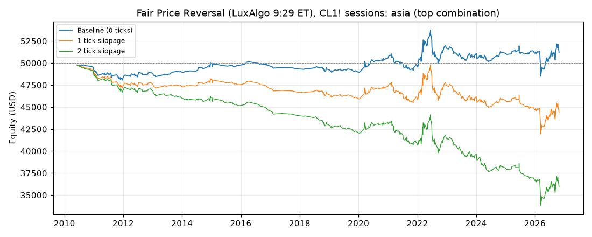
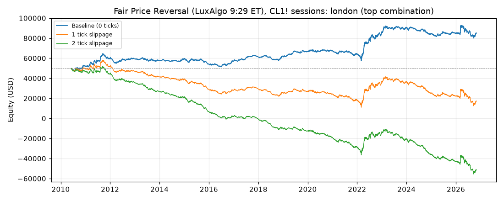
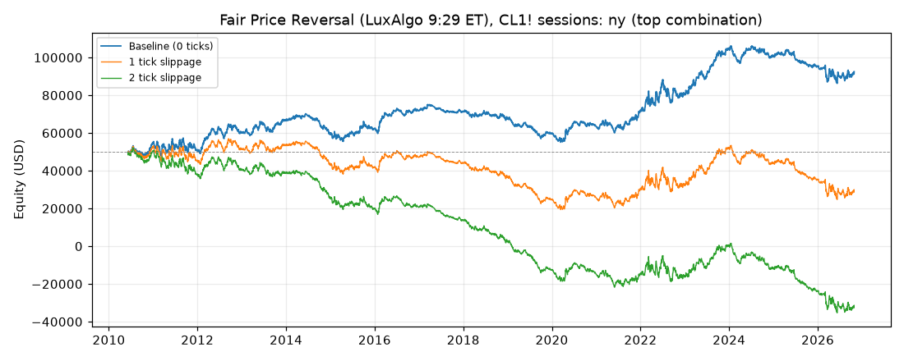

# Fair Price Reversal (LuxAlgo 9:29 ET), CL1! sessions: results

Generated 2026-10-29 07:21 UTC by `python -m tvtester.cli test fair_price_reversal`.

Source: LuxAlgo, [9:29 ET Fair Price Reversal](https://www.luxalgo.com/library/indicator/9-29-et-fair-price-reversal/)
(Pine v6, MPL-2.0). The original reads NQ around the 9:30 ET stock open. Here it runs on CL1! with the anchor
moved to the candle before each CL session open:

| Variant | Session open | Anchor candle | Malaysia time (UTC+8) | Flat at |
|---|---|---|---|---|
| asia | 09:00 Asia/Shanghai (same clock as Singapore / Kuala Lumpur, no DST) | 08:59 | 09:00 all year | 15:00 Asia/Shanghai |
| london | 08:00 Europe/London | 07:59 | 15:00 (UK summer) / 16:00 (UK winter) | 13:00 London |
| ny | 09:00 America/New_York (NYMEX crude open) | 08:59 | 21:00 (US summer) / 22:00 (US winter) | 14:30 New York |

**Signal (unchanged from the indicator):** the anchor candle's body (open/close) is the fair price. Inside the
setup window that starts at the session open, price must move at least `atr_mult` x ATR(14) of the previous
bar beyond the body. A long needs a lower swing high to form after a move down, then a close above that swing
high while still below the body ("MSS LONG"); a short is the mirror ("MSS SHORT"). At most one long and one
short signal per session day. Swing highs / lows use `swing` bars on each side.

**Trade rules (ours, the indicator has none):**
- Entry: market order at the next bar open after the signal, only when flat.
- Stop: the excursion extreme, fixed at the signal bar (lowest low since the move down began for a long,
  highest high since the move up began for a short).
- Target (`target`): `near` = nearest body edge, `far` = far body edge (limit orders), `rr1` / `rr2` = 1R / 2R
  measured in ticks from the actual fill, where R = signal close to stop.
- Session end: any open position is closed at the next bar open after the flat time.

A runnable Pine v6 twin for checking trades in TradingView is in
[`strategies/fair_price_reversal.pine`](../../../strategies/fair_price_reversal.pine).

## Test settings (TradingView Properties)

| Setting | Value |
|---|---|
| Symbol | CL1! (NYMEX Light Crude Oil, front month), 1-minute bars |
| Data | 2010-06-07 00:00:00+00:00 to 2026-10-27 20:59:00+00:00 UTC, 5,667,487 bars (manifest written 2026-10-29T06:25:08+00:00) |
| Initial capital | 50,000.00 USD |
| Order size | 1 contract |
| Commission | 2.01 USD per contract per order (4.02 USD round trip) |
| Slippage | 0 ticks baseline; 1 tick, 2 ticks shown separately (market and stop fills only, as TradingView) |
| Pyramiding | 0 (one position) |
| Fills | TradingView broker emulator, Bar Magnifier off, limits fill on touch |
| Roll rule | position closed at the last bar of a contract (exit reason `roll`) |

## How the top combination was chosen

Every variant ran all 192 combinations of the grid below at 0 ticks slippage. The combination with the highest **net profit** is the top combination (ties: higher profit factor, then grid order). Its slippage results use the same parameters, never a re-optimized set.

| Parameter | Values |
|---|---|
| `window` | 30, 60, 90, 120 |
| `atr_mult` | 0.5, 1.0, 1.5, 2.0 |
| `swing` | 1, 2, 3 |
| `target` | near, far, rr1, rr2 |

> **Read this first.** The top combination is the best of 192 tries on the same data it is reported on (in-sample). Picking the best of many tries makes the result look better than what the same rules can be expected to earn on new data. Treat these numbers as an upper bound, not as a forecast.

## Summary: top combination per variant

| Variant | Parameters | Net profit (0 / 1 / 2 ticks) | Trades | % profitable | Profit factor | Max DD |
|---|---|---|---|---|---|---|
| asia | window=30, atr_mult=2.0, swing=3, target=rr1 | 1,182.96 USD / -5,657.04 USD / -14,087.04 USD | 452 | 50.88% | 1.031 | 5,704.86 USD |
| london | window=120, atr_mult=2.0, swing=3, target=rr2 | 34,591.64 USD / -33,338.16 USD / -101,643.94 USD | 3,818 | 36.59% | 1.072 | 13,213.46 USD |
| ny | window=120, atr_mult=0.5, swing=3, target=rr2 | 42,475.80 USD / -20,100.08 USD / -81,394.00 USD | 3,710 | 36.50% | 1.056 | 20,110.90 USD |

## Conclusion

**No tradable edge on CL.** The best of 192 combinations in each session earns only a few dollars per trade
before slippage, and every session loses money at 1 tick of slippage (a market entry plus a stop exit costs
$20 more per trade at 1 tick). The baseline profits are in-sample: they come from picking the best of 192
tries on the same 16 years. Codex independently replicated the New York top combination trade for trade
(3,710 trades, +42,475.80 USD at 0 ticks, -20,100.08 USD at 1 tick).

## Variant: asia

**Top combination:** `session=asia`, `window=30`, `atr_mult=2.0`, `swing=3`, `target=rr1`

Files: [grid](../../../results/fair_price_reversal/asia/grid.csv), [trades 0 ticks](../../../results/fair_price_reversal/asia/trades_slippage0.csv), [trades 1 ticks](../../../results/fair_price_reversal/asia/trades_slippage1.csv), [trades 2 ticks](../../../results/fair_price_reversal/asia/trades_slippage2.csv), [summary](../../../results/fair_price_reversal/asia/summary.json)

### Baseline: 0 ticks slippage

#### Overview

| Metric | Value |
|---|---|
| Net profit | 1,182.96 USD (2.37%) |
| Total closed trades | 452 |
| Percent profitable | 50.88% |
| Profit factor | 1.031 |
| Max equity drawdown | 5,704.86 USD (11.41%) |
| Avg trade | 2.62 USD |
| Avg # bars in trades | 48 |

#### Performance

| Metric | All | Long | Short |
|---|---|---|---|
| Net profit | 1,182.96 USD (2.37%) | 731.18 USD (1.46%) | 451.78 USD (0.90%) |
| Gross profit | 39,835.40 USD (79.67%) | 23,023.58 USD (46.05%) | 16,811.82 USD (33.62%) |
| Gross loss | 38,652.44 USD (77.30%) | 22,292.40 USD (44.58%) | 16,360.04 USD (32.72%) |
| Commission paid | 1,817.04 USD | 968.82 USD | 848.22 USD |

| Account | Value |
|---|---|
| Initial capital | 50,000.00 USD |
| Buy & hold return (TV-style, all capital at the first entry) | 20,168.07 USD (40.34%) |
| Max equity run-up (intrabar) | 5,685.30 USD (11.37%) |
| Max equity drawdown (intrabar) | 5,704.86 USD (11.41%) |
| Open P&L | 0.00 USD |
| Max contracts held | 1 |

#### Trades analysis

| Metric | All | Long | Short |
|---|---|---|---|
| Total closed trades | 452 | 241 | 211 |
| Winning trades | 230 | 121 | 109 |
| Losing trades | 222 | 120 | 102 |
| Even trades | 0 | 0 | 0 |
| Percent profitable | 50.88% | 50.21% | 51.66% |
| Avg P&L | 2.62 USD | 3.03 USD | 2.14 USD |
| Avg P&L % | 0.01% | 0.01% | 0.01% |
| Avg winning trade | 173.20 USD | 190.28 USD | 154.24 USD |
| Avg losing trade | 174.11 USD | 185.77 USD | 160.39 USD |
| Ratio avg win / avg loss | 0.995 | 1.024 | 0.962 |
| Largest winning trade | 1,065.98 USD | 1,065.98 USD | 675.98 USD |
| Largest winning trade % | 1.85% | 1.85% | 1.50% |
| Largest losing trade | 1,794.02 USD | 1,794.02 USD | 1,064.02 USD |
| Largest losing trade % | 2.08% | 2.08% | 1.28% |
| Avg # bars in trades | 48 | 56 | 39 |
| Avg # bars in winning trades | 51 | 57 | 44 |
| Avg # bars in losing trades | 44 | 54 | 33 |

#### Risk/performance ratios

| Metric | Value |
|---|---|
| Sharpe ratio | -0.235 |
| Sortino ratio | -0.291 |
| Profit factor | 1.031 |
| Margin calls | 0 |

#### List of trades (last 10, newest first; full list in the trades CSV)

| Trade # | Type | Signal | Date/Time (UTC) | Price | Contracts | Profit | Cum. profit | Run-up | Drawdown |
|---|---|---|---|---|---|---|---|---|---|
| 452 | Exit long | Exit | 2026-10-26 01:56 | 101.30 | 1 | -254.02 USD (-0.25%) | 1,182.96 USD | 140.00 USD | 250.00 USD |
|  | Entry long | Long | 2026-10-26 01:29 | 101.55 | 1 |  |  |  |  |
| 451 | Exit short | Exit | 2026-10-23 01:52 | 100.24 | 1 | -464.02 USD (-0.47%) | 1,436.98 USD | 160.00 USD | 460.00 USD |
|  | Entry short | Short | 2026-10-23 01:28 | 99.78 | 1 |  |  |  |  |
| 450 | Exit long | Exit | 2026-10-13 01:54 | 92.65 | 1 | -234.02 USD (-0.25%) | 1,901.00 USD | 70.00 USD | 230.00 USD |
|  | Entry long | Long | 2026-10-13 01:24 | 92.88 | 1 |  |  |  |  |
| 449 | Exit long | Exit | 2026-10-12 01:32 | 90.40 | 1 | 385.98 USD (0.43%) | 2,135.02 USD | 390.00 USD | 60.00 USD |
|  | Entry long | Long | 2026-10-12 01:10 | 90.01 | 1 |  |  |  |  |
| 448 | Exit short | Exit | 2026-10-08 01:19 | 89.50 | 1 | -154.02 USD (-0.17%) | 1,749.04 USD | 60.00 USD | 150.00 USD |
|  | Entry short | Short | 2026-10-08 01:17 | 89.35 | 1 |  |  |  |  |
| 447 | Exit long | Exit | 2026-10-02 02:05 | 92.78 | 1 | -264.02 USD (-0.28%) | 1,903.06 USD | 100.00 USD | 260.00 USD |
|  | Entry long | Long | 2026-10-02 01:26 | 93.04 | 1 |  |  |  |  |
| 446 | Exit long | Exit | 2026-09-28 02:06 | 93.74 | 1 | 515.98 USD (0.55%) | 2,167.08 USD | 520.00 USD | 50.00 USD |
|  | Entry long | Long | 2026-09-28 01:18 | 93.22 | 1 |  |  |  |  |
| 445 | Exit short | Exit | 2026-09-23 01:51 | 89.98 | 1 | 225.98 USD (0.25%) | 1,651.10 USD | 230.00 USD | 90.00 USD |
|  | Entry short | Short | 2026-09-23 01:14 | 90.21 | 1 |  |  |  |  |
| 444 | Exit long | Exit | 2026-09-15 01:54 | 102.95 | 1 | 415.98 USD (0.41%) | 1,425.12 USD | 420.00 USD | 290.00 USD |
|  | Entry long | Long | 2026-09-15 01:28 | 102.53 | 1 |  |  |  |  |
| 443 | Exit short | Exit | 2026-09-14 01:56 | 102.25 | 1 | 675.98 USD (0.66%) | 1,009.14 USD | 680.00 USD | 220.00 USD |
|  | Entry short | Short | 2026-09-14 01:25 | 102.93 | 1 |  |  |  |  |

#### By year (extra, not a TV tab)

| Year | Trades | Net profit | % profitable | Profit factor |
|---|---|---|---|---|
| 2010 | 9 | -556.18 USD | 22.22% | 0.226 |
| 2011 | 30 | -1,130.60 USD | 50.00% | 0.646 |
| 2012 | 20 | 589.60 USD | 50.00% | 1.526 |
| 2013 | 21 | 85.58 USD | 57.14% | 1.107 |
| 2014 | 22 | 921.56 USD | 63.64% | 2.700 |
| 2015 | 16 | -164.32 USD | 50.00% | 0.814 |
| 2016 | 14 | -96.28 USD | 50.00% | 0.851 |
| 2017 | 6 | -314.12 USD | 16.67% | 0.174 |
| 2018 | 20 | -10.40 USD | 60.00% | 0.989 |
| 2019 | 19 | -206.38 USD | 47.37% | 0.812 |
| 2020 | 26 | 1,435.48 USD | 61.54% | 1.932 |
| 2021 | 40 | -730.80 USD | 42.50% | 0.781 |
| 2022 | 59 | 1,852.82 USD | 54.24% | 1.214 |
| 2023 | 40 | -860.80 USD | 42.50% | 0.738 |
| 2024 | 39 | 263.22 USD | 46.15% | 1.106 |
| 2025 | 25 | 89.50 USD | 60.00% | 1.053 |
| 2026 | 46 | 15.08 USD | 54.35% | 1.002 |

#### Exit reasons (extra)

| Reason | Trades |
|---|---|
| limit | 219 |
| stop | 216 |
| close | 17 |

- Session-end exits more than 5 minutes after the flat time (missing bars / early closes): 0.
- Roll exits: 0.

### Slippage scenarios (same parameters)

| Metric | Baseline (0 ticks) | 1 tick | 2 ticks |
|---|---|---|---|
| Net profit | 1,182.96 USD | -5,657.04 USD | -14,087.04 USD |
| Total closed trades | 452 | 452 | 452 |
| Percent profitable | 50.88% | 48.23% | 44.03% |
| Profit factor | 1.031 | 0.872 | 0.724 |
| Avg trade | 2.62 USD | -12.52 USD | -31.17 USD |
| Max equity drawdown | 5,704.86 USD | 8,522.32 USD | 16,662.32 USD |
| Sharpe ratio | -0.235 | -0.305 | -0.380 |
| Sortino ratio | -0.291 | -0.356 | -0.419 |

#### 1 tick slippage: full report

##### Overview

| Metric | Value |
|---|---|
| Net profit | -5,657.04 USD (-11.31%) |
| Total closed trades | 452 |
| Percent profitable | 48.23% |
| Profit factor | 0.872 |
| Max equity drawdown | 8,522.32 USD (17.04%) |
| Avg trade | -12.52 USD |
| Avg # bars in trades | 50 |

##### Performance

| Metric | All | Long | Short |
|---|---|---|---|
| Net profit | -5,657.04 USD (-11.31%) | -2,898.82 USD (-5.80%) | -2,758.22 USD (-5.52%) |
| Gross profit | 38,563.64 USD (77.13%) | 22,307.70 USD (44.62%) | 16,255.94 USD (32.51%) |
| Gross loss | 44,220.68 USD (88.44%) | 25,206.52 USD (50.41%) | 19,014.16 USD (38.03%) |
| Commission paid | 1,817.04 USD | 968.82 USD | 848.22 USD |

| Account | Value |
|---|---|
| Initial capital | 50,000.00 USD |
| Buy & hold return (TV-style, all capital at the first entry) | 20,177.90 USD (40.36%) |
| Max equity run-up (intrabar) | 4,347.34 USD (8.69%) |
| Max equity drawdown (intrabar) | 8,522.32 USD (17.04%) |
| Open P&L | 0.00 USD |
| Max contracts held | 1 |

##### Trades analysis

| Metric | All | Long | Short |
|---|---|---|---|
| Total closed trades | 452 | 241 | 211 |
| Winning trades | 218 | 115 | 103 |
| Losing trades | 234 | 126 | 108 |
| Even trades | 0 | 0 | 0 |
| Percent profitable | 48.23% | 47.72% | 48.82% |
| Avg P&L | -12.52 USD | -12.03 USD | -13.07 USD |
| Avg P&L % | -0.02% | -0.02% | -0.01% |
| Avg winning trade | 176.90 USD | 193.98 USD | 157.82 USD |
| Avg losing trade | 188.98 USD | 200.05 USD | 176.06 USD |
| Ratio avg win / avg loss | 0.936 | 0.970 | 0.896 |
| Largest winning trade | 1,065.98 USD | 1,065.98 USD | 675.98 USD |
| Largest winning trade % | 1.85% | 1.85% | 1.44% |
| Largest losing trade | 1,814.02 USD | 1,814.02 USD | 1,084.02 USD |
| Largest losing trade % | 2.10% | 2.10% | 1.30% |
| Avg # bars in trades | 50 | 59 | 41 |
| Avg # bars in winning trades | 54 | 60 | 47 |
| Avg # bars in losing trades | 47 | 57 | 35 |

##### Risk/performance ratios

| Metric | Value |
|---|---|
| Sharpe ratio | -0.305 |
| Sortino ratio | -0.356 |
| Profit factor | 0.872 |
| Margin calls | 0 |

#### 2 ticks slippage: full report

##### Overview

| Metric | Value |
|---|---|
| Net profit | -14,087.04 USD (-28.17%) |
| Total closed trades | 452 |
| Percent profitable | 44.03% |
| Profit factor | 0.724 |
| Max equity drawdown | 16,662.32 USD (33.32%) |
| Avg trade | -31.17 USD |
| Avg # bars in trades | 54 |

##### Performance

| Metric | All | Long | Short |
|---|---|---|---|
| Net profit | -14,087.04 USD (-28.17%) | -7,028.82 USD (-14.06%) | -7,058.22 USD (-14.12%) |
| Gross profit | 36,970.02 USD (73.94%) | 21,555.84 USD (43.11%) | 15,414.18 USD (30.83%) |
| Gross loss | 51,057.06 USD (102.11%) | 28,584.66 USD (57.17%) | 22,472.40 USD (44.94%) |
| Commission paid | 1,817.04 USD | 968.82 USD | 848.22 USD |

| Account | Value |
|---|---|
| Initial capital | 50,000.00 USD |
| Buy & hold return (TV-style, all capital at the first entry) | 20,187.73 USD (40.38%) |
| Max equity run-up (intrabar) | 3,491.46 USD (6.98%) |
| Max equity drawdown (intrabar) | 16,662.32 USD (33.32%) |
| Open P&L | 0.00 USD |
| Max contracts held | 1 |

##### Trades analysis

| Metric | All | Long | Short |
|---|---|---|---|
| Total closed trades | 452 | 241 | 211 |
| Winning trades | 199 | 108 | 91 |
| Losing trades | 253 | 133 | 120 |
| Even trades | 0 | 0 | 0 |
| Percent profitable | 44.03% | 44.81% | 43.13% |
| Avg P&L | -31.17 USD | -29.17 USD | -33.45 USD |
| Avg P&L % | -0.04% | -0.04% | -0.04% |
| Avg winning trade | 185.78 USD | 199.59 USD | 169.39 USD |
| Avg losing trade | 201.81 USD | 214.92 USD | 187.27 USD |
| Ratio avg win / avg loss | 0.921 | 0.929 | 0.905 |
| Largest winning trade | 1,065.98 USD | 1,065.98 USD | 675.98 USD |
| Largest winning trade % | 1.85% | 1.85% | 1.39% |
| Largest losing trade | 1,834.02 USD | 1,834.02 USD | 1,104.02 USD |
| Largest losing trade % | 2.13% | 2.13% | 1.32% |
| Avg # bars in trades | 54 | 62 | 44 |
| Avg # bars in winning trades | 57 | 64 | 49 |
| Avg # bars in losing trades | 51 | 61 | 40 |

##### Risk/performance ratios

| Metric | Value |
|---|---|
| Sharpe ratio | -0.380 |
| Sortino ratio | -0.419 |
| Profit factor | 0.724 |
| Margin calls | 0 |

### Top 10 combinations (0 ticks)

| # | window | atr_mult | swing | target | Net profit | Trades | % profitable | Profit factor | Max DD |
|---|---|---|---|---|---|---|---|---|---|
| 1 | 30 | 2.0 | 3 | rr1 | 1,182.96 USD | 452 | 50.88% | 1.031 | 5,704.86 USD |
| 2 | 30 | 1.5 | 3 | rr1 | 615.32 USD | 434 | 50.46% | 1.016 | 4,930.74 USD |
| 3 | 30 | 1.0 | 3 | rr1 | 281.80 USD | 410 | 50.24% | 1.008 | 4,412.50 USD |
| 4 | 30 | 0.5 | 3 | rr1 | -348.66 USD | 333 | 50.75% | 0.988 | 3,718.34 USD |
| 5 | 30 | 0.5 | 3 | rr2 | -914.64 USD | 332 | 34.34% | 0.975 | 4,256.02 USD |
| 6 | 30 | 2.0 | 3 | far | -1,257.04 USD | 452 | 59.73% | 0.959 | 4,210.84 USD |
| 7 | 30 | 1.0 | 3 | rr2 | -1,834.18 USD | 409 | 33.01% | 0.959 | 6,217.42 USD |
| 8 | 30 | 0.5 | 3 | far | -2,118.66 USD | 333 | 59.16% | 0.910 | 3,614.32 USD |
| 9 | 30 | 1.0 | 2 | rr1 | -2,151.08 USD | 754 | 48.28% | 0.964 | 7,208.86 USD |
| 10 | 30 | 1.0 | 3 | far | -2,238.20 USD | 410 | 59.02% | 0.920 | 4,177.42 USD |

Profitable combinations: 3 of 192.

## Variant: london

**Top combination:** `session=london`, `window=120`, `atr_mult=2.0`, `swing=3`, `target=rr2`

Files: [grid](../../../results/fair_price_reversal/london/grid.csv), [trades 0 ticks](../../../results/fair_price_reversal/london/trades_slippage0.csv), [trades 1 ticks](../../../results/fair_price_reversal/london/trades_slippage1.csv), [trades 2 ticks](../../../results/fair_price_reversal/london/trades_slippage2.csv), [summary](../../../results/fair_price_reversal/london/summary.json)

### Baseline: 0 ticks slippage

#### Overview

| Metric | Value |
|---|---|
| Net profit | 34,591.64 USD (69.18%) |
| Total closed trades | 3,818 |
| Percent profitable | 36.59% |
| Profit factor | 1.072 |
| Max equity drawdown | 13,213.46 USD (26.43%) |
| Avg trade | 9.06 USD |
| Avg # bars in trades | 64 |

#### Performance

| Metric | All | Long | Short |
|---|---|---|---|
| Net profit | 34,591.64 USD (69.18%) | 23,910.40 USD (47.82%) | 10,681.24 USD (21.36%) |
| Gross profit | 512,284.06 USD (1,024.57%) | 272,685.20 USD (545.37%) | 239,598.86 USD (479.20%) |
| Gross loss | 477,692.42 USD (955.38%) | 248,774.80 USD (497.55%) | 228,917.62 USD (457.84%) |
| Commission paid | 15,348.36 USD | 7,959.60 USD | 7,388.76 USD |

| Account | Value |
|---|---|
| Initial capital | 50,000.00 USD |
| Buy & hold return (TV-style, all capital at the first entry) | 21,013.47 USD (42.03%) |
| Max equity run-up (intrabar) | 46,877.40 USD (93.75%) |
| Max equity drawdown (intrabar) | 13,213.46 USD (26.43%) |
| Open P&L | 0.00 USD |
| Max contracts held | 1 |

#### Trades analysis

| Metric | All | Long | Short |
|---|---|---|---|
| Total closed trades | 3,818 | 1,980 | 1,838 |
| Winning trades | 1,397 | 740 | 657 |
| Losing trades | 2,421 | 1,240 | 1,181 |
| Even trades | 0 | 0 | 0 |
| Percent profitable | 36.59% | 37.37% | 35.75% |
| Avg P&L | 9.06 USD | 12.08 USD | 5.81 USD |
| Avg P&L % | 0.01% | 0.02% | 0.00% |
| Avg winning trade | 366.70 USD | 368.49 USD | 364.69 USD |
| Avg losing trade | 197.31 USD | 200.62 USD | 193.83 USD |
| Ratio avg win / avg loss | 1.858 | 1.837 | 1.881 |
| Largest winning trade | 3,395.98 USD | 2,465.98 USD | 3,395.98 USD |
| Largest winning trade % | 5.62% | 5.62% | 5.09% |
| Largest losing trade | 1,284.02 USD | 1,284.02 USD | 984.02 USD |
| Largest losing trade % | 3.38% | 3.38% | 3.09% |
| Avg # bars in trades | 64 | 67 | 61 |
| Avg # bars in winning trades | 92 | 96 | 87 |
| Avg # bars in losing trades | 48 | 49 | 47 |

#### Risk/performance ratios

| Metric | Value |
|---|---|
| Sharpe ratio | 0.053 |
| Sortino ratio | 0.099 |
| Profit factor | 1.072 |
| Margin calls | 0 |

#### List of trades (last 10, newest first; full list in the trades CSV)

| Trade # | Type | Signal | Date/Time (UTC) | Price | Contracts | Profit | Cum. profit | Run-up | Drawdown |
|---|---|---|---|---|---|---|---|---|---|
| 3818 | Exit long | Exit | 2026-10-27 10:41 | 101.50 | 1 | -824.02 USD (-0.81%) | 34,591.64 USD | 260.00 USD | 820.00 USD |
|  | Entry long | Long | 2026-10-27 09:26 | 102.32 | 1 |  |  |  |  |
| 3817 | Exit short | Exit | 2026-10-27 09:10 | 101.54 | 1 | 855.98 USD (0.84%) | 35,415.66 USD | 860.00 USD | 120.00 USD |
|  | Entry short | Short | 2026-10-27 09:01 | 102.40 | 1 |  |  |  |  |
| 3816 | Exit long | Session end | 2026-10-26 13:00 | 101.26 | 1 | 305.98 USD (0.30%) | 34,559.68 USD | 670.00 USD | 320.00 USD |
|  | Entry long | Long | 2026-10-26 08:59 | 100.95 | 1 |  |  |  |  |
| 3815 | Exit long | Exit | 2026-10-23 08:21 | 100.32 | 1 | -304.02 USD (-0.30%) | 34,253.70 USD | 270.00 USD | 300.00 USD |
|  | Entry long | Long | 2026-10-23 07:47 | 100.62 | 1 |  |  |  |  |
| 3814 | Exit short | Exit | 2026-10-22 07:36 | 99.69 | 1 | -244.02 USD (-0.25%) | 34,557.72 USD | 120.00 USD | 240.00 USD |
|  | Entry short | Short | 2026-10-22 07:25 | 99.45 | 1 |  |  |  |  |
| 3813 | Exit long | Exit | 2026-10-21 09:00 | 99.52 | 1 | 875.98 USD (0.89%) | 34,801.74 USD | 880.00 USD | 200.00 USD |
|  | Entry long | Long | 2026-10-21 08:17 | 98.64 | 1 |  |  |  |  |
| 3812 | Exit short | Exit | 2026-10-19 08:44 | 97.29 | 1 | -314.02 USD (-0.32%) | 33,925.76 USD | 20.00 USD | 310.00 USD |
|  | Entry short | Short | 2026-10-19 08:41 | 96.98 | 1 |  |  |  |  |
| 3811 | Exit short | Exit | 2026-10-16 08:44 | 96.90 | 1 | 415.98 USD (0.43%) | 34,239.78 USD | 420.00 USD | 110.00 USD |
|  | Entry short | Short | 2026-10-16 07:57 | 97.32 | 1 |  |  |  |  |
| 3810 | Exit long | Exit | 2026-10-15 08:49 | 94.99 | 1 | 855.98 USD (0.91%) | 33,823.80 USD | 860.00 USD | 230.00 USD |
|  | Entry long | Long | 2026-10-15 07:38 | 94.13 | 1 |  |  |  |  |
| 3809 | Exit long | Exit | 2026-10-14 09:11 | 94.01 | 1 | -304.02 USD (-0.32%) | 32,967.82 USD | 330.00 USD | 300.00 USD |
|  | Entry long | Long | 2026-10-14 08:40 | 94.31 | 1 |  |  |  |  |

#### By year (extra, not a TV tab)

| Year | Trades | Net profit | % profitable | Profit factor |
|---|---|---|---|---|
| 2010 | 144 | 2,051.12 USD | 36.81% | 1.129 |
| 2011 | 237 | 7,957.26 USD | 38.40% | 1.222 |
| 2012 | 232 | -722.64 USD | 34.91% | 0.973 |
| 2013 | 217 | -1,622.34 USD | 36.41% | 0.928 |
| 2014 | 206 | 1,711.88 USD | 38.83% | 1.096 |
| 2015 | 241 | -5,108.82 USD | 30.71% | 0.816 |
| 2016 | 220 | 2,955.60 USD | 39.09% | 1.152 |
| 2017 | 205 | 4,095.90 USD | 42.44% | 1.301 |
| 2018 | 214 | 699.72 USD | 34.58% | 1.036 |
| 2019 | 211 | 4,751.78 USD | 39.81% | 1.273 |
| 2020 | 237 | 627.26 USD | 37.97% | 1.024 |
| 2021 | 233 | -3,226.66 USD | 32.62% | 0.889 |
| 2022 | 269 | 22,268.62 USD | 41.64% | 1.389 |
| 2023 | 254 | 3,838.92 USD | 38.19% | 1.111 |
| 2024 | 253 | -5,937.06 USD | 30.83% | 0.819 |
| 2025 | 234 | 549.32 USD | 35.04% | 1.021 |
| 2026 | 211 | -298.22 USD | 34.60% | 0.995 |

#### Exit reasons (extra)

| Reason | Trades |
|---|---|
| stop | 2354 |
| limit | 1169 |
| close | 295 |

- Session-end exits more than 5 minutes after the flat time (missing bars / early closes): 0.
- Roll exits: 0.

### Slippage scenarios (same parameters)

| Metric | Baseline (0 ticks) | 1 tick | 2 ticks |
|---|---|---|---|
| Net profit | 34,591.64 USD | -33,338.16 USD | -101,643.94 USD |
| Total closed trades | 3,818 | 3,808 | 3,797 |
| Percent profitable | 36.59% | 35.43% | 34.37% |
| Profit factor | 1.072 | 0.937 | 0.825 |
| Avg trade | 9.06 USD | -8.75 USD | -26.77 USD |
| Max equity drawdown | 13,213.46 USD | 47,336.50 USD | 107,665.28 USD |
| Sharpe ratio | 0.053 | -0.072 | 0.065 |
| Sortino ratio | 0.099 | -0.136 | 0.108 |

#### 1 tick slippage: full report

##### Overview

| Metric | Value |
|---|---|
| Net profit | -33,338.16 USD (-66.68%) |
| Total closed trades | 3,808 |
| Percent profitable | 35.43% |
| Profit factor | 0.937 |
| Max equity drawdown | 47,336.50 USD (94.67%) |
| Avg trade | -8.75 USD |
| Avg # bars in trades | 65 |

##### Performance

| Metric | All | Long | Short |
|---|---|---|---|
| Net profit | -33,338.16 USD (-66.68%) | -8,287.44 USD (-16.57%) | -25,050.72 USD (-50.10%) |
| Gross profit | 496,377.02 USD (992.75%) | 265,643.64 USD (531.29%) | 230,733.38 USD (461.47%) |
| Gross loss | 529,715.18 USD (1,059.43%) | 273,931.08 USD (547.86%) | 255,784.10 USD (511.57%) |
| Commission paid | 15,308.16 USD | 7,927.44 USD | 7,380.72 USD |

| Account | Value |
|---|---|
| Initial capital | 50,000.00 USD |
| Buy & hold return (TV-style, all capital at the first entry) | 21,023.53 USD (42.05%) |
| Max equity run-up (intrabar) | 30,590.58 USD (61.18%) |
| Max equity drawdown (intrabar) | 47,336.50 USD (94.67%) |
| Open P&L | 0.00 USD |
| Max contracts held | 1 |

##### Trades analysis

| Metric | All | Long | Short |
|---|---|---|---|
| Total closed trades | 3,808 | 1,972 | 1,836 |
| Winning trades | 1,349 | 718 | 631 |
| Losing trades | 2,459 | 1,254 | 1,205 |
| Even trades | 0 | 0 | 0 |
| Percent profitable | 35.43% | 36.41% | 34.37% |
| Avg P&L | -8.75 USD | -4.20 USD | -13.64 USD |
| Avg P&L % | -0.02% | -0.00% | -0.03% |
| Avg winning trade | 367.96 USD | 369.98 USD | 365.66 USD |
| Avg losing trade | 215.42 USD | 218.45 USD | 212.27 USD |
| Ratio avg win / avg loss | 1.708 | 1.694 | 1.723 |
| Largest winning trade | 3,395.98 USD | 2,445.98 USD | 3,395.98 USD |
| Largest winning trade % | 5.61% | 5.61% | 5.09% |
| Largest losing trade | 1,304.02 USD | 1,304.02 USD | 1,004.02 USD |
| Largest losing trade % | 3.57% | 3.57% | 3.23% |
| Avg # bars in trades | 65 | 68 | 63 |
| Avg # bars in winning trades | 93 | 97 | 89 |
| Avg # bars in losing trades | 50 | 51 | 49 |

##### Risk/performance ratios

| Metric | Value |
|---|---|
| Sharpe ratio | -0.072 |
| Sortino ratio | -0.136 |
| Profit factor | 0.937 |
| Margin calls | 0 |

#### 2 ticks slippage: full report

##### Overview

| Metric | Value |
|---|---|
| Net profit | -101,643.94 USD (-203.29%) |
| Total closed trades | 3,797 |
| Percent profitable | 34.37% |
| Profit factor | 0.825 |
| Max equity drawdown | 107,665.28 USD (215.33%) |
| Avg trade | -26.77 USD |
| Avg # bars in trades | 67 |

##### Performance

| Metric | All | Long | Short |
|---|---|---|---|
| Net profit | -101,643.94 USD (-203.29%) | -42,983.32 USD (-85.97%) | -58,660.62 USD (-117.32%) |
| Gross profit | 480,503.90 USD (961.01%) | 257,596.20 USD (515.19%) | 222,907.70 USD (445.82%) |
| Gross loss | 582,147.84 USD (1,164.30%) | 300,579.52 USD (601.16%) | 281,568.32 USD (563.14%) |
| Commission paid | 15,263.94 USD | 7,903.32 USD | 7,360.62 USD |

| Account | Value |
|---|---|
| Initial capital | 50,000.00 USD |
| Buy & hold return (TV-style, all capital at the first entry) | 21,033.60 USD (42.07%) |
| Max equity run-up (intrabar) | 25,762.64 USD (51.53%) |
| Max equity drawdown (intrabar) | 107,665.28 USD (215.33%) |
| Open P&L | 0.00 USD |
| Max contracts held | 1 |

##### Trades analysis

| Metric | All | Long | Short |
|---|---|---|---|
| Total closed trades | 3,797 | 1,966 | 1,831 |
| Winning trades | 1,305 | 690 | 615 |
| Losing trades | 2,492 | 1,276 | 1,216 |
| Even trades | 0 | 0 | 0 |
| Percent profitable | 34.37% | 35.10% | 33.59% |
| Avg P&L | -26.77 USD | -21.86 USD | -32.04 USD |
| Avg P&L % | -0.04% | -0.03% | -0.06% |
| Avg winning trade | 368.20 USD | 373.33 USD | 362.45 USD |
| Avg losing trade | 233.61 USD | 235.56 USD | 231.55 USD |
| Ratio avg win / avg loss | 1.576 | 1.585 | 1.565 |
| Largest winning trade | 3,395.98 USD | 2,425.98 USD | 3,395.98 USD |
| Largest winning trade % | 5.61% | 5.61% | 5.09% |
| Largest losing trade | 1,324.02 USD | 1,324.02 USD | 1,024.02 USD |
| Largest losing trade % | 3.75% | 3.75% | 3.38% |
| Avg # bars in trades | 67 | 69 | 64 |
| Avg # bars in winning trades | 96 | 99 | 93 |
| Avg # bars in losing trades | 52 | 53 | 50 |

##### Risk/performance ratios

| Metric | Value |
|---|---|
| Sharpe ratio | 0.065 |
| Sortino ratio | 0.108 |
| Profit factor | 0.825 |
| Margin calls | 0 |

### Top 10 combinations (0 ticks)

| # | window | atr_mult | swing | target | Net profit | Trades | % profitable | Profit factor | Max DD |
|---|---|---|---|---|---|---|---|---|---|
| 1 | 120 | 2.0 | 3 | rr2 | 34,591.64 USD | 3,818 | 36.59% | 1.072 | 13,213.46 USD |
| 2 | 120 | 0.5 | 3 | rr2 | 33,778.54 USD | 3,473 | 36.48% | 1.077 | 14,152.42 USD |
| 3 | 120 | 1.0 | 3 | rr2 | 32,044.60 USD | 3,770 | 36.58% | 1.068 | 13,778.58 USD |
| 4 | 120 | 1.5 | 3 | rr2 | 31,729.68 USD | 3,816 | 36.56% | 1.066 | 13,998.58 USD |
| 5 | 90 | 2.0 | 2 | rr2 | 31,122.60 USD | 3,870 | 35.94% | 1.072 | 11,118.60 USD |
| 6 | 90 | 2.0 | 3 | rr2 | 29,697.70 USD | 3,115 | 36.44% | 1.077 | 14,430.88 USD |
| 7 | 90 | 0.5 | 3 | rr2 | 28,174.30 USD | 2,785 | 36.23% | 1.081 | 12,164.80 USD |
| 8 | 90 | 1.5 | 2 | rr2 | 28,100.54 USD | 3,873 | 35.79% | 1.065 | 11,817.60 USD |
| 9 | 90 | 1.0 | 3 | rr2 | 27,506.74 USD | 3,063 | 36.40% | 1.072 | 14,540.68 USD |
| 10 | 90 | 1.0 | 2 | rr2 | 27,013.40 USD | 3,830 | 35.74% | 1.063 | 12,434.38 USD |

Profitable combinations: 91 of 192.

## Variant: ny

**Top combination:** `session=ny`, `window=120`, `atr_mult=0.5`, `swing=3`, `target=rr2`

Files: [grid](../../../results/fair_price_reversal/ny/grid.csv), [trades 0 ticks](../../../results/fair_price_reversal/ny/trades_slippage0.csv), [trades 1 ticks](../../../results/fair_price_reversal/ny/trades_slippage1.csv), [trades 2 ticks](../../../results/fair_price_reversal/ny/trades_slippage2.csv), [summary](../../../results/fair_price_reversal/ny/summary.json)

### Baseline: 0 ticks slippage

#### Overview

| Metric | Value |
|---|---|
| Net profit | 42,475.80 USD (84.95%) |
| Total closed trades | 3,710 |
| Percent profitable | 36.50% |
| Profit factor | 1.056 |
| Max equity drawdown | 20,110.90 USD (40.22%) |
| Avg trade | 11.45 USD |
| Avg # bars in trades | 67 |

#### Performance

| Metric | All | Long | Short |
|---|---|---|---|
| Net profit | 42,475.80 USD (84.95%) | 33,622.00 USD (67.24%) | 8,853.80 USD (17.71%) |
| Gross profit | 797,326.92 USD (1,594.65%) | 423,410.02 USD (846.82%) | 373,916.90 USD (747.83%) |
| Gross loss | 754,851.12 USD (1,509.70%) | 389,788.02 USD (779.58%) | 365,063.10 USD (730.13%) |
| Commission paid | 14,914.20 USD | 7,638.00 USD | 7,276.20 USD |

| Account | Value |
|---|---|
| Initial capital | 50,000.00 USD |
| Buy & hold return (TV-style, all capital at the first entry) | 19,893.97 USD (39.79%) |
| Max equity run-up (intrabar) | 58,852.12 USD (117.70%) |
| Max equity drawdown (intrabar) | 20,110.90 USD (40.22%) |
| Open P&L | 0.00 USD |
| Max contracts held | 1 |

#### Trades analysis

| Metric | All | Long | Short |
|---|---|---|---|
| Total closed trades | 3,710 | 1,900 | 1,810 |
| Winning trades | 1,354 | 699 | 655 |
| Losing trades | 2,356 | 1,201 | 1,155 |
| Even trades | 0 | 0 | 0 |
| Percent profitable | 36.50% | 36.79% | 36.19% |
| Avg P&L | 11.45 USD | 17.70 USD | 4.89 USD |
| Avg P&L % | 0.02% | 0.03% | 0.01% |
| Avg winning trade | 588.87 USD | 605.74 USD | 570.87 USD |
| Avg losing trade | 320.40 USD | 324.55 USD | 316.07 USD |
| Ratio avg win / avg loss | 1.838 | 1.866 | 1.806 |
| Largest winning trade | 3,315.98 USD | 3,315.98 USD | 2,215.98 USD |
| Largest winning trade % | 13.47% | 5.70% | 13.47% |
| Largest losing trade | 1,764.02 USD | 1,764.02 USD | 1,714.02 USD |
| Largest losing trade % | 4.38% | 1.96% | 4.38% |
| Avg # bars in trades | 67 | 71 | 63 |
| Avg # bars in winning trades | 98 | 109 | 87 |
| Avg # bars in losing trades | 50 | 49 | 50 |

#### Risk/performance ratios

| Metric | Value |
|---|---|
| Sharpe ratio | 0.059 |
| Sortino ratio | 0.099 |
| Profit factor | 1.056 |
| Margin calls | 0 |

#### List of trades (last 10, newest first; full list in the trades CSV)

| Trade # | Type | Signal | Date/Time (UTC) | Price | Contracts | Profit | Cum. profit | Run-up | Drawdown |
|---|---|---|---|---|---|---|---|---|---|
| 3710 | Exit short | Exit | 2026-10-27 15:00 | 99.98 | 1 | 1,295.98 USD (1.28%) | 42,475.80 USD | 1,300.00 USD | 60.00 USD |
|  | Entry short | Short | 2026-10-27 14:18 | 101.28 | 1 |  |  |  |  |
| 3709 | Exit short | Exit | 2026-10-26 15:30 | 102.19 | 1 | -744.02 USD (-0.73%) | 41,179.82 USD | 1,120.00 USD | 740.00 USD |
|  | Entry short | Short | 2026-10-26 13:32 | 101.45 | 1 |  |  |  |  |
| 3708 | Exit long | Exit | 2026-10-22 15:17 | 98.15 | 1 | -274.02 USD (-0.28%) | 41,923.84 USD | 520.00 USD | 270.00 USD |
|  | Entry long | Long | 2026-10-22 14:54 | 98.42 | 1 |  |  |  |  |
| 3707 | Exit short | Exit | 2026-10-22 13:48 | 99.09 | 1 | 615.98 USD (0.62%) | 42,197.86 USD | 620.00 USD | 0.00 USD |
|  | Entry short | Short | 2026-10-22 13:40 | 99.71 | 1 |  |  |  |  |
| 3706 | Exit short | Exit | 2026-10-21 14:35 | 97.96 | 1 | -274.02 USD (-0.28%) | 41,581.88 USD | 230.00 USD | 270.00 USD |
|  | Entry short | Short | 2026-10-21 14:29 | 97.69 | 1 |  |  |  |  |
| 3705 | Exit long | Exit | 2026-10-19 15:52 | 98.15 | 1 | 695.98 USD (0.71%) | 41,855.90 USD | 700.00 USD | 150.00 USD |
|  | Entry long | Long | 2026-10-19 13:39 | 97.45 | 1 |  |  |  |  |
| 3704 | Exit long | Exit | 2026-10-16 15:24 | 97.90 | 1 | 515.98 USD (0.53%) | 41,159.92 USD | 520.00 USD | 60.00 USD |
|  | Entry long | Long | 2026-10-16 14:31 | 97.38 | 1 |  |  |  |  |
| 3703 | Exit short | Exit | 2026-10-15 14:07 | 96.33 | 1 | -314.02 USD (-0.33%) | 40,643.94 USD | 480.00 USD | 310.00 USD |
|  | Entry short | Short | 2026-10-15 13:35 | 96.02 | 1 |  |  |  |  |
| 3702 | Exit short | Exit | 2026-10-13 13:47 | 93.16 | 1 | -244.02 USD (-0.26%) | 40,957.96 USD | 240.00 USD | 240.00 USD |
|  | Entry short | Short | 2026-10-13 13:21 | 92.92 | 1 |  |  |  |  |
| 3701 | Exit short | Exit | 2026-10-12 15:15 | 93.52 | 1 | 335.98 USD (0.36%) | 41,201.98 USD | 340.00 USD | 120.00 USD |
|  | Entry short | Short | 2026-10-12 14:40 | 93.86 | 1 |  |  |  |  |

#### By year (extra, not a TV tab)

| Year | Trades | Net profit | % profitable | Profit factor |
|---|---|---|---|---|
| 2010 | 132 | 4,929.36 USD | 38.64% | 1.179 |
| 2011 | 237 | -3,732.74 USD | 34.60% | 0.949 |
| 2012 | 235 | 8,745.30 USD | 39.15% | 1.191 |
| 2013 | 213 | 7,253.74 USD | 38.50% | 1.183 |
| 2014 | 205 | -7,734.10 USD | 32.20% | 0.798 |
| 2015 | 244 | 2,549.12 USD | 36.89% | 1.054 |
| 2016 | 220 | 9,645.60 USD | 39.09% | 1.329 |
| 2017 | 196 | -147.92 USD | 33.16% | 0.993 |
| 2018 | 235 | -4,124.70 USD | 34.89% | 0.892 |
| 2019 | 216 | -7,778.32 USD | 31.94% | 0.781 |
| 2020 | 231 | 3,741.38 USD | 37.23% | 1.098 |
| 2021 | 224 | 8,509.52 USD | 38.84% | 1.200 |
| 2022 | 235 | 8,225.30 USD | 36.60% | 1.096 |
| 2023 | 231 | 24,921.38 USD | 47.19% | 1.573 |
| 2024 | 230 | -4,224.60 USD | 34.78% | 0.908 |
| 2025 | 226 | -5,388.52 USD | 32.30% | 0.861 |
| 2026 | 200 | -2,914.00 USD | 34.00% | 0.954 |

#### Exit reasons (extra)

| Reason | Trades |
|---|---|
| stop | 2289 |
| limit | 1137 |
| close | 283 |
| roll | 1 |

- Session-end exits more than 5 minutes after the flat time (missing bars / early closes): 7.
- Roll exits: 1.

### Slippage scenarios (same parameters)

| Metric | Baseline (0 ticks) | 1 tick | 2 ticks |
|---|---|---|---|
| Net profit | 42,475.80 USD | -20,100.08 USD | -81,394.00 USD |
| Total closed trades | 3,710 | 3,704 | 3,700 |
| Percent profitable | 36.50% | 36.04% | 35.62% |
| Profit factor | 1.056 | 0.975 | 0.904 |
| Avg trade | 11.45 USD | -5.43 USD | -22.00 USD |
| Max equity drawdown | 20,110.90 USD | 37,656.82 USD | 87,689.54 USD |
| Sharpe ratio | 0.059 | -0.027 | -0.076 |
| Sortino ratio | 0.099 | -0.043 | -0.080 |

#### 1 tick slippage: full report

##### Overview

| Metric | Value |
|---|---|
| Net profit | -20,100.08 USD (-40.20%) |
| Total closed trades | 3,704 |
| Percent profitable | 36.04% |
| Profit factor | 0.975 |
| Max equity drawdown | 37,656.82 USD (75.31%) |
| Avg trade | -5.43 USD |
| Avg # bars in trades | 68 |

##### Performance

| Metric | All | Long | Short |
|---|---|---|---|
| Net profit | -20,100.08 USD (-40.20%) | 1,032.10 USD (2.06%) | -21,132.18 USD (-42.26%) |
| Gross profit | 783,593.30 USD (1,567.19%) | 415,286.20 USD (830.57%) | 368,307.10 USD (736.61%) |
| Gross loss | 803,693.38 USD (1,607.39%) | 414,254.10 USD (828.51%) | 389,439.28 USD (778.88%) |
| Commission paid | 14,890.08 USD | 7,617.90 USD | 7,272.18 USD |

| Account | Value |
|---|---|
| Initial capital | 50,000.00 USD |
| Buy & hold return (TV-style, all capital at the first entry) | 19,903.73 USD (39.81%) |
| Max equity run-up (intrabar) | 34,146.32 USD (68.29%) |
| Max equity drawdown (intrabar) | 37,656.82 USD (75.31%) |
| Open P&L | 0.00 USD |
| Max contracts held | 1 |

##### Trades analysis

| Metric | All | Long | Short |
|---|---|---|---|
| Total closed trades | 3,704 | 1,895 | 1,809 |
| Winning trades | 1,335 | 690 | 645 |
| Losing trades | 2,369 | 1,205 | 1,164 |
| Even trades | 0 | 0 | 0 |
| Percent profitable | 36.04% | 36.41% | 35.66% |
| Avg P&L | -5.43 USD | 0.54 USD | -11.68 USD |
| Avg P&L % | -0.01% | 0.00% | -0.01% |
| Avg winning trade | 586.96 USD | 601.86 USD | 571.02 USD |
| Avg losing trade | 339.25 USD | 343.78 USD | 334.57 USD |
| Ratio avg win / avg loss | 1.730 | 1.751 | 1.707 |
| Largest winning trade | 3,315.98 USD | 3,315.98 USD | 2,215.98 USD |
| Largest winning trade % | 13.48% | 5.70% | 13.48% |
| Largest losing trade | 1,784.02 USD | 1,784.02 USD | 1,734.02 USD |
| Largest losing trade % | 4.55% | 2.04% | 4.55% |
| Avg # bars in trades | 68 | 72 | 64 |
| Avg # bars in winning trades | 100 | 111 | 88 |
| Avg # bars in losing trades | 50 | 50 | 51 |

##### Risk/performance ratios

| Metric | Value |
|---|---|
| Sharpe ratio | -0.027 |
| Sortino ratio | -0.043 |
| Profit factor | 0.975 |
| Margin calls | 0 |

#### 2 ticks slippage: full report

##### Overview

| Metric | Value |
|---|---|
| Net profit | -81,394.00 USD (-162.79%) |
| Total closed trades | 3,700 |
| Percent profitable | 35.62% |
| Profit factor | 0.904 |
| Max equity drawdown | 87,689.54 USD (175.38%) |
| Avg trade | -22.00 USD |
| Avg # bars in trades | 69 |

##### Performance

| Metric | All | Long | Short |
|---|---|---|---|
| Net profit | -81,394.00 USD (-162.79%) | -31,719.86 USD (-63.44%) | -49,674.14 USD (-99.35%) |
| Gross profit | 770,831.64 USD (1,541.66%) | 407,412.38 USD (814.82%) | 363,419.26 USD (726.84%) |
| Gross loss | 852,225.64 USD (1,704.45%) | 439,132.24 USD (878.26%) | 413,093.40 USD (826.19%) |
| Commission paid | 14,874.00 USD | 7,609.86 USD | 7,264.14 USD |

| Account | Value |
|---|---|
| Initial capital | 50,000.00 USD |
| Buy & hold return (TV-style, all capital at the first entry) | 19,913.48 USD (39.83%) |
| Max equity run-up (intrabar) | 23,447.80 USD (46.90%) |
| Max equity drawdown (intrabar) | 87,689.54 USD (175.38%) |
| Open P&L | 0.00 USD |
| Max contracts held | 1 |

##### Trades analysis

| Metric | All | Long | Short |
|---|---|---|---|
| Total closed trades | 3,700 | 1,893 | 1,807 |
| Winning trades | 1,318 | 681 | 637 |
| Losing trades | 2,382 | 1,212 | 1,170 |
| Even trades | 0 | 0 | 0 |
| Percent profitable | 35.62% | 35.97% | 35.25% |
| Avg P&L | -22.00 USD | -16.76 USD | -27.49 USD |
| Avg P&L % | -0.03% | -0.03% | -0.04% |
| Avg winning trade | 584.85 USD | 598.26 USD | 570.52 USD |
| Avg losing trade | 357.78 USD | 362.32 USD | 353.07 USD |
| Ratio avg win / avg loss | 1.635 | 1.651 | 1.616 |
| Largest winning trade | 3,315.98 USD | 3,315.98 USD | 2,215.98 USD |
| Largest winning trade % | 13.48% | 5.69% | 13.48% |
| Largest losing trade | 1,804.02 USD | 1,804.02 USD | 1,754.02 USD |
| Largest losing trade % | 4.71% | 2.12% | 4.71% |
| Avg # bars in trades | 69 | 73 | 65 |
| Avg # bars in winning trades | 102 | 113 | 89 |
| Avg # bars in losing trades | 51 | 51 | 52 |

##### Risk/performance ratios

| Metric | Value |
|---|---|
| Sharpe ratio | -0.076 |
| Sortino ratio | -0.080 |
| Profit factor | 0.904 |
| Margin calls | 0 |

### Top 10 combinations (0 ticks)

| # | window | atr_mult | swing | target | Net profit | Trades | % profitable | Profit factor | Max DD |
|---|---|---|---|---|---|---|---|---|---|
| 1 | 120 | 0.5 | 3 | rr2 | 42,475.80 USD | 3,710 | 36.50% | 1.056 | 20,110.90 USD |
| 2 | 90 | 0.5 | 3 | rr2 | 32,039.70 USD | 3,015 | 36.35% | 1.052 | 18,322.20 USD |
| 3 | 120 | 0.5 | 1 | rr2 | 17,765.22 USD | 4,939 | 34.12% | 1.023 | 25,553.68 USD |
| 4 | 120 | 1.0 | 3 | rr2 | 16,101.26 USD | 4,037 | 35.99% | 1.019 | 25,102.00 USD |
| 5 | 90 | 0.5 | 1 | rr2 | 15,806.88 USD | 4,456 | 33.98% | 1.023 | 24,106.20 USD |
| 6 | 60 | 0.5 | 3 | rr2 | 13,227.94 USD | 2,003 | 35.85% | 1.033 | 15,954.44 USD |
| 7 | 120 | 2.0 | 3 | rr2 | 12,771.92 USD | 4,104 | 36.01% | 1.015 | 26,980.40 USD |
| 8 | 90 | 0.5 | 3 | rr1 | 11,256.44 USD | 3,078 | 50.97% | 1.023 | 15,718.54 USD |
| 9 | 30 | 0.5 | 1 | rr2 | 9,816.44 USD | 2,078 | 33.93% | 1.032 | 21,043.64 USD |
| 10 | 60 | 0.5 | 2 | rr2 | 9,783.34 USD | 2,733 | 34.58% | 1.020 | 31,915.48 USD |

Profitable combinations: 19 of 192.
