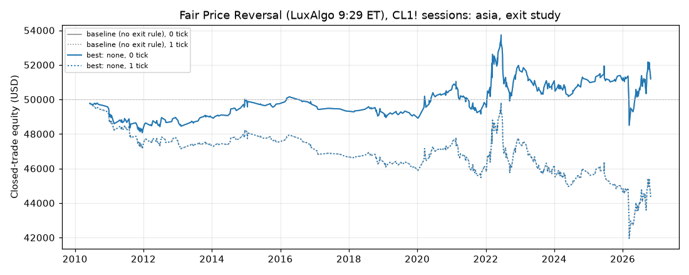
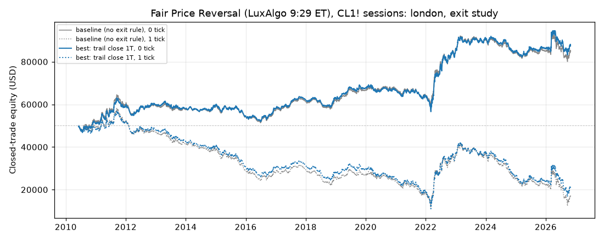
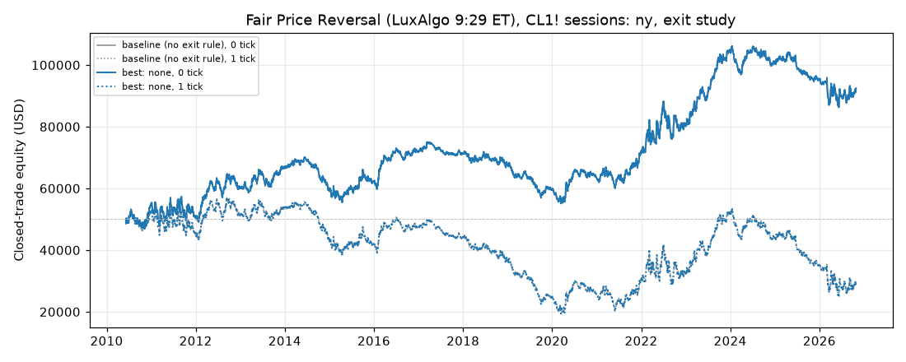

# Fair Price Reversal (LuxAlgo 9:29 ET), CL1! sessions: exit study (breakeven, trailing stop, time exit)

Generated 2026-11-01 00:50 UTC by `python -m tvtester.cli exits fair_price_reversal`.

> **Read this first.** Exploratory **in-sample** exit sweep. Each variant's feature-1 top combination is frozen and only the exit rule changes. The best rule is the **best of 428** tries per variant (each family below says its own N), conditional on baselines that were themselves the best of the feature-1 grid, and after an earlier 330-rule version of this study (ledger). The interval is the full feature-1 interval, **including the reserved 2024+ bars**, so these exit winners cannot be validated on 2024+. The slippage columns rerun the same frozen winner; they are not out-of-sample tests.

## Settings

| Setting | Value |
|---|---|
| Data | 2010-06-07 00:00:00+00:00 to 2026-10-27 20:59:00+00:00 UTC, 5,667,487 bars (data hash `d819aa714f83f298`, code hash `6c3a327aba69338f`, grid hash `0937cd7fbd4beddd`) |
| Properties | as feature 1: $50,000, 1 contract, $2.01 per order ($4.02 round trip), slippage 0 with 1 and 2 tick scenarios |
| Objective (declared first) | net0 (net profit + open P&L at the end, 0 ticks); ties: profit factor, then rule order |
| Baseline | the variant's feature-1 top combination, unchanged (entries, initial stop and target) |
| Run | `20261101T001119Z_0937cd` (ledger `results/fair_price_reversal/ledger.jsonl`; files never overwritten) |

## Exit rules

Units: **T** = the trade's target distance in ticks (rr x signal risk). All rules run at every 1-minute bar close while in a position; a moved stop works from the next bar, a time exit fills at the next open. **best** = most favourable high (long) / low (short) since the entry bar. A stop never loosens. Trailing rules come with the target kept or removed, and most start either at once or after 0.5T. Full rules: `docs/ENGINE.md` (Exit management) and `tvtester/exits.py`.

| Family | Rule | Rules |
|---|---|---|
| `be_touch` | Breakeven when the high / low reaches be_x x T | 9 |
| `be_close` | Breakeven when a close reaches be_x x T | 6 |
| `be_time` | Breakeven after N bars if the close is in profit | 6 |
| `trail_frac` | Trail a fixed fraction of T behind the best price | 32 |
| `trail_atr` | Trail k x ATR(14) behind the best price (chandelier) | 16 |
| `trail_swing` | Trail at the last confirmed 1m swing low / high (UNVERIFIED pivots) | 12 |
| `trail_step` | Ratchet: lock one step behind every step of T reached | 4 |
| `trail_close` | Trail a fraction of T behind the best close | 16 |
| `trail_ema` | Trail at the 1m EMA while it is on the trade's side | 12 |
| `trail_sar` | Trail at the 1m Parabolic SAR while it is on the trade's side (UNVERIFIED SAR) | 8 |
| `both` | Every trailing rule with one of 3 declared breakevens: touch 0.5T +1t, close 0.5T +1t, time 30 bars +1t | 300 |
| `time_exit` | Close at market after N bars in the trade | 6 |
| | **Total (with the baseline)** | **428** |

Every rule that trails with `swing` or `sar` (their own families and the matching `both` rules, marked **(unverified)** below) uses Python transcriptions of Pine `ta.pivotlow` / `ta.sar` that have **not been checked against a TradingView export** yet.

Breakeven is a stop price, not a guaranteed result: a stop fill pays slippage, a gap can fill worse, and the round trip still costs $4.02 (1 tick offset = $10).

## Summary: best rule per variant

| Variant | Baseline net (0 / 1 / 2 ticks) | Best rule (of 428) | Family | Best net (0 / 1 / 2 ticks) | Rules beating the baseline |
|---|---|---|---|---|---|
| asia | 1,182.96 USD / -5,657.04 USD / -14,087.04 USD | none | baseline | 1,182.96 USD / -5,657.04 USD / -14,087.04 USD | 0 of 427 |
| london | 34,591.64 USD / -33,338.16 USD / -101,643.94 USD | trail close 1T | trail_close | 37,361.64 USD / -29,428.16 USD / -99,777.96 USD | 2 of 427 |
| ny | 42,475.80 USD / -20,100.08 USD / -81,394.00 USD | none | baseline | 42,475.80 USD / -20,100.08 USD / -81,394.00 USD | 0 of 427 |

## Variant: asia

**Frozen baseline:** `session=asia`, `window=30`, `atr_mult=2.0`, `swing=3`, `target=rr1`

Chart: closed trades only (an open position at the end is in the Open P&L column).

Files: [grid](../../../../results/fair_price_reversal/exits/20261101T001119Z_0937cd/asia/grid.csv), [summary](../../../../results/fair_price_reversal/exits/20261101T001119Z_0937cd/asia/summary.json), best rule trades [0 ticks](../../../../results/fair_price_reversal/exits/20261101T001119Z_0937cd/asia/best_trades_slippage0.csv), [1 ticks](../../../../results/fair_price_reversal/exits/20261101T001119Z_0937cd/asia/best_trades_slippage1.csv), [2 ticks](../../../../results/fair_price_reversal/exits/20261101T001119Z_0937cd/asia/best_trades_slippage2.csv)

### Best rule of each family

| Family | Best rule | Best of | Net profit (0 / 1 / 2 ticks) | Open P&L at the end (0 / 1 / 2) | Trades | % profitable | PF | Avg trade | Max DD | Trades with stop moved / closed by time exit | Family rules beating the baseline |
|---|---|---|---|---|---|---|---|---|---|---|---|
| baseline | none | 1 | 1,182.96 USD / -5,657.04 USD / -14,087.04 USD | 0.00 USD / 0.00 USD / 0.00 USD | 452 | 50.88% | 1.031 | 2.62 USD | 5,704.86 USD | 0 / 0 |  |
| be_touch | BE touch 0.75T +1t | 9 | -827.04 USD / -7,877.04 USD / -15,847.04 USD | 0.00 USD / 0.00 USD / 0.00 USD | 452 | 56.19% | 0.976 | -1.83 USD | 6,014.86 USD | 183 / 0 | 0 of 9 |
| be_close | BE close 0.75T +1t | 6 | 532.96 USD / -7,007.04 USD / -13,687.04 USD | 0.00 USD / 0.00 USD / 0.00 USD | 452 | 53.76% | 1.014 | 1.18 USD | 6,024.86 USD | 136 / 0 | 0 of 6 |
| be_time | BE after 60 bars +1t | 6 | -1,997.04 USD / -9,337.04 USD / -17,177.04 USD | 0.00 USD / 0.00 USD / 0.00 USD | 452 | 54.65% | 0.943 | -4.42 USD | 5,814.86 USD | 63 / 0 | 0 of 6 |
| trail_frac | trail 0.5T from 0.75T | 32 | -467.04 USD / -7,537.04 USD / -15,477.04 USD | 0.00 USD / 0.00 USD / 0.00 USD | 452 | 56.64% | 0.987 | -1.03 USD | 6,024.86 USD | 183 / 0 | 0 of 32 |
| trail_atr | trail 2 ATR from 0.5T | 16 | -1,107.04 USD / -9,417.04 USD / -17,707.04 USD | 0.00 USD / 0.00 USD / 0.00 USD | 452 | 51.99% | 0.962 | -2.45 USD | 4,360.84 USD | 279 / 0 | 0 of 16 |
| trail_swing | trail pivot 5 from 0.5T (unverified) | 12 | -1,757.04 USD / -9,447.04 USD / -17,077.04 USD | 0.00 USD / 0.00 USD / 0.00 USD | 452 | 47.79% | 0.948 | -3.89 USD | 4,750.84 USD | 211 / 0 | 0 of 12 |
| trail_step | trail step 0.25T | 4 | -2,667.04 USD / -11,387.04 USD / -21,427.04 USD | 0.00 USD / 0.00 USD / 0.00 USD | 452 | 41.59% | 0.856 | -5.90 USD | 3,892.32 USD | 367 / 0 | 0 of 4 |
| trail_close | trail close 1T from 0.5T | 16 | -1,107.04 USD / -8,927.04 USD / -16,857.04 USD | 0.00 USD / 0.00 USD / 0.00 USD | 452 | 42.04% | 0.969 | -2.45 USD | 6,794.86 USD | 278 / 0 | 0 of 16 |
| trail_ema | trail EMA 50 | 12 | -867.04 USD / -8,907.04 USD / -16,407.04 USD | 0.00 USD / 0.00 USD / 0.00 USD | 452 | 41.37% | 0.951 | -1.92 USD | 3,139.58 USD | 365 / 0 | 0 of 12 |
| trail_sar | trail SAR 0.01/0.01/0.1 from 0.5T (unverified) | 8 | -1,787.04 USD / -9,417.04 USD / -17,877.04 USD | 0.00 USD / 0.00 USD / 0.00 USD | 452 | 46.24% | 0.947 | -3.95 USD | 5,400.84 USD | 236 / 0 | 0 of 8 |
| both | BE touch 0.5T +1t; trail 2 ATR from 0.5T | 300 | -167.04 USD / -8,707.04 USD / -17,337.04 USD | 0.00 USD / 0.00 USD / 0.00 USD | 452 | 64.82% | 0.994 | -0.37 USD | 4,050.84 USD | 279 / 0 | 0 of 300 |
| time_exit | time exit 60 bars | 6 | 122.96 USD / -7,447.04 USD / -16,057.04 USD | 0.00 USD / 0.00 USD / 0.00 USD | 452 | 50.44% | 1.004 | 0.27 USD | 3,894.86 USD | 0 / 81 | 0 of 6 |
| **overall** | none | 428 | 1,182.96 USD / -5,657.04 USD / -14,087.04 USD | 0.00 USD / 0.00 USD / 0.00 USD | 452 | 50.88% | 1.031 | 2.62 USD | 5,704.86 USD | 0 / 0 |  |

### Top 10 of 428 (0 ticks)

| # | Rule | Family | Objective | Trades | % profitable | PF | Max DD |
|---|---|---|---|---|---|---|---|
| 1 | none | baseline | 1,182.96 USD | 452 | 50.88% | 1.031 | 5,704.86 USD |
| 2 | BE close 0.75T +1t | be_close | 532.96 USD | 452 | 53.76% | 1.014 | 6,024.86 USD |
| 3 | BE close 0.75T +0t | be_close | 282.96 USD | 452 | 47.12% | 1.008 | 6,044.86 USD |
| 4 | time exit 60 bars | time_exit | 122.96 USD | 452 | 50.44% | 1.004 | 3,894.86 USD |
| 5 | BE touch 0.5T +1t; trail 2 ATR from 0.5T | both | -167.04 USD | 452 | 64.82% | 0.994 | 4,050.84 USD |
| 6 | BE close 0.5T +1t; trail EMA 50 | both | -237.04 USD | 452 | 46.46% | 0.986 | 3,349.58 USD |
| 7 | trail 0.5T from 0.75T | trail_frac | -467.04 USD | 452 | 56.64% | 0.987 | 6,024.86 USD |
| 8 | BE close 0.5T +1t; trail 2 ATR from 0.5T | both | -467.04 USD | 452 | 58.63% | 0.984 | 4,190.84 USD |
| 9 | BE touch 0.5T +1t; trail EMA 50 | both | -497.04 USD | 452 | 48.23% | 0.970 | 3,439.58 USD |
| 10 | BE touch 0.5T +1t; trail SAR 0.01/0.01/0.1 from 0.5T (unverified) | both | -527.04 USD | 452 | 64.16% | 0.981 | 4,140.84 USD |

Rules with a positive objective: 4 of 428. Rules beating the baseline: 0 of 427.

## Variant: london

**Frozen baseline:** `session=london`, `window=120`, `atr_mult=2.0`, `swing=3`, `target=rr2`

Chart: closed trades only (an open position at the end is in the Open P&L column).

Files: [grid](../../../../results/fair_price_reversal/exits/20261101T001119Z_0937cd/london/grid.csv), [summary](../../../../results/fair_price_reversal/exits/20261101T001119Z_0937cd/london/summary.json), best rule trades [0 ticks](../../../../results/fair_price_reversal/exits/20261101T001119Z_0937cd/london/best_trades_slippage0.csv), [1 ticks](../../../../results/fair_price_reversal/exits/20261101T001119Z_0937cd/london/best_trades_slippage1.csv), [2 ticks](../../../../results/fair_price_reversal/exits/20261101T001119Z_0937cd/london/best_trades_slippage2.csv)

### Best rule of each family

| Family | Best rule | Best of | Net profit (0 / 1 / 2 ticks) | Open P&L at the end (0 / 1 / 2) | Trades | % profitable | PF | Avg trade | Max DD | Trades with stop moved / closed by time exit | Family rules beating the baseline |
|---|---|---|---|---|---|---|---|---|---|---|---|
| baseline | none | 1 | 34,591.64 USD / -33,338.16 USD / -101,643.94 USD | 0.00 USD / 0.00 USD / 0.00 USD | 3,818 | 36.59% | 1.072 | 9.06 USD | 13,213.46 USD | 0 / 0 |  |
| be_touch | BE touch 0.75T +0t | 9 | 28,813.60 USD / -38,066.20 USD / -103,404.04 USD | 0.00 USD / 0.00 USD / 0.00 USD | 3,820 | 32.88% | 1.065 | 7.54 USD | 12,629.30 USD | 1,334 / 0 | 0 of 9 |
| be_close | BE close 0.75T +1t | 6 | 31,407.62 USD / -34,786.20 USD / -102,508.06 USD | 0.00 USD / 0.00 USD / 0.00 USD | 3,819 | 39.67% | 1.069 | 8.22 USD | 12,438.78 USD | 1,127 / 0 | 0 of 6 |
| be_time | BE after 60 bars +0t | 6 | 13,691.64 USD / -56,178.16 USD / -127,387.96 USD | 0.00 USD / 0.00 USD / 0.00 USD | 3,818 | 27.13% | 1.035 | 3.59 USD | 15,925.40 USD | 1,149 / 0 | 0 of 6 |
| trail_frac | trail 1T; no target | 32 | 32,226.80 USD / -40,973.20 USD / -114,173.20 USD | 0.00 USD / 0.00 USD / 0.00 USD | 3,660 | 32.87% | 1.075 | 8.81 USD | 13,550.16 USD | 1,766 / 0 | 0 of 32 |
| trail_atr | trail 4 ATR from 0.5T | 16 | 19,558.48 USD / -50,581.42 USD / -123,473.28 USD | 0.00 USD / 0.00 USD / 0.00 USD | 3,876 | 44.48% | 1.049 | 5.05 USD | 10,851.36 USD | 1,908 / 0 | 0 of 16 |
| trail_swing | trail pivot 5 from 0.5T; no target (unverified) | 12 | 23,137.72 USD / -53,990.22 USD / -129,750.12 USD | 0.00 USD / 0.00 USD / 0.00 USD | 3,814 | 41.85% | 1.058 | 6.07 USD | 11,328.56 USD | 1,871 / 0 | 0 of 12 |
| trail_step | trail step 0.5T | 4 | 22,051.44 USD / -50,252.38 USD / -115,418.26 USD | 0.00 USD / 0.00 USD / 0.00 USD | 3,828 | 27.06% | 1.057 | 5.76 USD | 12,403.42 USD | 1,887 / 0 | 0 of 4 |
| trail_close | trail close 1T | 16 | 37,361.64 USD / -29,428.16 USD / -99,777.96 USD | 0.00 USD / 0.00 USD / 0.00 USD | 3,818 | 34.99% | 1.081 | 9.79 USD | 12,683.32 USD | 1,662 / 0 | 2 of 16 |
| trail_ema | trail EMA 20 from 0.5T; no target | 12 | 18,151.20 USD / -58,900.76 USD / -134,570.66 USD | 0.00 USD / 0.00 USD / 0.00 USD | 3,940 | 50.13% | 1.046 | 4.61 USD | 14,728.12 USD | 1,973 / 0 | 0 of 12 |
| trail_sar | trail SAR 0.02/0.02/0.2 from 0.5T (unverified) | 8 | 13,027.08 USD / -60,414.88 USD / -132,420.76 USD | 0.00 USD / 0.00 USD / 0.00 USD | 3,946 | 47.82% | 1.033 | 3.30 USD | 13,436.02 USD | 1,948 / 0 | 0 of 8 |
| both | BE close 0.5T +1t; trail 0.75T from 0.75T; no target | 300 | 24,539.22 USD / -47,310.78 USD / -124,716.86 USD | 0.00 USD / 0.00 USD / 0.00 USD | 3,739 | 47.50% | 1.062 | 6.56 USD | 13,506.12 USD | 1,734 / 0 | 0 of 300 |
| time_exit | time exit 60 bars; no target | 6 | 16,269.52 USD / -58,210.48 USD / -132,690.48 USD | 0.00 USD / 0.00 USD / 0.00 USD | 3,724 | 39.96% | 1.043 | 4.37 USD | 14,253.02 USD | 0 / 1,899 | 0 of 6 |
| **overall** | trail close 1T | 428 | 37,361.64 USD / -29,428.16 USD / -99,777.96 USD | 0.00 USD / 0.00 USD / 0.00 USD | 3,818 | 34.99% | 1.081 | 9.79 USD | 12,683.32 USD | 1,662 / 0 |  |

### Top 10 of 428 (0 ticks)

| # | Rule | Family | Objective | Trades | % profitable | PF | Max DD |
|---|---|---|---|---|---|---|---|
| 1 | trail close 1T | trail_close | 37,361.64 USD | 3,818 | 34.99% | 1.081 | 12,683.32 USD |
| 2 | trail close 1T from 0.5T | trail_close | 37,341.64 USD | 3,818 | 34.99% | 1.081 | 12,683.32 USD |
| 3 | none | baseline | 34,591.64 USD | 3,818 | 36.59% | 1.072 | 13,213.46 USD |
| 4 | trail 1T; no target | trail_frac | 32,226.80 USD | 3,660 | 32.87% | 1.075 | 13,550.16 USD |
| 5 | trail 1T from 0.25T; no target | trail_frac | 32,226.80 USD | 3,660 | 32.87% | 1.075 | 13,550.16 USD |
| 6 | trail 1T from 0.5T; no target | trail_frac | 32,196.80 USD | 3,660 | 32.87% | 1.075 | 13,550.16 USD |
| 7 | trail 0.75T from 0.75T; no target | trail_frac | 31,981.48 USD | 3,726 | 40.26% | 1.074 | 12,388.20 USD |
| 8 | trail 1T | trail_frac | 31,791.64 USD | 3,818 | 33.76% | 1.070 | 12,433.06 USD |
| 9 | trail 1T from 0.25T | trail_frac | 31,791.64 USD | 3,818 | 33.76% | 1.070 | 12,433.06 USD |
| 10 | trail 1T from 0.5T | trail_frac | 31,761.64 USD | 3,818 | 33.76% | 1.070 | 12,433.06 USD |

Rules with a positive objective: 215 of 428. Rules beating the baseline: 2 of 427.

## Variant: ny

**Frozen baseline:** `session=ny`, `window=120`, `atr_mult=0.5`, `swing=3`, `target=rr2`

Chart: closed trades only (an open position at the end is in the Open P&L column).

Files: [grid](../../../../results/fair_price_reversal/exits/20261101T001119Z_0937cd/ny/grid.csv), [summary](../../../../results/fair_price_reversal/exits/20261101T001119Z_0937cd/ny/summary.json), best rule trades [0 ticks](../../../../results/fair_price_reversal/exits/20261101T001119Z_0937cd/ny/best_trades_slippage0.csv), [1 ticks](../../../../results/fair_price_reversal/exits/20261101T001119Z_0937cd/ny/best_trades_slippage1.csv), [2 ticks](../../../../results/fair_price_reversal/exits/20261101T001119Z_0937cd/ny/best_trades_slippage2.csv)

### Best rule of each family

| Family | Best rule | Best of | Net profit (0 / 1 / 2 ticks) | Open P&L at the end (0 / 1 / 2) | Trades | % profitable | PF | Avg trade | Max DD | Trades with stop moved / closed by time exit | Family rules beating the baseline |
|---|---|---|---|---|---|---|---|---|---|---|---|
| baseline | none | 1 | 42,475.80 USD / -20,100.08 USD / -81,394.00 USD | 0.00 USD / 0.00 USD / 0.00 USD | 3,710 | 36.50% | 1.056 | 11.45 USD | 20,110.90 USD | 0 / 0 |  |
| be_touch | BE touch 0.75T +0t | 9 | 16,967.66 USD / -44,188.22 USD / -105,198.12 USD | 0.00 USD / 0.00 USD / 0.00 USD | 3,717 | 32.55% | 1.024 | 4.56 USD | 25,167.66 USD | 1,264 / 0 | 0 of 9 |
| be_close | BE close 0.75T +0t | 6 | 23,987.76 USD / -34,098.12 USD / -97,278.02 USD | 0.00 USD / 0.00 USD / 0.00 USD | 3,712 | 34.16% | 1.033 | 6.46 USD | 22,684.92 USD | 1,058 / 0 | 0 of 6 |
| be_time | BE after 60 bars +0t | 6 | 11,713.74 USD / -55,762.14 USD / -116,996.06 USD | 0.00 USD / 0.00 USD / 0.00 USD | 3,713 | 27.23% | 1.019 | 3.15 USD | 23,021.90 USD | 1,101 / 0 | 0 of 6 |
| trail_frac | trail 1T from 0.75T | 32 | 33,785.70 USD / -28,760.18 USD / -89,984.10 USD | 0.00 USD / 0.00 USD / 0.00 USD | 3,715 | 34.29% | 1.046 | 9.09 USD | 23,134.92 USD | 1,263 / 0 | 0 of 32 |
| trail_atr | trail 4 ATR from 0.5T; no target | 16 | -14,156.92 USD / -84,148.88 USD / -148,602.80 USD | 0.00 USD / 0.00 USD / 0.00 USD | 3,646 | 41.66% | 0.977 | -3.88 USD | 32,020.86 USD | 1,796 / 0 | 0 of 16 |
| trail_swing | trail pivot 5 from 0.5T; no target (unverified) | 12 | 4,544.44 USD / -63,843.50 USD / -134,017.42 USD | 0.00 USD / 0.00 USD / 0.00 USD | 3,678 | 40.97% | 1.007 | 1.24 USD | 25,788.78 USD | 1,782 / 0 | 0 of 12 |
| trail_step | trail step 0.5T | 4 | -18,480.48 USD / -84,816.36 USD / -141,810.28 USD | 0.00 USD / 0.00 USD / 0.00 USD | 3,724 | 25.51% | 0.970 | -4.96 USD | 32,389.42 USD | 1,811 / 0 | 0 of 4 |
| trail_close | trail close 1T | 16 | 36,159.72 USD / -26,646.16 USD / -88,850.08 USD | 0.00 USD / 0.00 USD / 0.00 USD | 3,714 | 34.76% | 1.049 | 9.74 USD | 22,104.92 USD | 1,581 / 0 | 0 of 16 |
| trail_ema | trail EMA 20 from 0.5T; no target | 12 | -14,884.44 USD / -86,104.44 USD / -155,362.38 USD | 0.00 USD / 0.00 USD / 0.00 USD | 3,822 | 49.48% | 0.976 | -3.89 USD | 32,636.38 USD | 1,893 / 0 | 0 of 12 |
| trail_sar | trail SAR 0.01/0.01/0.1 from 0.5T; no target (unverified) | 8 | -12,811.98 USD / -84,193.94 USD / -153,987.86 USD | 0.00 USD / 0.00 USD / 0.00 USD | 3,799 | 44.35% | 0.980 | -3.37 USD | 35,328.04 USD | 1,879 / 0 | 0 of 8 |
| both | BE close 0.5T +1t; trail pivot 2 from 0.5T; no target (unverified) | 300 | 2,943.20 USD / -71,646.80 USD / -142,924.74 USD | 0.00 USD / 0.00 USD / 0.00 USD | 3,840 | 48.20% | 1.005 | 0.77 USD | 24,667.24 USD | 1,901 / 0 | 0 of 300 |
| time_exit | time exit 60 bars; no target | 6 | 7,287.70 USD / -65,012.30 USD / -137,312.30 USD | 0.00 USD / 0.00 USD / 0.00 USD | 3,615 | 39.09% | 1.012 | 2.02 USD | 22,039.18 USD | 0 / 1,840 | 0 of 6 |
| **overall** | none | 428 | 42,475.80 USD / -20,100.08 USD / -81,394.00 USD | 0.00 USD / 0.00 USD / 0.00 USD | 3,710 | 36.50% | 1.056 | 11.45 USD | 20,110.90 USD | 0 / 0 |  |

### Top 10 of 428 (0 ticks)

| # | Rule | Family | Objective | Trades | % profitable | PF | Max DD |
|---|---|---|---|---|---|---|---|
| 1 | none | baseline | 42,475.80 USD | 3,710 | 36.50% | 1.056 | 20,110.90 USD |
| 2 | trail close 1T | trail_close | 36,159.72 USD | 3,714 | 34.76% | 1.049 | 22,104.92 USD |
| 3 | trail close 1T from 0.5T | trail_close | 36,159.72 USD | 3,714 | 34.76% | 1.049 | 22,104.92 USD |
| 4 | trail 1T from 0.75T | trail_frac | 33,785.70 USD | 3,715 | 34.29% | 1.046 | 23,134.92 USD |
| 5 | trail 1T | trail_frac | 32,735.70 USD | 3,715 | 33.38% | 1.046 | 21,104.92 USD |
| 6 | trail 1T from 0.25T | trail_frac | 32,735.70 USD | 3,715 | 33.38% | 1.046 | 21,104.92 USD |
| 7 | trail 1T from 0.5T | trail_frac | 32,735.70 USD | 3,715 | 33.38% | 1.046 | 21,104.92 USD |
| 8 | trail 1T; no target | trail_frac | 26,891.06 USD | 3,547 | 32.99% | 1.039 | 28,493.46 USD |
| 9 | trail 1T from 0.25T; no target | trail_frac | 26,891.06 USD | 3,547 | 32.99% | 1.039 | 28,493.46 USD |
| 10 | trail 1T from 0.5T; no target | trail_frac | 26,891.06 USD | 3,547 | 32.99% | 1.039 | 28,493.46 USD |

Rules with a positive objective: 33 of 428. Rules beating the baseline: 0 of 427.
