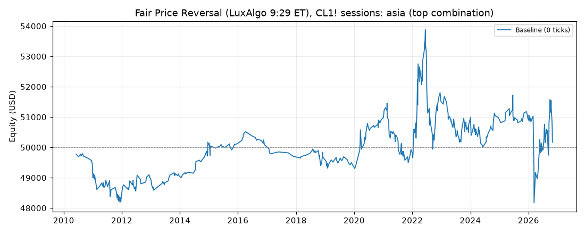
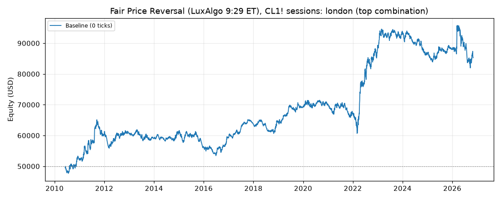
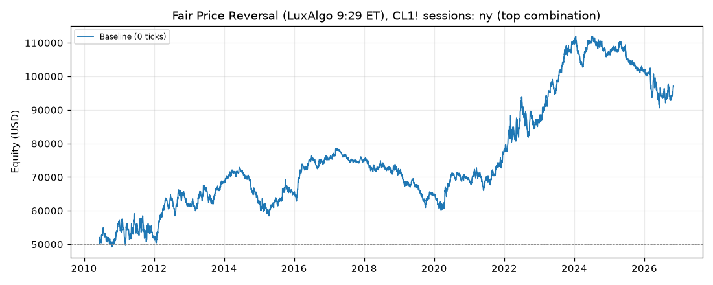

# Fair Price Reversal (LuxAlgo 9:29 ET), CL1! sessions: results

Generated 2026-11-03 16:22 UTC by `python -m tvtester.cli test fair_price_reversal`.

Source: LuxAlgo, [9:29 ET Fair Price Reversal](https://www.luxalgo.com/library/indicator/9-29-et-fair-price-reversal/)
(Pine v6, MPL-2.0). The original reads NQ around the 9:30 ET stock open. Here it runs on CL1! with the anchor
moved to the candle before each CL session open:

| Variant | Session open | Anchor candle | Malaysia time (UTC+8) | Flat at |
|---|---|---|---|---|
| asia | 09:00 Asia/Shanghai (same clock as Singapore / Kuala Lumpur, no DST) | 08:59 | 09:00 all year | 15:00 Asia/Shanghai |
| london | 08:00 Europe/London | 07:59 | 15:00 (UK summer) / 16:00 (UK winter) | 13:00 London |
| ny | 09:00 America/New_York (NYMEX crude open) | 08:59 | 21:00 (US summer) / 22:00 (US winter) | 14:30 New York |

**Signal (unchanged from the indicator):** the anchor candle's body (open/close) is the fair price. Inside the
setup window that starts at the session open, price must move at least `atr_mult` x ATR(14) of the previous
bar beyond the body. A long needs a lower swing high to form after a move down, then a close above that swing
high while still below the body ("MSS LONG"); a short is the mirror ("MSS SHORT"). At most one long and one
short signal per session day. Swing highs / lows use `swing` bars on each side.

**Trade rules (ours, the indicator has none):**
- Entry: limit at the signal close, active from the next bar, only when flat.
- Stop: the excursion extreme, fixed at the signal bar (lowest low since the move down began for a long,
  highest high since the move up began for a short).
- Target (`target`): `near` = nearest body edge, `far` = far body edge (limit orders), `rr1` / `rr2` = 1R / 2R
  measured in ticks from the actual fill, where R = signal close to stop.
- Session end: any open position is closed at the next bar open after the flat time.

A runnable Pine v6 twin for checking trades in TradingView is in
[`strategies/fair_price_reversal.pine`](../../../strategies/fair_price_reversal.pine).

## Test settings (TradingView Properties)

| Setting | Value |
|---|---|
| Symbol | CL1! (NYMEX Light Crude Oil, front month), 1-minute bars |
| Data | 2010-06-07 00:00:00+00:00 to 2026-11-02 16:30:00+00:00 UTC, 5,672,666 bars (manifest written 2026-10-29T06:25:08+00:00) |
| Initial capital | 50,000.00 USD |
| Order size | 1 contract |
| Commission | 2.01 USD per contract per order (4.02 USD round trip) |
| Execution | Limit entries; commission included; no added slippage |
| Pyramiding | 0 (one position) |
| Fills | TradingView broker emulator, Bar Magnifier off, limits fill on touch |
| Roll rule | position closed at the last bar of a contract (exit reason `roll`) |

## How the top combination was chosen

Every variant ran all 192 combinations of the grid below with commission included. The combination with the highest **net profit** is the top combination (ties: higher profit factor, then grid order). This reference is retained for compatibility. Thirteen separate metric winners are also selected, with a declared minimum trade count; their values, settings and trade lists are linked below. No slippage stress runs are performed.

| Parameter | Values |
|---|---|
| `window` | 30, 60, 90, 120 |
| `atr_mult` | 0.5, 1.0, 1.5, 2.0 |
| `swing` | 1, 2, 3 |
| `target` | near, far, rr1, rr2 |

> **Read this first.** The top combination is the best of 192 tries on the same data it is reported on (in-sample). Picking the best of many tries makes the result look better than what the same rules can be expected to earn on new data. Treat these numbers as an upper bound, not as a forecast.

## Summary: top combination per variant

| Variant | Parameters | Net profit | Trades | % profitable | Profit factor | Max DD |
|---|---|---|---|---|---|---|
| asia | window=30, atr_mult=2.0, swing=3, target=rr1 | 169.14 USD | 443 | 50.11% | 1.004 | 6,154.76 USD |
| london | window=120, atr_mult=2.0, swing=3, target=rr2 | 35,263.90 USD | 3,805 | 36.43% | 1.075 | 13,986.52 USD |
| ny | window=120, atr_mult=0.5, swing=3, target=rr2 | 46,837.86 USD | 3,707 | 36.58% | 1.063 | 21,534.68 USD |

## Conclusion

Execution rules changed to limit entries at the decision close, with unfilled entries cancelled after the
planned target is reached at a one-minute close. Historical market-entry conclusions do not apply. Read
the newly generated tables as in-sample research; independent replication and TradingView comparison are
pending.

## Variant: asia

**Top combination:** `session=asia`, `window=30`, `atr_mult=2.0`, `swing=3`, `target=rr1`

Files: [grid](../../../results/fair_price_reversal/metrics/asia/grid.csv), [trades 0 ticks](../../../results/fair_price_reversal/metrics/asia/trades_slippage0.csv), [summary](../../../results/fair_price_reversal/metrics/asia/summary.json)

### Results after commission

#### Overview

| Metric | Value |
|---|---|
| Net profit | 169.14 USD (0.34%) |
| Total closed trades | 443 |
| Percent profitable | 50.11% |
| Profit factor | 1.004 |
| Max equity drawdown | 6,154.76 USD (12.31%) |
| Avg trade | 0.38 USD |
| Avg # bars in trades | 48 |

#### Performance

| Metric | All | Long | Short |
|---|---|---|---|
| Net profit | 169.14 USD (0.34%) | -176.66 USD (-0.35%) | 345.80 USD (0.69%) |
| Gross profit | 38,487.56 USD (76.98%) | 21,741.72 USD (43.48%) | 16,745.84 USD (33.49%) |
| Gross loss | 38,318.42 USD (76.64%) | 21,918.38 USD (43.84%) | 16,400.04 USD (32.80%) |
| Commission paid | 1,780.86 USD | 936.66 USD | 844.20 USD |

| Account | Value |
|---|---|
| Initial capital | 50,000.00 USD |
| Buy & hold return (TV-style, all capital at the first entry) | 17,871.15 USD (35.74%) |
| Max equity run-up (intrabar) | 5,685.40 USD (11.37%) |
| Max equity drawdown (intrabar) | 6,154.76 USD (12.31%) |
| Open P&L | 0.00 USD |
| Max contracts held | 1 |

#### Trades analysis

| Metric | All | Long | Short |
|---|---|---|---|
| Total closed trades | 443 | 233 | 210 |
| Winning trades | 222 | 114 | 108 |
| Losing trades | 221 | 119 | 102 |
| Even trades | 0 | 0 | 0 |
| Percent profitable | 50.11% | 48.93% | 51.43% |
| Avg P&L | 0.38 USD | -0.76 USD | 1.65 USD |
| Avg P&L % | 0.00% | 0.00% | 0.01% |
| Avg winning trade | 173.37 USD | 190.72 USD | 155.05 USD |
| Avg losing trade | 173.39 USD | 184.19 USD | 160.78 USD |
| Ratio avg win / avg loss | 1.000 | 1.035 | 0.964 |
| Largest winning trade | 1,065.98 USD | 1,065.98 USD | 675.98 USD |
| Largest winning trade % | 1.85% | 1.85% | 1.50% |
| Largest losing trade | 1,794.02 USD | 1,794.02 USD | 1,064.02 USD |
| Largest losing trade % | 2.08% | 2.08% | 1.28% |
| Avg # bars in trades | 48 | 57 | 39 |
| Avg # bars in winning trades | 52 | 59 | 44 |
| Avg # bars in losing trades | 45 | 54 | 34 |

#### Risk/performance ratios

| Metric | Value |
|---|---|
| Sharpe ratio | -0.245 |
| Sortino ratio | -0.296 |
| Profit factor | 1.004 |
| Margin calls | 0 |

#### List of trades (last 10, newest first; full list in the trades CSV)

| Trade # | Type | Signal | Date/Time (UTC) | Price | Contracts | Profit | Cum. profit | Run-up | Drawdown |
|---|---|---|---|---|---|---|---|---|---|
| 443 | Exit short | Exit | 2026-10-28 01:55 | 101.32 | 1 | -424.02 USD (-0.42%) | 169.14 USD | 100.00 USD | 420.00 USD |
|  | Entry short | Short | 2026-10-28 01:19 | 100.90 | 1 |  |  |  |  |
| 442 | Exit long | Exit | 2026-10-26 01:56 | 101.30 | 1 | -254.02 USD (-0.25%) | 593.16 USD | 140.00 USD | 250.00 USD |
|  | Entry long | Long | 2026-10-26 01:29 | 101.55 | 1 |  |  |  |  |
| 441 | Exit short | Exit | 2026-10-23 01:52 | 100.24 | 1 | -464.02 USD (-0.47%) | 847.18 USD | 160.00 USD | 460.00 USD |
|  | Entry short | Short | 2026-10-23 01:28 | 99.78 | 1 |  |  |  |  |
| 440 | Exit long | Exit | 2026-10-13 01:54 | 92.65 | 1 | -234.02 USD (-0.25%) | 1,311.20 USD | 70.00 USD | 230.00 USD |
|  | Entry long | Long | 2026-10-13 01:24 | 92.88 | 1 |  |  |  |  |
| 439 | Exit long | Exit | 2026-10-12 01:32 | 90.39 | 1 | 385.98 USD (0.43%) | 1,545.22 USD | 390.00 USD | 50.00 USD |
|  | Entry long | Long | 2026-10-12 01:10 | 90.00 | 1 |  |  |  |  |
| 438 | Exit short | Exit | 2026-10-08 01:19 | 89.50 | 1 | -154.02 USD (-0.17%) | 1,159.24 USD | 60.00 USD | 150.00 USD |
|  | Entry short | Short | 2026-10-08 01:17 | 89.35 | 1 |  |  |  |  |
| 437 | Exit long | Exit | 2026-10-02 02:05 | 92.78 | 1 | -264.02 USD (-0.28%) | 1,313.26 USD | 100.00 USD | 260.00 USD |
|  | Entry long | Long | 2026-10-02 01:26 | 93.04 | 1 |  |  |  |  |
| 436 | Exit long | Exit | 2026-09-28 02:06 | 93.72 | 1 | 515.98 USD (0.55%) | 1,577.28 USD | 520.00 USD | 30.00 USD |
|  | Entry long | Long | 2026-09-28 01:18 | 93.20 | 1 |  |  |  |  |
| 435 | Exit short | Exit | 2026-09-23 01:51 | 89.98 | 1 | 225.98 USD (0.25%) | 1,061.30 USD | 230.00 USD | 90.00 USD |
|  | Entry short | Short | 2026-09-23 01:14 | 90.21 | 1 |  |  |  |  |
| 434 | Exit long | Exit | 2026-09-15 01:54 | 102.95 | 1 | 415.98 USD (0.41%) | 835.32 USD | 420.00 USD | 290.00 USD |
|  | Entry long | Long | 2026-09-15 01:28 | 102.53 | 1 |  |  |  |  |

#### By year (extra, not a TV tab)

| Year | Trades | Net profit | % profitable | Profit factor |
|---|---|---|---|---|
| 2010 | 9 | -556.18 USD | 22.22% | 0.226 |
| 2011 | 30 | -1,000.60 USD | 50.00% | 0.673 |
| 2012 | 20 | 599.60 USD | 50.00% | 1.540 |
| 2013 | 20 | 29.60 USD | 55.00% | 1.037 |
| 2014 | 21 | 1,005.58 USD | 66.67% | 3.195 |
| 2015 | 16 | 35.68 USD | 56.25% | 1.046 |
| 2016 | 14 | -96.28 USD | 50.00% | 0.851 |
| 2017 | 6 | -314.12 USD | 16.67% | 0.174 |
| 2018 | 20 | -10.40 USD | 60.00% | 0.989 |
| 2019 | 19 | -196.38 USD | 47.37% | 0.820 |
| 2020 | 26 | 1,475.48 USD | 61.54% | 1.984 |
| 2021 | 38 | -1,042.76 USD | 39.47% | 0.684 |
| 2022 | 57 | 1,580.86 USD | 52.63% | 1.186 |
| 2023 | 40 | -790.80 USD | 42.50% | 0.755 |
| 2024 | 38 | 197.24 USD | 44.74% | 1.081 |
| 2025 | 24 | 53.52 USD | 58.33% | 1.032 |
| 2026 | 45 | -800.90 USD | 51.11% | 0.897 |

#### Exit reasons (extra)

| Reason | Trades |
|---|---|
| stop | 215 |
| limit | 211 |
| close | 17 |

- Session-end exits more than 5 minutes after the flat time (missing bars / early closes): 0.
- Roll exits: 0.

### Best settings by metric

Each winner needs at least 30 closed trades. Undefined values are excluded. Ties: higher net profit, higher profit factor, then grid order. Ruin loss threshold: 25,000.00 USD from starting capital. All selections are in-sample. MAE/MFE objectives use the mean of the per-trade maxima.

| Metric | Goal | Best value | Grid order | Trades | Eligible settings | Parameters |
|---|---|---|---|---|---|---|
| Net profit | max | 169.14 USD | [47](../../../results/fair_price_reversal/metrics/asia/metric_winners/order_47/trades_slippage0.csv) | 443 | 192 | window=30, atr_mult=2.0, swing=3, target=rr1 |
| Win rate | max | 63.16% | [9](../../../results/fair_price_reversal/metrics/asia/metric_winners/order_9/trades_slippage0.csv) | 323 | 192 | window=30, atr_mult=0.5, swing=3, target=near |
| Expectancy | max | 0.38 USD | [47](../../../results/fair_price_reversal/metrics/asia/metric_winners/order_47/trades_slippage0.csv) | 443 | 192 | window=30, atr_mult=2.0, swing=3, target=rr1 |
| Profit factor | max | 1.004 | [47](../../../results/fair_price_reversal/metrics/asia/metric_winners/order_47/trades_slippage0.csv) | 443 | 192 | window=30, atr_mult=2.0, swing=3, target=rr1 |
| Payoff ratio | max | 2.025 | [20](../../../results/fair_price_reversal/metrics/asia/metric_winners/order_20/trades_slippage0.csv) | 746 | 192 | window=30, atr_mult=1.0, swing=2, target=rr2 |
| Risk of ruin (estimate) | min | 71.24% | [47](../../../results/fair_price_reversal/metrics/asia/metric_winners/order_47/trades_slippage0.csv) | 443 | 192 | window=30, atr_mult=2.0, swing=3, target=rr1 |
| Maximum drawdown | min | 3,574.32 USD | [10](../../../results/fair_price_reversal/metrics/asia/metric_winners/order_10/trades_slippage0.csv) | 325 | 192 | window=30, atr_mult=0.5, swing=3, target=far |
| Consecutive losses | min | 5.000 | [45](../../../results/fair_price_reversal/metrics/asia/metric_winners/order_45/trades_slippage0.csv) | 436 | 192 | window=30, atr_mult=2.0, swing=3, target=near |
| Sharpe ratio | max | -0.048 | [172](../../../results/fair_price_reversal/metrics/asia/metric_winners/order_172/trades_slippage0.csv) | 4330 | 192 | window=120, atr_mult=1.5, swing=1, target=rr2 |
| Sortino ratio | max | -0.075 | [172](../../../results/fair_price_reversal/metrics/asia/metric_winners/order_172/trades_slippage0.csv) | 4330 | 192 | window=120, atr_mult=1.5, swing=1, target=rr2 |
| R-multiple | max | -0.018 | [11](../../../results/fair_price_reversal/metrics/asia/metric_winners/order_11/trades_slippage0.csv) | 328 | 116 | window=30, atr_mult=0.5, swing=3, target=rr1 |
| Maximum adverse excursion (MAE) | min | 64.89 USD | [157](../../../results/fair_price_reversal/metrics/asia/metric_winners/order_157/trades_slippage0.csv) | 4351 | 192 | window=120, atr_mult=1.0, swing=1, target=near |
| Maximum favorable excursion (MFE) | max | 187.44 USD | [12](../../../results/fair_price_reversal/metrics/asia/metric_winners/order_12/trades_slippage0.csv) | 332 | 192 | window=30, atr_mult=0.5, swing=3, target=rr2 |

- **Net profit:** Sum of closed-trade profit after commission; excludes open P&L.
- **Win rate:** Winning closed trades divided by all closed trades, including breakevens.
- **Expectancy:** Mean net profit per closed trade, including losses and breakevens.
- **Profit factor:** Gross winning profit divided by gross losing profit, both after commission. Undefined without losses.
- **Payoff ratio:** Average net winning trade divided by the absolute average net losing trade. Requires wins and losses.
- **Risk of ruin (estimate):** Infinite-horizon diffusion estimate of losing the declared amount from starting capital. Assumes independent, stationary, fixed-size net trade P&L; ignores intratrade losses and margin.
- **Maximum drawdown:** Largest equity drawdown under the tester's intrabar TradingView convention, including an open trade at the end.
- **Consecutive losses:** Longest streak of losing closed trades in execution order. A win or breakeven resets the streak.
- **Sharpe ratio:** Monthly marked-to-market excess return divided by population standard deviation, using 2% annual risk-free rate; not annualized.
- **Sortino ratio:** Monthly marked-to-market excess return divided by downside deviation about the risk-free rate; not annualized.
- **R-multiple:** Mean net trade profit / initial stop risk in dollars. Risk is actual fill to initial stop, before costs. Requires positive initial risk for every closed trade; R standard deviation and mean / standard deviation describe consistency.
- **Maximum adverse excursion (MAE):** Mean of each closed trade's maximum adverse price excursion in dollars, before commission; only the exposed intrabar path counts.
- **Maximum favorable excursion (MFE):** Mean of each closed trade's maximum favorable price excursion in dollars, before commission; only the exposed intrabar path counts. Unrealized opportunity, not realized profit.

Full selection metadata: [metric_winners.json](../../../results/fair_price_reversal/metrics/asia/metric_winners.json).

### Top 10 combinations

| # | window | atr_mult | swing | target | Net profit | Trades | % profitable | Profit factor | Max DD |
|---|---|---|---|---|---|---|---|---|---|
| 1 | 30 | 2.0 | 3 | rr1 | 169.14 USD | 443 | 50.11% | 1.004 | 6,154.76 USD |
| 2 | 30 | 1.5 | 3 | rr1 | -418.50 USD | 425 | 49.65% | 0.989 | 5,390.64 USD |
| 3 | 30 | 1.0 | 3 | rr1 | -596.04 USD | 402 | 49.50% | 0.983 | 4,942.40 USD |
| 4 | 30 | 0.5 | 3 | rr2 | -864.64 USD | 332 | 34.34% | 0.977 | 4,132.00 USD |
| 5 | 30 | 0.5 | 3 | rr1 | -1,048.56 USD | 328 | 50.30% | 0.964 | 3,698.34 USD |
| 6 | 30 | 2.0 | 3 | far | -1,180.76 USD | 438 | 59.36% | 0.961 | 4,106.72 USD |
| 7 | 30 | 1.0 | 2 | rr1 | -1,806.76 USD | 738 | 48.10% | 0.968 | 6,242.78 USD |
| 8 | 30 | 1.0 | 2 | far | -2,010.58 USD | 729 | 57.48% | 0.956 | 5,412.68 USD |
| 9 | 30 | 0.5 | 3 | far | -2,096.50 USD | 325 | 59.08% | 0.911 | 3,574.32 USD |
| 10 | 30 | 1.0 | 3 | far | -2,189.96 USD | 398 | 58.79% | 0.922 | 3,941.34 USD |

Profitable combinations: 1 of 192.

## Variant: london

**Top combination:** `session=london`, `window=120`, `atr_mult=2.0`, `swing=3`, `target=rr2`

Files: [grid](../../../results/fair_price_reversal/metrics/london/grid.csv), [trades 0 ticks](../../../results/fair_price_reversal/metrics/london/trades_slippage0.csv), [summary](../../../results/fair_price_reversal/metrics/london/summary.json)

### Results after commission

#### Overview

| Metric | Value |
|---|---|
| Net profit | 35,263.90 USD (70.53%) |
| Total closed trades | 3,805 |
| Percent profitable | 36.43% |
| Profit factor | 1.075 |
| Max equity drawdown | 13,986.52 USD (27.97%) |
| Avg trade | 9.27 USD |
| Avg # bars in trades | 64 |

#### Performance

| Metric | All | Long | Short |
|---|---|---|---|
| Net profit | 35,263.90 USD (70.53%) | 24,340.50 USD (48.68%) | 10,923.40 USD (21.85%) |
| Gross profit | 507,678.28 USD (1,015.36%) | 270,485.30 USD (540.97%) | 237,192.98 USD (474.39%) |
| Gross loss | 472,414.38 USD (944.83%) | 246,144.80 USD (492.29%) | 226,269.58 USD (452.54%) |
| Commission paid | 15,296.10 USD | 7,939.50 USD | 7,356.60 USD |

| Account | Value |
|---|---|
| Initial capital | 50,000.00 USD |
| Buy & hold return (TV-style, all capital at the first entry) | 18,688.87 USD (37.38%) |
| Max equity run-up (intrabar) | 49,953.68 USD (99.91%) |
| Max equity drawdown (intrabar) | 13,986.52 USD (27.97%) |
| Open P&L | 0.00 USD |
| Max contracts held | 1 |

#### Trades analysis

| Metric | All | Long | Short |
|---|---|---|---|
| Total closed trades | 3,805 | 1,975 | 1,830 |
| Winning trades | 1,386 | 735 | 651 |
| Losing trades | 2,419 | 1,240 | 1,179 |
| Even trades | 0 | 0 | 0 |
| Percent profitable | 36.43% | 37.22% | 35.57% |
| Avg P&L | 9.27 USD | 12.32 USD | 5.97 USD |
| Avg P&L % | 0.01% | 0.02% | 0.00% |
| Avg winning trade | 366.29 USD | 368.01 USD | 364.35 USD |
| Avg losing trade | 195.29 USD | 198.50 USD | 191.92 USD |
| Ratio avg win / avg loss | 1.876 | 1.854 | 1.898 |
| Largest winning trade | 3,395.98 USD | 2,465.98 USD | 3,395.98 USD |
| Largest winning trade % | 5.62% | 5.62% | 5.09% |
| Largest losing trade | 1,284.02 USD | 1,284.02 USD | 974.02 USD |
| Largest losing trade % | 3.38% | 3.38% | 3.09% |
| Avg # bars in trades | 64 | 66 | 61 |
| Avg # bars in winning trades | 91 | 95 | 87 |
| Avg # bars in losing trades | 48 | 49 | 46 |

#### Risk/performance ratios

| Metric | Value |
|---|---|
| Sharpe ratio | 0.055 |
| Sortino ratio | 0.103 |
| Profit factor | 1.075 |
| Margin calls | 0 |

#### List of trades (last 10, newest first; full list in the trades CSV)

| Trade # | Type | Signal | Date/Time (UTC) | Price | Contracts | Profit | Cum. profit | Run-up | Drawdown |
|---|---|---|---|---|---|---|---|---|---|
| 3805 | Exit long | Exit | 2026-11-02 09:07 | 99.80 | 1 | -424.02 USD (-0.42%) | 35,263.90 USD | 80.00 USD | 420.00 USD |
|  | Entry long | Long | 2026-11-02 08:44 | 100.22 | 1 |  |  |  |  |
| 3804 | Exit long | Exit | 2026-10-30 09:06 | 103.42 | 1 | -344.02 USD (-0.33%) | 35,687.92 USD | 110.00 USD | 340.00 USD |
|  | Entry long | Long | 2026-10-30 08:44 | 103.76 | 1 |  |  |  |  |
| 3803 | Exit long | Exit | 2026-10-29 08:55 | 101.29 | 1 | -234.02 USD (-0.23%) | 36,031.94 USD | 370.00 USD | 230.00 USD |
|  | Entry long | Long | 2026-10-29 08:37 | 101.52 | 1 |  |  |  |  |
| 3802 | Exit short | Session end | 2026-10-28 13:00 | 101.99 | 1 | -304.02 USD (-0.30%) | 36,265.96 USD | 700.00 USD | 470.00 USD |
|  | Entry short | Short | 2026-10-28 09:36 | 101.69 | 1 |  |  |  |  |
| 3801 | Exit long | Exit | 2026-10-27 10:41 | 101.50 | 1 | -794.02 USD (-0.78%) | 36,569.98 USD | 290.00 USD | 790.00 USD |
|  | Entry long | Long | 2026-10-27 09:26 | 102.29 | 1 |  |  |  |  |
| 3800 | Exit short | Exit | 2026-10-27 09:10 | 101.54 | 1 | 855.98 USD (0.84%) | 37,364.00 USD | 860.00 USD | 120.00 USD |
|  | Entry short | Short | 2026-10-27 09:01 | 102.40 | 1 |  |  |  |  |
| 3799 | Exit long | Session end | 2026-10-26 13:00 | 101.26 | 1 | 305.98 USD (0.30%) | 36,508.02 USD | 670.00 USD | 320.00 USD |
|  | Entry long | Long | 2026-10-26 08:59 | 100.95 | 1 |  |  |  |  |
| 3798 | Exit long | Exit | 2026-10-23 08:21 | 100.32 | 1 | -304.02 USD (-0.30%) | 36,202.04 USD | 270.00 USD | 300.00 USD |
|  | Entry long | Long | 2026-10-23 07:47 | 100.62 | 1 |  |  |  |  |
| 3797 | Exit short | Exit | 2026-10-22 07:36 | 99.69 | 1 | -244.02 USD (-0.25%) | 36,506.06 USD | 120.00 USD | 240.00 USD |
|  | Entry short | Short | 2026-10-22 07:25 | 99.45 | 1 |  |  |  |  |
| 3796 | Exit long | Exit | 2026-10-21 08:57 | 99.51 | 1 | 875.98 USD (0.89%) | 36,750.08 USD | 880.00 USD | 190.00 USD |
|  | Entry long | Long | 2026-10-21 08:17 | 98.63 | 1 |  |  |  |  |

#### By year (extra, not a TV tab)

| Year | Trades | Net profit | % profitable | Profit factor |
|---|---|---|---|---|
| 2010 | 144 | 2,321.12 USD | 36.81% | 1.148 |
| 2011 | 236 | 8,161.28 USD | 38.14% | 1.230 |
| 2012 | 232 | 117.36 USD | 35.34% | 1.004 |
| 2013 | 214 | -1,440.28 USD | 35.98% | 0.935 |
| 2014 | 206 | 2,031.88 USD | 38.83% | 1.116 |
| 2015 | 241 | -4,878.82 USD | 30.71% | 0.823 |
| 2016 | 220 | 3,065.60 USD | 38.64% | 1.159 |
| 2017 | 205 | 4,275.90 USD | 42.44% | 1.317 |
| 2018 | 213 | 863.74 USD | 34.74% | 1.046 |
| 2019 | 211 | 4,891.78 USD | 39.81% | 1.284 |
| 2020 | 235 | 645.30 USD | 37.45% | 1.025 |
| 2021 | 232 | -2,822.64 USD | 33.19% | 0.901 |
| 2022 | 268 | 22,092.64 USD | 41.79% | 1.394 |
| 2023 | 253 | 3,832.94 USD | 37.94% | 1.112 |
| 2024 | 250 | -6,455.00 USD | 30.00% | 0.801 |
| 2025 | 233 | 1,283.34 USD | 35.19% | 1.049 |
| 2026 | 212 | -2,722.24 USD | 33.02% | 0.950 |

#### Exit reasons (extra)

| Reason | Trades |
|---|---|
| stop | 2352 |
| limit | 1161 |
| close | 292 |

- Session-end exits more than 5 minutes after the flat time (missing bars / early closes): 0.
- Roll exits: 0.

### Best settings by metric

Each winner needs at least 30 closed trades. Undefined values are excluded. Ties: higher net profit, higher profit factor, then grid order. Ruin loss threshold: 25,000.00 USD from starting capital. All selections are in-sample. MAE/MFE objectives use the mean of the per-trade maxima.

| Metric | Goal | Best value | Grid order | Trades | Eligible settings | Parameters |
|---|---|---|---|---|---|---|
| Net profit | max | 35,263.90 USD | [192](../../../results/fair_price_reversal/metrics/london/metric_winners/order_192/trades_slippage0.csv) | 3805 | 192 | window=120, atr_mult=2.0, swing=3, target=rr2 |
| Win rate | max | 66.48% | [45](../../../results/fair_price_reversal/metrics/london/metric_winners/order_45/trades_slippage0.csv) | 549 | 192 | window=30, atr_mult=2.0, swing=3, target=near |
| Expectancy | max | 9.60 USD | [144](../../../results/fair_price_reversal/metrics/london/metric_winners/order_144/trades_slippage0.csv) | 3103 | 192 | window=90, atr_mult=2.0, swing=3, target=rr2 |
| Profit factor | max | 1.104 | [4](../../../results/fair_price_reversal/metrics/london/metric_winners/order_4/trades_slippage0.csv) | 1831 | 192 | window=30, atr_mult=0.5, swing=1, target=rr2 |
| Payoff ratio | max | 2.026 | [8](../../../results/fair_price_reversal/metrics/london/metric_winners/order_8/trades_slippage0.csv) | 944 | 192 | window=30, atr_mult=0.5, swing=2, target=rr2 |
| Risk of ruin (estimate) | min | 0.03% | [4](../../../results/fair_price_reversal/metrics/london/metric_winners/order_4/trades_slippage0.csv) | 1831 | 192 | window=30, atr_mult=0.5, swing=1, target=rr2 |
| Maximum drawdown | min | 5,741.14 USD | [1](../../../results/fair_price_reversal/metrics/london/metric_winners/order_1/trades_slippage0.csv) | 1816 | 192 | window=30, atr_mult=0.5, swing=1, target=near |
| Consecutive losses | min | 4.000 | [10](../../../results/fair_price_reversal/metrics/london/metric_winners/order_10/trades_slippage0.csv) | 477 | 192 | window=30, atr_mult=0.5, swing=3, target=far |
| Sharpe ratio | max | 0.060 | [140](../../../results/fair_price_reversal/metrics/london/metric_winners/order_140/trades_slippage0.csv) | 3859 | 192 | window=90, atr_mult=2.0, swing=2, target=rr2 |
| Sortino ratio | max | 0.103 | [192](../../../results/fair_price_reversal/metrics/london/metric_winners/order_192/trades_slippage0.csv) | 3805 | 192 | window=120, atr_mult=2.0, swing=3, target=rr2 |
| R-multiple | max | 0.028 | [140](../../../results/fair_price_reversal/metrics/london/metric_winners/order_140/trades_slippage0.csv) | 3859 | 112 | window=90, atr_mult=2.0, swing=2, target=rr2 |
| Maximum adverse excursion (MAE) | min | 72.64 USD | [25](../../../results/fair_price_reversal/metrics/london/metric_winners/order_25/trades_slippage0.csv) | 2086 | 192 | window=30, atr_mult=1.5, swing=1, target=near |
| Maximum favorable excursion (MFE) | max | 224.62 USD | [156](../../../results/fair_price_reversal/metrics/london/metric_winners/order_156/trades_slippage0.csv) | 3458 | 192 | window=120, atr_mult=0.5, swing=3, target=rr2 |

- **Net profit:** Sum of closed-trade profit after commission; excludes open P&L.
- **Win rate:** Winning closed trades divided by all closed trades, including breakevens.
- **Expectancy:** Mean net profit per closed trade, including losses and breakevens.
- **Profit factor:** Gross winning profit divided by gross losing profit, both after commission. Undefined without losses.
- **Payoff ratio:** Average net winning trade divided by the absolute average net losing trade. Requires wins and losses.
- **Risk of ruin (estimate):** Infinite-horizon diffusion estimate of losing the declared amount from starting capital. Assumes independent, stationary, fixed-size net trade P&L; ignores intratrade losses and margin.
- **Maximum drawdown:** Largest equity drawdown under the tester's intrabar TradingView convention, including an open trade at the end.
- **Consecutive losses:** Longest streak of losing closed trades in execution order. A win or breakeven resets the streak.
- **Sharpe ratio:** Monthly marked-to-market excess return divided by population standard deviation, using 2% annual risk-free rate; not annualized.
- **Sortino ratio:** Monthly marked-to-market excess return divided by downside deviation about the risk-free rate; not annualized.
- **R-multiple:** Mean net trade profit / initial stop risk in dollars. Risk is actual fill to initial stop, before costs. Requires positive initial risk for every closed trade; R standard deviation and mean / standard deviation describe consistency.
- **Maximum adverse excursion (MAE):** Mean of each closed trade's maximum adverse price excursion in dollars, before commission; only the exposed intrabar path counts.
- **Maximum favorable excursion (MFE):** Mean of each closed trade's maximum favorable price excursion in dollars, before commission; only the exposed intrabar path counts. Unrealized opportunity, not realized profit.

Full selection metadata: [metric_winners.json](../../../results/fair_price_reversal/metrics/london/metric_winners.json).

### Top 10 combinations

| # | window | atr_mult | swing | target | Net profit | Trades | % profitable | Profit factor | Max DD |
|---|---|---|---|---|---|---|---|---|---|
| 1 | 120 | 2.0 | 3 | rr2 | 35,263.90 USD | 3,805 | 36.43% | 1.075 | 13,986.52 USD |
| 2 | 90 | 2.0 | 2 | rr2 | 34,306.82 USD | 3,859 | 35.76% | 1.080 | 11,071.52 USD |
| 3 | 120 | 1.0 | 3 | rr2 | 32,396.86 USD | 3,757 | 36.39% | 1.069 | 15,036.52 USD |
| 4 | 120 | 1.5 | 3 | rr2 | 32,161.94 USD | 3,803 | 36.37% | 1.068 | 15,256.52 USD |
| 5 | 120 | 0.5 | 3 | rr2 | 32,088.84 USD | 3,458 | 36.21% | 1.074 | 14,442.30 USD |
| 6 | 120 | 2.0 | 2 | rr2 | 30,781.20 USD | 4,440 | 35.65% | 1.062 | 13,532.16 USD |
| 7 | 90 | 1.5 | 2 | rr2 | 30,620.74 USD | 3,863 | 35.57% | 1.071 | 12,051.52 USD |
| 8 | 90 | 2.0 | 3 | rr2 | 29,775.94 USD | 3,103 | 36.26% | 1.078 | 14,710.78 USD |
| 9 | 90 | 1.0 | 2 | rr2 | 29,553.60 USD | 3,820 | 35.52% | 1.070 | 12,125.44 USD |
| 10 | 120 | 1.5 | 2 | rr2 | 29,185.12 USD | 4,444 | 35.53% | 1.059 | 14,224.12 USD |

Profitable combinations: 110 of 192.

## Variant: ny

**Top combination:** `session=ny`, `window=120`, `atr_mult=0.5`, `swing=3`, `target=rr2`

Files: [grid](../../../results/fair_price_reversal/metrics/ny/grid.csv), [trades 0 ticks](../../../results/fair_price_reversal/metrics/ny/trades_slippage0.csv), [summary](../../../results/fair_price_reversal/metrics/ny/summary.json)

### Results after commission

#### Overview

| Metric | Value |
|---|---|
| Net profit | 46,837.86 USD (93.68%) |
| Total closed trades | 3,707 |
| Percent profitable | 36.58% |
| Profit factor | 1.063 |
| Max equity drawdown | 21,534.68 USD (43.07%) |
| Avg trade | 12.63 USD |
| Avg # bars in trades | 67 |

#### Performance

| Metric | All | Long | Short |
|---|---|---|---|
| Net profit | 46,837.86 USD (93.68%) | 34,476.02 USD (68.95%) | 12,361.84 USD (24.72%) |
| Gross profit | 795,388.88 USD (1,590.78%) | 421,454.04 USD (842.91%) | 373,934.84 USD (747.87%) |
| Gross loss | 748,551.02 USD (1,497.10%) | 386,978.02 USD (773.96%) | 361,573.00 USD (723.15%) |
| Commission paid | 14,902.14 USD | 7,633.98 USD | 7,268.16 USD |

| Account | Value |
|---|---|
| Initial capital | 50,000.00 USD |
| Buy & hold return (TV-style, all capital at the first entry) | 17,596.60 USD (35.19%) |
| Max equity run-up (intrabar) | 62,972.22 USD (125.94%) |
| Max equity drawdown (intrabar) | 21,534.68 USD (43.07%) |
| Open P&L | 0.00 USD |
| Max contracts held | 1 |

#### Trades analysis

| Metric | All | Long | Short |
|---|---|---|---|
| Total closed trades | 3,707 | 1,899 | 1,808 |
| Winning trades | 1,356 | 698 | 658 |
| Losing trades | 2,351 | 1,201 | 1,150 |
| Even trades | 0 | 0 | 0 |
| Percent profitable | 36.58% | 36.76% | 36.39% |
| Avg P&L | 12.63 USD | 18.15 USD | 6.84 USD |
| Avg P&L % | 0.02% | 0.03% | 0.02% |
| Avg winning trade | 586.57 USD | 603.80 USD | 568.29 USD |
| Avg losing trade | 318.40 USD | 322.21 USD | 314.41 USD |
| Ratio avg win / avg loss | 1.842 | 1.874 | 1.807 |
| Largest winning trade | 3,315.98 USD | 3,315.98 USD | 2,215.98 USD |
| Largest winning trade % | 13.47% | 5.70% | 13.47% |
| Largest losing trade | 1,764.02 USD | 1,764.02 USD | 1,714.02 USD |
| Largest losing trade % | 4.38% | 1.96% | 4.38% |
| Avg # bars in trades | 67 | 71 | 63 |
| Avg # bars in winning trades | 98 | 109 | 87 |
| Avg # bars in losing trades | 49 | 49 | 50 |

#### Risk/performance ratios

| Metric | Value |
|---|---|
| Sharpe ratio | 0.067 |
| Sortino ratio | 0.111 |
| Profit factor | 1.063 |
| Margin calls | 0 |

#### List of trades (last 10, newest first; full list in the trades CSV)

| Trade # | Type | Signal | Date/Time (UTC) | Price | Contracts | Profit | Cum. profit | Run-up | Drawdown |
|---|---|---|---|---|---|---|---|---|---|
| 3707 | Exit long | Exit | 2026-11-02 14:51 | 97.14 | 1 | -334.02 USD (-0.34%) | 46,837.86 USD | 40.00 USD | 330.00 USD |
|  | Entry long | Long | 2026-11-02 14:45 | 97.47 | 1 |  |  |  |  |
| 3706 | Exit short | Exit | 2026-10-30 15:23 | 103.89 | 1 | 515.98 USD (0.49%) | 47,171.88 USD | 520.00 USD | 50.00 USD |
|  | Entry short | Short | 2026-10-30 14:28 | 104.41 | 1 |  |  |  |  |
| 3705 | Exit long | Exit | 2026-10-29 16:56 | 101.25 | 1 | 975.98 USD (0.97%) | 46,655.90 USD | 980.00 USD | 250.00 USD |
|  | Entry long | Long | 2026-10-29 13:54 | 100.27 | 1 |  |  |  |  |
| 3704 | Exit short | Exit | 2026-10-27 15:00 | 99.98 | 1 | 1,295.98 USD (1.28%) | 45,679.92 USD | 1,300.00 USD | 60.00 USD |
|  | Entry short | Short | 2026-10-27 14:18 | 101.28 | 1 |  |  |  |  |
| 3703 | Exit short | Exit | 2026-10-26 15:30 | 102.19 | 1 | -744.02 USD (-0.73%) | 44,383.94 USD | 1,120.00 USD | 740.00 USD |
|  | Entry short | Short | 2026-10-26 13:32 | 101.45 | 1 |  |  |  |  |
| 3702 | Exit long | Exit | 2026-10-22 15:17 | 98.15 | 1 | -274.02 USD (-0.28%) | 45,127.96 USD | 520.00 USD | 270.00 USD |
|  | Entry long | Long | 2026-10-22 14:54 | 98.42 | 1 |  |  |  |  |
| 3701 | Exit short | Exit | 2026-10-22 13:48 | 99.09 | 1 | 615.98 USD (0.62%) | 45,401.98 USD | 620.00 USD | 0.00 USD |
|  | Entry short | Short | 2026-10-22 13:40 | 99.71 | 1 |  |  |  |  |
| 3700 | Exit short | Exit | 2026-10-21 14:35 | 97.96 | 1 | -274.02 USD (-0.28%) | 44,786.00 USD | 230.00 USD | 270.00 USD |
|  | Entry short | Short | 2026-10-21 14:29 | 97.69 | 1 |  |  |  |  |
| 3699 | Exit long | Exit | 2026-10-19 15:52 | 98.15 | 1 | 695.98 USD (0.71%) | 45,060.02 USD | 700.00 USD | 150.00 USD |
|  | Entry long | Long | 2026-10-19 13:39 | 97.45 | 1 |  |  |  |  |
| 3698 | Exit long | Exit | 2026-10-16 15:24 | 97.90 | 1 | 515.98 USD (0.53%) | 44,364.04 USD | 520.00 USD | 60.00 USD |
|  | Entry long | Long | 2026-10-16 14:31 | 97.38 | 1 |  |  |  |  |

#### By year (extra, not a TV tab)

| Year | Trades | Net profit | % profitable | Profit factor |
|---|---|---|---|---|
| 2010 | 132 | 6,769.36 USD | 39.39% | 1.253 |
| 2011 | 236 | -4,278.72 USD | 34.32% | 0.941 |
| 2012 | 234 | 8,859.32 USD | 38.89% | 1.195 |
| 2013 | 213 | 7,623.74 USD | 38.50% | 1.194 |
| 2014 | 205 | -6,684.10 USD | 33.17% | 0.823 |
| 2015 | 244 | 2,819.12 USD | 36.89% | 1.060 |
| 2016 | 220 | 9,955.60 USD | 39.55% | 1.342 |
| 2017 | 196 | 82.08 USD | 33.16% | 1.004 |
| 2018 | 234 | -3,870.68 USD | 35.04% | 0.897 |
| 2019 | 216 | -6,648.32 USD | 32.41% | 0.810 |
| 2020 | 231 | 4,501.38 USD | 37.66% | 1.119 |
| 2021 | 224 | 8,829.52 USD | 38.84% | 1.209 |
| 2022 | 234 | 8,109.32 USD | 36.32% | 1.095 |
| 2023 | 230 | 24,645.40 USD | 46.96% | 1.573 |
| 2024 | 230 | -3,854.60 USD | 34.78% | 0.915 |
| 2025 | 226 | -4,958.52 USD | 32.30% | 0.870 |
| 2026 | 202 | -5,062.04 USD | 33.66% | 0.920 |

#### Exit reasons (extra)

| Reason | Trades |
|---|---|
| stop | 2286 |
| limit | 1138 |
| close | 282 |
| roll | 1 |

- Session-end exits more than 5 minutes after the flat time (missing bars / early closes): 7.
- Roll exits: 1.

### Best settings by metric

Each winner needs at least 30 closed trades. Undefined values are excluded. Ties: higher net profit, higher profit factor, then grid order. Ruin loss threshold: 25,000.00 USD from starting capital. All selections are in-sample. MAE/MFE objectives use the mean of the per-trade maxima.

| Metric | Goal | Best value | Grid order | Trades | Eligible settings | Parameters |
|---|---|---|---|---|---|---|
| Net profit | max | 46,837.86 USD | [156](../../../results/fair_price_reversal/metrics/ny/metric_winners/order_156/trades_slippage0.csv) | 3707 | 192 | window=120, atr_mult=0.5, swing=3, target=rr2 |
| Win rate | max | 68.63% | [33](../../../results/fair_price_reversal/metrics/ny/metric_winners/order_33/trades_slippage0.csv) | 714 | 192 | window=30, atr_mult=1.5, swing=3, target=near |
| Expectancy | max | 12.63 USD | [156](../../../results/fair_price_reversal/metrics/ny/metric_winners/order_156/trades_slippage0.csv) | 3707 | 192 | window=120, atr_mult=0.5, swing=3, target=rr2 |
| Profit factor | max | 1.063 | [156](../../../results/fair_price_reversal/metrics/ny/metric_winners/order_156/trades_slippage0.csv) | 3707 | 192 | window=120, atr_mult=0.5, swing=3, target=rr2 |
| Payoff ratio | max | 2.055 | [40](../../../results/fair_price_reversal/metrics/ny/metric_winners/order_40/trades_slippage0.csv) | 2309 | 192 | window=30, atr_mult=2.0, swing=1, target=rr2 |
| Risk of ruin (estimate) | min | 8.67% | [156](../../../results/fair_price_reversal/metrics/ny/metric_winners/order_156/trades_slippage0.csv) | 3707 | 192 | window=120, atr_mult=0.5, swing=3, target=rr2 |
| Maximum drawdown | min | 11,915.56 USD | [21](../../../results/fair_price_reversal/metrics/ny/metric_winners/order_21/trades_slippage0.csv) | 683 | 192 | window=30, atr_mult=1.0, swing=3, target=near |
| Consecutive losses | min | 5.000 | [33](../../../results/fair_price_reversal/metrics/ny/metric_winners/order_33/trades_slippage0.csv) | 714 | 192 | window=30, atr_mult=1.5, swing=3, target=near |
| Sharpe ratio | max | 0.067 | [156](../../../results/fair_price_reversal/metrics/ny/metric_winners/order_156/trades_slippage0.csv) | 3707 | 192 | window=120, atr_mult=0.5, swing=3, target=rr2 |
| Sortino ratio | max | 0.111 | [156](../../../results/fair_price_reversal/metrics/ny/metric_winners/order_156/trades_slippage0.csv) | 3707 | 192 | window=120, atr_mult=0.5, swing=3, target=rr2 |
| R-multiple | max | 0.060 | [12](../../../results/fair_price_reversal/metrics/ny/metric_winners/order_12/trades_slippage0.csv) | 595 | 128 | window=30, atr_mult=0.5, swing=3, target=rr2 |
| Maximum adverse excursion (MAE) | min | 122.42 USD | [13](../../../results/fair_price_reversal/metrics/ny/metric_winners/order_13/trades_slippage0.csv) | 2352 | 192 | window=30, atr_mult=1.0, swing=1, target=near |
| Maximum favorable excursion (MFE) | max | 354.63 USD | [156](../../../results/fair_price_reversal/metrics/ny/metric_winners/order_156/trades_slippage0.csv) | 3707 | 192 | window=120, atr_mult=0.5, swing=3, target=rr2 |

- **Net profit:** Sum of closed-trade profit after commission; excludes open P&L.
- **Win rate:** Winning closed trades divided by all closed trades, including breakevens.
- **Expectancy:** Mean net profit per closed trade, including losses and breakevens.
- **Profit factor:** Gross winning profit divided by gross losing profit, both after commission. Undefined without losses.
- **Payoff ratio:** Average net winning trade divided by the absolute average net losing trade. Requires wins and losses.
- **Risk of ruin (estimate):** Infinite-horizon diffusion estimate of losing the declared amount from starting capital. Assumes independent, stationary, fixed-size net trade P&L; ignores intratrade losses and margin.
- **Maximum drawdown:** Largest equity drawdown under the tester's intrabar TradingView convention, including an open trade at the end.
- **Consecutive losses:** Longest streak of losing closed trades in execution order. A win or breakeven resets the streak.
- **Sharpe ratio:** Monthly marked-to-market excess return divided by population standard deviation, using 2% annual risk-free rate; not annualized.
- **Sortino ratio:** Monthly marked-to-market excess return divided by downside deviation about the risk-free rate; not annualized.
- **R-multiple:** Mean net trade profit / initial stop risk in dollars. Risk is actual fill to initial stop, before costs. Requires positive initial risk for every closed trade; R standard deviation and mean / standard deviation describe consistency.
- **Maximum adverse excursion (MAE):** Mean of each closed trade's maximum adverse price excursion in dollars, before commission; only the exposed intrabar path counts.
- **Maximum favorable excursion (MFE):** Mean of each closed trade's maximum favorable price excursion in dollars, before commission; only the exposed intrabar path counts. Unrealized opportunity, not realized profit.

Full selection metadata: [metric_winners.json](../../../results/fair_price_reversal/metrics/ny/metric_winners.json).

### Top 10 combinations

| # | window | atr_mult | swing | target | Net profit | Trades | % profitable | Profit factor | Max DD |
|---|---|---|---|---|---|---|---|---|---|
| 1 | 120 | 0.5 | 3 | rr2 | 46,837.86 USD | 3,707 | 36.58% | 1.063 | 21,534.68 USD |
| 2 | 90 | 0.5 | 3 | rr2 | 35,903.72 USD | 3,014 | 36.43% | 1.059 | 18,598.18 USD |
| 3 | 120 | 0.5 | 1 | rr2 | 23,921.30 USD | 4,935 | 34.04% | 1.031 | 25,071.62 USD |
| 4 | 120 | 1.0 | 3 | rr2 | 21,779.30 USD | 4,035 | 36.08% | 1.027 | 26,412.00 USD |
| 5 | 90 | 0.5 | 1 | rr2 | 21,591.00 USD | 4,450 | 33.91% | 1.031 | 23,774.14 USD |
| 6 | 120 | 2.0 | 3 | rr2 | 18,619.96 USD | 4,102 | 36.10% | 1.022 | 28,340.40 USD |
| 7 | 60 | 0.5 | 3 | rr2 | 15,917.94 USD | 2,003 | 35.90% | 1.039 | 15,569.66 USD |
| 8 | 120 | 1.5 | 3 | rr2 | 15,578.00 USD | 4,100 | 35.95% | 1.019 | 29,208.28 USD |
| 9 | 60 | 0.5 | 2 | rr2 | 15,379.42 USD | 2,729 | 34.66% | 1.031 | 30,840.40 USD |
| 10 | 60 | 0.5 | 1 | rr2 | 14,267.30 USD | 3,635 | 33.62% | 1.026 | 27,200.34 USD |

Profitable combinations: 24 of 192.
