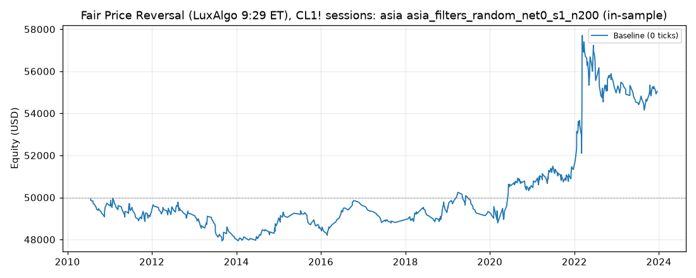

# Fair Price Reversal (LuxAlgo 9:29 ET), CL1! sessions: optimized `asia` (asia_filters_random_net0_s1_n200)

Generated 2026-11-04 15:05 UTC by `python -m tvtester.cli replay strategies/configs/fair_price_reversal_asia_filters_random_net0_s1_n200.json`.

> **In-sample.** Development interval only (bars before 2024-01-01 UTC). Picked by search `results/fair_price_reversal/search/asia_filters_random_net0_s1_n200` (trial 67, objective `net0`); see its report for how many trials it took. Nothing here shows a tradable edge: out-of-sample validation is a later feature.

**Parameters:** `atr_mult=2.0`, `session=asia`, `swing=1`, `target=rr2`, `window=30`

**Filters:** `anchor_body_atr <= 0.7`, `range_ratio >= 0.8`

Replay matches the search trial: **yes**.

## Against the baseline (same interval, same costs)

| Scenario | Baseline net | Optimized net | Baseline trades | Optimized trades | Baseline PF | Optimized PF | Baseline max DD | Optimized max DD |
|---|---|---|---|---|---|---|---|---|
| 0 ticks | -1,376.20 USD | 5,038.40 USD | 1,310 | 580 | 0.985 | 1.123 | 8,097.82 USD | 3,631.80 USD |

## Results after commission

### Overview

| Metric | Value |
|---|---|
| Net profit | 5,038.40 USD (10.08%) |
| Total closed trades | 580 |
| Percent profitable | 34.31% |
| Profit factor | 1.123 |
| Max equity drawdown | 3,631.80 USD (7.26%) |
| Avg trade | 8.69 USD |
| Avg # bars in trades | 47 |

### Performance

| Metric | All | Long | Short |
|---|---|---|---|
| Net profit | 5,038.40 USD (10.08%) | 7,812.24 USD (15.62%) | -2,773.84 USD (-5.55%) |
| Gross profit | 45,940.02 USD (91.88%) | 27,283.88 USD (54.57%) | 18,656.14 USD (37.31%) |
| Gross loss | 40,901.62 USD (81.80%) | 19,471.64 USD (38.94%) | 21,429.98 USD (42.86%) |
| Commission paid | 2,331.60 USD | 1,157.76 USD | 1,173.84 USD |

| Account | Value |
|---|---|
| Initial capital | 50,000.00 USD |
| Buy & hold return (TV-style, all capital at the first entry) | -4,051.79 USD (-8.10%) |
| Max equity run-up (intrabar) | 9,803.40 USD (19.61%) |
| Max equity drawdown (intrabar) | 3,631.80 USD (7.26%) |
| Open P&L | 0.00 USD |
| Max contracts held | 1 |

### Trades analysis

| Metric | All | Long | Short |
|---|---|---|---|
| Total closed trades | 580 | 288 | 292 |
| Winning trades | 199 | 106 | 93 |
| Losing trades | 381 | 182 | 199 |
| Even trades | 0 | 0 | 0 |
| Percent profitable | 34.31% | 36.81% | 31.85% |
| Avg P&L | 8.69 USD | 27.13 USD | -9.50 USD |
| Avg P&L % | 0.01% | 0.04% | -0.02% |
| Avg winning trade | 230.85 USD | 257.40 USD | 200.60 USD |
| Avg losing trade | 107.35 USD | 106.99 USD | 107.69 USD |
| Ratio avg win / avg loss | 2.150 | 2.406 | 1.863 |
| Largest winning trade | 2,655.98 USD | 2,655.98 USD | 915.98 USD |
| Largest winning trade % | 3.02% | 3.02% | 0.86% |
| Largest losing trade | 814.02 USD | 814.02 USD | 624.02 USD |
| Largest losing trade % | 1.80% | 1.34% | 1.80% |
| Avg # bars in trades | 47 | 49 | 45 |
| Avg # bars in winning trades | 76 | 79 | 72 |
| Avg # bars in losing trades | 32 | 31 | 32 |

### Risk/performance ratios

| Metric | Value |
|---|---|
| Sharpe ratio | -0.133 |
| Sortino ratio | -0.219 |
| Profit factor | 1.123 |
| Margin calls | 0 |

### By year (extra)

| Year | Trades | Net profit | % profitable | Profit factor |
|---|---|---|---|---|
| 2010 | 19 | -306.38 USD | 21.05% | 0.703 |
| 2011 | 52 | -339.04 USD | 30.77% | 0.903 |
| 2012 | 37 | -148.74 USD | 32.43% | 0.939 |
| 2013 | 50 | -1,191.00 USD | 26.00% | 0.591 |
| 2014 | 33 | 737.34 USD | 42.42% | 1.638 |
| 2015 | 35 | -200.70 USD | 31.43% | 0.891 |
| 2016 | 27 | 1,091.46 USD | 55.56% | 2.151 |
| 2017 | 25 | -830.50 USD | 12.00% | 0.257 |
| 2018 | 44 | 473.12 USD | 38.64% | 1.231 |
| 2019 | 35 | -0.70 USD | 31.43% | 1.000 |
| 2020 | 48 | 1,277.04 USD | 41.67% | 1.349 |
| 2021 | 51 | 764.98 USD | 33.33% | 1.202 |
| 2022 | 76 | 3,644.48 USD | 38.16% | 1.329 |
| 2023 | 48 | 67.04 USD | 35.42% | 1.019 |
