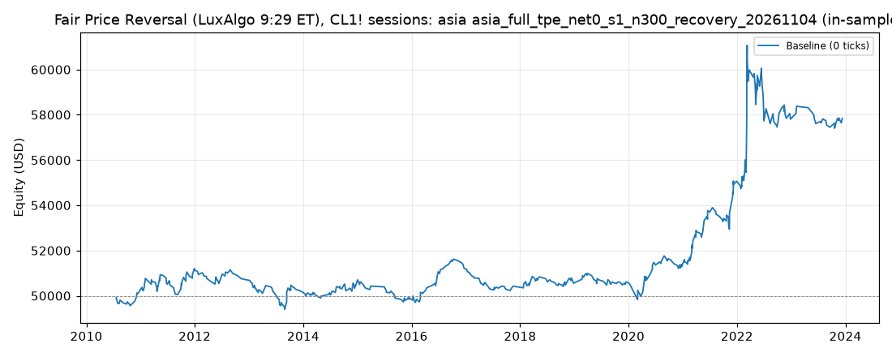

# Fair Price Reversal (LuxAlgo 9:29 ET), CL1! sessions: optimized `asia` (asia_full_tpe_net0_s1_n300_recovery_20261104)

Generated 2026-11-04 15:06 UTC by `python -m tvtester.cli replay strategies/configs/fair_price_reversal_asia_full_tpe_net0_s1_n300_recovery_20261104.json`.

> **In-sample.** Development interval only (bars before 2024-01-01 UTC). Picked by search `results/fair_price_reversal/search/asia_full_tpe_net0_s1_n300_recovery_20261104` (trial 273, objective `net0`); see its report for how many trials it took. Nothing here shows a tradable edge: out-of-sample validation is a later feature.

**Parameters:** `atr_mult=2.0`, `session=asia`, `swing=1`, `target=rr2`, `window=60`

**Filters:** `anchor_body_atr <= 0.3`, `minutes_from_open <= 45`, `range_ratio >= 0.8`

Replay matches the search trial: **yes**.

## Against the baseline (same interval, same costs)

| Scenario | Baseline net | Optimized net | Baseline trades | Optimized trades | Baseline PF | Optimized PF | Baseline max DD | Optimized max DD |
|---|---|---|---|---|---|---|---|---|
| 0 ticks | -1,376.20 USD | 7,838.14 USD | 1,310 | 493 | 0.985 | 1.238 | 8,097.82 USD | 3,795.22 USD |

## Results after commission

### Overview

| Metric | Value |
|---|---|
| Net profit | 7,838.14 USD (15.68%) |
| Total closed trades | 493 |
| Percent profitable | 35.70% |
| Profit factor | 1.238 |
| Max equity drawdown | 3,795.22 USD (7.59%) |
| Avg trade | 15.90 USD |
| Avg # bars in trades | 53 |

### Performance

| Metric | All | Long | Short |
|---|---|---|---|
| Net profit | 7,838.14 USD (15.68%) | 6,805.20 USD (13.61%) | 1,032.94 USD (2.07%) |
| Gross profit | 40,792.48 USD (81.58%) | 22,162.22 USD (44.32%) | 18,630.26 USD (37.26%) |
| Gross loss | 32,954.34 USD (65.91%) | 15,357.02 USD (30.71%) | 17,597.32 USD (35.19%) |
| Commission paid | 1,981.86 USD | 964.80 USD | 1,017.06 USD |

| Account | Value |
|---|---|
| Initial capital | 50,000.00 USD |
| Buy & hold return (TV-style, all capital at the first entry) | -4,051.79 USD (-8.10%) |
| Max equity run-up (intrabar) | 12,277.82 USD (24.56%) |
| Max equity drawdown (intrabar) | 3,795.22 USD (7.59%) |
| Open P&L | 0.00 USD |
| Max contracts held | 1 |

### Trades analysis

| Metric | All | Long | Short |
|---|---|---|---|
| Total closed trades | 493 | 240 | 253 |
| Winning trades | 176 | 89 | 87 |
| Losing trades | 317 | 151 | 166 |
| Even trades | 0 | 0 | 0 |
| Percent profitable | 35.70% | 37.08% | 34.39% |
| Avg P&L | 15.90 USD | 28.36 USD | 4.08 USD |
| Avg P&L % | 0.02% | 0.05% | -0.00% |
| Avg winning trade | 231.78 USD | 249.01 USD | 214.14 USD |
| Avg losing trade | 103.96 USD | 101.70 USD | 106.01 USD |
| Ratio avg win / avg loss | 2.230 | 2.448 | 2.020 |
| Largest winning trade | 2,655.98 USD | 2,655.98 USD | 915.98 USD |
| Largest winning trade % | 3.02% | 3.02% | 0.86% |
| Largest losing trade | 754.02 USD | 754.02 USD | 624.02 USD |
| Largest losing trade % | 1.39% | 1.34% | 1.39% |
| Avg # bars in trades | 53 | 54 | 53 |
| Avg # bars in winning trades | 82 | 88 | 77 |
| Avg # bars in losing trades | 37 | 34 | 40 |

### Risk/performance ratios

| Metric | Value |
|---|---|
| Sharpe ratio | -0.089 |
| Sortino ratio | -0.165 |
| Profit factor | 1.238 |
| Margin calls | 0 |

### By year (extra)

| Year | Trades | Net profit | % profitable | Profit factor |
|---|---|---|---|---|
| 2010 | 16 | 95.68 USD | 31.25% | 1.132 |
| 2011 | 44 | 1,043.12 USD | 38.64% | 1.391 |
| 2012 | 23 | -382.46 USD | 21.74% | 0.745 |
| 2013 | 49 | -606.98 USD | 26.53% | 0.761 |
| 2014 | 40 | 279.20 USD | 35.00% | 1.184 |
| 2015 | 29 | -566.58 USD | 27.59% | 0.636 |
| 2016 | 32 | 1,351.36 USD | 56.25% | 2.189 |
| 2017 | 32 | -788.64 USD | 18.75% | 0.438 |
| 2018 | 35 | 129.30 USD | 34.29% | 1.075 |
| 2019 | 28 | 17.44 USD | 35.71% | 1.013 |
| 2020 | 33 | 717.34 USD | 42.42% | 1.298 |
| 2021 | 48 | 3,777.04 USD | 45.83% | 2.386 |
| 2022 | 60 | 2,738.80 USD | 38.33% | 1.275 |
| 2023 | 24 | 33.52 USD | 37.50% | 1.019 |
