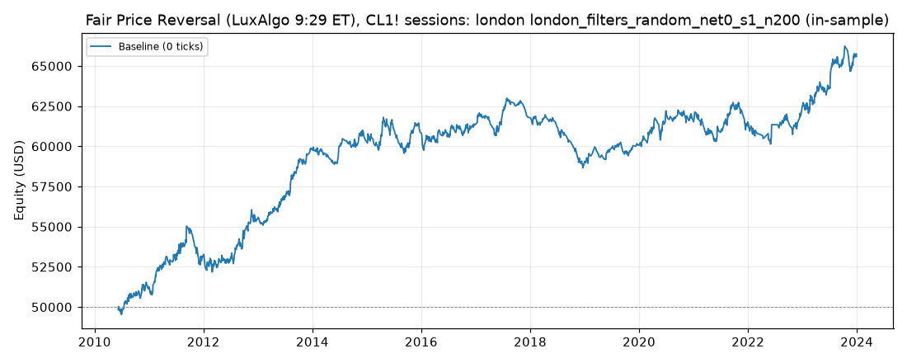

# Fair Price Reversal (LuxAlgo 9:29 ET), CL1! sessions: optimized `london` (london_filters_random_net0_s1_n200)

Generated 2026-11-04 14:10 UTC by `python -m tvtester.cli replay strategies/configs/fair_price_reversal_london_filters_random_net0_s1_n200.json`.

> **In-sample.** Development interval only (bars before 2024-01-01 UTC). Picked by search `results/fair_price_reversal/search/london_filters_random_net0_s1_n200` (trial 168, objective `net0`); see its report for how many trials it took. Nothing here shows a tradable edge: out-of-sample validation is a later feature.

**Parameters:** `atr_mult=1.5`, `session=london`, `swing=1`, `target=rr2`, `window=30`

**Filters:** `anchor_body_atr <= 1.9`, `risk_ticks <= 20`

Replay matches the search trial: **yes**.

## Against the baseline (same interval, same costs)

| Scenario | Baseline net | Optimized net | Baseline trades | Optimized trades | Baseline PF | Optimized PF | Baseline max DD | Optimized max DD |
|---|---|---|---|---|---|---|---|---|
| 0 ticks | 11,237.30 USD | 15,599.54 USD | 1,635 | 1,423 | 1.086 | 1.166 | 7,901.56 USD | 4,338.58 USD |

## Results after commission

### Overview

| Metric | Value |
|---|---|
| Net profit | 15,599.54 USD (31.20%) |
| Total closed trades | 1,423 |
| Percent profitable | 36.54% |
| Profit factor | 1.166 |
| Max equity drawdown | 4,338.58 USD (8.68%) |
| Avg trade | 10.96 USD |
| Avg # bars in trades | 27 |

### Performance

| Metric | All | Long | Short |
|---|---|---|---|
| Net profit | 15,599.54 USD (31.20%) | 8,261.18 USD (16.52%) | 7,338.36 USD (14.68%) |
| Gross profit | 109,569.60 USD (219.14%) | 56,750.68 USD (113.50%) | 52,818.92 USD (105.64%) |
| Gross loss | 93,970.06 USD (187.94%) | 48,489.50 USD (96.98%) | 45,480.56 USD (90.96%) |
| Commission paid | 5,720.46 USD | 2,978.82 USD | 2,741.64 USD |

| Account | Value |
|---|---|
| Initial capital | 50,000.00 USD |
| Buy & hold return (TV-style, all capital at the first entry) | -472.16 USD (-0.94%) |
| Max equity run-up (intrabar) | 16,782.30 USD (33.56%) |
| Max equity drawdown (intrabar) | 4,338.58 USD (8.68%) |
| Open P&L | 0.00 USD |
| Max contracts held | 1 |

### Trades analysis

| Metric | All | Long | Short |
|---|---|---|---|
| Total closed trades | 1,423 | 741 | 682 |
| Winning trades | 520 | 266 | 254 |
| Losing trades | 903 | 475 | 428 |
| Even trades | 0 | 0 | 0 |
| Percent profitable | 36.54% | 35.90% | 37.24% |
| Avg P&L | 10.96 USD | 11.15 USD | 10.76 USD |
| Avg P&L % | 0.01% | 0.02% | 0.01% |
| Avg winning trade | 210.71 USD | 213.35 USD | 207.95 USD |
| Avg losing trade | 104.06 USD | 102.08 USD | 106.26 USD |
| Ratio avg win / avg loss | 2.025 | 2.090 | 1.957 |
| Largest winning trade | 455.98 USD | 455.98 USD | 415.98 USD |
| Largest winning trade % | 1.53% | 0.90% | 1.53% |
| Largest losing trade | 204.02 USD | 204.02 USD | 204.02 USD |
| Largest losing trade % | 1.19% | 0.72% | 1.19% |
| Avg # bars in trades | 27 | 28 | 25 |
| Avg # bars in winning trades | 37 | 41 | 33 |
| Avg # bars in losing trades | 21 | 21 | 21 |

### Risk/performance ratios

| Metric | Value |
|---|---|
| Sharpe ratio | 0.004 |
| Sortino ratio | 0.006 |
| Profit factor | 1.166 |
| Margin calls | 0 |

### By year (extra)

| Year | Trades | Net profit | % profitable | Profit factor |
|---|---|---|---|---|
| 2010 | 63 | 1,256.74 USD | 38.10% | 1.305 |
| 2011 | 108 | 1,805.84 USD | 37.96% | 1.210 |
| 2012 | 124 | 2,361.52 USD | 38.71% | 1.268 |
| 2013 | 106 | 4,453.88 USD | 49.06% | 1.913 |
| 2014 | 95 | 508.10 USD | 34.74% | 1.095 |
| 2015 | 133 | 435.34 USD | 33.08% | 1.050 |
| 2016 | 119 | 491.62 USD | 35.29% | 1.068 |
| 2017 | 105 | 507.90 USD | 33.33% | 1.101 |
| 2018 | 98 | -2,753.96 USD | 24.49% | 0.595 |
| 2019 | 78 | 986.44 USD | 38.46% | 1.250 |
| 2020 | 100 | 1,468.00 USD | 36.00% | 1.218 |
| 2021 | 112 | -10.24 USD | 34.82% | 0.999 |
| 2022 | 57 | 930.86 USD | 36.84% | 1.159 |
| 2023 | 125 | 3,157.50 USD | 40.80% | 1.334 |
