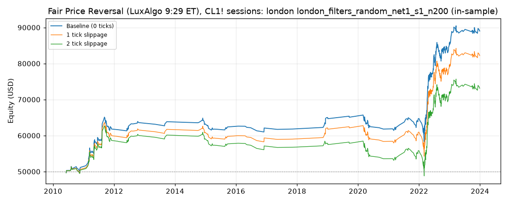

> **Superseded — 4 November 2026.** This is a historical record under previous rules.
> Current runs must use only `indicators/structure_swings.pine`; see the regenerated strategy results
> and current `net0` search/validation reports. These numbers do not establish current-rule performance.

# Fair Price Reversal (LuxAlgo 9:29 ET), CL1! sessions: optimized `london` (london_filters_random_net1_s1_n200)

Generated 2026-10-31 05:45 UTC by `python -m tvtester.cli replay strategies/configs/fair_price_reversal_london_filters_random_net1_s1_n200.json`.

> **In-sample.** Development interval only (bars before 2024-01-01 UTC). Picked by search `results/fair_price_reversal/search/london_filters_random_net1_s1_n200` (trial 89, objective `net1`); see its report for how many trials it took. Nothing here shows a tradable edge: out-of-sample validation is a later feature.

**Parameters:** `atr_mult=2.0`, `session=london`, `swing=3`, `target=rr2`, `window=120`

**Filters:** `risk_ticks >= 30`

Replay matches the search trial: **yes**.

## Against the baseline (same interval, same costs)

| Scenario | Baseline net | Optimized net | Baseline trades | Optimized trades | Baseline PF | Optimized PF | Baseline max DD | Optimized max DD |
|---|---|---|---|---|---|---|---|---|
| 0 ticks | 40,277.60 USD | 39,017.28 USD | 3,120 | 436 | 1.111 | 1.422 | 13,213.46 USD | 7,567.38 USD |
| 1 tick | -13,754.26 USD | 32,197.28 USD | 3,113 | 436 | 0.966 | 1.331 | 47,336.50 USD | 9,579.18 USD |
| 2 ticks | -70,832.10 USD | 23,121.30 USD | 3,105 | 435 | 0.842 | 1.226 | 88,522.38 USD | 14,065.16 USD |

## 0 ticks slippage

### Overview

| Metric | Value |
|---|---|
| Net profit | 39,017.28 USD (78.03%) |
| Total closed trades | 436 |
| Percent profitable | 45.64% |
| Profit factor | 1.422 |
| Max equity drawdown | 7,567.38 USD (15.13%) |
| Avg trade | 89.49 USD |
| Avg # bars in trades | 98 |

### Performance

| Metric | All | Long | Short |
|---|---|---|---|
| Net profit | 39,017.28 USD (78.03%) | 22,419.22 USD (44.84%) | 16,598.06 USD (33.20%) |
| Gross profit | 131,570.02 USD (263.14%) | 73,723.78 USD (147.45%) | 57,846.24 USD (115.69%) |
| Gross loss | 92,552.74 USD (185.11%) | 51,304.56 USD (102.61%) | 41,248.18 USD (82.50%) |
| Commission paid | 1,752.72 USD | 960.78 USD | 791.94 USD |

| Account | Value |
|---|---|
| Initial capital | 50,000.00 USD |
| Buy & hold return (TV-style, all capital at the first entry) | 552.80 USD (1.11%) |
| Max equity run-up (intrabar) | 41,327.98 USD (82.66%) |
| Max equity drawdown (intrabar) | 7,567.38 USD (15.13%) |
| Open P&L | 0.00 USD |
| Max contracts held | 1 |

### Trades analysis

| Metric | All | Long | Short |
|---|---|---|---|
| Total closed trades | 436 | 239 | 197 |
| Winning trades | 199 | 111 | 88 |
| Losing trades | 237 | 128 | 109 |
| Even trades | 0 | 0 | 0 |
| Percent profitable | 45.64% | 46.44% | 44.67% |
| Avg P&L | 89.49 USD | 93.80 USD | 84.25 USD |
| Avg P&L % | 0.08% | 0.11% | 0.04% |
| Avg winning trade | 661.16 USD | 664.18 USD | 657.34 USD |
| Avg losing trade | 390.52 USD | 400.82 USD | 378.42 USD |
| Ratio avg win / avg loss | 1.693 | 1.657 | 1.737 |
| Largest winning trade | 2,255.98 USD | 2,255.98 USD | 1,635.98 USD |
| Largest winning trade % | 5.62% | 5.62% | 5.09% |
| Largest losing trade | 1,284.02 USD | 1,284.02 USD | 984.02 USD |
| Largest losing trade % | 3.38% | 3.38% | 3.09% |
| Avg # bars in trades | 98 | 100 | 95 |
| Avg # bars in winning trades | 134 | 139 | 127 |
| Avg # bars in losing trades | 68 | 67 | 69 |

### Risk/performance ratios

| Metric | Value |
|---|---|
| Sharpe ratio | 0.103 |
| Sortino ratio | 0.307 |
| Profit factor | 1.422 |
| Margin calls | 0 |

### By year (extra)

| Year | Trades | Net profit | % profitable | Profit factor |
|---|---|---|---|---|
| 2010 | 14 | 1,153.72 USD | 57.14% | 1.533 |
| 2011 | 71 | 10,664.58 USD | 47.89% | 1.775 |
| 2012 | 14 | 1,773.72 USD | 50.00% | 1.965 |
| 2013 | 4 | 253.92 USD | 50.00% | 1.286 |
| 2014 | 12 | -598.24 USD | 50.00% | 0.735 |
| 2015 | 16 | -854.32 USD | 31.25% | 0.693 |
| 2016 | 8 | -292.16 USD | 37.50% | 0.819 |
| 2017 | 2 | -288.04 USD | 50.00% | 0.250 |
| 2018 | 8 | 3,137.84 USD | 75.00% | 10.565 |
| 2019 | 4 | 133.92 USD | 50.00% | 1.213 |
| 2020 | 28 | -3,282.56 USD | 35.71% | 0.549 |
| 2021 | 26 | 2,945.48 USD | 50.00% | 1.647 |
| 2022 | 180 | 21,036.40 USD | 43.33% | 1.472 |
| 2023 | 49 | 3,233.02 USD | 48.98% | 1.341 |

## 1 tick slippage

### Overview

| Metric | Value |
|---|---|
| Net profit | 32,197.28 USD (64.39%) |
| Total closed trades | 436 |
| Percent profitable | 45.41% |
| Profit factor | 1.331 |
| Max equity drawdown | 9,579.18 USD (19.16%) |
| Avg trade | 73.85 USD |
| Avg # bars in trades | 98 |

### Performance

| Metric | All | Long | Short |
|---|---|---|---|
| Net profit | 32,197.28 USD (64.39%) | 18,339.22 USD (36.68%) | 13,858.06 USD (27.72%) |
| Gross profit | 129,504.04 USD (259.01%) | 72,203.78 USD (144.41%) | 57,300.26 USD (114.60%) |
| Gross loss | 97,306.76 USD (194.61%) | 53,864.56 USD (107.73%) | 43,442.20 USD (86.88%) |
| Commission paid | 1,752.72 USD | 960.78 USD | 791.94 USD |

| Account | Value |
|---|---|
| Initial capital | 50,000.00 USD |
| Buy & hold return (TV-style, all capital at the first entry) | 559.97 USD (1.12%) |
| Max equity run-up (intrabar) | 35,077.98 USD (70.16%) |
| Max equity drawdown (intrabar) | 9,579.18 USD (19.16%) |
| Open P&L | 0.00 USD |
| Max contracts held | 1 |

### Trades analysis

| Metric | All | Long | Short |
|---|---|---|---|
| Total closed trades | 436 | 239 | 197 |
| Winning trades | 198 | 111 | 87 |
| Losing trades | 238 | 128 | 110 |
| Even trades | 0 | 0 | 0 |
| Percent profitable | 45.41% | 46.44% | 44.16% |
| Avg P&L | 73.85 USD | 76.73 USD | 70.35 USD |
| Avg P&L % | 0.05% | 0.09% | 0.02% |
| Avg winning trade | 654.06 USD | 650.48 USD | 658.62 USD |
| Avg losing trade | 408.85 USD | 420.82 USD | 394.93 USD |
| Ratio avg win / avg loss | 1.600 | 1.546 | 1.668 |
| Largest winning trade | 2,255.98 USD | 2,255.98 USD | 1,635.98 USD |
| Largest winning trade % | 5.61% | 5.61% | 5.09% |
| Largest losing trade | 1,304.02 USD | 1,304.02 USD | 1,004.02 USD |
| Largest losing trade % | 3.57% | 3.57% | 3.23% |
| Avg # bars in trades | 98 | 101 | 95 |
| Avg # bars in winning trades | 134 | 141 | 126 |
| Avg # bars in losing trades | 69 | 67 | 71 |

### Risk/performance ratios

| Metric | Value |
|---|---|
| Sharpe ratio | 0.076 |
| Sortino ratio | 0.207 |
| Profit factor | 1.331 |
| Margin calls | 0 |

## 2 ticks slippage

### Overview

| Metric | Value |
|---|---|
| Net profit | 23,121.30 USD (46.24%) |
| Total closed trades | 435 |
| Percent profitable | 44.37% |
| Profit factor | 1.226 |
| Max equity drawdown | 14,065.16 USD (28.13%) |
| Avg trade | 53.15 USD |
| Avg # bars in trades | 100 |

### Performance

| Metric | All | Long | Short |
|---|---|---|---|
| Net profit | 23,121.30 USD (46.24%) | 13,323.24 USD (26.65%) | 9,798.06 USD (19.60%) |
| Gross profit | 125,654.14 USD (251.31%) | 69,789.86 USD (139.58%) | 55,864.28 USD (111.73%) |
| Gross loss | 102,532.84 USD (205.07%) | 56,466.62 USD (112.93%) | 46,066.22 USD (92.13%) |
| Commission paid | 1,748.70 USD | 956.76 USD | 791.94 USD |

| Account | Value |
|---|---|
| Initial capital | 50,000.00 USD |
| Buy & hold return (TV-style, all capital at the first entry) | 567.13 USD (1.13%) |
| Max equity run-up (intrabar) | 27,420.42 USD (54.84%) |
| Max equity drawdown (intrabar) | 14,065.16 USD (28.13%) |
| Open P&L | 0.00 USD |
| Max contracts held | 1 |

### Trades analysis

| Metric | All | Long | Short |
|---|---|---|---|
| Total closed trades | 435 | 238 | 197 |
| Winning trades | 193 | 107 | 86 |
| Losing trades | 242 | 131 | 111 |
| Even trades | 0 | 0 | 0 |
| Percent profitable | 44.37% | 44.96% | 43.65% |
| Avg P&L | 53.15 USD | 55.98 USD | 49.74 USD |
| Avg P&L % | 0.02% | 0.05% | -0.02% |
| Avg winning trade | 651.06 USD | 652.24 USD | 649.58 USD |
| Avg losing trade | 423.69 USD | 431.04 USD | 415.01 USD |
| Ratio avg win / avg loss | 1.537 | 1.513 | 1.565 |
| Largest winning trade | 2,255.98 USD | 2,255.98 USD | 1,635.98 USD |
| Largest winning trade % | 5.61% | 5.61% | 5.09% |
| Largest losing trade | 1,324.02 USD | 1,324.02 USD | 1,024.02 USD |
| Largest losing trade % | 3.75% | 3.75% | 3.38% |
| Avg # bars in trades | 100 | 103 | 97 |
| Avg # bars in winning trades | 137 | 143 | 130 |
| Avg # bars in losing trades | 71 | 71 | 71 |

### Risk/performance ratios

| Metric | Value |
|---|---|
| Sharpe ratio | 0.041 |
| Sortino ratio | 0.101 |
| Profit factor | 1.226 |
| Margin calls | 0 |
