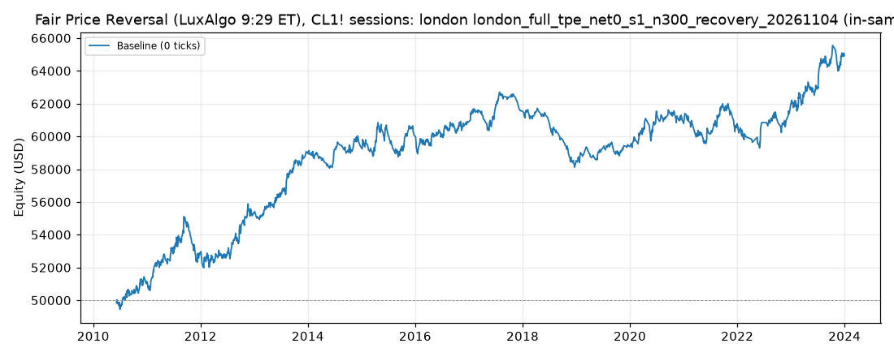

# Fair Price Reversal (LuxAlgo 9:29 ET), CL1! sessions: optimized `london` (london_full_tpe_net0_s1_n300_recovery_20261104)

Generated 2026-11-04 15:05 UTC by `python -m tvtester.cli replay strategies/configs/fair_price_reversal_london_full_tpe_net0_s1_n300_recovery_20261104.json`.

> **In-sample.** Development interval only (bars before 2024-01-01 UTC). Picked by search `results/fair_price_reversal/search/london_full_tpe_net0_s1_n300_recovery_20261104` (trial 271, objective `net0`); see its report for how many trials it took. Nothing here shows a tradable edge: out-of-sample validation is a later feature.

**Parameters:** `atr_mult=1.5`, `session=london`, `swing=1`, `target=rr2`, `window=30`

**Filters:** `risk_ticks <= 20`

Replay matches the search trial: **yes**.

## Against the baseline (same interval, same costs)

| Scenario | Baseline net | Optimized net | Baseline trades | Optimized trades | Baseline PF | Optimized PF | Baseline max DD | Optimized max DD |
|---|---|---|---|---|---|---|---|---|
| 0 ticks | 11,237.30 USD | 14,922.76 USD | 1,635 | 1,462 | 1.086 | 1.154 | 7,901.56 USD | 4,578.68 USD |

## Results after commission

### Overview

| Metric | Value |
|---|---|
| Net profit | 14,922.76 USD (29.85%) |
| Total closed trades | 1,462 |
| Percent profitable | 36.32% |
| Profit factor | 1.154 |
| Max equity drawdown | 4,578.68 USD (9.16%) |
| Avg trade | 10.21 USD |
| Avg # bars in trades | 27 |

### Performance

| Metric | All | Long | Short |
|---|---|---|---|
| Net profit | 14,922.76 USD (29.85%) | 7,576.76 USD (15.15%) | 7,346.00 USD (14.69%) |
| Gross profit | 111,845.38 USD (223.69%) | 57,634.60 USD (115.27%) | 54,210.78 USD (108.42%) |
| Gross loss | 96,922.62 USD (193.85%) | 50,057.84 USD (100.12%) | 46,864.78 USD (93.73%) |
| Commission paid | 5,877.24 USD | 3,063.24 USD | 2,814.00 USD |

| Account | Value |
|---|---|
| Initial capital | 50,000.00 USD |
| Buy & hold return (TV-style, all capital at the first entry) | -472.16 USD (-0.94%) |
| Max equity run-up (intrabar) | 16,189.54 USD (32.38%) |
| Max equity drawdown (intrabar) | 4,578.68 USD (9.16%) |
| Open P&L | 0.00 USD |
| Max contracts held | 1 |

### Trades analysis

| Metric | All | Long | Short |
|---|---|---|---|
| Total closed trades | 1,462 | 762 | 700 |
| Winning trades | 531 | 270 | 261 |
| Losing trades | 931 | 492 | 439 |
| Even trades | 0 | 0 | 0 |
| Percent profitable | 36.32% | 35.43% | 37.29% |
| Avg P&L | 10.21 USD | 9.94 USD | 10.49 USD |
| Avg P&L % | 0.01% | 0.01% | 0.01% |
| Avg winning trade | 210.63 USD | 213.46 USD | 207.70 USD |
| Avg losing trade | 104.11 USD | 101.74 USD | 106.75 USD |
| Ratio avg win / avg loss | 2.023 | 2.098 | 1.946 |
| Largest winning trade | 455.98 USD | 455.98 USD | 415.98 USD |
| Largest winning trade % | 1.53% | 0.90% | 1.53% |
| Largest losing trade | 204.02 USD | 204.02 USD | 204.02 USD |
| Largest losing trade % | 1.19% | 0.72% | 1.19% |
| Avg # bars in trades | 27 | 28 | 26 |
| Avg # bars in winning trades | 37 | 40 | 34 |
| Avg # bars in losing trades | 21 | 21 | 21 |

### Risk/performance ratios

| Metric | Value |
|---|---|
| Sharpe ratio | -0.003 |
| Sortino ratio | -0.005 |
| Profit factor | 1.154 |
| Margin calls | 0 |

### By year (extra)

| Year | Trades | Net profit | % profitable | Profit factor |
|---|---|---|---|---|
| 2010 | 67 | 1,150.66 USD | 37.31% | 1.261 |
| 2011 | 116 | 1,613.68 USD | 37.07% | 1.171 |
| 2012 | 125 | 2,497.50 USD | 39.20% | 1.284 |
| 2013 | 112 | 3,799.76 USD | 46.43% | 1.687 |
| 2014 | 97 | 360.06 USD | 34.02% | 1.066 |
| 2015 | 134 | 591.32 USD | 33.58% | 1.068 |
| 2016 | 121 | 823.58 USD | 36.36% | 1.113 |
| 2017 | 108 | 745.84 USD | 34.26% | 1.146 |
| 2018 | 101 | -3,056.02 USD | 23.76% | 0.570 |
| 2019 | 80 | 858.40 USD | 37.50% | 1.210 |
| 2020 | 104 | 1,401.92 USD | 35.58% | 1.200 |
| 2021 | 112 | -10.24 USD | 34.82% | 0.999 |
| 2022 | 59 | 1,162.82 USD | 37.29% | 1.195 |
| 2023 | 126 | 2,983.48 USD | 40.48% | 1.310 |
