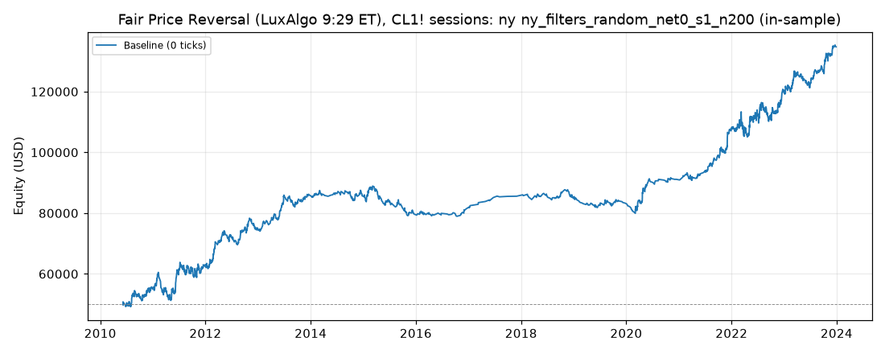

# Fair Price Reversal (LuxAlgo 9:29 ET), CL1! sessions: optimized `ny` (ny_filters_random_net0_s1_n200)

Generated 2026-11-04 14:09 UTC by `python -m tvtester.cli replay strategies/configs/fair_price_reversal_ny_filters_random_net0_s1_n200.json`.

> **In-sample.** Development interval only (bars before 2024-01-01 UTC). Picked by search `results/fair_price_reversal/search/ny_filters_random_net0_s1_n200` (trial 4, objective `net0`); see its report for how many trials it took. Nothing here shows a tradable edge: out-of-sample validation is a later feature.

**Parameters:** `atr_mult=0.5`, `session=ny`, `swing=1`, `target=rr2`, `window=120`

**Filters:** `risk_ticks >= 22`

Replay matches the search trial: **yes**.

## Against the baseline (same interval, same costs)

| Scenario | Baseline net | Optimized net | Baseline trades | Optimized trades | Baseline PF | Optimized PF | Baseline max DD | Optimized max DD |
|---|---|---|---|---|---|---|---|---|
| 0 ticks | 69,157.02 USD | 84,729.22 USD | 3,849 | 1,739 | 1.123 | 1.237 | 24,678.62 USD | 10,250.84 USD |

## Results after commission

### Overview

| Metric | Value |
|---|---|
| Net profit | 84,729.22 USD (169.46%) |
| Total closed trades | 1,739 |
| Percent profitable | 38.93% |
| Profit factor | 1.237 |
| Max equity drawdown | 10,250.84 USD (20.50%) |
| Avg trade | 48.72 USD |
| Avg # bars in trades | 56 |

### Performance

| Metric | All | Long | Short |
|---|---|---|---|
| Net profit | 84,729.22 USD (169.46%) | 56,129.64 USD (112.26%) | 28,599.58 USD (57.20%) |
| Gross profit | 441,558.46 USD (883.12%) | 246,352.60 USD (492.71%) | 195,205.86 USD (390.41%) |
| Gross loss | 356,829.24 USD (713.66%) | 190,222.96 USD (380.45%) | 166,606.28 USD (333.21%) |
| Commission paid | 6,990.78 USD | 3,690.36 USD | 3,300.42 USD |

| Account | Value |
|---|---|
| Initial capital | 50,000.00 USD |
| Buy & hold return (TV-style, all capital at the first entry) | -174.63 USD (-0.35%) |
| Max equity run-up (intrabar) | 86,253.84 USD (172.51%) |
| Max equity drawdown (intrabar) | 10,250.84 USD (20.50%) |
| Open P&L | 0.00 USD |
| Max contracts held | 1 |

### Trades analysis

| Metric | All | Long | Short |
|---|---|---|---|
| Total closed trades | 1,739 | 918 | 821 |
| Winning trades | 677 | 370 | 307 |
| Losing trades | 1,062 | 548 | 514 |
| Even trades | 0 | 0 | 0 |
| Percent profitable | 38.93% | 40.31% | 37.39% |
| Avg P&L | 48.72 USD | 61.14 USD | 34.84 USD |
| Avg P&L % | 0.08% | 0.11% | 0.04% |
| Avg winning trade | 652.23 USD | 665.82 USD | 635.85 USD |
| Avg losing trade | 336.00 USD | 347.12 USD | 324.14 USD |
| Ratio avg win / avg loss | 1.941 | 1.918 | 1.962 |
| Largest winning trade | 3,135.98 USD | 3,135.98 USD | 1,795.98 USD |
| Largest winning trade % | 8.62% | 8.62% | 7.23% |
| Largest losing trade | 1,854.02 USD | 1,854.02 USD | 924.02 USD |
| Largest losing trade % | 4.38% | 2.54% | 4.38% |
| Avg # bars in trades | 56 | 57 | 56 |
| Avg # bars in winning trades | 85 | 88 | 81 |
| Avg # bars in losing trades | 38 | 36 | 41 |

### Risk/performance ratios

| Metric | Value |
|---|---|
| Sharpe ratio | 0.198 |
| Sortino ratio | 0.394 |
| Profit factor | 1.237 |
| Margin calls | 0 |

### By year (extra)

| Year | Trades | Net profit | % profitable | Profit factor |
|---|---|---|---|---|
| 2010 | 120 | 5,457.60 USD | 40.00% | 1.242 |
| 2011 | 235 | 7,625.30 USD | 36.17% | 1.137 |
| 2012 | 176 | 11,422.48 USD | 42.05% | 1.343 |
| 2013 | 129 | 11,221.42 USD | 43.41% | 1.526 |
| 2014 | 91 | -25.82 USD | 36.26% | 0.998 |
| 2015 | 136 | -6,056.72 USD | 29.41% | 0.787 |
| 2016 | 47 | 1,741.06 USD | 40.43% | 1.242 |
| 2017 | 13 | 4,177.74 USD | 76.92% | 6.951 |
| 2018 | 65 | -651.30 USD | 32.31% | 0.947 |
| 2019 | 70 | -1,681.40 USD | 34.29% | 0.875 |
| 2020 | 86 | 7,904.28 USD | 43.02% | 1.537 |
| 2021 | 125 | 16,627.50 USD | 46.40% | 1.818 |
| 2022 | 258 | 12,502.84 USD | 36.82% | 1.169 |
| 2023 | 188 | 14,464.24 USD | 40.96% | 1.392 |
