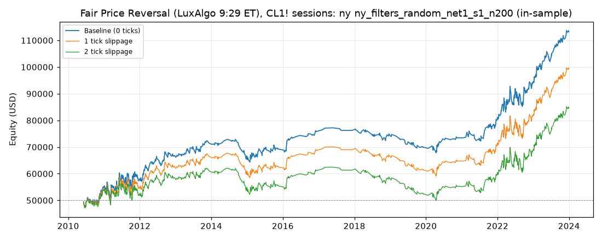

> **Superseded — 4 November 2026.** This is a historical record under previous rules.
> Current runs must use only `indicators/structure_swings.pine`; see the regenerated strategy results
> and current `net0` search/validation reports. These numbers do not establish current-rule performance.

# Fair Price Reversal (LuxAlgo 9:29 ET), CL1! sessions: optimized `ny` (ny_filters_random_net1_s1_n200)

Generated 2026-10-31 05:46 UTC by `python -m tvtester.cli replay strategies/configs/fair_price_reversal_ny_filters_random_net1_s1_n200.json`.

> **In-sample.** Development interval only (bars before 2024-01-01 UTC). Picked by search `results/fair_price_reversal/search/ny_filters_random_net1_s1_n200` (trial 85, objective `net1`); see its report for how many trials it took. Nothing here shows a tradable edge: out-of-sample validation is a later feature.

**Parameters:** `atr_mult=0.5`, `session=ny`, `swing=3`, `target=rr2`, `window=120`

**Filters:** `anchor_body_atr >= 0.3`, `risk_ticks >= 32`

Replay matches the search trial: **yes**.

## Against the baseline (same interval, same costs)

| Scenario | Baseline net | Optimized net | Baseline trades | Optimized trades | Baseline PF | Optimized PF | Baseline max DD | Optimized max DD |
|---|---|---|---|---|---|---|---|---|
| 0 ticks | 55,002.92 USD | 63,293.46 USD | 3,054 | 927 | 1.091 | 1.261 | 19,966.92 USD | 9,717.98 USD |
| 1 tick | 2,423.02 USD | 49,297.48 USD | 3,049 | 926 | 1.004 | 1.195 | 37,656.82 USD | 11,089.94 USD |
| 2 ticks | -49,304.92 USD | 34,591.50 USD | 3,046 | 925 | 0.928 | 1.132 | 74,110.46 USD | 12,699.94 USD |

## 0 ticks slippage

### Overview

| Metric | Value |
|---|---|
| Net profit | 63,293.46 USD (126.59%) |
| Total closed trades | 927 |
| Percent profitable | 42.50% |
| Profit factor | 1.261 |
| Max equity drawdown | 9,717.98 USD (19.44%) |
| Avg trade | 68.28 USD |
| Avg # bars in trades | 98 |

### Performance

| Metric | All | Long | Short |
|---|---|---|---|
| Net profit | 63,293.46 USD (126.59%) | 42,171.76 USD (84.34%) | 21,121.70 USD (42.24%) |
| Gross profit | 305,626.12 USD (611.25%) | 173,441.58 USD (346.88%) | 132,184.54 USD (264.37%) |
| Gross loss | 242,332.66 USD (484.67%) | 131,269.82 USD (262.54%) | 111,062.84 USD (222.13%) |
| Commission paid | 3,726.54 USD | 2,058.24 USD | 1,668.30 USD |

| Account | Value |
|---|---|
| Initial capital | 50,000.00 USD |
| Buy & hold return (TV-style, all capital at the first entry) | -244.14 USD (-0.49%) |
| Max equity run-up (intrabar) | 66,673.66 USD (133.35%) |
| Max equity drawdown (intrabar) | 9,717.98 USD (19.44%) |
| Open P&L | 0.00 USD |
| Max contracts held | 1 |

### Trades analysis

| Metric | All | Long | Short |
|---|---|---|---|
| Total closed trades | 927 | 512 | 415 |
| Winning trades | 394 | 221 | 173 |
| Losing trades | 533 | 291 | 242 |
| Even trades | 0 | 0 | 0 |
| Percent profitable | 42.50% | 43.16% | 41.69% |
| Avg P&L | 68.28 USD | 82.37 USD | 50.90 USD |
| Avg P&L % | 0.11% | 0.12% | 0.09% |
| Avg winning trade | 775.70 USD | 784.80 USD | 764.07 USD |
| Avg losing trade | 454.66 USD | 451.10 USD | 458.94 USD |
| Ratio avg win / avg loss | 1.706 | 1.740 | 1.665 |
| Largest winning trade | 3,315.98 USD | 3,315.98 USD | 2,215.98 USD |
| Largest winning trade % | 13.47% | 5.70% | 13.47% |
| Largest losing trade | 1,354.02 USD | 1,174.02 USD | 1,354.02 USD |
| Largest losing trade % | 3.48% | 1.83% | 3.48% |
| Avg # bars in trades | 98 | 98 | 99 |
| Avg # bars in winning trades | 136 | 142 | 128 |
| Avg # bars in losing trades | 71 | 64 | 79 |

### Risk/performance ratios

| Metric | Value |
|---|---|
| Sharpe ratio | 0.161 |
| Sortino ratio | 0.306 |
| Profit factor | 1.261 |
| Margin calls | 0 |

### By year (extra)

| Year | Trades | Net profit | % profitable | Profit factor |
|---|---|---|---|---|
| 2010 | 60 | 4,708.80 USD | 45.00% | 1.348 |
| 2011 | 155 | 3,376.90 USD | 36.13% | 1.069 |
| 2012 | 86 | 8,394.28 USD | 47.67% | 1.460 |
| 2013 | 60 | 4,908.80 USD | 48.33% | 1.394 |
| 2014 | 44 | -5,376.88 USD | 27.27% | 0.562 |
| 2015 | 73 | 3,196.54 USD | 41.10% | 1.184 |
| 2016 | 30 | 6,549.40 USD | 56.67% | 2.458 |
| 2017 | 7 | 471.86 USD | 57.14% | 1.476 |
| 2018 | 43 | -1,812.86 USD | 34.88% | 0.842 |
| 2019 | 38 | -4,552.76 USD | 26.32% | 0.532 |
| 2020 | 35 | 3,609.30 USD | 45.71% | 1.439 |
| 2021 | 64 | 7,702.72 USD | 48.44% | 1.520 |
| 2022 | 131 | 12,433.38 USD | 38.93% | 1.255 |
| 2023 | 101 | 19,683.98 USD | 54.46% | 1.919 |

## 1 tick slippage

### Overview

| Metric | Value |
|---|---|
| Net profit | 49,297.48 USD (98.59%) |
| Total closed trades | 926 |
| Percent profitable | 42.22% |
| Profit factor | 1.195 |
| Max equity drawdown | 11,089.94 USD (22.18%) |
| Avg trade | 53.24 USD |
| Avg # bars in trades | 99 |

### Performance

| Metric | All | Long | Short |
|---|---|---|---|
| Net profit | 49,297.48 USD (98.59%) | 34,091.76 USD (68.18%) | 15,205.72 USD (30.41%) |
| Gross profit | 301,938.18 USD (603.88%) | 171,189.62 USD (342.38%) | 130,748.56 USD (261.50%) |
| Gross loss | 252,640.70 USD (505.28%) | 137,097.86 USD (274.20%) | 115,542.84 USD (231.09%) |
| Commission paid | 3,722.52 USD | 2,058.24 USD | 1,664.28 USD |

| Account | Value |
|---|---|
| Initial capital | 50,000.00 USD |
| Buy & hold return (TV-style, all capital at the first entry) | -237.20 USD (-0.47%) |
| Max equity run-up (intrabar) | 52,847.68 USD (105.70%) |
| Max equity drawdown (intrabar) | 11,089.94 USD (22.18%) |
| Open P&L | 0.00 USD |
| Max contracts held | 1 |

### Trades analysis

| Metric | All | Long | Short |
|---|---|---|---|
| Total closed trades | 926 | 512 | 414 |
| Winning trades | 391 | 219 | 172 |
| Losing trades | 535 | 293 | 242 |
| Even trades | 0 | 0 | 0 |
| Percent profitable | 42.22% | 42.77% | 41.55% |
| Avg P&L | 53.24 USD | 66.59 USD | 36.73 USD |
| Avg P&L % | 0.09% | 0.10% | 0.07% |
| Avg winning trade | 772.22 USD | 781.69 USD | 760.17 USD |
| Avg losing trade | 472.23 USD | 467.91 USD | 477.45 USD |
| Ratio avg win / avg loss | 1.635 | 1.671 | 1.592 |
| Largest winning trade | 3,315.98 USD | 3,315.98 USD | 2,215.98 USD |
| Largest winning trade % | 13.48% | 5.70% | 13.48% |
| Largest losing trade | 1,374.02 USD | 1,194.02 USD | 1,374.02 USD |
| Largest losing trade % | 3.61% | 1.92% | 3.61% |
| Avg # bars in trades | 99 | 99 | 100 |
| Avg # bars in winning trades | 137 | 144 | 129 |
| Avg # bars in losing trades | 72 | 65 | 80 |

### Risk/performance ratios

| Metric | Value |
|---|---|
| Sharpe ratio | 0.117 |
| Sortino ratio | 0.209 |
| Profit factor | 1.195 |
| Margin calls | 0 |

## 2 ticks slippage

### Overview

| Metric | Value |
|---|---|
| Net profit | 34,591.50 USD (69.18%) |
| Total closed trades | 925 |
| Percent profitable | 42.05% |
| Profit factor | 1.132 |
| Max equity drawdown | 12,699.94 USD (25.40%) |
| Avg trade | 37.40 USD |
| Avg # bars in trades | 101 |

### Performance

| Metric | All | Long | Short |
|---|---|---|---|
| Net profit | 34,591.50 USD (69.18%) | 25,651.76 USD (51.30%) | 8,939.74 USD (17.88%) |
| Gross profit | 297,456.22 USD (594.91%) | 168,609.62 USD (337.22%) | 128,846.60 USD (257.69%) |
| Gross loss | 262,864.72 USD (525.73%) | 142,957.86 USD (285.92%) | 119,906.86 USD (239.81%) |
| Commission paid | 3,718.50 USD | 2,058.24 USD | 1,660.26 USD |

| Account | Value |
|---|---|
| Initial capital | 50,000.00 USD |
| Buy & hold return (TV-style, all capital at the first entry) | -230.25 USD (-0.46%) |
| Max equity run-up (intrabar) | 38,311.70 USD (76.62%) |
| Max equity drawdown (intrabar) | 12,699.94 USD (25.40%) |
| Open P&L | 0.00 USD |
| Max contracts held | 1 |

### Trades analysis

| Metric | All | Long | Short |
|---|---|---|---|
| Total closed trades | 925 | 512 | 413 |
| Winning trades | 389 | 219 | 170 |
| Losing trades | 536 | 293 | 243 |
| Even trades | 0 | 0 | 0 |
| Percent profitable | 42.05% | 42.77% | 41.16% |
| Avg P&L | 37.40 USD | 50.10 USD | 21.65 USD |
| Avg P&L % | 0.06% | 0.07% | 0.05% |
| Avg winning trade | 764.67 USD | 769.91 USD | 757.92 USD |
| Avg losing trade | 490.42 USD | 487.91 USD | 493.44 USD |
| Ratio avg win / avg loss | 1.559 | 1.578 | 1.536 |
| Largest winning trade | 3,315.98 USD | 3,315.98 USD | 2,215.98 USD |
| Largest winning trade % | 13.48% | 5.69% | 13.48% |
| Largest losing trade | 1,394.02 USD | 1,214.02 USD | 1,394.02 USD |
| Largest losing trade % | 3.75% | 2.00% | 3.75% |
| Avg # bars in trades | 101 | 100 | 101 |
| Avg # bars in winning trades | 139 | 147 | 129 |
| Avg # bars in losing trades | 73 | 65 | 81 |

### Risk/performance ratios

| Metric | Value |
|---|---|
| Sharpe ratio | 0.072 |
| Sortino ratio | 0.120 |
| Profit factor | 1.132 |
| Margin calls | 0 |
