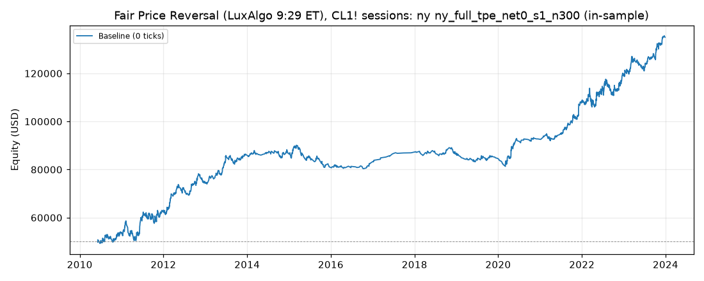

# Fair Price Reversal (LuxAlgo 9:29 ET), CL1! sessions: optimized `ny` (ny_full_tpe_net0_s1_n300)

Generated 2026-11-04 15:05 UTC by `python -m tvtester.cli replay strategies/configs/fair_price_reversal_ny_full_tpe_net0_s1_n300.json`.

> **In-sample.** Development interval only (bars before 2024-01-01 UTC). Picked by search `results/fair_price_reversal/search/ny_full_tpe_net0_s1_n300` (trial 102, objective `net0`); see its report for how many trials it took. Nothing here shows a tradable edge: out-of-sample validation is a later feature.

**Parameters:** `atr_mult=0.5`, `session=ny`, `swing=1`, `target=rr2`, `window=120`

**Filters:** `risk_atr >= 1.75`, `risk_ticks >= 22`

Replay matches the search trial: **yes**.

## Against the baseline (same interval, same costs)

| Scenario | Baseline net | Optimized net | Baseline trades | Optimized trades | Baseline PF | Optimized PF | Baseline max DD | Optimized max DD |
|---|---|---|---|---|---|---|---|---|
| 0 ticks | 69,157.02 USD | 85,071.32 USD | 3,849 | 1,634 | 1.123 | 1.253 | 24,678.62 USD | 10,074.76 USD |

## Results after commission

### Overview

| Metric | Value |
|---|---|
| Net profit | 85,071.32 USD (170.14%) |
| Total closed trades | 1,634 |
| Percent profitable | 39.41% |
| Profit factor | 1.253 |
| Max equity drawdown | 10,074.76 USD (20.15%) |
| Avg trade | 52.06 USD |
| Avg # bars in trades | 59 |

### Performance

| Metric | All | Long | Short |
|---|---|---|---|
| Net profit | 85,071.32 USD (170.14%) | 57,774.66 USD (115.55%) | 27,296.66 USD (54.59%) |
| Gross profit | 421,691.12 USD (843.38%) | 237,928.88 USD (475.86%) | 183,762.24 USD (367.52%) |
| Gross loss | 336,619.80 USD (673.24%) | 180,154.22 USD (360.31%) | 156,465.58 USD (312.93%) |
| Commission paid | 6,568.68 USD | 3,485.34 USD | 3,083.34 USD |

| Account | Value |
|---|---|
| Initial capital | 50,000.00 USD |
| Buy & hold return (TV-style, all capital at the first entry) | -174.63 USD (-0.35%) |
| Max equity run-up (intrabar) | 86,531.52 USD (173.06%) |
| Max equity drawdown (intrabar) | 10,074.76 USD (20.15%) |
| Open P&L | 0.00 USD |
| Max contracts held | 1 |

### Trades analysis

| Metric | All | Long | Short |
|---|---|---|---|
| Total closed trades | 1,634 | 867 | 767 |
| Winning trades | 644 | 356 | 288 |
| Losing trades | 990 | 511 | 479 |
| Even trades | 0 | 0 | 0 |
| Percent profitable | 39.41% | 41.06% | 37.55% |
| Avg P&L | 52.06 USD | 66.64 USD | 35.59 USD |
| Avg P&L % | 0.08% | 0.11% | 0.04% |
| Avg winning trade | 654.80 USD | 668.34 USD | 638.06 USD |
| Avg losing trade | 340.02 USD | 352.55 USD | 326.65 USD |
| Ratio avg win / avg loss | 1.926 | 1.896 | 1.953 |
| Largest winning trade | 3,135.98 USD | 3,135.98 USD | 1,795.98 USD |
| Largest winning trade % | 8.62% | 8.62% | 7.23% |
| Largest losing trade | 1,854.02 USD | 1,854.02 USD | 924.02 USD |
| Largest losing trade % | 4.38% | 2.54% | 4.38% |
| Avg # bars in trades | 59 | 59 | 58 |
| Avg # bars in winning trades | 88 | 90 | 84 |
| Avg # bars in losing trades | 40 | 37 | 43 |

### Risk/performance ratios

| Metric | Value |
|---|---|
| Sharpe ratio | 0.203 |
| Sortino ratio | 0.398 |
| Profit factor | 1.253 |
| Margin calls | 0 |

### By year (extra)

| Year | Trades | Net profit | % profitable | Profit factor |
|---|---|---|---|---|
| 2010 | 107 | 3,839.86 USD | 39.25% | 1.184 |
| 2011 | 206 | 9,251.88 USD | 37.86% | 1.185 |
| 2012 | 168 | 11,344.64 USD | 42.26% | 1.354 |
| 2013 | 128 | 11,515.44 USD | 43.75% | 1.547 |
| 2014 | 88 | 756.24 USD | 37.50% | 1.051 |
| 2015 | 131 | -5,666.62 USD | 29.77% | 0.794 |
| 2016 | 47 | 1,741.06 USD | 40.43% | 1.242 |
| 2017 | 13 | 4,177.74 USD | 76.92% | 6.951 |
| 2018 | 65 | -651.30 USD | 32.31% | 0.947 |
| 2019 | 70 | -1,681.40 USD | 34.29% | 0.875 |
| 2020 | 85 | 8,128.30 USD | 43.53% | 1.560 |
| 2021 | 123 | 15,635.54 USD | 45.53% | 1.769 |
| 2022 | 221 | 11,421.58 USD | 37.10% | 1.173 |
| 2023 | 182 | 15,258.36 USD | 41.76% | 1.429 |
