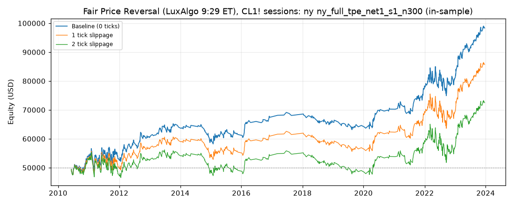

# Fair Price Reversal (LuxAlgo 9:29 ET), CL1! sessions: optimized `ny` (ny_full_tpe_net1_s1_n300)

Generated 2026-10-31 05:46 UTC by `python -m tvtester.cli replay strategies/configs/fair_price_reversal_ny_full_tpe_net1_s1_n300.json`.

> **In-sample.** Development interval only (bars before 2024-01-01 UTC). Picked by search `results/fair_price_reversal/search/ny_full_tpe_net1_s1_n300` (trial 286, objective `net1`); see its report for how many trials it took. Nothing here shows a tradable edge: out-of-sample validation is a later feature.

**Parameters:** `atr_mult=1.0`, `session=ny`, `swing=3`, `target=rr2`, `window=120`

**Filters:** `anchor_body_atr >= 0.3`, `risk_ticks >= 34`

Replay matches the search trial: **yes**.

## Against the baseline (same interval, same costs)

| Scenario | Baseline net | Optimized net | Baseline trades | Optimized trades | Baseline PF | Optimized PF | Baseline max DD | Optimized max DD |
|---|---|---|---|---|---|---|---|---|
| 0 ticks | 55,002.92 USD | 48,318.88 USD | 3,054 | 856 | 1.091 | 1.206 | 19,966.92 USD | 10,203.16 USD |
| 1 tick | 2,423.02 USD | 35,686.92 USD | 3,049 | 854 | 1.004 | 1.146 | 37,656.82 USD | 12,063.66 USD |
| 2 ticks | -49,304.92 USD | 22,470.94 USD | 3,046 | 853 | 0.928 | 1.089 | 74,110.46 USD | 13,453.66 USD |

## 0 ticks slippage

### Overview

| Metric | Value |
|---|---|
| Net profit | 48,318.88 USD (96.64%) |
| Total closed trades | 856 |
| Percent profitable | 41.94% |
| Profit factor | 1.206 |
| Max equity drawdown | 10,203.16 USD (20.41%) |
| Avg trade | 56.45 USD |
| Avg # bars in trades | 101 |

### Performance

| Metric | All | Long | Short |
|---|---|---|---|
| Net profit | 48,318.88 USD (96.64%) | 34,396.58 USD (68.79%) | 13,922.30 USD (27.84%) |
| Gross profit | 283,316.82 USD (566.63%) | 160,726.00 USD (321.45%) | 122,590.82 USD (245.18%) |
| Gross loss | 234,997.94 USD (470.00%) | 126,329.42 USD (252.66%) | 108,668.52 USD (217.34%) |
| Commission paid | 3,441.12 USD | 1,893.42 USD | 1,547.70 USD |

| Account | Value |
|---|---|
| Initial capital | 50,000.00 USD |
| Buy & hold return (TV-style, all capital at the first entry) | -244.14 USD (-0.49%) |
| Max equity run-up (intrabar) | 51,745.06 USD (103.49%) |
| Max equity drawdown (intrabar) | 10,203.16 USD (20.41%) |
| Open P&L | 0.00 USD |
| Max contracts held | 1 |

### Trades analysis

| Metric | All | Long | Short |
|---|---|---|---|
| Total closed trades | 856 | 471 | 385 |
| Winning trades | 359 | 200 | 159 |
| Losing trades | 497 | 271 | 226 |
| Even trades | 0 | 0 | 0 |
| Percent profitable | 41.94% | 42.46% | 41.30% |
| Avg P&L | 56.45 USD | 73.03 USD | 36.16 USD |
| Avg P&L % | 0.10% | 0.12% | 0.08% |
| Avg winning trade | 789.18 USD | 803.63 USD | 771.01 USD |
| Avg losing trade | 472.83 USD | 466.16 USD | 480.83 USD |
| Ratio avg win / avg loss | 1.669 | 1.724 | 1.603 |
| Largest winning trade | 3,315.98 USD | 3,315.98 USD | 2,215.98 USD |
| Largest winning trade % | 13.47% | 5.70% | 13.47% |
| Largest losing trade | 1,354.02 USD | 1,174.02 USD | 1,354.02 USD |
| Largest losing trade % | 3.48% | 1.83% | 3.48% |
| Avg # bars in trades | 101 | 102 | 100 |
| Avg # bars in winning trades | 141 | 151 | 129 |
| Avg # bars in losing trades | 72 | 66 | 79 |

### Risk/performance ratios

| Metric | Value |
|---|---|
| Sharpe ratio | 0.114 |
| Sortino ratio | 0.197 |
| Profit factor | 1.206 |
| Margin calls | 0 |

### By year (extra)

| Year | Trades | Net profit | % profitable | Profit factor |
|---|---|---|---|---|
| 2010 | 55 | 3,698.90 USD | 43.64% | 1.286 |
| 2011 | 147 | -540.94 USD | 34.69% | 0.989 |
| 2012 | 77 | 7,260.46 USD | 48.05% | 1.432 |
| 2013 | 50 | 3,599.00 USD | 50.00% | 1.341 |
| 2014 | 37 | -4,138.74 USD | 29.73% | 0.594 |
| 2015 | 61 | 1,624.78 USD | 39.34% | 1.104 |
| 2016 | 29 | 5,903.42 USD | 55.17% | 2.311 |
| 2017 | 6 | 665.88 USD | 50.00% | 1.633 |
| 2018 | 38 | -2,242.76 USD | 34.21% | 0.789 |
| 2019 | 31 | -1,324.62 USD | 35.48% | 0.814 |
| 2020 | 39 | 5,763.22 USD | 48.72% | 1.691 |
| 2021 | 66 | 8,034.68 USD | 48.48% | 1.526 |
| 2022 | 132 | 2,029.36 USD | 34.09% | 1.038 |
| 2023 | 88 | 17,986.24 USD | 54.55% | 1.923 |

## 1 tick slippage

### Overview

| Metric | Value |
|---|---|
| Net profit | 35,686.92 USD (71.37%) |
| Total closed trades | 854 |
| Percent profitable | 41.69% |
| Profit factor | 1.146 |
| Max equity drawdown | 12,063.66 USD (24.13%) |
| Avg trade | 41.79 USD |
| Avg # bars in trades | 102 |

### Performance

| Metric | All | Long | Short |
|---|---|---|---|
| Net profit | 35,686.92 USD (71.37%) | 27,320.60 USD (54.64%) | 8,366.32 USD (16.73%) |
| Gross profit | 279,718.88 USD (559.44%) | 158,524.04 USD (317.05%) | 121,194.84 USD (242.39%) |
| Gross loss | 244,031.96 USD (488.06%) | 131,203.44 USD (262.41%) | 112,828.52 USD (225.66%) |
| Commission paid | 3,433.08 USD | 1,889.40 USD | 1,543.68 USD |

| Account | Value |
|---|---|
| Initial capital | 50,000.00 USD |
| Buy & hold return (TV-style, all capital at the first entry) | -237.20 USD (-0.47%) |
| Max equity run-up (intrabar) | 39,296.66 USD (78.59%) |
| Max equity drawdown (intrabar) | 12,063.66 USD (24.13%) |
| Open P&L | 0.00 USD |
| Max contracts held | 1 |

### Trades analysis

| Metric | All | Long | Short |
|---|---|---|---|
| Total closed trades | 854 | 470 | 384 |
| Winning trades | 356 | 198 | 158 |
| Losing trades | 498 | 272 | 226 |
| Even trades | 0 | 0 | 0 |
| Percent profitable | 41.69% | 42.13% | 41.15% |
| Avg P&L | 41.79 USD | 58.13 USD | 21.79 USD |
| Avg P&L % | 0.09% | 0.10% | 0.06% |
| Avg winning trade | 785.73 USD | 800.63 USD | 767.06 USD |
| Avg losing trade | 490.02 USD | 482.37 USD | 499.24 USD |
| Ratio avg win / avg loss | 1.603 | 1.660 | 1.536 |
| Largest winning trade | 3,315.98 USD | 3,315.98 USD | 2,215.98 USD |
| Largest winning trade % | 13.48% | 5.70% | 13.48% |
| Largest losing trade | 1,374.02 USD | 1,194.02 USD | 1,374.02 USD |
| Largest losing trade % | 3.61% | 1.92% | 3.61% |
| Avg # bars in trades | 102 | 103 | 101 |
| Avg # bars in winning trades | 144 | 153 | 132 |
| Avg # bars in losing trades | 73 | 67 | 80 |

### Risk/performance ratios

| Metric | Value |
|---|---|
| Sharpe ratio | 0.074 |
| Sortino ratio | 0.122 |
| Profit factor | 1.146 |
| Margin calls | 0 |

## 2 ticks slippage

### Overview

| Metric | Value |
|---|---|
| Net profit | 22,470.94 USD (44.94%) |
| Total closed trades | 853 |
| Percent profitable | 41.50% |
| Profit factor | 1.089 |
| Max equity drawdown | 13,453.66 USD (26.91%) |
| Avg trade | 26.34 USD |
| Avg # bars in trades | 103 |

### Performance

| Metric | All | Long | Short |
|---|---|---|---|
| Net profit | 22,470.94 USD (44.94%) | 19,760.60 USD (39.52%) | 2,710.34 USD (5.42%) |
| Gross profit | 275,986.92 USD (551.97%) | 156,404.04 USD (312.81%) | 119,582.88 USD (239.17%) |
| Gross loss | 253,515.98 USD (507.03%) | 136,643.44 USD (273.29%) | 116,872.54 USD (233.75%) |
| Commission paid | 3,429.06 USD | 1,889.40 USD | 1,539.66 USD |

| Account | Value |
|---|---|
| Initial capital | 50,000.00 USD |
| Buy & hold return (TV-style, all capital at the first entry) | -230.25 USD (-0.46%) |
| Max equity run-up (intrabar) | 27,103.18 USD (54.21%) |
| Max equity drawdown (intrabar) | 13,453.66 USD (26.91%) |
| Open P&L | 0.00 USD |
| Max contracts held | 1 |

### Trades analysis

| Metric | All | Long | Short |
|---|---|---|---|
| Total closed trades | 853 | 470 | 383 |
| Winning trades | 354 | 198 | 156 |
| Losing trades | 499 | 272 | 227 |
| Even trades | 0 | 0 | 0 |
| Percent profitable | 41.50% | 42.13% | 40.73% |
| Avg P&L | 26.34 USD | 42.04 USD | 7.08 USD |
| Avg P&L % | 0.06% | 0.08% | 0.04% |
| Avg winning trade | 779.62 USD | 789.92 USD | 766.56 USD |
| Avg losing trade | 508.05 USD | 502.37 USD | 514.86 USD |
| Ratio avg win / avg loss | 1.535 | 1.572 | 1.489 |
| Largest winning trade | 3,315.98 USD | 3,315.98 USD | 2,215.98 USD |
| Largest winning trade % | 13.48% | 5.69% | 13.48% |
| Largest losing trade | 1,394.02 USD | 1,214.02 USD | 1,394.02 USD |
| Largest losing trade % | 3.75% | 2.00% | 3.75% |
| Avg # bars in trades | 103 | 105 | 102 |
| Avg # bars in winning trades | 145 | 156 | 131 |
| Avg # bars in losing trades | 74 | 67 | 82 |

### Risk/performance ratios

| Metric | Value |
|---|---|
| Sharpe ratio | 0.035 |
| Sortino ratio | 0.055 |
| Profit factor | 1.089 |
| Margin calls | 0 |
