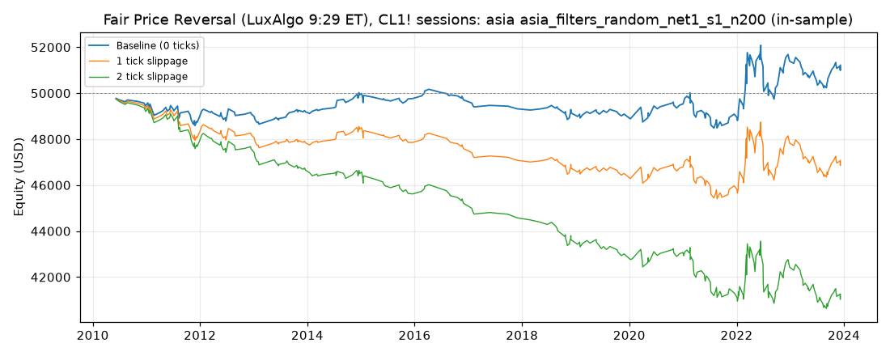

# Fair Price Reversal (LuxAlgo 9:29 ET), CL1! sessions: optimized `asia` (asia_filters_random_net1_s1_n200)

Generated 2026-10-31 05:44 UTC by `python -m tvtester.cli replay strategies/configs/fair_price_reversal_asia_filters_random_net1_s1_n200.json`.

> **In-sample.** Development interval only (bars before 2024-01-01 UTC). Picked by search `results/fair_price_reversal/search/asia_filters_random_net1_s1_n200` (trial 48, objective `net1`); see its report for how many trials it took. Nothing here shows a tradable edge: out-of-sample validation is a later feature.

**Parameters:** `atr_mult=2.0`, `session=asia`, `swing=3`, `target=rr1`, `window=30`

**Filters:** `minutes_from_open >= 15`

Replay matches the search trial: **yes**.

## Against the baseline (same interval, same costs)

| Scenario | Baseline net | Optimized net | Baseline trades | Optimized trades | Baseline PF | Optimized PF | Baseline max DD | Optimized max DD |
|---|---|---|---|---|---|---|---|---|
| 0 ticks | 815.16 USD | 1,215.96 USD | 342 | 302 | 1.030 | 1.053 | 3,940.30 USD | 2,464.22 USD |
| 1 tick | -4,084.84 USD | -2,924.04 USD | 342 | 302 | 0.869 | 0.889 | 4,779.58 USD | 4,624.20 USD |
| 2 ticks | -10,584.84 USD | -8,744.04 USD | 342 | 302 | 0.710 | 0.718 | 10,900.82 USD | 9,405.80 USD |

## 0 ticks slippage

### Overview

| Metric | Value |
|---|---|
| Net profit | 1,215.96 USD (2.43%) |
| Total closed trades | 302 |
| Percent profitable | 50.99% |
| Profit factor | 1.053 |
| Max equity drawdown | 2,464.22 USD (4.93%) |
| Avg trade | 4.03 USD |
| Avg # bars in trades | 45 |

### Performance

| Metric | All | Long | Short |
|---|---|---|---|
| Net profit | 1,215.96 USD (2.43%) | -11.24 USD (-0.02%) | 1,227.20 USD (2.45%) |
| Gross profit | 23,980.92 USD (47.96%) | 14,318.40 USD (28.64%) | 9,662.52 USD (19.33%) |
| Gross loss | 22,764.96 USD (45.53%) | 14,329.64 USD (28.66%) | 8,435.32 USD (16.87%) |
| Commission paid | 1,214.04 USD | 651.24 USD | 562.80 USD |

| Account | Value |
|---|---|
| Initial capital | 50,000.00 USD |
| Buy & hold return (TV-style, all capital at the first entry) | -49.02 USD (-0.10%) |
| Max equity run-up (intrabar) | 3,621.26 USD (7.24%) |
| Max equity drawdown (intrabar) | 2,464.22 USD (4.93%) |
| Open P&L | 0.00 USD |
| Max contracts held | 1 |

### Trades analysis

| Metric | All | Long | Short |
|---|---|---|---|
| Total closed trades | 302 | 162 | 140 |
| Winning trades | 154 | 80 | 74 |
| Losing trades | 148 | 82 | 66 |
| Even trades | 0 | 0 | 0 |
| Percent profitable | 50.99% | 49.38% | 52.86% |
| Avg P&L | 4.03 USD | -0.07 USD | 8.77 USD |
| Avg P&L % | 0.00% | -0.00% | 0.01% |
| Avg winning trade | 155.72 USD | 178.98 USD | 130.57 USD |
| Avg losing trade | 153.82 USD | 174.75 USD | 127.81 USD |
| Ratio avg win / avg loss | 1.012 | 1.024 | 1.022 |
| Largest winning trade | 1,065.98 USD | 1,065.98 USD | 525.98 USD |
| Largest winning trade % | 1.85% | 1.85% | 0.81% |
| Largest losing trade | 834.02 USD | 834.02 USD | 514.02 USD |
| Largest losing trade % | 1.10% | 1.04% | 1.10% |
| Avg # bars in trades | 45 | 54 | 34 |
| Avg # bars in winning trades | 47 | 53 | 40 |
| Avg # bars in losing trades | 43 | 55 | 27 |

### Risk/performance ratios

| Metric | Value |
|---|---|
| Sharpe ratio | -0.329 |
| Sortino ratio | -0.388 |
| Profit factor | 1.053 |
| Margin calls | 0 |

### By year (extra)

| Year | Trades | Net profit | % profitable | Profit factor |
|---|---|---|---|---|
| 2010 | 7 | -558.14 USD | 14.29% | 0.120 |
| 2011 | 26 | -464.52 USD | 53.85% | 0.808 |
| 2012 | 18 | 127.64 USD | 44.44% | 1.114 |
| 2013 | 21 | 85.58 USD | 57.14% | 1.107 |
| 2014 | 20 | 739.60 USD | 65.00% | 2.456 |
| 2015 | 16 | -164.32 USD | 50.00% | 0.814 |
| 2016 | 13 | -132.26 USD | 46.15% | 0.796 |
| 2017 | 6 | -314.12 USD | 16.67% | 0.174 |
| 2018 | 17 | -178.34 USD | 52.94% | 0.809 |
| 2019 | 18 | -52.36 USD | 50.00% | 0.945 |
| 2020 | 20 | 439.60 USD | 60.00% | 1.323 |
| 2021 | 35 | -440.70 USD | 45.71% | 0.841 |
| 2022 | 49 | 2,303.02 USD | 57.14% | 1.340 |
| 2023 | 36 | -174.72 USD | 47.22% | 0.933 |

## 1 tick slippage

### Overview

| Metric | Value |
|---|---|
| Net profit | -2,924.04 USD (-5.85%) |
| Total closed trades | 302 |
| Percent profitable | 49.01% |
| Profit factor | 0.889 |
| Max equity drawdown | 4,624.20 USD (9.25%) |
| Avg trade | -9.68 USD |
| Avg # bars in trades | 47 |

### Performance

| Metric | All | Long | Short |
|---|---|---|---|
| Net profit | -2,924.04 USD (-5.85%) | -2,371.24 USD (-4.74%) | -552.80 USD (-1.11%) |
| Gross profit | 23,395.04 USD (46.79%) | 13,954.48 USD (27.91%) | 9,440.56 USD (18.88%) |
| Gross loss | 26,319.08 USD (52.64%) | 16,325.72 USD (32.65%) | 9,993.36 USD (19.99%) |
| Commission paid | 1,214.04 USD | 651.24 USD | 562.80 USD |

| Account | Value |
|---|---|
| Initial capital | 50,000.00 USD |
| Buy & hold return (TV-style, all capital at the first entry) | -42.02 USD (-0.08%) |
| Max equity run-up (intrabar) | 3,347.34 USD (6.69%) |
| Max equity drawdown (intrabar) | 4,624.20 USD (9.25%) |
| Open P&L | 0.00 USD |
| Max contracts held | 1 |

### Trades analysis

| Metric | All | Long | Short |
|---|---|---|---|
| Total closed trades | 302 | 162 | 140 |
| Winning trades | 148 | 76 | 72 |
| Losing trades | 154 | 86 | 68 |
| Even trades | 0 | 0 | 0 |
| Percent profitable | 49.01% | 46.91% | 51.43% |
| Avg P&L | -9.68 USD | -14.64 USD | -3.95 USD |
| Avg P&L % | -0.02% | -0.02% | -0.01% |
| Avg winning trade | 158.07 USD | 183.61 USD | 131.12 USD |
| Avg losing trade | 170.90 USD | 189.83 USD | 146.96 USD |
| Ratio avg win / avg loss | 0.925 | 0.967 | 0.892 |
| Largest winning trade | 1,065.98 USD | 1,065.98 USD | 505.98 USD |
| Largest winning trade % | 1.85% | 1.85% | 0.81% |
| Largest losing trade | 854.02 USD | 854.02 USD | 534.02 USD |
| Largest losing trade % | 1.18% | 1.14% | 1.18% |
| Avg # bars in trades | 47 | 57 | 35 |
| Avg # bars in winning trades | 49 | 56 | 43 |
| Avg # bars in losing trades | 44 | 57 | 27 |

### Risk/performance ratios

| Metric | Value |
|---|---|
| Sharpe ratio | -0.400 |
| Sortino ratio | -0.440 |
| Profit factor | 0.889 |
| Margin calls | 0 |

## 2 ticks slippage

### Overview

| Metric | Value |
|---|---|
| Net profit | -8,744.04 USD (-17.49%) |
| Total closed trades | 302 |
| Percent profitable | 44.37% |
| Profit factor | 0.718 |
| Max equity drawdown | 9,405.80 USD (18.81%) |
| Avg trade | -28.95 USD |
| Avg # bars in trades | 51 |

### Performance

| Metric | All | Long | Short |
|---|---|---|---|
| Net profit | -8,744.04 USD (-17.49%) | -4,981.24 USD (-9.96%) | -3,762.80 USD (-7.53%) |
| Gross profit | 22,261.32 USD (44.52%) | 13,530.56 USD (27.06%) | 8,730.76 USD (17.46%) |
| Gross loss | 31,005.36 USD (62.01%) | 18,511.80 USD (37.02%) | 12,493.56 USD (24.99%) |
| Commission paid | 1,214.04 USD | 651.24 USD | 562.80 USD |

| Account | Value |
|---|---|
| Initial capital | 50,000.00 USD |
| Buy & hold return (TV-style, all capital at the first entry) | -35.02 USD (-0.07%) |
| Max equity run-up (intrabar) | 2,617.54 USD (5.24%) |
| Max equity drawdown (intrabar) | 9,405.80 USD (18.81%) |
| Open P&L | 0.00 USD |
| Max contracts held | 1 |

### Trades analysis

| Metric | All | Long | Short |
|---|---|---|---|
| Total closed trades | 302 | 162 | 140 |
| Winning trades | 134 | 72 | 62 |
| Losing trades | 168 | 90 | 78 |
| Even trades | 0 | 0 | 0 |
| Percent profitable | 44.37% | 44.44% | 44.29% |
| Avg P&L | -28.95 USD | -30.75 USD | -26.88 USD |
| Avg P&L % | -0.04% | -0.05% | -0.04% |
| Avg winning trade | 166.13 USD | 187.92 USD | 140.82 USD |
| Avg losing trade | 184.56 USD | 205.69 USD | 160.17 USD |
| Ratio avg win / avg loss | 0.900 | 0.914 | 0.879 |
| Largest winning trade | 1,065.98 USD | 1,065.98 USD | 485.98 USD |
| Largest winning trade % | 1.85% | 1.85% | 0.81% |
| Largest losing trade | 874.02 USD | 874.02 USD | 554.02 USD |
| Largest losing trade % | 1.26% | 1.23% | 1.26% |
| Avg # bars in trades | 51 | 61 | 39 |
| Avg # bars in winning trades | 54 | 59 | 49 |
| Avg # bars in losing trades | 48 | 62 | 32 |

### Risk/performance ratios

| Metric | Value |
|---|---|
| Sharpe ratio | -0.499 |
| Sortino ratio | -0.506 |
| Profit factor | 0.718 |
| Margin calls | 0 |
