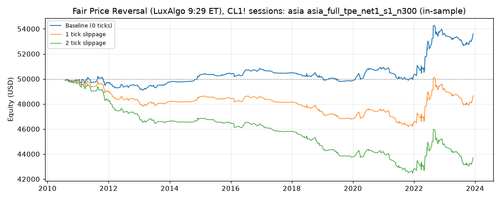

# Fair Price Reversal (LuxAlgo 9:29 ET), CL1! sessions: optimized `asia` (asia_full_tpe_net1_s1_n300)

Generated 2026-10-31 05:45 UTC by `python -m tvtester.cli replay strategies/configs/fair_price_reversal_asia_full_tpe_net1_s1_n300.json`.

> **In-sample.** Development interval only (bars before 2024-01-01 UTC). Picked by search `results/fair_price_reversal/search/asia_full_tpe_net1_s1_n300` (trial 252, objective `net1`); see its report for how many trials it took. Nothing here shows a tradable edge: out-of-sample validation is a later feature.

**Parameters:** `atr_mult=0.5`, `session=asia`, `swing=2`, `target=far`, `window=30`

**Filters:** `range_ratio <= 1.2`

Replay matches the search trial: **yes**.

## Against the baseline (same interval, same costs)

| Scenario | Baseline net | Optimized net | Baseline trades | Optimized trades | Baseline PF | Optimized PF | Baseline max DD | Optimized max DD |
|---|---|---|---|---|---|---|---|---|
| 0 ticks | 815.16 USD | 3,604.86 USD | 342 | 357 | 1.030 | 1.229 | 3,940.30 USD | 1,677.18 USD |
| 1 tick | -4,084.84 USD | -1,345.14 USD | 342 | 357 | 0.869 | 0.927 | 4,779.58 USD | 3,921.28 USD |
| 2 ticks | -10,584.84 USD | -6,295.14 USD | 342 | 357 | 0.710 | 0.706 | 10,900.82 USD | 7,641.28 USD |

## 0 ticks slippage

### Overview

| Metric | Value |
|---|---|
| Net profit | 3,604.86 USD (7.21%) |
| Total closed trades | 357 |
| Percent profitable | 61.90% |
| Profit factor | 1.229 |
| Max equity drawdown | 1,677.18 USD (3.35%) |
| Avg trade | 10.10 USD |
| Avg # bars in trades | 29 |

### Performance

| Metric | All | Long | Short |
|---|---|---|---|
| Net profit | 3,604.86 USD (7.21%) | 1,342.48 USD (2.68%) | 2,262.38 USD (4.52%) |
| Gross profit | 19,321.58 USD (38.64%) | 9,727.80 USD (19.46%) | 9,593.78 USD (19.19%) |
| Gross loss | 15,716.72 USD (31.43%) | 8,385.32 USD (16.77%) | 7,331.40 USD (14.66%) |
| Commission paid | 1,435.14 USD | 707.52 USD | 727.62 USD |

| Account | Value |
|---|---|
| Initial capital | 50,000.00 USD |
| Buy & hold return (TV-style, all capital at the first entry) | -4,962.75 USD (-9.93%) |
| Max equity run-up (intrabar) | 5,191.78 USD (10.38%) |
| Max equity drawdown (intrabar) | 1,677.18 USD (3.35%) |
| Open P&L | 0.00 USD |
| Max contracts held | 1 |

### Trades analysis

| Metric | All | Long | Short |
|---|---|---|---|
| Total closed trades | 357 | 176 | 181 |
| Winning trades | 221 | 110 | 111 |
| Losing trades | 136 | 66 | 70 |
| Even trades | 0 | 0 | 0 |
| Percent profitable | 61.90% | 62.50% | 61.33% |
| Avg P&L | 10.10 USD | 7.63 USD | 12.50 USD |
| Avg P&L % | 0.01% | 0.01% | 0.02% |
| Avg winning trade | 87.43 USD | 88.43 USD | 86.43 USD |
| Avg losing trade | 115.56 USD | 127.05 USD | 104.73 USD |
| Ratio avg win / avg loss | 0.757 | 0.696 | 0.825 |
| Largest winning trade | 975.98 USD | 705.98 USD | 975.98 USD |
| Largest winning trade % | 1.50% | 0.90% | 1.50% |
| Largest losing trade | 574.02 USD | 574.02 USD | 384.02 USD |
| Largest losing trade % | 1.10% | 1.04% | 1.10% |
| Avg # bars in trades | 29 | 29 | 29 |
| Avg # bars in winning trades | 26 | 24 | 27 |
| Avg # bars in losing trades | 34 | 37 | 31 |

### Risk/performance ratios

| Metric | Value |
|---|---|
| Sharpe ratio | -0.260 |
| Sortino ratio | -0.387 |
| Profit factor | 1.229 |
| Margin calls | 0 |

### By year (extra)

| Year | Trades | Net profit | % profitable | Profit factor |
|---|---|---|---|---|
| 2010 | 8 | -132.16 USD | 50.00% | 0.582 |
| 2011 | 41 | -134.82 USD | 53.66% | 0.930 |
| 2012 | 31 | -284.62 USD | 51.61% | 0.734 |
| 2013 | 28 | 297.44 USD | 64.29% | 1.372 |
| 2014 | 16 | 585.68 USD | 81.25% | 5.798 |
| 2015 | 18 | 77.64 USD | 72.22% | 1.277 |
| 2016 | 18 | 357.64 USD | 61.11% | 1.579 |
| 2017 | 5 | -320.10 USD | 0.00% | 0.000 |
| 2018 | 31 | -274.62 USD | 64.52% | 0.760 |
| 2019 | 21 | -334.42 USD | 61.90% | 0.583 |
| 2020 | 26 | 1,095.48 USD | 76.92% | 2.313 |
| 2021 | 24 | -636.48 USD | 41.67% | 0.633 |
| 2022 | 51 | 3,354.98 USD | 70.59% | 1.830 |
| 2023 | 39 | -46.78 USD | 64.10% | 0.973 |

## 1 tick slippage

### Overview

| Metric | Value |
|---|---|
| Net profit | -1,345.14 USD (-2.69%) |
| Total closed trades | 357 |
| Percent profitable | 57.70% |
| Profit factor | 0.927 |
| Max equity drawdown | 3,921.28 USD (7.84%) |
| Avg trade | -3.77 USD |
| Avg # bars in trades | 29 |

### Performance

| Metric | All | Long | Short |
|---|---|---|---|
| Net profit | -1,345.14 USD (-2.69%) | -1,097.52 USD (-2.20%) | -247.62 USD (-0.50%) |
| Gross profit | 17,101.88 USD (34.20%) | 8,638.00 USD (17.28%) | 8,463.88 USD (16.93%) |
| Gross loss | 18,447.02 USD (36.89%) | 9,735.52 USD (19.47%) | 8,711.50 USD (17.42%) |
| Commission paid | 1,435.14 USD | 707.52 USD | 727.62 USD |

| Account | Value |
|---|---|
| Initial capital | 50,000.00 USD |
| Buy & hold return (TV-style, all capital at the first entry) | -4,957.06 USD (-9.91%) |
| Max equity run-up (intrabar) | 3,933.32 USD (7.87%) |
| Max equity drawdown (intrabar) | 3,921.28 USD (7.84%) |
| Open P&L | 0.00 USD |
| Max contracts held | 1 |

### Trades analysis

| Metric | All | Long | Short |
|---|---|---|---|
| Total closed trades | 357 | 176 | 181 |
| Winning trades | 206 | 100 | 106 |
| Losing trades | 151 | 76 | 75 |
| Even trades | 0 | 0 | 0 |
| Percent profitable | 57.70% | 56.82% | 58.56% |
| Avg P&L | -3.77 USD | -6.24 USD | -1.37 USD |
| Avg P&L % | -0.01% | -0.01% | -0.00% |
| Avg winning trade | 83.02 USD | 86.38 USD | 79.85 USD |
| Avg losing trade | 122.17 USD | 128.10 USD | 116.15 USD |
| Ratio avg win / avg loss | 0.680 | 0.674 | 0.687 |
| Largest winning trade | 955.98 USD | 695.98 USD | 955.98 USD |
| Largest winning trade % | 1.44% | 0.88% | 1.44% |
| Largest losing trade | 594.02 USD | 594.02 USD | 404.02 USD |
| Largest losing trade % | 1.18% | 1.14% | 1.18% |
| Avg # bars in trades | 29 | 29 | 29 |
| Avg # bars in winning trades | 28 | 27 | 29 |
| Avg # bars in losing trades | 31 | 32 | 29 |

### Risk/performance ratios

| Metric | Value |
|---|---|
| Sharpe ratio | -0.358 |
| Sortino ratio | -0.471 |
| Profit factor | 0.927 |
| Margin calls | 0 |

## 2 ticks slippage

### Overview

| Metric | Value |
|---|---|
| Net profit | -6,295.14 USD (-12.59%) |
| Total closed trades | 357 |
| Percent profitable | 49.30% |
| Profit factor | 0.706 |
| Max equity drawdown | 7,641.28 USD (15.28%) |
| Avg trade | -17.63 USD |
| Avg # bars in trades | 29 |

### Performance

| Metric | All | Long | Short |
|---|---|---|---|
| Net profit | -6,295.14 USD (-12.59%) | -3,537.52 USD (-7.08%) | -2,757.62 USD (-5.52%) |
| Gross profit | 15,102.48 USD (30.20%) | 7,678.30 USD (15.36%) | 7,424.18 USD (14.85%) |
| Gross loss | 21,397.62 USD (42.80%) | 11,215.82 USD (22.43%) | 10,181.80 USD (20.36%) |
| Commission paid | 1,435.14 USD | 707.52 USD | 727.62 USD |

| Account | Value |
|---|---|
| Initial capital | 50,000.00 USD |
| Buy & hold return (TV-style, all capital at the first entry) | -4,951.37 USD (-9.90%) |
| Max equity run-up (intrabar) | 3,539.40 USD (7.08%) |
| Max equity drawdown (intrabar) | 7,641.28 USD (15.28%) |
| Open P&L | 0.00 USD |
| Max contracts held | 1 |

### Trades analysis

| Metric | All | Long | Short |
|---|---|---|---|
| Total closed trades | 357 | 176 | 181 |
| Winning trades | 176 | 85 | 91 |
| Losing trades | 181 | 91 | 90 |
| Even trades | 0 | 0 | 0 |
| Percent profitable | 49.30% | 48.30% | 50.28% |
| Avg P&L | -17.63 USD | -20.10 USD | -15.24 USD |
| Avg P&L % | -0.03% | -0.04% | -0.02% |
| Avg winning trade | 85.81 USD | 90.33 USD | 81.58 USD |
| Avg losing trade | 118.22 USD | 123.25 USD | 113.13 USD |
| Ratio avg win / avg loss | 0.726 | 0.733 | 0.721 |
| Largest winning trade | 935.98 USD | 685.98 USD | 935.98 USD |
| Largest winning trade % | 1.39% | 0.86% | 1.39% |
| Largest losing trade | 614.02 USD | 614.02 USD | 424.02 USD |
| Largest losing trade % | 1.26% | 1.23% | 1.26% |
| Avg # bars in trades | 29 | 29 | 29 |
| Avg # bars in winning trades | 30 | 27 | 32 |
| Avg # bars in losing trades | 28 | 31 | 25 |

### Risk/performance ratios

| Metric | Value |
|---|---|
| Sharpe ratio | -0.445 |
| Sortino ratio | -0.529 |
| Profit factor | 0.706 |
| Margin calls | 0 |
