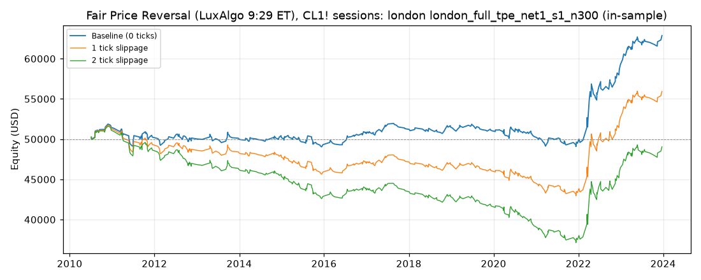

# Fair Price Reversal (LuxAlgo 9:29 ET), CL1! sessions: optimized `london` (london_full_tpe_net1_s1_n300)

Generated 2026-10-31 05:45 UTC by `python -m tvtester.cli replay strategies/configs/fair_price_reversal_london_full_tpe_net1_s1_n300.json`.

> **In-sample.** Development interval only (bars before 2024-01-01 UTC). Picked by search `results/fair_price_reversal/search/london_full_tpe_net1_s1_n300` (trial 213, objective `net1`); see its report for how many trials it took. Nothing here shows a tradable edge: out-of-sample validation is a later feature.

**Parameters:** `atr_mult=1.5`, `session=london`, `swing=3`, `target=rr2`, `window=90`

**Filters:** `minutes_from_open <= 75`, `range_ratio <= 0.7`, `risk_atr >= 1.75`

Replay matches the search trial: **yes**.

## Against the baseline (same interval, same costs)

| Scenario | Baseline net | Optimized net | Baseline trades | Optimized trades | Baseline PF | Optimized PF | Baseline max DD | Optimized max DD |
|---|---|---|---|---|---|---|---|---|
| 0 ticks | 40,277.60 USD | 12,869.44 USD | 3,120 | 428 | 1.111 | 1.295 | 13,213.46 USD | 3,030.64 USD |
| 1 tick | -13,754.26 USD | 5,929.44 USD | 3,113 | 428 | 0.966 | 1.120 | 47,336.50 USD | 8,966.70 USD |
| 2 ticks | -70,832.10 USD | -950.56 USD | 3,105 | 428 | 0.842 | 0.983 | 88,522.38 USD | 14,676.70 USD |

## 0 ticks slippage

### Overview

| Metric | Value |
|---|---|
| Net profit | 12,869.44 USD (25.74%) |
| Total closed trades | 428 |
| Percent profitable | 39.02% |
| Profit factor | 1.295 |
| Max equity drawdown | 3,030.64 USD (6.06%) |
| Avg trade | 30.07 USD |
| Avg # bars in trades | 65 |

### Performance

| Metric | All | Long | Short |
|---|---|---|---|
| Net profit | 12,869.44 USD (25.74%) | 8,333.84 USD (16.67%) | 4,535.60 USD (9.07%) |
| Gross profit | 56,518.66 USD (113.04%) | 29,110.36 USD (58.22%) | 27,408.30 USD (54.82%) |
| Gross loss | 43,649.22 USD (87.30%) | 20,776.52 USD (41.55%) | 22,872.70 USD (45.75%) |
| Commission paid | 1,720.56 USD | 836.16 USD | 884.40 USD |

| Account | Value |
|---|---|
| Initial capital | 50,000.00 USD |
| Buy & hold return (TV-style, all capital at the first entry) | -636.68 USD (-1.27%) |
| Max equity run-up (intrabar) | 13,836.86 USD (27.67%) |
| Max equity drawdown (intrabar) | 3,030.64 USD (6.06%) |
| Open P&L | 0.00 USD |
| Max contracts held | 1 |

### Trades analysis

| Metric | All | Long | Short |
|---|---|---|---|
| Total closed trades | 428 | 208 | 220 |
| Winning trades | 167 | 82 | 85 |
| Losing trades | 261 | 126 | 135 |
| Even trades | 0 | 0 | 0 |
| Percent profitable | 39.02% | 39.42% | 38.64% |
| Avg P&L | 30.07 USD | 40.07 USD | 20.62 USD |
| Avg P&L % | 0.03% | 0.06% | 0.01% |
| Avg winning trade | 338.44 USD | 355.00 USD | 322.45 USD |
| Avg losing trade | 167.24 USD | 164.89 USD | 169.43 USD |
| Ratio avg win / avg loss | 2.024 | 2.153 | 1.903 |
| Largest winning trade | 1,575.98 USD | 1,435.98 USD | 1,575.98 USD |
| Largest winning trade % | 1.52% | 1.52% | 1.49% |
| Largest losing trade | 694.02 USD | 634.02 USD | 694.02 USD |
| Largest losing trade % | 2.19% | 0.75% | 2.19% |
| Avg # bars in trades | 65 | 65 | 64 |
| Avg # bars in winning trades | 89 | 89 | 89 |
| Avg # bars in losing trades | 49 | 50 | 48 |

### Risk/performance ratios

| Metric | Value |
|---|---|
| Sharpe ratio | -0.019 |
| Sortino ratio | -0.036 |
| Profit factor | 1.295 |
| Margin calls | 0 |

### By year (extra)

| Year | Trades | Net profit | % profitable | Profit factor |
|---|---|---|---|---|
| 2010 | 17 | 1,471.66 USD | 52.94% | 2.373 |
| 2011 | 36 | -1,224.72 USD | 38.89% | 0.766 |
| 2012 | 35 | -220.70 USD | 37.14% | 0.940 |
| 2013 | 21 | 15.58 USD | 28.57% | 1.007 |
| 2014 | 24 | 143.52 USD | 37.50% | 1.078 |
| 2015 | 38 | -872.76 USD | 28.95% | 0.770 |
| 2016 | 26 | 1,385.48 USD | 53.85% | 1.931 |
| 2017 | 26 | 605.48 USD | 46.15% | 1.337 |
| 2018 | 25 | 219.50 USD | 36.00% | 1.108 |
| 2019 | 26 | -464.52 USD | 26.92% | 0.787 |
| 2020 | 47 | -818.94 USD | 31.91% | 0.815 |
| 2021 | 30 | -750.60 USD | 30.00% | 0.783 |
| 2022 | 42 | 9,781.16 USD | 52.38% | 2.368 |
| 2023 | 35 | 3,599.30 USD | 48.57% | 2.064 |

## 1 tick slippage

### Overview

| Metric | Value |
|---|---|
| Net profit | 5,929.44 USD (11.86%) |
| Total closed trades | 428 |
| Percent profitable | 37.15% |
| Profit factor | 1.120 |
| Max equity drawdown | 8,966.70 USD (17.93%) |
| Avg trade | 13.85 USD |
| Avg # bars in trades | 66 |

### Performance

| Metric | All | Long | Short |
|---|---|---|---|
| Net profit | 5,929.44 USD (11.86%) | 5,353.84 USD (10.71%) | 575.60 USD (1.15%) |
| Gross profit | 55,340.82 USD (110.68%) | 28,786.44 USD (57.57%) | 26,554.38 USD (53.11%) |
| Gross loss | 49,411.38 USD (98.82%) | 23,432.60 USD (46.87%) | 25,978.78 USD (51.96%) |
| Commission paid | 1,720.56 USD | 836.16 USD | 884.40 USD |

| Account | Value |
|---|---|
| Initial capital | 50,000.00 USD |
| Buy & hold return (TV-style, all capital at the first entry) | -643.51 USD (-1.29%) |
| Max equity run-up (intrabar) | 13,112.72 USD (26.23%) |
| Max equity drawdown (intrabar) | 8,966.70 USD (17.93%) |
| Open P&L | 0.00 USD |
| Max contracts held | 1 |

### Trades analysis

| Metric | All | Long | Short |
|---|---|---|---|
| Total closed trades | 428 | 208 | 220 |
| Winning trades | 159 | 78 | 81 |
| Losing trades | 269 | 130 | 139 |
| Even trades | 0 | 0 | 0 |
| Percent profitable | 37.15% | 37.50% | 36.82% |
| Avg P&L | 13.85 USD | 25.74 USD | 2.62 USD |
| Avg P&L % | 0.01% | 0.04% | -0.02% |
| Avg winning trade | 348.06 USD | 369.06 USD | 327.83 USD |
| Avg losing trade | 183.69 USD | 180.25 USD | 186.90 USD |
| Ratio avg win / avg loss | 1.895 | 2.047 | 1.754 |
| Largest winning trade | 1,575.98 USD | 1,435.98 USD | 1,575.98 USD |
| Largest winning trade % | 1.52% | 1.52% | 1.49% |
| Largest losing trade | 714.02 USD | 654.02 USD | 714.02 USD |
| Largest losing trade % | 2.29% | 0.83% | 2.29% |
| Avg # bars in trades | 66 | 67 | 65 |
| Avg # bars in winning trades | 90 | 88 | 91 |
| Avg # bars in losing trades | 52 | 54 | 49 |

### Risk/performance ratios

| Metric | Value |
|---|---|
| Sharpe ratio | -0.076 |
| Sortino ratio | -0.135 |
| Profit factor | 1.120 |
| Margin calls | 0 |

## 2 ticks slippage

### Overview

| Metric | Value |
|---|---|
| Net profit | -950.56 USD (-1.90%) |
| Total closed trades | 428 |
| Percent profitable | 36.68% |
| Profit factor | 0.983 |
| Max equity drawdown | 14,676.70 USD (29.35%) |
| Avg trade | -2.22 USD |
| Avg # bars in trades | 67 |

### Performance

| Metric | All | Long | Short |
|---|---|---|---|
| Net profit | -950.56 USD (-1.90%) | 1,473.84 USD (2.95%) | -2,424.40 USD (-4.85%) |
| Gross profit | 54,158.86 USD (108.32%) | 27,824.48 USD (55.65%) | 26,334.38 USD (52.67%) |
| Gross loss | 55,109.42 USD (110.22%) | 26,350.64 USD (52.70%) | 28,758.78 USD (57.52%) |
| Commission paid | 1,720.56 USD | 836.16 USD | 884.40 USD |

| Account | Value |
|---|---|
| Initial capital | 50,000.00 USD |
| Buy & hold return (TV-style, all capital at the first entry) | -650.34 USD (-1.30%) |
| Max equity run-up (intrabar) | 12,242.72 USD (24.49%) |
| Max equity drawdown (intrabar) | 14,676.70 USD (29.35%) |
| Open P&L | 0.00 USD |
| Max contracts held | 1 |

### Trades analysis

| Metric | All | Long | Short |
|---|---|---|---|
| Total closed trades | 428 | 208 | 220 |
| Winning trades | 157 | 76 | 81 |
| Losing trades | 271 | 132 | 139 |
| Even trades | 0 | 0 | 0 |
| Percent profitable | 36.68% | 36.54% | 36.82% |
| Avg P&L | -2.22 USD | 7.09 USD | -11.02 USD |
| Avg P&L % | -0.02% | 0.01% | -0.05% |
| Avg winning trade | 344.96 USD | 366.11 USD | 325.12 USD |
| Avg losing trade | 203.36 USD | 199.63 USD | 206.90 USD |
| Ratio avg win / avg loss | 1.696 | 1.834 | 1.571 |
| Largest winning trade | 1,575.98 USD | 1,435.98 USD | 1,575.98 USD |
| Largest winning trade % | 1.52% | 1.52% | 1.49% |
| Largest losing trade | 734.02 USD | 674.02 USD | 734.02 USD |
| Largest losing trade % | 2.39% | 0.91% | 2.39% |
| Avg # bars in trades | 67 | 70 | 65 |
| Avg # bars in winning trades | 93 | 95 | 91 |
| Avg # bars in losing trades | 52 | 55 | 49 |

### Risk/performance ratios

| Metric | Value |
|---|---|
| Sharpe ratio | -0.126 |
| Sortino ratio | -0.211 |
| Profit factor | 0.983 |
| Margin calls | 0 |
