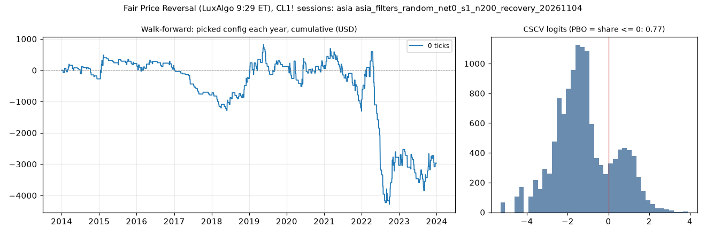

# Fair Price Reversal (LuxAlgo 9:29 ET), CL1! sessions: limit-entry validation, asia (asia_filters_random_net0_s1_n200_recovery_20261104)

Generated 2026-11-04 14:46 UTC. Execution: limit-close-tp-expiry-owner-swings-v2. Commission included; no added slippage.

> **Development interval only, in-sample research.** The starting settings were selected using the full history. Walk-forward re-selection does not remove that exposure. Passing is not proof of a tradable edge.

Candidate: trial 67 of `results/fair_price_reversal/search/asia_filters_random_net0_s1_n200`; 200 configurations in the search universe.

## Verdict

| Check | Result | Need |
|---|---|---|
| Walk-forward net profit | -2,967.60 USD | > 0 |
| Positive years | 5 of 10 | >= 7 |
| PBO | 0.772 | <= 0.5 |
| DSR | 0.085 | >= 0.95 |

Procedure: **fail**. Candidate: **fail**. Advance to F4: False.

Engine runs: 200 matrix configurations + 20 fold runs, baseline only.

## Walk-forward, anchored

Each test year starts flat. Selection uses prior development data only, net profit plus open P&L, and the scaled minimum trade count. Sensitivities cannot rescue a failure.

| Year | Picked trial | Configuration | Training result | Net profit | Trades | Frozen candidate (in-sample) |
|---|---|---|---|---|---|---|
| 2014 | 1 | anchor_body_atr <= 0.1, risk_ticks <= 14 | 447.90 USD | -274.62 USD | 31 | 737.34 USD |
| 2015 | 65 | anchor_body_atr >= 0.5, range_ratio <= 1.7, risk_atr <= 3.75 | 583.58 USD | 487.44 USD | 28 | -200.70 USD |
| 2016 | 65 | anchor_body_atr >= 0.5, range_ratio <= 1.7, risk_atr <= 3.75 | 1,071.02 USD | -160.60 USD | 30 | 1,091.46 USD |
| 2017 | 65 | anchor_body_atr >= 0.5, range_ratio <= 1.7, risk_atr <= 3.75 | 910.42 USD | -842.36 USD | 18 | -830.50 USD |
| 2018 | 65 | anchor_body_atr >= 0.5, range_ratio <= 1.7, risk_atr <= 3.75 | 68.06 USD | 525.28 USD | 36 | 473.12 USD |
| 2019 | 65 | anchor_body_atr >= 0.5, range_ratio <= 1.7, risk_atr <= 3.75 | 593.34 USD | 385.08 USD | 46 | -0.70 USD |
| 2020 | 65 | anchor_body_atr >= 0.5, range_ratio <= 1.7, risk_atr <= 3.75 | 978.42 USD | 29.10 USD | 45 | 1,277.04 USD |
| 2021 | 65 | anchor_body_atr >= 0.5, range_ratio <= 1.7, risk_atr <= 3.75 | 1,007.52 USD | -1,078.94 USD | 47 | 764.98 USD |
| 2022 | 79 | anchor_body_atr <= 0.3, range_ratio <= 2, risk_ticks <= 38 | 2,912.00 USD | -2,105.02 USD | 51 | 3,644.48 USD |
| 2023 | 67 | anchor_body_atr <= 0.7, range_ratio >= 0.8 | 4,971.36 USD | 67.04 USD | 48 | 67.04 USD |
| Total | | | | -2,967.60 USD | 380 | |

Walk-forward efficiency: -1.97. Fold-end open positions: 0.
Fold/full-history boundary difference: 0.00 USD.

## Sensitivity: rolling four-year training

Each test year starts flat. Selection uses prior development data only, net profit plus open P&L, and the scaled minimum trade count. Sensitivities cannot rescue a failure.

| Year | Picked trial | Configuration | Training result | Net profit | Trades | Frozen candidate (in-sample) |
|---|---|---|---|---|---|---|
| 2014 | 1 | anchor_body_atr <= 0.1, risk_ticks <= 14 | 447.90 USD | -274.62 USD | 31 | 737.34 USD |
| 2015 | 65 | anchor_body_atr >= 0.5, range_ratio <= 1.7, risk_atr <= 3.75 | 347.90 USD | 487.44 USD | 28 | -200.70 USD |
| 2016 | 83 | range_ratio <= 1 | 1,444.64 USD | 65.18 USD | 41 | 1,091.46 USD |
| 2017 | 105 | minutes_from_open <= 70, range_ratio <= 1.3, risk_atr <= 3.25 | 1,565.14 USD | -824.52 USD | 26 | -830.50 USD |
| 2018 | 87 | anchor_body_atr <= 0.6, minutes_from_open <= 45 | 902.78 USD | -257.18 USD | 59 | 473.12 USD |
| 2019 | 67 | anchor_body_atr <= 0.7, range_ratio >= 0.8 | 533.38 USD | -0.70 USD | 35 | -0.70 USD |
| 2020 | 67 | anchor_body_atr <= 0.7, range_ratio >= 0.8 | 733.38 USD | 1,277.04 USD | 48 | 1,277.04 USD |
| 2021 | 71 | range_ratio >= 0.9 | 2,610.42 USD | -665.32 USD | 66 | 764.98 USD |
| 2022 | 185 | anchor_body_atr <= 1.3, risk_atr <= 5.25, risk_ticks <= 36 | 4,806.52 USD | -2,906.42 USD | 121 | 3,644.48 USD |
| 2023 | 47 | anchor_body_atr <= 1.2 | 6,987.48 USD | -846.02 USD | 101 | 67.04 USD |
| Total | | | | -3,945.12 USD | 556 | |

Walk-forward efficiency: -0.77. Fold-end open positions: 0.
Fold/full-history boundary difference: 0.00 USD.

## Probability of backtest overfitting

Daily marked-to-market P&L, split into complementary halves. PBO is the fraction where the in-sample winner ranks at or below the out-of-sample median. This diagnostic is not time ordered.

| Version | PBO | P(OOS loss) | Median logit | Skipped |
|---|---|---|---|---|
| primary | 0.772 | 0.733 | -1.331 | 0 |
| eligible_only | 0.651 | 0.733 | -0.504 | 0 |

## Deflated Sharpe

Daily returns use fixed starting capital, idle days included, and are not annualized. The luck bar uses the search universe's Sharpe spread. Broader-N sensitivities reuse that spread as an assumption.

| Version | N | Luck bar | DSR |
|---|---|---|---|
| primary | 200 | 0.0334 | 0.085 |
| variant_n | 718 | 0.0381 | 0.044 |
| strategy_n | 2520 | 0.0423 | 0.023 |
| monthly | 200 | 0.1749 | 0.072 |

Daily Sharpe: 0.0138. PSR above zero: 0.833. 90% block-bootstrap Sharpe interval: (-0.015237653442140724, 0.03445651786821045). Identical paths: 46.

Raw files: `results/fair_price_reversal/validate/asia_filters_random_net0_s1_n200_recovery_20261104`. The statistical formula assumes independent returns; the block bootstrap checks sensitivity to dependence.
