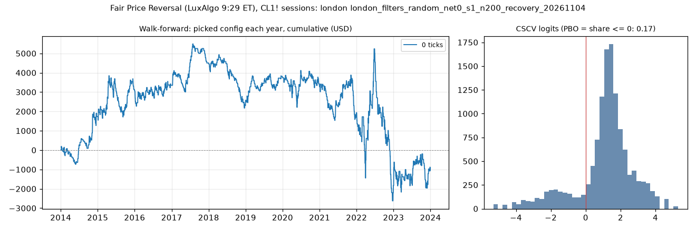

# Fair Price Reversal (LuxAlgo 9:29 ET), CL1! sessions: limit-entry validation, london (london_filters_random_net0_s1_n200_recovery_20261104)

Generated 2026-11-04 14:44 UTC. Execution: limit-close-tp-expiry-owner-swings-v2. Commission included; no added slippage.

> **Development interval only, in-sample research.** The starting settings were selected using the full history. Walk-forward re-selection does not remove that exposure. Passing is not proof of a tradable edge.

Candidate: trial 168 of `results/fair_price_reversal/search/london_filters_random_net0_s1_n200`; 200 configurations in the search universe.

## Verdict

| Check | Result | Need |
|---|---|---|
| Walk-forward net profit | -1,045.58 USD | > 0 |
| Positive years | 6 of 10 | >= 7 |
| PBO | 0.166 | <= 0.5 |
| DSR | 0.473 | >= 0.95 |

Procedure: **fail**. Candidate: **fail**. Advance to F4: False.

Engine runs: 200 matrix configurations + 20 fold runs, baseline only.

## Walk-forward, anchored

Each test year starts flat. Selection uses prior development data only, net profit plus open P&L, and the scaled minimum trade count. Sensitivities cannot rescue a failure.

| Year | Picked trial | Configuration | Training result | Net profit | Trades | Frozen candidate (in-sample) |
|---|---|---|---|---|---|---|
| 2014 | 158 | anchor_body_atr <= 2, range_ratio <= 1.6, risk_ticks <= 58 | 12,399.64 USD | 1,732.32 USD | 84 | 508.10 USD |
| 2015 | 158 | anchor_body_atr <= 2, range_ratio <= 1.6, risk_ticks <= 58 | 14,131.96 USD | 1,329.46 USD | 127 | 435.34 USD |
| 2016 | 158 | anchor_body_atr <= 2, range_ratio <= 1.6, risk_ticks <= 58 | 15,461.42 USD | 287.80 USD | 110 | 491.62 USD |
| 2017 | 158 | anchor_body_atr <= 2, range_ratio <= 1.6, risk_ticks <= 58 | 15,749.22 USD | 1,154.08 USD | 96 | 507.90 USD |
| 2018 | 158 | anchor_body_atr <= 2, range_ratio <= 1.6, risk_ticks <= 58 | 16,903.30 USD | -1,927.78 USD | 89 | -2,753.96 USD |
| 2019 | 158 | anchor_body_atr <= 2, range_ratio <= 1.6, risk_ticks <= 58 | 14,975.52 USD | 1,160.46 USD | 77 | 986.44 USD |
| 2020 | 158 | anchor_body_atr <= 2, range_ratio <= 1.6, risk_ticks <= 58 | 16,135.98 USD | -467.88 USD | 94 | 1,468.00 USD |
| 2021 | 164 | risk_atr >= 2 | 15,922.16 USD | -1,333.76 USD | 88 | -10.24 USD |
| 2022 | 164 | risk_atr >= 2 | 14,588.40 USD | -3,766.02 USD | 101 | 930.86 USD |
| 2023 | 18 | range_ratio >= 0.7 | 12,784.84 USD | 785.74 USD | 113 | 3,157.50 USD |
| Total | | | | -1,045.58 USD | 979 | |

Walk-forward efficiency: -0.05. Fold-end open positions: 0.
Fold/full-history boundary difference: 0.00 USD.

## Sensitivity: rolling four-year training

Each test year starts flat. Selection uses prior development data only, net profit plus open P&L, and the scaled minimum trade count. Sensitivities cannot rescue a failure.

| Year | Picked trial | Configuration | Training result | Net profit | Trades | Frozen candidate (in-sample) |
|---|---|---|---|---|---|---|
| 2014 | 158 | anchor_body_atr <= 2, range_ratio <= 1.6, risk_ticks <= 58 | 12,399.64 USD | 1,732.32 USD | 84 | 508.10 USD |
| 2015 | 158 | anchor_body_atr <= 2, range_ratio <= 1.6, risk_ticks <= 58 | 12,511.00 USD | 1,329.46 USD | 127 | 435.34 USD |
| 2016 | 158 | anchor_body_atr <= 2, range_ratio <= 1.6, risk_ticks <= 58 | 11,697.08 USD | 287.80 USD | 110 | 491.62 USD |
| 2017 | 18 | range_ratio >= 0.7 | 9,462.20 USD | 1,258.30 USD | 85 | 507.90 USD |
| 2018 | 18 | range_ratio >= 0.7 | 6,376.52 USD | -2,187.58 USD | 79 | -2,753.96 USD |
| 2019 | 18 | range_ratio >= 0.7 | 2,188.68 USD | 176.84 USD | 58 | 986.44 USD |
| 2020 | 24 | anchor_body_atr <= 1.1, range_ratio <= 1.7 | 1,229.68 USD | -47.68 USD | 84 | 1,468.00 USD |
| 2021 | 73 | risk_atr <= 5.75, risk_ticks >= 8 | 2,001.08 USD | -1,142.10 USD | 105 | -10.24 USD |
| 2022 | 1 | anchor_body_atr <= 0.1, risk_ticks <= 14 | 1,834.18 USD | 131.96 USD | 2 | 930.86 USD |
| 2023 | 168 | anchor_body_atr <= 1.9, risk_ticks <= 20 | 3,375.06 USD | 3,157.50 USD | 125 | 3,157.50 USD |
| Total | | | | 4,696.82 USD | 859 | |

Walk-forward efficiency: 0.29. Fold-end open positions: 0.
Fold/full-history boundary difference: 0.00 USD.

## Probability of backtest overfitting

Daily marked-to-market P&L, split into complementary halves. PBO is the fraction where the in-sample winner ranks at or below the out-of-sample median. This diagnostic is not time ordered.

| Version | PBO | P(OOS loss) | Median logit | Skipped |
|---|---|---|---|---|
| primary | 0.166 | 0.153 | 1.324 | 0 |
| eligible_only | 0.496 | 0.153 | 0.025 | 0 |

## Deflated Sharpe

Daily returns use fixed starting capital, idle days included, and are not annualized. The luck bar uses the search universe's Sharpe spread. Broader-N sensitivities reuse that spread as an assumption.

| Version | N | Luck bar | DSR |
|---|---|---|---|
| primary | 200 | 0.0403 | 0.473 |
| variant_n | 779 | 0.0463 | 0.318 |
| strategy_n | 2520 | 0.0511 | 0.215 |
| monthly | 200 | 0.1866 | 0.520 |

Daily Sharpe: 0.0392. PSR above zero: 0.996. 90% block-bootstrap Sharpe interval: (0.01358214933212116, 0.0648388729213212). Identical paths: 53.

Raw files: `results/fair_price_reversal/validate/london_filters_random_net0_s1_n200_recovery_20261104`. The statistical formula assumes independent returns; the block bootstrap checks sensitivity to dependence.
