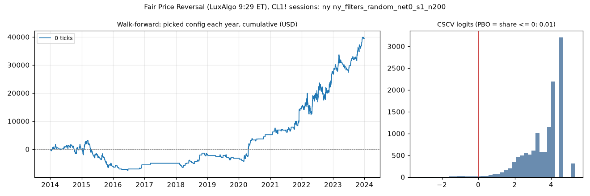

# Fair Price Reversal (LuxAlgo 9:29 ET), CL1! sessions: limit-entry validation, ny (ny_filters_random_net0_s1_n200)

Generated 2026-11-04 14:07 UTC. Execution: limit-close-tp-expiry-owner-swings-v2. Commission included; no added slippage.

> **Development interval only, in-sample research.** The starting settings were selected using the full history. Walk-forward re-selection does not remove that exposure. Passing is not proof of a tradable edge.

Candidate: trial 4 of `results/fair_price_reversal/search/ny_filters_random_net0_s1_n200`; 200 configurations in the search universe.

## Verdict

| Check | Result | Need |
|---|---|---|
| Walk-forward net profit | 39,463.24 USD | > 0 |
| Positive years | 7 of 10 | >= 7 |
| PBO | 0.011 | <= 0.5 |
| DSR | 0.759 | >= 0.95 |

Procedure: pass. Candidate: **fail**. Advance to F4: False.

Engine runs: 200 matrix configurations + 20 fold runs, baseline only.

## Walk-forward, anchored

Each test year starts flat. Selection uses prior development data only, net profit plus open P&L, and the scaled minimum trade count. Sensitivities cannot rescue a failure.

| Year | Picked trial | Configuration | Training result | Net profit | Trades | Frozen candidate (in-sample) |
|---|---|---|---|---|---|---|
| 2014 | 4 | risk_ticks >= 22 | 35,726.80 USD | -25.82 USD | 91 | -25.82 USD |
| 2015 | 4 | risk_ticks >= 22 | 35,700.98 USD | -6,056.72 USD | 136 | -6,056.72 USD |
| 2016 | 89 | risk_ticks >= 30 | 32,882.56 USD | 531.76 USD | 12 | 1,741.06 USD |
| 2017 | 82 | minutes_from_open <= 90, risk_ticks >= 28 | 33,631.86 USD | 555.98 USD | 1 | 4,177.74 USD |
| 2018 | 89 | risk_ticks >= 30 | 35,944.22 USD | 3,143.52 USD | 24 | -651.30 USD |
| 2019 | 89 | risk_ticks >= 30 | 39,087.74 USD | -1,352.36 USD | 18 | -1,681.40 USD |
| 2020 | 89 | risk_ticks >= 30 | 37,735.38 USD | 8,399.30 USD | 35 | 7,904.28 USD |
| 2021 | 89 | risk_ticks >= 30 | 46,134.68 USD | 9,804.88 USD | 56 | 16,627.50 USD |
| 2022 | 4 | risk_ticks >= 22 | 57,762.14 USD | 12,502.84 USD | 258 | 12,502.84 USD |
| 2023 | 89 | risk_ticks >= 30 | 72,011.34 USD | 11,959.86 USD | 107 | 14,464.24 USD |
| Total | | | | 39,463.24 USD | 738 | |

Walk-forward efficiency: 0.69. Fold-end open positions: 0.
Fold/full-history boundary difference: 0.00 USD.

## Sensitivity: rolling four-year training

Each test year starts flat. Selection uses prior development data only, net profit plus open P&L, and the scaled minimum trade count. Sensitivities cannot rescue a failure.

| Year | Picked trial | Configuration | Training result | Net profit | Trades | Frozen candidate (in-sample) |
|---|---|---|---|---|---|---|
| 2014 | 4 | risk_ticks >= 22 | 35,726.80 USD | -25.82 USD | 91 | -25.82 USD |
| 2015 | 4 | risk_ticks >= 22 | 30,243.38 USD | -6,056.72 USD | 136 | -6,056.72 USD |
| 2016 | 143 | risk_atr >= 2.75, risk_ticks >= 10 | 19,611.44 USD | -733.66 USD | 83 | 1,741.06 USD |
| 2017 | 143 | risk_atr >= 2.75, risk_ticks >= 10 | 12,627.72 USD | -391.90 USD | 95 | 4,177.74 USD |
| 2018 | 172 | anchor_body_atr >= 1.4 | 4,335.64 USD | 157.44 USD | 28 | -651.30 USD |
| 2019 | 89 | risk_ticks >= 30 | 5,735.94 USD | -1,352.36 USD | 18 | -1,681.40 USD |
| 2020 | 58 | anchor_body_atr <= 0.8, minutes_from_open >= 70, range_ratio <= 1.1 | 4,247.20 USD | 623.42 USD | 29 | 7,904.28 USD |
| 2021 | 96 | minutes_from_open >= 60 | 10,458.98 USD | 3,622.12 USD | 94 | 16,627.50 USD |
| 2022 | 161 | risk_atr >= 1 | 22,996.80 USD | 12,830.28 USD | 286 | 12,502.84 USD |
| 2023 | 164 | risk_atr >= 2 | 42,893.80 USD | 11,215.70 USD | 215 | 14,464.24 USD |
| Total | | | | 19,888.50 USD | 1075 | |

Walk-forward efficiency: 0.41. Fold-end open positions: 0.
Fold/full-history boundary difference: 0.00 USD.

## Probability of backtest overfitting

Daily marked-to-market P&L, split into complementary halves. PBO is the fraction where the in-sample winner ranks at or below the out-of-sample median. This diagnostic is not time ordered.

| Version | PBO | P(OOS loss) | Median logit | Skipped |
|---|---|---|---|---|
| primary | 0.011 | 0.009 | 3.897 | 0 |
| eligible_only | 0.011 | 0.009 | 3.248 | 0 |

## Deflated Sharpe

Daily returns use fixed starting capital, idle days included, and are not annualized. The luck bar uses the search universe's Sharpe spread. Broader-N sensitivities reuse that spread as an assumption.

| Version | N | Luck bar | DSR |
|---|---|---|---|
| primary | 200 | 0.0490 | 0.759 |
| variant_n | 1023 | 0.0578 | 0.538 |
| strategy_n | 2520 | 0.0622 | 0.418 |
| monthly | 200 | 0.2459 | 0.705 |

Daily Sharpe: 0.0592. PSR above zero: 1.000. 90% block-bootstrap Sharpe interval: (0.03399326639277331, 0.08290513492570283). Identical paths: 3.

Raw files: `results/fair_price_reversal/validate/ny_filters_random_net0_s1_n200`. The statistical formula assumes independent returns; the block bootstrap checks sensitivity to dependence.
