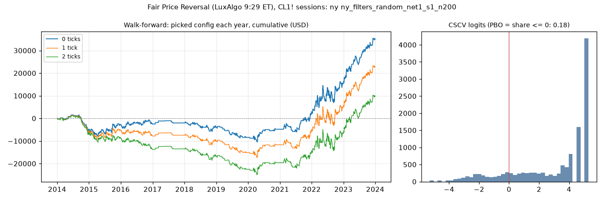

> **Superseded — 4 November 2026.** This is a historical record under previous rules.
> Current runs must use only `indicators/structure_swings.pine`; see the regenerated strategy results
> and current `net0` search/validation reports. These numbers do not establish current-rule performance.

# Fair Price Reversal (LuxAlgo 9:29 ET), CL1! sessions: feature 3 validation, `ny` (ny_filters_random_net1_s1_n200)

Generated 2026-10-31 16:15 UTC by `python -m tvtester.cli validate strategies/configs/fair_price_reversal_ny_filters_random_net1_s1_n200.json`. Protocol: [`docs/VALIDATE.md`](../../../VALIDATE.md).

> **Development interval only** (bars before 2024-01-01 UTC). This is retrospective robustness, conditional on the frozen feature-2 search universe: the base parameters were picked on 2010-2026 and the filters on the whole development interval, so a fold is not out-of-sample evidence. Passing does not show a tradable edge.

**Candidate:** trial 85 of `results/fair_price_reversal/search/ny_filters_random_net1_s1_n200`. Parameters `atr_mult=0.5`, `session=ny`, `swing=3`, `target=rr2`, `window=120`; filters `anchor_body_atr >= 0.3`, `risk_ticks >= 32`.

## Verdict

| Verdict | Result | Checks |
|---|---|---|
| Procedure (would the E2 search, run blind each year, have worked?) | **fail** | walk-forward 1 tick 22,839.82 USD (pass), 2 ticks 9,739.82 USD (pass); positive folds 6 of 10 (need 7, **fail**); PBO 0.184 (max 0.5, pass) |
| Candidate (is its Sharpe more than best-of-200 luck?) | **fail** | DSR 0.432 (need 0.95) |
| **Advance to feature 4** | **no** | both verdicts must pass |

Engine runs: 600 (matrix: 200 configurations x 0 / 1 / 2 ticks) + 60 fold runs. Every matrix row matched its `trials.csv` totals.

## Walk-forward re-selection (anchored, primary)

Each year Y: pick the best of the 200 E2 configurations on all development data before Y (1 tick, net profit + open P&L, scaled trade minimum), then run **that** configuration through year Y, starting flat. The last column is the frozen candidate in the same year (in-sample reference only).

| Test year | Picked trial | Configuration | Training result | Year result 0 / 1 / 2 ticks | Trades (1) | Frozen candidate (1 tick, in-sample) |
|---|---|---|---|---|---|---|
| 2014 | 85 | anchor_body_atr >= 0.3, risk_ticks >= 32 | 16,408.78 USD | -5,376.88 USD / -6,096.88 USD / -6,816.88 USD | 44 | -6,096.88 USD |
| 2015 | 154 | range_ratio <= 1, risk_ticks <= 44 | 14,026.18 USD | 2,491.42 USD / 751.42 USD / -1,968.58 USD | 129 | 2,216.54 USD |
| 2016 | 154 | range_ratio <= 1, risk_ticks <= 44 | 14,777.60 USD | 375.64 USD / -2,454.36 USD / -4,964.36 USD | 118 | 6,129.40 USD |
| 2017 | 85 | anchor_body_atr >= 0.3, risk_ticks >= 32 | 18,657.84 USD | 471.86 USD / 351.86 USD / 231.86 USD | 7 | 351.86 USD |
| 2018 | 85 | anchor_body_atr >= 0.3, risk_ticks >= 32 | 19,009.70 USD | -1,812.86 USD / -2,472.86 USD / -3,132.86 USD | 43 | -2,472.86 USD |
| 2019 | 85 | anchor_body_atr >= 0.3, risk_ticks >= 32 | 16,536.84 USD | -4,552.76 USD / -5,212.76 USD / -5,872.76 USD | 38 | -5,212.76 USD |
| 2020 | 85 | anchor_body_atr >= 0.3, risk_ticks >= 32 | 11,324.08 USD | 3,609.30 USD / 3,453.32 USD / 2,953.32 USD | 34 | 3,453.32 USD |
| 2021 | 85 | anchor_body_atr >= 0.3, risk_ticks >= 32 | 14,777.40 USD | 7,702.72 USD / 6,802.72 USD / 5,202.72 USD | 64 | 6,802.72 USD |
| 2022 | 85 | anchor_body_atr >= 0.3, risk_ticks >= 32 | 21,580.12 USD | 12,433.38 USD / 9,703.38 USD / 7,683.38 USD | 131 | 9,703.38 USD |
| 2023 | 85 | anchor_body_atr >= 0.3, risk_ticks >= 32 | 31,283.50 USD | 19,683.98 USD / 18,013.98 USD / 16,423.98 USD | 101 | 18,013.98 USD |
| **Total** | | | | **35,025.80 USD / 22,839.82 USD / 9,739.82 USD** | 709 | 32,888.70 USD |

- Distinct configurations picked: 2 of 10 folds; the frozen candidate (trial 85) was picked in 8.
- Without its best year (2023, 18,013.98 USD): 4,825.84 USD at 1 tick.
- Walk-forward efficiency (mean year result / mean training result per training year, 1 tick): 0.93.
- Boundary check: a position left open at a fold end in 0 folds; fold run vs the same configuration's full-run slice differ by 0.00 USD in total at 1 tick.

### Sensitivity: rolling 4-year training window (cannot rescue a failure)

| Test year | Picked trial | Configuration | Year result 0 / 1 / 2 ticks |
|---|---|---|---|
| 2014 | 85 | anchor_body_atr >= 0.3, risk_ticks >= 32 | -5,376.88 USD / -6,096.88 USD / -6,816.88 USD |
| 2015 | 154 | range_ratio <= 1, risk_ticks <= 44 | 2,491.42 USD / 751.42 USD / -1,968.58 USD |
| 2016 | 150 | anchor_body_atr <= 1.1, minutes_from_open <= 75, risk_ticks >= 30 | 2,477.54 USD / 2,157.54 USD / 1,837.54 USD |
| 2017 | 150 | anchor_body_atr <= 1.1, minutes_from_open <= 75, risk_ticks >= 30 | 519.90 USD / 439.90 USD / 359.90 USD |
| 2018 | 46 | anchor_body_atr >= 0.4, minutes_from_open <= 30 | -1,340.40 USD / -1,660.40 USD / -1,980.40 USD |
| 2019 | 85 | anchor_body_atr >= 0.3, risk_ticks >= 32 | -4,552.76 USD / -5,212.76 USD / -5,872.76 USD |
| 2020 | 16 | minutes_from_open >= 25, range_ratio <= 1.5, risk_ticks >= 34 | -1,274.72 USD / -1,834.72 USD / -2,394.72 USD |
| 2021 | 176 | range_ratio >= 1.5 | 177.34 USD / -242.66 USD / -1,662.66 USD |
| 2022 | 150 | anchor_body_atr <= 1.1, minutes_from_open <= 75, risk_ticks >= 30 | -1,990.54 USD / -7,046.52 USD / -8,826.52 USD |
| 2023 | 85 | anchor_body_atr >= 0.3, risk_ticks >= 32 | 19,683.98 USD / 18,013.98 USD / 16,423.98 USD |
| **Total** | | | **10,814.88 USD / -731.10 USD / -10,901.10 USD** |

## CSCV: probability of backtest overfitting

Daily P&L at 1 tick in 16 blocks, all 12,870 ways to split them into two halves. In each split the best configuration of one half is ranked in the other half. PBO = share of splits where it lands at or below the median. A diagnostic of the search, not a time-ordered test.

| Version | PBO | P(OOS loss) | Median logit | Median IS / OOS net of the pick | Slope (OOS on IS) | Skipped splits |
|---|---|---|---|---|---|---|
| primary (1 tick, all 200) | 0.184 | 0.187 | 4.19 | 25,589.02 USD / 15,633.76 USD | -0.563 | 0 |
| eligible configurations only | 0.186 | 0.187 | 3.65 | 25,589.02 USD / 15,633.76 USD | -0.563 | 0 |
| 2 ticks | 0.222 | 0.291 | 3.90 | 18,086.53 USD / 8,223.96 USD | -0.350 | 0 |

Identical trade paths among the 200 (inert filters): 11.

## Deflated Sharpe ratio of the frozen candidate

Daily marked-to-market P&L / 50,000 (fixed capital, idle days included as zeros), Sharpe per day, not annualized. The trial population that sets the luck bar is the 200 E2 configurations (their own Sharpe spread). The broader N rows reuse that spread for configurations whose spread was not measured here: an assumption, shown for scale.

| Version | SR (daily) | Skew | Kurtosis | N | SR luck bar (SR0) | DSR |
|---|---|---|---|---|---|---|
| primary: 1 tick, N = 200 | 0.0356 | 2.43 | 17.9 | 200 | 0.0382 | 0.432 |
| 1 tick, N = variant distinct | 0.0356 | 2.43 | 17.9 | 693 | 0.0435 | 0.298 |
| 1 tick, N = strategy distinct | 0.0356 | 2.43 | 17.9 | 2,011 | 0.0476 | 0.209 |
| 2 ticks, N = 200 | 0.0249 | 2.33 | 17.5 | 200 | 0.0484 | 0.058 |
| 1 tick, monthly returns, N = 200 | 0.1946 | 0.61 | 4.1 | 200 | 0.1907 | 0.521 |

- Distinct configurations: variant 693, strategy 2,011 (feature-1 grid + every search trial and neighbour). Configurations with zero variance left out of the spread: 10.
- Probabilistic Sharpe (SR > 0, no deflation), 1 tick: 0.992. 90% block bootstrap interval of the daily SR (mean block 20 days): 0.0152 .. 0.0581.
- The formula assumes independent, identically distributed returns; the bootstrap interval is the dependence check.

Raw files in `results/fair_price_reversal/validate/ny_filters_random_net1_s1_n200/`: `matrix.npz`, `folds.csv`, `folds_rolling.csv`, `pbo.json`, `dsr.json`, `verdict.json`, `run.json` (hashes).
