# Price Reversal v2 (hourly anchors, entry cap, fixed TP), CL1!: results

Generated 2026-11-11 20:10 UTC by `python -m tvtester.cli test price_reversal_v2`.

New strategy built 12 November 2026 from the owner's two questions about Fair Price Reversal (FPR):

1. **Does the hourly candle matter?** The FPR setup is anchored to the candle before each of the 23 Globex
   hours. Hour 1 opens 18:00 New York (06:00 Malaysia in US summer time, 07:00 in US winter time); hour 16 is
   09:00 ET (the FPR NY open); hour 23 is 16:00 ET. Because the clock is New York time, the hour number moves
   with US daylight saving time exactly as the owner defined it. Each hour variant runs the full FPR grid and
   trades for up to 5 hours after its open, never past 16:59 ET (the 17:00 ET halt).
2. **Entry cap and fixed TP.** On FPR's frozen session baselines (`entry_asia`, `entry_london`, `entry_ny`):
   `entry_cap` N > 0 places the limit N ticks from the stop when the signal close is further than N ticks from
   it (otherwise at the close, as FPR); `tp_mode = fixed` uses 2 x the 5-tick tier at or above the stop
   distance (<= 20 -> 40, <= 25 -> 50, <= 30 -> 60, ...). `entry_cap = 0, tp_mode = default` is FPR itself.

**Signal:** unchanged FPR setup (anchor body = fair price, `atr_mult` x ATR(14) move away, owner swing
market-structure shift back toward the body; one long and one short per anchor day).

**Trade rules:** limit entry from the next bar, stop = excursion extreme, target `near` / `far` / `rr1` / `rr2`
(R = planned entry to stop) or fixed tiers, unfilled entry cancelled when the planned TP is reached at a
one-minute close or the session ends, flat at the next bar open after the flat time.

Per-hour and entry-study comparisons across every combination (not only the top one):
[study.md](study.md). Pine v6 twin:
[`strategies/price_reversal_v2.pine`](../../../strategies/price_reversal_v2.pine).

## Test settings (TradingView Properties)

| Setting | Value |
|---|---|
| Symbol | CL1! (NYMEX Light Crude Oil, front month), 1-minute bars |
| Data | 2010-06-07 00:00:00+00:00 to 2026-11-10 08:27:00+00:00 UTC, 5,680,278 bars (manifest written 2026-11-04T02:31:15+00:00) |
| Initial capital | 50,000.00 USD |
| Order size | 1 contract |
| Commission | 2.01 USD per contract per order (4.02 USD round trip) |
| Execution | Limit entries; commission included; no added slippage |
| Pyramiding | 0 (one position) |
| Fills | TradingView broker emulator, Bar Magnifier off, limits fill on touch |
| Roll rule | position closed at the last bar of a contract (exit reason `roll`) |

## How the top combination was chosen

Every variant ran all combinations of its grid below with commission included. The combination with the highest **net profit** is the top combination (ties: higher profit factor, then grid order). This reference is retained for compatibility. Thirteen separate metric winners are also selected, with a declared minimum trade count; their values, settings and trade lists are linked below. No slippage stress runs are performed.

Variants h01, h02, h03, h04, h05, h06, h07, h08, h09, h10, h11, h12, h13, h14, h15, h16, h17, h18, h19, h20, h21, h22, h23: 64 combinations.

| Parameter | Values |
|---|---|
| `window` | 30, 60, 90, 120 |
| `atr_mult` | 0.5, 1.0, 1.5, 2.0 |
| `swing` | 1 |
| `target` | near, far, rr1, rr2 |

Variants entry_asia, entry_london, entry_ny: 16 combinations.

| Parameter | Values |
|---|---|
| `entry_cap` | 0, 20, 25, 30, 35, 40, 45, 50 |
| `tp_mode` | default, fixed |

> **Read this first.** The top combination is the best of 16 / 64 tries (per variant) on the same data it is reported on (in-sample). Picking the best of many tries makes the result look better than what the same rules can be expected to earn on new data. Treat these numbers as an upper bound, not as a forecast.

## Summary: top combination per variant

| Variant | Parameters | Net profit | Trades | % profitable | Profit factor | Max DD |
|---|---|---|---|---|---|---|
| h01 | window=60, atr_mult=2.0, swing=1, target=rr2 | 34,149.78 USD | 2,811 | 36.50% | 1.164 | 10,026.72 USD |
| h02 | window=60, atr_mult=0.5, swing=1, target=far | 7,160.88 USD | 2,256 | 51.55% | 1.085 | 5,247.46 USD |
| h03 | window=30, atr_mult=0.5, swing=1, target=near | -6,180.08 USD | 1,204 | 55.07% | 0.890 | 7,503.94 USD |
| h04 | window=30, atr_mult=0.5, swing=1, target=rr1 | -6,557.46 USD | 1,273 | 48.63% | 0.908 | 8,073.50 USD |
| h05 | window=60, atr_mult=0.5, swing=1, target=rr2 | -2,322.16 USD | 2,508 | 31.10% | 0.985 | 11,827.62 USD |
| h06 | window=30, atr_mult=1.0, swing=1, target=far | -4,014.16 USD | 1,108 | 55.05% | 0.901 | 6,623.08 USD |
| h07 | window=30, atr_mult=1.0, swing=1, target=near | -4,945.88 USD | 994 | 57.04% | 0.829 | 5,768.20 USD |
| h08 | window=60, atr_mult=1.0, swing=1, target=rr2 | -993.80 USD | 2,690 | 33.27% | 0.994 | 8,234.94 USD |
| h09 | window=30, atr_mult=0.5, swing=1, target=rr1 | -4,418.10 USD | 1,405 | 48.11% | 0.943 | 10,676.40 USD |
| h10 | window=30, atr_mult=1.5, swing=1, target=rr2 | 12,568.38 USD | 1,881 | 35.03% | 1.079 | 7,586.28 USD |
| h11 | window=30, atr_mult=0.5, swing=1, target=rr2 | 6,729.62 USD | 1,719 | 33.97% | 1.043 | 8,178.26 USD |
| h12 | window=30, atr_mult=1.0, swing=1, target=near | 263.34 USD | 1,733 | 60.65% | 1.003 | 7,765.48 USD |
| h13 | window=30, atr_mult=1.0, swing=1, target=far | 612.88 USD | 1,656 | 55.92% | 1.007 | 8,856.16 USD |
| h14 | window=90, atr_mult=1.0, swing=1, target=near | 5,251.24 USD | 4,338 | 56.34% | 1.020 | 14,904.96 USD |
| h15 | window=120, atr_mult=0.5, swing=1, target=rr2 | 10,896.22 USD | 4,889 | 33.05% | 1.017 | 26,052.96 USD |
| h16 | window=90, atr_mult=0.5, swing=1, target=rr2 | 35,362.52 USD | 4,074 | 34.32% | 1.057 | 30,603.88 USD |
| h17 | window=90, atr_mult=1.0, swing=1, target=rr1 | 10,388.30 USD | 4,585 | 50.19% | 1.019 | 16,717.90 USD |
| h18 | window=30, atr_mult=0.5, swing=1, target=far | 7,334.50 USD | 1,775 | 57.69% | 1.047 | 11,572.74 USD |
| h19 | window=60, atr_mult=2.0, swing=1, target=near | 4,891.62 USD | 3,119 | 59.63% | 1.022 | 12,706.98 USD |
| h20 | window=90, atr_mult=0.5, swing=1, target=rr1 | 1,595.98 USD | 4,001 | 49.94% | 1.004 | 24,764.78 USD |
| h21 | window=30, atr_mult=1.5, swing=1, target=rr1 | 23,031.16 USD | 1,542 | 52.72% | 1.171 | 9,297.32 USD |
| h22 | window=60, atr_mult=2.0, swing=1, target=near | 858.28 USD | 2,386 | 58.72% | 1.008 | 7,100.00 USD |
| h23 | window=30, atr_mult=1.5, swing=1, target=far | 608.14 USD | 993 | 53.68% | 1.017 | 2,980.46 USD |
| entry_asia | entry_cap=0, tp_mode=default | -5,035.22 USD | 1,561 | 32.48% | 0.959 | 10,296.38 USD |
| entry_london | entry_cap=50, tp_mode=default | 13,824.26 USD | 1,887 | 35.19% | 1.086 | 7,849.10 USD |
| entry_ny | entry_cap=0, tp_mode=fixed | 36,639.60 USD | 4,520 | 30.07% | 1.050 | 32,109.64 USD |

## Conclusion

In-sample, all available bars (2024+ included), best of the grid per variant. Read study.md before drawing
conclusions: a best-of-64 hour result is biased upward; the study page shows the whole grid per hour.
Independent replication (Codex) and a TradingView comparison of the Pine twin are pending.

## Variant: h01

**Top combination:** `anchor=h01`, `window=60`, `atr_mult=2.0`, `swing=1`, `target=rr2`

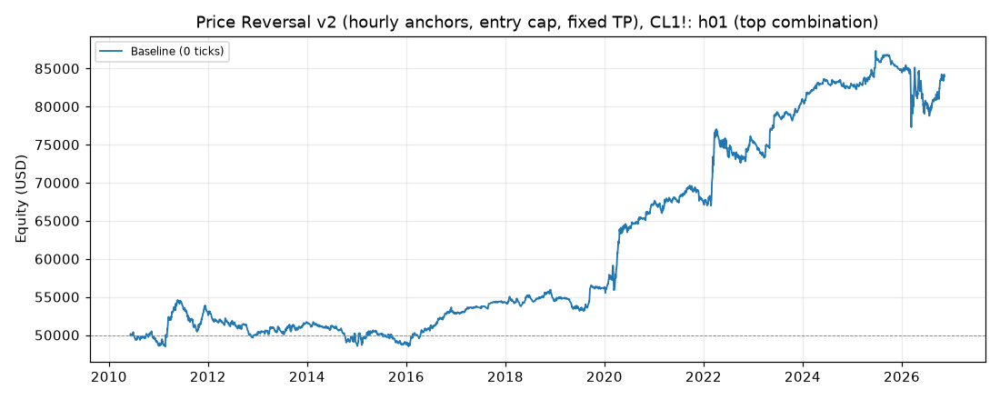

Files: [grid](../../../results/price_reversal_v2/h01/grid.csv), [trades 0 ticks](../../../results/price_reversal_v2/h01/trades_slippage0.csv), [summary](../../../results/price_reversal_v2/h01/summary.json)

### Results after commission

#### Overview

| Metric | Value |
|---|---|
| Net profit | 34,149.78 USD (68.30%) |
| Total closed trades | 2,811 |
| Percent profitable | 36.50% |
| Profit factor | 1.164 |
| Max equity drawdown | 10,026.72 USD (20.05%) |
| Avg trade | 12.15 USD |
| Avg # bars in trades | 70 |

#### Performance

| Metric | All | Long | Short |
|---|---|---|---|
| Net profit | 34,149.78 USD (68.30%) | 13,090.44 USD (26.18%) | 21,059.34 USD (42.12%) |
| Gross profit | 241,875.48 USD (483.75%) | 110,060.30 USD (220.12%) | 131,815.18 USD (263.63%) |
| Gross loss | 207,725.70 USD (415.45%) | 96,969.86 USD (193.94%) | 110,755.84 USD (221.51%) |
| Commission paid | 11,300.22 USD | 5,539.56 USD | 5,760.66 USD |

| Account | Value |
|---|---|
| Initial capital | 50,000.00 USD |
| Buy & hold return (TV-style, all capital at the first entry) | 10,138.38 USD (20.28%) |
| Max equity run-up (intrabar) | 39,197.98 USD (78.40%) |
| Max equity drawdown (intrabar) | 10,026.72 USD (20.05%) |
| Open P&L | 0.00 USD |
| Max contracts held | 1 |

#### Trades analysis

| Metric | All | Long | Short |
|---|---|---|---|
| Total closed trades | 2,811 | 1,378 | 1,433 |
| Winning trades | 1,026 | 485 | 541 |
| Losing trades | 1,785 | 893 | 892 |
| Even trades | 0 | 0 | 0 |
| Percent profitable | 36.50% | 35.20% | 37.75% |
| Avg P&L | 12.15 USD | 9.50 USD | 14.70 USD |
| Avg P&L % | 0.03% | 0.03% | 0.03% |
| Avg winning trade | 235.75 USD | 226.93 USD | 243.65 USD |
| Avg losing trade | 116.37 USD | 108.59 USD | 124.17 USD |
| Ratio avg win / avg loss | 2.026 | 2.090 | 1.962 |
| Largest winning trade | 2,675.98 USD | 2,595.98 USD | 2,675.98 USD |
| Largest winning trade % | 5.16% | 5.16% | 2.65% |
| Largest losing trade | 3,374.02 USD | 2,294.02 USD | 3,374.02 USD |
| Largest losing trade % | 7.00% | 7.00% | 3.13% |
| Avg # bars in trades | 70 | 69 | 70 |
| Avg # bars in winning trades | 99 | 100 | 98 |
| Avg # bars in losing trades | 53 | 52 | 54 |

#### Risk/performance ratios

| Metric | Value |
|---|---|
| Sharpe ratio | 0.068 |
| Sortino ratio | 0.144 |
| Profit factor | 1.164 |
| Margin calls | 0 |

#### List of trades (last 10, newest first; full list in the trades CSV)

| Trade # | Type | Signal | Date/Time (UTC) | Price | Contracts | Profit | Cum. profit | Run-up | Drawdown |
|---|---|---|---|---|---|---|---|---|---|
| 2811 | Exit long | Exit | 2026-11-10 00:33 | 86.56 | 1 | 295.98 USD (0.34%) | 34,149.78 USD | 300.00 USD | 0.00 USD |
|  | Entry long | Long | 2026-11-09 23:26 | 86.26 | 1 |  |  |  |  |
| 2810 | Exit short | Exit | 2026-11-09 00:54 | 90.76 | 1 | -324.02 USD (-0.36%) | 33,853.80 USD | 300.00 USD | 320.00 USD |
|  | Entry short | Short | 2026-11-08 23:42 | 90.44 | 1 |  |  |  |  |
| 2809 | Exit short | Exit | 2026-11-06 00:15 | 90.94 | 1 | 375.98 USD (0.41%) | 34,177.82 USD | 380.00 USD | 160.00 USD |
|  | Entry short | Short | 2026-11-05 23:20 | 91.32 | 1 |  |  |  |  |
| 2808 | Exit short | Exit | 2026-11-05 01:00 | 87.77 | 1 | 435.98 USD (0.49%) | 33,801.84 USD | 440.00 USD | 180.00 USD |
|  | Entry short | Short | 2026-11-04 23:16 | 88.21 | 1 |  |  |  |  |
| 2807 | Exit long | Exit | 2026-11-03 23:34 | 96.64 | 1 | -94.02 USD (-0.10%) | 33,365.86 USD | 20.00 USD | 90.00 USD |
|  | Entry long | Long | 2026-11-03 23:22 | 96.73 | 1 |  |  |  |  |
| 2806 | Exit short | Exit | 2026-11-03 00:39 | 96.50 | 1 | -114.02 USD (-0.12%) | 33,459.88 USD | 180.00 USD | 110.00 USD |
|  | Entry short | Short | 2026-11-02 23:16 | 96.39 | 1 |  |  |  |  |
| 2805 | Exit long | Exit | 2026-11-01 23:44 | 102.25 | 1 | -204.02 USD (-0.20%) | 33,573.90 USD | 100.00 USD | 200.00 USD |
|  | Entry long | Long | 2026-11-01 23:17 | 102.45 | 1 |  |  |  |  |
| 2804 | Exit long | Exit | 2026-10-30 00:54 | 102.60 | 1 | -144.02 USD (-0.14%) | 33,777.92 USD | 200.00 USD | 140.00 USD |
|  | Entry long | Long | 2026-10-29 22:17 | 102.74 | 1 |  |  |  |  |
| 2803 | Exit long | Exit | 2026-10-28 00:07 | 100.41 | 1 | 435.98 USD (0.44%) | 33,921.94 USD | 440.00 USD | 150.00 USD |
|  | Entry long | Long | 2026-10-27 22:38 | 99.97 | 1 |  |  |  |  |
| 2802 | Exit long | Exit | 2026-10-26 01:09 | 101.54 | 1 | -424.02 USD (-0.42%) | 33,485.96 USD | 500.00 USD | 420.00 USD |
|  | Entry long | Long | 2026-10-25 22:12 | 101.96 | 1 |  |  |  |  |

#### By year (extra, not a TV tab)

| Year | Trades | Net profit | % profitable | Profit factor |
|---|---|---|---|---|
| 2010 | 104 | -1,328.08 USD | 28.85% | 0.785 |
| 2011 | 182 | 4,278.36 USD | 36.81% | 1.281 |
| 2012 | 168 | -2,795.36 USD | 27.98% | 0.745 |
| 2013 | 157 | 1,498.86 USD | 38.22% | 1.176 |
| 2014 | 155 | -2,783.10 USD | 30.97% | 0.737 |
| 2015 | 168 | -125.36 USD | 34.52% | 0.988 |
| 2016 | 176 | 4,092.48 USD | 43.18% | 1.521 |
| 2017 | 108 | 1,515.84 USD | 40.74% | 1.507 |
| 2018 | 151 | 142.98 USD | 35.10% | 1.018 |
| 2019 | 148 | 1,725.04 USD | 39.19% | 1.230 |
| 2020 | 193 | 10,924.14 USD | 44.56% | 1.717 |
| 2021 | 183 | 234.34 USD | 37.70% | 1.018 |
| 2022 | 211 | 8,141.78 USD | 36.02% | 1.310 |
| 2023 | 175 | 5,496.50 USD | 32.00% | 1.562 |
| 2024 | 162 | 1,818.76 USD | 38.27% | 1.215 |
| 2025 | 181 | 1,742.38 USD | 34.25% | 1.160 |
| 2026 | 189 | -429.78 USD | 39.15% | 0.988 |

#### Exit reasons (extra)

| Reason | Trades |
|---|---|
| stop | 1704 |
| limit | 845 |
| close | 230 |
| roll | 32 |

- Session-end exits: 230.
- Roll exits: 32.

### Best settings by metric

Each winner needs at least 30 closed trades. Undefined values are excluded. Ties: higher net profit, higher profit factor, then grid order. Ruin loss threshold: 25,000.00 USD from starting capital. All selections are in-sample. MAE/MFE objectives use the mean of the per-trade maxima.

| Metric | Goal | Best value | Grid order | Trades | Eligible settings | Parameters |
|---|---|---|---|---|---|---|
| Net profit | max | 34,149.78 USD | [32](../../../results/price_reversal_v2/h01/metric_winners/order_32/trades_slippage0.csv) | 2811 | 64 | window=60, atr_mult=2.0, swing=1, target=rr2 |
| Win rate | max | 57.15% | [1](../../../results/price_reversal_v2/h01/metric_winners/order_1/trades_slippage0.csv) | 1384 | 64 | window=30, atr_mult=0.5, swing=1, target=near |
| Expectancy | max | 18.84 USD | [4](../../../results/price_reversal_v2/h01/metric_winners/order_4/trades_slippage0.csv) | 1420 | 64 | window=30, atr_mult=0.5, swing=1, target=rr2 |
| Profit factor | max | 1.334 | [1](../../../results/price_reversal_v2/h01/metric_winners/order_1/trades_slippage0.csv) | 1384 | 64 | window=30, atr_mult=0.5, swing=1, target=near |
| Payoff ratio | max | 2.128 | [16](../../../results/price_reversal_v2/h01/metric_winners/order_16/trades_slippage0.csv) | 1637 | 64 | window=30, atr_mult=2.0, swing=1, target=rr2 |
| Risk of ruin (estimate) | min | 0.00% | [15](../../../results/price_reversal_v2/h01/metric_winners/order_15/trades_slippage0.csv) | 1625 | 64 | window=30, atr_mult=2.0, swing=1, target=rr1 |
| Maximum drawdown | min | 3,449.34 USD | [3](../../../results/price_reversal_v2/h01/metric_winners/order_3/trades_slippage0.csv) | 1403 | 64 | window=30, atr_mult=0.5, swing=1, target=rr1 |
| Consecutive losses | min | 8.000 | [31](../../../results/price_reversal_v2/h01/metric_winners/order_31/trades_slippage0.csv) | 2799 | 64 | window=60, atr_mult=2.0, swing=1, target=rr1 |
| Sharpe ratio | max | 0.068 | [32](../../../results/price_reversal_v2/h01/metric_winners/order_32/trades_slippage0.csv) | 2811 | 64 | window=60, atr_mult=2.0, swing=1, target=rr2 |
| Sortino ratio | max | 0.144 | [32](../../../results/price_reversal_v2/h01/metric_winners/order_32/trades_slippage0.csv) | 2811 | 64 | window=60, atr_mult=2.0, swing=1, target=rr2 |
| R-multiple | max | No eligible value | — | — | 0 | — |
| Maximum adverse excursion (MAE) | min | 68.68 USD | [53](../../../results/price_reversal_v2/h01/metric_winners/order_53/trades_slippage0.csv) | 3826 | 64 | window=120, atr_mult=1.0, swing=1, target=near |
| Maximum favorable excursion (MFE) | max | 164.87 USD | [16](../../../results/price_reversal_v2/h01/metric_winners/order_16/trades_slippage0.csv) | 1637 | 64 | window=30, atr_mult=2.0, swing=1, target=rr2 |

- **Net profit:** Sum of closed-trade profit after commission; excludes open P&L.
- **Win rate:** Winning closed trades divided by all closed trades, including breakevens.
- **Expectancy:** Mean net profit per closed trade, including losses and breakevens.
- **Profit factor:** Gross winning profit divided by gross losing profit, both after commission. Undefined without losses.
- **Payoff ratio:** Average net winning trade divided by the absolute average net losing trade. Requires wins and losses.
- **Risk of ruin (estimate):** Infinite-horizon diffusion estimate of losing the declared amount from starting capital. Assumes independent, stationary, fixed-size net trade P&L; ignores intratrade losses and margin.
- **Maximum drawdown:** Largest equity drawdown under the tester's intrabar TradingView convention, including an open trade at the end.
- **Consecutive losses:** Longest streak of losing closed trades in execution order. A win or breakeven resets the streak.
- **Sharpe ratio:** Monthly marked-to-market excess return divided by population standard deviation, using 2% annual risk-free rate; not annualized.
- **Sortino ratio:** Monthly marked-to-market excess return divided by downside deviation about the risk-free rate; not annualized.
- **R-multiple:** Mean net trade profit / initial stop risk in dollars. Risk is actual fill to initial stop, before costs. Requires positive initial risk for every closed trade; R standard deviation and mean / standard deviation describe consistency.
- **Maximum adverse excursion (MAE):** Mean of each closed trade's maximum adverse price excursion in dollars, before commission; only the exposed intrabar path counts.
- **Maximum favorable excursion (MFE):** Mean of each closed trade's maximum favorable price excursion in dollars, before commission; only the exposed intrabar path counts. Unrealized opportunity, not realized profit.

Full selection metadata: [metric_winners.json](../../../results/price_reversal_v2/h01/metric_winners.json).

### Top 10 combinations

| # | window | atr_mult | swing | target | Net profit | Trades | % profitable | Profit factor | Max DD |
|---|---|---|---|---|---|---|---|---|---|
| 1 | 60 | 2.0 | 1 | rr2 | 34,149.78 USD | 2,811 | 36.50% | 1.164 | 10,026.72 USD |
| 2 | 120 | 2.0 | 1 | rr2 | 32,158.58 USD | 3,871 | 36.17% | 1.120 | 12,527.56 USD |
| 3 | 30 | 2.0 | 1 | rr2 | 30,129.26 USD | 1,637 | 36.65% | 1.231 | 6,534.88 USD |
| 4 | 60 | 1.0 | 1 | rr2 | 29,825.30 USD | 2,735 | 36.53% | 1.151 | 13,066.16 USD |
| 5 | 60 | 2.0 | 1 | rr1 | 29,468.02 USD | 2,799 | 51.80% | 1.179 | 8,712.04 USD |
| 6 | 90 | 2.0 | 1 | rr2 | 29,152.76 USD | 3,462 | 35.70% | 1.118 | 10,453.04 USD |
| 7 | 30 | 2.0 | 1 | rr1 | 28,737.50 USD | 1,625 | 51.51% | 1.280 | 4,052.62 USD |
| 8 | 60 | 1.5 | 1 | rr2 | 28,405.56 USD | 2,822 | 36.29% | 1.137 | 12,822.44 USD |
| 9 | 60 | 2.0 | 1 | far | 27,469.98 USD | 2,801 | 48.66% | 1.172 | 7,222.70 USD |
| 10 | 120 | 2.0 | 1 | far | 27,272.76 USD | 3,962 | 47.12% | 1.128 | 7,190.10 USD |

Profitable combinations: 64 of 64.

## Variant: h02

**Top combination:** `anchor=h02`, `window=60`, `atr_mult=0.5`, `swing=1`, `target=far`

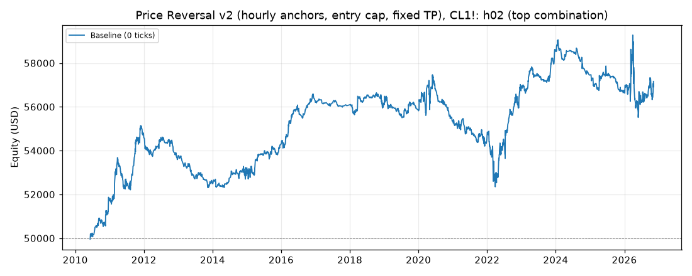

Files: [grid](../../../results/price_reversal_v2/h02/grid.csv), [trades 0 ticks](../../../results/price_reversal_v2/h02/trades_slippage0.csv), [summary](../../../results/price_reversal_v2/h02/summary.json)

### Results after commission

#### Overview

| Metric | Value |
|---|---|
| Net profit | 7,160.88 USD (14.32%) |
| Total closed trades | 2,256 |
| Percent profitable | 51.55% |
| Profit factor | 1.085 |
| Max equity drawdown | 5,247.46 USD (10.49%) |
| Avg trade | 3.17 USD |
| Avg # bars in trades | 17 |

#### Performance

| Metric | All | Long | Short |
|---|---|---|---|
| Net profit | 7,160.88 USD (14.32%) | 1,332.98 USD (2.67%) | 5,827.90 USD (11.66%) |
| Gross profit | 91,394.74 USD (182.79%) | 46,841.92 USD (93.68%) | 44,552.82 USD (89.11%) |
| Gross loss | 84,233.86 USD (168.47%) | 45,508.94 USD (91.02%) | 38,724.92 USD (77.45%) |
| Commission paid | 9,069.12 USD | 4,627.02 USD | 4,442.10 USD |

| Account | Value |
|---|---|
| Initial capital | 50,000.00 USD |
| Buy & hold return (TV-style, all capital at the first entry) | 9,977.47 USD (19.95%) |
| Max equity run-up (intrabar) | 9,529.36 USD (19.06%) |
| Max equity drawdown (intrabar) | 5,247.46 USD (10.49%) |
| Open P&L | 0.00 USD |
| Max contracts held | 1 |

#### Trades analysis

| Metric | All | Long | Short |
|---|---|---|---|
| Total closed trades | 2,256 | 1,151 | 1,105 |
| Winning trades | 1,163 | 604 | 559 |
| Losing trades | 1,093 | 547 | 546 |
| Even trades | 0 | 0 | 0 |
| Percent profitable | 51.55% | 52.48% | 50.59% |
| Avg P&L | 3.17 USD | 1.16 USD | 5.27 USD |
| Avg P&L % | 0.00% | 0.01% | 0.00% |
| Avg winning trade | 78.59 USD | 77.55 USD | 79.70 USD |
| Avg losing trade | 77.07 USD | 83.20 USD | 70.92 USD |
| Ratio avg win / avg loss | 1.020 | 0.932 | 1.124 |
| Largest winning trade | 1,445.98 USD | 1,275.98 USD | 1,445.98 USD |
| Largest winning trade % | 1.78% | 1.78% | 1.62% |
| Largest losing trade | 1,914.02 USD | 1,914.02 USD | 634.02 USD |
| Largest losing trade % | 4.01% | 2.01% | 4.01% |
| Avg # bars in trades | 17 | 16 | 18 |
| Avg # bars in winning trades | 18 | 17 | 18 |
| Avg # bars in losing trades | 16 | 15 | 17 |

#### Risk/performance ratios

| Metric | Value |
|---|---|
| Sharpe ratio | -0.125 |
| Sortino ratio | -0.164 |
| Profit factor | 1.085 |
| Margin calls | 0 |

#### List of trades (last 10, newest first; full list in the trades CSV)

| Trade # | Type | Signal | Date/Time (UTC) | Price | Contracts | Profit | Cum. profit | Run-up | Drawdown |
|---|---|---|---|---|---|---|---|---|---|
| 2256 | Exit long | Exit | 2026-11-06 01:00 | 91.27 | 1 | 265.98 USD (0.29%) | 7,160.88 USD | 270.00 USD | 70.00 USD |
|  | Entry long | Long | 2026-11-06 00:27 | 91.00 | 1 |  |  |  |  |
| 2255 | Exit long | Exit | 2026-11-05 00:24 | 87.89 | 1 | -174.02 USD (-0.20%) | 6,894.90 USD | 0.00 USD | 170.00 USD |
|  | Entry long | Long | 2026-11-05 00:23 | 88.06 | 1 |  |  |  |  |
| 2254 | Exit short | Exit | 2026-11-04 00:48 | 96.59 | 1 | 35.98 USD (0.04%) | 7,068.92 USD | 40.00 USD | 40.00 USD |
|  | Entry short | Short | 2026-11-04 00:47 | 96.63 | 1 |  |  |  |  |
| 2253 | Exit long | Exit | 2026-11-04 00:16 | 96.60 | 1 | 25.98 USD (0.03%) | 7,032.94 USD | 30.00 USD | 70.00 USD |
|  | Entry long | Long | 2026-11-04 00:12 | 96.57 | 1 |  |  |  |  |
| 2252 | Exit short | Exit | 2026-11-03 00:58 | 96.40 | 1 | 175.98 USD (0.18%) | 7,006.96 USD | 180.00 USD | 180.00 USD |
|  | Entry short | Short | 2026-11-03 00:49 | 96.58 | 1 |  |  |  |  |
| 2251 | Exit long | Exit | 2026-11-03 00:39 | 96.43 | 1 | 155.98 USD (0.16%) | 6,830.98 USD | 160.00 USD | 10.00 USD |
|  | Entry long | Long | 2026-11-03 00:30 | 96.27 | 1 |  |  |  |  |
| 2250 | Exit short | Exit | 2026-11-02 00:49 | 102.30 | 1 | 145.98 USD (0.14%) | 6,675.00 USD | 150.00 USD | 70.00 USD |
|  | Entry short | Short | 2026-11-02 00:19 | 102.45 | 1 |  |  |  |  |
| 2249 | Exit long | Exit | 2026-10-29 23:18 | 102.83 | 1 | 45.98 USD (0.04%) | 6,529.02 USD | 50.00 USD | 10.00 USD |
|  | Entry long | Long | 2026-10-29 23:13 | 102.78 | 1 |  |  |  |  |
| 2248 | Exit short | Exit | 2026-10-28 23:33 | 101.89 | 1 | 55.98 USD (0.05%) | 6,483.04 USD | 60.00 USD | 50.00 USD |
|  | Entry short | Short | 2026-10-28 23:19 | 101.95 | 1 |  |  |  |  |
| 2247 | Exit short | Exit | 2026-10-27 23:56 | 100.10 | 1 | -64.02 USD (-0.06%) | 6,427.06 USD | 30.00 USD | 60.00 USD |
|  | Entry short | Short | 2026-10-27 23:42 | 100.04 | 1 |  |  |  |  |

#### By year (extra, not a TV tab)

| Year | Trades | Net profit | % profitable | Profit factor |
|---|---|---|---|---|
| 2010 | 78 | 1,706.44 USD | 47.44% | 1.796 |
| 2011 | 173 | 2,894.54 USD | 53.18% | 1.430 |
| 2012 | 133 | -824.66 USD | 41.35% | 0.820 |
| 2013 | 114 | -1,238.28 USD | 39.47% | 0.654 |
| 2014 | 110 | 677.80 USD | 52.73% | 1.206 |
| 2015 | 155 | 1,096.90 USD | 58.06% | 1.259 |
| 2016 | 121 | 1,893.58 USD | 63.64% | 1.609 |
| 2017 | 61 | -155.22 USD | 60.66% | 0.861 |
| 2018 | 110 | 127.80 USD | 50.91% | 1.041 |
| 2019 | 131 | -326.62 USD | 54.96% | 0.909 |
| 2020 | 155 | -473.10 USD | 47.10% | 0.935 |
| 2021 | 149 | -688.98 USD | 47.65% | 0.870 |
| 2022 | 204 | 2,209.92 USD | 53.92% | 1.191 |
| 2023 | 143 | 1,665.14 USD | 57.34% | 1.508 |
| 2024 | 113 | -1,114.26 USD | 44.25% | 0.699 |
| 2025 | 131 | -696.62 USD | 48.85% | 0.824 |
| 2026 | 175 | 406.50 USD | 53.71% | 1.030 |

#### Exit reasons (extra)

| Reason | Trades |
|---|---|
| limit | 1149 |
| stop | 1087 |
| close | 15 |
| roll | 5 |

- Session-end exits: 15.
- Roll exits: 5.

### Best settings by metric

Each winner needs at least 30 closed trades. Undefined values are excluded. Ties: higher net profit, higher profit factor, then grid order. Ruin loss threshold: 25,000.00 USD from starting capital. All selections are in-sample. MAE/MFE objectives use the mean of the per-trade maxima.

| Metric | Goal | Best value | Grid order | Trades | Eligible settings | Parameters |
|---|---|---|---|---|---|---|
| Net profit | max | 7,160.88 USD | [18](../../../results/price_reversal_v2/h02/metric_winners/order_18/trades_slippage0.csv) | 2256 | 64 | window=60, atr_mult=0.5, swing=1, target=far |
| Win rate | max | 58.92% | [1](../../../results/price_reversal_v2/h02/metric_winners/order_1/trades_slippage0.csv) | 1003 | 64 | window=30, atr_mult=0.5, swing=1, target=near |
| Expectancy | max | 4.77 USD | [16](../../../results/price_reversal_v2/h02/metric_winners/order_16/trades_slippage0.csv) | 1089 | 64 | window=30, atr_mult=2.0, swing=1, target=rr2 |
| Profit factor | max | 1.129 | [14](../../../results/price_reversal_v2/h02/metric_winners/order_14/trades_slippage0.csv) | 1054 | 64 | window=30, atr_mult=2.0, swing=1, target=far |
| Payoff ratio | max | 2.188 | [4](../../../results/price_reversal_v2/h02/metric_winners/order_4/trades_slippage0.csv) | 1042 | 64 | window=30, atr_mult=0.5, swing=1, target=rr2 |
| Risk of ruin (estimate) | min | 0.00% | [14](../../../results/price_reversal_v2/h02/metric_winners/order_14/trades_slippage0.csv) | 1054 | 64 | window=30, atr_mult=2.0, swing=1, target=far |
| Maximum drawdown | min | 3,931.94 USD | [2](../../../results/price_reversal_v2/h02/metric_winners/order_2/trades_slippage0.csv) | 1012 | 64 | window=30, atr_mult=0.5, swing=1, target=far |
| Consecutive losses | min | 7.000 | [6](../../../results/price_reversal_v2/h02/metric_winners/order_6/trades_slippage0.csv) | 1079 | 64 | window=30, atr_mult=1.0, swing=1, target=far |
| Sharpe ratio | max | -0.059 | [32](../../../results/price_reversal_v2/h02/metric_winners/order_32/trades_slippage0.csv) | 2430 | 64 | window=60, atr_mult=2.0, swing=1, target=rr2 |
| Sortino ratio | max | -0.111 | [48](../../../results/price_reversal_v2/h02/metric_winners/order_48/trades_slippage0.csv) | 3609 | 64 | window=90, atr_mult=2.0, swing=1, target=rr2 |
| R-multiple | max | No eligible value | — | — | 0 | — |
| Maximum adverse excursion (MAE) | min | 44.96 USD | [9](../../../results/price_reversal_v2/h02/metric_winners/order_9/trades_slippage0.csv) | 1073 | 64 | window=30, atr_mult=1.5, swing=1, target=near |
| Maximum favorable excursion (MFE) | max | 97.11 USD | [64](../../../results/price_reversal_v2/h02/metric_winners/order_64/trades_slippage0.csv) | 4330 | 64 | window=120, atr_mult=2.0, swing=1, target=rr2 |

- **Net profit:** Sum of closed-trade profit after commission; excludes open P&L.
- **Win rate:** Winning closed trades divided by all closed trades, including breakevens.
- **Expectancy:** Mean net profit per closed trade, including losses and breakevens.
- **Profit factor:** Gross winning profit divided by gross losing profit, both after commission. Undefined without losses.
- **Payoff ratio:** Average net winning trade divided by the absolute average net losing trade. Requires wins and losses.
- **Risk of ruin (estimate):** Infinite-horizon diffusion estimate of losing the declared amount from starting capital. Assumes independent, stationary, fixed-size net trade P&L; ignores intratrade losses and margin.
- **Maximum drawdown:** Largest equity drawdown under the tester's intrabar TradingView convention, including an open trade at the end.
- **Consecutive losses:** Longest streak of losing closed trades in execution order. A win or breakeven resets the streak.
- **Sharpe ratio:** Monthly marked-to-market excess return divided by population standard deviation, using 2% annual risk-free rate; not annualized.
- **Sortino ratio:** Monthly marked-to-market excess return divided by downside deviation about the risk-free rate; not annualized.
- **R-multiple:** Mean net trade profit / initial stop risk in dollars. Risk is actual fill to initial stop, before costs. Requires positive initial risk for every closed trade; R standard deviation and mean / standard deviation describe consistency.
- **Maximum adverse excursion (MAE):** Mean of each closed trade's maximum adverse price excursion in dollars, before commission; only the exposed intrabar path counts.
- **Maximum favorable excursion (MFE):** Mean of each closed trade's maximum favorable price excursion in dollars, before commission; only the exposed intrabar path counts. Unrealized opportunity, not realized profit.

Full selection metadata: [metric_winners.json](../../../results/price_reversal_v2/h02/metric_winners.json).

### Top 10 combinations

| # | window | atr_mult | swing | target | Net profit | Trades | % profitable | Profit factor | Max DD |
|---|---|---|---|---|---|---|---|---|---|
| 1 | 60 | 0.5 | 1 | far | 7,160.88 USD | 2,256 | 51.55% | 1.085 | 5,247.46 USD |
| 2 | 60 | 0.5 | 1 | rr2 | 7,006.36 USD | 2,282 | 33.44% | 1.057 | 7,062.82 USD |
| 3 | 60 | 2.0 | 1 | rr2 | 6,531.40 USD | 2,430 | 33.54% | 1.050 | 7,408.84 USD |
| 4 | 60 | 2.0 | 1 | far | 6,266.02 USD | 2,399 | 51.52% | 1.069 | 5,999.82 USD |
| 5 | 60 | 1.5 | 1 | far | 6,209.54 USD | 2,423 | 51.51% | 1.069 | 6,037.86 USD |
| 6 | 60 | 1.5 | 1 | rr2 | 6,196.98 USD | 2,451 | 33.37% | 1.047 | 7,549.04 USD |
| 7 | 60 | 1.0 | 1 | far | 6,089.84 USD | 2,408 | 51.45% | 1.068 | 6,029.82 USD |
| 8 | 60 | 1.5 | 1 | near | 5,765.82 USD | 2,409 | 55.42% | 1.072 | 5,459.82 USD |
| 9 | 60 | 2.0 | 1 | near | 5,712.30 USD | 2,385 | 55.18% | 1.071 | 5,411.78 USD |
| 10 | 60 | 1.0 | 1 | near | 5,556.12 USD | 2,394 | 55.39% | 1.069 | 5,451.78 USD |

Profitable combinations: 35 of 64.

## Variant: h03

**Top combination:** `anchor=h03`, `window=30`, `atr_mult=0.5`, `swing=1`, `target=near`

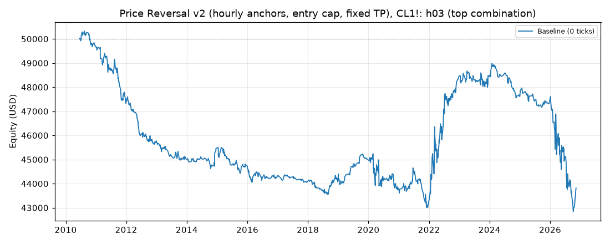

Files: [grid](../../../results/price_reversal_v2/h03/grid.csv), [trades 0 ticks](../../../results/price_reversal_v2/h03/trades_slippage0.csv), [summary](../../../results/price_reversal_v2/h03/summary.json)

### Results after commission

#### Overview

| Metric | Value |
|---|---|
| Net profit | -6,180.08 USD (-12.36%) |
| Total closed trades | 1,204 |
| Percent profitable | 55.07% |
| Profit factor | 0.890 |
| Max equity drawdown | 7,503.94 USD (15.01%) |
| Avg trade | -5.13 USD |
| Avg # bars in trades | 20 |

#### Performance

| Metric | All | Long | Short |
|---|---|---|---|
| Net profit | -6,180.08 USD (-12.36%) | -1,552.00 USD (-3.10%) | -4,628.08 USD (-9.26%) |
| Gross profit | 50,094.74 USD (100.19%) | 27,945.36 USD (55.89%) | 22,149.38 USD (44.30%) |
| Gross loss | 56,274.82 USD (112.55%) | 29,497.36 USD (58.99%) | 26,777.46 USD (53.55%) |
| Commission paid | 4,840.08 USD | 2,412.00 USD | 2,428.08 USD |

| Account | Value |
|---|---|
| Initial capital | 50,000.00 USD |
| Buy & hold return (TV-style, all capital at the first entry) | 5,196.99 USD (10.39%) |
| Max equity run-up (intrabar) | 6,090.02 USD (12.18%) |
| Max equity drawdown (intrabar) | 7,503.94 USD (15.01%) |
| Open P&L | 0.00 USD |
| Max contracts held | 1 |

#### Trades analysis

| Metric | All | Long | Short |
|---|---|---|---|
| Total closed trades | 1,204 | 600 | 604 |
| Winning trades | 663 | 332 | 331 |
| Losing trades | 541 | 268 | 273 |
| Even trades | 0 | 0 | 0 |
| Percent profitable | 55.07% | 55.33% | 54.80% |
| Avg P&L | -5.13 USD | -2.59 USD | -7.66 USD |
| Avg P&L % | -0.01% | -0.01% | -0.01% |
| Avg winning trade | 75.56 USD | 84.17 USD | 66.92 USD |
| Avg losing trade | 104.02 USD | 110.06 USD | 98.09 USD |
| Ratio avg win / avg loss | 0.726 | 0.765 | 0.682 |
| Largest winning trade | 1,085.98 USD | 1,085.98 USD | 885.98 USD |
| Largest winning trade % | 1.77% | 1.77% | 1.43% |
| Largest losing trade | 854.02 USD | 854.02 USD | 684.02 USD |
| Largest losing trade % | 2.23% | 2.23% | 1.43% |
| Avg # bars in trades | 20 | 20 | 20 |
| Avg # bars in winning trades | 18 | 18 | 19 |
| Avg # bars in losing trades | 22 | 22 | 22 |

#### Risk/performance ratios

| Metric | Value |
|---|---|
| Sharpe ratio | -0.389 |
| Sortino ratio | -0.421 |
| Profit factor | 0.890 |
| Margin calls | 0 |

#### List of trades (last 10, newest first; full list in the trades CSV)

| Trade # | Type | Signal | Date/Time (UTC) | Price | Contracts | Profit | Cum. profit | Run-up | Drawdown |
|---|---|---|---|---|---|---|---|---|---|
| 1204 | Exit long | Exit | 2026-11-09 01:45 | 90.68 | 1 | 185.98 USD (0.21%) | -6,180.08 USD | 190.00 USD | 260.00 USD |
|  | Entry long | Long | 2026-11-09 01:16 | 90.49 | 1 |  |  |  |  |
| 1203 | Exit short | Exit | 2026-11-04 01:10 | 96.66 | 1 | 75.98 USD (0.08%) | -6,366.06 USD | 80.00 USD | 30.00 USD |
|  | Entry short | Short | 2026-11-04 01:10 | 96.74 | 1 |  |  |  |  |
| 1202 | Exit short | Exit | 2026-11-03 02:00 | 96.48 | 1 | 175.98 USD (0.18%) | -6,442.04 USD | 180.00 USD | 140.00 USD |
|  | Entry short | Short | 2026-11-03 01:24 | 96.66 | 1 |  |  |  |  |
| 1201 | Exit short | Exit | 2026-10-29 01:00 | 101.86 | 1 | 265.98 USD (0.26%) | -6,618.02 USD | 270.00 USD | 50.00 USD |
|  | Entry short | Short | 2026-10-29 00:25 | 102.13 | 1 |  |  |  |  |
| 1200 | Exit long | Exit | 2026-10-23 00:17 | 99.29 | 1 | 85.98 USD (0.09%) | -6,884.00 USD | 90.00 USD | 60.00 USD |
|  | Entry long | Long | 2026-10-23 00:15 | 99.20 | 1 |  |  |  |  |
| 1199 | Exit long | Exit | 2026-10-19 00:32 | 97.68 | 1 | 65.98 USD (0.07%) | -6,969.98 USD | 70.00 USD | 90.00 USD |
|  | Entry long | Long | 2026-10-19 00:26 | 97.61 | 1 |  |  |  |  |
| 1198 | Exit short | Exit | 2026-10-08 00:14 | 89.00 | 1 | 115.98 USD (0.13%) | -7,035.96 USD | 120.00 USD | 0.00 USD |
|  | Entry short | Short | 2026-10-08 00:11 | 89.12 | 1 |  |  |  |  |
| 1197 | Exit short | Exit | 2026-10-07 00:32 | 90.31 | 1 | -104.02 USD (-0.12%) | -7,151.94 USD | 10.00 USD | 100.00 USD |
|  | Entry short | Short | 2026-10-07 00:30 | 90.21 | 1 |  |  |  |  |
| 1196 | Exit long | Exit | 2026-10-05 00:53 | 90.51 | 1 | -214.02 USD (-0.24%) | -7,047.92 USD | 60.00 USD | 210.00 USD |
|  | Entry long | Long | 2026-10-05 00:17 | 90.72 | 1 |  |  |  |  |
| 1195 | Exit short | Exit | 2026-10-01 00:30 | 90.63 | 1 | -254.02 USD (-0.28%) | -6,833.90 USD | 0.00 USD | 250.00 USD |
|  | Entry short | Short | 2026-10-01 00:21 | 90.38 | 1 |  |  |  |  |

#### By year (extra, not a TV tab)

| Year | Trades | Net profit | % profitable | Profit factor |
|---|---|---|---|---|
| 2010 | 47 | -258.94 USD | 53.19% | 0.817 |
| 2011 | 92 | -2,259.84 USD | 47.83% | 0.547 |
| 2012 | 81 | -1,705.62 USD | 45.68% | 0.473 |
| 2013 | 61 | -775.22 USD | 50.82% | 0.641 |
| 2014 | 48 | 457.04 USD | 58.33% | 1.375 |
| 2015 | 72 | -729.44 USD | 54.17% | 0.715 |
| 2016 | 66 | -435.32 USD | 53.03% | 0.783 |
| 2017 | 38 | -232.76 USD | 55.26% | 0.719 |
| 2018 | 75 | 18.50 USD | 68.00% | 1.010 |
| 2019 | 57 | 940.86 USD | 68.42% | 1.789 |
| 2020 | 105 | -1,242.10 USD | 58.10% | 0.796 |
| 2021 | 77 | -469.54 USD | 53.25% | 0.871 |
| 2022 | 108 | 5,145.84 USD | 68.52% | 1.788 |
| 2023 | 81 | -15.62 USD | 51.85% | 0.995 |
| 2024 | 62 | -829.24 USD | 46.77% | 0.653 |
| 2025 | 49 | -176.98 USD | 53.06% | 0.900 |
| 2026 | 85 | -3,611.70 USD | 47.06% | 0.674 |

#### Exit reasons (extra)

| Reason | Trades |
|---|---|
| limit | 650 |
| stop | 535 |
| close | 19 |

- Session-end exits: 19.
- Roll exits: 0.

### Best settings by metric

Each winner needs at least 30 closed trades. Undefined values are excluded. Ties: higher net profit, higher profit factor, then grid order. Ruin loss threshold: 25,000.00 USD from starting capital. All selections are in-sample. MAE/MFE objectives use the mean of the per-trade maxima.

| Metric | Goal | Best value | Grid order | Trades | Eligible settings | Parameters |
|---|---|---|---|---|---|---|
| Net profit | max | -6,180.08 USD | [1](../../../results/price_reversal_v2/h03/metric_winners/order_1/trades_slippage0.csv) | 1204 | 64 | window=30, atr_mult=0.5, swing=1, target=near |
| Win rate | max | 55.07% | [1](../../../results/price_reversal_v2/h03/metric_winners/order_1/trades_slippage0.csv) | 1204 | 64 | window=30, atr_mult=0.5, swing=1, target=near |
| Expectancy | max | -3.27 USD | [35](../../../results/price_reversal_v2/h03/metric_winners/order_35/trades_slippage0.csv) | 3270 | 64 | window=90, atr_mult=0.5, swing=1, target=rr1 |
| Profit factor | max | 0.938 | [35](../../../results/price_reversal_v2/h03/metric_winners/order_35/trades_slippage0.csv) | 3270 | 64 | window=90, atr_mult=0.5, swing=1, target=rr1 |
| Payoff ratio | max | 1.877 | [16](../../../results/price_reversal_v2/h03/metric_winners/order_16/trades_slippage0.csv) | 1599 | 64 | window=30, atr_mult=2.0, swing=1, target=rr2 |
| Risk of ruin (estimate) | min | 100.00% | [1](../../../results/price_reversal_v2/h03/metric_winners/order_1/trades_slippage0.csv) | 1204 | 64 | window=30, atr_mult=0.5, swing=1, target=near |
| Maximum drawdown | min | 7,503.94 USD | [1](../../../results/price_reversal_v2/h03/metric_winners/order_1/trades_slippage0.csv) | 1204 | 64 | window=30, atr_mult=0.5, swing=1, target=near |
| Consecutive losses | min | 8.000 | [3](../../../results/price_reversal_v2/h03/metric_winners/order_3/trades_slippage0.csv) | 1217 | 64 | window=30, atr_mult=0.5, swing=1, target=rr1 |
| Sharpe ratio | max | -0.213 | [16](../../../results/price_reversal_v2/h03/metric_winners/order_16/trades_slippage0.csv) | 1599 | 64 | window=30, atr_mult=2.0, swing=1, target=rr2 |
| Sortino ratio | max | -0.236 | [48](../../../results/price_reversal_v2/h03/metric_winners/order_48/trades_slippage0.csv) | 3843 | 64 | window=90, atr_mult=2.0, swing=1, target=rr2 |
| R-multiple | max | No eligible value | — | — | 0 | — |
| Maximum adverse excursion (MAE) | min | 61.94 USD | [17](../../../results/price_reversal_v2/h03/metric_winners/order_17/trades_slippage0.csv) | 2434 | 64 | window=60, atr_mult=0.5, swing=1, target=near |
| Maximum favorable excursion (MFE) | max | 116.22 USD | [16](../../../results/price_reversal_v2/h03/metric_winners/order_16/trades_slippage0.csv) | 1599 | 64 | window=30, atr_mult=2.0, swing=1, target=rr2 |

- **Net profit:** Sum of closed-trade profit after commission; excludes open P&L.
- **Win rate:** Winning closed trades divided by all closed trades, including breakevens.
- **Expectancy:** Mean net profit per closed trade, including losses and breakevens.
- **Profit factor:** Gross winning profit divided by gross losing profit, both after commission. Undefined without losses.
- **Payoff ratio:** Average net winning trade divided by the absolute average net losing trade. Requires wins and losses.
- **Risk of ruin (estimate):** Infinite-horizon diffusion estimate of losing the declared amount from starting capital. Assumes independent, stationary, fixed-size net trade P&L; ignores intratrade losses and margin.
- **Maximum drawdown:** Largest equity drawdown under the tester's intrabar TradingView convention, including an open trade at the end.
- **Consecutive losses:** Longest streak of losing closed trades in execution order. A win or breakeven resets the streak.
- **Sharpe ratio:** Monthly marked-to-market excess return divided by population standard deviation, using 2% annual risk-free rate; not annualized.
- **Sortino ratio:** Monthly marked-to-market excess return divided by downside deviation about the risk-free rate; not annualized.
- **R-multiple:** Mean net trade profit / initial stop risk in dollars. Risk is actual fill to initial stop, before costs. Requires positive initial risk for every closed trade; R standard deviation and mean / standard deviation describe consistency.
- **Maximum adverse excursion (MAE):** Mean of each closed trade's maximum adverse price excursion in dollars, before commission; only the exposed intrabar path counts.
- **Maximum favorable excursion (MFE):** Mean of each closed trade's maximum favorable price excursion in dollars, before commission; only the exposed intrabar path counts. Unrealized opportunity, not realized profit.

Full selection metadata: [metric_winners.json](../../../results/price_reversal_v2/h03/metric_winners.json).

### Top 10 combinations

| # | window | atr_mult | swing | target | Net profit | Trades | % profitable | Profit factor | Max DD |
|---|---|---|---|---|---|---|---|---|---|
| 1 | 30 | 0.5 | 1 | near | -6,180.08 USD | 1,204 | 55.07% | 0.890 | 7,503.94 USD |
| 2 | 30 | 0.5 | 1 | rr1 | -6,542.34 USD | 1,217 | 48.56% | 0.907 | 9,969.62 USD |
| 3 | 30 | 2.0 | 1 | rr1 | -6,579.54 USD | 1,577 | 49.02% | 0.927 | 10,280.16 USD |
| 4 | 30 | 0.5 | 1 | far | -7,784.30 USD | 1,215 | 49.79% | 0.878 | 9,477.82 USD |
| 5 | 30 | 2.0 | 1 | near | -8,063.26 USD | 1,563 | 54.32% | 0.893 | 10,221.76 USD |
| 6 | 30 | 2.0 | 1 | far | -8,407.48 USD | 1,574 | 50.51% | 0.898 | 10,621.86 USD |
| 7 | 30 | 1.0 | 1 | rr1 | -10,079.40 USD | 1,470 | 48.71% | 0.882 | 12,203.18 USD |
| 8 | 30 | 1.5 | 1 | rr1 | -10,396.88 USD | 1,544 | 48.58% | 0.884 | 12,602.02 USD |
| 9 | 30 | 1.0 | 1 | near | -10,437.04 USD | 1,452 | 54.82% | 0.849 | 11,054.48 USD |
| 10 | 60 | 2.0 | 1 | rr1 | -10,490.00 USD | 3,000 | 49.00% | 0.935 | 11,057.94 USD |

Profitable combinations: 0 of 64.

## Variant: h04

**Top combination:** `anchor=h04`, `window=30`, `atr_mult=0.5`, `swing=1`, `target=rr1`

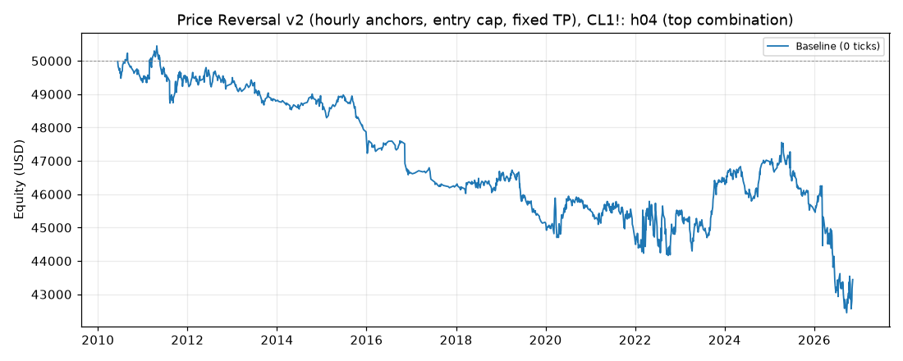

Files: [grid](../../../results/price_reversal_v2/h04/grid.csv), [trades 0 ticks](../../../results/price_reversal_v2/h04/trades_slippage0.csv), [summary](../../../results/price_reversal_v2/h04/summary.json)

### Results after commission

#### Overview

| Metric | Value |
|---|---|
| Net profit | -6,557.46 USD (-13.11%) |
| Total closed trades | 1,273 |
| Percent profitable | 48.63% |
| Profit factor | 0.908 |
| Max equity drawdown | 8,073.50 USD (16.15%) |
| Avg trade | -5.15 USD |
| Avg # bars in trades | 21 |

#### Performance

| Metric | All | Long | Short |
|---|---|---|---|
| Net profit | -6,557.46 USD (-13.11%) | -3,944.86 USD (-7.89%) | -2,612.60 USD (-5.23%) |
| Gross profit | 64,681.62 USD (129.36%) | 34,369.68 USD (68.74%) | 30,311.94 USD (60.62%) |
| Gross loss | 71,239.08 USD (142.48%) | 38,314.54 USD (76.63%) | 32,924.54 USD (65.85%) |
| Commission paid | 5,117.46 USD | 2,584.86 USD | 2,532.60 USD |

| Account | Value |
|---|---|
| Initial capital | 50,000.00 USD |
| Buy & hold return (TV-style, all capital at the first entry) | 6,477.92 USD (12.96%) |
| Max equity run-up (intrabar) | 3,449.32 USD (6.90%) |
| Max equity drawdown (intrabar) | 8,073.50 USD (16.15%) |
| Open P&L | 0.00 USD |
| Max contracts held | 1 |

#### Trades analysis

| Metric | All | Long | Short |
|---|---|---|---|
| Total closed trades | 1,273 | 643 | 630 |
| Winning trades | 619 | 316 | 303 |
| Losing trades | 654 | 327 | 327 |
| Even trades | 0 | 0 | 0 |
| Percent profitable | 48.63% | 49.14% | 48.10% |
| Avg P&L | -5.15 USD | -6.14 USD | -4.15 USD |
| Avg P&L % | -0.01% | -0.01% | -0.01% |
| Avg winning trade | 104.49 USD | 108.76 USD | 100.04 USD |
| Avg losing trade | 108.93 USD | 117.17 USD | 100.69 USD |
| Ratio avg win / avg loss | 0.959 | 0.928 | 0.994 |
| Largest winning trade | 1,095.98 USD | 1,095.98 USD | 475.98 USD |
| Largest winning trade % | 1.64% | 1.64% | 1.21% |
| Largest losing trade | 1,794.02 USD | 1,794.02 USD | 694.02 USD |
| Largest losing trade % | 2.08% | 2.08% | 1.80% |
| Avg # bars in trades | 21 | 23 | 20 |
| Avg # bars in winning trades | 21 | 22 | 20 |
| Avg # bars in losing trades | 21 | 23 | 20 |

#### Risk/performance ratios

| Metric | Value |
|---|---|
| Sharpe ratio | -0.379 |
| Sortino ratio | -0.410 |
| Profit factor | 0.908 |
| Margin calls | 0 |

#### List of trades (last 10, newest first; full list in the trades CSV)

| Trade # | Type | Signal | Date/Time (UTC) | Price | Contracts | Profit | Cum. profit | Run-up | Drawdown |
|---|---|---|---|---|---|---|---|---|---|
| 1273 | Exit short | Exit | 2026-11-10 02:55 | 85.91 | 1 | 275.98 USD (0.32%) | -6,557.46 USD | 280.00 USD | 100.00 USD |
|  | Entry short | Short | 2026-11-10 02:21 | 86.19 | 1 |  |  |  |  |
| 1272 | Exit long | Exit | 2026-11-05 02:27 | 87.46 | 1 | 365.98 USD (0.42%) | -6,833.44 USD | 370.00 USD | 60.00 USD |
|  | Entry long | Long | 2026-11-05 02:14 | 87.09 | 1 |  |  |  |  |
| 1271 | Exit long | Exit | 2026-11-03 02:26 | 96.60 | 1 | 235.98 USD (0.24%) | -7,199.42 USD | 240.00 USD | 0.00 USD |
|  | Entry long | Long | 2026-11-03 02:14 | 96.36 | 1 |  |  |  |  |
| 1270 | Exit short | Exit | 2026-10-28 01:55 | 101.32 | 1 | -424.02 USD (-0.42%) | -7,435.40 USD | 100.00 USD | 420.00 USD |
|  | Entry short | Short | 2026-10-28 01:19 | 100.90 | 1 |  |  |  |  |
| 1269 | Exit long | Exit | 2026-10-27 01:23 | 101.15 | 1 | 135.98 USD (0.13%) | -7,011.38 USD | 140.00 USD | 40.00 USD |
|  | Entry long | Long | 2026-10-27 01:19 | 101.01 | 1 |  |  |  |  |
| 1268 | Exit short | Exit | 2026-10-23 01:52 | 100.24 | 1 | -444.02 USD (-0.44%) | -7,147.36 USD | 180.00 USD | 440.00 USD |
|  | Entry short | Short | 2026-10-23 01:12 | 99.80 | 1 |  |  |  |  |
| 1267 | Exit short | Exit | 2026-10-21 02:00 | 99.09 | 1 | -244.02 USD (-0.25%) | -6,703.34 USD | 120.00 USD | 240.00 USD |
|  | Entry short | Short | 2026-10-21 01:11 | 98.85 | 1 |  |  |  |  |
| 1266 | Exit long | Exit | 2026-10-16 01:28 | 97.46 | 1 | 125.98 USD (0.13%) | -6,459.32 USD | 130.00 USD | 80.00 USD |
|  | Entry long | Long | 2026-10-16 01:11 | 97.33 | 1 |  |  |  |  |
| 1265 | Exit long | Exit | 2026-10-15 01:28 | 94.26 | 1 | 175.98 USD (0.19%) | -6,585.30 USD | 180.00 USD | 0.00 USD |
|  | Entry long | Long | 2026-10-15 01:26 | 94.08 | 1 |  |  |  |  |
| 1264 | Exit short | Exit | 2026-10-14 01:25 | 95.18 | 1 | 105.98 USD (0.11%) | -6,761.28 USD | 110.00 USD | 10.00 USD |
|  | Entry short | Short | 2026-10-14 01:24 | 95.29 | 1 |  |  |  |  |

#### By year (extra, not a TV tab)

| Year | Trades | Net profit | % profitable | Profit factor |
|---|---|---|---|---|
| 2010 | 44 | -646.88 USD | 45.45% | 0.664 |
| 2011 | 103 | 165.94 USD | 53.40% | 1.031 |
| 2012 | 74 | -127.48 USD | 52.70% | 0.958 |
| 2013 | 62 | -599.24 USD | 53.23% | 0.745 |
| 2014 | 49 | -26.98 USD | 48.98% | 0.983 |
| 2015 | 63 | -893.26 USD | 39.68% | 0.630 |
| 2016 | 51 | -1,215.02 USD | 47.06% | 0.553 |
| 2017 | 25 | -440.50 USD | 40.00% | 0.516 |
| 2018 | 73 | 186.54 USD | 49.32% | 1.073 |
| 2019 | 73 | -1,243.46 USD | 39.73% | 0.644 |
| 2020 | 89 | 352.22 USD | 52.81% | 1.080 |
| 2021 | 93 | -923.86 USD | 45.16% | 0.823 |
| 2022 | 120 | 797.60 USD | 49.17% | 1.065 |
| 2023 | 93 | 1,046.14 USD | 54.84% | 1.247 |
| 2024 | 82 | 590.36 USD | 50.00% | 1.190 |
| 2025 | 87 | -1,449.74 USD | 43.68% | 0.710 |
| 2026 | 92 | -2,129.84 USD | 50.00% | 0.800 |

#### Exit reasons (extra)

| Reason | Trades |
|---|---|
| stop | 651 |
| limit | 614 |
| close | 8 |

- Session-end exits: 8.
- Roll exits: 0.

### Best settings by metric

Each winner needs at least 30 closed trades. Undefined values are excluded. Ties: higher net profit, higher profit factor, then grid order. Ruin loss threshold: 25,000.00 USD from starting capital. All selections are in-sample. MAE/MFE objectives use the mean of the per-trade maxima.

| Metric | Goal | Best value | Grid order | Trades | Eligible settings | Parameters |
|---|---|---|---|---|---|---|
| Net profit | max | -6,557.46 USD | [3](../../../results/price_reversal_v2/h04/metric_winners/order_3/trades_slippage0.csv) | 1273 | 64 | window=30, atr_mult=0.5, swing=1, target=rr1 |
| Win rate | max | 56.33% | [1](../../../results/price_reversal_v2/h04/metric_winners/order_1/trades_slippage0.csv) | 1248 | 64 | window=30, atr_mult=0.5, swing=1, target=near |
| Expectancy | max | -4.86 USD | [50](../../../results/price_reversal_v2/h04/metric_winners/order_50/trades_slippage0.csv) | 3950 | 64 | window=120, atr_mult=0.5, swing=1, target=far |
| Profit factor | max | 0.916 | [8](../../../results/price_reversal_v2/h04/metric_winners/order_8/trades_slippage0.csv) | 1445 | 64 | window=30, atr_mult=1.0, swing=1, target=rr2 |
| Payoff ratio | max | 2.078 | [8](../../../results/price_reversal_v2/h04/metric_winners/order_8/trades_slippage0.csv) | 1445 | 64 | window=30, atr_mult=1.0, swing=1, target=rr2 |
| Risk of ruin (estimate) | min | 100.00% | [3](../../../results/price_reversal_v2/h04/metric_winners/order_3/trades_slippage0.csv) | 1273 | 64 | window=30, atr_mult=0.5, swing=1, target=rr1 |
| Maximum drawdown | min | 8,073.50 USD | [3](../../../results/price_reversal_v2/h04/metric_winners/order_3/trades_slippage0.csv) | 1273 | 64 | window=30, atr_mult=0.5, swing=1, target=rr1 |
| Consecutive losses | min | 7.000 | [1](../../../results/price_reversal_v2/h04/metric_winners/order_1/trades_slippage0.csv) | 1248 | 64 | window=30, atr_mult=0.5, swing=1, target=near |
| Sharpe ratio | max | -0.186 | [52](../../../results/price_reversal_v2/h04/metric_winners/order_52/trades_slippage0.csv) | 3884 | 64 | window=120, atr_mult=0.5, swing=1, target=rr2 |
| Sortino ratio | max | -0.230 | [51](../../../results/price_reversal_v2/h04/metric_winners/order_51/trades_slippage0.csv) | 3952 | 64 | window=120, atr_mult=0.5, swing=1, target=rr1 |
| R-multiple | max | -0.050 | [3](../../../results/price_reversal_v2/h04/metric_winners/order_3/trades_slippage0.csv) | 1273 | 16 | window=30, atr_mult=0.5, swing=1, target=rr1 |
| Maximum adverse excursion (MAE) | min | 60.72 USD | [5](../../../results/price_reversal_v2/h04/metric_winners/order_5/trades_slippage0.csv) | 1402 | 64 | window=30, atr_mult=1.0, swing=1, target=near |
| Maximum favorable excursion (MFE) | max | 113.63 USD | [16](../../../results/price_reversal_v2/h04/metric_winners/order_16/trades_slippage0.csv) | 1439 | 64 | window=30, atr_mult=2.0, swing=1, target=rr2 |

- **Net profit:** Sum of closed-trade profit after commission; excludes open P&L.
- **Win rate:** Winning closed trades divided by all closed trades, including breakevens.
- **Expectancy:** Mean net profit per closed trade, including losses and breakevens.
- **Profit factor:** Gross winning profit divided by gross losing profit, both after commission. Undefined without losses.
- **Payoff ratio:** Average net winning trade divided by the absolute average net losing trade. Requires wins and losses.
- **Risk of ruin (estimate):** Infinite-horizon diffusion estimate of losing the declared amount from starting capital. Assumes independent, stationary, fixed-size net trade P&L; ignores intratrade losses and margin.
- **Maximum drawdown:** Largest equity drawdown under the tester's intrabar TradingView convention, including an open trade at the end.
- **Consecutive losses:** Longest streak of losing closed trades in execution order. A win or breakeven resets the streak.
- **Sharpe ratio:** Monthly marked-to-market excess return divided by population standard deviation, using 2% annual risk-free rate; not annualized.
- **Sortino ratio:** Monthly marked-to-market excess return divided by downside deviation about the risk-free rate; not annualized.
- **R-multiple:** Mean net trade profit / initial stop risk in dollars. Risk is actual fill to initial stop, before costs. Requires positive initial risk for every closed trade; R standard deviation and mean / standard deviation describe consistency.
- **Maximum adverse excursion (MAE):** Mean of each closed trade's maximum adverse price excursion in dollars, before commission; only the exposed intrabar path counts.
- **Maximum favorable excursion (MFE):** Mean of each closed trade's maximum favorable price excursion in dollars, before commission; only the exposed intrabar path counts. Unrealized opportunity, not realized profit.

Full selection metadata: [metric_winners.json](../../../results/price_reversal_v2/h04/metric_winners.json).

### Top 10 combinations

| # | window | atr_mult | swing | target | Net profit | Trades | % profitable | Profit factor | Max DD |
|---|---|---|---|---|---|---|---|---|---|
| 1 | 30 | 0.5 | 1 | rr1 | -6,557.46 USD | 1,273 | 48.63% | 0.908 | 8,073.50 USD |
| 2 | 30 | 2.0 | 1 | rr1 | -7,250.46 USD | 1,423 | 47.79% | 0.911 | 8,924.64 USD |
| 3 | 30 | 1.0 | 1 | rr1 | -7,594.58 USD | 1,429 | 47.94% | 0.905 | 9,628.56 USD |
| 4 | 30 | 1.5 | 1 | rr1 | -7,931.06 USD | 1,453 | 47.76% | 0.903 | 9,965.04 USD |
| 5 | 30 | 2.0 | 1 | far | -8,146.04 USD | 1,402 | 50.57% | 0.889 | 9,229.56 USD |
| 6 | 30 | 1.0 | 1 | far | -8,478.20 USD | 1,410 | 50.78% | 0.882 | 9,725.00 USD |
| 7 | 30 | 1.0 | 1 | rr2 | -8,728.90 USD | 1,445 | 30.59% | 0.916 | 11,587.76 USD |
| 8 | 30 | 0.5 | 1 | far | -8,773.14 USD | 1,257 | 50.91% | 0.864 | 10,048.18 USD |
| 9 | 30 | 2.0 | 1 | near | -8,873.88 USD | 1,394 | 55.52% | 0.866 | 9,778.22 USD |
| 10 | 30 | 2.0 | 1 | rr2 | -8,924.78 USD | 1,439 | 30.99% | 0.916 | 10,558.96 USD |

Profitable combinations: 0 of 64.

## Variant: h05

**Top combination:** `anchor=h05`, `window=60`, `atr_mult=0.5`, `swing=1`, `target=rr2`

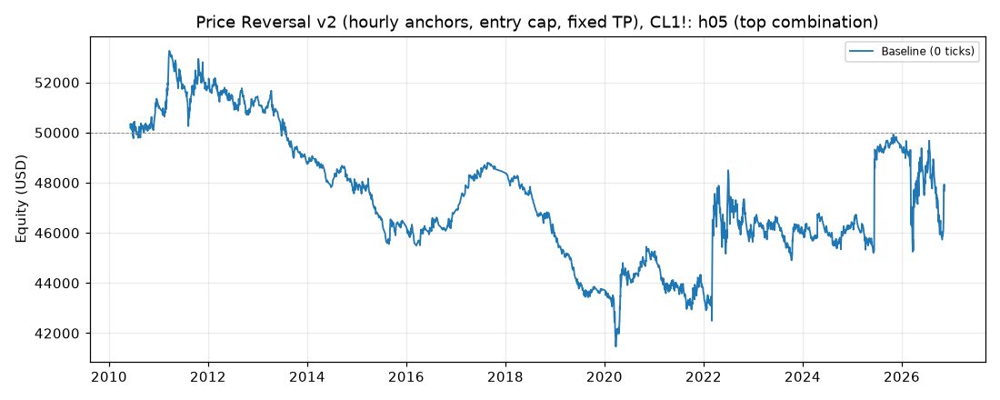

Files: [grid](../../../results/price_reversal_v2/h05/grid.csv), [trades 0 ticks](../../../results/price_reversal_v2/h05/trades_slippage0.csv), [summary](../../../results/price_reversal_v2/h05/summary.json)

### Results after commission

#### Overview

| Metric | Value |
|---|---|
| Net profit | -2,322.16 USD (-4.64%) |
| Total closed trades | 2,508 |
| Percent profitable | 31.10% |
| Profit factor | 0.985 |
| Max equity drawdown | 11,827.62 USD (23.66%) |
| Avg trade | -0.93 USD |
| Avg # bars in trades | 46 |

#### Performance

| Metric | All | Long | Short |
|---|---|---|---|
| Net profit | -2,322.16 USD (-4.64%) | 1,092.34 USD (2.18%) | -3,414.50 USD (-6.83%) |
| Gross profit | 148,574.40 USD (297.15%) | 74,727.88 USD (149.46%) | 73,846.52 USD (147.69%) |
| Gross loss | 150,896.56 USD (301.79%) | 73,635.54 USD (147.27%) | 77,261.02 USD (154.52%) |
| Commission paid | 10,082.16 USD | 5,157.66 USD | 4,924.50 USD |

| Account | Value |
|---|---|
| Initial capital | 50,000.00 USD |
| Buy & hold return (TV-style, all capital at the first entry) | 10,747.40 USD (21.49%) |
| Max equity run-up (intrabar) | 8,819.00 USD (17.64%) |
| Max equity drawdown (intrabar) | 11,827.62 USD (23.66%) |
| Open P&L | 0.00 USD |
| Max contracts held | 1 |

#### Trades analysis

| Metric | All | Long | Short |
|---|---|---|---|
| Total closed trades | 2,508 | 1,283 | 1,225 |
| Winning trades | 780 | 406 | 374 |
| Losing trades | 1,728 | 877 | 851 |
| Even trades | 0 | 0 | 0 |
| Percent profitable | 31.10% | 31.64% | 30.53% |
| Avg P&L | -0.93 USD | 0.85 USD | -2.79 USD |
| Avg P&L % | 0.00% | 0.00% | 0.00% |
| Avg winning trade | 190.48 USD | 184.06 USD | 197.45 USD |
| Avg losing trade | 87.32 USD | 83.96 USD | 90.79 USD |
| Ratio avg win / avg loss | 2.181 | 2.192 | 2.175 |
| Largest winning trade | 3,655.98 USD | 1,835.98 USD | 3,655.98 USD |
| Largest winning trade % | 4.82% | 3.10% | 4.82% |
| Largest losing trade | 2,014.02 USD | 574.02 USD | 2,014.02 USD |
| Largest losing trade % | 1.72% | 1.50% | 1.72% |
| Avg # bars in trades | 46 | 47 | 45 |
| Avg # bars in winning trades | 70 | 73 | 66 |
| Avg # bars in losing trades | 36 | 35 | 36 |

#### Risk/performance ratios

| Metric | Value |
|---|---|
| Sharpe ratio | -0.135 |
| Sortino ratio | -0.217 |
| Profit factor | 0.985 |
| Margin calls | 0 |

#### List of trades (last 10, newest first; full list in the trades CSV)

| Trade # | Type | Signal | Date/Time (UTC) | Price | Contracts | Profit | Cum. profit | Run-up | Drawdown |
|---|---|---|---|---|---|---|---|---|---|
| 2508 | Exit long | Exit | 2026-11-10 06:27 | 85.52 | 1 | -254.02 USD (-0.30%) | -2,322.16 USD | 480.00 USD | 250.00 USD |
|  | Entry long | Long | 2026-11-10 03:54 | 85.77 | 1 |  |  |  |  |
| 2507 | Exit short | Exit | 2026-11-09 05:07 | 90.97 | 1 | 295.98 USD (0.32%) | -2,068.14 USD | 300.00 USD | 110.00 USD |
|  | Entry short | Short | 2026-11-09 03:14 | 91.27 | 1 |  |  |  |  |
| 2506 | Exit short | Session end | 2026-11-06 08:00 | 91.00 | 1 | 885.98 USD (0.96%) | -2,364.12 USD | 910.00 USD | 270.00 USD |
|  | Entry short | Short | 2026-11-06 03:54 | 91.89 | 1 |  |  |  |  |
| 2505 | Exit short | Exit | 2026-11-05 03:31 | 86.83 | 1 | 295.98 USD (0.34%) | -3,250.10 USD | 300.00 USD | 30.00 USD |
|  | Entry short | Short | 2026-11-05 03:20 | 87.13 | 1 |  |  |  |  |
| 2504 | Exit short | Exit | 2026-11-04 04:10 | 95.32 | 1 | 335.98 USD (0.35%) | -3,546.08 USD | 340.00 USD | 30.00 USD |
|  | Entry short | Short | 2026-11-04 03:50 | 95.66 | 1 |  |  |  |  |
| 2503 | Exit long | Exit | 2026-11-03 03:51 | 96.76 | 1 | 235.98 USD (0.24%) | -3,882.06 USD | 240.00 USD | 30.00 USD |
|  | Entry long | Long | 2026-11-03 03:12 | 96.52 | 1 |  |  |  |  |
| 2502 | Exit long | Exit | 2026-10-30 02:52 | 103.39 | 1 | -164.02 USD (-0.16%) | -4,118.04 USD | 10.00 USD | 160.00 USD |
|  | Entry long | Long | 2026-10-30 02:48 | 103.55 | 1 |  |  |  |  |
| 2501 | Exit long | Exit | 2026-10-28 03:51 | 101.44 | 1 | 315.98 USD (0.31%) | -3,954.02 USD | 320.00 USD | 110.00 USD |
|  | Entry long | Long | 2026-10-28 03:03 | 101.12 | 1 |  |  |  |  |
| 2500 | Exit long | Exit | 2026-10-26 02:52 | 101.03 | 1 | -124.02 USD (-0.12%) | -4,270.00 USD | 50.00 USD | 120.00 USD |
|  | Entry long | Long | 2026-10-26 02:43 | 101.15 | 1 |  |  |  |  |
| 2499 | Exit short | Exit | 2026-10-21 02:35 | 99.21 | 1 | -74.02 USD (-0.07%) | -4,145.98 USD | 100.00 USD | 70.00 USD |
|  | Entry short | Short | 2026-10-21 02:22 | 99.14 | 1 |  |  |  |  |

#### By year (extra, not a TV tab)

| Year | Trades | Net profit | % profitable | Profit factor |
|---|---|---|---|---|
| 2010 | 99 | 1,072.02 USD | 38.38% | 1.231 |
| 2011 | 179 | 690.42 USD | 32.96% | 1.057 |
| 2012 | 160 | -313.20 USD | 35.00% | 0.961 |
| 2013 | 139 | -2,648.78 USD | 25.90% | 0.635 |
| 2014 | 128 | -804.56 USD | 28.12% | 0.844 |
| 2015 | 131 | -1,716.62 USD | 25.19% | 0.738 |
| 2016 | 113 | 555.74 USD | 33.63% | 1.119 |
| 2017 | 89 | 1,582.22 USD | 40.45% | 1.635 |
| 2018 | 124 | -2,518.48 USD | 21.77% | 0.575 |
| 2019 | 115 | -2,142.30 USD | 24.35% | 0.604 |
| 2020 | 153 | 1,374.94 USD | 34.64% | 1.151 |
| 2021 | 191 | -1,507.82 USD | 28.80% | 0.859 |
| 2022 | 211 | 2,191.78 USD | 33.18% | 1.100 |
| 2023 | 177 | 308.46 USD | 32.20% | 1.036 |
| 2024 | 164 | 310.72 USD | 33.54% | 1.043 |
| 2025 | 158 | 2,924.84 USD | 29.75% | 1.388 |
| 2026 | 177 | -1,681.54 USD | 31.64% | 0.929 |

#### Exit reasons (extra)

| Reason | Trades |
|---|---|
| stop | 1714 |
| limit | 746 |
| close | 48 |

- Session-end exits: 48.
- Roll exits: 0.

### Best settings by metric

Each winner needs at least 30 closed trades. Undefined values are excluded. Ties: higher net profit, higher profit factor, then grid order. Ruin loss threshold: 25,000.00 USD from starting capital. All selections are in-sample. MAE/MFE objectives use the mean of the per-trade maxima.

| Metric | Goal | Best value | Grid order | Trades | Eligible settings | Parameters |
|---|---|---|---|---|---|---|
| Net profit | max | -2,322.16 USD | [20](../../../results/price_reversal_v2/h05/metric_winners/order_20/trades_slippage0.csv) | 2508 | 64 | window=60, atr_mult=0.5, swing=1, target=rr2 |
| Win rate | max | 56.56% | [9](../../../results/price_reversal_v2/h05/metric_winners/order_9/trades_slippage0.csv) | 1243 | 64 | window=30, atr_mult=1.5, swing=1, target=near |
| Expectancy | max | -0.93 USD | [20](../../../results/price_reversal_v2/h05/metric_winners/order_20/trades_slippage0.csv) | 2508 | 64 | window=60, atr_mult=0.5, swing=1, target=rr2 |
| Profit factor | max | 0.985 | [20](../../../results/price_reversal_v2/h05/metric_winners/order_20/trades_slippage0.csv) | 2508 | 64 | window=60, atr_mult=0.5, swing=1, target=rr2 |
| Payoff ratio | max | 2.181 | [20](../../../results/price_reversal_v2/h05/metric_winners/order_20/trades_slippage0.csv) | 2508 | 64 | window=60, atr_mult=0.5, swing=1, target=rr2 |
| Risk of ruin (estimate) | min | 100.00% | [20](../../../results/price_reversal_v2/h05/metric_winners/order_20/trades_slippage0.csv) | 2508 | 64 | window=60, atr_mult=0.5, swing=1, target=rr2 |
| Maximum drawdown | min | 9,754.46 USD | [2](../../../results/price_reversal_v2/h05/metric_winners/order_2/trades_slippage0.csv) | 1190 | 64 | window=30, atr_mult=0.5, swing=1, target=far |
| Consecutive losses | min | 6.000 | [1](../../../results/price_reversal_v2/h05/metric_winners/order_1/trades_slippage0.csv) | 1181 | 64 | window=30, atr_mult=0.5, swing=1, target=near |
| Sharpe ratio | max | -0.135 | [20](../../../results/price_reversal_v2/h05/metric_winners/order_20/trades_slippage0.csv) | 2508 | 64 | window=60, atr_mult=0.5, swing=1, target=rr2 |
| Sortino ratio | max | -0.215 | [60](../../../results/price_reversal_v2/h05/metric_winners/order_60/trades_slippage0.csv) | 4002 | 64 | window=120, atr_mult=1.5, swing=1, target=rr2 |
| R-multiple | max | No eligible value | — | — | 0 | — |
| Maximum adverse excursion (MAE) | min | 50.49 USD | [5](../../../results/price_reversal_v2/h05/metric_winners/order_5/trades_slippage0.csv) | 1253 | 64 | window=30, atr_mult=1.0, swing=1, target=near |
| Maximum favorable excursion (MFE) | max | 97.18 USD | [20](../../../results/price_reversal_v2/h05/metric_winners/order_20/trades_slippage0.csv) | 2508 | 64 | window=60, atr_mult=0.5, swing=1, target=rr2 |

- **Net profit:** Sum of closed-trade profit after commission; excludes open P&L.
- **Win rate:** Winning closed trades divided by all closed trades, including breakevens.
- **Expectancy:** Mean net profit per closed trade, including losses and breakevens.
- **Profit factor:** Gross winning profit divided by gross losing profit, both after commission. Undefined without losses.
- **Payoff ratio:** Average net winning trade divided by the absolute average net losing trade. Requires wins and losses.
- **Risk of ruin (estimate):** Infinite-horizon diffusion estimate of losing the declared amount from starting capital. Assumes independent, stationary, fixed-size net trade P&L; ignores intratrade losses and margin.
- **Maximum drawdown:** Largest equity drawdown under the tester's intrabar TradingView convention, including an open trade at the end.
- **Consecutive losses:** Longest streak of losing closed trades in execution order. A win or breakeven resets the streak.
- **Sharpe ratio:** Monthly marked-to-market excess return divided by population standard deviation, using 2% annual risk-free rate; not annualized.
- **Sortino ratio:** Monthly marked-to-market excess return divided by downside deviation about the risk-free rate; not annualized.
- **R-multiple:** Mean net trade profit / initial stop risk in dollars. Risk is actual fill to initial stop, before costs. Requires positive initial risk for every closed trade; R standard deviation and mean / standard deviation describe consistency.
- **Maximum adverse excursion (MAE):** Mean of each closed trade's maximum adverse price excursion in dollars, before commission; only the exposed intrabar path counts.
- **Maximum favorable excursion (MFE):** Mean of each closed trade's maximum favorable price excursion in dollars, before commission; only the exposed intrabar path counts. Unrealized opportunity, not realized profit.

Full selection metadata: [metric_winners.json](../../../results/price_reversal_v2/h05/metric_winners.json).

### Top 10 combinations

| # | window | atr_mult | swing | target | Net profit | Trades | % profitable | Profit factor | Max DD |
|---|---|---|---|---|---|---|---|---|---|
| 1 | 60 | 0.5 | 1 | rr2 | -2,322.16 USD | 2,508 | 31.10% | 0.985 | 11,827.62 USD |
| 2 | 60 | 1.0 | 1 | rr2 | -4,518.88 USD | 2,644 | 30.82% | 0.972 | 13,275.10 USD |
| 3 | 60 | 2.0 | 1 | rr2 | -5,162.40 USD | 2,620 | 30.99% | 0.968 | 12,729.02 USD |
| 4 | 60 | 1.5 | 1 | rr2 | -5,226.92 USD | 2,646 | 30.88% | 0.967 | 13,161.18 USD |
| 5 | 60 | 0.5 | 1 | near | -5,287.64 USD | 2,482 | 53.06% | 0.944 | 11,236.56 USD |
| 6 | 30 | 0.5 | 1 | rr2 | -5,474.20 USD | 1,210 | 30.66% | 0.927 | 9,890.50 USD |
| 7 | 30 | 2.0 | 1 | rr2 | -5,814.60 USD | 1,230 | 30.73% | 0.923 | 10,138.94 USD |
| 8 | 30 | 1.0 | 1 | rr2 | -6,213.64 USD | 1,282 | 30.42% | 0.921 | 9,875.72 USD |
| 9 | 30 | 1.5 | 1 | rr2 | -6,377.46 USD | 1,273 | 30.48% | 0.919 | 10,331.60 USD |
| 10 | 60 | 0.5 | 1 | far | -6,991.96 USD | 2,498 | 47.28% | 0.936 | 13,040.88 USD |

Profitable combinations: 0 of 64.

## Variant: h06

**Top combination:** `anchor=h06`, `window=30`, `atr_mult=1.0`, `swing=1`, `target=far`

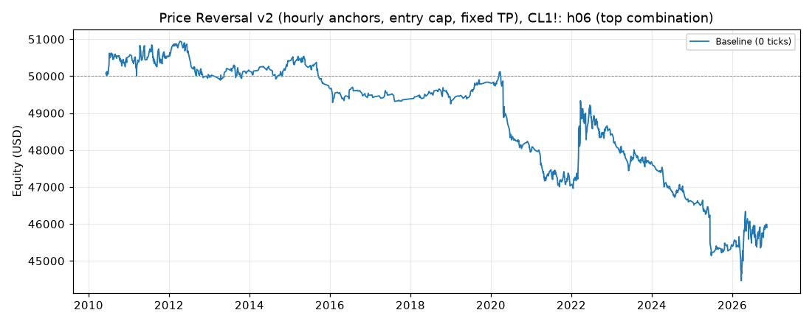

Files: [grid](../../../results/price_reversal_v2/h06/grid.csv), [trades 0 ticks](../../../results/price_reversal_v2/h06/trades_slippage0.csv), [summary](../../../results/price_reversal_v2/h06/summary.json)

### Results after commission

#### Overview

| Metric | Value |
|---|---|
| Net profit | -4,014.16 USD (-8.03%) |
| Total closed trades | 1,108 |
| Percent profitable | 55.05% |
| Profit factor | 0.901 |
| Max equity drawdown | 6,623.08 USD (13.25%) |
| Avg trade | -3.62 USD |
| Avg # bars in trades | 16 |

#### Performance

| Metric | All | Long | Short |
|---|---|---|---|
| Net profit | -4,014.16 USD (-8.03%) | -2,677.58 USD (-5.36%) | -1,336.58 USD (-2.67%) |
| Gross profit | 36,377.80 USD (72.76%) | 18,843.60 USD (37.69%) | 17,534.20 USD (35.07%) |
| Gross loss | 40,391.96 USD (80.78%) | 21,521.18 USD (43.04%) | 18,870.78 USD (37.74%) |
| Commission paid | 4,454.16 USD | 2,327.58 USD | 2,126.58 USD |

| Account | Value |
|---|---|
| Initial capital | 50,000.00 USD |
| Buy & hold return (TV-style, all capital at the first entry) | 10,816.79 USD (21.63%) |
| Max equity run-up (intrabar) | 2,521.56 USD (5.04%) |
| Max equity drawdown (intrabar) | 6,623.08 USD (13.25%) |
| Open P&L | 0.00 USD |
| Max contracts held | 1 |

#### Trades analysis

| Metric | All | Long | Short |
|---|---|---|---|
| Total closed trades | 1,108 | 579 | 529 |
| Winning trades | 610 | 320 | 290 |
| Losing trades | 498 | 259 | 239 |
| Even trades | 0 | 0 | 0 |
| Percent profitable | 55.05% | 55.27% | 54.82% |
| Avg P&L | -3.62 USD | -4.62 USD | -2.53 USD |
| Avg P&L % | -0.01% | -0.02% | -0.01% |
| Avg winning trade | 59.64 USD | 58.89 USD | 60.46 USD |
| Avg losing trade | 81.11 USD | 83.09 USD | 78.96 USD |
| Ratio avg win / avg loss | 0.735 | 0.709 | 0.766 |
| Largest winning trade | 685.98 USD | 685.98 USD | 555.98 USD |
| Largest winning trade % | 1.05% | 0.75% | 1.05% |
| Largest losing trade | 764.02 USD | 764.02 USD | 434.02 USD |
| Largest losing trade % | 5.97% | 5.97% | 1.36% |
| Avg # bars in trades | 16 | 16 | 16 |
| Avg # bars in winning trades | 14 | 13 | 15 |
| Avg # bars in losing trades | 18 | 19 | 17 |

#### Risk/performance ratios

| Metric | Value |
|---|---|
| Sharpe ratio | -0.401 |
| Sortino ratio | -0.466 |
| Profit factor | 0.901 |
| Margin calls | 0 |

#### List of trades (last 10, newest first; full list in the trades CSV)

| Trade # | Type | Signal | Date/Time (UTC) | Price | Contracts | Profit | Cum. profit | Run-up | Drawdown |
|---|---|---|---|---|---|---|---|---|---|
| 1108 | Exit short | Exit | 2026-11-10 04:35 | 85.81 | 1 | 85.98 USD (0.10%) | -4,014.16 USD | 90.00 USD | 0.00 USD |
|  | Entry short | Short | 2026-11-10 04:24 | 85.90 | 1 |  |  |  |  |
| 1107 | Exit short | Exit | 2026-11-09 04:19 | 91.35 | 1 | -94.02 USD (-0.10%) | -4,100.14 USD | 10.00 USD | 90.00 USD |
|  | Entry short | Short | 2026-11-09 04:09 | 91.26 | 1 |  |  |  |  |
| 1106 | Exit short | Exit | 2026-11-05 04:34 | 86.79 | 1 | 95.98 USD (0.11%) | -4,006.12 USD | 100.00 USD | 90.00 USD |
|  | Entry short | Short | 2026-11-05 04:15 | 86.89 | 1 |  |  |  |  |
| 1105 | Exit long | Exit | 2026-11-04 04:35 | 95.12 | 1 | -74.02 USD (-0.08%) | -4,102.10 USD | 200.00 USD | 70.00 USD |
|  | Entry long | Long | 2026-11-04 04:22 | 95.19 | 1 |  |  |  |  |
| 1104 | Exit long | Exit | 2026-10-28 03:26 | 101.22 | 1 | 115.98 USD (0.11%) | -4,028.08 USD | 120.00 USD | 0.00 USD |
|  | Entry long | Long | 2026-10-28 03:19 | 101.10 | 1 |  |  |  |  |
| 1103 | Exit short | Exit | 2026-10-23 03:19 | 100.17 | 1 | -94.02 USD (-0.09%) | -4,144.06 USD | 110.00 USD | 90.00 USD |
|  | Entry short | Short | 2026-10-23 03:10 | 100.08 | 1 |  |  |  |  |
| 1102 | Exit short | Exit | 2026-10-22 03:33 | 98.37 | 1 | 75.98 USD (0.08%) | -4,050.04 USD | 80.00 USD | 40.00 USD |
|  | Entry short | Short | 2026-10-22 03:07 | 98.45 | 1 |  |  |  |  |
| 1101 | Exit long | Exit | 2026-10-15 03:17 | 93.85 | 1 | 35.98 USD (0.04%) | -4,126.02 USD | 40.00 USD | 20.00 USD |
|  | Entry long | Long | 2026-10-15 03:15 | 93.81 | 1 |  |  |  |  |
| 1100 | Exit long | Exit | 2026-10-13 03:15 | 92.42 | 1 | 75.98 USD (0.08%) | -4,162.00 USD | 80.00 USD | 0.00 USD |
|  | Entry long | Long | 2026-10-13 03:13 | 92.34 | 1 |  |  |  |  |
| 1099 | Exit long | Exit | 2026-10-12 03:30 | 90.15 | 1 | 125.98 USD (0.14%) | -4,237.98 USD | 130.00 USD | 10.00 USD |
|  | Entry long | Long | 2026-10-12 03:28 | 90.02 | 1 |  |  |  |  |

#### By year (extra, not a TV tab)

| Year | Trades | Net profit | % profitable | Profit factor |
|---|---|---|---|---|
| 2010 | 55 | 518.90 USD | 60.00% | 1.358 |
| 2011 | 91 | 4.18 USD | 54.95% | 1.001 |
| 2012 | 74 | -477.48 USD | 48.65% | 0.792 |
| 2013 | 53 | 96.94 USD | 62.26% | 1.073 |
| 2014 | 50 | 259.00 USD | 62.00% | 1.310 |
| 2015 | 53 | -713.06 USD | 47.17% | 0.609 |
| 2016 | 41 | -204.82 USD | 53.66% | 0.827 |
| 2017 | 24 | -126.48 USD | 66.67% | 0.738 |
| 2018 | 45 | -10.90 USD | 62.22% | 0.989 |
| 2019 | 39 | 493.22 USD | 71.79% | 1.890 |
| 2020 | 76 | -1,895.52 USD | 51.32% | 0.467 |
| 2021 | 83 | -913.66 USD | 48.19% | 0.697 |
| 2022 | 107 | 1,389.86 USD | 57.94% | 1.247 |
| 2023 | 72 | -739.44 USD | 45.83% | 0.711 |
| 2024 | 71 | -1,075.42 USD | 45.07% | 0.526 |
| 2025 | 69 | -1,167.38 USD | 56.52% | 0.577 |
| 2026 | 105 | 547.90 USD | 60.00% | 1.087 |

#### Exit reasons (extra)

| Reason | Trades |
|---|---|
| limit | 609 |
| stop | 498 |
| close | 1 |

- Session-end exits: 1.
- Roll exits: 0.

### Best settings by metric

Each winner needs at least 30 closed trades. Undefined values are excluded. Ties: higher net profit, higher profit factor, then grid order. Ruin loss threshold: 25,000.00 USD from starting capital. All selections are in-sample. MAE/MFE objectives use the mean of the per-trade maxima.

| Metric | Goal | Best value | Grid order | Trades | Eligible settings | Parameters |
|---|---|---|---|---|---|---|
| Net profit | max | -4,014.16 USD | [6](../../../results/price_reversal_v2/h06/metric_winners/order_6/trades_slippage0.csv) | 1108 | 64 | window=30, atr_mult=1.0, swing=1, target=far |
| Win rate | max | 58.89% | [5](../../../results/price_reversal_v2/h06/metric_winners/order_5/trades_slippage0.csv) | 1097 | 64 | window=30, atr_mult=1.0, swing=1, target=near |
| Expectancy | max | -3.62 USD | [6](../../../results/price_reversal_v2/h06/metric_winners/order_6/trades_slippage0.csv) | 1108 | 64 | window=30, atr_mult=1.0, swing=1, target=far |
| Profit factor | max | 0.901 | [6](../../../results/price_reversal_v2/h06/metric_winners/order_6/trades_slippage0.csv) | 1108 | 64 | window=30, atr_mult=1.0, swing=1, target=far |
| Payoff ratio | max | 2.065 | [48](../../../results/price_reversal_v2/h06/metric_winners/order_48/trades_slippage0.csv) | 3233 | 64 | window=90, atr_mult=2.0, swing=1, target=rr2 |
| Risk of ruin (estimate) | min | 100.00% | [6](../../../results/price_reversal_v2/h06/metric_winners/order_6/trades_slippage0.csv) | 1108 | 64 | window=30, atr_mult=1.0, swing=1, target=far |
| Maximum drawdown | min | 6,523.68 USD | [14](../../../results/price_reversal_v2/h06/metric_winners/order_14/trades_slippage0.csv) | 1063 | 64 | window=30, atr_mult=2.0, swing=1, target=far |
| Consecutive losses | min | 8.000 | [6](../../../results/price_reversal_v2/h06/metric_winners/order_6/trades_slippage0.csv) | 1108 | 64 | window=30, atr_mult=1.0, swing=1, target=far |
| Sharpe ratio | max | -0.227 | [48](../../../results/price_reversal_v2/h06/metric_winners/order_48/trades_slippage0.csv) | 3233 | 64 | window=90, atr_mult=2.0, swing=1, target=rr2 |
| Sortino ratio | max | -0.327 | [64](../../../results/price_reversal_v2/h06/metric_winners/order_64/trades_slippage0.csv) | 3902 | 64 | window=120, atr_mult=2.0, swing=1, target=rr2 |
| R-multiple | max | No eligible value | — | — | 0 | — |
| Maximum adverse excursion (MAE) | min | 43.68 USD | [5](../../../results/price_reversal_v2/h06/metric_winners/order_5/trades_slippage0.csv) | 1097 | 64 | window=30, atr_mult=1.0, swing=1, target=near |
| Maximum favorable excursion (MFE) | max | 89.73 USD | [4](../../../results/price_reversal_v2/h06/metric_winners/order_4/trades_slippage0.csv) | 1055 | 64 | window=30, atr_mult=0.5, swing=1, target=rr2 |

- **Net profit:** Sum of closed-trade profit after commission; excludes open P&L.
- **Win rate:** Winning closed trades divided by all closed trades, including breakevens.
- **Expectancy:** Mean net profit per closed trade, including losses and breakevens.
- **Profit factor:** Gross winning profit divided by gross losing profit, both after commission. Undefined without losses.
- **Payoff ratio:** Average net winning trade divided by the absolute average net losing trade. Requires wins and losses.
- **Risk of ruin (estimate):** Infinite-horizon diffusion estimate of losing the declared amount from starting capital. Assumes independent, stationary, fixed-size net trade P&L; ignores intratrade losses and margin.
- **Maximum drawdown:** Largest equity drawdown under the tester's intrabar TradingView convention, including an open trade at the end.
- **Consecutive losses:** Longest streak of losing closed trades in execution order. A win or breakeven resets the streak.
- **Sharpe ratio:** Monthly marked-to-market excess return divided by population standard deviation, using 2% annual risk-free rate; not annualized.
- **Sortino ratio:** Monthly marked-to-market excess return divided by downside deviation about the risk-free rate; not annualized.
- **R-multiple:** Mean net trade profit / initial stop risk in dollars. Risk is actual fill to initial stop, before costs. Requires positive initial risk for every closed trade; R standard deviation and mean / standard deviation describe consistency.
- **Maximum adverse excursion (MAE):** Mean of each closed trade's maximum adverse price excursion in dollars, before commission; only the exposed intrabar path counts.
- **Maximum favorable excursion (MFE):** Mean of each closed trade's maximum favorable price excursion in dollars, before commission; only the exposed intrabar path counts. Unrealized opportunity, not realized profit.

Full selection metadata: [metric_winners.json](../../../results/price_reversal_v2/h06/metric_winners.json).

### Top 10 combinations

| # | window | atr_mult | swing | target | Net profit | Trades | % profitable | Profit factor | Max DD |
|---|---|---|---|---|---|---|---|---|---|
| 1 | 30 | 1.0 | 1 | far | -4,014.16 USD | 1,108 | 55.05% | 0.901 | 6,623.08 USD |
| 2 | 30 | 1.5 | 1 | far | -4,372.10 USD | 1,105 | 54.75% | 0.892 | 6,896.34 USD |
| 3 | 30 | 0.5 | 1 | far | -4,386.78 USD | 1,039 | 54.57% | 0.886 | 7,233.74 USD |
| 4 | 30 | 2.0 | 1 | far | -4,593.26 USD | 1,063 | 54.19% | 0.883 | 6,523.68 USD |
| 5 | 30 | 1.0 | 1 | near | -4,819.94 USD | 1,097 | 58.89% | 0.863 | 6,558.70 USD |
| 6 | 30 | 0.5 | 1 | near | -4,932.56 USD | 1,028 | 58.75% | 0.852 | 6,857.50 USD |
| 7 | 30 | 1.5 | 1 | near | -5,027.88 USD | 1,094 | 58.59% | 0.858 | 6,822.72 USD |
| 8 | 30 | 2.0 | 1 | near | -5,739.04 USD | 1,052 | 57.51% | 0.836 | 7,289.66 USD |
| 9 | 30 | 0.5 | 1 | rr1 | -7,234.92 USD | 1,046 | 47.71% | 0.851 | 9,786.64 USD |
| 10 | 30 | 1.0 | 1 | rr1 | -7,492.30 USD | 1,115 | 48.25% | 0.853 | 10,013.92 USD |

Profitable combinations: 0 of 64.

## Variant: h07

**Top combination:** `anchor=h07`, `window=30`, `atr_mult=1.0`, `swing=1`, `target=near`

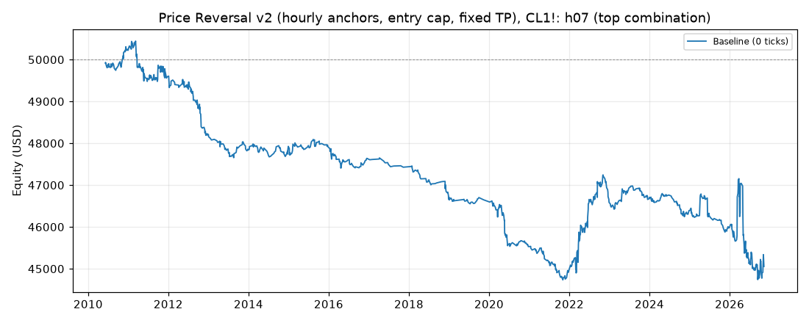

Files: [grid](../../../results/price_reversal_v2/h07/grid.csv), [trades 0 ticks](../../../results/price_reversal_v2/h07/trades_slippage0.csv), [summary](../../../results/price_reversal_v2/h07/summary.json)

### Results after commission

#### Overview

| Metric | Value |
|---|---|
| Net profit | -4,945.88 USD (-9.89%) |
| Total closed trades | 994 |
| Percent profitable | 57.04% |
| Profit factor | 0.829 |
| Max equity drawdown | 5,768.20 USD (11.54%) |
| Avg trade | -4.98 USD |
| Avg # bars in trades | 9 |

#### Performance

| Metric | All | Long | Short |
|---|---|---|---|
| Net profit | -4,945.88 USD (-9.89%) | -3,975.98 USD (-7.95%) | -969.90 USD (-1.94%) |
| Gross profit | 23,950.66 USD (47.90%) | 10,706.46 USD (21.41%) | 13,244.20 USD (26.49%) |
| Gross loss | 28,896.54 USD (57.79%) | 14,682.44 USD (29.36%) | 14,214.10 USD (28.43%) |
| Commission paid | 3,995.88 USD | 2,005.98 USD | 1,989.90 USD |

| Account | Value |
|---|---|
| Initial capital | 50,000.00 USD |
| Buy & hold return (TV-style, all capital at the first entry) | 10,712.76 USD (21.43%) |
| Max equity run-up (intrabar) | 2,573.80 USD (5.15%) |
| Max equity drawdown (intrabar) | 5,768.20 USD (11.54%) |
| Open P&L | 0.00 USD |
| Max contracts held | 1 |

#### Trades analysis

| Metric | All | Long | Short |
|---|---|---|---|
| Total closed trades | 994 | 499 | 495 |
| Winning trades | 567 | 277 | 290 |
| Losing trades | 427 | 222 | 205 |
| Even trades | 0 | 0 | 0 |
| Percent profitable | 57.04% | 55.51% | 58.59% |
| Avg P&L | -4.98 USD | -7.97 USD | -1.96 USD |
| Avg P&L % | -0.01% | -0.01% | -0.01% |
| Avg winning trade | 42.24 USD | 38.65 USD | 45.67 USD |
| Avg losing trade | 67.67 USD | 66.14 USD | 69.34 USD |
| Ratio avg win / avg loss | 0.624 | 0.584 | 0.659 |
| Largest winning trade | 585.98 USD | 375.98 USD | 585.98 USD |
| Largest winning trade % | 0.73% | 0.51% | 0.73% |
| Largest losing trade | 514.02 USD | 514.02 USD | 504.02 USD |
| Largest losing trade % | 0.95% | 0.83% | 0.95% |
| Avg # bars in trades | 9 | 9 | 9 |
| Avg # bars in winning trades | 8 | 8 | 8 |
| Avg # bars in losing trades | 10 | 11 | 10 |

#### Risk/performance ratios

| Metric | Value |
|---|---|
| Sharpe ratio | -0.544 |
| Sortino ratio | -0.558 |
| Profit factor | 0.829 |
| Margin calls | 0 |

#### List of trades (last 10, newest first; full list in the trades CSV)

| Trade # | Type | Signal | Date/Time (UTC) | Price | Contracts | Profit | Cum. profit | Run-up | Drawdown |
|---|---|---|---|---|---|---|---|---|---|
| 994 | Exit long | Exit | 2026-11-09 05:36 | 90.34 | 1 | -284.02 USD (-0.31%) | -4,945.88 USD | 40.00 USD | 280.00 USD |
|  | Entry long | Long | 2026-11-09 05:28 | 90.62 | 1 |  |  |  |  |
| 993 | Exit short | Exit | 2026-11-04 05:38 | 95.87 | 1 | 425.98 USD (0.44%) | -4,661.86 USD | 430.00 USD | 90.00 USD |
|  | Entry short | Short | 2026-11-04 05:17 | 96.30 | 1 |  |  |  |  |
| 992 | Exit short | Exit | 2026-10-30 04:11 | 103.21 | 1 | 5.98 USD (0.01%) | -5,087.84 USD | 10.00 USD | 0.00 USD |
|  | Entry short | Short | 2026-10-30 04:11 | 103.22 | 1 |  |  |  |  |
| 991 | Exit short | Exit | 2026-10-26 04:30 | 100.98 | 1 | 5.98 USD (0.01%) | -5,093.82 USD | 10.00 USD | 70.00 USD |
|  | Entry short | Short | 2026-10-26 04:24 | 100.99 | 1 |  |  |  |  |
| 990 | Exit short | Exit | 2026-10-23 04:10 | 100.02 | 1 | 125.98 USD (0.13%) | -5,099.80 USD | 130.00 USD | 0.00 USD |
|  | Entry short | Short | 2026-10-23 04:07 | 100.15 | 1 |  |  |  |  |
| 989 | Exit long | Exit | 2026-10-21 04:30 | 99.08 | 1 | -114.02 USD (-0.11%) | -5,225.78 USD | 20.00 USD | 110.00 USD |
|  | Entry long | Long | 2026-10-21 04:20 | 99.19 | 1 |  |  |  |  |
| 988 | Exit short | Exit | 2026-10-16 04:34 | 97.35 | 1 | -144.02 USD (-0.15%) | -5,111.76 USD | 20.00 USD | 140.00 USD |
|  | Entry short | Short | 2026-10-16 04:18 | 97.21 | 1 |  |  |  |  |
| 987 | Exit short | Exit | 2026-10-15 04:26 | 94.05 | 1 | 5.98 USD (0.01%) | -4,967.74 USD | 10.00 USD | 0.00 USD |
|  | Entry short | Short | 2026-10-15 04:26 | 94.06 | 1 |  |  |  |  |
| 986 | Exit long | Exit | 2026-10-14 04:32 | 94.58 | 1 | -94.02 USD (-0.10%) | -4,973.72 USD | 10.00 USD | 90.00 USD |
|  | Entry long | Long | 2026-10-14 04:21 | 94.67 | 1 |  |  |  |  |
| 985 | Exit long | Exit | 2026-10-13 04:25 | 92.48 | 1 | -64.02 USD (-0.07%) | -4,879.70 USD | 70.00 USD | 60.00 USD |
|  | Entry long | Long | 2026-10-13 04:16 | 92.54 | 1 |  |  |  |  |

#### By year (extra, not a TV tab)

| Year | Trades | Net profit | % profitable | Profit factor |
|---|---|---|---|---|
| 2010 | 47 | 221.06 USD | 59.57% | 1.229 |
| 2011 | 90 | -631.80 USD | 50.00% | 0.800 |
| 2012 | 77 | -1,379.54 USD | 50.65% | 0.491 |
| 2013 | 48 | -372.96 USD | 54.17% | 0.669 |
| 2014 | 50 | 89.00 USD | 56.00% | 1.097 |
| 2015 | 48 | -2.96 USD | 60.42% | 0.997 |
| 2016 | 53 | -283.06 USD | 64.15% | 0.753 |
| 2017 | 13 | -212.26 USD | 53.85% | 0.253 |
| 2018 | 41 | -764.82 USD | 53.66% | 0.315 |
| 2019 | 31 | -14.62 USD | 67.74% | 0.964 |
| 2020 | 57 | -1,119.14 USD | 52.63% | 0.459 |
| 2021 | 61 | -615.22 USD | 57.38% | 0.568 |
| 2022 | 94 | 1,672.12 USD | 64.89% | 1.592 |
| 2023 | 58 | 86.84 USD | 62.07% | 1.086 |
| 2024 | 58 | -283.16 USD | 53.45% | 0.751 |
| 2025 | 55 | -401.10 USD | 52.73% | 0.755 |
| 2026 | 113 | -934.26 USD | 58.41% | 0.844 |

#### Exit reasons (extra)

| Reason | Trades |
|---|---|
| limit | 567 |
| stop | 427 |

- Session-end exits: 0.
- Roll exits: 0.

### Best settings by metric

Each winner needs at least 30 closed trades. Undefined values are excluded. Ties: higher net profit, higher profit factor, then grid order. Ruin loss threshold: 25,000.00 USD from starting capital. All selections are in-sample. MAE/MFE objectives use the mean of the per-trade maxima.

| Metric | Goal | Best value | Grid order | Trades | Eligible settings | Parameters |
|---|---|---|---|---|---|---|
| Net profit | max | -4,945.88 USD | [5](../../../results/price_reversal_v2/h07/metric_winners/order_5/trades_slippage0.csv) | 994 | 64 | window=30, atr_mult=1.0, swing=1, target=near |
| Win rate | max | 57.39% | [1](../../../results/price_reversal_v2/h07/metric_winners/order_1/trades_slippage0.csv) | 927 | 64 | window=30, atr_mult=0.5, swing=1, target=near |
| Expectancy | max | -2.27 USD | [19](../../../results/price_reversal_v2/h07/metric_winners/order_19/trades_slippage0.csv) | 2220 | 64 | window=60, atr_mult=0.5, swing=1, target=rr1 |
| Profit factor | max | 0.942 | [19](../../../results/price_reversal_v2/h07/metric_winners/order_19/trades_slippage0.csv) | 2220 | 64 | window=60, atr_mult=0.5, swing=1, target=rr1 |
| Payoff ratio | max | 2.088 | [32](../../../results/price_reversal_v2/h07/metric_winners/order_32/trades_slippage0.csv) | 2398 | 64 | window=60, atr_mult=2.0, swing=1, target=rr2 |
| Risk of ruin (estimate) | min | 100.00% | [5](../../../results/price_reversal_v2/h07/metric_winners/order_5/trades_slippage0.csv) | 994 | 64 | window=30, atr_mult=1.0, swing=1, target=near |
| Maximum drawdown | min | 5,768.20 USD | [5](../../../results/price_reversal_v2/h07/metric_winners/order_5/trades_slippage0.csv) | 994 | 64 | window=30, atr_mult=1.0, swing=1, target=near |
| Consecutive losses | min | 6.000 | [9](../../../results/price_reversal_v2/h07/metric_winners/order_9/trades_slippage0.csv) | 998 | 64 | window=30, atr_mult=1.5, swing=1, target=near |
| Sharpe ratio | max | -0.198 | [56](../../../results/price_reversal_v2/h07/metric_winners/order_56/trades_slippage0.csv) | 4093 | 64 | window=120, atr_mult=1.0, swing=1, target=rr2 |
| Sortino ratio | max | -0.277 | [56](../../../results/price_reversal_v2/h07/metric_winners/order_56/trades_slippage0.csv) | 4093 | 64 | window=120, atr_mult=1.0, swing=1, target=rr2 |
| R-multiple | max | No eligible value | — | — | 0 | — |
| Maximum adverse excursion (MAE) | min | 37.80 USD | [5](../../../results/price_reversal_v2/h07/metric_winners/order_5/trades_slippage0.csv) | 994 | 64 | window=30, atr_mult=1.0, swing=1, target=near |
| Maximum favorable excursion (MFE) | max | 85.13 USD | [64](../../../results/price_reversal_v2/h07/metric_winners/order_64/trades_slippage0.csv) | 4127 | 64 | window=120, atr_mult=2.0, swing=1, target=rr2 |

- **Net profit:** Sum of closed-trade profit after commission; excludes open P&L.
- **Win rate:** Winning closed trades divided by all closed trades, including breakevens.
- **Expectancy:** Mean net profit per closed trade, including losses and breakevens.
- **Profit factor:** Gross winning profit divided by gross losing profit, both after commission. Undefined without losses.
- **Payoff ratio:** Average net winning trade divided by the absolute average net losing trade. Requires wins and losses.
- **Risk of ruin (estimate):** Infinite-horizon diffusion estimate of losing the declared amount from starting capital. Assumes independent, stationary, fixed-size net trade P&L; ignores intratrade losses and margin.
- **Maximum drawdown:** Largest equity drawdown under the tester's intrabar TradingView convention, including an open trade at the end.
- **Consecutive losses:** Longest streak of losing closed trades in execution order. A win or breakeven resets the streak.
- **Sharpe ratio:** Monthly marked-to-market excess return divided by population standard deviation, using 2% annual risk-free rate; not annualized.
- **Sortino ratio:** Monthly marked-to-market excess return divided by downside deviation about the risk-free rate; not annualized.
- **R-multiple:** Mean net trade profit / initial stop risk in dollars. Risk is actual fill to initial stop, before costs. Requires positive initial risk for every closed trade; R standard deviation and mean / standard deviation describe consistency.
- **Maximum adverse excursion (MAE):** Mean of each closed trade's maximum adverse price excursion in dollars, before commission; only the exposed intrabar path counts.
- **Maximum favorable excursion (MFE):** Mean of each closed trade's maximum favorable price excursion in dollars, before commission; only the exposed intrabar path counts. Unrealized opportunity, not realized profit.

Full selection metadata: [metric_winners.json](../../../results/price_reversal_v2/h07/metric_winners.json).

### Top 10 combinations

| # | window | atr_mult | swing | target | Net profit | Trades | % profitable | Profit factor | Max DD |
|---|---|---|---|---|---|---|---|---|---|
| 1 | 30 | 1.0 | 1 | near | -4,945.88 USD | 994 | 57.04% | 0.829 | 5,768.20 USD |
| 2 | 30 | 0.5 | 1 | near | -5,036.54 USD | 927 | 57.39% | 0.814 | 5,866.90 USD |
| 3 | 60 | 0.5 | 1 | rr1 | -5,044.40 USD | 2,220 | 47.21% | 0.942 | 9,645.28 USD |
| 4 | 30 | 1.5 | 1 | near | -5,261.96 USD | 998 | 56.61% | 0.821 | 6,000.26 USD |
| 5 | 30 | 2.0 | 1 | near | -5,511.46 USD | 973 | 56.01% | 0.813 | 5,998.10 USD |
| 6 | 60 | 1.0 | 1 | rr1 | -6,623.58 USD | 2,379 | 46.83% | 0.929 | 10,951.60 USD |
| 7 | 30 | 1.0 | 1 | far | -6,793.92 USD | 996 | 50.40% | 0.800 | 7,147.04 USD |
| 8 | 30 | 0.5 | 1 | rr1 | -6,860.96 USD | 948 | 45.25% | 0.815 | 8,287.00 USD |
| 9 | 30 | 0.5 | 1 | far | -6,974.58 USD | 929 | 50.48% | 0.782 | 7,271.72 USD |
| 10 | 60 | 1.0 | 1 | near | -7,006.80 USD | 2,340 | 55.38% | 0.904 | 8,425.70 USD |

Profitable combinations: 0 of 64.

## Variant: h08

**Top combination:** `anchor=h08`, `window=60`, `atr_mult=1.0`, `swing=1`, `target=rr2`

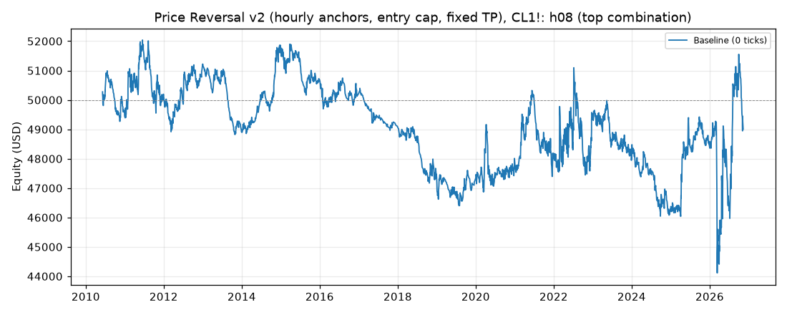

Files: [grid](../../../results/price_reversal_v2/h08/grid.csv), [trades 0 ticks](../../../results/price_reversal_v2/h08/trades_slippage0.csv), [summary](../../../results/price_reversal_v2/h08/summary.json)

### Results after commission

#### Overview

| Metric | Value |
|---|---|
| Net profit | -993.80 USD (-1.99%) |
| Total closed trades | 2,690 |
| Percent profitable | 33.27% |
| Profit factor | 0.994 |
| Max equity drawdown | 8,234.94 USD (16.47%) |
| Avg trade | -0.37 USD |
| Avg # bars in trades | 25 |

#### Performance

| Metric | All | Long | Short |
|---|---|---|---|
| Net profit | -993.80 USD (-1.99%) | 3,970.74 USD (7.94%) | -4,964.54 USD (-9.93%) |
| Gross profit | 156,172.10 USD (312.34%) | 83,550.70 USD (167.10%) | 72,621.40 USD (145.24%) |
| Gross loss | 157,165.90 USD (314.33%) | 79,579.96 USD (159.16%) | 77,585.94 USD (155.17%) |
| Commission paid | 10,813.80 USD | 5,479.26 USD | 5,334.54 USD |

| Account | Value |
|---|---|
| Initial capital | 50,000.00 USD |
| Buy & hold return (TV-style, all capital at the first entry) | 10,531.55 USD (21.06%) |
| Max equity run-up (intrabar) | 7,715.54 USD (15.43%) |
| Max equity drawdown (intrabar) | 8,234.94 USD (16.47%) |
| Open P&L | 0.00 USD |
| Max contracts held | 1 |

#### Trades analysis

| Metric | All | Long | Short |
|---|---|---|---|
| Total closed trades | 2,690 | 1,363 | 1,327 |
| Winning trades | 895 | 465 | 430 |
| Losing trades | 1,795 | 898 | 897 |
| Even trades | 0 | 0 | 0 |
| Percent profitable | 33.27% | 34.12% | 32.40% |
| Avg P&L | -0.37 USD | 2.91 USD | -3.74 USD |
| Avg P&L % | -0.00% | 0.00% | -0.01% |
| Avg winning trade | 174.49 USD | 179.68 USD | 168.89 USD |
| Avg losing trade | 87.56 USD | 88.62 USD | 86.49 USD |
| Ratio avg win / avg loss | 1.993 | 2.028 | 1.953 |
| Largest winning trade | 2,335.98 USD | 2,335.98 USD | 1,055.98 USD |
| Largest winning trade % | 2.31% | 2.31% | 2.15% |
| Largest losing trade | 1,864.02 USD | 1,864.02 USD | 674.02 USD |
| Largest losing trade % | 2.54% | 1.72% | 2.54% |
| Avg # bars in trades | 25 | 25 | 25 |
| Avg # bars in winning trades | 34 | 35 | 34 |
| Avg # bars in losing trades | 20 | 21 | 20 |

#### Risk/performance ratios

| Metric | Value |
|---|---|
| Sharpe ratio | -0.128 |
| Sortino ratio | -0.167 |
| Profit factor | 0.994 |
| Margin calls | 0 |

#### List of trades (last 10, newest first; full list in the trades CSV)

| Trade # | Type | Signal | Date/Time (UTC) | Price | Contracts | Profit | Cum. profit | Run-up | Drawdown |
|---|---|---|---|---|---|---|---|---|---|
| 2690 | Exit long | Exit | 2026-11-10 07:40 | 85.10 | 1 | -264.02 USD (-0.31%) | -993.80 USD | 360.00 USD | 260.00 USD |
|  | Entry long | Long | 2026-11-10 06:56 | 85.36 | 1 |  |  |  |  |
| 2689 | Exit long | Exit | 2026-11-06 06:23 | 91.52 | 1 | -174.02 USD (-0.19%) | -729.78 USD | 20.00 USD | 170.00 USD |
|  | Entry long | Long | 2026-11-06 06:18 | 91.69 | 1 |  |  |  |  |
| 2688 | Exit long | Exit | 2026-11-05 07:22 | 87.66 | 1 | 495.98 USD (0.57%) | -555.76 USD | 500.00 USD | 220.00 USD |
|  | Entry long | Long | 2026-11-05 06:58 | 87.16 | 1 |  |  |  |  |
| 2687 | Exit short | Exit | 2026-11-04 07:00 | 96.64 | 1 | -184.02 USD (-0.19%) | -1,051.74 USD | 310.00 USD | 180.00 USD |
|  | Entry short | Short | 2026-11-04 06:33 | 96.46 | 1 |  |  |  |  |
| 2686 | Exit short | Exit | 2026-11-03 07:01 | 98.14 | 1 | -184.02 USD (-0.19%) | -867.72 USD | 40.00 USD | 180.00 USD |
|  | Entry short | Short | 2026-11-03 07:00 | 97.96 | 1 |  |  |  |  |
| 2685 | Exit long | Exit | 2026-11-03 06:13 | 97.33 | 1 | -104.02 USD (-0.11%) | -683.70 USD | 90.00 USD | 100.00 USD |
|  | Entry long | Long | 2026-11-03 06:08 | 97.43 | 1 |  |  |  |  |
| 2684 | Exit short | Exit | 2026-11-02 06:31 | 100.76 | 1 | -84.02 USD (-0.08%) | -579.68 USD | 0.00 USD | 80.00 USD |
|  | Entry short | Short | 2026-11-02 06:31 | 100.68 | 1 |  |  |  |  |
| 2683 | Exit short | Exit | 2026-10-30 05:31 | 103.05 | 1 | -64.02 USD (-0.06%) | -495.66 USD | 90.00 USD | 60.00 USD |
|  | Entry short | Short | 2026-10-30 05:08 | 102.99 | 1 |  |  |  |  |
| 2682 | Exit long | Exit | 2026-10-29 05:30 | 101.15 | 1 | -124.02 USD (-0.12%) | -431.64 USD | 0.00 USD | 120.00 USD |
|  | Entry long | Long | 2026-10-29 05:23 | 101.27 | 1 |  |  |  |  |
| 2681 | Exit short | Exit | 2026-10-28 05:51 | 101.62 | 1 | -144.02 USD (-0.14%) | -307.62 USD | 0.00 USD | 140.00 USD |
|  | Entry short | Short | 2026-10-28 05:48 | 101.48 | 1 |  |  |  |  |

#### By year (extra, not a TV tab)

| Year | Trades | Net profit | % profitable | Profit factor |
|---|---|---|---|---|
| 2010 | 91 | -555.82 USD | 29.67% | 0.874 |
| 2011 | 217 | 657.66 USD | 35.94% | 1.048 |
| 2012 | 179 | 1,120.42 USD | 36.87% | 1.145 |
| 2013 | 136 | -2,316.72 USD | 24.26% | 0.637 |
| 2014 | 148 | 2,745.04 USD | 45.27% | 1.571 |
| 2015 | 144 | -968.88 USD | 28.47% | 0.860 |
| 2016 | 134 | -478.68 USD | 33.58% | 0.923 |
| 2017 | 76 | -1,105.52 USD | 28.95% | 0.634 |
| 2018 | 141 | -1,726.82 USD | 25.53% | 0.742 |
| 2019 | 139 | -118.78 USD | 31.65% | 0.980 |
| 2020 | 162 | 758.76 USD | 36.42% | 1.083 |
| 2021 | 189 | 70.22 USD | 35.45% | 1.006 |
| 2022 | 220 | 1,255.60 USD | 34.55% | 1.057 |
| 2023 | 184 | -1,389.68 USD | 31.52% | 0.858 |
| 2024 | 169 | -1,729.38 USD | 26.63% | 0.791 |
| 2025 | 178 | 2,224.44 USD | 37.08% | 1.289 |
| 2026 | 183 | 564.34 USD | 35.52% | 1.024 |

#### Exit reasons (extra)

| Reason | Trades |
|---|---|
| stop | 1795 |
| limit | 891 |
| close | 4 |

- Session-end exits: 4.
- Roll exits: 0.

### Best settings by metric

Each winner needs at least 30 closed trades. Undefined values are excluded. Ties: higher net profit, higher profit factor, then grid order. Ruin loss threshold: 25,000.00 USD from starting capital. All selections are in-sample. MAE/MFE objectives use the mean of the per-trade maxima.

| Metric | Goal | Best value | Grid order | Trades | Eligible settings | Parameters |
|---|---|---|---|---|---|---|
| Net profit | max | -993.80 USD | [24](../../../results/price_reversal_v2/h08/metric_winners/order_24/trades_slippage0.csv) | 2690 | 64 | window=60, atr_mult=1.0, swing=1, target=rr2 |
| Win rate | max | 58.08% | [1](../../../results/price_reversal_v2/h08/metric_winners/order_1/trades_slippage0.csv) | 1009 | 64 | window=30, atr_mult=0.5, swing=1, target=near |
| Expectancy | max | -0.37 USD | [24](../../../results/price_reversal_v2/h08/metric_winners/order_24/trades_slippage0.csv) | 2690 | 64 | window=60, atr_mult=1.0, swing=1, target=rr2 |
| Profit factor | max | 0.994 | [24](../../../results/price_reversal_v2/h08/metric_winners/order_24/trades_slippage0.csv) | 2690 | 64 | window=60, atr_mult=1.0, swing=1, target=rr2 |
| Payoff ratio | max | 1.998 | [32](../../../results/price_reversal_v2/h08/metric_winners/order_32/trades_slippage0.csv) | 2711 | 64 | window=60, atr_mult=2.0, swing=1, target=rr2 |
| Risk of ruin (estimate) | min | 100.00% | [24](../../../results/price_reversal_v2/h08/metric_winners/order_24/trades_slippage0.csv) | 2690 | 64 | window=60, atr_mult=1.0, swing=1, target=rr2 |
| Maximum drawdown | min | 4,004.62 USD | [7](../../../results/price_reversal_v2/h08/metric_winners/order_7/trades_slippage0.csv) | 1123 | 64 | window=30, atr_mult=1.0, swing=1, target=rr1 |
| Consecutive losses | min | 7.000 | [9](../../../results/price_reversal_v2/h08/metric_winners/order_9/trades_slippage0.csv) | 1106 | 64 | window=30, atr_mult=1.5, swing=1, target=near |
| Sharpe ratio | max | -0.112 | [40](../../../results/price_reversal_v2/h08/metric_winners/order_40/trades_slippage0.csv) | 3812 | 64 | window=90, atr_mult=1.0, swing=1, target=rr2 |
| Sortino ratio | max | -0.155 | [40](../../../results/price_reversal_v2/h08/metric_winners/order_40/trades_slippage0.csv) | 3812 | 64 | window=90, atr_mult=1.0, swing=1, target=rr2 |
| R-multiple | max | No eligible value | — | — | 0 | — |
| Maximum adverse excursion (MAE) | min | 44.54 USD | [9](../../../results/price_reversal_v2/h08/metric_winners/order_9/trades_slippage0.csv) | 1106 | 64 | window=30, atr_mult=1.5, swing=1, target=near |
| Maximum favorable excursion (MFE) | max | 101.49 USD | [64](../../../results/price_reversal_v2/h08/metric_winners/order_64/trades_slippage0.csv) | 4588 | 64 | window=120, atr_mult=2.0, swing=1, target=rr2 |

- **Net profit:** Sum of closed-trade profit after commission; excludes open P&L.
- **Win rate:** Winning closed trades divided by all closed trades, including breakevens.
- **Expectancy:** Mean net profit per closed trade, including losses and breakevens.
- **Profit factor:** Gross winning profit divided by gross losing profit, both after commission. Undefined without losses.
- **Payoff ratio:** Average net winning trade divided by the absolute average net losing trade. Requires wins and losses.
- **Risk of ruin (estimate):** Infinite-horizon diffusion estimate of losing the declared amount from starting capital. Assumes independent, stationary, fixed-size net trade P&L; ignores intratrade losses and margin.
- **Maximum drawdown:** Largest equity drawdown under the tester's intrabar TradingView convention, including an open trade at the end.
- **Consecutive losses:** Longest streak of losing closed trades in execution order. A win or breakeven resets the streak.
- **Sharpe ratio:** Monthly marked-to-market excess return divided by population standard deviation, using 2% annual risk-free rate; not annualized.
- **Sortino ratio:** Monthly marked-to-market excess return divided by downside deviation about the risk-free rate; not annualized.
- **R-multiple:** Mean net trade profit / initial stop risk in dollars. Risk is actual fill to initial stop, before costs. Requires positive initial risk for every closed trade; R standard deviation and mean / standard deviation describe consistency.
- **Maximum adverse excursion (MAE):** Mean of each closed trade's maximum adverse price excursion in dollars, before commission; only the exposed intrabar path counts.
- **Maximum favorable excursion (MFE):** Mean of each closed trade's maximum favorable price excursion in dollars, before commission; only the exposed intrabar path counts. Unrealized opportunity, not realized profit.

Full selection metadata: [metric_winners.json](../../../results/price_reversal_v2/h08/metric_winners.json).

### Top 10 combinations

| # | window | atr_mult | swing | target | Net profit | Trades | % profitable | Profit factor | Max DD |
|---|---|---|---|---|---|---|---|---|---|
| 1 | 60 | 1.0 | 1 | rr2 | -993.80 USD | 2,690 | 33.27% | 0.994 | 8,234.94 USD |
| 2 | 30 | 1.5 | 1 | rr2 | -1,004.86 USD | 1,143 | 33.77% | 0.984 | 5,122.60 USD |
| 3 | 30 | 1.0 | 1 | rr2 | -1,420.64 USD | 1,132 | 33.66% | 0.978 | 5,404.46 USD |
| 4 | 30 | 2.0 | 1 | rr2 | -1,424.66 USD | 1,133 | 33.54% | 0.978 | 5,296.52 USD |
| 5 | 60 | 1.5 | 1 | rr2 | -2,262.44 USD | 2,722 | 33.10% | 0.986 | 9,427.00 USD |
| 6 | 60 | 2.0 | 1 | rr2 | -2,938.22 USD | 2,711 | 32.94% | 0.982 | 10,152.88 USD |
| 7 | 30 | 1.5 | 1 | rr1 | -2,984.66 USD | 1,133 | 50.04% | 0.938 | 4,056.88 USD |
| 8 | 60 | 0.5 | 1 | rr2 | -3,085.88 USD | 2,494 | 33.00% | 0.979 | 9,995.56 USD |
| 9 | 30 | 1.0 | 1 | rr1 | -3,104.46 USD | 1,123 | 49.87% | 0.935 | 4,004.62 USD |
| 10 | 30 | 2.0 | 1 | rr1 | -3,254.46 USD | 1,123 | 49.78% | 0.932 | 4,244.72 USD |

Profitable combinations: 0 of 64.

## Variant: h09

**Top combination:** `anchor=h09`, `window=30`, `atr_mult=0.5`, `swing=1`, `target=rr1`

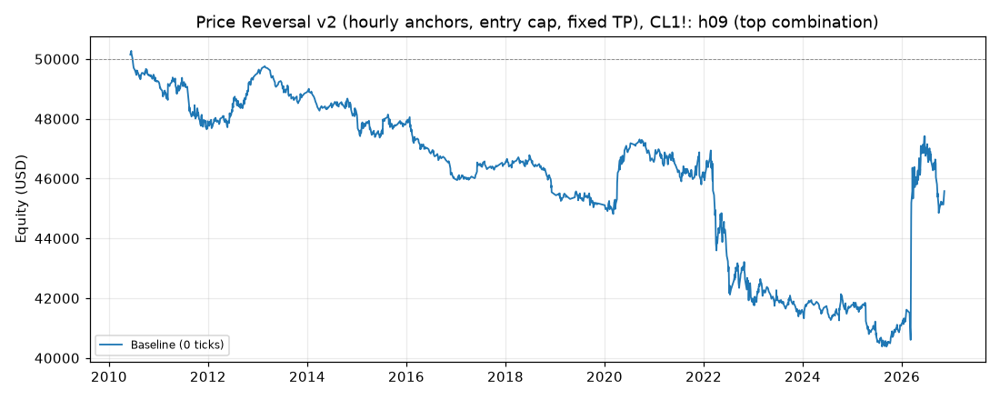

Files: [grid](../../../results/price_reversal_v2/h09/grid.csv), [trades 0 ticks](../../../results/price_reversal_v2/h09/trades_slippage0.csv), [summary](../../../results/price_reversal_v2/h09/summary.json)

### Results after commission

#### Overview

| Metric | Value |
|---|---|
| Net profit | -4,418.10 USD (-8.84%) |
| Total closed trades | 1,405 |
| Percent profitable | 48.11% |
| Profit factor | 0.943 |
| Max equity drawdown | 10,676.40 USD (21.35%) |
| Avg trade | -3.14 USD |
| Avg # bars in trades | 14 |

#### Performance

| Metric | All | Long | Short |
|---|---|---|---|
| Net profit | -4,418.10 USD (-8.84%) | 1,294.14 USD (2.59%) | -5,712.24 USD (-11.42%) |
| Gross profit | 72,882.48 USD (145.76%) | 39,143.40 USD (78.29%) | 33,739.08 USD (67.48%) |
| Gross loss | 77,300.58 USD (154.60%) | 37,849.26 USD (75.70%) | 39,451.32 USD (78.90%) |
| Commission paid | 5,648.10 USD | 2,785.86 USD | 2,862.24 USD |

| Account | Value |
|---|---|
| Initial capital | 50,000.00 USD |
| Buy & hold return (TV-style, all capital at the first entry) | 10,799.43 USD (21.60%) |
| Max equity run-up (intrabar) | 7,104.28 USD (14.21%) |
| Max equity drawdown (intrabar) | 10,676.40 USD (21.35%) |
| Open P&L | 0.00 USD |
| Max contracts held | 1 |

#### Trades analysis

| Metric | All | Long | Short |
|---|---|---|---|
| Total closed trades | 1,405 | 693 | 712 |
| Winning trades | 676 | 330 | 346 |
| Losing trades | 729 | 363 | 366 |
| Even trades | 0 | 0 | 0 |
| Percent profitable | 48.11% | 47.62% | 48.60% |
| Avg P&L | -3.14 USD | 1.87 USD | -8.02 USD |
| Avg P&L % | -0.00% | 0.01% | -0.01% |
| Avg winning trade | 107.81 USD | 118.62 USD | 97.51 USD |
| Avg losing trade | 106.04 USD | 104.27 USD | 107.79 USD |
| Ratio avg win / avg loss | 1.017 | 1.138 | 0.905 |
| Largest winning trade | 3,525.98 USD | 3,525.98 USD | 565.98 USD |
| Largest winning trade % | 3.41% | 3.41% | 1.74% |
| Largest losing trade | 904.02 USD | 674.02 USD | 904.02 USD |
| Largest losing trade % | 1.98% | 1.98% | 1.37% |
| Avg # bars in trades | 14 | 14 | 15 |
| Avg # bars in winning trades | 15 | 14 | 16 |
| Avg # bars in losing trades | 14 | 14 | 14 |

#### Risk/performance ratios

| Metric | Value |
|---|---|
| Sharpe ratio | -0.192 |
| Sortino ratio | -0.292 |
| Profit factor | 0.943 |
| Margin calls | 0 |

#### List of trades (last 10, newest first; full list in the trades CSV)

| Trade # | Type | Signal | Date/Time (UTC) | Price | Contracts | Profit | Cum. profit | Run-up | Drawdown |
|---|---|---|---|---|---|---|---|---|---|
| 1405 | Exit short | Exit | 2026-11-09 07:20 | 89.90 | 1 | 205.98 USD (0.23%) | -4,418.10 USD | 210.00 USD | 100.00 USD |
|  | Entry short | Short | 2026-11-09 07:14 | 90.11 | 1 |  |  |  |  |
| 1404 | Exit long | Exit | 2026-11-06 07:48 | 91.63 | 1 | 245.98 USD (0.27%) | -4,624.08 USD | 250.00 USD | 230.00 USD |
|  | Entry long | Long | 2026-11-06 07:16 | 91.38 | 1 |  |  |  |  |
| 1403 | Exit long | Exit | 2026-11-02 07:17 | 100.61 | 1 | -84.02 USD (-0.08%) | -4,870.06 USD | 50.00 USD | 80.00 USD |
|  | Entry long | Long | 2026-11-02 07:14 | 100.69 | 1 |  |  |  |  |
| 1402 | Exit short | Exit | 2026-10-22 06:15 | 99.18 | 1 | 85.98 USD (0.09%) | -4,786.04 USD | 90.00 USD | 30.00 USD |
|  | Entry short | Short | 2026-10-22 06:08 | 99.27 | 1 |  |  |  |  |
| 1401 | Exit short | Exit | 2026-10-21 06:12 | 99.25 | 1 | -104.02 USD (-0.10%) | -4,872.02 USD | 70.00 USD | 100.00 USD |
|  | Entry short | Short | 2026-10-21 06:09 | 99.15 | 1 |  |  |  |  |
| 1400 | Exit short | Exit | 2026-10-16 08:08 | 97.12 | 1 | 215.98 USD (0.22%) | -4,768.00 USD | 220.00 USD | 180.00 USD |
|  | Entry short | Short | 2026-10-16 06:27 | 97.34 | 1 |  |  |  |  |
| 1399 | Exit long | Exit | 2026-10-05 06:20 | 89.93 | 1 | 165.98 USD (0.18%) | -4,983.98 USD | 170.00 USD | 10.00 USD |
|  | Entry long | Long | 2026-10-05 06:19 | 89.76 | 1 |  |  |  |  |
| 1398 | Exit long | Exit | 2026-09-29 07:10 | 93.71 | 1 | -224.02 USD (-0.24%) | -5,149.96 USD | 200.00 USD | 220.00 USD |
|  | Entry long | Long | 2026-09-29 06:18 | 93.93 | 1 |  |  |  |  |
| 1397 | Exit long | Exit | 2026-09-28 06:48 | 93.78 | 1 | -274.02 USD (-0.29%) | -4,925.94 USD | 190.00 USD | 270.00 USD |
|  | Entry long | Long | 2026-09-28 06:21 | 94.05 | 1 |  |  |  |  |
| 1396 | Exit long | Exit | 2026-09-23 06:06 | 89.12 | 1 | -154.02 USD (-0.17%) | -4,651.92 USD | 10.00 USD | 150.00 USD |
|  | Entry long | Long | 2026-09-23 06:05 | 89.27 | 1 |  |  |  |  |

#### By year (extra, not a TV tab)

| Year | Trades | Net profit | % profitable | Profit factor |
|---|---|---|---|---|
| 2010 | 46 | -754.92 USD | 36.96% | 0.643 |
| 2011 | 103 | -1,324.06 USD | 45.63% | 0.789 |
| 2012 | 112 | 1,589.76 USD | 58.04% | 1.468 |
| 2013 | 62 | -619.24 USD | 48.39% | 0.747 |
| 2014 | 61 | -605.22 USD | 44.26% | 0.787 |
| 2015 | 90 | -381.80 USD | 47.78% | 0.909 |
| 2016 | 75 | -1,901.50 USD | 36.00% | 0.477 |
| 2017 | 59 | 502.82 USD | 57.63% | 1.333 |
| 2018 | 65 | -961.30 USD | 41.54% | 0.672 |
| 2019 | 60 | -371.20 USD | 50.00% | 0.852 |
| 2020 | 79 | 1,382.42 USD | 56.96% | 1.368 |
| 2021 | 112 | -510.24 USD | 47.32% | 0.914 |
| 2022 | 118 | -4,134.36 USD | 47.46% | 0.697 |
| 2023 | 93 | -353.86 USD | 44.09% | 0.921 |
| 2024 | 73 | 206.54 USD | 46.58% | 1.073 |
| 2025 | 97 | -629.94 USD | 49.48% | 0.861 |
| 2026 | 100 | 4,448.00 USD | 52.00% | 1.431 |

#### Exit reasons (extra)

| Reason | Trades |
|---|---|
| stop | 729 |
| limit | 676 |

- Session-end exits: 0.
- Roll exits: 0.

### Best settings by metric

Each winner needs at least 30 closed trades. Undefined values are excluded. Ties: higher net profit, higher profit factor, then grid order. Ruin loss threshold: 25,000.00 USD from starting capital. All selections are in-sample. MAE/MFE objectives use the mean of the per-trade maxima.

| Metric | Goal | Best value | Grid order | Trades | Eligible settings | Parameters |
|---|---|---|---|---|---|---|
| Net profit | max | -4,418.10 USD | [3](../../../results/price_reversal_v2/h09/metric_winners/order_3/trades_slippage0.csv) | 1405 | 64 | window=30, atr_mult=0.5, swing=1, target=rr1 |
| Win rate | max | 58.26% | [1](../../../results/price_reversal_v2/h09/metric_winners/order_1/trades_slippage0.csv) | 1387 | 64 | window=30, atr_mult=0.5, swing=1, target=near |
| Expectancy | max | -3.14 USD | [3](../../../results/price_reversal_v2/h09/metric_winners/order_3/trades_slippage0.csv) | 1405 | 64 | window=30, atr_mult=0.5, swing=1, target=rr1 |
| Profit factor | max | 0.943 | [3](../../../results/price_reversal_v2/h09/metric_winners/order_3/trades_slippage0.csv) | 1405 | 64 | window=30, atr_mult=0.5, swing=1, target=rr1 |
| Payoff ratio | max | 1.988 | [16](../../../results/price_reversal_v2/h09/metric_winners/order_16/trades_slippage0.csv) | 1542 | 64 | window=30, atr_mult=2.0, swing=1, target=rr2 |
| Risk of ruin (estimate) | min | 100.00% | [3](../../../results/price_reversal_v2/h09/metric_winners/order_3/trades_slippage0.csv) | 1405 | 64 | window=30, atr_mult=0.5, swing=1, target=rr1 |
| Maximum drawdown | min | 10,676.40 USD | [3](../../../results/price_reversal_v2/h09/metric_winners/order_3/trades_slippage0.csv) | 1405 | 64 | window=30, atr_mult=0.5, swing=1, target=rr1 |
| Consecutive losses | min | 6.000 | [5](../../../results/price_reversal_v2/h09/metric_winners/order_5/trades_slippage0.csv) | 1530 | 64 | window=30, atr_mult=1.0, swing=1, target=near |
| Sharpe ratio | max | -0.184 | [56](../../../results/price_reversal_v2/h09/metric_winners/order_56/trades_slippage0.csv) | 4904 | 64 | window=120, atr_mult=1.0, swing=1, target=rr2 |
| Sortino ratio | max | -0.196 | [56](../../../results/price_reversal_v2/h09/metric_winners/order_56/trades_slippage0.csv) | 4904 | 64 | window=120, atr_mult=1.0, swing=1, target=rr2 |
| R-multiple | max | No eligible value | — | — | 0 | — |
| Maximum adverse excursion (MAE) | min | 56.64 USD | [5](../../../results/price_reversal_v2/h09/metric_winners/order_5/trades_slippage0.csv) | 1530 | 64 | window=30, atr_mult=1.0, swing=1, target=near |
| Maximum favorable excursion (MFE) | max | 122.74 USD | [64](../../../results/price_reversal_v2/h09/metric_winners/order_64/trades_slippage0.csv) | 4903 | 64 | window=120, atr_mult=2.0, swing=1, target=rr2 |

- **Net profit:** Sum of closed-trade profit after commission; excludes open P&L.
- **Win rate:** Winning closed trades divided by all closed trades, including breakevens.
- **Expectancy:** Mean net profit per closed trade, including losses and breakevens.
- **Profit factor:** Gross winning profit divided by gross losing profit, both after commission. Undefined without losses.
- **Payoff ratio:** Average net winning trade divided by the absolute average net losing trade. Requires wins and losses.
- **Risk of ruin (estimate):** Infinite-horizon diffusion estimate of losing the declared amount from starting capital. Assumes independent, stationary, fixed-size net trade P&L; ignores intratrade losses and margin.
- **Maximum drawdown:** Largest equity drawdown under the tester's intrabar TradingView convention, including an open trade at the end.
- **Consecutive losses:** Longest streak of losing closed trades in execution order. A win or breakeven resets the streak.
- **Sharpe ratio:** Monthly marked-to-market excess return divided by population standard deviation, using 2% annual risk-free rate; not annualized.
- **Sortino ratio:** Monthly marked-to-market excess return divided by downside deviation about the risk-free rate; not annualized.
- **R-multiple:** Mean net trade profit / initial stop risk in dollars. Risk is actual fill to initial stop, before costs. Requires positive initial risk for every closed trade; R standard deviation and mean / standard deviation describe consistency.
- **Maximum adverse excursion (MAE):** Mean of each closed trade's maximum adverse price excursion in dollars, before commission; only the exposed intrabar path counts.
- **Maximum favorable excursion (MFE):** Mean of each closed trade's maximum favorable price excursion in dollars, before commission; only the exposed intrabar path counts. Unrealized opportunity, not realized profit.

Full selection metadata: [metric_winners.json](../../../results/price_reversal_v2/h09/metric_winners.json).

### Top 10 combinations

| # | window | atr_mult | swing | target | Net profit | Trades | % profitable | Profit factor | Max DD |
|---|---|---|---|---|---|---|---|---|---|
| 1 | 30 | 0.5 | 1 | rr1 | -4,418.10 USD | 1,405 | 48.11% | 0.943 | 10,676.40 USD |
| 2 | 30 | 1.5 | 1 | rr1 | -5,321.20 USD | 1,560 | 47.69% | 0.937 | 11,783.32 USD |
| 3 | 30 | 1.0 | 1 | rr1 | -5,332.96 USD | 1,548 | 47.67% | 0.937 | 12,089.10 USD |
| 4 | 30 | 2.0 | 1 | rr1 | -9,686.58 USD | 1,529 | 47.22% | 0.884 | 11,045.84 USD |
| 5 | 30 | 2.0 | 1 | rr2 | -10,888.84 USD | 1,542 | 31.19% | 0.901 | 12,194.72 USD |
| 6 | 30 | 0.5 | 1 | far | -12,129.96 USD | 1,398 | 52.79% | 0.814 | 13,257.96 USD |
| 7 | 30 | 0.5 | 1 | near | -12,235.74 USD | 1,387 | 58.26% | 0.786 | 13,261.78 USD |
| 8 | 30 | 1.0 | 1 | near | -13,350.60 USD | 1,530 | 57.97% | 0.786 | 14,284.58 USD |
| 9 | 30 | 0.5 | 1 | rr2 | -13,400.26 USD | 1,413 | 31.49% | 0.873 | 14,358.10 USD |
| 10 | 30 | 1.5 | 1 | near | -13,554.82 USD | 1,541 | 57.95% | 0.784 | 14,374.78 USD |

Profitable combinations: 0 of 64.

## Variant: h10

**Top combination:** `anchor=h10`, `window=30`, `atr_mult=1.5`, `swing=1`, `target=rr2`

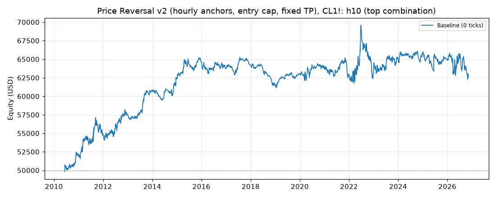

Files: [grid](../../../results/price_reversal_v2/h10/grid.csv), [trades 0 ticks](../../../results/price_reversal_v2/h10/trades_slippage0.csv), [summary](../../../results/price_reversal_v2/h10/summary.json)

### Results after commission

#### Overview

| Metric | Value |
|---|---|
| Net profit | 12,568.38 USD (25.14%) |
| Total closed trades | 1,881 |
| Percent profitable | 35.03% |
| Profit factor | 1.079 |
| Max equity drawdown | 7,586.28 USD (15.17%) |
| Avg trade | 6.68 USD |
| Avg # bars in trades | 28 |

#### Performance

| Metric | All | Long | Short |
|---|---|---|---|
| Net profit | 12,568.38 USD (25.14%) | 9,282.36 USD (18.56%) | 3,286.02 USD (6.57%) |
| Gross profit | 172,210.82 USD (344.42%) | 91,399.28 USD (182.80%) | 80,811.54 USD (161.62%) |
| Gross loss | 159,642.44 USD (319.28%) | 82,116.92 USD (164.23%) | 77,525.52 USD (155.05%) |
| Commission paid | 7,561.62 USD | 3,947.64 USD | 3,613.98 USD |

| Account | Value |
|---|---|
| Initial capital | 50,000.00 USD |
| Buy & hold return (TV-style, all capital at the first entry) | 9,144.56 USD (18.29%) |
| Max equity run-up (intrabar) | 19,886.72 USD (39.77%) |
| Max equity drawdown (intrabar) | 7,586.28 USD (15.17%) |
| Open P&L | -22.01 USD |
| Max contracts held | 1 |

#### Trades analysis

| Metric | All | Long | Short |
|---|---|---|---|
| Total closed trades | 1,881 | 982 | 899 |
| Winning trades | 659 | 336 | 323 |
| Losing trades | 1,222 | 646 | 576 |
| Even trades | 0 | 0 | 0 |
| Percent profitable | 35.03% | 34.22% | 35.93% |
| Avg P&L | 6.68 USD | 9.45 USD | 3.66 USD |
| Avg P&L % | 0.01% | 0.02% | 0.00% |
| Avg winning trade | 261.32 USD | 272.02 USD | 250.19 USD |
| Avg losing trade | 130.64 USD | 127.12 USD | 134.59 USD |
| Ratio avg win / avg loss | 2.000 | 2.140 | 1.859 |
| Largest winning trade | 1,935.98 USD | 1,935.98 USD | 1,135.98 USD |
| Largest winning trade % | 4.70% | 4.70% | 1.50% |
| Largest losing trade | 754.02 USD | 754.02 USD | 574.02 USD |
| Largest losing trade % | 2.19% | 1.05% | 2.19% |
| Avg # bars in trades | 28 | 29 | 27 |
| Avg # bars in winning trades | 41 | 45 | 37 |
| Avg # bars in losing trades | 22 | 21 | 22 |

#### Risk/performance ratios

| Metric | Value |
|---|---|
| Sharpe ratio | -0.037 |
| Sortino ratio | -0.057 |
| Profit factor | 1.079 |
| Margin calls | 0 |

#### List of trades (last 10, newest first; full list in the trades CSV)

| Trade # | Type | Signal | Date/Time (UTC) | Price | Contracts | Profit | Cum. profit | Run-up | Drawdown |
|---|---|---|---|---|---|---|---|---|---|
| 1881 | Exit long | Exit | 2026-11-09 08:35 | 89.39 | 1 | -464.02 USD (-0.52%) | 12,568.38 USD | 70.00 USD | 460.00 USD |
|  | Entry long | Long | 2026-11-09 08:29 | 89.85 | 1 |  |  |  |  |
| 1880 | Exit long | Exit | 2026-11-05 10:17 | 88.73 | 1 | 735.98 USD (0.84%) | 13,032.40 USD | 740.00 USD | 290.00 USD |
|  | Entry long | Long | 2026-11-05 08:13 | 87.99 | 1 |  |  |  |  |
| 1879 | Exit short | Exit | 2026-10-30 07:06 | 102.99 | 1 | -124.02 USD (-0.12%) | 12,296.42 USD | 0.00 USD | 120.00 USD |
|  | Entry short | Short | 2026-10-30 07:06 | 102.87 | 1 |  |  |  |  |
| 1878 | Exit short | Exit | 2026-10-28 07:24 | 101.97 | 1 | -224.02 USD (-0.22%) | 12,420.44 USD | 0.00 USD | 220.00 USD |
|  | Entry short | Short | 2026-10-28 07:11 | 101.75 | 1 |  |  |  |  |
| 1877 | Exit short | Exit | 2026-10-27 07:46 | 102.16 | 1 | -254.02 USD (-0.25%) | 12,644.46 USD | 120.00 USD | 250.00 USD |
|  | Entry short | Short | 2026-10-27 07:11 | 101.91 | 1 |  |  |  |  |
| 1876 | Exit short | Exit | 2026-10-22 07:17 | 99.60 | 1 | -214.02 USD (-0.22%) | 12,898.48 USD | 120.00 USD | 210.00 USD |
|  | Entry short | Short | 2026-10-22 07:09 | 99.39 | 1 |  |  |  |  |
| 1875 | Exit short | Exit | 2026-10-19 08:30 | 97.12 | 1 | -154.02 USD (-0.16%) | 13,112.50 USD | 250.00 USD | 150.00 USD |
|  | Entry short | Short | 2026-10-19 07:27 | 96.97 | 1 |  |  |  |  |
| 1874 | Exit long | Exit | 2026-10-12 07:38 | 90.84 | 1 | -234.02 USD (-0.26%) | 13,266.52 USD | 440.00 USD | 230.00 USD |
|  | Entry long | Long | 2026-10-12 07:08 | 91.07 | 1 |  |  |  |  |
| 1873 | Exit short | Exit | 2026-10-08 07:30 | 91.47 | 1 | -254.02 USD (-0.28%) | 13,500.54 USD | 20.00 USD | 250.00 USD |
|  | Entry short | Short | 2026-10-08 07:17 | 91.22 | 1 |  |  |  |  |
| 1872 | Exit long | Exit | 2026-10-07 07:33 | 89.74 | 1 | -184.02 USD (-0.20%) | 13,754.56 USD | 100.00 USD | 180.00 USD |
|  | Entry long | Long | 2026-10-07 07:16 | 89.92 | 1 |  |  |  |  |

#### By year (extra, not a TV tab)

| Year | Trades | Net profit | % profitable | Profit factor |
|---|---|---|---|---|
| 2010 | 65 | 2,228.70 USD | 40.00% | 1.525 |
| 2011 | 146 | 2,713.08 USD | 37.67% | 1.176 |
| 2012 | 133 | 2,675.34 USD | 38.35% | 1.269 |
| 2013 | 113 | 3,175.74 USD | 41.59% | 1.509 |
| 2014 | 106 | 1,743.88 USD | 35.85% | 1.287 |
| 2015 | 116 | 2,173.68 USD | 37.93% | 1.301 |
| 2016 | 122 | -1,020.44 USD | 31.15% | 0.877 |
| 2017 | 101 | 533.98 USD | 34.65% | 1.106 |
| 2018 | 93 | -2,573.86 USD | 24.73% | 0.604 |
| 2019 | 74 | 1,262.52 USD | 41.89% | 1.319 |
| 2020 | 104 | 831.92 USD | 33.65% | 1.100 |
| 2021 | 119 | -738.38 USD | 33.61% | 0.925 |
| 2022 | 141 | 313.18 USD | 33.33% | 1.013 |
| 2023 | 129 | 1,791.42 USD | 37.98% | 1.158 |
| 2024 | 111 | 723.78 USD | 36.94% | 1.097 |
| 2025 | 110 | -992.20 USD | 27.27% | 0.891 |
| 2026 | 98 | -2,273.96 USD | 29.59% | 0.866 |

#### Exit reasons (extra)

| Reason | Trades |
|---|---|
| stop | 1221 |
| limit | 653 |
| close | 7 |

- Session-end exits: 7.
- Roll exits: 0.

### Best settings by metric

Each winner needs at least 30 closed trades. Undefined values are excluded. Ties: higher net profit, higher profit factor, then grid order. Ruin loss threshold: 25,000.00 USD from starting capital. All selections are in-sample. MAE/MFE objectives use the mean of the per-trade maxima.

| Metric | Goal | Best value | Grid order | Trades | Eligible settings | Parameters |
|---|---|---|---|---|---|---|
| Net profit | max | 12,568.38 USD | [12](../../../results/price_reversal_v2/h10/metric_winners/order_12/trades_slippage0.csv) | 1881 | 64 | window=30, atr_mult=1.5, swing=1, target=rr2 |
| Win rate | max | 59.33% | [9](../../../results/price_reversal_v2/h10/metric_winners/order_9/trades_slippage0.csv) | 1864 | 64 | window=30, atr_mult=1.5, swing=1, target=near |
| Expectancy | max | 6.68 USD | [12](../../../results/price_reversal_v2/h10/metric_winners/order_12/trades_slippage0.csv) | 1881 | 64 | window=30, atr_mult=1.5, swing=1, target=rr2 |
| Profit factor | max | 1.079 | [12](../../../results/price_reversal_v2/h10/metric_winners/order_12/trades_slippage0.csv) | 1881 | 64 | window=30, atr_mult=1.5, swing=1, target=rr2 |
| Payoff ratio | max | 2.023 | [4](../../../results/price_reversal_v2/h10/metric_winners/order_4/trades_slippage0.csv) | 1673 | 64 | window=30, atr_mult=0.5, swing=1, target=rr2 |
| Risk of ruin (estimate) | min | 0.14% | [12](../../../results/price_reversal_v2/h10/metric_winners/order_12/trades_slippage0.csv) | 1881 | 64 | window=30, atr_mult=1.5, swing=1, target=rr2 |
| Maximum drawdown | min | 4,211.42 USD | [1](../../../results/price_reversal_v2/h10/metric_winners/order_1/trades_slippage0.csv) | 1655 | 64 | window=30, atr_mult=0.5, swing=1, target=near |
| Consecutive losses | min | 6.000 | [1](../../../results/price_reversal_v2/h10/metric_winners/order_1/trades_slippage0.csv) | 1655 | 64 | window=30, atr_mult=0.5, swing=1, target=near |
| Sharpe ratio | max | -0.037 | [12](../../../results/price_reversal_v2/h10/metric_winners/order_12/trades_slippage0.csv) | 1881 | 64 | window=30, atr_mult=1.5, swing=1, target=rr2 |
| Sortino ratio | max | -0.057 | [12](../../../results/price_reversal_v2/h10/metric_winners/order_12/trades_slippage0.csv) | 1881 | 64 | window=30, atr_mult=1.5, swing=1, target=rr2 |
| R-multiple | max | No eligible value | — | — | 0 | — |
| Maximum adverse excursion (MAE) | min | 71.33 USD | [9](../../../results/price_reversal_v2/h10/metric_winners/order_9/trades_slippage0.csv) | 1864 | 64 | window=30, atr_mult=1.5, swing=1, target=near |
| Maximum favorable excursion (MFE) | max | 153.26 USD | [64](../../../results/price_reversal_v2/h10/metric_winners/order_64/trades_slippage0.csv) | 4891 | 64 | window=120, atr_mult=2.0, swing=1, target=rr2 |

- **Net profit:** Sum of closed-trade profit after commission; excludes open P&L.
- **Win rate:** Winning closed trades divided by all closed trades, including breakevens.
- **Expectancy:** Mean net profit per closed trade, including losses and breakevens.
- **Profit factor:** Gross winning profit divided by gross losing profit, both after commission. Undefined without losses.
- **Payoff ratio:** Average net winning trade divided by the absolute average net losing trade. Requires wins and losses.
- **Risk of ruin (estimate):** Infinite-horizon diffusion estimate of losing the declared amount from starting capital. Assumes independent, stationary, fixed-size net trade P&L; ignores intratrade losses and margin.
- **Maximum drawdown:** Largest equity drawdown under the tester's intrabar TradingView convention, including an open trade at the end.
- **Consecutive losses:** Longest streak of losing closed trades in execution order. A win or breakeven resets the streak.
- **Sharpe ratio:** Monthly marked-to-market excess return divided by population standard deviation, using 2% annual risk-free rate; not annualized.
- **Sortino ratio:** Monthly marked-to-market excess return divided by downside deviation about the risk-free rate; not annualized.
- **R-multiple:** Mean net trade profit / initial stop risk in dollars. Risk is actual fill to initial stop, before costs. Requires positive initial risk for every closed trade; R standard deviation and mean / standard deviation describe consistency.
- **Maximum adverse excursion (MAE):** Mean of each closed trade's maximum adverse price excursion in dollars, before commission; only the exposed intrabar path counts.
- **Maximum favorable excursion (MFE):** Mean of each closed trade's maximum favorable price excursion in dollars, before commission; only the exposed intrabar path counts. Unrealized opportunity, not realized profit.

Full selection metadata: [metric_winners.json](../../../results/price_reversal_v2/h10/metric_winners.json).

### Top 10 combinations

| # | window | atr_mult | swing | target | Net profit | Trades | % profitable | Profit factor | Max DD |
|---|---|---|---|---|---|---|---|---|---|
| 1 | 30 | 1.5 | 1 | rr2 | 12,568.38 USD | 1,881 | 35.03% | 1.079 | 7,586.28 USD |
| 2 | 30 | 1.0 | 1 | rr2 | 11,549.08 USD | 1,846 | 34.78% | 1.073 | 7,772.16 USD |
| 3 | 30 | 2.0 | 1 | rr2 | 11,090.54 USD | 1,873 | 34.92% | 1.070 | 7,942.26 USD |
| 4 | 30 | 0.5 | 1 | rr2 | 9,414.54 USD | 1,673 | 34.49% | 1.065 | 6,647.18 USD |
| 5 | 30 | 1.5 | 1 | rr1 | 2,142.40 USD | 1,880 | 51.33% | 1.018 | 5,775.22 USD |
| 6 | 90 | 1.0 | 1 | rr2 | 2,042.50 USD | 4,375 | 33.62% | 1.005 | 10,923.80 USD |
| 7 | 30 | 2.0 | 1 | rr1 | 1,826.62 USD | 1,869 | 51.26% | 1.015 | 5,775.22 USD |
| 8 | 60 | 1.0 | 1 | rr2 | 1,498.54 USD | 3,473 | 33.63% | 1.005 | 9,280.24 USD |
| 9 | 60 | 1.5 | 1 | rr2 | 611.76 USD | 3,512 | 33.71% | 1.002 | 9,368.28 USD |
| 10 | 30 | 1.0 | 1 | rr1 | 565.06 USD | 1,847 | 50.89% | 1.005 | 6,137.18 USD |

Profitable combinations: 10 of 64.

## Variant: h11

**Top combination:** `anchor=h11`, `window=30`, `atr_mult=0.5`, `swing=1`, `target=rr2`

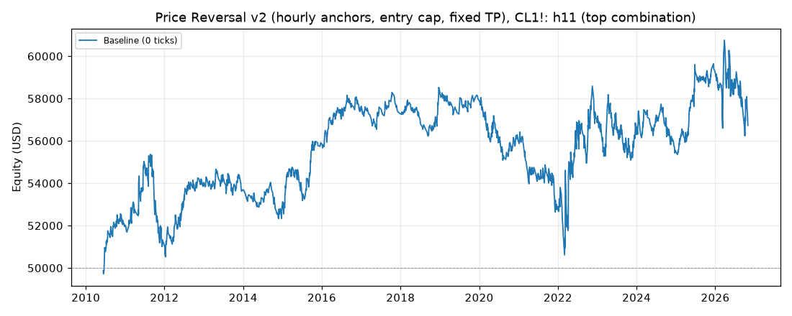

Files: [grid](../../../results/price_reversal_v2/h11/grid.csv), [trades 0 ticks](../../../results/price_reversal_v2/h11/trades_slippage0.csv), [summary](../../../results/price_reversal_v2/h11/summary.json)

### Results after commission

#### Overview

| Metric | Value |
|---|---|
| Net profit | 6,729.62 USD (13.46%) |
| Total closed trades | 1,719 |
| Percent profitable | 33.97% |
| Profit factor | 1.043 |
| Max equity drawdown | 8,178.26 USD (16.36%) |
| Avg trade | 3.91 USD |
| Avg # bars in trades | 30 |

#### Performance

| Metric | All | Long | Short |
|---|---|---|---|
| Net profit | 6,729.62 USD (13.46%) | 7,006.02 USD (14.01%) | -276.40 USD (-0.55%) |
| Gross profit | 163,852.32 USD (327.70%) | 90,187.82 USD (180.38%) | 73,664.50 USD (147.33%) |
| Gross loss | 157,122.70 USD (314.25%) | 83,181.80 USD (166.36%) | 73,940.90 USD (147.88%) |
| Commission paid | 6,910.38 USD | 3,613.98 USD | 3,296.40 USD |

| Account | Value |
|---|---|
| Initial capital | 50,000.00 USD |
| Buy & hold return (TV-style, all capital at the first entry) | 6,862.48 USD (13.72%) |
| Max equity run-up (intrabar) | 11,245.04 USD (22.49%) |
| Max equity drawdown (intrabar) | 8,178.26 USD (16.36%) |
| Open P&L | 0.00 USD |
| Max contracts held | 1 |

#### Trades analysis

| Metric | All | Long | Short |
|---|---|---|---|
| Total closed trades | 1,719 | 899 | 820 |
| Winning trades | 584 | 309 | 275 |
| Losing trades | 1,135 | 590 | 545 |
| Even trades | 0 | 0 | 0 |
| Percent profitable | 33.97% | 34.37% | 33.54% |
| Avg P&L | 3.91 USD | 7.79 USD | -0.34 USD |
| Avg P&L % | 0.01% | 0.02% | -0.00% |
| Avg winning trade | 280.57 USD | 291.87 USD | 267.87 USD |
| Avg losing trade | 138.43 USD | 140.99 USD | 135.67 USD |
| Ratio avg win / avg loss | 2.027 | 2.070 | 1.974 |
| Largest winning trade | 2,715.98 USD | 2,715.98 USD | 1,795.98 USD |
| Largest winning trade % | 3.83% | 3.83% | 1.92% |
| Largest losing trade | 844.02 USD | 844.02 USD | 654.02 USD |
| Largest losing trade % | 1.69% | 1.69% | 1.20% |
| Avg # bars in trades | 30 | 32 | 28 |
| Avg # bars in winning trades | 43 | 47 | 39 |
| Avg # bars in losing trades | 23 | 24 | 23 |

#### Risk/performance ratios

| Metric | Value |
|---|---|
| Sharpe ratio | -0.084 |
| Sortino ratio | -0.119 |
| Profit factor | 1.043 |
| Margin calls | 0 |

#### List of trades (last 10, newest first; full list in the trades CSV)

| Trade # | Type | Signal | Date/Time (UTC) | Price | Contracts | Profit | Cum. profit | Run-up | Drawdown |
|---|---|---|---|---|---|---|---|---|---|
| 1719 | Exit long | Exit | 2026-10-30 09:06 | 103.42 | 1 | -304.02 USD (-0.29%) | 6,729.62 USD | 250.00 USD | 300.00 USD |
|  | Entry long | Long | 2026-10-30 08:30 | 103.72 | 1 |  |  |  |  |
| 1718 | Exit long | Exit | 2026-10-28 08:28 | 101.20 | 1 | -244.02 USD (-0.24%) | 7,033.64 USD | 30.00 USD | 240.00 USD |
|  | Entry long | Long | 2026-10-28 08:22 | 101.44 | 1 |  |  |  |  |
| 1717 | Exit long | Exit | 2026-10-26 08:15 | 101.10 | 1 | -154.02 USD (-0.15%) | 7,277.66 USD | 0.00 USD | 150.00 USD |
|  | Entry long | Long | 2026-10-26 08:14 | 101.25 | 1 |  |  |  |  |
| 1716 | Exit long | Exit | 2026-10-23 08:32 | 100.26 | 1 | -274.02 USD (-0.27%) | 7,431.68 USD | 210.00 USD | 270.00 USD |
|  | Entry long | Long | 2026-10-23 08:29 | 100.53 | 1 |  |  |  |  |
| 1715 | Exit short | Exit | 2026-10-21 08:34 | 98.84 | 1 | -384.02 USD (-0.39%) | 7,705.70 USD | 10.00 USD | 380.00 USD |
|  | Entry short | Short | 2026-10-21 08:27 | 98.46 | 1 |  |  |  |  |
| 1714 | Exit long | Exit | 2026-10-19 08:30 | 97.11 | 1 | 255.98 USD (0.26%) | 8,089.72 USD | 260.00 USD | 10.00 USD |
|  | Entry long | Long | 2026-10-19 08:15 | 96.85 | 1 |  |  |  |  |
| 1713 | Exit long | Exit | 2026-10-14 08:44 | 94.49 | 1 | 315.98 USD (0.34%) | 7,833.74 USD | 320.00 USD | 50.00 USD |
|  | Entry long | Long | 2026-10-14 08:17 | 94.17 | 1 |  |  |  |  |
| 1712 | Exit short | Exit | 2026-10-12 08:44 | 91.81 | 1 | -434.02 USD (-0.47%) | 7,517.76 USD | 120.00 USD | 430.00 USD |
|  | Entry short | Short | 2026-10-12 08:21 | 91.38 | 1 |  |  |  |  |
| 1711 | Exit long | Exit | 2026-10-09 09:43 | 90.85 | 1 | 555.98 USD (0.62%) | 7,951.78 USD | 560.00 USD | 180.00 USD |
|  | Entry long | Long | 2026-10-09 08:27 | 90.29 | 1 |  |  |  |  |
| 1710 | Exit long | Exit | 2026-10-08 08:51 | 91.93 | 1 | 455.98 USD (0.50%) | 7,395.80 USD | 460.00 USD | 120.00 USD |
|  | Entry long | Long | 2026-10-08 08:10 | 91.47 | 1 |  |  |  |  |

#### By year (extra, not a TV tab)

| Year | Trades | Net profit | % profitable | Profit factor |
|---|---|---|---|---|
| 2010 | 60 | 2,028.80 USD | 40.00% | 1.535 |
| 2011 | 119 | -798.38 USD | 31.93% | 0.943 |
| 2012 | 112 | 2,799.76 USD | 35.71% | 1.380 |
| 2013 | 112 | -330.24 USD | 32.14% | 0.955 |
| 2014 | 81 | -715.62 USD | 32.10% | 0.870 |
| 2015 | 107 | 2,869.86 USD | 38.32% | 1.396 |
| 2016 | 99 | 1,782.02 USD | 40.40% | 1.310 |
| 2017 | 88 | -323.76 USD | 28.41% | 0.928 |
| 2018 | 88 | 986.24 USD | 34.09% | 1.188 |
| 2019 | 70 | -301.40 USD | 31.43% | 0.935 |
| 2020 | 110 | -2,002.20 USD | 30.91% | 0.796 |
| 2021 | 109 | -3,248.18 USD | 27.52% | 0.718 |
| 2022 | 125 | 4,117.50 USD | 33.60% | 1.196 |
| 2023 | 142 | -560.84 USD | 33.80% | 0.963 |
| 2024 | 103 | -774.06 USD | 33.01% | 0.915 |
| 2025 | 97 | 3,670.06 USD | 44.33% | 1.569 |
| 2026 | 97 | -2,469.94 USD | 31.96% | 0.869 |

#### Exit reasons (extra)

| Reason | Trades |
|---|---|
| stop | 1133 |
| limit | 576 |
| close | 10 |

- Session-end exits: 10.
- Roll exits: 0.

### Best settings by metric

Each winner needs at least 30 closed trades. Undefined values are excluded. Ties: higher net profit, higher profit factor, then grid order. Ruin loss threshold: 25,000.00 USD from starting capital. All selections are in-sample. MAE/MFE objectives use the mean of the per-trade maxima.

| Metric | Goal | Best value | Grid order | Trades | Eligible settings | Parameters |
|---|---|---|---|---|---|---|
| Net profit | max | 6,729.62 USD | [4](../../../results/price_reversal_v2/h11/metric_winners/order_4/trades_slippage0.csv) | 1719 | 64 | window=30, atr_mult=0.5, swing=1, target=rr2 |
| Win rate | max | 59.46% | [5](../../../results/price_reversal_v2/h11/metric_winners/order_5/trades_slippage0.csv) | 1818 | 64 | window=30, atr_mult=1.0, swing=1, target=near |
| Expectancy | max | 3.91 USD | [4](../../../results/price_reversal_v2/h11/metric_winners/order_4/trades_slippage0.csv) | 1719 | 64 | window=30, atr_mult=0.5, swing=1, target=rr2 |
| Profit factor | max | 1.043 | [4](../../../results/price_reversal_v2/h11/metric_winners/order_4/trades_slippage0.csv) | 1719 | 64 | window=30, atr_mult=0.5, swing=1, target=rr2 |
| Payoff ratio | max | 2.027 | [4](../../../results/price_reversal_v2/h11/metric_winners/order_4/trades_slippage0.csv) | 1719 | 64 | window=30, atr_mult=0.5, swing=1, target=rr2 |
| Risk of ruin (estimate) | min | 4.19% | [4](../../../results/price_reversal_v2/h11/metric_winners/order_4/trades_slippage0.csv) | 1719 | 64 | window=30, atr_mult=0.5, swing=1, target=rr2 |
| Maximum drawdown | min | 8,178.26 USD | [4](../../../results/price_reversal_v2/h11/metric_winners/order_4/trades_slippage0.csv) | 1719 | 64 | window=30, atr_mult=0.5, swing=1, target=rr2 |
| Consecutive losses | min | 7.000 | [5](../../../results/price_reversal_v2/h11/metric_winners/order_5/trades_slippage0.csv) | 1818 | 64 | window=30, atr_mult=1.0, swing=1, target=near |
| Sharpe ratio | max | -0.041 | [52](../../../results/price_reversal_v2/h11/metric_winners/order_52/trades_slippage0.csv) | 4660 | 64 | window=120, atr_mult=0.5, swing=1, target=rr2 |
| Sortino ratio | max | -0.062 | [52](../../../results/price_reversal_v2/h11/metric_winners/order_52/trades_slippage0.csv) | 4660 | 64 | window=120, atr_mult=0.5, swing=1, target=rr2 |
| R-multiple | max | No eligible value | — | — | 0 | — |
| Maximum adverse excursion (MAE) | min | 76.97 USD | [1](../../../results/price_reversal_v2/h11/metric_winners/order_1/trades_slippage0.csv) | 1701 | 64 | window=30, atr_mult=0.5, swing=1, target=near |
| Maximum favorable excursion (MFE) | max | 160.77 USD | [48](../../../results/price_reversal_v2/h11/metric_winners/order_48/trades_slippage0.csv) | 4264 | 64 | window=90, atr_mult=2.0, swing=1, target=rr2 |

- **Net profit:** Sum of closed-trade profit after commission; excludes open P&L.
- **Win rate:** Winning closed trades divided by all closed trades, including breakevens.
- **Expectancy:** Mean net profit per closed trade, including losses and breakevens.
- **Profit factor:** Gross winning profit divided by gross losing profit, both after commission. Undefined without losses.
- **Payoff ratio:** Average net winning trade divided by the absolute average net losing trade. Requires wins and losses.
- **Risk of ruin (estimate):** Infinite-horizon diffusion estimate of losing the declared amount from starting capital. Assumes independent, stationary, fixed-size net trade P&L; ignores intratrade losses and margin.
- **Maximum drawdown:** Largest equity drawdown under the tester's intrabar TradingView convention, including an open trade at the end.
- **Consecutive losses:** Longest streak of losing closed trades in execution order. A win or breakeven resets the streak.
- **Sharpe ratio:** Monthly marked-to-market excess return divided by population standard deviation, using 2% annual risk-free rate; not annualized.
- **Sortino ratio:** Monthly marked-to-market excess return divided by downside deviation about the risk-free rate; not annualized.
- **R-multiple:** Mean net trade profit / initial stop risk in dollars. Risk is actual fill to initial stop, before costs. Requires positive initial risk for every closed trade; R standard deviation and mean / standard deviation describe consistency.
- **Maximum adverse excursion (MAE):** Mean of each closed trade's maximum adverse price excursion in dollars, before commission; only the exposed intrabar path counts.
- **Maximum favorable excursion (MFE):** Mean of each closed trade's maximum favorable price excursion in dollars, before commission; only the exposed intrabar path counts. Unrealized opportunity, not realized profit.

Full selection metadata: [metric_winners.json](../../../results/price_reversal_v2/h11/metric_winners.json).

### Top 10 combinations

| # | window | atr_mult | swing | target | Net profit | Trades | % profitable | Profit factor | Max DD |
|---|---|---|---|---|---|---|---|---|---|
| 1 | 30 | 0.5 | 1 | rr2 | 6,729.62 USD | 1,719 | 33.97% | 1.043 | 8,178.26 USD |
| 2 | 30 | 1.0 | 1 | rr2 | 2,995.26 USD | 1,837 | 33.91% | 1.018 | 8,380.72 USD |
| 3 | 30 | 1.5 | 1 | rr2 | 1,255.26 USD | 1,837 | 33.64% | 1.007 | 9,265.12 USD |
| 4 | 30 | 2.0 | 1 | rr2 | 1,200.68 USD | 1,766 | 33.52% | 1.007 | 9,632.72 USD |
| 5 | 90 | 0.5 | 1 | rr2 | 451.02 USD | 4,149 | 33.36% | 1.001 | 27,927.68 USD |
| 6 | 120 | 0.5 | 1 | rr2 | -303.20 USD | 4,660 | 33.58% | 0.999 | 28,316.88 USD |
| 7 | 60 | 0.5 | 1 | rr2 | -826.00 USD | 3,300 | 33.21% | 0.997 | 21,382.64 USD |
| 8 | 30 | 1.0 | 1 | rr1 | -3,848.56 USD | 1,828 | 48.96% | 0.970 | 9,376.66 USD |
| 9 | 30 | 0.5 | 1 | rr1 | -4,584.20 USD | 1,710 | 48.83% | 0.962 | 8,571.34 USD |
| 10 | 30 | 2.0 | 1 | rr1 | -4,649.12 USD | 1,756 | 48.69% | 0.963 | 9,295.46 USD |

Profitable combinations: 5 of 64.

## Variant: h12

**Top combination:** `anchor=h12`, `window=30`, `atr_mult=1.0`, `swing=1`, `target=near`

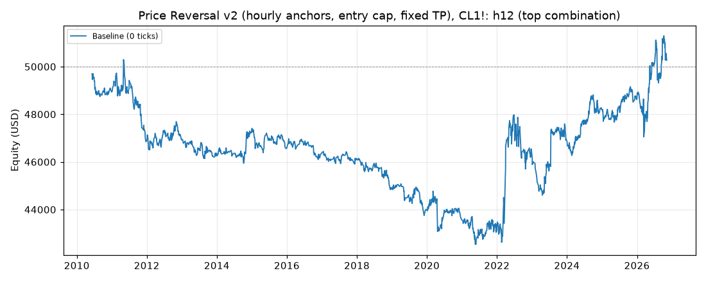

Files: [grid](../../../results/price_reversal_v2/h12/grid.csv), [trades 0 ticks](../../../results/price_reversal_v2/h12/trades_slippage0.csv), [summary](../../../results/price_reversal_v2/h12/summary.json)

### Results after commission

#### Overview

| Metric | Value |
|---|---|
| Net profit | 263.34 USD (0.53%) |
| Total closed trades | 1,733 |
| Percent profitable | 60.65% |
| Profit factor | 1.003 |
| Max equity drawdown | 7,765.48 USD (15.53%) |
| Avg trade | 0.15 USD |
| Avg # bars in trades | 12 |

#### Performance

| Metric | All | Long | Short |
|---|---|---|---|
| Net profit | 263.34 USD (0.53%) | 3,470.24 USD (6.94%) | -3,206.90 USD (-6.41%) |
| Gross profit | 85,044.98 USD (170.09%) | 45,206.64 USD (90.41%) | 39,838.34 USD (79.68%) |
| Gross loss | 84,781.64 USD (169.56%) | 41,736.40 USD (83.47%) | 43,045.24 USD (86.09%) |
| Commission paid | 6,966.66 USD | 3,569.76 USD | 3,396.90 USD |

| Account | Value |
|---|---|
| Initial capital | 50,000.00 USD |
| Buy & hold return (TV-style, all capital at the first entry) | 9,733.52 USD (19.47%) |
| Max equity run-up (intrabar) | 8,848.96 USD (17.70%) |
| Max equity drawdown (intrabar) | 7,765.48 USD (15.53%) |
| Open P&L | 0.00 USD |
| Max contracts held | 1 |

#### Trades analysis

| Metric | All | Long | Short |
|---|---|---|---|
| Total closed trades | 1,733 | 888 | 845 |
| Winning trades | 1,051 | 568 | 483 |
| Losing trades | 682 | 320 | 362 |
| Even trades | 0 | 0 | 0 |
| Percent profitable | 60.65% | 63.96% | 57.16% |
| Avg P&L | 0.15 USD | 3.91 USD | -3.80 USD |
| Avg P&L % | -0.00% | -0.00% | -0.01% |
| Avg winning trade | 80.92 USD | 79.59 USD | 82.48 USD |
| Avg losing trade | 124.31 USD | 130.43 USD | 118.91 USD |
| Ratio avg win / avg loss | 0.651 | 0.610 | 0.694 |
| Largest winning trade | 1,495.98 USD | 1,165.98 USD | 1,495.98 USD |
| Largest winning trade % | 1.98% | 1.10% | 1.98% |
| Largest losing trade | 1,374.02 USD | 1,374.02 USD | 634.02 USD |
| Largest losing trade % | 7.91% | 7.91% | 0.83% |
| Avg # bars in trades | 12 | 13 | 12 |
| Avg # bars in winning trades | 11 | 11 | 10 |
| Avg # bars in losing trades | 15 | 17 | 14 |

#### Risk/performance ratios

| Metric | Value |
|---|---|
| Sharpe ratio | -0.174 |
| Sortino ratio | -0.261 |
| Profit factor | 1.003 |
| Margin calls | 0 |

#### List of trades (last 10, newest first; full list in the trades CSV)

| Trade # | Type | Signal | Date/Time (UTC) | Price | Contracts | Profit | Cum. profit | Run-up | Drawdown |
|---|---|---|---|---|---|---|---|---|---|
| 1733 | Exit short | Exit | 2026-11-06 10:15 | 89.91 | 1 | -294.02 USD (-0.33%) | 263.34 USD | 0.00 USD | 290.00 USD |
|  | Entry short | Short | 2026-11-06 10:14 | 89.62 | 1 |  |  |  |  |
| 1732 | Exit long | Exit | 2026-10-30 09:23 | 103.61 | 1 | 65.98 USD (0.06%) | 557.36 USD | 70.00 USD | 120.00 USD |
|  | Entry long | Long | 2026-10-30 09:14 | 103.54 | 1 |  |  |  |  |
| 1731 | Exit long | Exit | 2026-10-27 09:25 | 102.30 | 1 | 105.98 USD (0.10%) | 491.38 USD | 110.00 USD | 0.00 USD |
|  | Entry long | Long | 2026-10-27 09:25 | 102.19 | 1 |  |  |  |  |
| 1730 | Exit long | Exit | 2026-10-26 09:32 | 100.95 | 1 | 105.98 USD (0.11%) | 385.40 USD | 110.00 USD | 0.00 USD |
|  | Entry long | Long | 2026-10-26 09:30 | 100.84 | 1 |  |  |  |  |
| 1729 | Exit short | Exit | 2026-10-23 09:34 | 101.19 | 1 | -254.02 USD (-0.25%) | 279.42 USD | 210.00 USD | 250.00 USD |
|  | Entry short | Short | 2026-10-23 09:28 | 100.94 | 1 |  |  |  |  |
| 1728 | Exit long | Exit | 2026-10-22 11:09 | 98.96 | 1 | -274.02 USD (-0.28%) | 533.44 USD | 580.00 USD | 270.00 USD |
|  | Entry long | Long | 2026-10-22 09:20 | 99.23 | 1 |  |  |  |  |
| 1727 | Exit long | Exit | 2026-10-21 09:11 | 99.08 | 1 | -164.02 USD (-0.17%) | 807.46 USD | 10.00 USD | 160.00 USD |
|  | Entry long | Long | 2026-10-21 09:11 | 99.24 | 1 |  |  |  |  |
| 1726 | Exit short | Exit | 2026-10-20 09:19 | 100.37 | 1 | 175.98 USD (0.18%) | 971.48 USD | 180.00 USD | 40.00 USD |
|  | Entry short | Short | 2026-10-20 09:07 | 100.55 | 1 |  |  |  |  |
| 1725 | Exit short | Exit | 2026-10-19 09:27 | 98.14 | 1 | -224.02 USD (-0.23%) | 795.50 USD | 90.00 USD | 220.00 USD |
|  | Entry short | Short | 2026-10-19 09:16 | 97.92 | 1 |  |  |  |  |
| 1724 | Exit short | Exit | 2026-10-16 09:13 | 97.02 | 1 | 15.98 USD (0.02%) | 1,019.52 USD | 20.00 USD | 20.00 USD |
|  | Entry short | Short | 2026-10-16 09:12 | 97.04 | 1 |  |  |  |  |

#### By year (extra, not a TV tab)

| Year | Trades | Net profit | % profitable | Profit factor |
|---|---|---|---|---|
| 2010 | 60 | -1,061.20 USD | 56.67% | 0.636 |
| 2011 | 115 | -2,092.30 USD | 56.52% | 0.744 |
| 2012 | 115 | 77.70 USD | 62.61% | 1.018 |
| 2013 | 97 | -579.94 USD | 59.79% | 0.846 |
| 2014 | 97 | 1,030.06 USD | 63.92% | 1.348 |
| 2015 | 95 | -791.90 USD | 61.05% | 0.776 |
| 2016 | 78 | -223.56 USD | 61.54% | 0.911 |
| 2017 | 80 | -211.60 USD | 58.75% | 0.909 |
| 2018 | 87 | -1,299.74 USD | 52.87% | 0.664 |
| 2019 | 96 | -835.92 USD | 60.42% | 0.776 |
| 2020 | 106 | -446.12 USD | 64.15% | 0.913 |
| 2021 | 122 | -260.44 USD | 60.66% | 0.954 |
| 2022 | 134 | 3,061.32 USD | 61.19% | 1.273 |
| 2023 | 104 | 591.92 USD | 50.96% | 1.096 |
| 2024 | 118 | 1,225.64 USD | 68.64% | 1.262 |
| 2025 | 112 | 499.76 USD | 63.39% | 1.117 |
| 2026 | 117 | 1,579.66 USD | 63.25% | 1.164 |

#### Exit reasons (extra)

| Reason | Trades |
|---|---|
| limit | 1051 |
| stop | 681 |
| close | 1 |

- Session-end exits: 1.
- Roll exits: 0.

### Best settings by metric

Each winner needs at least 30 closed trades. Undefined values are excluded. Ties: higher net profit, higher profit factor, then grid order. Ruin loss threshold: 25,000.00 USD from starting capital. All selections are in-sample. MAE/MFE objectives use the mean of the per-trade maxima.

| Metric | Goal | Best value | Grid order | Trades | Eligible settings | Parameters |
|---|---|---|---|---|---|---|
| Net profit | max | 263.34 USD | [5](../../../results/price_reversal_v2/h12/metric_winners/order_5/trades_slippage0.csv) | 1733 | 64 | window=30, atr_mult=1.0, swing=1, target=near |
| Win rate | max | 60.65% | [5](../../../results/price_reversal_v2/h12/metric_winners/order_5/trades_slippage0.csv) | 1733 | 64 | window=30, atr_mult=1.0, swing=1, target=near |
| Expectancy | max | 0.15 USD | [5](../../../results/price_reversal_v2/h12/metric_winners/order_5/trades_slippage0.csv) | 1733 | 64 | window=30, atr_mult=1.0, swing=1, target=near |
| Profit factor | max | 1.003 | [5](../../../results/price_reversal_v2/h12/metric_winners/order_5/trades_slippage0.csv) | 1733 | 64 | window=30, atr_mult=1.0, swing=1, target=near |
| Payoff ratio | max | 2.038 | [4](../../../results/price_reversal_v2/h12/metric_winners/order_4/trades_slippage0.csv) | 1673 | 64 | window=30, atr_mult=0.5, swing=1, target=rr2 |
| Risk of ruin (estimate) | min | 70.41% | [5](../../../results/price_reversal_v2/h12/metric_winners/order_5/trades_slippage0.csv) | 1733 | 64 | window=30, atr_mult=1.0, swing=1, target=near |
| Maximum drawdown | min | 7,222.66 USD | [11](../../../results/price_reversal_v2/h12/metric_winners/order_11/trades_slippage0.csv) | 1730 | 64 | window=30, atr_mult=1.5, swing=1, target=rr1 |
| Consecutive losses | min | 9.000 | [5](../../../results/price_reversal_v2/h12/metric_winners/order_5/trades_slippage0.csv) | 1733 | 64 | window=30, atr_mult=1.0, swing=1, target=near |
| Sharpe ratio | max | -0.083 | [52](../../../results/price_reversal_v2/h12/metric_winners/order_52/trades_slippage0.csv) | 4578 | 64 | window=120, atr_mult=0.5, swing=1, target=rr2 |
| Sortino ratio | max | -0.125 | [52](../../../results/price_reversal_v2/h12/metric_winners/order_52/trades_slippage0.csv) | 4578 | 64 | window=120, atr_mult=0.5, swing=1, target=rr2 |
| R-multiple | max | No eligible value | — | — | 0 | — |
| Maximum adverse excursion (MAE) | min | 70.54 USD | [5](../../../results/price_reversal_v2/h12/metric_winners/order_5/trades_slippage0.csv) | 1733 | 64 | window=30, atr_mult=1.0, swing=1, target=near |
| Maximum favorable excursion (MFE) | max | 151.44 USD | [64](../../../results/price_reversal_v2/h12/metric_winners/order_64/trades_slippage0.csv) | 4663 | 64 | window=120, atr_mult=2.0, swing=1, target=rr2 |

- **Net profit:** Sum of closed-trade profit after commission; excludes open P&L.
- **Win rate:** Winning closed trades divided by all closed trades, including breakevens.
- **Expectancy:** Mean net profit per closed trade, including losses and breakevens.
- **Profit factor:** Gross winning profit divided by gross losing profit, both after commission. Undefined without losses.
- **Payoff ratio:** Average net winning trade divided by the absolute average net losing trade. Requires wins and losses.
- **Risk of ruin (estimate):** Infinite-horizon diffusion estimate of losing the declared amount from starting capital. Assumes independent, stationary, fixed-size net trade P&L; ignores intratrade losses and margin.
- **Maximum drawdown:** Largest equity drawdown under the tester's intrabar TradingView convention, including an open trade at the end.
- **Consecutive losses:** Longest streak of losing closed trades in execution order. A win or breakeven resets the streak.
- **Sharpe ratio:** Monthly marked-to-market excess return divided by population standard deviation, using 2% annual risk-free rate; not annualized.
- **Sortino ratio:** Monthly marked-to-market excess return divided by downside deviation about the risk-free rate; not annualized.
- **R-multiple:** Mean net trade profit / initial stop risk in dollars. Risk is actual fill to initial stop, before costs. Requires positive initial risk for every closed trade; R standard deviation and mean / standard deviation describe consistency.
- **Maximum adverse excursion (MAE):** Mean of each closed trade's maximum adverse price excursion in dollars, before commission; only the exposed intrabar path counts.
- **Maximum favorable excursion (MFE):** Mean of each closed trade's maximum favorable price excursion in dollars, before commission; only the exposed intrabar path counts. Unrealized opportunity, not realized profit.

Full selection metadata: [metric_winners.json](../../../results/price_reversal_v2/h12/metric_winners.json).

### Top 10 combinations

| # | window | atr_mult | swing | target | Net profit | Trades | % profitable | Profit factor | Max DD |
|---|---|---|---|---|---|---|---|---|---|
| 1 | 30 | 1.0 | 1 | near | 263.34 USD | 1,733 | 60.65% | 1.003 | 7,765.48 USD |
| 2 | 30 | 0.5 | 1 | near | 14.84 USD | 1,658 | 60.19% | 1.000 | 8,136.48 USD |
| 3 | 30 | 1.5 | 1 | near | -86.46 USD | 1,723 | 60.30% | 0.999 | 7,753.42 USD |
| 4 | 30 | 1.0 | 1 | rr1 | -324.80 USD | 1,740 | 49.31% | 0.997 | 7,531.10 USD |
| 5 | 30 | 1.5 | 1 | rr1 | -434.60 USD | 1,730 | 49.19% | 0.996 | 7,222.66 USD |
| 6 | 30 | 2.0 | 1 | rr1 | -567.02 USD | 1,651 | 49.00% | 0.995 | 7,766.68 USD |
| 7 | 30 | 2.0 | 1 | near | -568.88 USD | 1,644 | 59.25% | 0.993 | 7,972.40 USD |
| 8 | 90 | 0.5 | 1 | rr1 | -2,067.32 USD | 4,166 | 49.14% | 0.993 | 20,642.80 USD |
| 9 | 30 | 1.0 | 1 | far | -2,290.88 USD | 1,744 | 53.61% | 0.977 | 10,011.54 USD |
| 10 | 30 | 1.5 | 1 | far | -2,370.68 USD | 1,734 | 53.46% | 0.977 | 9,895.46 USD |

Profitable combinations: 2 of 64.

## Variant: h13

**Top combination:** `anchor=h13`, `window=30`, `atr_mult=1.0`, `swing=1`, `target=far`

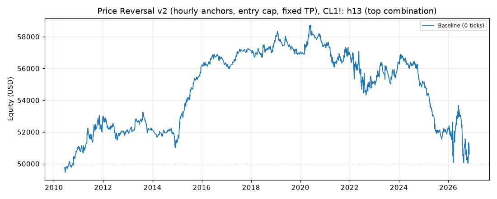

Files: [grid](../../../results/price_reversal_v2/h13/grid.csv), [trades 0 ticks](../../../results/price_reversal_v2/h13/trades_slippage0.csv), [summary](../../../results/price_reversal_v2/h13/summary.json)

### Results after commission

#### Overview

| Metric | Value |
|---|---|
| Net profit | 612.88 USD (1.23%) |
| Total closed trades | 1,656 |
| Percent profitable | 55.92% |
| Profit factor | 1.007 |
| Max equity drawdown | 8,856.16 USD (17.71%) |
| Avg trade | 0.37 USD |
| Avg # bars in trades | 14 |

#### Performance

| Metric | All | Long | Short |
|---|---|---|---|
| Net profit | 612.88 USD (1.23%) | -1,461.22 USD (-2.92%) | 2,074.10 USD (4.15%) |
| Gross profit | 89,717.48 USD (179.43%) | 45,324.32 USD (90.65%) | 44,393.16 USD (88.79%) |
| Gross loss | 89,104.60 USD (178.21%) | 46,785.54 USD (93.57%) | 42,319.06 USD (84.64%) |
| Commission paid | 6,657.12 USD | 3,461.22 USD | 3,195.90 USD |

| Account | Value |
|---|---|
| Initial capital | 50,000.00 USD |
| Buy & hold return (TV-style, all capital at the first entry) | 6,900.47 USD (13.80%) |
| Max equity run-up (intrabar) | 9,355.32 USD (18.71%) |
| Max equity drawdown (intrabar) | 8,856.16 USD (17.71%) |
| Open P&L | 0.00 USD |
| Max contracts held | 1 |

#### Trades analysis

| Metric | All | Long | Short |
|---|---|---|---|
| Total closed trades | 1,656 | 861 | 795 |
| Winning trades | 926 | 484 | 442 |
| Losing trades | 730 | 377 | 353 |
| Even trades | 0 | 0 | 0 |
| Percent profitable | 55.92% | 56.21% | 55.60% |
| Avg P&L | 0.37 USD | -1.70 USD | 2.61 USD |
| Avg P&L % | 0.01% | 0.00% | 0.01% |
| Avg winning trade | 96.89 USD | 93.65 USD | 100.44 USD |
| Avg losing trade | 122.06 USD | 124.10 USD | 119.88 USD |
| Ratio avg win / avg loss | 0.794 | 0.755 | 0.838 |
| Largest winning trade | 785.98 USD | 655.98 USD | 785.98 USD |
| Largest winning trade % | 2.71% | 2.71% | 1.59% |
| Largest losing trade | 1,334.02 USD | 704.02 USD | 1,334.02 USD |
| Largest losing trade % | 1.51% | 1.26% | 1.51% |
| Avg # bars in trades | 14 | 14 | 14 |
| Avg # bars in winning trades | 14 | 14 | 14 |
| Avg # bars in losing trades | 14 | 14 | 14 |

#### Risk/performance ratios

| Metric | Value |
|---|---|
| Sharpe ratio | -0.215 |
| Sortino ratio | -0.252 |
| Profit factor | 1.007 |
| Margin calls | 0 |

#### List of trades (last 10, newest first; full list in the trades CSV)

| Trade # | Type | Signal | Date/Time (UTC) | Price | Contracts | Profit | Cum. profit | Run-up | Drawdown |
|---|---|---|---|---|---|---|---|---|---|
| 1656 | Exit long | Exit | 2026-11-09 12:49 | 87.54 | 1 | -614.02 USD (-0.70%) | 612.88 USD | 500.00 USD | 610.00 USD |
|  | Entry long | Long | 2026-11-09 11:23 | 88.15 | 1 |  |  |  |  |
| 1655 | Exit short | Exit | 2026-11-04 11:36 | 95.17 | 1 | 225.98 USD (0.24%) | 1,226.90 USD | 230.00 USD | 150.00 USD |
|  | Entry short | Short | 2026-11-04 11:15 | 95.40 | 1 |  |  |  |  |
| 1654 | Exit short | Exit | 2026-11-03 11:36 | 98.53 | 1 | -174.02 USD (-0.18%) | 1,000.92 USD | 20.00 USD | 170.00 USD |
|  | Entry short | Short | 2026-11-03 11:27 | 98.36 | 1 |  |  |  |  |
| 1653 | Exit long | Exit | 2026-11-02 11:39 | 99.26 | 1 | -154.02 USD (-0.15%) | 1,174.94 USD | 70.00 USD | 150.00 USD |
|  | Entry long | Long | 2026-11-02 11:22 | 99.41 | 1 |  |  |  |  |
| 1652 | Exit short | Exit | 2026-10-30 10:38 | 103.95 | 1 | 205.98 USD (0.20%) | 1,328.96 USD | 210.00 USD | 130.00 USD |
|  | Entry short | Short | 2026-10-30 10:26 | 104.16 | 1 |  |  |  |  |
| 1651 | Exit short | Exit | 2026-10-28 10:31 | 101.15 | 1 | 375.98 USD (0.37%) | 1,122.98 USD | 380.00 USD | 60.00 USD |
|  | Entry short | Short | 2026-10-28 10:25 | 101.53 | 1 |  |  |  |  |
| 1650 | Exit short | Exit | 2026-10-27 10:38 | 101.84 | 1 | 375.98 USD (0.37%) | 747.00 USD | 380.00 USD | 310.00 USD |
|  | Entry short | Short | 2026-10-27 10:23 | 102.22 | 1 |  |  |  |  |
| 1649 | Exit short | Exit | 2026-10-26 10:16 | 101.20 | 1 | 155.98 USD (0.15%) | 371.02 USD | 160.00 USD | 100.00 USD |
|  | Entry short | Short | 2026-10-26 10:06 | 101.36 | 1 |  |  |  |  |
| 1648 | Exit long | Exit | 2026-10-23 10:49 | 100.91 | 1 | -254.02 USD (-0.25%) | 215.04 USD | 0.00 USD | 250.00 USD |
|  | Entry long | Long | 2026-10-23 10:18 | 101.16 | 1 |  |  |  |  |
| 1647 | Exit short | Exit | 2026-10-21 11:01 | 99.53 | 1 | 445.98 USD (0.45%) | 469.06 USD | 450.00 USD | 160.00 USD |
|  | Entry short | Short | 2026-10-21 10:25 | 99.98 | 1 |  |  |  |  |

#### By year (extra, not a TV tab)

| Year | Trades | Net profit | % profitable | Profit factor |
|---|---|---|---|---|
| 2010 | 51 | 1,064.98 USD | 64.71% | 1.572 |
| 2011 | 107 | 1,949.86 USD | 57.94% | 1.318 |
| 2012 | 111 | -896.22 USD | 53.15% | 0.827 |
| 2013 | 83 | 46.34 USD | 54.22% | 1.014 |
| 2014 | 77 | -679.54 USD | 50.65% | 0.798 |
| 2015 | 114 | 4,591.72 USD | 70.18% | 2.441 |
| 2016 | 86 | 134.28 USD | 58.14% | 1.047 |
| 2017 | 72 | 900.56 USD | 65.28% | 1.526 |
| 2018 | 115 | 837.70 USD | 60.87% | 1.215 |
| 2019 | 81 | -1,055.62 USD | 45.68% | 0.725 |
| 2020 | 95 | 668.10 USD | 58.95% | 1.162 |
| 2021 | 110 | -532.20 USD | 55.45% | 0.915 |
| 2022 | 119 | -1,898.38 USD | 52.94% | 0.842 |
| 2023 | 99 | 1,282.02 USD | 55.56% | 1.257 |
| 2024 | 110 | -1,342.20 USD | 51.82% | 0.765 |
| 2025 | 110 | -2,802.20 USD | 48.18% | 0.579 |
| 2026 | 116 | -1,656.32 USD | 50.86% | 0.881 |

#### Exit reasons (extra)

| Reason | Trades |
|---|---|
| limit | 926 |
| stop | 730 |

- Session-end exits: 0.
- Roll exits: 0.

### Best settings by metric

Each winner needs at least 30 closed trades. Undefined values are excluded. Ties: higher net profit, higher profit factor, then grid order. Ruin loss threshold: 25,000.00 USD from starting capital. All selections are in-sample. MAE/MFE objectives use the mean of the per-trade maxima.

| Metric | Goal | Best value | Grid order | Trades | Eligible settings | Parameters |
|---|---|---|---|---|---|---|
| Net profit | max | 612.88 USD | [6](../../../results/price_reversal_v2/h13/metric_winners/order_6/trades_slippage0.csv) | 1656 | 64 | window=30, atr_mult=1.0, swing=1, target=far |
| Win rate | max | 62.00% | [1](../../../results/price_reversal_v2/h13/metric_winners/order_1/trades_slippage0.csv) | 1571 | 64 | window=30, atr_mult=0.5, swing=1, target=near |
| Expectancy | max | 0.37 USD | [6](../../../results/price_reversal_v2/h13/metric_winners/order_6/trades_slippage0.csv) | 1656 | 64 | window=30, atr_mult=1.0, swing=1, target=far |
| Profit factor | max | 1.007 | [6](../../../results/price_reversal_v2/h13/metric_winners/order_6/trades_slippage0.csv) | 1656 | 64 | window=30, atr_mult=1.0, swing=1, target=far |
| Payoff ratio | max | 1.995 | [64](../../../results/price_reversal_v2/h13/metric_winners/order_64/trades_slippage0.csv) | 4757 | 64 | window=120, atr_mult=2.0, swing=1, target=rr2 |
| Risk of ruin (estimate) | min | 40.88% | [6](../../../results/price_reversal_v2/h13/metric_winners/order_6/trades_slippage0.csv) | 1656 | 64 | window=30, atr_mult=1.0, swing=1, target=far |
| Maximum drawdown | min | 7,944.76 USD | [5](../../../results/price_reversal_v2/h13/metric_winners/order_5/trades_slippage0.csv) | 1654 | 64 | window=30, atr_mult=1.0, swing=1, target=near |
| Consecutive losses | min | 7.000 | [21](../../../results/price_reversal_v2/h13/metric_winners/order_21/trades_slippage0.csv) | 3311 | 64 | window=60, atr_mult=1.0, swing=1, target=near |
| Sharpe ratio | max | -0.102 | [55](../../../results/price_reversal_v2/h13/metric_winners/order_55/trades_slippage0.csv) | 4932 | 64 | window=120, atr_mult=1.0, swing=1, target=rr1 |
| Sortino ratio | max | -0.147 | [54](../../../results/price_reversal_v2/h13/metric_winners/order_54/trades_slippage0.csv) | 4930 | 64 | window=120, atr_mult=1.0, swing=1, target=far |
| R-multiple | max | 0.006 | [2](../../../results/price_reversal_v2/h13/metric_winners/order_2/trades_slippage0.csv) | 1573 | 22 | window=30, atr_mult=0.5, swing=1, target=far |
| Maximum adverse excursion (MAE) | min | 67.47 USD | [1](../../../results/price_reversal_v2/h13/metric_winners/order_1/trades_slippage0.csv) | 1571 | 64 | window=30, atr_mult=0.5, swing=1, target=near |
| Maximum favorable excursion (MFE) | max | 149.06 USD | [64](../../../results/price_reversal_v2/h13/metric_winners/order_64/trades_slippage0.csv) | 4757 | 64 | window=120, atr_mult=2.0, swing=1, target=rr2 |

- **Net profit:** Sum of closed-trade profit after commission; excludes open P&L.
- **Win rate:** Winning closed trades divided by all closed trades, including breakevens.
- **Expectancy:** Mean net profit per closed trade, including losses and breakevens.
- **Profit factor:** Gross winning profit divided by gross losing profit, both after commission. Undefined without losses.
- **Payoff ratio:** Average net winning trade divided by the absolute average net losing trade. Requires wins and losses.
- **Risk of ruin (estimate):** Infinite-horizon diffusion estimate of losing the declared amount from starting capital. Assumes independent, stationary, fixed-size net trade P&L; ignores intratrade losses and margin.
- **Maximum drawdown:** Largest equity drawdown under the tester's intrabar TradingView convention, including an open trade at the end.
- **Consecutive losses:** Longest streak of losing closed trades in execution order. A win or breakeven resets the streak.
- **Sharpe ratio:** Monthly marked-to-market excess return divided by population standard deviation, using 2% annual risk-free rate; not annualized.
- **Sortino ratio:** Monthly marked-to-market excess return divided by downside deviation about the risk-free rate; not annualized.
- **R-multiple:** Mean net trade profit / initial stop risk in dollars. Risk is actual fill to initial stop, before costs. Requires positive initial risk for every closed trade; R standard deviation and mean / standard deviation describe consistency.
- **Maximum adverse excursion (MAE):** Mean of each closed trade's maximum adverse price excursion in dollars, before commission; only the exposed intrabar path counts.
- **Maximum favorable excursion (MFE):** Mean of each closed trade's maximum favorable price excursion in dollars, before commission; only the exposed intrabar path counts. Unrealized opportunity, not realized profit.

Full selection metadata: [metric_winners.json](../../../results/price_reversal_v2/h13/metric_winners.json).

### Top 10 combinations

| # | window | atr_mult | swing | target | Net profit | Trades | % profitable | Profit factor | Max DD |
|---|---|---|---|---|---|---|---|---|---|
| 1 | 30 | 1.0 | 1 | far | 612.88 USD | 1,656 | 55.92% | 1.007 | 8,856.16 USD |
| 2 | 30 | 1.0 | 1 | rr1 | 560.62 USD | 1,669 | 50.87% | 1.005 | 10,409.90 USD |
| 3 | 30 | 0.5 | 1 | far | 236.54 USD | 1,573 | 55.82% | 1.003 | 11,043.40 USD |
| 4 | 30 | 2.0 | 1 | rr1 | 46.24 USD | 1,588 | 50.82% | 1.000 | 10,525.38 USD |
| 5 | 30 | 1.5 | 1 | rr1 | -105.16 USD | 1,658 | 50.66% | 0.999 | 10,851.86 USD |
| 6 | 30 | 1.5 | 1 | far | -292.90 USD | 1,645 | 55.56% | 0.997 | 9,560.08 USD |
| 7 | 120 | 2.0 | 1 | rr1 | -623.88 USD | 4,894 | 50.08% | 0.998 | 15,318.66 USD |
| 8 | 120 | 1.0 | 1 | rr1 | -776.64 USD | 4,932 | 50.06% | 0.998 | 16,927.02 USD |
| 9 | 30 | 0.5 | 1 | rr1 | -879.64 USD | 1,582 | 50.95% | 0.991 | 11,994.72 USD |
| 10 | 30 | 2.0 | 1 | far | -929.54 USD | 1,577 | 55.10% | 0.989 | 10,249.38 USD |

Profitable combinations: 4 of 64.

## Variant: h14

**Top combination:** `anchor=h14`, `window=90`, `atr_mult=1.0`, `swing=1`, `target=near`

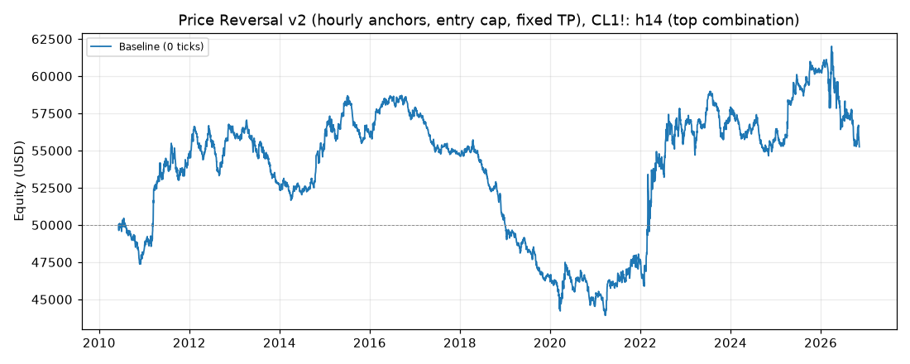

Files: [grid](../../../results/price_reversal_v2/h14/grid.csv), [trades 0 ticks](../../../results/price_reversal_v2/h14/trades_slippage0.csv), [summary](../../../results/price_reversal_v2/h14/summary.json)

### Results after commission

#### Overview

| Metric | Value |
|---|---|
| Net profit | 5,251.24 USD (10.50%) |
| Total closed trades | 4,338 |
| Percent profitable | 56.34% |
| Profit factor | 1.020 |
| Max equity drawdown | 14,904.96 USD (29.81%) |
| Avg trade | 1.21 USD |
| Avg # bars in trades | 14 |

#### Performance

| Metric | All | Long | Short |
|---|---|---|---|
| Net profit | 5,251.24 USD (10.50%) | 3,463.58 USD (6.93%) | 1,787.66 USD (3.58%) |
| Gross profit | 267,745.12 USD (535.49%) | 138,338.16 USD (276.68%) | 129,406.96 USD (258.81%) |
| Gross loss | 262,493.88 USD (524.99%) | 134,874.58 USD (269.75%) | 127,619.30 USD (255.24%) |
| Commission paid | 17,438.76 USD | 8,526.42 USD | 8,912.34 USD |

| Account | Value |
|---|---|
| Initial capital | 50,000.00 USD |
| Buy & hold return (TV-style, all capital at the first entry) | 9,633.16 USD (19.27%) |
| Max equity run-up (intrabar) | 18,934.76 USD (37.87%) |
| Max equity drawdown (intrabar) | 14,904.96 USD (29.81%) |
| Open P&L | 0.00 USD |
| Max contracts held | 1 |

#### Trades analysis

| Metric | All | Long | Short |
|---|---|---|---|
| Total closed trades | 4,338 | 2,121 | 2,217 |
| Winning trades | 2,444 | 1,192 | 1,252 |
| Losing trades | 1,894 | 929 | 965 |
| Even trades | 0 | 0 | 0 |
| Percent profitable | 56.34% | 56.20% | 56.47% |
| Avg P&L | 1.21 USD | 1.63 USD | 0.81 USD |
| Avg P&L % | 0.00% | 0.00% | 0.00% |
| Avg winning trade | 109.55 USD | 116.06 USD | 103.36 USD |
| Avg losing trade | 138.59 USD | 145.18 USD | 132.25 USD |
| Ratio avg win / avg loss | 0.790 | 0.799 | 0.782 |
| Largest winning trade | 2,045.98 USD | 2,045.98 USD | 1,845.98 USD |
| Largest winning trade % | 5.39% | 5.36% | 5.39% |
| Largest losing trade | 1,134.02 USD | 1,134.02 USD | 984.02 USD |
| Largest losing trade % | 2.13% | 2.13% | 1.42% |
| Avg # bars in trades | 14 | 15 | 13 |
| Avg # bars in winning trades | 13 | 14 | 12 |
| Avg # bars in losing trades | 16 | 16 | 15 |

#### Risk/performance ratios

| Metric | Value |
|---|---|
| Sharpe ratio | -0.059 |
| Sortino ratio | -0.091 |
| Profit factor | 1.020 |
| Margin calls | 0 |

#### List of trades (last 10, newest first; full list in the trades CSV)

| Trade # | Type | Signal | Date/Time (UTC) | Price | Contracts | Profit | Cum. profit | Run-up | Drawdown |
|---|---|---|---|---|---|---|---|---|---|
| 4338 | Exit long | Exit | 2026-11-09 13:33 | 87.11 | 1 | -444.02 USD (-0.51%) | 5,251.24 USD | 350.00 USD | 440.00 USD |
|  | Entry long | Long | 2026-11-09 13:08 | 87.55 | 1 |  |  |  |  |
| 4337 | Exit long | Exit | 2026-11-06 12:36 | 90.50 | 1 | -204.02 USD (-0.22%) | 5,695.26 USD | 50.00 USD | 200.00 USD |
|  | Entry long | Long | 2026-11-06 12:28 | 90.70 | 1 |  |  |  |  |
| 4336 | Exit short | Exit | 2026-11-05 12:10 | 89.50 | 1 | 175.98 USD (0.20%) | 5,899.28 USD | 180.00 USD | 20.00 USD |
|  | Entry short | Short | 2026-11-05 12:08 | 89.68 | 1 |  |  |  |  |
| 4335 | Exit long | Exit | 2026-11-04 13:00 | 94.43 | 1 | -364.02 USD (-0.38%) | 5,723.30 USD | 280.00 USD | 360.00 USD |
|  | Entry long | Long | 2026-11-04 12:35 | 94.79 | 1 |  |  |  |  |
| 4334 | Exit long | Exit | 2026-11-03 13:26 | 96.77 | 1 | -614.02 USD (-0.63%) | 6,087.32 USD | 210.00 USD | 610.00 USD |
|  | Entry long | Long | 2026-11-03 12:45 | 97.38 | 1 |  |  |  |  |
| 4333 | Exit long | Exit | 2026-11-02 12:57 | 99.61 | 1 | 55.98 USD (0.06%) | 6,701.34 USD | 60.00 USD | 10.00 USD |
|  | Entry long | Long | 2026-11-02 12:56 | 99.55 | 1 |  |  |  |  |
| 4332 | Exit short | Exit | 2026-11-02 12:30 | 99.69 | 1 | 95.98 USD (0.10%) | 6,645.36 USD | 100.00 USD | 130.00 USD |
|  | Entry short | Short | 2026-11-02 12:20 | 99.79 | 1 |  |  |  |  |
| 4331 | Exit long | Exit | 2026-10-30 11:41 | 104.22 | 1 | 85.98 USD (0.08%) | 6,549.38 USD | 90.00 USD | 40.00 USD |
|  | Entry long | Long | 2026-10-30 11:39 | 104.13 | 1 |  |  |  |  |
| 4330 | Exit short | Exit | 2026-10-29 11:38 | 101.50 | 1 | -104.02 USD (-0.10%) | 6,463.40 USD | 80.00 USD | 100.00 USD |
|  | Entry short | Short | 2026-10-29 11:35 | 101.40 | 1 |  |  |  |  |
| 4329 | Exit short | Exit | 2026-10-28 11:16 | 101.55 | 1 | 15.98 USD (0.02%) | 6,567.42 USD | 20.00 USD | 0.00 USD |
|  | Entry short | Short | 2026-10-28 11:16 | 101.57 | 1 |  |  |  |  |

#### By year (extra, not a TV tab)

| Year | Trades | Net profit | % profitable | Profit factor |
|---|---|---|---|---|
| 2010 | 146 | -1,626.92 USD | 52.74% | 0.820 |
| 2011 | 280 | 6,114.40 USD | 63.93% | 1.341 |
| 2012 | 264 | 1,718.72 USD | 59.47% | 1.120 |
| 2013 | 252 | -3,673.04 USD | 52.38% | 0.755 |
| 2014 | 247 | 2,547.06 USD | 58.30% | 1.231 |
| 2015 | 273 | 922.54 USD | 56.41% | 1.060 |
| 2016 | 267 | 1,876.66 USD | 59.93% | 1.173 |
| 2017 | 236 | -3,208.72 USD | 50.85% | 0.670 |
| 2018 | 253 | -4,617.06 USD | 53.36% | 0.642 |
| 2019 | 252 | -3,873.04 USD | 49.60% | 0.696 |
| 2020 | 279 | -1,561.58 USD | 52.69% | 0.902 |
| 2021 | 276 | 3,050.48 USD | 59.06% | 1.198 |
| 2022 | 291 | 8,970.18 USD | 59.11% | 1.286 |
| 2023 | 268 | 1,112.64 USD | 58.21% | 1.071 |
| 2024 | 265 | -1,465.30 USD | 53.58% | 0.897 |
| 2025 | 260 | 4,124.80 USD | 57.69% | 1.349 |
| 2026 | 229 | -5,160.58 USD | 57.21% | 0.824 |

#### Exit reasons (extra)

| Reason | Trades |
|---|---|
| limit | 2440 |
| stop | 1894 |
| close | 4 |

- Session-end exits: 4.
- Roll exits: 0.

### Best settings by metric

Each winner needs at least 30 closed trades. Undefined values are excluded. Ties: higher net profit, higher profit factor, then grid order. Ruin loss threshold: 25,000.00 USD from starting capital. All selections are in-sample. MAE/MFE objectives use the mean of the per-trade maxima.

| Metric | Goal | Best value | Grid order | Trades | Eligible settings | Parameters |
|---|---|---|---|---|---|---|
| Net profit | max | 5,251.24 USD | [37](../../../results/price_reversal_v2/h14/metric_winners/order_37/trades_slippage0.csv) | 4338 | 64 | window=90, atr_mult=1.0, swing=1, target=near |
| Win rate | max | 60.72% | [5](../../../results/price_reversal_v2/h14/metric_winners/order_5/trades_slippage0.csv) | 1576 | 64 | window=30, atr_mult=1.0, swing=1, target=near |
| Expectancy | max | 1.21 USD | [37](../../../results/price_reversal_v2/h14/metric_winners/order_37/trades_slippage0.csv) | 4338 | 64 | window=90, atr_mult=1.0, swing=1, target=near |
| Profit factor | max | 1.020 | [37](../../../results/price_reversal_v2/h14/metric_winners/order_37/trades_slippage0.csv) | 4338 | 64 | window=90, atr_mult=1.0, swing=1, target=near |
| Payoff ratio | max | 2.164 | [4](../../../results/price_reversal_v2/h14/metric_winners/order_4/trades_slippage0.csv) | 1510 | 64 | window=30, atr_mult=0.5, swing=1, target=rr2 |
| Risk of ruin (estimate) | min | 16.99% | [37](../../../results/price_reversal_v2/h14/metric_winners/order_37/trades_slippage0.csv) | 4338 | 64 | window=90, atr_mult=1.0, swing=1, target=near |
| Maximum drawdown | min | 8,040.94 USD | [2](../../../results/price_reversal_v2/h14/metric_winners/order_2/trades_slippage0.csv) | 1501 | 64 | window=30, atr_mult=0.5, swing=1, target=far |
| Consecutive losses | min | 7.000 | [13](../../../results/price_reversal_v2/h14/metric_winners/order_13/trades_slippage0.csv) | 1504 | 64 | window=30, atr_mult=2.0, swing=1, target=near |
| Sharpe ratio | max | -0.058 | [53](../../../results/price_reversal_v2/h14/metric_winners/order_53/trades_slippage0.csv) | 5062 | 64 | window=120, atr_mult=1.0, swing=1, target=near |
| Sortino ratio | max | -0.091 | [37](../../../results/price_reversal_v2/h14/metric_winners/order_37/trades_slippage0.csv) | 4338 | 64 | window=90, atr_mult=1.0, swing=1, target=near |
| R-multiple | max | No eligible value | — | — | 0 | — |
| Maximum adverse excursion (MAE) | min | 69.75 USD | [1](../../../results/price_reversal_v2/h14/metric_winners/order_1/trades_slippage0.csv) | 1495 | 64 | window=30, atr_mult=0.5, swing=1, target=near |
| Maximum favorable excursion (MFE) | max | 167.71 USD | [64](../../../results/price_reversal_v2/h14/metric_winners/order_64/trades_slippage0.csv) | 4921 | 64 | window=120, atr_mult=2.0, swing=1, target=rr2 |

- **Net profit:** Sum of closed-trade profit after commission; excludes open P&L.
- **Win rate:** Winning closed trades divided by all closed trades, including breakevens.
- **Expectancy:** Mean net profit per closed trade, including losses and breakevens.
- **Profit factor:** Gross winning profit divided by gross losing profit, both after commission. Undefined without losses.
- **Payoff ratio:** Average net winning trade divided by the absolute average net losing trade. Requires wins and losses.
- **Risk of ruin (estimate):** Infinite-horizon diffusion estimate of losing the declared amount from starting capital. Assumes independent, stationary, fixed-size net trade P&L; ignores intratrade losses and margin.
- **Maximum drawdown:** Largest equity drawdown under the tester's intrabar TradingView convention, including an open trade at the end.
- **Consecutive losses:** Longest streak of losing closed trades in execution order. A win or breakeven resets the streak.
- **Sharpe ratio:** Monthly marked-to-market excess return divided by population standard deviation, using 2% annual risk-free rate; not annualized.
- **Sortino ratio:** Monthly marked-to-market excess return divided by downside deviation about the risk-free rate; not annualized.
- **R-multiple:** Mean net trade profit / initial stop risk in dollars. Risk is actual fill to initial stop, before costs. Requires positive initial risk for every closed trade; R standard deviation and mean / standard deviation describe consistency.
- **Maximum adverse excursion (MAE):** Mean of each closed trade's maximum adverse price excursion in dollars, before commission; only the exposed intrabar path counts.
- **Maximum favorable excursion (MFE):** Mean of each closed trade's maximum favorable price excursion in dollars, before commission; only the exposed intrabar path counts. Unrealized opportunity, not realized profit.

Full selection metadata: [metric_winners.json](../../../results/price_reversal_v2/h14/metric_winners.json).

### Top 10 combinations

| # | window | atr_mult | swing | target | Net profit | Trades | % profitable | Profit factor | Max DD |
|---|---|---|---|---|---|---|---|---|---|
| 1 | 90 | 1.0 | 1 | near | 5,251.24 USD | 4,338 | 56.34% | 1.020 | 14,904.96 USD |
| 2 | 90 | 1.5 | 1 | near | 4,283.10 USD | 4,345 | 56.25% | 1.016 | 14,717.54 USD |
| 3 | 90 | 2.0 | 1 | near | 3,296.26 USD | 4,287 | 55.61% | 1.012 | 15,985.18 USD |
| 4 | 90 | 0.5 | 1 | near | 1,190.62 USD | 4,169 | 55.84% | 1.005 | 15,669.68 USD |
| 5 | 30 | 0.5 | 1 | rr2 | 1,059.80 USD | 1,510 | 31.79% | 1.008 | 12,621.44 USD |
| 6 | 120 | 1.0 | 1 | near | 560.76 USD | 5,062 | 55.83% | 1.002 | 18,097.94 USD |
| 7 | 30 | 2.0 | 1 | rr2 | 507.54 USD | 1,523 | 32.37% | 1.004 | 13,170.64 USD |
| 8 | 90 | 1.0 | 1 | far | 157.02 USD | 4,349 | 51.18% | 1.001 | 18,907.54 USD |
| 9 | 30 | 2.0 | 1 | rr1 | -416.38 USD | 1,519 | 49.24% | 0.996 | 10,676.92 USD |
| 10 | 30 | 1.0 | 1 | rr2 | -813.86 USD | 1,593 | 32.08% | 0.994 | 14,111.64 USD |

Profitable combinations: 8 of 64.

## Variant: h15

**Top combination:** `anchor=h15`, `window=120`, `atr_mult=0.5`, `swing=1`, `target=rr2`

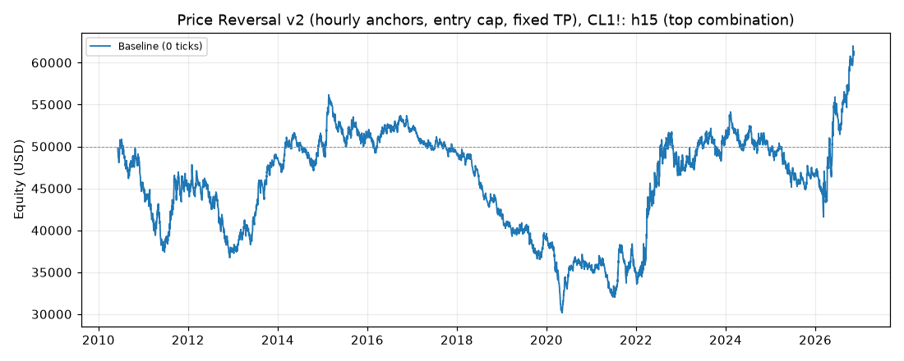

Files: [grid](../../../results/price_reversal_v2/h15/grid.csv), [trades 0 ticks](../../../results/price_reversal_v2/h15/trades_slippage0.csv), [summary](../../../results/price_reversal_v2/h15/summary.json)

### Results after commission

#### Overview

| Metric | Value |
|---|---|
| Net profit | 10,896.22 USD (21.79%) |
| Total closed trades | 4,889 |
| Percent profitable | 33.05% |
| Profit factor | 1.017 |
| Max equity drawdown | 26,052.96 USD (52.11%) |
| Avg trade | 2.23 USD |
| Avg # bars in trades | 28 |

#### Performance

| Metric | All | Long | Short |
|---|---|---|---|
| Net profit | 10,896.22 USD (21.79%) | 899.44 USD (1.80%) | 9,996.78 USD (19.99%) |
| Gross profit | 649,153.68 USD (1,298.31%) | 330,212.14 USD (660.42%) | 318,941.54 USD (637.88%) |
| Gross loss | 638,257.46 USD (1,276.51%) | 329,312.70 USD (658.63%) | 308,944.76 USD (617.89%) |
| Commission paid | 19,653.78 USD | 9,760.56 USD | 9,893.22 USD |

| Account | Value |
|---|---|
| Initial capital | 50,000.00 USD |
| Buy & hold return (TV-style, all capital at the first entry) | 9,591.44 USD (19.18%) |
| Max equity run-up (intrabar) | 32,344.42 USD (64.69%) |
| Max equity drawdown (intrabar) | 26,052.96 USD (52.11%) |
| Open P&L | 0.00 USD |
| Max contracts held | 1 |

#### Trades analysis

| Metric | All | Long | Short |
|---|---|---|---|
| Total closed trades | 4,889 | 2,428 | 2,461 |
| Winning trades | 1,616 | 793 | 823 |
| Losing trades | 3,273 | 1,635 | 1,638 |
| Even trades | 0 | 0 | 0 |
| Percent profitable | 33.05% | 32.66% | 33.44% |
| Avg P&L | 2.23 USD | 0.37 USD | 4.06 USD |
| Avg P&L % | -0.00% | -0.01% | 0.00% |
| Avg winning trade | 401.70 USD | 416.41 USD | 387.54 USD |
| Avg losing trade | 195.01 USD | 201.41 USD | 188.61 USD |
| Ratio avg win / avg loss | 2.060 | 2.067 | 2.055 |
| Largest winning trade | 2,815.98 USD | 2,815.98 USD | 2,255.98 USD |
| Largest winning trade % | 4.13% | 2.82% | 4.13% |
| Largest losing trade | 1,964.02 USD | 1,474.02 USD | 1,964.02 USD |
| Largest losing trade % | 2.96% | 2.96% | 2.63% |
| Avg # bars in trades | 28 | 29 | 28 |
| Avg # bars in winning trades | 39 | 41 | 37 |
| Avg # bars in losing trades | 23 | 24 | 23 |

#### Risk/performance ratios

| Metric | Value |
|---|---|
| Sharpe ratio | 0.001 |
| Sortino ratio | 0.001 |
| Profit factor | 1.017 |
| Margin calls | 0 |

#### List of trades (last 10, newest first; full list in the trades CSV)

| Trade # | Type | Signal | Date/Time (UTC) | Price | Contracts | Profit | Cum. profit | Run-up | Drawdown |
|---|---|---|---|---|---|---|---|---|---|
| 4889 | Exit long | Exit | 2026-11-09 13:50 | 86.86 | 1 | -484.02 USD (-0.55%) | 10,896.22 USD | 140.00 USD | 480.00 USD |
|  | Entry long | Long | 2026-11-09 13:44 | 87.34 | 1 |  |  |  |  |
| 4888 | Exit short | Exit | 2026-11-09 13:33 | 87.14 | 1 | 515.98 USD (0.59%) | 11,380.24 USD | 520.00 USD | 40.00 USD |
|  | Entry short | Short | 2026-11-09 13:29 | 87.66 | 1 |  |  |  |  |
| 4887 | Exit short | Exit | 2026-11-06 13:30 | 91.04 | 1 | -324.02 USD (-0.36%) | 10,864.26 USD | 0.00 USD | 320.00 USD |
|  | Entry short | Short | 2026-11-06 13:24 | 90.72 | 1 |  |  |  |  |
| 4886 | Exit short | Exit | 2026-11-05 15:20 | 90.35 | 1 | -504.02 USD (-0.56%) | 11,188.28 USD | 810.00 USD | 500.00 USD |
|  | Entry short | Short | 2026-11-05 13:18 | 89.85 | 1 |  |  |  |  |
| 4885 | Exit long | Exit | 2026-11-04 13:36 | 93.94 | 1 | -304.02 USD (-0.32%) | 11,692.30 USD | 300.00 USD | 300.00 USD |
|  | Entry long | Long | 2026-11-04 13:09 | 94.24 | 1 |  |  |  |  |
| 4884 | Exit long | Exit | 2026-11-03 14:25 | 96.38 | 1 | 1,855.98 USD (1.96%) | 11,996.32 USD | 1,860.00 USD | 240.00 USD |
|  | Entry long | Long | 2026-11-03 13:49 | 94.52 | 1 |  |  |  |  |
| 4883 | Exit short | Exit | 2026-11-03 13:26 | 96.85 | 1 | 495.98 USD (0.51%) | 10,140.34 USD | 500.00 USD | 110.00 USD |
|  | Entry short | Short | 2026-11-03 13:08 | 97.35 | 1 |  |  |  |  |
| 4882 | Exit long | Exit | 2026-10-30 13:36 | 103.71 | 1 | -324.02 USD (-0.31%) | 9,644.36 USD | 140.00 USD | 320.00 USD |
|  | Entry long | Long | 2026-10-30 13:33 | 104.03 | 1 |  |  |  |  |
| 4881 | Exit long | Exit | 2026-10-29 12:35 | 101.72 | 1 | -154.02 USD (-0.15%) | 9,968.38 USD | 100.00 USD | 150.00 USD |
|  | Entry long | Long | 2026-10-29 12:32 | 101.87 | 1 |  |  |  |  |
| 4880 | Exit long | Exit | 2026-10-28 13:08 | 101.50 | 1 | -294.02 USD (-0.29%) | 10,122.40 USD | 370.00 USD | 290.00 USD |
|  | Entry long | Long | 2026-10-28 12:16 | 101.79 | 1 |  |  |  |  |

#### By year (extra, not a TV tab)

| Year | Trades | Net profit | % profitable | Profit factor |
|---|---|---|---|---|
| 2010 | 153 | -4,835.06 USD | 28.10% | 0.816 |
| 2011 | 293 | 72.14 USD | 36.86% | 1.001 |
| 2012 | 312 | -7,784.24 USD | 31.41% | 0.831 |
| 2013 | 284 | 11,088.32 USD | 40.14% | 1.358 |
| 2014 | 273 | 1,762.54 USD | 32.60% | 1.059 |
| 2015 | 301 | 1,179.98 USD | 32.56% | 1.032 |
| 2016 | 305 | 503.90 USD | 34.10% | 1.018 |
| 2017 | 284 | -2,901.68 USD | 30.28% | 0.861 |
| 2018 | 284 | -7,461.68 USD | 24.65% | 0.731 |
| 2019 | 306 | -2,240.12 USD | 33.66% | 0.927 |
| 2020 | 310 | -4,186.20 USD | 31.61% | 0.877 |
| 2021 | 306 | -560.12 USD | 32.35% | 0.985 |
| 2022 | 313 | 12,691.74 USD | 36.10% | 1.180 |
| 2023 | 301 | 3,509.98 USD | 34.88% | 1.085 |
| 2024 | 303 | -1,388.06 USD | 31.68% | 0.962 |
| 2025 | 302 | -2,644.04 USD | 33.11% | 0.918 |
| 2026 | 259 | 14,088.82 USD | 35.52% | 1.259 |

#### Exit reasons (extra)

| Reason | Trades |
|---|---|
| stop | 3256 |
| limit | 1577 |
| close | 56 |

- Session-end exits: 56.
- Roll exits: 0.

### Best settings by metric

Each winner needs at least 30 closed trades. Undefined values are excluded. Ties: higher net profit, higher profit factor, then grid order. Ruin loss threshold: 25,000.00 USD from starting capital. All selections are in-sample. MAE/MFE objectives use the mean of the per-trade maxima.

| Metric | Goal | Best value | Grid order | Trades | Eligible settings | Parameters |
|---|---|---|---|---|---|---|
| Net profit | max | 10,896.22 USD | [52](../../../results/price_reversal_v2/h15/metric_winners/order_52/trades_slippage0.csv) | 4889 | 64 | window=120, atr_mult=0.5, swing=1, target=rr2 |
| Win rate | max | 61.61% | [5](../../../results/price_reversal_v2/h15/metric_winners/order_5/trades_slippage0.csv) | 1722 | 64 | window=30, atr_mult=1.0, swing=1, target=near |
| Expectancy | max | 4.38 USD | [4](../../../results/price_reversal_v2/h15/metric_winners/order_4/trades_slippage0.csv) | 1584 | 64 | window=30, atr_mult=0.5, swing=1, target=rr2 |
| Profit factor | max | 1.041 | [4](../../../results/price_reversal_v2/h15/metric_winners/order_4/trades_slippage0.csv) | 1584 | 64 | window=30, atr_mult=0.5, swing=1, target=rr2 |
| Payoff ratio | max | 2.083 | [4](../../../results/price_reversal_v2/h15/metric_winners/order_4/trades_slippage0.csv) | 1584 | 64 | window=30, atr_mult=0.5, swing=1, target=rr2 |
| Risk of ruin (estimate) | min | 6.75% | [4](../../../results/price_reversal_v2/h15/metric_winners/order_4/trades_slippage0.csv) | 1584 | 64 | window=30, atr_mult=0.5, swing=1, target=rr2 |
| Maximum drawdown | min | 7,456.86 USD | [7](../../../results/price_reversal_v2/h15/metric_winners/order_7/trades_slippage0.csv) | 1733 | 64 | window=30, atr_mult=1.0, swing=1, target=rr1 |
| Consecutive losses | min | 7.000 | [5](../../../results/price_reversal_v2/h15/metric_winners/order_5/trades_slippage0.csv) | 1722 | 64 | window=30, atr_mult=1.0, swing=1, target=near |
| Sharpe ratio | max | 0.001 | [52](../../../results/price_reversal_v2/h15/metric_winners/order_52/trades_slippage0.csv) | 4889 | 64 | window=120, atr_mult=0.5, swing=1, target=rr2 |
| Sortino ratio | max | 0.001 | [52](../../../results/price_reversal_v2/h15/metric_winners/order_52/trades_slippage0.csv) | 4889 | 64 | window=120, atr_mult=0.5, swing=1, target=rr2 |
| R-multiple | max | No eligible value | — | — | 0 | — |
| Maximum adverse excursion (MAE) | min | 87.60 USD | [5](../../../results/price_reversal_v2/h15/metric_winners/order_5/trades_slippage0.csv) | 1722 | 64 | window=30, atr_mult=1.0, swing=1, target=near |
| Maximum favorable excursion (MFE) | max | 219.26 USD | [64](../../../results/price_reversal_v2/h15/metric_winners/order_64/trades_slippage0.csv) | 5114 | 64 | window=120, atr_mult=2.0, swing=1, target=rr2 |

- **Net profit:** Sum of closed-trade profit after commission; excludes open P&L.
- **Win rate:** Winning closed trades divided by all closed trades, including breakevens.
- **Expectancy:** Mean net profit per closed trade, including losses and breakevens.
- **Profit factor:** Gross winning profit divided by gross losing profit, both after commission. Undefined without losses.
- **Payoff ratio:** Average net winning trade divided by the absolute average net losing trade. Requires wins and losses.
- **Risk of ruin (estimate):** Infinite-horizon diffusion estimate of losing the declared amount from starting capital. Assumes independent, stationary, fixed-size net trade P&L; ignores intratrade losses and margin.
- **Maximum drawdown:** Largest equity drawdown under the tester's intrabar TradingView convention, including an open trade at the end.
- **Consecutive losses:** Longest streak of losing closed trades in execution order. A win or breakeven resets the streak.
- **Sharpe ratio:** Monthly marked-to-market excess return divided by population standard deviation, using 2% annual risk-free rate; not annualized.
- **Sortino ratio:** Monthly marked-to-market excess return divided by downside deviation about the risk-free rate; not annualized.
- **R-multiple:** Mean net trade profit / initial stop risk in dollars. Risk is actual fill to initial stop, before costs. Requires positive initial risk for every closed trade; R standard deviation and mean / standard deviation describe consistency.
- **Maximum adverse excursion (MAE):** Mean of each closed trade's maximum adverse price excursion in dollars, before commission; only the exposed intrabar path counts.
- **Maximum favorable excursion (MFE):** Mean of each closed trade's maximum favorable price excursion in dollars, before commission; only the exposed intrabar path counts. Unrealized opportunity, not realized profit.

Full selection metadata: [metric_winners.json](../../../results/price_reversal_v2/h15/metric_winners.json).

### Top 10 combinations

| # | window | atr_mult | swing | target | Net profit | Trades | % profitable | Profit factor | Max DD |
|---|---|---|---|---|---|---|---|---|---|
| 1 | 120 | 0.5 | 1 | rr2 | 10,896.22 USD | 4,889 | 33.05% | 1.017 | 26,052.96 USD |
| 2 | 30 | 0.5 | 1 | rr2 | 6,932.32 USD | 1,584 | 33.33% | 1.041 | 10,297.50 USD |
| 3 | 30 | 1.0 | 1 | rr2 | 4,769.42 USD | 1,729 | 33.43% | 1.026 | 9,921.26 USD |
| 4 | 30 | 2.0 | 1 | rr2 | 2,236.60 USD | 1,670 | 33.17% | 1.012 | 12,084.98 USD |
| 5 | 30 | 1.0 | 1 | rr1 | 1,763.34 USD | 1,733 | 49.86% | 1.013 | 7,456.86 USD |
| 6 | 30 | 0.5 | 1 | rr1 | 1,614.28 USD | 1,586 | 49.56% | 1.013 | 7,847.62 USD |
| 7 | 30 | 1.5 | 1 | rr2 | 1,085.20 USD | 1,740 | 33.16% | 1.006 | 12,543.32 USD |
| 8 | 90 | 0.5 | 1 | rr2 | 441.18 USD | 4,241 | 32.75% | 1.001 | 25,619.52 USD |
| 9 | 30 | 1.5 | 1 | rr1 | -1,368.82 USD | 1,741 | 49.51% | 0.990 | 7,821.56 USD |
| 10 | 30 | 2.0 | 1 | rr1 | -1,829.38 USD | 1,669 | 49.37% | 0.986 | 7,884.78 USD |

Profitable combinations: 8 of 64.

## Variant: h16

**Top combination:** `anchor=h16`, `window=90`, `atr_mult=0.5`, `swing=1`, `target=rr2`

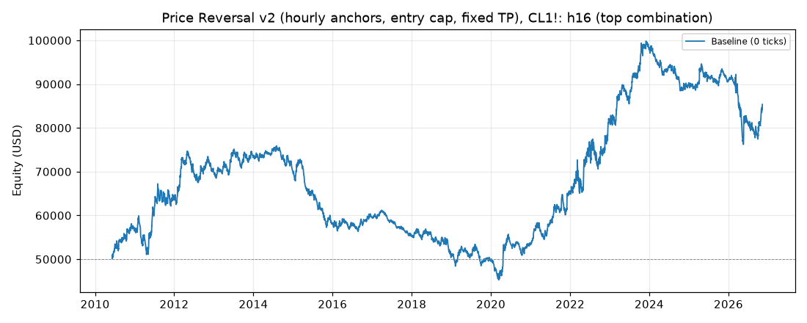

Files: [grid](../../../results/price_reversal_v2/h16/grid.csv), [trades 0 ticks](../../../results/price_reversal_v2/h16/trades_slippage0.csv), [summary](../../../results/price_reversal_v2/h16/summary.json)

### Results after commission

#### Overview

| Metric | Value |
|---|---|
| Net profit | 35,362.52 USD (70.73%) |
| Total closed trades | 4,074 |
| Percent profitable | 34.32% |
| Profit factor | 1.057 |
| Max equity drawdown | 30,603.88 USD (61.21%) |
| Avg trade | 8.68 USD |
| Avg # bars in trades | 36 |

#### Performance

| Metric | All | Long | Short |
|---|---|---|---|
| Net profit | 35,362.52 USD (70.73%) | 19,870.16 USD (39.74%) | 15,492.36 USD (30.98%) |
| Gross profit | 659,470.04 USD (1,318.94%) | 347,659.62 USD (695.32%) | 311,810.42 USD (623.62%) |
| Gross loss | 624,107.52 USD (1,248.22%) | 327,789.46 USD (655.58%) | 296,318.06 USD (592.64%) |
| Commission paid | 16,377.48 USD | 8,409.84 USD | 7,967.64 USD |

| Account | Value |
|---|---|
| Initial capital | 50,000.00 USD |
| Buy & hold return (TV-style, all capital at the first entry) | 9,499.86 USD (19.00%) |
| Max equity run-up (intrabar) | 54,652.56 USD (109.31%) |
| Max equity drawdown (intrabar) | 30,603.88 USD (61.21%) |
| Open P&L | 0.00 USD |
| Max contracts held | 1 |

#### Trades analysis

| Metric | All | Long | Short |
|---|---|---|---|
| Total closed trades | 4,074 | 2,092 | 1,982 |
| Winning trades | 1,398 | 719 | 679 |
| Losing trades | 2,676 | 1,373 | 1,303 |
| Even trades | 0 | 0 | 0 |
| Percent profitable | 34.32% | 34.37% | 34.26% |
| Avg P&L | 8.68 USD | 9.50 USD | 7.82 USD |
| Avg P&L % | 0.01% | 0.02% | 0.00% |
| Avg winning trade | 471.72 USD | 483.53 USD | 459.22 USD |
| Avg losing trade | 233.22 USD | 238.74 USD | 227.41 USD |
| Ratio avg win / avg loss | 2.023 | 2.025 | 2.019 |
| Largest winning trade | 4,195.98 USD | 3,135.98 USD | 4,195.98 USD |
| Largest winning trade % | 8.62% | 8.62% | 7.23% |
| Largest losing trade | 1,364.02 USD | 1,354.02 USD | 1,364.02 USD |
| Largest losing trade % | 4.38% | 2.54% | 4.38% |
| Avg # bars in trades | 36 | 36 | 35 |
| Avg # bars in winning trades | 53 | 57 | 48 |
| Avg # bars in losing trades | 27 | 26 | 28 |

#### Risk/performance ratios

| Metric | Value |
|---|---|
| Sharpe ratio | 0.050 |
| Sortino ratio | 0.081 |
| Profit factor | 1.057 |
| Margin calls | 0 |

#### List of trades (last 10, newest first; full list in the trades CSV)

| Trade # | Type | Signal | Date/Time (UTC) | Price | Contracts | Profit | Cum. profit | Run-up | Drawdown |
|---|---|---|---|---|---|---|---|---|---|
| 4074 | Exit long | Exit | 2026-11-09 15:35 | 88.11 | 1 | 1,275.98 USD (1.47%) | 35,362.52 USD | 1,280.00 USD | 100.00 USD |
|  | Entry long | Long | 2026-11-09 14:29 | 86.83 | 1 |  |  |  |  |
| 4073 | Exit long | Exit | 2026-11-06 14:35 | 90.46 | 1 | -274.02 USD (-0.30%) | 34,086.54 USD | 110.00 USD | 270.00 USD |
|  | Entry long | Long | 2026-11-06 14:26 | 90.73 | 1 |  |  |  |  |
| 4072 | Exit short | Exit | 2026-11-05 14:41 | 89.97 | 1 | -324.02 USD (-0.36%) | 34,360.56 USD | 370.00 USD | 320.00 USD |
|  | Entry short | Short | 2026-11-05 14:31 | 89.65 | 1 |  |  |  |  |
| 4071 | Exit short | Exit | 2026-11-04 16:00 | 92.08 | 1 | 1,135.98 USD (1.22%) | 34,684.58 USD | 1,140.00 USD | 210.00 USD |
|  | Entry short | Short | 2026-11-04 14:52 | 93.22 | 1 |  |  |  |  |
| 4070 | Exit short | Exit | 2026-11-03 14:24 | 95.85 | 1 | -444.02 USD (-0.47%) | 33,548.60 USD | 50.00 USD | 440.00 USD |
|  | Entry short | Short | 2026-11-03 14:24 | 95.41 | 1 |  |  |  |  |
| 4069 | Exit long | Exit | 2026-11-02 14:30 | 97.30 | 1 | -234.02 USD (-0.24%) | 33,992.62 USD | 350.00 USD | 230.00 USD |
|  | Entry long | Long | 2026-11-02 14:21 | 97.53 | 1 |  |  |  |  |
| 4068 | Exit short | Exit | 2026-10-30 15:32 | 103.58 | 1 | 715.98 USD (0.69%) | 34,226.64 USD | 720.00 USD | 160.00 USD |
|  | Entry short | Short | 2026-10-30 14:30 | 104.30 | 1 |  |  |  |  |
| 4067 | Exit long | Exit | 2026-10-29 14:04 | 100.93 | 1 | 755.98 USD (0.75%) | 33,510.66 USD | 760.00 USD | 10.00 USD |
|  | Entry long | Long | 2026-10-29 13:53 | 100.17 | 1 |  |  |  |  |
| 4066 | Exit short | Exit | 2026-10-27 14:25 | 100.87 | 1 | 695.98 USD (0.69%) | 32,754.68 USD | 700.00 USD | 0.00 USD |
|  | Entry short | Short | 2026-10-27 14:10 | 101.57 | 1 |  |  |  |  |
| 4065 | Exit short | Exit | 2026-10-26 14:15 | 100.75 | 1 | 955.98 USD (0.94%) | 32,058.70 USD | 960.00 USD | 210.00 USD |
|  | Entry short | Short | 2026-10-26 13:21 | 101.71 | 1 |  |  |  |  |

#### By year (extra, not a TV tab)

| Year | Trades | Net profit | % profitable | Profit factor |
|---|---|---|---|---|
| 2010 | 126 | 6,903.48 USD | 40.48% | 1.336 |
| 2011 | 245 | 7,635.10 USD | 36.33% | 1.141 |
| 2012 | 257 | 5,396.86 USD | 36.96% | 1.131 |
| 2013 | 224 | 3,679.52 USD | 34.82% | 1.117 |
| 2014 | 216 | -3,828.32 USD | 30.09% | 0.868 |
| 2015 | 250 | -11,785.00 USD | 26.80% | 0.709 |
| 2016 | 256 | 1,400.88 USD | 34.77% | 1.056 |
| 2017 | 234 | -3,880.68 USD | 30.77% | 0.794 |
| 2018 | 261 | -5,139.22 USD | 30.27% | 0.833 |
| 2019 | 246 | -858.92 USD | 36.18% | 0.969 |
| 2020 | 245 | 3,925.10 USD | 34.29% | 1.128 |
| 2021 | 262 | 11,616.76 USD | 39.31% | 1.343 |
| 2022 | 272 | 16,806.56 USD | 38.24% | 1.231 |
| 2023 | 262 | 16,016.76 USD | 40.46% | 1.381 |
| 2024 | 245 | -7,684.90 USD | 30.20% | 0.797 |
| 2025 | 256 | 730.88 USD | 33.59% | 1.023 |
| 2026 | 217 | -5,572.34 USD | 30.88% | 0.900 |

#### Exit reasons (extra)

| Reason | Trades |
|---|---|
| stop | 2656 |
| limit | 1320 |
| close | 98 |

- Session-end exits: 98.
- Roll exits: 0.

### Best settings by metric

Each winner needs at least 30 closed trades. Undefined values are excluded. Ties: higher net profit, higher profit factor, then grid order. Ruin loss threshold: 25,000.00 USD from starting capital. All selections are in-sample. MAE/MFE objectives use the mean of the per-trade maxima.

| Metric | Goal | Best value | Grid order | Trades | Eligible settings | Parameters |
|---|---|---|---|---|---|---|
| Net profit | max | 35,362.52 USD | [36](../../../results/price_reversal_v2/h16/metric_winners/order_36/trades_slippage0.csv) | 4074 | 64 | window=90, atr_mult=0.5, swing=1, target=rr2 |
| Win rate | max | 58.90% | [1](../../../results/price_reversal_v2/h16/metric_winners/order_1/trades_slippage0.csv) | 1781 | 64 | window=30, atr_mult=0.5, swing=1, target=near |
| Expectancy | max | 8.68 USD | [36](../../../results/price_reversal_v2/h16/metric_winners/order_36/trades_slippage0.csv) | 4074 | 64 | window=90, atr_mult=0.5, swing=1, target=rr2 |
| Profit factor | max | 1.057 | [36](../../../results/price_reversal_v2/h16/metric_winners/order_36/trades_slippage0.csv) | 4074 | 64 | window=90, atr_mult=0.5, swing=1, target=rr2 |
| Payoff ratio | max | 2.073 | [4](../../../results/price_reversal_v2/h16/metric_winners/order_4/trades_slippage0.csv) | 1784 | 64 | window=30, atr_mult=0.5, swing=1, target=rr2 |
| Risk of ruin (estimate) | min | 6.73% | [36](../../../results/price_reversal_v2/h16/metric_winners/order_36/trades_slippage0.csv) | 4074 | 64 | window=90, atr_mult=0.5, swing=1, target=rr2 |
| Maximum drawdown | min | 15,496.54 USD | [2](../../../results/price_reversal_v2/h16/metric_winners/order_2/trades_slippage0.csv) | 1788 | 64 | window=30, atr_mult=0.5, swing=1, target=far |
| Consecutive losses | min | 7.000 | [1](../../../results/price_reversal_v2/h16/metric_winners/order_1/trades_slippage0.csv) | 1781 | 64 | window=30, atr_mult=0.5, swing=1, target=near |
| Sharpe ratio | max | 0.050 | [36](../../../results/price_reversal_v2/h16/metric_winners/order_36/trades_slippage0.csv) | 4074 | 64 | window=90, atr_mult=0.5, swing=1, target=rr2 |
| Sortino ratio | max | 0.081 | [36](../../../results/price_reversal_v2/h16/metric_winners/order_36/trades_slippage0.csv) | 4074 | 64 | window=90, atr_mult=0.5, swing=1, target=rr2 |
| R-multiple | max | -0.002 | [36](../../../results/price_reversal_v2/h16/metric_winners/order_36/trades_slippage0.csv) | 4074 | 55 | window=90, atr_mult=0.5, swing=1, target=rr2 |
| Maximum adverse excursion (MAE) | min | 123.07 USD | [1](../../../results/price_reversal_v2/h16/metric_winners/order_1/trades_slippage0.csv) | 1781 | 64 | window=30, atr_mult=0.5, swing=1, target=near |
| Maximum favorable excursion (MFE) | max | 264.08 USD | [64](../../../results/price_reversal_v2/h16/metric_winners/order_64/trades_slippage0.csv) | 4900 | 64 | window=120, atr_mult=2.0, swing=1, target=rr2 |

- **Net profit:** Sum of closed-trade profit after commission; excludes open P&L.
- **Win rate:** Winning closed trades divided by all closed trades, including breakevens.
- **Expectancy:** Mean net profit per closed trade, including losses and breakevens.
- **Profit factor:** Gross winning profit divided by gross losing profit, both after commission. Undefined without losses.
- **Payoff ratio:** Average net winning trade divided by the absolute average net losing trade. Requires wins and losses.
- **Risk of ruin (estimate):** Infinite-horizon diffusion estimate of losing the declared amount from starting capital. Assumes independent, stationary, fixed-size net trade P&L; ignores intratrade losses and margin.
- **Maximum drawdown:** Largest equity drawdown under the tester's intrabar TradingView convention, including an open trade at the end.
- **Consecutive losses:** Longest streak of losing closed trades in execution order. A win or breakeven resets the streak.
- **Sharpe ratio:** Monthly marked-to-market excess return divided by population standard deviation, using 2% annual risk-free rate; not annualized.
- **Sortino ratio:** Monthly marked-to-market excess return divided by downside deviation about the risk-free rate; not annualized.
- **R-multiple:** Mean net trade profit / initial stop risk in dollars. Risk is actual fill to initial stop, before costs. Requires positive initial risk for every closed trade; R standard deviation and mean / standard deviation describe consistency.
- **Maximum adverse excursion (MAE):** Mean of each closed trade's maximum adverse price excursion in dollars, before commission; only the exposed intrabar path counts.
- **Maximum favorable excursion (MFE):** Mean of each closed trade's maximum favorable price excursion in dollars, before commission; only the exposed intrabar path counts. Unrealized opportunity, not realized profit.

Full selection metadata: [metric_winners.json](../../../results/price_reversal_v2/h16/metric_winners.json).

### Top 10 combinations

| # | window | atr_mult | swing | target | Net profit | Trades | % profitable | Profit factor | Max DD |
|---|---|---|---|---|---|---|---|---|---|
| 1 | 90 | 0.5 | 1 | rr2 | 35,362.52 USD | 4,074 | 34.32% | 1.057 | 30,603.88 USD |
| 2 | 120 | 0.5 | 1 | rr2 | 27,749.76 USD | 4,612 | 34.30% | 1.039 | 35,583.20 USD |
| 3 | 90 | 1.0 | 1 | rr2 | 18,761.90 USD | 4,405 | 33.96% | 1.028 | 34,439.34 USD |
| 4 | 60 | 0.5 | 1 | rr2 | 14,361.28 USD | 3,236 | 33.75% | 1.029 | 27,433.76 USD |
| 5 | 120 | 1.0 | 1 | rr2 | 14,095.62 USD | 4,919 | 34.03% | 1.018 | 38,555.98 USD |
| 6 | 30 | 0.5 | 1 | rr2 | 12,878.32 USD | 1,784 | 33.63% | 1.051 | 16,693.48 USD |
| 7 | 90 | 1.5 | 1 | rr2 | 11,943.26 USD | 4,437 | 33.74% | 1.017 | 33,837.66 USD |
| 8 | 90 | 2.0 | 1 | rr2 | 11,626.22 USD | 4,389 | 33.86% | 1.017 | 32,130.64 USD |
| 9 | 120 | 2.0 | 1 | rr2 | 11,172.00 USD | 4,900 | 34.06% | 1.014 | 34,319.90 USD |
| 10 | 120 | 1.5 | 1 | rr2 | 10,797.08 USD | 4,946 | 33.93% | 1.014 | 36,660.20 USD |

Profitable combinations: 15 of 64.

## Variant: h17

**Top combination:** `anchor=h17`, `window=90`, `atr_mult=1.0`, `swing=1`, `target=rr1`

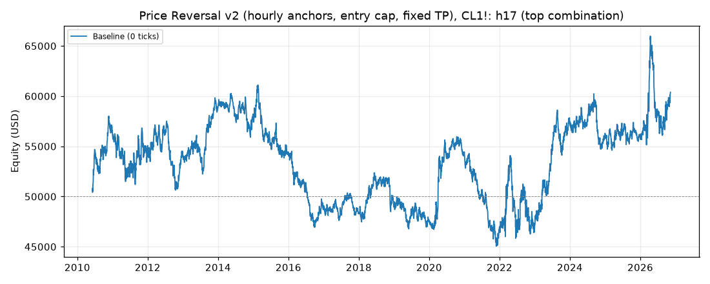

Files: [grid](../../../results/price_reversal_v2/h17/grid.csv), [trades 0 ticks](../../../results/price_reversal_v2/h17/trades_slippage0.csv), [summary](../../../results/price_reversal_v2/h17/summary.json)

### Results after commission

#### Overview

| Metric | Value |
|---|---|
| Net profit | 10,388.30 USD (20.78%) |
| Total closed trades | 4,585 |
| Percent profitable | 50.19% |
| Profit factor | 1.019 |
| Max equity drawdown | 16,717.90 USD (33.44%) |
| Avg trade | 2.27 USD |
| Avg # bars in trades | 21 |

#### Performance

| Metric | All | Long | Short |
|---|---|---|---|
| Net profit | 10,388.30 USD (20.78%) | 25,036.66 USD (50.07%) | -14,648.36 USD (-29.30%) |
| Gross profit | 549,599.98 USD (1,099.20%) | 290,192.88 USD (580.39%) | 259,407.10 USD (518.81%) |
| Gross loss | 539,211.68 USD (1,078.42%) | 265,156.22 USD (530.31%) | 274,055.46 USD (548.11%) |
| Commission paid | 18,431.70 USD | 9,113.34 USD | 9,318.36 USD |

| Account | Value |
|---|---|
| Initial capital | 50,000.00 USD |
| Buy & hold return (TV-style, all capital at the first entry) | 9,977.47 USD (19.95%) |
| Max equity run-up (intrabar) | 20,997.82 USD (42.00%) |
| Max equity drawdown (intrabar) | 16,717.90 USD (33.44%) |
| Open P&L | 0.00 USD |
| Max contracts held | 1 |

#### Trades analysis

| Metric | All | Long | Short |
|---|---|---|---|
| Total closed trades | 4,585 | 2,267 | 2,318 |
| Winning trades | 2,301 | 1,156 | 1,145 |
| Losing trades | 2,284 | 1,111 | 1,173 |
| Even trades | 0 | 0 | 0 |
| Percent profitable | 50.19% | 50.99% | 49.40% |
| Avg P&L | 2.27 USD | 11.04 USD | -6.32 USD |
| Avg P&L % | 0.00% | 0.01% | -0.00% |
| Avg winning trade | 238.85 USD | 251.03 USD | 226.56 USD |
| Avg losing trade | 236.08 USD | 238.66 USD | 233.64 USD |
| Ratio avg win / avg loss | 1.012 | 1.052 | 0.970 |
| Largest winning trade | 2,695.98 USD | 2,695.98 USD | 2,095.98 USD |
| Largest winning trade % | 7.98% | 5.29% | 7.98% |
| Largest losing trade | 2,424.02 USD | 2,424.02 USD | 1,114.02 USD |
| Largest losing trade % | 4.52% | 4.52% | 2.21% |
| Avg # bars in trades | 21 | 22 | 20 |
| Avg # bars in winning trades | 21 | 22 | 20 |
| Avg # bars in losing trades | 21 | 22 | 21 |

#### Risk/performance ratios

| Metric | Value |
|---|---|
| Sharpe ratio | -0.014 |
| Sortino ratio | -0.022 |
| Profit factor | 1.019 |
| Margin calls | 0 |

#### List of trades (last 10, newest first; full list in the trades CSV)

| Trade # | Type | Signal | Date/Time (UTC) | Price | Contracts | Profit | Cum. profit | Run-up | Drawdown |
|---|---|---|---|---|---|---|---|---|---|
| 4585 | Exit short | Exit | 2026-11-09 15:29 | 87.51 | 1 | 215.98 USD (0.25%) | 10,388.30 USD | 220.00 USD | 50.00 USD |
|  | Entry short | Short | 2026-11-09 15:21 | 87.73 | 1 |  |  |  |  |
| 4584 | Exit long | Exit | 2026-11-06 16:23 | 90.68 | 1 | 415.98 USD (0.46%) | 10,172.32 USD | 420.00 USD | 290.00 USD |
|  | Entry long | Long | 2026-11-06 15:34 | 90.26 | 1 |  |  |  |  |
| 4583 | Exit short | Exit | 2026-11-05 15:19 | 90.21 | 1 | -334.02 USD (-0.37%) | 9,756.34 USD | 240.00 USD | 330.00 USD |
|  | Entry short | Short | 2026-11-05 15:10 | 89.88 | 1 |  |  |  |  |
| 4582 | Exit long | Exit | 2026-11-04 16:10 | 92.46 | 1 | 425.98 USD (0.46%) | 10,090.36 USD | 430.00 USD | 340.00 USD |
|  | Entry long | Long | 2026-11-04 16:06 | 92.03 | 1 |  |  |  |  |
| 4581 | Exit short | Exit | 2026-11-03 15:40 | 96.06 | 1 | 335.98 USD (0.35%) | 9,664.38 USD | 340.00 USD | 170.00 USD |
|  | Entry short | Short | 2026-11-03 15:31 | 96.40 | 1 |  |  |  |  |
| 4580 | Exit long | Exit | 2026-11-02 16:39 | 96.74 | 1 | -344.02 USD (-0.35%) | 9,328.40 USD | 0.00 USD | 340.00 USD |
|  | Entry long | Long | 2026-11-02 16:30 | 97.08 | 1 |  |  |  |  |
| 4579 | Exit short | Exit | 2026-11-02 16:17 | 97.00 | 1 | 335.98 USD (0.35%) | 9,672.42 USD | 340.00 USD | 160.00 USD |
|  | Entry short | Short | 2026-11-02 15:49 | 97.34 | 1 |  |  |  |  |
| 4578 | Exit long | Exit | 2026-10-30 15:23 | 103.92 | 1 | -244.02 USD (-0.23%) | 9,336.44 USD | 170.00 USD | 240.00 USD |
|  | Entry long | Long | 2026-10-30 15:14 | 104.16 | 1 |  |  |  |  |
| 4577 | Exit long | Exit | 2026-10-29 15:45 | 100.58 | 1 | 275.98 USD (0.28%) | 9,580.46 USD | 280.00 USD | 190.00 USD |
|  | Entry long | Long | 2026-10-29 15:15 | 100.30 | 1 |  |  |  |  |
| 4576 | Exit short | Exit | 2026-10-29 14:41 | 100.51 | 1 | 345.98 USD (0.34%) | 9,304.48 USD | 350.00 USD | 140.00 USD |
|  | Entry short | Short | 2026-10-29 14:19 | 100.86 | 1 |  |  |  |  |

#### By year (extra, not a TV tab)

| Year | Trades | Net profit | % profitable | Profit factor |
|---|---|---|---|---|
| 2010 | 138 | 6,345.24 USD | 55.80% | 1.370 |
| 2011 | 265 | -1,265.30 USD | 48.30% | 0.973 |
| 2012 | 255 | -815.10 USD | 50.20% | 0.975 |
| 2013 | 257 | 4,716.86 USD | 55.25% | 1.178 |
| 2014 | 251 | -1,049.02 USD | 49.00% | 0.958 |
| 2015 | 269 | -3,741.38 USD | 48.33% | 0.891 |
| 2016 | 302 | -5,084.04 USD | 45.36% | 0.817 |
| 2017 | 283 | -827.66 USD | 49.47% | 0.957 |
| 2018 | 268 | 982.64 USD | 50.37% | 1.038 |
| 2019 | 279 | -1,821.58 USD | 49.10% | 0.931 |
| 2020 | 292 | 7,006.16 USD | 51.37% | 1.272 |
| 2021 | 267 | -7,563.34 USD | 46.07% | 0.773 |
| 2022 | 302 | 145.96 USD | 48.34% | 1.002 |
| 2023 | 311 | 10,269.78 USD | 55.63% | 1.303 |
| 2024 | 299 | -1,091.98 USD | 50.84% | 0.967 |
| 2025 | 284 | -291.68 USD | 51.76% | 0.989 |
| 2026 | 263 | 4,472.74 USD | 50.57% | 1.104 |

#### Exit reasons (extra)

| Reason | Trades |
|---|---|
| limit | 2288 |
| stop | 2267 |
| close | 30 |

- Session-end exits: 30.
- Roll exits: 0.

### Best settings by metric

Each winner needs at least 30 closed trades. Undefined values are excluded. Ties: higher net profit, higher profit factor, then grid order. Ruin loss threshold: 25,000.00 USD from starting capital. All selections are in-sample. MAE/MFE objectives use the mean of the per-trade maxima.

| Metric | Goal | Best value | Grid order | Trades | Eligible settings | Parameters |
|---|---|---|---|---|---|---|
| Net profit | max | 10,388.30 USD | [39](../../../results/price_reversal_v2/h17/metric_winners/order_39/trades_slippage0.csv) | 4585 | 64 | window=90, atr_mult=1.0, swing=1, target=rr1 |
| Win rate | max | 62.63% | [1](../../../results/price_reversal_v2/h17/metric_winners/order_1/trades_slippage0.csv) | 1793 | 64 | window=30, atr_mult=0.5, swing=1, target=near |
| Expectancy | max | 2.76 USD | [23](../../../results/price_reversal_v2/h17/metric_winners/order_23/trades_slippage0.csv) | 3607 | 64 | window=60, atr_mult=1.0, swing=1, target=rr1 |
| Profit factor | max | 1.024 | [23](../../../results/price_reversal_v2/h17/metric_winners/order_23/trades_slippage0.csv) | 3607 | 64 | window=60, atr_mult=1.0, swing=1, target=rr1 |
| Payoff ratio | max | 1.949 | [24](../../../results/price_reversal_v2/h17/metric_winners/order_24/trades_slippage0.csv) | 3529 | 64 | window=60, atr_mult=1.0, swing=1, target=rr2 |
| Risk of ruin (estimate) | min | 17.24% | [23](../../../results/price_reversal_v2/h17/metric_winners/order_23/trades_slippage0.csv) | 3607 | 64 | window=60, atr_mult=1.0, swing=1, target=rr1 |
| Maximum drawdown | min | 10,022.62 USD | [3](../../../results/price_reversal_v2/h17/metric_winners/order_3/trades_slippage0.csv) | 1798 | 64 | window=30, atr_mult=0.5, swing=1, target=rr1 |
| Consecutive losses | min | 6.000 | [1](../../../results/price_reversal_v2/h17/metric_winners/order_1/trades_slippage0.csv) | 1793 | 64 | window=30, atr_mult=0.5, swing=1, target=near |
| Sharpe ratio | max | 0.004 | [61](../../../results/price_reversal_v2/h17/metric_winners/order_61/trades_slippage0.csv) | 5020 | 64 | window=120, atr_mult=2.0, swing=1, target=near |
| Sortino ratio | max | 0.008 | [61](../../../results/price_reversal_v2/h17/metric_winners/order_61/trades_slippage0.csv) | 5020 | 64 | window=120, atr_mult=2.0, swing=1, target=near |
| R-multiple | max | -0.002 | [4](../../../results/price_reversal_v2/h17/metric_winners/order_4/trades_slippage0.csv) | 1798 | 16 | window=30, atr_mult=0.5, swing=1, target=rr2 |
| Maximum adverse excursion (MAE) | min | 116.03 USD | [5](../../../results/price_reversal_v2/h17/metric_winners/order_5/trades_slippage0.csv) | 1886 | 64 | window=30, atr_mult=1.0, swing=1, target=near |
| Maximum favorable excursion (MFE) | max | 265.95 USD | [48](../../../results/price_reversal_v2/h17/metric_winners/order_48/trades_slippage0.csv) | 4312 | 64 | window=90, atr_mult=2.0, swing=1, target=rr2 |

- **Net profit:** Sum of closed-trade profit after commission; excludes open P&L.
- **Win rate:** Winning closed trades divided by all closed trades, including breakevens.
- **Expectancy:** Mean net profit per closed trade, including losses and breakevens.
- **Profit factor:** Gross winning profit divided by gross losing profit, both after commission. Undefined without losses.
- **Payoff ratio:** Average net winning trade divided by the absolute average net losing trade. Requires wins and losses.
- **Risk of ruin (estimate):** Infinite-horizon diffusion estimate of losing the declared amount from starting capital. Assumes independent, stationary, fixed-size net trade P&L; ignores intratrade losses and margin.
- **Maximum drawdown:** Largest equity drawdown under the tester's intrabar TradingView convention, including an open trade at the end.
- **Consecutive losses:** Longest streak of losing closed trades in execution order. A win or breakeven resets the streak.
- **Sharpe ratio:** Monthly marked-to-market excess return divided by population standard deviation, using 2% annual risk-free rate; not annualized.
- **Sortino ratio:** Monthly marked-to-market excess return divided by downside deviation about the risk-free rate; not annualized.
- **R-multiple:** Mean net trade profit / initial stop risk in dollars. Risk is actual fill to initial stop, before costs. Requires positive initial risk for every closed trade; R standard deviation and mean / standard deviation describe consistency.
- **Maximum adverse excursion (MAE):** Mean of each closed trade's maximum adverse price excursion in dollars, before commission; only the exposed intrabar path counts.
- **Maximum favorable excursion (MFE):** Mean of each closed trade's maximum favorable price excursion in dollars, before commission; only the exposed intrabar path counts. Unrealized opportunity, not realized profit.

Full selection metadata: [metric_winners.json](../../../results/price_reversal_v2/h17/metric_winners.json).

### Top 10 combinations

| # | window | atr_mult | swing | target | Net profit | Trades | % profitable | Profit factor | Max DD |
|---|---|---|---|---|---|---|---|---|---|
| 1 | 90 | 1.0 | 1 | rr1 | 10,388.30 USD | 4,585 | 50.19% | 1.019 | 16,717.90 USD |
| 2 | 60 | 1.0 | 1 | rr1 | 9,969.86 USD | 3,607 | 49.93% | 1.024 | 14,335.68 USD |
| 3 | 90 | 0.5 | 1 | rr1 | 9,363.86 USD | 4,407 | 50.26% | 1.018 | 16,267.10 USD |
| 4 | 60 | 1.5 | 1 | rr1 | 8,992.42 USD | 3,579 | 49.93% | 1.022 | 14,377.54 USD |
| 5 | 90 | 1.5 | 1 | rr1 | 8,722.62 USD | 4,569 | 50.12% | 1.016 | 17,787.80 USD |
| 6 | 60 | 0.5 | 1 | rr1 | 8,175.12 USD | 3,444 | 49.94% | 1.021 | 13,896.54 USD |
| 7 | 60 | 2.0 | 1 | rr1 | 7,328.94 USD | 3,453 | 49.93% | 1.018 | 14,500.86 USD |
| 8 | 60 | 1.5 | 1 | rr2 | 7,127.94 USD | 3,503 | 34.26% | 1.013 | 23,710.98 USD |
| 9 | 60 | 2.0 | 1 | rr2 | 6,928.18 USD | 3,391 | 34.44% | 1.013 | 24,526.00 USD |
| 10 | 90 | 2.0 | 1 | rr1 | 6,274.82 USD | 4,459 | 50.10% | 1.012 | 17,561.22 USD |

Profitable combinations: 17 of 64.

## Variant: h18

**Top combination:** `anchor=h18`, `window=30`, `atr_mult=0.5`, `swing=1`, `target=far`

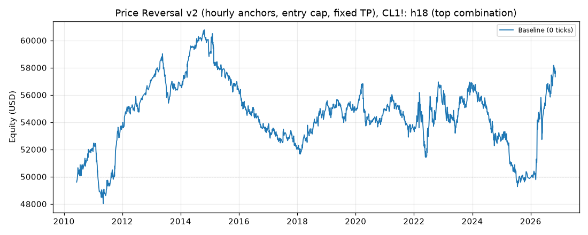

Files: [grid](../../../results/price_reversal_v2/h18/grid.csv), [trades 0 ticks](../../../results/price_reversal_v2/h18/trades_slippage0.csv), [summary](../../../results/price_reversal_v2/h18/summary.json)

### Results after commission

#### Overview

| Metric | Value |
|---|---|
| Net profit | 7,334.50 USD (14.67%) |
| Total closed trades | 1,775 |
| Percent profitable | 57.69% |
| Profit factor | 1.047 |
| Max equity drawdown | 11,572.74 USD (23.15%) |
| Avg trade | 4.13 USD |
| Avg # bars in trades | 17 |

#### Performance

| Metric | All | Long | Short |
|---|---|---|---|
| Net profit | 7,334.50 USD (14.67%) | 4,264.76 USD (8.53%) | 3,069.74 USD (6.14%) |
| Gross profit | 164,933.52 USD (329.87%) | 83,894.02 USD (167.79%) | 81,039.50 USD (162.08%) |
| Gross loss | 157,599.02 USD (315.20%) | 79,629.26 USD (159.26%) | 77,969.76 USD (155.94%) |
| Commission paid | 7,135.50 USD | 3,465.24 USD | 3,670.26 USD |

| Account | Value |
|---|---|
| Initial capital | 50,000.00 USD |
| Buy & hold return (TV-style, all capital at the first entry) | 9,358.89 USD (18.72%) |
| Max equity run-up (intrabar) | 13,191.84 USD (26.38%) |
| Max equity drawdown (intrabar) | 11,572.74 USD (23.15%) |
| Open P&L | 0.00 USD |
| Max contracts held | 1 |

#### Trades analysis

| Metric | All | Long | Short |
|---|---|---|---|
| Total closed trades | 1,775 | 862 | 913 |
| Winning trades | 1,024 | 499 | 525 |
| Losing trades | 751 | 363 | 388 |
| Even trades | 0 | 0 | 0 |
| Percent profitable | 57.69% | 57.89% | 57.50% |
| Avg P&L | 4.13 USD | 4.95 USD | 3.36 USD |
| Avg P&L % | -0.00% | -0.01% | -0.00% |
| Avg winning trade | 161.07 USD | 168.12 USD | 154.36 USD |
| Avg losing trade | 209.85 USD | 219.36 USD | 200.95 USD |
| Ratio avg win / avg loss | 0.768 | 0.766 | 0.768 |
| Largest winning trade | 2,855.98 USD | 2,855.98 USD | 1,435.98 USD |
| Largest winning trade % | 3.30% | 3.30% | 1.35% |
| Largest losing trade | 2,244.02 USD | 2,244.02 USD | 934.02 USD |
| Largest losing trade % | 3.08% | 3.08% | 1.87% |
| Avg # bars in trades | 17 | 18 | 15 |
| Avg # bars in winning trades | 15 | 17 | 14 |
| Avg # bars in losing trades | 19 | 21 | 17 |

#### Risk/performance ratios

| Metric | Value |
|---|---|
| Sharpe ratio | -0.063 |
| Sortino ratio | -0.091 |
| Profit factor | 1.047 |
| Margin calls | 0 |

#### List of trades (last 10, newest first; full list in the trades CSV)

| Trade # | Type | Signal | Date/Time (UTC) | Price | Contracts | Profit | Cum. profit | Run-up | Drawdown |
|---|---|---|---|---|---|---|---|---|---|
| 1775 | Exit long | Exit | 2026-11-04 16:15 | 91.60 | 1 | -434.02 USD (-0.47%) | 7,334.50 USD | 470.00 USD | 430.00 USD |
|  | Entry long | Long | 2026-11-04 16:06 | 92.03 | 1 |  |  |  |  |
| 1774 | Exit short | Exit | 2026-11-03 16:29 | 95.65 | 1 | 195.98 USD (0.20%) | 7,768.52 USD | 200.00 USD | 20.00 USD |
|  | Entry short | Short | 2026-11-03 16:26 | 95.85 | 1 |  |  |  |  |
| 1773 | Exit long | Exit | 2026-11-02 16:39 | 96.74 | 1 | -344.02 USD (-0.35%) | 7,572.54 USD | 0.00 USD | 340.00 USD |
|  | Entry long | Long | 2026-11-02 16:30 | 97.08 | 1 |  |  |  |  |
| 1772 | Exit long | Exit | 2026-10-30 15:15 | 104.27 | 1 | 105.98 USD (0.10%) | 7,916.56 USD | 110.00 USD | 10.00 USD |
|  | Entry long | Long | 2026-10-30 15:14 | 104.16 | 1 |  |  |  |  |
| 1771 | Exit long | Exit | 2026-10-29 15:36 | 100.38 | 1 | 75.98 USD (0.08%) | 7,810.58 USD | 80.00 USD | 190.00 USD |
|  | Entry long | Long | 2026-10-29 15:15 | 100.30 | 1 |  |  |  |  |
| 1770 | Exit long | Exit | 2026-10-28 15:26 | 102.48 | 1 | 105.98 USD (0.10%) | 7,734.60 USD | 110.00 USD | 20.00 USD |
|  | Entry long | Long | 2026-10-28 15:23 | 102.37 | 1 |  |  |  |  |
| 1769 | Exit long | Exit | 2026-10-27 15:42 | 99.85 | 1 | -354.02 USD (-0.35%) | 7,628.62 USD | 90.00 USD | 350.00 USD |
|  | Entry long | Long | 2026-10-27 15:11 | 100.20 | 1 |  |  |  |  |
| 1768 | Exit long | Exit | 2026-10-23 15:22 | 102.03 | 1 | -184.02 USD (-0.18%) | 7,982.64 USD | 0.00 USD | 180.00 USD |
|  | Entry long | Long | 2026-10-23 15:22 | 102.21 | 1 |  |  |  |  |
| 1767 | Exit short | Exit | 2026-10-14 15:15 | 95.00 | 1 | 345.98 USD (0.36%) | 8,166.66 USD | 350.00 USD | 40.00 USD |
|  | Entry short | Short | 2026-10-14 15:12 | 95.35 | 1 |  |  |  |  |
| 1766 | Exit long | Exit | 2026-10-12 15:23 | 93.82 | 1 | 135.98 USD (0.15%) | 7,820.68 USD | 140.00 USD | 20.00 USD |
|  | Entry long | Long | 2026-10-12 15:22 | 93.68 | 1 |  |  |  |  |

#### By year (extra, not a TV tab)

| Year | Trades | Net profit | % profitable | Profit factor |
|---|---|---|---|---|
| 2010 | 54 | 1,852.92 USD | 64.81% | 1.372 |
| 2011 | 99 | 1,782.02 USD | 61.62% | 1.164 |
| 2012 | 80 | 3,368.40 USD | 67.50% | 1.697 |
| 2013 | 85 | -331.70 USD | 60.00% | 0.954 |
| 2014 | 89 | 2,342.22 USD | 66.29% | 1.398 |
| 2015 | 99 | -2,667.98 USD | 52.53% | 0.748 |
| 2016 | 122 | -2,650.44 USD | 55.74% | 0.710 |
| 2017 | 119 | -1,678.38 USD | 51.26% | 0.785 |
| 2018 | 104 | 3,321.92 USD | 63.46% | 1.488 |
| 2019 | 109 | -348.18 USD | 55.96% | 0.956 |
| 2020 | 116 | -86.32 USD | 61.21% | 0.990 |
| 2021 | 111 | -1,446.22 USD | 54.05% | 0.840 |
| 2022 | 106 | 2,223.88 USD | 54.72% | 1.127 |
| 2023 | 137 | 1,179.26 USD | 56.93% | 1.090 |
| 2024 | 130 | -4,182.60 USD | 50.00% | 0.673 |
| 2025 | 111 | -2,736.22 USD | 49.55% | 0.720 |
| 2026 | 104 | 7,391.92 USD | 66.35% | 1.677 |

#### Exit reasons (extra)

| Reason | Trades |
|---|---|
| limit | 1017 |
| stop | 746 |
| close | 11 |
| roll | 1 |

- Session-end exits: 11.
- Roll exits: 1.

### Best settings by metric

Each winner needs at least 30 closed trades. Undefined values are excluded. Ties: higher net profit, higher profit factor, then grid order. Ruin loss threshold: 25,000.00 USD from starting capital. All selections are in-sample. MAE/MFE objectives use the mean of the per-trade maxima.

| Metric | Goal | Best value | Grid order | Trades | Eligible settings | Parameters |
|---|---|---|---|---|---|---|
| Net profit | max | 7,334.50 USD | [2](../../../results/price_reversal_v2/h18/metric_winners/order_2/trades_slippage0.csv) | 1775 | 64 | window=30, atr_mult=0.5, swing=1, target=far |
| Win rate | max | 64.78% | [1](../../../results/price_reversal_v2/h18/metric_winners/order_1/trades_slippage0.csv) | 1769 | 64 | window=30, atr_mult=0.5, swing=1, target=near |
| Expectancy | max | 4.13 USD | [2](../../../results/price_reversal_v2/h18/metric_winners/order_2/trades_slippage0.csv) | 1775 | 64 | window=30, atr_mult=0.5, swing=1, target=far |
| Profit factor | max | 1.047 | [2](../../../results/price_reversal_v2/h18/metric_winners/order_2/trades_slippage0.csv) | 1775 | 64 | window=30, atr_mult=0.5, swing=1, target=far |
| Payoff ratio | max | 1.914 | [16](../../../results/price_reversal_v2/h18/metric_winners/order_16/trades_slippage0.csv) | 1671 | 64 | window=30, atr_mult=2.0, swing=1, target=rr2 |
| Risk of ruin (estimate) | min | 2.95% | [2](../../../results/price_reversal_v2/h18/metric_winners/order_2/trades_slippage0.csv) | 1775 | 64 | window=30, atr_mult=0.5, swing=1, target=far |
| Maximum drawdown | min | 11,572.74 USD | [2](../../../results/price_reversal_v2/h18/metric_winners/order_2/trades_slippage0.csv) | 1775 | 64 | window=30, atr_mult=0.5, swing=1, target=far |
| Consecutive losses | min | 7.000 | [2](../../../results/price_reversal_v2/h18/metric_winners/order_2/trades_slippage0.csv) | 1775 | 64 | window=30, atr_mult=0.5, swing=1, target=far |
| Sharpe ratio | max | 0.095 | [38](../../../results/price_reversal_v2/h18/metric_winners/order_38/trades_slippage0.csv) | 4408 | 64 | window=90, atr_mult=1.0, swing=1, target=far |
| Sortino ratio | max | 22.073 | [59](../../../results/price_reversal_v2/h18/metric_winners/order_59/trades_slippage0.csv) | 4849 | 64 | window=120, atr_mult=1.5, swing=1, target=rr1 |
| R-multiple | max | 0.006 | [2](../../../results/price_reversal_v2/h18/metric_winners/order_2/trades_slippage0.csv) | 1775 | 64 | window=30, atr_mult=0.5, swing=1, target=far |
| Maximum adverse excursion (MAE) | min | 116.32 USD | [1](../../../results/price_reversal_v2/h18/metric_winners/order_1/trades_slippage0.csv) | 1769 | 64 | window=30, atr_mult=0.5, swing=1, target=near |
| Maximum favorable excursion (MFE) | max | 244.88 USD | [16](../../../results/price_reversal_v2/h18/metric_winners/order_16/trades_slippage0.csv) | 1671 | 64 | window=30, atr_mult=2.0, swing=1, target=rr2 |

- **Net profit:** Sum of closed-trade profit after commission; excludes open P&L.
- **Win rate:** Winning closed trades divided by all closed trades, including breakevens.
- **Expectancy:** Mean net profit per closed trade, including losses and breakevens.
- **Profit factor:** Gross winning profit divided by gross losing profit, both after commission. Undefined without losses.
- **Payoff ratio:** Average net winning trade divided by the absolute average net losing trade. Requires wins and losses.
- **Risk of ruin (estimate):** Infinite-horizon diffusion estimate of losing the declared amount from starting capital. Assumes independent, stationary, fixed-size net trade P&L; ignores intratrade losses and margin.
- **Maximum drawdown:** Largest equity drawdown under the tester's intrabar TradingView convention, including an open trade at the end.
- **Consecutive losses:** Longest streak of losing closed trades in execution order. A win or breakeven resets the streak.
- **Sharpe ratio:** Monthly marked-to-market excess return divided by population standard deviation, using 2% annual risk-free rate; not annualized.
- **Sortino ratio:** Monthly marked-to-market excess return divided by downside deviation about the risk-free rate; not annualized.
- **R-multiple:** Mean net trade profit / initial stop risk in dollars. Risk is actual fill to initial stop, before costs. Requires positive initial risk for every closed trade; R standard deviation and mean / standard deviation describe consistency.
- **Maximum adverse excursion (MAE):** Mean of each closed trade's maximum adverse price excursion in dollars, before commission; only the exposed intrabar path counts.
- **Maximum favorable excursion (MFE):** Mean of each closed trade's maximum favorable price excursion in dollars, before commission; only the exposed intrabar path counts. Unrealized opportunity, not realized profit.

Full selection metadata: [metric_winners.json](../../../results/price_reversal_v2/h18/metric_winners.json).

### Top 10 combinations

| # | window | atr_mult | swing | target | Net profit | Trades | % profitable | Profit factor | Max DD |
|---|---|---|---|---|---|---|---|---|---|
| 1 | 30 | 0.5 | 1 | far | 7,334.50 USD | 1,775 | 57.69% | 1.047 | 11,572.74 USD |
| 2 | 30 | 1.0 | 1 | far | 5,962.90 USD | 1,855 | 57.74% | 1.036 | 13,285.70 USD |
| 3 | 30 | 2.0 | 1 | far | 3,846.70 USD | 1,665 | 55.98% | 1.024 | 13,368.78 USD |
| 4 | 30 | 1.5 | 1 | far | 3,529.78 USD | 1,811 | 57.21% | 1.022 | 14,815.20 USD |
| 5 | 30 | 0.5 | 1 | near | 1,888.62 USD | 1,769 | 64.78% | 1.014 | 13,682.64 USD |
| 6 | 30 | 0.5 | 1 | rr1 | 1,460.38 USD | 1,781 | 50.48% | 1.008 | 18,448.00 USD |
| 7 | 30 | 1.0 | 1 | near | 897.02 USD | 1,849 | 64.63% | 1.006 | 14,887.06 USD |
| 8 | 30 | 1.0 | 1 | rr1 | -321.22 USD | 1,861 | 50.03% | 0.998 | 20,621.26 USD |
| 9 | 30 | 2.0 | 1 | near | -593.20 USD | 1,660 | 62.11% | 0.996 | 15,378.68 USD |
| 10 | 30 | 1.5 | 1 | near | -870.12 USD | 1,806 | 64.01% | 0.994 | 15,937.86 USD |

Profitable combinations: 7 of 64.

## Variant: h19

**Top combination:** `anchor=h19`, `window=60`, `atr_mult=2.0`, `swing=1`, `target=near`

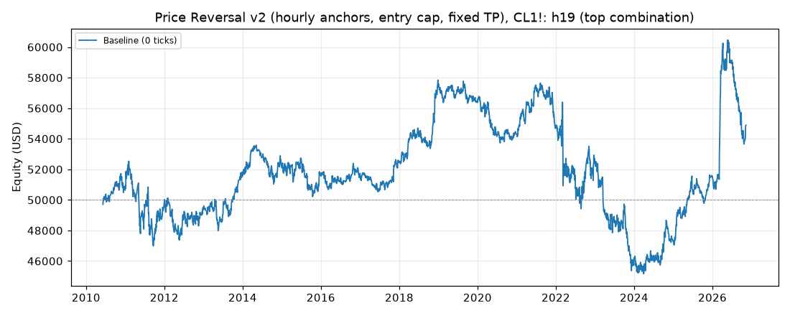

Files: [grid](../../../results/price_reversal_v2/h19/grid.csv), [trades 0 ticks](../../../results/price_reversal_v2/h19/trades_slippage0.csv), [summary](../../../results/price_reversal_v2/h19/summary.json)

### Results after commission

#### Overview

| Metric | Value |
|---|---|
| Net profit | 4,891.62 USD (9.78%) |
| Total closed trades | 3,119 |
| Percent profitable | 59.63% |
| Profit factor | 1.022 |
| Max equity drawdown | 12,706.98 USD (25.41%) |
| Avg trade | 1.57 USD |
| Avg # bars in trades | 18 |

#### Performance

| Metric | All | Long | Short |
|---|---|---|---|
| Net profit | 4,891.62 USD (9.78%) | 6,745.38 USD (13.49%) | -1,853.76 USD (-3.71%) |
| Gross profit | 232,302.80 USD (464.61%) | 118,603.26 USD (237.21%) | 113,699.54 USD (227.40%) |
| Gross loss | 227,411.18 USD (454.82%) | 111,857.88 USD (223.72%) | 115,553.30 USD (231.11%) |
| Commission paid | 12,538.38 USD | 6,154.62 USD | 6,383.76 USD |

| Account | Value |
|---|---|
| Initial capital | 50,000.00 USD |
| Buy & hold return (TV-style, all capital at the first entry) | 9,466.63 USD (18.93%) |
| Max equity run-up (intrabar) | 15,716.88 USD (31.43%) |
| Max equity drawdown (intrabar) | 12,706.98 USD (25.41%) |
| Open P&L | 0.00 USD |
| Max contracts held | 1 |

#### Trades analysis

| Metric | All | Long | Short |
|---|---|---|---|
| Total closed trades | 3,119 | 1,531 | 1,588 |
| Winning trades | 1,860 | 937 | 923 |
| Losing trades | 1,259 | 594 | 665 |
| Even trades | 0 | 0 | 0 |
| Percent profitable | 59.63% | 61.20% | 58.12% |
| Avg P&L | 1.57 USD | 4.41 USD | -1.17 USD |
| Avg P&L % | 0.00% | 0.00% | -0.00% |
| Avg winning trade | 124.89 USD | 126.58 USD | 123.18 USD |
| Avg losing trade | 180.63 USD | 188.31 USD | 173.76 USD |
| Ratio avg win / avg loss | 0.691 | 0.672 | 0.709 |
| Largest winning trade | 1,775.98 USD | 1,275.98 USD | 1,775.98 USD |
| Largest winning trade % | 1.93% | 1.90% | 1.93% |
| Largest losing trade | 3,964.02 USD | 3,964.02 USD | 1,004.02 USD |
| Largest losing trade % | 3.17% | 3.17% | 2.11% |
| Avg # bars in trades | 18 | 19 | 17 |
| Avg # bars in winning trades | 17 | 18 | 15 |
| Avg # bars in losing trades | 21 | 21 | 21 |

#### Risk/performance ratios

| Metric | Value |
|---|---|
| Sharpe ratio | -0.058 |
| Sortino ratio | -0.089 |
| Profit factor | 1.022 |
| Margin calls | 0 |

#### List of trades (last 10, newest first; full list in the trades CSV)

| Trade # | Type | Signal | Date/Time (UTC) | Price | Contracts | Profit | Cum. profit | Run-up | Drawdown |
|---|---|---|---|---|---|---|---|---|---|
| 3119 | Exit long | Exit | 2026-11-09 17:57 | 87.62 | 1 | 25.98 USD (0.03%) | 4,891.62 USD | 30.00 USD | 130.00 USD |
|  | Entry long | Long | 2026-11-09 17:50 | 87.59 | 1 |  |  |  |  |
| 3118 | Exit long | Exit | 2026-11-06 17:11 | 90.19 | 1 | 95.98 USD (0.11%) | 4,865.64 USD | 100.00 USD | 30.00 USD |
|  | Entry long | Long | 2026-11-06 17:11 | 90.09 | 1 |  |  |  |  |
| 3117 | Exit short | Exit | 2026-11-05 18:00 | 90.21 | 1 | 175.98 USD (0.19%) | 4,769.66 USD | 180.00 USD | 120.00 USD |
|  | Entry short | Short | 2026-11-05 17:55 | 90.39 | 1 |  |  |  |  |
| 3116 | Exit long | Exit | 2026-11-04 19:48 | 88.49 | 1 | 555.98 USD (0.63%) | 4,593.68 USD | 560.00 USD | 340.00 USD |
|  | Entry long | Long | 2026-11-04 17:42 | 87.93 | 1 |  |  |  |  |
| 3115 | Exit long | Exit | 2026-11-03 17:18 | 95.90 | 1 | 65.98 USD (0.07%) | 4,037.70 USD | 70.00 USD | 0.00 USD |
|  | Entry long | Long | 2026-11-03 17:17 | 95.83 | 1 |  |  |  |  |
| 3114 | Exit short | Exit | 2026-11-02 17:47 | 96.49 | 1 | 25.98 USD (0.03%) | 3,971.72 USD | 30.00 USD | 30.00 USD |
|  | Entry short | Short | 2026-11-02 17:47 | 96.52 | 1 |  |  |  |  |
| 3113 | Exit short | Exit | 2026-10-30 16:32 | 104.08 | 1 | 195.98 USD (0.19%) | 3,945.74 USD | 200.00 USD | 40.00 USD |
|  | Entry short | Short | 2026-10-30 16:26 | 104.28 | 1 |  |  |  |  |
| 3112 | Exit short | Exit | 2026-10-23 16:25 | 103.07 | 1 | 25.98 USD (0.03%) | 3,749.76 USD | 30.00 USD | 0.00 USD |
|  | Entry short | Short | 2026-10-23 16:25 | 103.10 | 1 |  |  |  |  |
| 3111 | Exit long | Exit | 2026-10-23 16:15 | 103.03 | 1 | 65.98 USD (0.06%) | 3,723.78 USD | 70.00 USD | 40.00 USD |
|  | Entry long | Long | 2026-10-23 16:13 | 102.96 | 1 |  |  |  |  |
| 3110 | Exit short | Exit | 2026-10-22 16:21 | 98.86 | 1 | -134.02 USD (-0.14%) | 3,657.80 USD | 30.00 USD | 130.00 USD |
|  | Entry short | Short | 2026-10-22 16:14 | 98.73 | 1 |  |  |  |  |

#### By year (extra, not a TV tab)

| Year | Trades | Net profit | % profitable | Profit factor |
|---|---|---|---|---|
| 2010 | 70 | 638.60 USD | 64.29% | 1.120 |
| 2011 | 184 | -849.68 USD | 61.96% | 0.962 |
| 2012 | 173 | -345.46 USD | 56.07% | 0.976 |
| 2013 | 170 | 2,186.60 USD | 64.12% | 1.218 |
| 2014 | 162 | 468.76 USD | 61.11% | 1.046 |
| 2015 | 183 | -545.66 USD | 62.30% | 0.958 |
| 2016 | 169 | 190.62 USD | 62.13% | 1.024 |
| 2017 | 181 | 692.38 USD | 60.77% | 1.100 |
| 2018 | 203 | 5,073.94 USD | 66.01% | 1.530 |
| 2019 | 187 | -1,131.74 USD | 58.82% | 0.878 |
| 2020 | 185 | -2,073.70 USD | 55.68% | 0.826 |
| 2021 | 206 | 481.88 USD | 54.85% | 1.037 |
| 2022 | 230 | -2,234.60 USD | 59.57% | 0.927 |
| 2023 | 219 | -6,390.38 USD | 51.14% | 0.702 |
| 2024 | 205 | 1,185.90 USD | 56.59% | 1.088 |
| 2025 | 202 | 4,177.96 USD | 64.85% | 1.485 |
| 2026 | 190 | 3,366.20 USD | 58.42% | 1.170 |

#### Exit reasons (extra)

| Reason | Trades |
|---|---|
| limit | 1838 |
| stop | 1250 |
| close | 31 |

- Session-end exits: 31.
- Roll exits: 0.

### Best settings by metric

Each winner needs at least 30 closed trades. Undefined values are excluded. Ties: higher net profit, higher profit factor, then grid order. Ruin loss threshold: 25,000.00 USD from starting capital. All selections are in-sample. MAE/MFE objectives use the mean of the per-trade maxima.

| Metric | Goal | Best value | Grid order | Trades | Eligible settings | Parameters |
|---|---|---|---|---|---|---|
| Net profit | max | 4,891.62 USD | [29](../../../results/price_reversal_v2/h19/metric_winners/order_29/trades_slippage0.csv) | 3119 | 64 | window=60, atr_mult=2.0, swing=1, target=near |
| Win rate | max | 64.52% | [1](../../../results/price_reversal_v2/h19/metric_winners/order_1/trades_slippage0.csv) | 1598 | 64 | window=30, atr_mult=0.5, swing=1, target=near |
| Expectancy | max | 1.57 USD | [29](../../../results/price_reversal_v2/h19/metric_winners/order_29/trades_slippage0.csv) | 3119 | 64 | window=60, atr_mult=2.0, swing=1, target=near |
| Profit factor | max | 1.022 | [29](../../../results/price_reversal_v2/h19/metric_winners/order_29/trades_slippage0.csv) | 3119 | 64 | window=60, atr_mult=2.0, swing=1, target=near |
| Payoff ratio | max | 1.873 | [24](../../../results/price_reversal_v2/h19/metric_winners/order_24/trades_slippage0.csv) | 3233 | 64 | window=60, atr_mult=1.0, swing=1, target=rr2 |
| Risk of ruin (estimate) | min | 17.84% | [29](../../../results/price_reversal_v2/h19/metric_winners/order_29/trades_slippage0.csv) | 3119 | 64 | window=60, atr_mult=2.0, swing=1, target=near |
| Maximum drawdown | min | 12,706.98 USD | [29](../../../results/price_reversal_v2/h19/metric_winners/order_29/trades_slippage0.csv) | 3119 | 64 | window=60, atr_mult=2.0, swing=1, target=near |
| Consecutive losses | min | 6.000 | [13](../../../results/price_reversal_v2/h19/metric_winners/order_13/trades_slippage0.csv) | 1460 | 64 | window=30, atr_mult=2.0, swing=1, target=near |
| Sharpe ratio | max | 0.083 | [64](../../../results/price_reversal_v2/h19/metric_winners/order_64/trades_slippage0.csv) | 4495 | 64 | window=120, atr_mult=2.0, swing=1, target=rr2 |
| Sortino ratio | max | 0.298 | [56](../../../results/price_reversal_v2/h19/metric_winners/order_56/trades_slippage0.csv) | 4603 | 64 | window=120, atr_mult=1.0, swing=1, target=rr2 |
| R-multiple | max | -0.015 | [1](../../../results/price_reversal_v2/h19/metric_winners/order_1/trades_slippage0.csv) | 1598 | 16 | window=30, atr_mult=0.5, swing=1, target=near |
| Maximum adverse excursion (MAE) | min | 96.53 USD | [1](../../../results/price_reversal_v2/h19/metric_winners/order_1/trades_slippage0.csv) | 1598 | 64 | window=30, atr_mult=0.5, swing=1, target=near |
| Maximum favorable excursion (MFE) | max | 206.90 USD | [64](../../../results/price_reversal_v2/h19/metric_winners/order_64/trades_slippage0.csv) | 4495 | 64 | window=120, atr_mult=2.0, swing=1, target=rr2 |

- **Net profit:** Sum of closed-trade profit after commission; excludes open P&L.
- **Win rate:** Winning closed trades divided by all closed trades, including breakevens.
- **Expectancy:** Mean net profit per closed trade, including losses and breakevens.
- **Profit factor:** Gross winning profit divided by gross losing profit, both after commission. Undefined without losses.
- **Payoff ratio:** Average net winning trade divided by the absolute average net losing trade. Requires wins and losses.
- **Risk of ruin (estimate):** Infinite-horizon diffusion estimate of losing the declared amount from starting capital. Assumes independent, stationary, fixed-size net trade P&L; ignores intratrade losses and margin.
- **Maximum drawdown:** Largest equity drawdown under the tester's intrabar TradingView convention, including an open trade at the end.
- **Consecutive losses:** Longest streak of losing closed trades in execution order. A win or breakeven resets the streak.
- **Sharpe ratio:** Monthly marked-to-market excess return divided by population standard deviation, using 2% annual risk-free rate; not annualized.
- **Sortino ratio:** Monthly marked-to-market excess return divided by downside deviation about the risk-free rate; not annualized.
- **R-multiple:** Mean net trade profit / initial stop risk in dollars. Risk is actual fill to initial stop, before costs. Requires positive initial risk for every closed trade; R standard deviation and mean / standard deviation describe consistency.
- **Maximum adverse excursion (MAE):** Mean of each closed trade's maximum adverse price excursion in dollars, before commission; only the exposed intrabar path counts.
- **Maximum favorable excursion (MFE):** Mean of each closed trade's maximum favorable price excursion in dollars, before commission; only the exposed intrabar path counts. Unrealized opportunity, not realized profit.

Full selection metadata: [metric_winners.json](../../../results/price_reversal_v2/h19/metric_winners.json).

### Top 10 combinations

| # | window | atr_mult | swing | target | Net profit | Trades | % profitable | Profit factor | Max DD |
|---|---|---|---|---|---|---|---|---|---|
| 1 | 60 | 2.0 | 1 | near | 4,891.62 USD | 3,119 | 59.63% | 1.022 | 12,706.98 USD |
| 2 | 60 | 1.5 | 1 | near | 2,404.60 USD | 3,270 | 60.76% | 1.010 | 13,219.30 USD |
| 3 | 60 | 1.0 | 1 | near | 1,123.90 USD | 3,305 | 61.00% | 1.005 | 13,304.16 USD |
| 4 | 60 | 0.5 | 1 | near | -1,952.14 USD | 3,207 | 60.68% | 0.991 | 13,034.46 USD |
| 5 | 90 | 2.0 | 1 | near | -2,201.50 USD | 4,075 | 58.23% | 0.993 | 18,050.28 USD |
| 6 | 90 | 1.5 | 1 | near | -4,577.92 USD | 4,196 | 59.27% | 0.985 | 20,230.98 USD |
| 7 | 60 | 2.0 | 1 | far | -4,932.60 USD | 3,130 | 52.78% | 0.981 | 18,762.06 USD |
| 8 | 120 | 2.0 | 1 | near | -5,411.54 USD | 4,677 | 57.47% | 0.985 | 19,170.90 USD |
| 9 | 90 | 1.0 | 1 | near | -5,962.44 USD | 4,222 | 59.40% | 0.981 | 20,341.08 USD |
| 10 | 120 | 1.5 | 1 | near | -6,615.40 USD | 4,770 | 58.43% | 0.982 | 22,109.44 USD |

Profitable combinations: 3 of 64.

## Variant: h20

**Top combination:** `anchor=h20`, `window=90`, `atr_mult=0.5`, `swing=1`, `target=rr1`

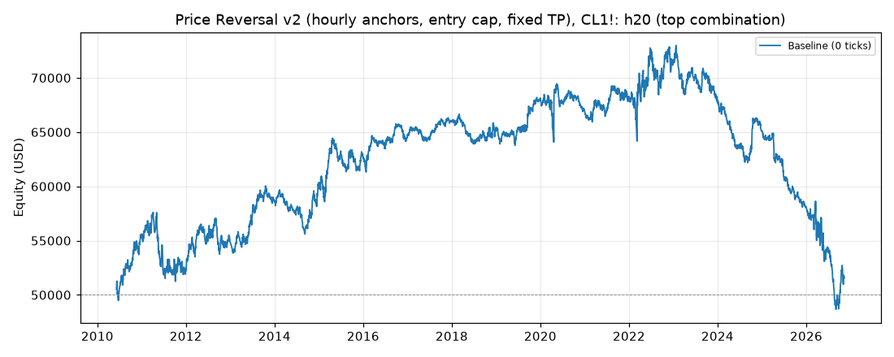

Files: [grid](../../../results/price_reversal_v2/h20/grid.csv), [trades 0 ticks](../../../results/price_reversal_v2/h20/trades_slippage0.csv), [summary](../../../results/price_reversal_v2/h20/summary.json)

### Results after commission

#### Overview

| Metric | Value |
|---|---|
| Net profit | 1,595.98 USD (3.19%) |
| Total closed trades | 4,001 |
| Percent profitable | 49.94% |
| Profit factor | 1.004 |
| Max equity drawdown | 24,764.78 USD (49.53%) |
| Avg trade | 0.40 USD |
| Avg # bars in trades | 22 |

#### Performance

| Metric | All | Long | Short |
|---|---|---|---|
| Net profit | 1,595.98 USD (3.19%) | 4,573.82 USD (9.15%) | -2,977.84 USD (-5.96%) |
| Gross profit | 365,298.04 USD (730.60%) | 191,193.82 USD (382.39%) | 174,104.22 USD (348.21%) |
| Gross loss | 363,702.06 USD (727.40%) | 186,620.00 USD (373.24%) | 177,082.06 USD (354.16%) |
| Commission paid | 16,084.02 USD | 8,076.18 USD | 8,007.84 USD |

| Account | Value |
|---|---|
| Initial capital | 50,000.00 USD |
| Buy & hold return (TV-style, all capital at the first entry) | 9,160.99 USD (18.32%) |
| Max equity run-up (intrabar) | 23,625.68 USD (47.25%) |
| Max equity drawdown (intrabar) | 24,764.78 USD (49.53%) |
| Open P&L | 0.00 USD |
| Max contracts held | 1 |

#### Trades analysis

| Metric | All | Long | Short |
|---|---|---|---|
| Total closed trades | 4,001 | 2,009 | 1,992 |
| Winning trades | 1,998 | 1,009 | 989 |
| Losing trades | 2,003 | 1,000 | 1,003 |
| Even trades | 0 | 0 | 0 |
| Percent profitable | 49.94% | 50.22% | 49.65% |
| Avg P&L | 0.40 USD | 2.28 USD | -1.49 USD |
| Avg P&L % | 0.01% | 0.02% | -0.00% |
| Avg winning trade | 182.83 USD | 189.49 USD | 176.04 USD |
| Avg losing trade | 181.58 USD | 186.62 USD | 176.55 USD |
| Ratio avg win / avg loss | 1.007 | 1.015 | 0.997 |
| Largest winning trade | 3,815.98 USD | 3,815.98 USD | 2,075.98 USD |
| Largest winning trade % | 36.98% | 36.98% | 3.07% |
| Largest losing trade | 1,604.02 USD | 1,224.02 USD | 1,604.02 USD |
| Largest losing trade % | 4.48% | 1.96% | 4.48% |
| Avg # bars in trades | 22 | 22 | 21 |
| Avg # bars in winning trades | 22 | 25 | 20 |
| Avg # bars in losing trades | 21 | 20 | 22 |

#### Risk/performance ratios

| Metric | Value |
|---|---|
| Sharpe ratio | -0.078 |
| Sortino ratio | -0.102 |
| Profit factor | 1.004 |
| Margin calls | 0 |

#### List of trades (last 10, newest first; full list in the trades CSV)

| Trade # | Type | Signal | Date/Time (UTC) | Price | Contracts | Profit | Cum. profit | Run-up | Drawdown |
|---|---|---|---|---|---|---|---|---|---|
| 4001 | Exit long | Exit | 2026-11-09 19:13 | 87.67 | 1 | 105.98 USD (0.12%) | 1,595.98 USD | 110.00 USD | 0.00 USD |
|  | Entry long | Long | 2026-11-09 19:12 | 87.56 | 1 |  |  |  |  |
| 4000 | Exit short | Exit | 2026-11-06 19:08 | 90.61 | 1 | -314.02 USD (-0.35%) | 1,490.00 USD | 90.00 USD | 310.00 USD |
|  | Entry short | Short | 2026-11-06 19:02 | 90.30 | 1 |  |  |  |  |
| 3999 | Exit long | Exit | 2026-11-06 18:23 | 90.06 | 1 | 255.98 USD (0.29%) | 1,804.02 USD | 260.00 USD | 90.00 USD |
|  | Entry long | Long | 2026-11-06 18:09 | 89.80 | 1 |  |  |  |  |
| 3998 | Exit short | Exit | 2026-11-05 18:43 | 90.28 | 1 | 275.98 USD (0.30%) | 1,548.04 USD | 280.00 USD | 220.00 USD |
|  | Entry short | Short | 2026-11-05 18:21 | 90.56 | 1 |  |  |  |  |
| 3997 | Exit long | Exit | 2026-11-03 19:12 | 96.13 | 1 | 185.98 USD (0.19%) | 1,272.06 USD | 190.00 USD | 110.00 USD |
|  | Entry long | Long | 2026-11-03 18:54 | 95.94 | 1 |  |  |  |  |
| 3996 | Exit short | Exit | 2026-11-03 18:16 | 95.88 | 1 | 115.98 USD (0.12%) | 1,086.08 USD | 120.00 USD | 0.00 USD |
|  | Entry short | Short | 2026-11-03 18:16 | 96.00 | 1 |  |  |  |  |
| 3995 | Exit short | Exit | 2026-11-02 18:52 | 96.32 | 1 | -184.02 USD (-0.19%) | 970.10 USD | 30.00 USD | 180.00 USD |
|  | Entry short | Short | 2026-11-02 18:47 | 96.14 | 1 |  |  |  |  |
| 3994 | Exit long | Exit | 2026-10-30 17:59 | 104.31 | 1 | -384.02 USD (-0.37%) | 1,154.12 USD | 30.00 USD | 380.00 USD |
|  | Entry long | Long | 2026-10-30 17:50 | 104.69 | 1 |  |  |  |  |
| 3993 | Exit short | Exit | 2026-10-29 17:30 | 101.91 | 1 | -324.02 USD (-0.32%) | 1,538.14 USD | 270.00 USD | 320.00 USD |
|  | Entry short | Short | 2026-10-29 17:18 | 101.59 | 1 |  |  |  |  |
| 3992 | Exit long | Exit | 2026-10-28 17:51 | 102.74 | 1 | -154.02 USD (-0.15%) | 1,862.16 USD | 110.00 USD | 150.00 USD |
|  | Entry long | Long | 2026-10-28 17:45 | 102.89 | 1 |  |  |  |  |

#### By year (extra, not a TV tab)

| Year | Trades | Net profit | % profitable | Profit factor |
|---|---|---|---|---|
| 2010 | 123 | 5,375.54 USD | 59.35% | 1.464 |
| 2011 | 228 | -3,076.56 USD | 46.93% | 0.912 |
| 2012 | 230 | 2,625.40 USD | 52.61% | 1.109 |
| 2013 | 211 | 3,601.78 USD | 50.71% | 1.197 |
| 2014 | 194 | 1,830.12 USD | 50.00% | 1.113 |
| 2015 | 249 | 2,199.02 USD | 48.59% | 1.096 |
| 2016 | 258 | 2,202.84 USD | 54.26% | 1.145 |
| 2017 | 232 | 1,247.36 USD | 53.02% | 1.123 |
| 2018 | 239 | -570.78 USD | 49.37% | 0.965 |
| 2019 | 245 | 2,625.10 USD | 54.69% | 1.180 |
| 2020 | 259 | -1,171.18 USD | 44.79% | 0.944 |
| 2021 | 260 | 1,204.80 USD | 53.08% | 1.066 |
| 2022 | 282 | 3,596.36 USD | 50.71% | 1.086 |
| 2023 | 272 | -3,733.44 USD | 46.69% | 0.856 |
| 2024 | 258 | -2,817.16 USD | 45.74% | 0.859 |
| 2025 | 246 | -7,108.92 USD | 46.34% | 0.622 |
| 2026 | 215 | -6,434.30 USD | 46.98% | 0.810 |

#### Exit reasons (extra)

| Reason | Trades |
|---|---|
| stop | 1938 |
| limit | 1920 |
| close | 140 |
| roll | 3 |

- Session-end exits: 140.
- Roll exits: 3.

### Best settings by metric

Each winner needs at least 30 closed trades. Undefined values are excluded. Ties: higher net profit, higher profit factor, then grid order. Ruin loss threshold: 25,000.00 USD from starting capital. All selections are in-sample. MAE/MFE objectives use the mean of the per-trade maxima.

| Metric | Goal | Best value | Grid order | Trades | Eligible settings | Parameters |
|---|---|---|---|---|---|---|
| Net profit | max | 1,595.98 USD | [35](../../../results/price_reversal_v2/h20/metric_winners/order_35/trades_slippage0.csv) | 4001 | 64 | window=90, atr_mult=0.5, swing=1, target=rr1 |
| Win rate | max | 63.60% | [5](../../../results/price_reversal_v2/h20/metric_winners/order_5/trades_slippage0.csv) | 1566 | 64 | window=30, atr_mult=1.0, swing=1, target=near |
| Expectancy | max | 0.40 USD | [35](../../../results/price_reversal_v2/h20/metric_winners/order_35/trades_slippage0.csv) | 4001 | 64 | window=90, atr_mult=0.5, swing=1, target=rr1 |
| Profit factor | max | 1.004 | [35](../../../results/price_reversal_v2/h20/metric_winners/order_35/trades_slippage0.csv) | 4001 | 64 | window=90, atr_mult=0.5, swing=1, target=rr1 |
| Payoff ratio | max | 1.953 | [4](../../../results/price_reversal_v2/h20/metric_winners/order_4/trades_slippage0.csv) | 1467 | 64 | window=30, atr_mult=0.5, swing=1, target=rr2 |
| Risk of ruin (estimate) | min | 68.71% | [35](../../../results/price_reversal_v2/h20/metric_winners/order_35/trades_slippage0.csv) | 4001 | 64 | window=90, atr_mult=0.5, swing=1, target=rr1 |
| Maximum drawdown | min | 13,079.36 USD | [15](../../../results/price_reversal_v2/h20/metric_winners/order_15/trades_slippage0.csv) | 1436 | 64 | window=30, atr_mult=2.0, swing=1, target=rr1 |
| Consecutive losses | min | 7.000 | [1](../../../results/price_reversal_v2/h20/metric_winners/order_1/trades_slippage0.csv) | 1460 | 64 | window=30, atr_mult=0.5, swing=1, target=near |
| Sharpe ratio | max | -0.031 | [64](../../../results/price_reversal_v2/h20/metric_winners/order_64/trades_slippage0.csv) | 4517 | 64 | window=120, atr_mult=2.0, swing=1, target=rr2 |
| Sortino ratio | max | -0.058 | [56](../../../results/price_reversal_v2/h20/metric_winners/order_56/trades_slippage0.csv) | 4630 | 64 | window=120, atr_mult=1.0, swing=1, target=rr2 |
| R-multiple | max | -0.019 | [35](../../../results/price_reversal_v2/h20/metric_winners/order_35/trades_slippage0.csv) | 4001 | 64 | window=90, atr_mult=0.5, swing=1, target=rr1 |
| Maximum adverse excursion (MAE) | min | 90.63 USD | [5](../../../results/price_reversal_v2/h20/metric_winners/order_5/trades_slippage0.csv) | 1566 | 64 | window=30, atr_mult=1.0, swing=1, target=near |
| Maximum favorable excursion (MFE) | max | 201.22 USD | [48](../../../results/price_reversal_v2/h20/metric_winners/order_48/trades_slippage0.csv) | 3987 | 64 | window=90, atr_mult=2.0, swing=1, target=rr2 |

- **Net profit:** Sum of closed-trade profit after commission; excludes open P&L.
- **Win rate:** Winning closed trades divided by all closed trades, including breakevens.
- **Expectancy:** Mean net profit per closed trade, including losses and breakevens.
- **Profit factor:** Gross winning profit divided by gross losing profit, both after commission. Undefined without losses.
- **Payoff ratio:** Average net winning trade divided by the absolute average net losing trade. Requires wins and losses.
- **Risk of ruin (estimate):** Infinite-horizon diffusion estimate of losing the declared amount from starting capital. Assumes independent, stationary, fixed-size net trade P&L; ignores intratrade losses and margin.
- **Maximum drawdown:** Largest equity drawdown under the tester's intrabar TradingView convention, including an open trade at the end.
- **Consecutive losses:** Longest streak of losing closed trades in execution order. A win or breakeven resets the streak.
- **Sharpe ratio:** Monthly marked-to-market excess return divided by population standard deviation, using 2% annual risk-free rate; not annualized.
- **Sortino ratio:** Monthly marked-to-market excess return divided by downside deviation about the risk-free rate; not annualized.
- **R-multiple:** Mean net trade profit / initial stop risk in dollars. Risk is actual fill to initial stop, before costs. Requires positive initial risk for every closed trade; R standard deviation and mean / standard deviation describe consistency.
- **Maximum adverse excursion (MAE):** Mean of each closed trade's maximum adverse price excursion in dollars, before commission; only the exposed intrabar path counts.
- **Maximum favorable excursion (MFE):** Mean of each closed trade's maximum favorable price excursion in dollars, before commission; only the exposed intrabar path counts. Unrealized opportunity, not realized profit.

Full selection metadata: [metric_winners.json](../../../results/price_reversal_v2/h20/metric_winners.json).

### Top 10 combinations

| # | window | atr_mult | swing | target | Net profit | Trades | % profitable | Profit factor | Max DD |
|---|---|---|---|---|---|---|---|---|---|
| 1 | 90 | 0.5 | 1 | rr1 | 1,595.98 USD | 4,001 | 49.94% | 1.004 | 24,764.78 USD |
| 2 | 90 | 2.0 | 1 | rr1 | -1,385.72 USD | 4,086 | 49.58% | 0.996 | 20,002.60 USD |
| 3 | 90 | 1.0 | 1 | rr1 | -2,239.98 USD | 4,199 | 49.49% | 0.994 | 22,132.46 USD |
| 4 | 90 | 1.5 | 1 | rr1 | -2,467.62 USD | 4,181 | 49.68% | 0.994 | 23,278.44 USD |
| 5 | 120 | 0.5 | 1 | rr1 | -2,721.70 USD | 4,585 | 49.42% | 0.993 | 23,705.12 USD |
| 6 | 30 | 0.5 | 1 | rr2 | -7,847.34 USD | 1,467 | 32.79% | 0.953 | 14,809.16 USD |
| 7 | 30 | 1.5 | 1 | near | -7,946.78 USD | 1,539 | 63.48% | 0.915 | 13,674.42 USD |
| 8 | 30 | 0.5 | 1 | near | -7,979.20 USD | 1,460 | 63.36% | 0.911 | 13,232.06 USD |
| 9 | 30 | 0.5 | 1 | rr1 | -8,929.30 USD | 1,465 | 48.87% | 0.931 | 13,353.78 USD |
| 10 | 120 | 1.0 | 1 | rr1 | -9,023.64 USD | 4,782 | 48.93% | 0.979 | 21,323.30 USD |

Profitable combinations: 1 of 64.

## Variant: h21

**Top combination:** `anchor=h21`, `window=30`, `atr_mult=1.5`, `swing=1`, `target=rr1`

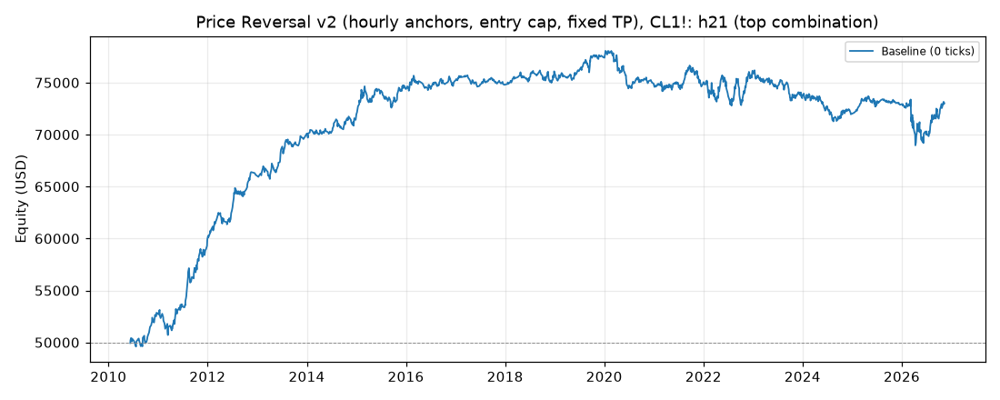

Files: [grid](../../../results/price_reversal_v2/h21/grid.csv), [trades 0 ticks](../../../results/price_reversal_v2/h21/trades_slippage0.csv), [summary](../../../results/price_reversal_v2/h21/summary.json)

### Results after commission

#### Overview

| Metric | Value |
|---|---|
| Net profit | 23,031.16 USD (46.06%) |
| Total closed trades | 1,542 |
| Percent profitable | 52.72% |
| Profit factor | 1.171 |
| Max equity drawdown | 9,297.32 USD (18.59%) |
| Avg trade | 14.94 USD |
| Avg # bars in trades | 29 |

#### Performance

| Metric | All | Long | Short |
|---|---|---|---|
| Net profit | 23,031.16 USD (46.06%) | 18,761.34 USD (37.52%) | 4,269.82 USD (8.54%) |
| Gross profit | 157,961.74 USD (315.92%) | 90,649.04 USD (181.30%) | 67,312.70 USD (134.63%) |
| Gross loss | 134,930.58 USD (269.86%) | 71,887.70 USD (143.78%) | 63,042.88 USD (126.09%) |
| Commission paid | 6,198.84 USD | 3,348.66 USD | 2,850.18 USD |

| Account | Value |
|---|---|
| Initial capital | 50,000.00 USD |
| Buy & hold return (TV-style, all capital at the first entry) | 6,350.89 USD (12.70%) |
| Max equity run-up (intrabar) | 28,523.90 USD (57.05%) |
| Max equity drawdown (intrabar) | 9,297.32 USD (18.59%) |
| Open P&L | 0.00 USD |
| Max contracts held | 1 |

#### Trades analysis

| Metric | All | Long | Short |
|---|---|---|---|
| Total closed trades | 1,542 | 833 | 709 |
| Winning trades | 813 | 448 | 365 |
| Losing trades | 729 | 385 | 344 |
| Even trades | 0 | 0 | 0 |
| Percent profitable | 52.72% | 53.78% | 51.48% |
| Avg P&L | 14.94 USD | 22.52 USD | 6.02 USD |
| Avg P&L % | 0.02% | 0.03% | 0.00% |
| Avg winning trade | 194.29 USD | 202.34 USD | 184.42 USD |
| Avg losing trade | 185.09 USD | 186.72 USD | 183.26 USD |
| Ratio avg win / avg loss | 1.050 | 1.084 | 1.006 |
| Largest winning trade | 1,085.98 USD | 1,085.98 USD | 725.98 USD |
| Largest winning trade % | 1.53% | 1.53% | 1.43% |
| Largest losing trade | 2,104.02 USD | 1,074.02 USD | 2,104.02 USD |
| Largest losing trade % | 4.48% | 1.36% | 4.48% |
| Avg # bars in trades | 29 | 31 | 26 |
| Avg # bars in winning trades | 28 | 30 | 25 |
| Avg # bars in losing trades | 30 | 31 | 28 |

#### Risk/performance ratios

| Metric | Value |
|---|---|
| Sharpe ratio | 0.031 |
| Sortino ratio | 0.047 |
| Profit factor | 1.171 |
| Margin calls | 0 |

#### List of trades (last 10, newest first; full list in the trades CSV)

| Trade # | Type | Signal | Date/Time (UTC) | Price | Contracts | Profit | Cum. profit | Run-up | Drawdown |
|---|---|---|---|---|---|---|---|---|---|
| 1542 | Exit long | Exit | 2026-11-09 19:13 | 87.67 | 1 | 105.98 USD (0.12%) | 23,031.16 USD | 110.00 USD | 0.00 USD |
|  | Entry long | Long | 2026-11-09 19:12 | 87.56 | 1 |  |  |  |  |
| 1541 | Exit short | Exit | 2026-11-06 19:41 | 91.12 | 1 | -234.02 USD (-0.26%) | 22,925.18 USD | 140.00 USD | 230.00 USD |
|  | Entry short | Short | 2026-11-06 19:28 | 90.89 | 1 |  |  |  |  |
| 1540 | Exit long | Exit | 2026-11-04 19:28 | 88.03 | 1 | 195.98 USD (0.22%) | 23,159.20 USD | 200.00 USD | 50.00 USD |
|  | Entry long | Long | 2026-11-04 19:25 | 87.83 | 1 |  |  |  |  |
| 1539 | Exit short | Exit | 2026-10-30 18:25 | 104.23 | 1 | 135.98 USD (0.13%) | 22,963.22 USD | 140.00 USD | 90.00 USD |
|  | Entry short | Short | 2026-10-30 18:21 | 104.37 | 1 |  |  |  |  |
| 1538 | Exit short | Exit | 2026-10-28 18:33 | 102.57 | 1 | 275.98 USD (0.27%) | 22,827.24 USD | 280.00 USD | 260.00 USD |
|  | Entry short | Short | 2026-10-28 18:13 | 102.85 | 1 |  |  |  |  |
| 1537 | Exit long | Exit | 2026-10-22 20:26 | 99.14 | 1 | -394.02 USD (-0.40%) | 22,551.26 USD | 60.00 USD | 390.00 USD |
|  | Entry long | Long | 2026-10-22 18:29 | 99.53 | 1 |  |  |  |  |
| 1536 | Exit long | Exit | 2026-10-20 18:25 | 97.91 | 1 | 215.98 USD (0.22%) | 22,945.28 USD | 220.00 USD | 110.00 USD |
|  | Entry long | Long | 2026-10-20 18:20 | 97.69 | 1 |  |  |  |  |
| 1535 | Exit long | Exit | 2026-10-16 18:12 | 101.25 | 1 | 325.98 USD (0.32%) | 22,729.30 USD | 330.00 USD | 200.00 USD |
|  | Entry long | Long | 2026-10-16 18:06 | 100.92 | 1 |  |  |  |  |
| 1534 | Exit short | Exit | 2026-10-08 18:28 | 91.59 | 1 | 335.98 USD (0.37%) | 22,403.32 USD | 340.00 USD | 190.00 USD |
|  | Entry short | Short | 2026-10-08 18:14 | 91.93 | 1 |  |  |  |  |
| 1533 | Exit long | Exit | 2026-10-06 18:25 | 89.51 | 1 | 205.98 USD (0.23%) | 22,067.34 USD | 210.00 USD | 100.00 USD |
|  | Entry long | Long | 2026-10-06 18:20 | 89.30 | 1 |  |  |  |  |

#### By year (extra, not a TV tab)

| Year | Trades | Net profit | % profitable | Profit factor |
|---|---|---|---|---|
| 2010 | 41 | 2,855.18 USD | 60.98% | 1.819 |
| 2011 | 91 | 7,114.18 USD | 60.44% | 1.698 |
| 2012 | 76 | 6,164.48 USD | 61.84% | 2.056 |
| 2013 | 70 | 3,968.60 USD | 61.43% | 1.710 |
| 2014 | 69 | 1,842.62 USD | 50.72% | 1.320 |
| 2015 | 96 | 2,434.08 USD | 47.92% | 1.291 |
| 2016 | 102 | 729.96 USD | 55.88% | 1.111 |
| 2017 | 82 | -319.64 USD | 50.00% | 0.921 |
| 2018 | 86 | 1,104.28 USD | 55.81% | 1.198 |
| 2019 | 86 | 1,554.28 USD | 54.65% | 1.287 |
| 2020 | 102 | -2,650.04 USD | 45.10% | 0.714 |
| 2021 | 119 | 241.62 USD | 52.10% | 1.027 |
| 2022 | 115 | 1,107.70 USD | 51.30% | 1.071 |
| 2023 | 101 | -2,486.02 USD | 42.57% | 0.747 |
| 2024 | 106 | -1,706.12 USD | 46.23% | 0.807 |
| 2025 | 93 | 916.14 USD | 55.91% | 1.180 |
| 2026 | 107 | 159.86 USD | 54.21% | 1.010 |

#### Exit reasons (extra)

| Reason | Trades |
|---|---|
| limit | 745 |
| stop | 651 |
| close | 140 |
| roll | 6 |

- Session-end exits: 140.
- Roll exits: 6.

### Best settings by metric

Each winner needs at least 30 closed trades. Undefined values are excluded. Ties: higher net profit, higher profit factor, then grid order. Ruin loss threshold: 25,000.00 USD from starting capital. All selections are in-sample. MAE/MFE objectives use the mean of the per-trade maxima.

| Metric | Goal | Best value | Grid order | Trades | Eligible settings | Parameters |
|---|---|---|---|---|---|---|
| Net profit | max | 23,031.16 USD | [11](../../../results/price_reversal_v2/h21/metric_winners/order_11/trades_slippage0.csv) | 1542 | 64 | window=30, atr_mult=1.5, swing=1, target=rr1 |
| Win rate | max | 68.63% | [5](../../../results/price_reversal_v2/h21/metric_winners/order_5/trades_slippage0.csv) | 1546 | 64 | window=30, atr_mult=1.0, swing=1, target=near |
| Expectancy | max | 14.94 USD | [11](../../../results/price_reversal_v2/h21/metric_winners/order_11/trades_slippage0.csv) | 1542 | 64 | window=30, atr_mult=1.5, swing=1, target=rr1 |
| Profit factor | max | 1.182 | [10](../../../results/price_reversal_v2/h21/metric_winners/order_10/trades_slippage0.csv) | 1537 | 64 | window=30, atr_mult=1.5, swing=1, target=far |
| Payoff ratio | max | 1.635 | [12](../../../results/price_reversal_v2/h21/metric_winners/order_12/trades_slippage0.csv) | 1540 | 64 | window=30, atr_mult=1.5, swing=1, target=rr2 |
| Risk of ruin (estimate) | min | 0.00% | [10](../../../results/price_reversal_v2/h21/metric_winners/order_10/trades_slippage0.csv) | 1537 | 64 | window=30, atr_mult=1.5, swing=1, target=far |
| Maximum drawdown | min | 6,550.70 USD | [10](../../../results/price_reversal_v2/h21/metric_winners/order_10/trades_slippage0.csv) | 1537 | 64 | window=30, atr_mult=1.5, swing=1, target=far |
| Consecutive losses | min | 7.000 | [9](../../../results/price_reversal_v2/h21/metric_winners/order_9/trades_slippage0.csv) | 1535 | 64 | window=30, atr_mult=1.5, swing=1, target=near |
| Sharpe ratio | max | 0.031 | [11](../../../results/price_reversal_v2/h21/metric_winners/order_11/trades_slippage0.csv) | 1542 | 64 | window=30, atr_mult=1.5, swing=1, target=rr1 |
| Sortino ratio | max | 0.047 | [11](../../../results/price_reversal_v2/h21/metric_winners/order_11/trades_slippage0.csv) | 1542 | 64 | window=30, atr_mult=1.5, swing=1, target=rr1 |
| R-multiple | max | 0.049 | [7](../../../results/price_reversal_v2/h21/metric_winners/order_7/trades_slippage0.csv) | 1552 | 64 | window=30, atr_mult=1.0, swing=1, target=rr1 |
| Maximum adverse excursion (MAE) | min | 101.31 USD | [5](../../../results/price_reversal_v2/h21/metric_winners/order_5/trades_slippage0.csv) | 1546 | 64 | window=30, atr_mult=1.0, swing=1, target=near |
| Maximum favorable excursion (MFE) | max | 214.02 USD | [16](../../../results/price_reversal_v2/h21/metric_winners/order_16/trades_slippage0.csv) | 1472 | 64 | window=30, atr_mult=2.0, swing=1, target=rr2 |

- **Net profit:** Sum of closed-trade profit after commission; excludes open P&L.
- **Win rate:** Winning closed trades divided by all closed trades, including breakevens.
- **Expectancy:** Mean net profit per closed trade, including losses and breakevens.
- **Profit factor:** Gross winning profit divided by gross losing profit, both after commission. Undefined without losses.
- **Payoff ratio:** Average net winning trade divided by the absolute average net losing trade. Requires wins and losses.
- **Risk of ruin (estimate):** Infinite-horizon diffusion estimate of losing the declared amount from starting capital. Assumes independent, stationary, fixed-size net trade P&L; ignores intratrade losses and margin.
- **Maximum drawdown:** Largest equity drawdown under the tester's intrabar TradingView convention, including an open trade at the end.
- **Consecutive losses:** Longest streak of losing closed trades in execution order. A win or breakeven resets the streak.
- **Sharpe ratio:** Monthly marked-to-market excess return divided by population standard deviation, using 2% annual risk-free rate; not annualized.
- **Sortino ratio:** Monthly marked-to-market excess return divided by downside deviation about the risk-free rate; not annualized.
- **R-multiple:** Mean net trade profit / initial stop risk in dollars. Risk is actual fill to initial stop, before costs. Requires positive initial risk for every closed trade; R standard deviation and mean / standard deviation describe consistency.
- **Maximum adverse excursion (MAE):** Mean of each closed trade's maximum adverse price excursion in dollars, before commission; only the exposed intrabar path counts.
- **Maximum favorable excursion (MFE):** Mean of each closed trade's maximum favorable price excursion in dollars, before commission; only the exposed intrabar path counts. Unrealized opportunity, not realized profit.

Full selection metadata: [metric_winners.json](../../../results/price_reversal_v2/h21/metric_winners.json).

### Top 10 combinations

| # | window | atr_mult | swing | target | Net profit | Trades | % profitable | Profit factor | Max DD |
|---|---|---|---|---|---|---|---|---|---|
| 1 | 30 | 1.5 | 1 | rr1 | 23,031.16 USD | 1,542 | 52.72% | 1.171 | 9,297.32 USD |
| 2 | 30 | 1.0 | 1 | rr1 | 21,740.96 USD | 1,552 | 52.71% | 1.159 | 9,483.90 USD |
| 3 | 30 | 2.0 | 1 | rr1 | 20,128.54 USD | 1,473 | 52.68% | 1.153 | 11,227.32 USD |
| 4 | 30 | 1.5 | 1 | far | 18,931.26 USD | 1,537 | 63.44% | 1.182 | 6,550.70 USD |
| 5 | 30 | 1.0 | 1 | far | 18,447.04 USD | 1,548 | 63.63% | 1.175 | 7,028.84 USD |
| 6 | 30 | 1.5 | 1 | rr2 | 17,359.20 USD | 1,540 | 40.32% | 1.105 | 11,210.58 USD |
| 7 | 30 | 2.0 | 1 | far | 16,634.62 USD | 1,469 | 62.70% | 1.161 | 8,266.28 USD |
| 8 | 30 | 2.0 | 1 | rr2 | 15,652.56 USD | 1,472 | 40.62% | 1.098 | 13,378.82 USD |
| 9 | 30 | 0.5 | 1 | far | 14,717.78 USD | 1,411 | 62.44% | 1.148 | 6,990.10 USD |
| 10 | 30 | 1.0 | 1 | rr2 | 13,959.00 USD | 1,550 | 40.26% | 1.083 | 12,978.72 USD |

Profitable combinations: 26 of 64.

## Variant: h22

**Top combination:** `anchor=h22`, `window=60`, `atr_mult=2.0`, `swing=1`, `target=near`

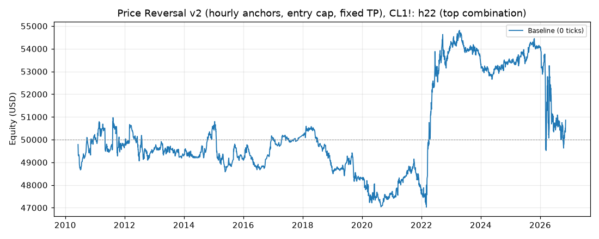

Files: [grid](../../../results/price_reversal_v2/h22/grid.csv), [trades 0 ticks](../../../results/price_reversal_v2/h22/trades_slippage0.csv), [summary](../../../results/price_reversal_v2/h22/summary.json)

### Results after commission

#### Overview

| Metric | Value |
|---|---|
| Net profit | 858.28 USD (1.72%) |
| Total closed trades | 2,386 |
| Percent profitable | 58.72% |
| Profit factor | 1.008 |
| Max equity drawdown | 7,100.00 USD (14.20%) |
| Avg trade | 0.36 USD |
| Avg # bars in trades | 18 |

#### Performance

| Metric | All | Long | Short |
|---|---|---|---|
| Net profit | 858.28 USD (1.72%) | -157.02 USD (-0.31%) | 1,015.30 USD (2.03%) |
| Gross profit | 105,097.98 USD (210.20%) | 49,484.14 USD (98.97%) | 55,613.84 USD (111.23%) |
| Gross loss | 104,239.70 USD (208.48%) | 49,641.16 USD (99.28%) | 54,598.54 USD (109.20%) |
| Commission paid | 9,591.72 USD | 4,627.02 USD | 4,964.70 USD |

| Account | Value |
|---|---|
| Initial capital | 50,000.00 USD |
| Buy & hold return (TV-style, all capital at the first entry) | 9,834.22 USD (19.67%) |
| Max equity run-up (intrabar) | 7,817.96 USD (15.64%) |
| Max equity drawdown (intrabar) | 7,100.00 USD (14.20%) |
| Open P&L | 0.00 USD |
| Max contracts held | 1 |

#### Trades analysis

| Metric | All | Long | Short |
|---|---|---|---|
| Total closed trades | 2,386 | 1,151 | 1,235 |
| Winning trades | 1,401 | 693 | 708 |
| Losing trades | 985 | 458 | 527 |
| Even trades | 0 | 0 | 0 |
| Percent profitable | 58.72% | 60.21% | 57.33% |
| Avg P&L | 0.36 USD | -0.14 USD | 0.82 USD |
| Avg P&L % | -0.00% | -0.00% | -0.00% |
| Avg winning trade | 75.02 USD | 71.41 USD | 78.55 USD |
| Avg losing trade | 105.83 USD | 108.39 USD | 103.60 USD |
| Ratio avg win / avg loss | 0.709 | 0.659 | 0.758 |
| Largest winning trade | 2,745.98 USD | 1,275.98 USD | 2,745.98 USD |
| Largest winning trade % | 2.99% | 1.37% | 2.99% |
| Largest losing trade | 1,764.02 USD | 1,764.02 USD | 804.02 USD |
| Largest losing trade % | 2.04% | 2.04% | 1.96% |
| Avg # bars in trades | 18 | 17 | 18 |
| Avg # bars in winning trades | 17 | 16 | 17 |
| Avg # bars in losing trades | 19 | 19 | 20 |

#### Risk/performance ratios

| Metric | Value |
|---|---|
| Sharpe ratio | -0.169 |
| Sortino ratio | -0.220 |
| Profit factor | 1.008 |
| Margin calls | 0 |

#### List of trades (last 10, newest first; full list in the trades CSV)

| Trade # | Type | Signal | Date/Time (UTC) | Price | Contracts | Profit | Cum. profit | Run-up | Drawdown |
|---|---|---|---|---|---|---|---|---|---|
| 2386 | Exit short | Session end | 2026-11-09 21:59 | 86.37 | 1 | 525.98 USD (0.61%) | 858.28 USD | 640.00 USD | 250.00 USD |
|  | Entry short | Short | 2026-11-09 20:49 | 86.90 | 1 |  |  |  |  |
| 2385 | Exit long | Exit | 2026-11-06 20:53 | 90.61 | 1 | -174.02 USD (-0.19%) | 332.30 USD | 80.00 USD | 170.00 USD |
|  | Entry long | Long | 2026-11-06 20:41 | 90.78 | 1 |  |  |  |  |
| 2384 | Exit short | Exit | 2026-11-04 20:36 | 88.53 | 1 | 85.98 USD (0.10%) | 506.32 USD | 90.00 USD | 90.00 USD |
|  | Entry short | Short | 2026-11-04 20:27 | 88.62 | 1 |  |  |  |  |
| 2383 | Exit short | Exit | 2026-11-03 20:38 | 96.65 | 1 | 45.98 USD (0.05%) | 420.34 USD | 50.00 USD | 0.00 USD |
|  | Entry short | Short | 2026-11-03 20:37 | 96.70 | 1 |  |  |  |  |
| 2382 | Exit long | Exit | 2026-10-28 19:18 | 102.81 | 1 | 75.98 USD (0.07%) | 374.36 USD | 80.00 USD | 30.00 USD |
|  | Entry long | Long | 2026-10-28 19:17 | 102.73 | 1 |  |  |  |  |
| 2381 | Exit long | Exit | 2026-10-27 19:26 | 99.91 | 1 | 225.98 USD (0.23%) | 298.38 USD | 230.00 USD | 80.00 USD |
|  | Entry long | Long | 2026-10-27 19:18 | 99.68 | 1 |  |  |  |  |
| 2380 | Exit short | Exit | 2026-10-26 19:25 | 102.25 | 1 | 15.98 USD (0.02%) | 72.40 USD | 20.00 USD | 0.00 USD |
|  | Entry short | Short | 2026-10-26 19:25 | 102.27 | 1 |  |  |  |  |
| 2379 | Exit short | Exit | 2026-10-23 19:15 | 103.57 | 1 | -134.02 USD (-0.13%) | 56.42 USD | 10.00 USD | 130.00 USD |
|  | Entry short | Short | 2026-10-23 19:13 | 103.44 | 1 |  |  |  |  |
| 2378 | Exit long | Session end | 2026-10-21 20:59 | 97.71 | 1 | 105.98 USD (0.11%) | 190.44 USD | 350.00 USD | 140.00 USD |
|  | Entry long | Long | 2026-10-21 19:43 | 97.60 | 1 |  |  |  |  |
| 2377 | Exit short | Exit | 2026-10-20 20:06 | 97.97 | 1 | 275.98 USD (0.28%) | 84.46 USD | 280.00 USD | 40.00 USD |
|  | Entry short | Short | 2026-10-20 19:45 | 98.25 | 1 |  |  |  |  |

#### By year (extra, not a TV tab)

| Year | Trades | Net profit | % profitable | Profit factor |
|---|---|---|---|---|
| 2010 | 74 | 112.52 USD | 59.46% | 1.032 |
| 2011 | 134 | -308.68 USD | 60.45% | 0.964 |
| 2012 | 123 | -174.46 USD | 60.16% | 0.970 |
| 2013 | 115 | -312.30 USD | 62.61% | 0.921 |
| 2014 | 120 | 1,317.60 USD | 67.50% | 1.413 |
| 2015 | 125 | -1,542.50 USD | 56.00% | 0.732 |
| 2016 | 131 | 893.38 USD | 61.83% | 1.282 |
| 2017 | 94 | 212.12 USD | 67.02% | 1.124 |
| 2018 | 129 | -1,578.58 USD | 49.61% | 0.662 |
| 2019 | 138 | -304.76 USD | 53.62% | 0.929 |
| 2020 | 159 | -709.18 USD | 61.01% | 0.887 |
| 2021 | 171 | 62.58 USD | 57.89% | 1.011 |
| 2022 | 192 | 6,658.16 USD | 62.50% | 1.584 |
| 2023 | 174 | -949.48 USD | 53.45% | 0.854 |
| 2024 | 172 | 28.56 USD | 57.56% | 1.006 |
| 2025 | 165 | 646.70 USD | 61.82% | 1.147 |
| 2026 | 170 | -3,193.40 USD | 51.18% | 0.847 |

#### Exit reasons (extra)

| Reason | Trades |
|---|---|
| limit | 1292 |
| stop | 925 |
| close | 169 |

- Session-end exits: 169.
- Roll exits: 0.

### Best settings by metric

Each winner needs at least 30 closed trades. Undefined values are excluded. Ties: higher net profit, higher profit factor, then grid order. Ruin loss threshold: 25,000.00 USD from starting capital. All selections are in-sample. MAE/MFE objectives use the mean of the per-trade maxima.

| Metric | Goal | Best value | Grid order | Trades | Eligible settings | Parameters |
|---|---|---|---|---|---|---|
| Net profit | max | 858.28 USD | [29](../../../results/price_reversal_v2/h22/metric_winners/order_29/trades_slippage0.csv) | 2386 | 64 | window=60, atr_mult=2.0, swing=1, target=near |
| Win rate | max | 62.00% | [5](../../../results/price_reversal_v2/h22/metric_winners/order_5/trades_slippage0.csv) | 1058 | 64 | window=30, atr_mult=1.0, swing=1, target=near |
| Expectancy | max | 0.36 USD | [29](../../../results/price_reversal_v2/h22/metric_winners/order_29/trades_slippage0.csv) | 2386 | 64 | window=60, atr_mult=2.0, swing=1, target=near |
| Profit factor | max | 1.008 | [29](../../../results/price_reversal_v2/h22/metric_winners/order_29/trades_slippage0.csv) | 2386 | 64 | window=60, atr_mult=2.0, swing=1, target=near |
| Payoff ratio | max | 1.702 | [4](../../../results/price_reversal_v2/h22/metric_winners/order_4/trades_slippage0.csv) | 1021 | 64 | window=30, atr_mult=0.5, swing=1, target=rr2 |
| Risk of ruin (estimate) | min | 44.00% | [29](../../../results/price_reversal_v2/h22/metric_winners/order_29/trades_slippage0.csv) | 2386 | 64 | window=60, atr_mult=2.0, swing=1, target=near |
| Maximum drawdown | min | 5,627.74 USD | [17](../../../results/price_reversal_v2/h22/metric_winners/order_17/trades_slippage0.csv) | 2342 | 64 | window=60, atr_mult=0.5, swing=1, target=near |
| Consecutive losses | min | 6.000 | [1](../../../results/price_reversal_v2/h22/metric_winners/order_1/trades_slippage0.csv) | 1007 | 64 | window=30, atr_mult=0.5, swing=1, target=near |
| Sharpe ratio | max | -0.149 | [45](../../../results/price_reversal_v2/h22/metric_winners/order_45/trades_slippage0.csv) | 3345 | 64 | window=90, atr_mult=2.0, swing=1, target=near |
| Sortino ratio | max | -0.203 | [45](../../../results/price_reversal_v2/h22/metric_winners/order_45/trades_slippage0.csv) | 3345 | 64 | window=90, atr_mult=2.0, swing=1, target=near |
| R-multiple | max | -0.072 | [13](../../../results/price_reversal_v2/h22/metric_winners/order_13/trades_slippage0.csv) | 942 | 8 | window=30, atr_mult=2.0, swing=1, target=near |
| Maximum adverse excursion (MAE) | min | 56.71 USD | [1](../../../results/price_reversal_v2/h22/metric_winners/order_1/trades_slippage0.csv) | 1007 | 64 | window=30, atr_mult=0.5, swing=1, target=near |
| Maximum favorable excursion (MFE) | max | 111.38 USD | [32](../../../results/price_reversal_v2/h22/metric_winners/order_32/trades_slippage0.csv) | 2392 | 64 | window=60, atr_mult=2.0, swing=1, target=rr2 |

- **Net profit:** Sum of closed-trade profit after commission; excludes open P&L.
- **Win rate:** Winning closed trades divided by all closed trades, including breakevens.
- **Expectancy:** Mean net profit per closed trade, including losses and breakevens.
- **Profit factor:** Gross winning profit divided by gross losing profit, both after commission. Undefined without losses.
- **Payoff ratio:** Average net winning trade divided by the absolute average net losing trade. Requires wins and losses.
- **Risk of ruin (estimate):** Infinite-horizon diffusion estimate of losing the declared amount from starting capital. Assumes independent, stationary, fixed-size net trade P&L; ignores intratrade losses and margin.
- **Maximum drawdown:** Largest equity drawdown under the tester's intrabar TradingView convention, including an open trade at the end.
- **Consecutive losses:** Longest streak of losing closed trades in execution order. A win or breakeven resets the streak.
- **Sharpe ratio:** Monthly marked-to-market excess return divided by population standard deviation, using 2% annual risk-free rate; not annualized.
- **Sortino ratio:** Monthly marked-to-market excess return divided by downside deviation about the risk-free rate; not annualized.
- **R-multiple:** Mean net trade profit / initial stop risk in dollars. Risk is actual fill to initial stop, before costs. Requires positive initial risk for every closed trade; R standard deviation and mean / standard deviation describe consistency.
- **Maximum adverse excursion (MAE):** Mean of each closed trade's maximum adverse price excursion in dollars, before commission; only the exposed intrabar path counts.
- **Maximum favorable excursion (MFE):** Mean of each closed trade's maximum favorable price excursion in dollars, before commission; only the exposed intrabar path counts. Unrealized opportunity, not realized profit.

Full selection metadata: [metric_winners.json](../../../results/price_reversal_v2/h22/metric_winners.json).

### Top 10 combinations

| # | window | atr_mult | swing | target | Net profit | Trades | % profitable | Profit factor | Max DD |
|---|---|---|---|---|---|---|---|---|---|
| 1 | 60 | 2.0 | 1 | near | 858.28 USD | 2,386 | 58.72% | 1.008 | 7,100.00 USD |
| 2 | 60 | 1.5 | 1 | near | 568.64 USD | 2,468 | 59.36% | 1.005 | 7,474.22 USD |
| 3 | 60 | 1.0 | 1 | near | 492.36 USD | 2,482 | 59.55% | 1.005 | 7,594.22 USD |
| 4 | 90 | 2.0 | 1 | near | 403.10 USD | 3,345 | 57.13% | 1.003 | 9,887.42 USD |
| 5 | 60 | 0.5 | 1 | near | -404.84 USD | 2,342 | 58.84% | 0.996 | 5,627.74 USD |
| 6 | 90 | 1.0 | 1 | near | -762.32 USD | 3,416 | 57.61% | 0.994 | 10,131.54 USD |
| 7 | 90 | 1.5 | 1 | near | -1,052.22 USD | 3,411 | 57.49% | 0.992 | 10,051.54 USD |
| 8 | 90 | 0.5 | 1 | near | -1,146.36 USD | 3,218 | 57.05% | 0.991 | 7,958.98 USD |
| 9 | 60 | 0.5 | 1 | far | -2,945.04 USD | 2,352 | 52.55% | 0.974 | 8,723.34 USD |
| 10 | 120 | 2.0 | 1 | near | -3,070.36 USD | 3,918 | 55.77% | 0.980 | 11,039.32 USD |

Profitable combinations: 4 of 64.

## Variant: h23

**Top combination:** `anchor=h23`, `window=30`, `atr_mult=1.5`, `swing=1`, `target=far`

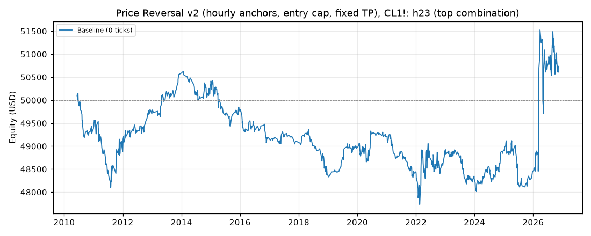

Files: [grid](../../../results/price_reversal_v2/h23/grid.csv), [trades 0 ticks](../../../results/price_reversal_v2/h23/trades_slippage0.csv), [summary](../../../results/price_reversal_v2/h23/summary.json)

### Results after commission

#### Overview

| Metric | Value |
|---|---|
| Net profit | 608.14 USD (1.22%) |
| Total closed trades | 993 |
| Percent profitable | 53.68% |
| Profit factor | 1.017 |
| Max equity drawdown | 2,980.46 USD (5.96%) |
| Avg trade | 0.61 USD |
| Avg # bars in trades | 12 |

#### Performance

| Metric | All | Long | Short |
|---|---|---|---|
| Net profit | 608.14 USD (1.22%) | 2,645.98 USD (5.29%) | -2,037.84 USD (-4.08%) |
| Gross profit | 35,527.34 USD (71.05%) | 19,366.46 USD (38.73%) | 16,160.88 USD (32.32%) |
| Gross loss | 34,919.20 USD (69.84%) | 16,720.48 USD (33.44%) | 18,198.72 USD (36.40%) |
| Commission paid | 3,991.86 USD | 2,014.02 USD | 1,977.84 USD |

| Account | Value |
|---|---|
| Initial capital | 50,000.00 USD |
| Buy & hold return (TV-style, all capital at the first entry) | 7,670.95 USD (15.34%) |
| Max equity run-up (intrabar) | 4,048.02 USD (8.10%) |
| Max equity drawdown (intrabar) | 2,980.46 USD (5.96%) |
| Open P&L | 0.00 USD |
| Max contracts held | 1 |

#### Trades analysis

| Metric | All | Long | Short |
|---|---|---|---|
| Total closed trades | 993 | 501 | 492 |
| Winning trades | 533 | 277 | 256 |
| Losing trades | 460 | 224 | 236 |
| Even trades | 0 | 0 | 0 |
| Percent profitable | 53.68% | 55.29% | 52.03% |
| Avg P&L | 0.61 USD | 5.28 USD | -4.14 USD |
| Avg P&L % | -0.00% | 0.01% | -0.01% |
| Avg winning trade | 66.66 USD | 69.92 USD | 63.13 USD |
| Avg losing trade | 75.91 USD | 74.64 USD | 77.11 USD |
| Ratio avg win / avg loss | 0.878 | 0.937 | 0.819 |
| Largest winning trade | 1,285.98 USD | 855.98 USD | 1,285.98 USD |
| Largest winning trade % | 1.47% | 0.90% | 1.47% |
| Largest losing trade | 704.02 USD | 424.02 USD | 704.02 USD |
| Largest losing trade % | 2.41% | 0.47% | 2.41% |
| Avg # bars in trades | 12 | 12 | 12 |
| Avg # bars in winning trades | 11 | 11 | 11 |
| Avg # bars in losing trades | 12 | 12 | 13 |

#### Risk/performance ratios

| Metric | Value |
|---|---|
| Sharpe ratio | -0.272 |
| Sortino ratio | -0.373 |
| Profit factor | 1.017 |
| Margin calls | 0 |

#### List of trades (last 10, newest first; full list in the trades CSV)

| Trade # | Type | Signal | Date/Time (UTC) | Price | Contracts | Profit | Cum. profit | Run-up | Drawdown |
|---|---|---|---|---|---|---|---|---|---|
| 993 | Exit long | Exit | 2026-11-06 21:34 | 90.41 | 1 | -134.02 USD (-0.15%) | 608.14 USD | 0.00 USD | 130.00 USD |
|  | Entry long | Long | 2026-11-06 21:25 | 90.54 | 1 |  |  |  |  |
| 992 | Exit long | Exit | 2026-11-05 21:16 | 90.71 | 1 | 125.98 USD (0.14%) | 742.16 USD | 130.00 USD | 50.00 USD |
|  | Entry long | Long | 2026-11-05 21:12 | 90.58 | 1 |  |  |  |  |
| 991 | Exit short | Exit | 2026-11-03 21:30 | 96.95 | 1 | -54.02 USD (-0.06%) | 616.18 USD | 30.00 USD | 50.00 USD |
|  | Entry short | Short | 2026-11-03 21:27 | 96.90 | 1 |  |  |  |  |
| 990 | Exit long | Session end | 2026-10-30 20:59 | 102.92 | 1 | 5.98 USD (0.01%) | 670.20 USD | 150.00 USD | 100.00 USD |
|  | Entry long | Long | 2026-10-30 20:08 | 102.91 | 1 |  |  |  |  |
| 989 | Exit short | Exit | 2026-10-29 20:26 | 102.99 | 1 | -204.02 USD (-0.20%) | 664.22 USD | 30.00 USD | 200.00 USD |
|  | Entry short | Short | 2026-10-29 20:20 | 102.79 | 1 |  |  |  |  |
| 988 | Exit long | Exit | 2026-10-20 20:22 | 97.95 | 1 | -164.02 USD (-0.17%) | 868.24 USD | 10.00 USD | 160.00 USD |
|  | Entry long | Long | 2026-10-20 20:13 | 98.11 | 1 |  |  |  |  |
| 987 | Exit short | Exit | 2026-10-19 20:35 | 98.36 | 1 | 35.98 USD (0.04%) | 1,032.26 USD | 40.00 USD | 90.00 USD |
|  | Entry short | Short | 2026-10-19 20:26 | 98.40 | 1 |  |  |  |  |
| 986 | Exit short | Exit | 2026-10-16 20:39 | 101.59 | 1 | 125.98 USD (0.12%) | 996.28 USD | 130.00 USD | 50.00 USD |
|  | Entry short | Short | 2026-10-16 20:28 | 101.72 | 1 |  |  |  |  |
| 985 | Exit long | Exit | 2026-10-15 20:45 | 97.71 | 1 | 85.98 USD (0.09%) | 870.30 USD | 90.00 USD | 10.00 USD |
|  | Entry long | Long | 2026-10-15 20:28 | 97.62 | 1 |  |  |  |  |
| 984 | Exit long | Exit | 2026-10-12 20:19 | 93.17 | 1 | -104.02 USD (-0.11%) | 784.32 USD | 0.00 USD | 100.00 USD |
|  | Entry long | Long | 2026-10-12 20:16 | 93.27 | 1 |  |  |  |  |

#### By year (extra, not a TV tab)

| Year | Trades | Net profit | % profitable | Profit factor |
|---|---|---|---|---|
| 2010 | 34 | -596.68 USD | 44.12% | 0.585 |
| 2011 | 68 | -523.36 USD | 55.88% | 0.856 |
| 2012 | 53 | 906.94 USD | 64.15% | 1.705 |
| 2013 | 45 | 769.10 USD | 62.22% | 1.837 |
| 2014 | 56 | -205.12 USD | 48.21% | 0.878 |
| 2015 | 68 | -603.36 USD | 51.47% | 0.718 |
| 2016 | 53 | -553.06 USD | 49.06% | 0.645 |
| 2017 | 31 | -84.62 USD | 58.06% | 0.878 |
| 2018 | 51 | -715.02 USD | 47.06% | 0.577 |
| 2019 | 40 | 559.20 USD | 72.50% | 1.941 |
| 2020 | 55 | 258.90 USD | 60.00% | 1.169 |
| 2021 | 62 | -769.24 USD | 37.10% | 0.577 |
| 2022 | 81 | 444.38 USD | 49.38% | 1.103 |
| 2023 | 73 | -603.46 USD | 52.05% | 0.683 |
| 2024 | 72 | 630.56 USD | 58.33% | 1.435 |
| 2025 | 66 | -465.32 USD | 54.55% | 0.790 |
| 2026 | 85 | 2,158.30 USD | 55.29% | 1.358 |

#### Exit reasons (extra)

| Reason | Trades |
|---|---|
| limit | 490 |
| stop | 422 |
| close | 81 |

- Session-end exits: 81.
- Roll exits: 0.

### Best settings by metric

Each winner needs at least 30 closed trades. Undefined values are excluded. Ties: higher net profit, higher profit factor, then grid order. Ruin loss threshold: 25,000.00 USD from starting capital. All selections are in-sample. MAE/MFE objectives use the mean of the per-trade maxima.

| Metric | Goal | Best value | Grid order | Trades | Eligible settings | Parameters |
|---|---|---|---|---|---|---|
| Net profit | max | 608.14 USD | [10](../../../results/price_reversal_v2/h23/metric_winners/order_10/trades_slippage0.csv) | 993 | 64 | window=30, atr_mult=1.5, swing=1, target=far |
| Win rate | max | 61.65% | [1](../../../results/price_reversal_v2/h23/metric_winners/order_1/trades_slippage0.csv) | 931 | 64 | window=30, atr_mult=0.5, swing=1, target=near |
| Expectancy | max | 0.61 USD | [10](../../../results/price_reversal_v2/h23/metric_winners/order_10/trades_slippage0.csv) | 993 | 64 | window=30, atr_mult=1.5, swing=1, target=far |
| Profit factor | max | 1.017 | [10](../../../results/price_reversal_v2/h23/metric_winners/order_10/trades_slippage0.csv) | 993 | 64 | window=30, atr_mult=1.5, swing=1, target=far |
| Payoff ratio | max | 1.743 | [16](../../../results/price_reversal_v2/h23/metric_winners/order_16/trades_slippage0.csv) | 931 | 64 | window=30, atr_mult=2.0, swing=1, target=rr2 |
| Risk of ruin (estimate) | min | 6.96% | [10](../../../results/price_reversal_v2/h23/metric_winners/order_10/trades_slippage0.csv) | 993 | 64 | window=30, atr_mult=1.5, swing=1, target=far |
| Maximum drawdown | min | 2,980.46 USD | [10](../../../results/price_reversal_v2/h23/metric_winners/order_10/trades_slippage0.csv) | 993 | 64 | window=30, atr_mult=1.5, swing=1, target=far |
| Consecutive losses | min | 6.000 | [1](../../../results/price_reversal_v2/h23/metric_winners/order_1/trades_slippage0.csv) | 931 | 64 | window=30, atr_mult=0.5, swing=1, target=near |
| Sharpe ratio | max | -0.226 | [16](../../../results/price_reversal_v2/h23/metric_winners/order_16/trades_slippage0.csv) | 931 | 64 | window=30, atr_mult=2.0, swing=1, target=rr2 |
| Sortino ratio | max | -0.352 | [16](../../../results/price_reversal_v2/h23/metric_winners/order_16/trades_slippage0.csv) | 931 | 64 | window=30, atr_mult=2.0, swing=1, target=rr2 |
| R-multiple | max | No eligible value | — | — | 0 | — |
| Maximum adverse excursion (MAE) | min | 43.76 USD | [1](../../../results/price_reversal_v2/h23/metric_winners/order_1/trades_slippage0.csv) | 931 | 64 | window=30, atr_mult=0.5, swing=1, target=near |
| Maximum favorable excursion (MFE) | max | 86.23 USD | [16](../../../results/price_reversal_v2/h23/metric_winners/order_16/trades_slippage0.csv) | 931 | 64 | window=30, atr_mult=2.0, swing=1, target=rr2 |

- **Net profit:** Sum of closed-trade profit after commission; excludes open P&L.
- **Win rate:** Winning closed trades divided by all closed trades, including breakevens.
- **Expectancy:** Mean net profit per closed trade, including losses and breakevens.
- **Profit factor:** Gross winning profit divided by gross losing profit, both after commission. Undefined without losses.
- **Payoff ratio:** Average net winning trade divided by the absolute average net losing trade. Requires wins and losses.
- **Risk of ruin (estimate):** Infinite-horizon diffusion estimate of losing the declared amount from starting capital. Assumes independent, stationary, fixed-size net trade P&L; ignores intratrade losses and margin.
- **Maximum drawdown:** Largest equity drawdown under the tester's intrabar TradingView convention, including an open trade at the end.
- **Consecutive losses:** Longest streak of losing closed trades in execution order. A win or breakeven resets the streak.
- **Sharpe ratio:** Monthly marked-to-market excess return divided by population standard deviation, using 2% annual risk-free rate; not annualized.
- **Sortino ratio:** Monthly marked-to-market excess return divided by downside deviation about the risk-free rate; not annualized.
- **R-multiple:** Mean net trade profit / initial stop risk in dollars. Risk is actual fill to initial stop, before costs. Requires positive initial risk for every closed trade; R standard deviation and mean / standard deviation describe consistency.
- **Maximum adverse excursion (MAE):** Mean of each closed trade's maximum adverse price excursion in dollars, before commission; only the exposed intrabar path counts.
- **Maximum favorable excursion (MFE):** Mean of each closed trade's maximum favorable price excursion in dollars, before commission; only the exposed intrabar path counts. Unrealized opportunity, not realized profit.

Full selection metadata: [metric_winners.json](../../../results/price_reversal_v2/h23/metric_winners.json).

### Top 10 combinations

| # | window | atr_mult | swing | target | Net profit | Trades | % profitable | Profit factor | Max DD |
|---|---|---|---|---|---|---|---|---|---|
| 1 | 30 | 1.5 | 1 | far | 608.14 USD | 993 | 53.68% | 1.017 | 2,980.46 USD |
| 2 | 30 | 1.0 | 1 | far | 397.84 USD | 1,008 | 53.57% | 1.011 | 3,152.52 USD |
| 3 | 30 | 0.5 | 1 | rr1 | 215.22 USD | 939 | 48.88% | 1.006 | 4,753.70 USD |
| 4 | 30 | 2.0 | 1 | far | 205.52 USD | 924 | 52.60% | 1.006 | 3,227.52 USD |
| 5 | 30 | 0.5 | 1 | far | 95.12 USD | 944 | 53.28% | 1.003 | 3,647.62 USD |
| 6 | 30 | 2.0 | 1 | near | -14.28 USD | 914 | 60.07% | 0.999 | 3,464.08 USD |
| 7 | 30 | 1.5 | 1 | near | -135.58 USD | 979 | 61.08% | 0.995 | 3,478.40 USD |
| 8 | 30 | 0.5 | 1 | near | -242.62 USD | 931 | 61.65% | 0.991 | 3,675.46 USD |
| 9 | 30 | 0.5 | 1 | rr2 | -264.98 USD | 949 | 36.35% | 0.994 | 4,994.50 USD |
| 10 | 30 | 2.0 | 1 | rr2 | -302.62 USD | 931 | 36.31% | 0.993 | 5,301.22 USD |

Profitable combinations: 5 of 64.

## Variant: entry_asia

**Top combination:** `anchor=asia`, `swing=1`, `window=30`, `atr_mult=2.0`, `target=rr2`, `entry_cap=0`, `tp_mode=default`

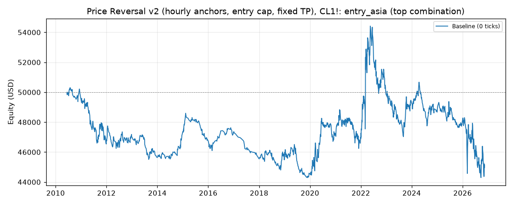

Files: [grid](../../../results/price_reversal_v2/entry_asia/grid.csv), [trades 0 ticks](../../../results/price_reversal_v2/entry_asia/trades_slippage0.csv), [summary](../../../results/price_reversal_v2/entry_asia/summary.json)

### Results after commission

#### Overview

| Metric | Value |
|---|---|
| Net profit | -5,035.22 USD (-10.07%) |
| Total closed trades | 1,561 |
| Percent profitable | 32.48% |
| Profit factor | 0.959 |
| Max equity drawdown | 10,296.38 USD (20.59%) |
| Avg trade | -3.23 USD |
| Avg # bars in trades | 50 |

#### Performance

| Metric | All | Long | Short |
|---|---|---|---|
| Net profit | -5,035.22 USD (-10.07%) | 56.26 USD (0.11%) | -5,091.48 USD (-10.18%) |
| Gross profit | 117,571.86 USD (235.14%) | 63,974.80 USD (127.95%) | 53,597.06 USD (107.19%) |
| Gross loss | 122,607.08 USD (245.21%) | 63,918.54 USD (127.84%) | 58,688.54 USD (117.38%) |
| Commission paid | 6,275.22 USD | 3,163.74 USD | 3,111.48 USD |

| Account | Value |
|---|---|
| Initial capital | 50,000.00 USD |
| Buy & hold return (TV-style, all capital at the first entry) | 6,477.92 USD (12.96%) |
| Max equity run-up (intrabar) | 10,513.90 USD (21.03%) |
| Max equity drawdown (intrabar) | 10,296.38 USD (20.59%) |
| Open P&L | 0.00 USD |
| Max contracts held | 1 |

#### Trades analysis

| Metric | All | Long | Short |
|---|---|---|---|
| Total closed trades | 1,561 | 787 | 774 |
| Winning trades | 507 | 260 | 247 |
| Losing trades | 1,054 | 527 | 527 |
| Even trades | 0 | 0 | 0 |
| Percent profitable | 32.48% | 33.04% | 31.91% |
| Avg P&L | -3.23 USD | 0.07 USD | -6.58 USD |
| Avg P&L % | -0.00% | 0.00% | -0.01% |
| Avg winning trade | 231.90 USD | 246.06 USD | 216.99 USD |
| Avg losing trade | 116.33 USD | 121.29 USD | 111.36 USD |
| Ratio avg win / avg loss | 1.994 | 2.029 | 1.949 |
| Largest winning trade | 2,655.98 USD | 2,655.98 USD | 955.98 USD |
| Largest winning trade % | 3.02% | 3.02% | 2.14% |
| Largest losing trade | 1,794.02 USD | 1,794.02 USD | 694.02 USD |
| Largest losing trade % | 2.08% | 2.08% | 1.80% |
| Avg # bars in trades | 50 | 51 | 48 |
| Avg # bars in winning trades | 72 | 75 | 69 |
| Avg # bars in losing trades | 39 | 39 | 38 |

#### Risk/performance ratios

| Metric | Value |
|---|---|
| Sharpe ratio | -0.208 |
| Sortino ratio | -0.272 |
| Profit factor | 0.959 |
| Margin calls | 0 |

#### List of trades (last 10, newest first; full list in the trades CSV)

| Trade # | Type | Signal | Date/Time (UTC) | Price | Contracts | Profit | Cum. profit | Run-up | Drawdown |
|---|---|---|---|---|---|---|---|---|---|
| 1561 | Exit long | Exit | 2026-11-10 01:26 | 86.22 | 1 | -214.02 USD (-0.25%) | -5,035.22 USD | 0.00 USD | 210.00 USD |
|  | Entry long | Long | 2026-11-10 01:24 | 86.43 | 1 |  |  |  |  |
| 1560 | Exit long | Exit | 2026-11-09 03:04 | 91.25 | 1 | 755.98 USD (0.84%) | -4,821.20 USD | 760.00 USD | 300.00 USD |
|  | Entry long | Long | 2026-11-09 01:16 | 90.49 | 1 |  |  |  |  |
| 1559 | Exit short | Exit | 2026-11-06 02:01 | 91.50 | 1 | -394.02 USD (-0.43%) | -5,577.18 USD | 190.00 USD | 390.00 USD |
|  | Entry short | Short | 2026-11-06 01:29 | 91.11 | 1 |  |  |  |  |
| 1558 | Exit long | Exit | 2026-11-05 02:04 | 87.01 | 1 | -404.02 USD (-0.46%) | -5,183.16 USD | 240.00 USD | 400.00 USD |
|  | Entry long | Long | 2026-11-05 01:29 | 87.41 | 1 |  |  |  |  |
| 1557 | Exit short | Exit | 2026-11-04 01:32 | 95.88 | 1 | 855.98 USD (0.88%) | -4,779.14 USD | 860.00 USD | 60.00 USD |
|  | Entry short | Short | 2026-11-04 01:10 | 96.74 | 1 |  |  |  |  |
| 1556 | Exit short | Exit | 2026-11-03 05:35 | 97.15 | 1 | -494.02 USD (-0.51%) | -5,635.12 USD | 540.00 USD | 490.00 USD |
|  | Entry short | Short | 2026-11-03 01:24 | 96.66 | 1 |  |  |  |  |
| 1555 | Exit short | Exit | 2026-10-28 01:55 | 101.32 | 1 | -424.02 USD (-0.42%) | -5,141.10 USD | 100.00 USD | 420.00 USD |
|  | Entry short | Short | 2026-10-28 01:19 | 100.90 | 1 |  |  |  |  |
| 1554 | Exit long | Exit | 2026-10-27 01:33 | 100.87 | 1 | -144.02 USD (-0.14%) | -4,717.08 USD | 150.00 USD | 140.00 USD |
|  | Entry long | Long | 2026-10-27 01:19 | 101.01 | 1 |  |  |  |  |
| 1553 | Exit short | Exit | 2026-10-23 01:52 | 100.24 | 1 | -444.02 USD (-0.44%) | -4,573.06 USD | 180.00 USD | 440.00 USD |
|  | Entry short | Short | 2026-10-23 01:12 | 99.80 | 1 |  |  |  |  |
| 1552 | Exit short | Exit | 2026-10-21 02:00 | 99.09 | 1 | -244.02 USD (-0.25%) | -4,129.04 USD | 120.00 USD | 240.00 USD |
|  | Entry short | Short | 2026-10-21 01:11 | 98.85 | 1 |  |  |  |  |

#### By year (extra, not a TV tab)

| Year | Trades | Net profit | % profitable | Profit factor |
|---|---|---|---|---|
| 2010 | 46 | -124.92 USD | 36.96% | 0.949 |
| 2011 | 112 | -3,060.24 USD | 31.25% | 0.697 |
| 2012 | 91 | 214.18 USD | 29.67% | 1.040 |
| 2013 | 78 | -1,393.56 USD | 32.05% | 0.666 |
| 2014 | 60 | 1,468.80 USD | 40.00% | 1.718 |
| 2015 | 74 | -337.48 USD | 29.73% | 0.903 |
| 2016 | 60 | 528.80 USD | 41.67% | 1.213 |
| 2017 | 44 | -1,686.88 USD | 11.36% | 0.211 |
| 2018 | 84 | -127.68 USD | 33.33% | 0.970 |
| 2019 | 93 | -933.86 USD | 31.18% | 0.830 |
| 2020 | 119 | 2,671.62 USD | 39.50% | 1.320 |
| 2021 | 117 | 39.66 USD | 32.48% | 1.004 |
| 2022 | 146 | 2,603.08 USD | 34.93% | 1.122 |
| 2023 | 119 | -548.38 USD | 30.25% | 0.941 |
| 2024 | 103 | -644.06 USD | 32.04% | 0.907 |
| 2025 | 98 | -663.96 USD | 29.59% | 0.898 |
| 2026 | 117 | -3,040.34 USD | 30.77% | 0.840 |

#### Exit reasons (extra)

| Reason | Trades |
|---|---|
| stop | 1041 |
| limit | 472 |
| close | 48 |

- Session-end exits: 48.
- Roll exits: 0.

### Best settings by metric

Each winner needs at least 30 closed trades. Undefined values are excluded. Ties: higher net profit, higher profit factor, then grid order. Ruin loss threshold: 25,000.00 USD from starting capital. All selections are in-sample. MAE/MFE objectives use the mean of the per-trade maxima.

| Metric | Goal | Best value | Grid order | Trades | Eligible settings | Parameters |
|---|---|---|---|---|---|---|
| Net profit | max | -5,035.22 USD | [1](../../../results/price_reversal_v2/entry_asia/metric_winners/order_1/trades_slippage0.csv) | 1561 | 16 | entry_cap=0, tp_mode=default |
| Win rate | max | 32.48% | [1](../../../results/price_reversal_v2/entry_asia/metric_winners/order_1/trades_slippage0.csv) | 1561 | 16 | entry_cap=0, tp_mode=default |
| Expectancy | max | -3.23 USD | [1](../../../results/price_reversal_v2/entry_asia/metric_winners/order_1/trades_slippage0.csv) | 1561 | 16 | entry_cap=0, tp_mode=default |
| Profit factor | max | 0.959 | [1](../../../results/price_reversal_v2/entry_asia/metric_winners/order_1/trades_slippage0.csv) | 1561 | 16 | entry_cap=0, tp_mode=default |
| Payoff ratio | max | 3.324 | [16](../../../results/price_reversal_v2/entry_asia/metric_winners/order_16/trades_slippage0.csv) | 1553 | 16 | entry_cap=50, tp_mode=fixed |
| Risk of ruin (estimate) | min | 100.00% | [1](../../../results/price_reversal_v2/entry_asia/metric_winners/order_1/trades_slippage0.csv) | 1561 | 16 | entry_cap=0, tp_mode=default |
| Maximum drawdown | min | 8,392.36 USD | [15](../../../results/price_reversal_v2/entry_asia/metric_winners/order_15/trades_slippage0.csv) | 1549 | 16 | entry_cap=50, tp_mode=default |
| Consecutive losses | min | 20.000 | [1](../../../results/price_reversal_v2/entry_asia/metric_winners/order_1/trades_slippage0.csv) | 1561 | 16 | entry_cap=0, tp_mode=default |
| Sharpe ratio | max | -0.208 | [1](../../../results/price_reversal_v2/entry_asia/metric_winners/order_1/trades_slippage0.csv) | 1561 | 16 | entry_cap=0, tp_mode=default |
| Sortino ratio | max | -0.272 | [1](../../../results/price_reversal_v2/entry_asia/metric_winners/order_1/trades_slippage0.csv) | 1561 | 16 | entry_cap=0, tp_mode=default |
| R-multiple | max | No eligible value | — | — | 0 | — |
| Maximum adverse excursion (MAE) | min | 77.83 USD | [3](../../../results/price_reversal_v2/entry_asia/metric_winners/order_3/trades_slippage0.csv) | 1502 | 16 | entry_cap=20, tp_mode=default |
| Maximum favorable excursion (MFE) | max | 158.04 USD | [2](../../../results/price_reversal_v2/entry_asia/metric_winners/order_2/trades_slippage0.csv) | 1565 | 16 | entry_cap=0, tp_mode=fixed |

- **Net profit:** Sum of closed-trade profit after commission; excludes open P&L.
- **Win rate:** Winning closed trades divided by all closed trades, including breakevens.
- **Expectancy:** Mean net profit per closed trade, including losses and breakevens.
- **Profit factor:** Gross winning profit divided by gross losing profit, both after commission. Undefined without losses.
- **Payoff ratio:** Average net winning trade divided by the absolute average net losing trade. Requires wins and losses.
- **Risk of ruin (estimate):** Infinite-horizon diffusion estimate of losing the declared amount from starting capital. Assumes independent, stationary, fixed-size net trade P&L; ignores intratrade losses and margin.
- **Maximum drawdown:** Largest equity drawdown under the tester's intrabar TradingView convention, including an open trade at the end.
- **Consecutive losses:** Longest streak of losing closed trades in execution order. A win or breakeven resets the streak.
- **Sharpe ratio:** Monthly marked-to-market excess return divided by population standard deviation, using 2% annual risk-free rate; not annualized.
- **Sortino ratio:** Monthly marked-to-market excess return divided by downside deviation about the risk-free rate; not annualized.
- **R-multiple:** Mean net trade profit / initial stop risk in dollars. Risk is actual fill to initial stop, before costs. Requires positive initial risk for every closed trade; R standard deviation and mean / standard deviation describe consistency.
- **Maximum adverse excursion (MAE):** Mean of each closed trade's maximum adverse price excursion in dollars, before commission; only the exposed intrabar path counts.
- **Maximum favorable excursion (MFE):** Mean of each closed trade's maximum favorable price excursion in dollars, before commission; only the exposed intrabar path counts. Unrealized opportunity, not realized profit.

Full selection metadata: [metric_winners.json](../../../results/price_reversal_v2/entry_asia/metric_winners.json).

### Top 10 combinations

| # | entry_cap | tp_mode | Net profit | Trades | % profitable | Profit factor | Max DD |
|---|---|---|---|---|---|---|---|
| 1 | 0 | default | -5,035.22 USD | 1,561 | 32.48% | 0.959 | 10,296.38 USD |
| 2 | 50 | default | -5,936.98 USD | 1,549 | 32.34% | 0.949 | 8,392.36 USD |
| 3 | 45 | default | -6,688.94 USD | 1,547 | 32.32% | 0.943 | 8,432.36 USD |
| 4 | 20 | default | -9,438.04 USD | 1,502 | 31.82% | 0.908 | 10,190.76 USD |
| 5 | 40 | default | -10,466.78 USD | 1,539 | 32.03% | 0.909 | 11,614.42 USD |
| 6 | 0 | fixed | -11,441.30 USD | 1,565 | 21.60% | 0.915 | 14,832.72 USD |
| 7 | 35 | default | -12,392.66 USD | 1,533 | 31.90% | 0.891 | 13,470.30 USD |
| 8 | 50 | fixed | -12,503.06 USD | 1,553 | 21.38% | 0.904 | 13,385.02 USD |
| 9 | 25 | default | -13,000.30 USD | 1,515 | 31.62% | 0.880 | 13,777.94 USD |
| 10 | 45 | fixed | -13,455.02 USD | 1,551 | 21.34% | 0.896 | 14,376.58 USD |

Profitable combinations: 0 of 16.

## Variant: entry_london

**Top combination:** `anchor=london`, `swing=1`, `window=30`, `atr_mult=1.5`, `target=rr2`, `entry_cap=50`, `tp_mode=default`

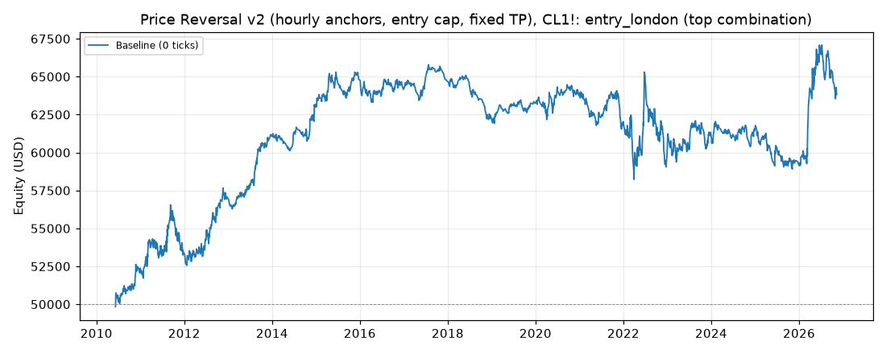

Files: [grid](../../../results/price_reversal_v2/entry_london/grid.csv), [trades 0 ticks](../../../results/price_reversal_v2/entry_london/trades_slippage0.csv), [summary](../../../results/price_reversal_v2/entry_london/summary.json)

### Results after commission

#### Overview

| Metric | Value |
|---|---|
| Net profit | 13,824.26 USD (27.65%) |
| Total closed trades | 1,887 |
| Percent profitable | 35.19% |
| Profit factor | 1.086 |
| Max equity drawdown | 7,849.10 USD (15.70%) |
| Avg trade | 7.33 USD |
| Avg # bars in trades | 28 |

#### Performance

| Metric | All | Long | Short |
|---|---|---|---|
| Net profit | 13,824.26 USD (27.65%) | 8,654.22 USD (17.31%) | 5,170.04 USD (10.34%) |
| Gross profit | 174,450.72 USD (348.90%) | 91,029.18 USD (182.06%) | 83,421.54 USD (166.84%) |
| Gross loss | 160,626.46 USD (321.25%) | 82,374.96 USD (164.75%) | 78,251.50 USD (156.50%) |
| Commission paid | 7,585.74 USD | 3,975.78 USD | 3,609.96 USD |

| Account | Value |
|---|---|
| Initial capital | 50,000.00 USD |
| Buy & hold return (TV-style, all capital at the first entry) | 9,144.56 USD (18.29%) |
| Max equity run-up (intrabar) | 17,371.14 USD (34.74%) |
| Max equity drawdown (intrabar) | 7,849.10 USD (15.70%) |
| Open P&L | -22.01 USD |
| Max contracts held | 1 |

#### Trades analysis

| Metric | All | Long | Short |
|---|---|---|---|
| Total closed trades | 1,887 | 989 | 898 |
| Winning trades | 664 | 341 | 323 |
| Losing trades | 1,223 | 648 | 575 |
| Even trades | 0 | 0 | 0 |
| Percent profitable | 35.19% | 34.48% | 35.97% |
| Avg P&L | 7.33 USD | 8.75 USD | 5.76 USD |
| Avg P&L % | 0.01% | 0.02% | 0.00% |
| Avg winning trade | 262.73 USD | 266.95 USD | 258.27 USD |
| Avg losing trade | 131.34 USD | 127.12 USD | 136.09 USD |
| Ratio avg win / avg loss | 2.000 | 2.100 | 1.898 |
| Largest winning trade | 995.98 USD | 995.98 USD | 995.98 USD |
| Largest winning trade % | 4.70% | 4.70% | 1.50% |
| Largest losing trade | 504.02 USD | 504.02 USD | 504.02 USD |
| Largest losing trade % | 2.19% | 0.72% | 2.19% |
| Avg # bars in trades | 28 | 29 | 27 |
| Avg # bars in winning trades | 41 | 44 | 37 |
| Avg # bars in losing trades | 22 | 21 | 22 |

#### Risk/performance ratios

| Metric | Value |
|---|---|
| Sharpe ratio | -0.023 |
| Sortino ratio | -0.036 |
| Profit factor | 1.086 |
| Margin calls | 0 |

#### List of trades (last 10, newest first; full list in the trades CSV)

| Trade # | Type | Signal | Date/Time (UTC) | Price | Contracts | Profit | Cum. profit | Run-up | Drawdown |
|---|---|---|---|---|---|---|---|---|---|
| 1887 | Exit long | Exit | 2026-11-09 08:35 | 89.39 | 1 | -464.02 USD (-0.52%) | 13,824.26 USD | 70.00 USD | 460.00 USD |
|  | Entry long | Long | 2026-11-09 08:29 | 89.85 | 1 |  |  |  |  |
| 1886 | Exit long | Exit | 2026-11-05 10:17 | 88.73 | 1 | 735.98 USD (0.84%) | 14,288.28 USD | 740.00 USD | 290.00 USD |
|  | Entry long | Long | 2026-11-05 08:13 | 87.99 | 1 |  |  |  |  |
| 1885 | Exit long | Exit | 2026-10-30 09:06 | 103.42 | 1 | -304.02 USD (-0.29%) | 13,552.30 USD | 250.00 USD | 300.00 USD |
|  | Entry long | Long | 2026-10-30 08:30 | 103.72 | 1 |  |  |  |  |
| 1884 | Exit long | Exit | 2026-10-28 08:28 | 101.20 | 1 | -244.02 USD (-0.24%) | 13,856.32 USD | 30.00 USD | 240.00 USD |
|  | Entry long | Long | 2026-10-28 08:22 | 101.44 | 1 |  |  |  |  |
| 1883 | Exit long | Exit | 2026-10-26 08:15 | 101.10 | 1 | -154.02 USD (-0.15%) | 14,100.34 USD | 0.00 USD | 150.00 USD |
|  | Entry long | Long | 2026-10-26 08:14 | 101.25 | 1 |  |  |  |  |
| 1882 | Exit short | Exit | 2026-10-22 07:17 | 99.60 | 1 | -214.02 USD (-0.22%) | 14,254.36 USD | 120.00 USD | 210.00 USD |
|  | Entry short | Short | 2026-10-22 07:09 | 99.39 | 1 |  |  |  |  |
| 1881 | Exit short | Exit | 2026-10-19 08:30 | 97.12 | 1 | -154.02 USD (-0.16%) | 14,468.38 USD | 250.00 USD | 150.00 USD |
|  | Entry short | Short | 2026-10-19 07:27 | 96.97 | 1 |  |  |  |  |
| 1880 | Exit long | Exit | 2026-10-12 07:38 | 90.84 | 1 | -234.02 USD (-0.26%) | 14,622.40 USD | 440.00 USD | 230.00 USD |
|  | Entry long | Long | 2026-10-12 07:08 | 91.07 | 1 |  |  |  |  |
| 1879 | Exit short | Exit | 2026-10-08 07:30 | 91.47 | 1 | -254.02 USD (-0.28%) | 14,856.42 USD | 20.00 USD | 250.00 USD |
|  | Entry short | Short | 2026-10-08 07:17 | 91.22 | 1 |  |  |  |  |
| 1878 | Exit long | Exit | 2026-10-07 07:33 | 89.74 | 1 | -184.02 USD (-0.20%) | 15,110.44 USD | 100.00 USD | 180.00 USD |
|  | Entry long | Long | 2026-10-07 07:16 | 89.92 | 1 |  |  |  |  |

#### By year (extra, not a TV tab)

| Year | Trades | Net profit | % profitable | Profit factor |
|---|---|---|---|---|
| 2010 | 66 | 2,384.68 USD | 39.39% | 1.548 |
| 2011 | 147 | 1,049.06 USD | 36.05% | 1.064 |
| 2012 | 130 | 3,637.40 USD | 40.00% | 1.367 |
| 2013 | 115 | 4,097.70 USD | 46.09% | 1.673 |
| 2014 | 100 | 2,018.00 USD | 37.00% | 1.353 |
| 2015 | 124 | 1,641.52 USD | 35.48% | 1.207 |
| 2016 | 124 | -668.48 USD | 32.26% | 0.920 |
| 2017 | 101 | 573.98 USD | 34.65% | 1.115 |
| 2018 | 92 | -2,359.84 USD | 26.09% | 0.633 |
| 2019 | 77 | 870.46 USD | 38.96% | 1.205 |
| 2020 | 103 | 475.94 USD | 33.98% | 1.059 |
| 2021 | 118 | -1,684.36 USD | 32.20% | 0.837 |
| 2022 | 140 | -2,012.80 USD | 32.86% | 0.917 |
| 2023 | 134 | 1,151.32 USD | 36.57% | 1.093 |
| 2024 | 106 | 433.88 USD | 35.85% | 1.059 |
| 2025 | 113 | -2,474.26 USD | 26.55% | 0.746 |
| 2026 | 97 | 4,690.06 USD | 35.05% | 1.329 |

#### Exit reasons (extra)

| Reason | Trades |
|---|---|
| stop | 1221 |
| limit | 658 |
| close | 8 |

- Session-end exits: 8.
- Roll exits: 0.

### Best settings by metric

Each winner needs at least 30 closed trades. Undefined values are excluded. Ties: higher net profit, higher profit factor, then grid order. Ruin loss threshold: 25,000.00 USD from starting capital. All selections are in-sample. MAE/MFE objectives use the mean of the per-trade maxima.

| Metric | Goal | Best value | Grid order | Trades | Eligible settings | Parameters |
|---|---|---|---|---|---|---|
| Net profit | max | 13,824.26 USD | [15](../../../results/price_reversal_v2/entry_london/metric_winners/order_15/trades_slippage0.csv) | 1887 | 16 | entry_cap=50, tp_mode=default |
| Win rate | max | 35.19% | [15](../../../results/price_reversal_v2/entry_london/metric_winners/order_15/trades_slippage0.csv) | 1887 | 16 | entry_cap=50, tp_mode=default |
| Expectancy | max | 7.33 USD | [15](../../../results/price_reversal_v2/entry_london/metric_winners/order_15/trades_slippage0.csv) | 1887 | 16 | entry_cap=50, tp_mode=default |
| Profit factor | max | 1.086 | [15](../../../results/price_reversal_v2/entry_london/metric_winners/order_15/trades_slippage0.csv) | 1887 | 16 | entry_cap=50, tp_mode=default |
| Payoff ratio | max | 3.371 | [16](../../../results/price_reversal_v2/entry_london/metric_winners/order_16/trades_slippage0.csv) | 1885 | 16 | entry_cap=50, tp_mode=fixed |
| Risk of ruin (estimate) | min | 0.06% | [15](../../../results/price_reversal_v2/entry_london/metric_winners/order_15/trades_slippage0.csv) | 1887 | 16 | entry_cap=50, tp_mode=default |
| Maximum drawdown | min | 6,589.30 USD | [3](../../../results/price_reversal_v2/entry_london/metric_winners/order_3/trades_slippage0.csv) | 1831 | 16 | entry_cap=20, tp_mode=default |
| Consecutive losses | min | 20.000 | [15](../../../results/price_reversal_v2/entry_london/metric_winners/order_15/trades_slippage0.csv) | 1887 | 16 | entry_cap=50, tp_mode=default |
| Sharpe ratio | max | -0.023 | [15](../../../results/price_reversal_v2/entry_london/metric_winners/order_15/trades_slippage0.csv) | 1887 | 16 | entry_cap=50, tp_mode=default |
| Sortino ratio | max | -0.036 | [15](../../../results/price_reversal_v2/entry_london/metric_winners/order_15/trades_slippage0.csv) | 1887 | 16 | entry_cap=50, tp_mode=default |
| R-multiple | max | No eligible value | — | — | 0 | — |
| Maximum adverse excursion (MAE) | min | 90.30 USD | [3](../../../results/price_reversal_v2/entry_london/metric_winners/order_3/trades_slippage0.csv) | 1831 | 16 | entry_cap=20, tp_mode=default |
| Maximum favorable excursion (MFE) | max | 187.02 USD | [2](../../../results/price_reversal_v2/entry_london/metric_winners/order_2/trades_slippage0.csv) | 1887 | 16 | entry_cap=0, tp_mode=fixed |

- **Net profit:** Sum of closed-trade profit after commission; excludes open P&L.
- **Win rate:** Winning closed trades divided by all closed trades, including breakevens.
- **Expectancy:** Mean net profit per closed trade, including losses and breakevens.
- **Profit factor:** Gross winning profit divided by gross losing profit, both after commission. Undefined without losses.
- **Payoff ratio:** Average net winning trade divided by the absolute average net losing trade. Requires wins and losses.
- **Risk of ruin (estimate):** Infinite-horizon diffusion estimate of losing the declared amount from starting capital. Assumes independent, stationary, fixed-size net trade P&L; ignores intratrade losses and margin.
- **Maximum drawdown:** Largest equity drawdown under the tester's intrabar TradingView convention, including an open trade at the end.
- **Consecutive losses:** Longest streak of losing closed trades in execution order. A win or breakeven resets the streak.
- **Sharpe ratio:** Monthly marked-to-market excess return divided by population standard deviation, using 2% annual risk-free rate; not annualized.
- **Sortino ratio:** Monthly marked-to-market excess return divided by downside deviation about the risk-free rate; not annualized.
- **R-multiple:** Mean net trade profit / initial stop risk in dollars. Risk is actual fill to initial stop, before costs. Requires positive initial risk for every closed trade; R standard deviation and mean / standard deviation describe consistency.
- **Maximum adverse excursion (MAE):** Mean of each closed trade's maximum adverse price excursion in dollars, before commission; only the exposed intrabar path counts.
- **Maximum favorable excursion (MFE):** Mean of each closed trade's maximum favorable price excursion in dollars, before commission; only the exposed intrabar path counts. Unrealized opportunity, not realized profit.

Full selection metadata: [metric_winners.json](../../../results/price_reversal_v2/entry_london/metric_winners.json).

### Top 10 combinations

| # | entry_cap | tp_mode | Net profit | Trades | % profitable | Profit factor | Max DD |
|---|---|---|---|---|---|---|---|
| 1 | 50 | default | 13,824.26 USD | 1,887 | 35.19% | 1.086 | 7,849.10 USD |
| 2 | 45 | default | 12,478.28 USD | 1,886 | 35.15% | 1.078 | 7,609.10 USD |
| 3 | 0 | default | 12,186.22 USD | 1,889 | 35.15% | 1.075 | 8,059.10 USD |
| 4 | 30 | default | 8,972.60 USD | 1,870 | 35.03% | 1.058 | 9,657.90 USD |
| 5 | 40 | default | 8,944.36 USD | 1,882 | 35.02% | 1.056 | 8,022.72 USD |
| 6 | 35 | default | 8,580.44 USD | 1,878 | 35.04% | 1.055 | 9,038.00 USD |
| 7 | 25 | default | 7,364.86 USD | 1,857 | 34.95% | 1.049 | 8,079.76 USD |
| 8 | 20 | default | 7,099.38 USD | 1,831 | 34.95% | 1.051 | 6,589.30 USD |
| 9 | 50 | fixed | 6,452.30 USD | 1,885 | 23.50% | 1.036 | 12,608.28 USD |
| 10 | 0 | fixed | 5,074.26 USD | 1,887 | 23.48% | 1.028 | 13,370.94 USD |

Profitable combinations: 14 of 16.

## Variant: entry_ny

**Top combination:** `anchor=ny`, `swing=1`, `window=120`, `atr_mult=0.5`, `target=rr2`, `entry_cap=0`, `tp_mode=fixed`

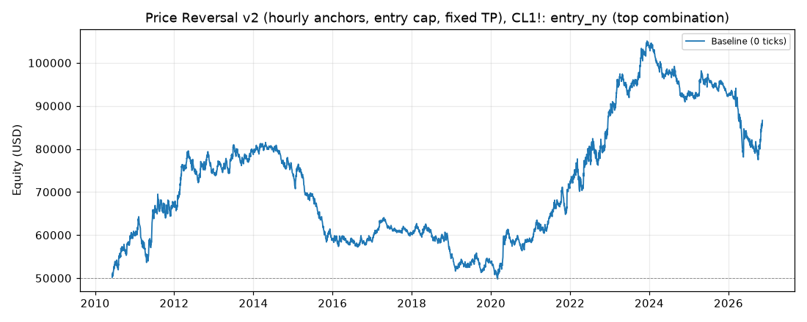

Files: [grid](../../../results/price_reversal_v2/entry_ny/grid.csv), [trades 0 ticks](../../../results/price_reversal_v2/entry_ny/trades_slippage0.csv), [summary](../../../results/price_reversal_v2/entry_ny/summary.json)

### Results after commission

#### Overview

| Metric | Value |
|---|---|
| Net profit | 36,639.60 USD (73.28%) |
| Total closed trades | 4,520 |
| Percent profitable | 30.07% |
| Profit factor | 1.050 |
| Max equity drawdown | 32,109.64 USD (64.22%) |
| Avg trade | 8.11 USD |
| Avg # bars in trades | 44 |

#### Performance

| Metric | All | Long | Short |
|---|---|---|---|
| Net profit | 36,639.60 USD (73.28%) | 23,721.94 USD (47.44%) | 12,917.66 USD (25.84%) |
| Gross profit | 767,946.82 USD (1,535.89%) | 403,761.98 USD (807.52%) | 364,184.84 USD (728.37%) |
| Gross loss | 731,307.22 USD (1,462.61%) | 380,040.04 USD (760.08%) | 351,267.18 USD (702.53%) |
| Commission paid | 18,170.40 USD | 9,258.06 USD | 8,912.34 USD |

| Account | Value |
|---|---|
| Initial capital | 50,000.00 USD |
| Buy & hold return (TV-style, all capital at the first entry) | 9,499.86 USD (19.00%) |
| Max equity run-up (intrabar) | 55,382.42 USD (110.76%) |
| Max equity drawdown (intrabar) | 32,109.64 USD (64.22%) |
| Open P&L | 0.00 USD |
| Max contracts held | 1 |

#### Trades analysis

| Metric | All | Long | Short |
|---|---|---|---|
| Total closed trades | 4,520 | 2,303 | 2,217 |
| Winning trades | 1,359 | 701 | 658 |
| Losing trades | 3,161 | 1,602 | 1,559 |
| Even trades | 0 | 0 | 0 |
| Percent profitable | 30.07% | 30.44% | 29.68% |
| Avg P&L | 8.11 USD | 10.30 USD | 5.83 USD |
| Avg P&L % | 0.01% | 0.02% | 0.00% |
| Avg winning trade | 565.08 USD | 575.98 USD | 553.47 USD |
| Avg losing trade | 231.35 USD | 237.23 USD | 225.32 USD |
| Ratio avg win / avg loss | 2.443 | 2.428 | 2.456 |
| Largest winning trade | 4,195.98 USD | 2,635.98 USD | 4,195.98 USD |
| Largest winning trade % | 9.04% | 9.04% | 7.75% |
| Largest losing trade | 1,364.02 USD | 1,354.02 USD | 1,364.02 USD |
| Largest losing trade % | 4.38% | 2.54% | 4.38% |
| Avg # bars in trades | 44 | 44 | 43 |
| Avg # bars in winning trades | 74 | 78 | 69 |
| Avg # bars in losing trades | 31 | 30 | 32 |

#### Risk/performance ratios

| Metric | Value |
|---|---|
| Sharpe ratio | 0.051 |
| Sortino ratio | 0.085 |
| Profit factor | 1.050 |
| Margin calls | 0 |

#### List of trades (last 10, newest first; full list in the trades CSV)

| Trade # | Type | Signal | Date/Time (UTC) | Price | Contracts | Profit | Cum. profit | Run-up | Drawdown |
|---|---|---|---|---|---|---|---|---|---|
| 4520 | Exit long | Exit | 2026-11-09 15:37 | 88.13 | 1 | 1,295.98 USD (1.49%) | 36,639.60 USD | 1,300.00 USD | 100.00 USD |
|  | Entry long | Long | 2026-11-09 14:29 | 86.83 | 1 |  |  |  |  |
| 4519 | Exit long | Exit | 2026-11-06 14:35 | 90.46 | 1 | -274.02 USD (-0.30%) | 35,343.62 USD | 110.00 USD | 270.00 USD |
|  | Entry long | Long | 2026-11-06 14:26 | 90.73 | 1 |  |  |  |  |
| 4518 | Exit short | Exit | 2026-11-05 14:41 | 89.97 | 1 | -324.02 USD (-0.36%) | 35,617.64 USD | 370.00 USD | 320.00 USD |
|  | Entry short | Short | 2026-11-05 14:31 | 89.65 | 1 |  |  |  |  |
| 4517 | Exit short | Exit | 2026-11-04 16:00 | 92.08 | 1 | 1,135.98 USD (1.22%) | 35,941.66 USD | 1,140.00 USD | 210.00 USD |
|  | Entry short | Short | 2026-11-04 14:52 | 93.22 | 1 |  |  |  |  |
| 4516 | Exit short | Exit | 2026-11-03 14:24 | 95.85 | 1 | -444.02 USD (-0.47%) | 34,805.68 USD | 50.00 USD | 440.00 USD |
|  | Entry short | Short | 2026-11-03 14:24 | 95.41 | 1 |  |  |  |  |
| 4515 | Exit long | Exit | 2026-11-02 14:30 | 97.30 | 1 | -234.02 USD (-0.24%) | 35,249.70 USD | 350.00 USD | 230.00 USD |
|  | Entry long | Long | 2026-11-02 14:21 | 97.53 | 1 |  |  |  |  |
| 4514 | Exit short | Exit | 2026-10-30 15:32 | 103.50 | 1 | 795.98 USD (0.76%) | 35,483.72 USD | 800.00 USD | 160.00 USD |
|  | Entry short | Short | 2026-10-30 14:30 | 104.30 | 1 |  |  |  |  |
| 4513 | Exit long | Exit | 2026-10-29 14:05 | 100.97 | 1 | 795.98 USD (0.79%) | 34,687.74 USD | 800.00 USD | 10.00 USD |
|  | Entry long | Long | 2026-10-29 13:53 | 100.17 | 1 |  |  |  |  |
| 4512 | Exit short | Exit | 2026-10-28 14:40 | 102.46 | 1 | -204.02 USD (-0.20%) | 33,891.76 USD | 100.00 USD | 200.00 USD |
|  | Entry short | Short | 2026-10-28 14:31 | 102.26 | 1 |  |  |  |  |
| 4511 | Exit long | Exit | 2026-10-27 14:50 | 100.08 | 1 | -444.02 USD (-0.44%) | 34,095.78 USD | 190.00 USD | 440.00 USD |
|  | Entry long | Long | 2026-10-27 14:46 | 100.52 | 1 |  |  |  |  |

#### By year (extra, not a TV tab)

| Year | Trades | Net profit | % profitable | Profit factor |
|---|---|---|---|---|
| 2010 | 154 | 10,360.92 USD | 40.91% | 1.406 |
| 2011 | 270 | 7,264.60 USD | 34.07% | 1.117 |
| 2012 | 285 | 6,994.30 USD | 34.04% | 1.142 |
| 2013 | 260 | 4,974.80 USD | 31.92% | 1.128 |
| 2014 | 248 | -5,716.96 USD | 26.61% | 0.839 |
| 2015 | 285 | -15,065.70 USD | 24.56% | 0.688 |
| 2016 | 281 | -459.62 USD | 26.33% | 0.985 |
| 2017 | 247 | 2,177.06 USD | 25.51% | 1.101 |
| 2018 | 287 | -5,983.74 USD | 24.74% | 0.839 |
| 2019 | 268 | -1,097.36 USD | 28.73% | 0.967 |
| 2020 | 264 | 4,988.72 USD | 28.79% | 1.144 |
| 2021 | 290 | 13,604.20 USD | 34.83% | 1.333 |
| 2022 | 289 | 16,788.22 USD | 37.02% | 1.214 |
| 2023 | 292 | 14,726.16 USD | 36.64% | 1.298 |
| 2024 | 282 | -10,283.64 USD | 25.18% | 0.776 |
| 2025 | 278 | -637.56 USD | 26.26% | 0.983 |
| 2026 | 240 | -5,994.80 USD | 28.33% | 0.903 |

#### Exit reasons (extra)

| Reason | Trades |
|---|---|
| stop | 3140 |
| limit | 1239 |
| close | 141 |

- Session-end exits: 141.
- Roll exits: 0.

### Best settings by metric

Each winner needs at least 30 closed trades. Undefined values are excluded. Ties: higher net profit, higher profit factor, then grid order. Ruin loss threshold: 25,000.00 USD from starting capital. All selections are in-sample. MAE/MFE objectives use the mean of the per-trade maxima.

| Metric | Goal | Best value | Grid order | Trades | Eligible settings | Parameters |
|---|---|---|---|---|---|---|
| Net profit | max | 36,639.60 USD | [2](../../../results/price_reversal_v2/entry_ny/metric_winners/order_2/trades_slippage0.csv) | 4520 | 16 | entry_cap=0, tp_mode=fixed |
| Win rate | max | 34.30% | [1](../../../results/price_reversal_v2/entry_ny/metric_winners/order_1/trades_slippage0.csv) | 4612 | 16 | entry_cap=0, tp_mode=default |
| Expectancy | max | 8.11 USD | [2](../../../results/price_reversal_v2/entry_ny/metric_winners/order_2/trades_slippage0.csv) | 4520 | 16 | entry_cap=0, tp_mode=fixed |
| Profit factor | max | 1.050 | [2](../../../results/price_reversal_v2/entry_ny/metric_winners/order_2/trades_slippage0.csv) | 4520 | 16 | entry_cap=0, tp_mode=fixed |
| Payoff ratio | max | 2.443 | [2](../../../results/price_reversal_v2/entry_ny/metric_winners/order_2/trades_slippage0.csv) | 4520 | 16 | entry_cap=0, tp_mode=fixed |
| Risk of ruin (estimate) | min | 9.88% | [2](../../../results/price_reversal_v2/entry_ny/metric_winners/order_2/trades_slippage0.csv) | 4520 | 16 | entry_cap=0, tp_mode=fixed |
| Maximum drawdown | min | 31,777.78 USD | [10](../../../results/price_reversal_v2/entry_ny/metric_winners/order_10/trades_slippage0.csv) | 4407 | 16 | entry_cap=35, tp_mode=fixed |
| Consecutive losses | min | 16.000 | [1](../../../results/price_reversal_v2/entry_ny/metric_winners/order_1/trades_slippage0.csv) | 4612 | 16 | entry_cap=0, tp_mode=default |
| Sharpe ratio | max | 0.051 | [2](../../../results/price_reversal_v2/entry_ny/metric_winners/order_2/trades_slippage0.csv) | 4520 | 16 | entry_cap=0, tp_mode=fixed |
| Sortino ratio | max | 0.085 | [2](../../../results/price_reversal_v2/entry_ny/metric_winners/order_2/trades_slippage0.csv) | 4520 | 16 | entry_cap=0, tp_mode=fixed |
| R-multiple | max | -0.001 | [2](../../../results/price_reversal_v2/entry_ny/metric_winners/order_2/trades_slippage0.csv) | 4520 | 16 | entry_cap=0, tp_mode=fixed |
| Maximum adverse excursion (MAE) | min | 131.68 USD | [3](../../../results/price_reversal_v2/entry_ny/metric_winners/order_3/trades_slippage0.csv) | 3986 | 16 | entry_cap=20, tp_mode=default |
| Maximum favorable excursion (MFE) | max | 285.97 USD | [2](../../../results/price_reversal_v2/entry_ny/metric_winners/order_2/trades_slippage0.csv) | 4520 | 16 | entry_cap=0, tp_mode=fixed |

- **Net profit:** Sum of closed-trade profit after commission; excludes open P&L.
- **Win rate:** Winning closed trades divided by all closed trades, including breakevens.
- **Expectancy:** Mean net profit per closed trade, including losses and breakevens.
- **Profit factor:** Gross winning profit divided by gross losing profit, both after commission. Undefined without losses.
- **Payoff ratio:** Average net winning trade divided by the absolute average net losing trade. Requires wins and losses.
- **Risk of ruin (estimate):** Infinite-horizon diffusion estimate of losing the declared amount from starting capital. Assumes independent, stationary, fixed-size net trade P&L; ignores intratrade losses and margin.
- **Maximum drawdown:** Largest equity drawdown under the tester's intrabar TradingView convention, including an open trade at the end.
- **Consecutive losses:** Longest streak of losing closed trades in execution order. A win or breakeven resets the streak.
- **Sharpe ratio:** Monthly marked-to-market excess return divided by population standard deviation, using 2% annual risk-free rate; not annualized.
- **Sortino ratio:** Monthly marked-to-market excess return divided by downside deviation about the risk-free rate; not annualized.
- **R-multiple:** Mean net trade profit / initial stop risk in dollars. Risk is actual fill to initial stop, before costs. Requires positive initial risk for every closed trade; R standard deviation and mean / standard deviation describe consistency.
- **Maximum adverse excursion (MAE):** Mean of each closed trade's maximum adverse price excursion in dollars, before commission; only the exposed intrabar path counts.
- **Maximum favorable excursion (MFE):** Mean of each closed trade's maximum favorable price excursion in dollars, before commission; only the exposed intrabar path counts. Unrealized opportunity, not realized profit.

Full selection metadata: [metric_winners.json](../../../results/price_reversal_v2/entry_ny/metric_winners.json).

### Top 10 combinations

| # | entry_cap | tp_mode | Net profit | Trades | % profitable | Profit factor | Max DD |
|---|---|---|---|---|---|---|---|
| 1 | 0 | fixed | 36,639.60 USD | 4,520 | 30.07% | 1.050 | 32,109.64 USD |
| 2 | 0 | default | 33,899.76 USD | 4,612 | 34.30% | 1.047 | 34,555.52 USD |
| 3 | 35 | fixed | 14,553.86 USD | 4,407 | 29.68% | 1.023 | 31,777.78 USD |
| 4 | 45 | fixed | 13,718.74 USD | 4,463 | 29.71% | 1.020 | 32,397.78 USD |
| 5 | 50 | fixed | 13,430.40 USD | 4,480 | 29.73% | 1.019 | 32,311.60 USD |
| 6 | 35 | default | 12,820.10 USD | 4,495 | 33.93% | 1.020 | 33,973.66 USD |
| 7 | 40 | fixed | 12,567.28 USD | 4,436 | 29.62% | 1.019 | 32,393.76 USD |
| 8 | 50 | default | 11,164.58 USD | 4,571 | 34.00% | 1.016 | 34,717.48 USD |
| 9 | 45 | default | 10,062.92 USD | 4,554 | 33.97% | 1.015 | 34,863.66 USD |
| 10 | 40 | default | 9,219.50 USD | 4,525 | 33.88% | 1.014 | 34,839.64 USD |

Profitable combinations: 12 of 16.
