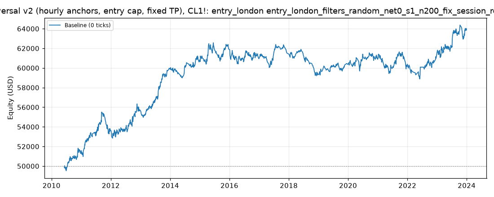

# Price Reversal v2 (hourly anchors, entry cap, fixed TP), CL1!: optimized `entry_london` (entry_london_filters_random_net0_s1_n200_fix_session_reentry)

Generated 2026-11-11 20:26 UTC by `python -m tvtester.cli replay strategies/configs/price_reversal_v2_entry_london_filters_random_net0_s1_n200_fix_session_reentry.json`.

> **In-sample.** Development interval only (bars before 2024-01-01 UTC). Picked by search `results/price_reversal_v2/search/entry_london_filters_random_net0_s1_n200_fix_session_reentry` (trial 168, objective `net0`); see its report for how many trials it took. Nothing here shows a tradable edge: out-of-sample validation is a later feature.

**Parameters:** `anchor=london`, `atr_mult=1.5`, `entry_cap=50`, `swing=1`, `target=rr2`, `tp_mode=default`, `window=30`

**Filters:** `anchor_body_atr <= 1.9`, `risk_ticks <= 20`

Replay matches the search trial: **yes**.

## Against the baseline (same interval, same costs)

| Scenario | Baseline net | Optimized net | Baseline trades | Optimized trades | Baseline PF | Optimized PF | Baseline max DD | Optimized max DD |
|---|---|---|---|---|---|---|---|---|
| 0 ticks | 11,174.58 USD | 13,867.02 USD | 1,571 | 1,349 | 1.086 | 1.153 | 7,849.10 USD | 3,727.42 USD |

## Results after commission

### Overview

| Metric | Value |
|---|---|
| Net profit | 13,867.02 USD (27.73%) |
| Total closed trades | 1,349 |
| Percent profitable | 36.55% |
| Profit factor | 1.153 |
| Max equity drawdown | 3,727.42 USD (7.45%) |
| Avg trade | 10.28 USD |
| Avg # bars in trades | 28 |

### Performance

| Metric | All | Long | Short |
|---|---|---|---|
| Net profit | 13,867.02 USD (27.73%) | 6,793.94 USD (13.59%) | 7,073.08 USD (14.15%) |
| Gross profit | 104,718.14 USD (209.44%) | 53,850.98 USD (107.70%) | 50,867.16 USD (101.73%) |
| Gross loss | 90,851.12 USD (181.70%) | 47,057.04 USD (94.11%) | 43,794.08 USD (87.59%) |
| Commission paid | 5,422.98 USD | 2,826.06 USD | 2,596.92 USD |

| Account | Value |
|---|---|
| Initial capital | 50,000.00 USD |
| Buy & hold return (TV-style, all capital at the first entry) | -472.16 USD (-0.94%) |
| Max equity run-up (intrabar) | 14,925.76 USD (29.85%) |
| Max equity drawdown (intrabar) | 3,727.42 USD (7.45%) |
| Open P&L | 0.00 USD |
| Max contracts held | 1 |

### Trades analysis

| Metric | All | Long | Short |
|---|---|---|---|
| Total closed trades | 1,349 | 703 | 646 |
| Winning trades | 493 | 251 | 242 |
| Losing trades | 856 | 452 | 404 |
| Even trades | 0 | 0 | 0 |
| Percent profitable | 36.55% | 35.70% | 37.46% |
| Avg P&L | 10.28 USD | 9.66 USD | 10.95 USD |
| Avg P&L % | 0.01% | 0.01% | 0.01% |
| Avg winning trade | 212.41 USD | 214.55 USD | 210.19 USD |
| Avg losing trade | 106.13 USD | 104.11 USD | 108.40 USD |
| Ratio avg win / avg loss | 2.001 | 2.061 | 1.939 |
| Largest winning trade | 455.98 USD | 455.98 USD | 415.98 USD |
| Largest winning trade % | 1.50% | 1.04% | 1.50% |
| Largest losing trade | 204.02 USD | 204.02 USD | 204.02 USD |
| Largest losing trade % | 1.19% | 0.72% | 1.19% |
| Avg # bars in trades | 28 | 29 | 26 |
| Avg # bars in winning trades | 38 | 43 | 34 |
| Avg # bars in losing trades | 21 | 21 | 21 |

### Risk/performance ratios

| Metric | Value |
|---|---|
| Sharpe ratio | -0.016 |
| Sortino ratio | -0.024 |
| Profit factor | 1.153 |
| Margin calls | 0 |

### By year (extra)

| Year | Trades | Net profit | % profitable | Profit factor |
|---|---|---|---|---|
| 2010 | 59 | 1,582.82 USD | 38.98% | 1.418 |
| 2011 | 101 | 2,133.98 USD | 39.60% | 1.271 |
| 2012 | 116 | 2,033.68 USD | 38.79% | 1.241 |
| 2013 | 104 | 4,221.92 USD | 48.08% | 1.848 |
| 2014 | 93 | 856.14 USD | 36.56% | 1.164 |
| 2015 | 120 | 1,107.60 USD | 34.17% | 1.144 |
| 2016 | 122 | -1,000.44 USD | 31.15% | 0.880 |
| 2017 | 98 | 526.04 USD | 34.69% | 1.108 |
| 2018 | 89 | -2,057.78 USD | 26.97% | 0.664 |
| 2019 | 74 | 952.52 USD | 39.19% | 1.246 |
| 2020 | 93 | 526.14 USD | 34.41% | 1.080 |
| 2021 | 110 | -492.20 USD | 33.64% | 0.943 |
| 2022 | 52 | 1,150.96 USD | 38.46% | 1.218 |
| 2023 | 118 | 2,325.64 USD | 38.98% | 1.253 |
