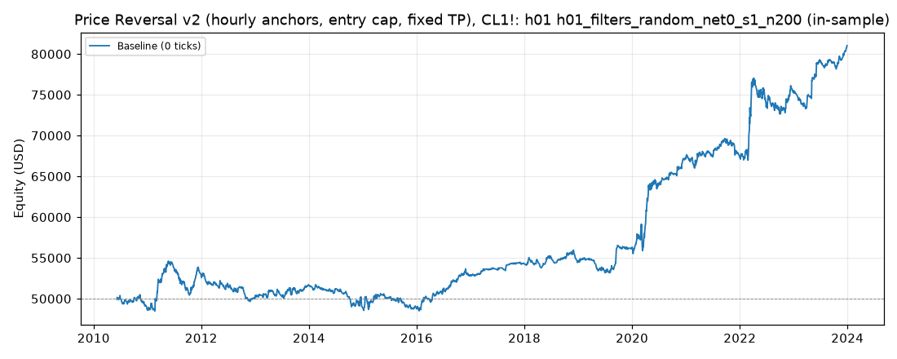

# Price Reversal v2 (hourly anchors, entry cap, fixed TP), CL1!: optimized `h01` (h01_filters_random_net0_s1_n200)

Generated 2026-11-11 20:20 UTC by `python -m tvtester.cli replay strategies/configs/price_reversal_v2_h01_filters_random_net0_s1_n200.json`.

> **In-sample.** Development interval only (bars before 2024-01-01 UTC). Picked by search `results/price_reversal_v2/search/h01_filters_random_net0_s1_n200` (trial 0, objective `net0`); see its report for how many trials it took. Nothing here shows a tradable edge: out-of-sample validation is a later feature.

**Parameters:** `anchor=h01`, `atr_mult=2.0`, `swing=1`, `target=rr2`, `window=60`

**Filters:** none

Replay matches the search trial: **yes**.

## Against the baseline (same interval, same costs)

| Scenario | Baseline net | Optimized net | Baseline trades | Optimized trades | Baseline PF | Optimized PF | Baseline max DD | Optimized max DD |
|---|---|---|---|---|---|---|---|---|
| 0 ticks | 31,018.42 USD | 31,018.42 USD | 2,279 | 2,279 | 1.204 | 1.204 | 6,151.28 USD | 6,151.28 USD |

## Results after commission

### Overview

| Metric | Value |
|---|---|
| Net profit | 31,018.42 USD (62.04%) |
| Total closed trades | 2,279 |
| Percent profitable | 36.33% |
| Profit factor | 1.204 |
| Max equity drawdown | 6,151.28 USD (12.30%) |
| Avg trade | 13.61 USD |
| Avg # bars in trades | 68 |

### Performance

| Metric | All | Long | Short |
|---|---|---|---|
| Net profit | 31,018.42 USD (62.04%) | 16,956.04 USD (33.91%) | 14,062.38 USD (28.12%) |
| Gross profit | 183,181.44 USD (366.36%) | 88,472.10 USD (176.94%) | 94,709.34 USD (189.42%) |
| Gross loss | 152,163.02 USD (304.33%) | 71,516.06 USD (143.03%) | 80,646.96 USD (161.29%) |
| Commission paid | 9,161.58 USD | 4,413.96 USD | 4,747.62 USD |

| Account | Value |
|---|---|
| Initial capital | 50,000.00 USD |
| Buy & hold return (TV-style, all capital at the first entry) | 360.07 USD (0.72%) |
| Max equity run-up (intrabar) | 32,545.04 USD (65.09%) |
| Max equity drawdown (intrabar) | 6,151.28 USD (12.30%) |
| Open P&L | 0.00 USD |
| Max contracts held | 1 |

### Trades analysis

| Metric | All | Long | Short |
|---|---|---|---|
| Total closed trades | 2,279 | 1,098 | 1,181 |
| Winning trades | 828 | 395 | 433 |
| Losing trades | 1,451 | 703 | 748 |
| Even trades | 0 | 0 | 0 |
| Percent profitable | 36.33% | 35.97% | 36.66% |
| Avg P&L | 13.61 USD | 15.44 USD | 11.91 USD |
| Avg P&L % | 0.03% | 0.04% | 0.02% |
| Avg winning trade | 221.23 USD | 223.98 USD | 218.73 USD |
| Avg losing trade | 104.87 USD | 101.73 USD | 107.82 USD |
| Ratio avg win / avg loss | 2.110 | 2.202 | 2.029 |
| Largest winning trade | 2,595.98 USD | 2,595.98 USD | 1,955.98 USD |
| Largest winning trade % | 5.16% | 5.16% | 2.54% |
| Largest losing trade | 2,294.02 USD | 2,294.02 USD | 1,134.02 USD |
| Largest losing trade % | 7.00% | 7.00% | 1.61% |
| Avg # bars in trades | 68 | 68 | 68 |
| Avg # bars in winning trades | 97 | 98 | 97 |
| Avg # bars in losing trades | 52 | 51 | 52 |

### Risk/performance ratios

| Metric | Value |
|---|---|
| Sharpe ratio | 0.085 |
| Sortino ratio | 0.188 |
| Profit factor | 1.204 |
| Margin calls | 0 |

### By year (extra)

| Year | Trades | Net profit | % profitable | Profit factor |
|---|---|---|---|---|
| 2010 | 104 | -1,328.08 USD | 28.85% | 0.785 |
| 2011 | 182 | 4,278.36 USD | 36.81% | 1.281 |
| 2012 | 168 | -2,795.36 USD | 27.98% | 0.745 |
| 2013 | 157 | 1,498.86 USD | 38.22% | 1.176 |
| 2014 | 155 | -2,783.10 USD | 30.97% | 0.737 |
| 2015 | 168 | -125.36 USD | 34.52% | 0.988 |
| 2016 | 176 | 4,092.48 USD | 43.18% | 1.521 |
| 2017 | 108 | 1,515.84 USD | 40.74% | 1.507 |
| 2018 | 151 | 142.98 USD | 35.10% | 1.018 |
| 2019 | 148 | 1,725.04 USD | 39.19% | 1.230 |
| 2020 | 193 | 10,924.14 USD | 44.56% | 1.717 |
| 2021 | 183 | 234.34 USD | 37.70% | 1.018 |
| 2022 | 211 | 8,141.78 USD | 36.02% | 1.310 |
| 2023 | 175 | 5,496.50 USD | 32.00% | 1.562 |
