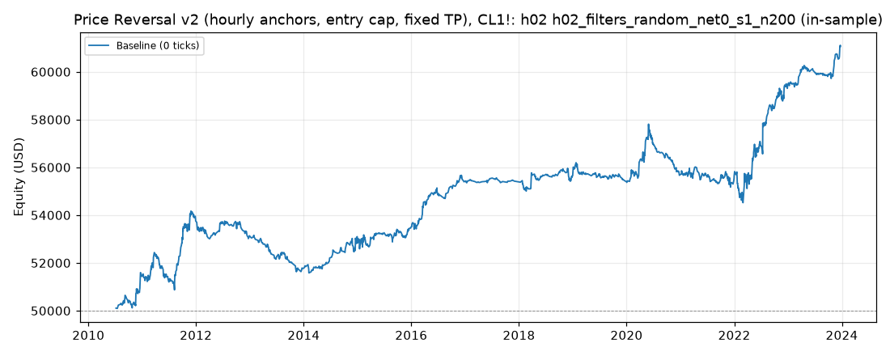

# Price Reversal v2 (hourly anchors, entry cap, fixed TP), CL1!: optimized `h02` (h02_filters_random_net0_s1_n200)

Generated 2026-11-11 20:24 UTC by `python -m tvtester.cli replay strategies/configs/price_reversal_v2_h02_filters_random_net0_s1_n200.json`.

> **In-sample.** Development interval only (bars before 2024-01-01 UTC). Picked by search `results/price_reversal_v2/search/h02_filters_random_net0_s1_n200` (trial 70, objective `net0`); see its report for how many trials it took. Nothing here shows a tradable edge: out-of-sample validation is a later feature.

**Parameters:** `anchor=h02`, `atr_mult=0.5`, `swing=1`, `target=far`, `window=60`

**Filters:** `minutes_from_open <= 50`, `range_ratio <= 1.9`

Replay matches the search trial: **yes**.

## Against the baseline (same interval, same costs)

| Scenario | Baseline net | Optimized net | Baseline trades | Optimized trades | Baseline PF | Optimized PF | Baseline max DD | Optimized max DD |
|---|---|---|---|---|---|---|---|---|
| 0 ticks | 8,565.26 USD | 11,056.48 USD | 1,837 | 1,476 | 1.136 | 1.236 | 5,247.46 USD | 3,288.52 USD |

## Results after commission

### Overview

| Metric | Value |
|---|---|
| Net profit | 11,056.48 USD (22.11%) |
| Total closed trades | 1,476 |
| Percent profitable | 52.85% |
| Profit factor | 1.236 |
| Max equity drawdown | 3,288.52 USD (6.58%) |
| Avg trade | 7.49 USD |
| Avg # bars in trades | 18 |

### Performance

| Metric | All | Long | Short |
|---|---|---|---|
| Net profit | 11,056.48 USD (22.11%) | 5,742.74 USD (11.49%) | 5,313.74 USD (10.63%) |
| Gross profit | 57,984.40 USD (115.97%) | 30,587.78 USD (61.18%) | 27,396.62 USD (54.79%) |
| Gross loss | 46,927.92 USD (93.86%) | 24,845.04 USD (49.69%) | 22,082.88 USD (44.17%) |
| Commission paid | 5,933.52 USD | 3,067.26 USD | 2,866.26 USD |

| Account | Value |
|---|---|
| Initial capital | 50,000.00 USD |
| Buy & hold return (TV-style, all capital at the first entry) | -684.46 USD (-1.37%) |
| Max equity run-up (intrabar) | 11,120.50 USD (22.24%) |
| Max equity drawdown (intrabar) | 3,288.52 USD (6.58%) |
| Open P&L | 0.00 USD |
| Max contracts held | 1 |

### Trades analysis

| Metric | All | Long | Short |
|---|---|---|---|
| Total closed trades | 1,476 | 763 | 713 |
| Winning trades | 780 | 411 | 369 |
| Losing trades | 696 | 352 | 344 |
| Even trades | 0 | 0 | 0 |
| Percent profitable | 52.85% | 53.87% | 51.75% |
| Avg P&L | 7.49 USD | 7.53 USD | 7.45 USD |
| Avg P&L % | 0.01% | 0.01% | 0.01% |
| Avg winning trade | 74.34 USD | 74.42 USD | 74.25 USD |
| Avg losing trade | 67.43 USD | 70.58 USD | 64.19 USD |
| Ratio avg win / avg loss | 1.103 | 1.054 | 1.157 |
| Largest winning trade | 1,275.98 USD | 1,275.98 USD | 705.98 USD |
| Largest winning trade % | 1.35% | 1.35% | 1.14% |
| Largest losing trade | 354.02 USD | 354.02 USD | 294.02 USD |
| Largest losing trade % | 1.65% | 1.65% | 1.60% |
| Avg # bars in trades | 18 | 17 | 19 |
| Avg # bars in winning trades | 20 | 18 | 21 |
| Avg # bars in losing trades | 16 | 15 | 17 |

### Risk/performance ratios

| Metric | Value |
|---|---|
| Sharpe ratio | -0.073 |
| Sortino ratio | -0.117 |
| Profit factor | 1.236 |
| Margin calls | 0 |

### By year (extra)

| Year | Trades | Net profit | % profitable | Profit factor |
|---|---|---|---|---|
| 2010 | 59 | 1,432.82 USD | 49.15% | 1.890 |
| 2011 | 147 | 2,319.06 USD | 53.06% | 1.430 |
| 2012 | 103 | -614.06 USD | 40.78% | 0.829 |
| 2013 | 96 | -1,375.92 USD | 38.54% | 0.554 |
| 2014 | 85 | 1,338.30 USD | 58.82% | 1.617 |
| 2015 | 136 | 403.28 USD | 55.88% | 1.103 |
| 2016 | 99 | 1,892.02 USD | 66.67% | 1.804 |
| 2017 | 43 | 27.14 USD | 62.79% | 1.041 |
| 2018 | 83 | 226.34 USD | 49.40% | 1.092 |
| 2019 | 96 | -245.92 USD | 58.33% | 0.897 |
| 2020 | 122 | 289.56 USD | 48.36% | 1.062 |
| 2021 | 123 | -34.46 USD | 50.41% | 0.992 |
| 2022 | 173 | 3,814.54 USD | 54.34% | 1.472 |
| 2023 | 111 | 1,583.78 USD | 56.76% | 1.654 |
