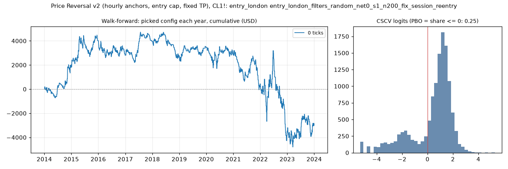

# Price Reversal v2 (hourly anchors, entry cap, fixed TP), CL1!: limit-entry validation, entry_london (entry_london_filters_random_net0_s1_n200_fix_session_reentry)

Generated 2026-11-11 20:47 UTC. Execution: limit-close-tp-expiry-owner-swings-v2. Commission included; no added slippage.

> **Development interval only, in-sample research.** The starting settings were selected using the full history. Walk-forward re-selection does not remove that exposure. Passing is not proof of a tradable edge.

Candidate: trial 168 of `results/price_reversal_v2/search/entry_london_filters_random_net0_s1_n200_fix_session_reentry`; 200 configurations in the search universe.

## Verdict

| Check | Result | Need |
|---|---|---|
| Walk-forward net profit | -2,999.60 USD | > 0 |
| Positive years | 5 of 10 | >= 7 |
| PBO | 0.255 | <= 0.5 |
| DSR | 0.388 | >= 0.95 |

Procedure: **fail**. Candidate: **fail**. Advance to F4: False.

Engine runs: 200 matrix configurations + 20 fold runs, baseline only.

## Walk-forward, anchored

Each test year starts flat. Selection uses prior development data only, net profit plus open P&L, and the scaled minimum trade count. Sensitivities cannot rescue a failure.

| Year | Picked trial | Configuration | Training result | Net profit | Trades | Frozen candidate (in-sample) |
|---|---|---|---|---|---|---|
| 2014 | 158 | anchor_body_atr <= 2, range_ratio <= 1.6, risk_ticks <= 58 | 13,659.94 USD | 2,016.34 USD | 83 | 856.14 USD |
| 2015 | 158 | anchor_body_atr <= 2, range_ratio <= 1.6, risk_ticks <= 58 | 15,676.28 USD | 2,001.72 USD | 114 | 1,107.60 USD |
| 2016 | 158 | anchor_body_atr <= 2, range_ratio <= 1.6, risk_ticks <= 58 | 17,678.00 USD | -1,204.26 USD | 113 | -1,000.44 USD |
| 2017 | 158 | anchor_body_atr <= 2, range_ratio <= 1.6, risk_ticks <= 58 | 16,473.74 USD | 1,172.22 USD | 89 | 526.04 USD |
| 2018 | 158 | anchor_body_atr <= 2, range_ratio <= 1.6, risk_ticks <= 58 | 17,645.96 USD | -1,231.60 USD | 80 | -2,057.78 USD |
| 2019 | 158 | anchor_body_atr <= 2, range_ratio <= 1.6, risk_ticks <= 58 | 16,414.36 USD | 686.54 USD | 73 | 952.52 USD |
| 2020 | 158 | anchor_body_atr <= 2, range_ratio <= 1.6, risk_ticks <= 58 | 17,100.90 USD | -611.80 USD | 90 | 526.14 USD |
| 2021 | 158 | anchor_body_atr <= 2, range_ratio <= 1.6, risk_ticks <= 58 | 16,489.10 USD | -2,396.12 USD | 106 | -492.20 USD |
| 2022 | 164 | risk_atr >= 2 | 14,684.78 USD | -3,906.02 USD | 101 | 1,150.96 USD |
| 2023 | 146 | anchor_body_atr <= 1.5 | 12,771.24 USD | 473.38 USD | 131 | 2,325.64 USD |
| Total | | | | -2,999.60 USD | 980 | |

Walk-forward efficiency: -0.13. Fold-end open positions: 0.
Fold/full-history boundary difference: 0.00 USD.

## Sensitivity: rolling four-year training

Each test year starts flat. Selection uses prior development data only, net profit plus open P&L, and the scaled minimum trade count. Sensitivities cannot rescue a failure.

| Year | Picked trial | Configuration | Training result | Net profit | Trades | Frozen candidate (in-sample) |
|---|---|---|---|---|---|---|
| 2014 | 158 | anchor_body_atr <= 2, range_ratio <= 1.6, risk_ticks <= 58 | 13,659.94 USD | 2,016.34 USD | 83 | 856.14 USD |
| 2015 | 158 | anchor_body_atr <= 2, range_ratio <= 1.6, risk_ticks <= 58 | 13,253.26 USD | 2,001.72 USD | 114 | 1,107.60 USD |
| 2016 | 158 | anchor_body_atr <= 2, range_ratio <= 1.6, risk_ticks <= 58 | 12,495.52 USD | -1,204.26 USD | 113 | -1,000.44 USD |
| 2017 | 18 | range_ratio >= 0.7 | 8,840.54 USD | 846.44 USD | 78 | 526.04 USD |
| 2018 | 73 | risk_atr <= 5.75, risk_ticks >= 8 | 6,004.30 USD | -2,387.28 USD | 64 | -2,057.78 USD |
| 2019 | 67 | anchor_body_atr <= 0.7, range_ratio >= 0.8 | 1,898.06 USD | -816.58 USD | 29 | 952.52 USD |
| 2020 | 1 | anchor_body_atr <= 0.1, risk_ticks <= 14 | 570.06 USD | 891.56 USD | 22 | 526.14 USD |
| 2021 | 78 | range_ratio >= 0.6, risk_atr >= 2.5, risk_ticks >= 8 | 1,488.96 USD | -2,086.88 USD | 44 | -492.20 USD |
| 2022 | 64 | anchor_body_atr <= 0.1, risk_atr <= 4.25 | 1,128.20 USD | -1,808.34 USD | 17 | 1,150.96 USD |
| 2023 | 144 | minutes_from_open <= 45, risk_ticks <= 16 | 2,610.28 USD | 1,808.10 USD | 95 | 2,325.64 USD |
| Total | | | | -739.18 USD | 659 | |

Walk-forward efficiency: -0.05. Fold-end open positions: 0.
Fold/full-history boundary difference: 0.00 USD.

## Probability of backtest overfitting

Daily marked-to-market P&L, split into complementary halves. PBO is the fraction where the in-sample winner ranks at or below the out-of-sample median. This diagnostic is not time ordered.

| Version | PBO | P(OOS loss) | Median logit | Skipped |
|---|---|---|---|---|
| primary | 0.255 | 0.227 | 0.951 | 0 |
| eligible_only | 0.673 | 0.227 | -0.395 | 0 |

## Deflated Sharpe

Daily returns use fixed starting capital, idle days included, and are not annualized. The luck bar uses the search universe's Sharpe spread. Broader-N sensitivities reuse that spread as an assumption.

| Version | N | Luck bar | DSR |
|---|---|---|---|
| primary | 200 | 0.0397 | 0.388 |
| variant_n | 221 | 0.0402 | 0.376 |
| strategy_n | 2129 | 0.0498 | 0.171 |
| monthly | 200 | 0.1941 | 0.406 |

Daily Sharpe: 0.0355. PSR above zero: 0.991. 90% block-bootstrap Sharpe interval: (0.010856591574903304, 0.06051472164818843). Identical paths: 54.

Raw files: `results/price_reversal_v2/validate/entry_london_filters_random_net0_s1_n200_fix_session_reentry`. The statistical formula assumes independent returns; the block bootstrap checks sensitivity to dependence.
