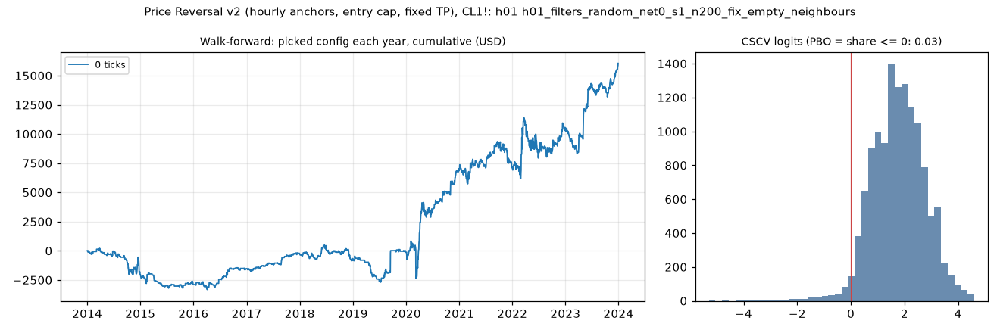

# Price Reversal v2 (hourly anchors, entry cap, fixed TP), CL1!: limit-entry validation, h01 (h01_filters_random_net0_s1_n200_fix_empty_neighbours)

Generated 2026-11-11 20:40 UTC. Execution: limit-close-tp-expiry-owner-swings-v2. Commission included; no added slippage.

> **Development interval only, in-sample research.** The starting settings were selected using the full history. Walk-forward re-selection does not remove that exposure. Passing is not proof of a tradable edge.

Candidate: trial 0 of `results/price_reversal_v2/search/h01_filters_random_net0_s1_n200`; 200 configurations in the search universe.

## Verdict

| Check | Result | Need |
|---|---|---|
| Walk-forward net profit | 16,054.08 USD | > 0 |
| Positive years | 7 of 10 | >= 7 |
| PBO | 0.028 | <= 0.5 |
| DSR | 0.584 | >= 0.95 |

Procedure: pass. Candidate: **fail**. Advance to F4: False.

Engine runs: 200 matrix configurations + 20 fold runs, baseline only.

## Walk-forward, anchored

Each test year starts flat. Selection uses prior development data only, net profit plus open P&L, and the scaled minimum trade count. Sensitivities cannot rescue a failure.

| Year | Picked trial | Configuration | Training result | Net profit | Trades | Frozen candidate (in-sample) |
|---|---|---|---|---|---|---|
| 2014 | 73 | risk_atr <= 5.75, risk_ticks >= 8 | 4,184.76 USD | -2,073.56 USD | 78 | -2,783.10 USD |
| 2015 | 156 | anchor_body_atr >= 0.6, minutes_from_open <= 40, range_ratio <= 1.2 | 3,725.80 USD | -829.04 USD | 52 | -125.36 USD |
| 2016 | 156 | anchor_body_atr >= 0.6, minutes_from_open <= 40, range_ratio <= 1.2 | 2,896.76 USD | 1,360.96 USD | 52 | 4,092.48 USD |
| 2017 | 113 | anchor_body_atr <= 1.3, minutes_from_open <= 80, range_ratio <= 1.3 | 5,755.80 USD | 1,326.64 USD | 68 | 1,515.84 USD |
| 2018 | 113 | anchor_body_atr <= 1.3, minutes_from_open <= 80, range_ratio <= 1.3 | 7,082.44 USD | -561.90 USD | 95 | 142.98 USD |
| 2019 | 73 | risk_atr <= 5.75, risk_ticks >= 8 | 7,360.12 USD | 649.00 USD | 50 | 1,725.04 USD |
| 2020 | 98 | risk_atr <= 6 | 8,353.16 USD | 6,996.50 USD | 175 | 10,924.14 USD |
| 2021 | 0 | baseline | 17,145.80 USD | 234.34 USD | 183 | 234.34 USD |
| 2022 | 48 | minutes_from_open >= 15 | 19,237.74 USD | 3,454.64 USD | 168 | 8,141.78 USD |
| 2023 | 0 | baseline | 25,521.92 USD | 5,496.50 USD | 175 | 5,496.50 USD |
| Total | | | | 16,054.08 USD | 1096 | |

Walk-forward efficiency: 1.41. Fold-end open positions: 0.
Fold/full-history boundary difference: 0.00 USD.

## Sensitivity: rolling four-year training

Each test year starts flat. Selection uses prior development data only, net profit plus open P&L, and the scaled minimum trade count. Sensitivities cannot rescue a failure.

| Year | Picked trial | Configuration | Training result | Net profit | Trades | Frozen candidate (in-sample) |
|---|---|---|---|---|---|---|
| 2014 | 73 | risk_atr <= 5.75, risk_ticks >= 8 | 4,184.76 USD | -2,073.56 USD | 78 | -2,783.10 USD |
| 2015 | 156 | anchor_body_atr >= 0.6, minutes_from_open <= 40, range_ratio <= 1.2 | 4,292.18 USD | -829.04 USD | 52 | -125.36 USD |
| 2016 | 105 | minutes_from_open <= 70, range_ratio <= 1.3, risk_atr <= 3.25 | 1,030.08 USD | 786.24 USD | 88 | 4,092.48 USD |
| 2017 | 24 | anchor_body_atr <= 1.1, range_ratio <= 1.7 | 5,570.70 USD | 1,544.48 USD | 76 | 1,515.84 USD |
| 2018 | 25 | minutes_from_open >= 15, range_ratio <= 1.4 | 6,667.98 USD | 208.20 USD | 90 | 142.98 USD |
| 2019 | 25 | minutes_from_open >= 15, range_ratio <= 1.4 | 7,416.12 USD | -994.16 USD | 108 | 1,725.04 USD |
| 2020 | 161 | risk_atr >= 1 | 7,476.34 USD | 10,924.14 USD | 193 | 10,924.14 USD |
| 2021 | 48 | minutes_from_open >= 15 | 14,410.10 USD | 2,129.06 USD | 147 | 234.34 USD |
| 2022 | 48 | minutes_from_open >= 15 | 15,408.90 USD | 3,454.64 USD | 168 | 8,141.78 USD |
| 2023 | 164 | risk_atr >= 2 | 22,523.48 USD | 5,173.18 USD | 141 | 5,496.50 USD |
| Total | | | | 20,323.18 USD | 1141 | |

Walk-forward efficiency: 0.91. Fold-end open positions: 0.
Fold/full-history boundary difference: 0.00 USD.

## Probability of backtest overfitting

Daily marked-to-market P&L, split into complementary halves. PBO is the fraction where the in-sample winner ranks at or below the out-of-sample median. This diagnostic is not time ordered.

| Version | PBO | P(OOS loss) | Median logit | Skipped |
|---|---|---|---|---|
| primary | 0.028 | 0.015 | 1.780 | 0 |
| eligible_only | 0.194 | 0.015 | 0.953 | 0 |

## Deflated Sharpe

Daily returns use fixed starting capital, idle days included, and are not annualized. The luck bar uses the search universe's Sharpe spread. Broader-N sensitivities reuse that spread as an assumption.

| Version | N | Luck bar | DSR |
|---|---|---|---|
| primary | 200 | 0.0398 | 0.584 |
| variant_n | 263 | 0.0411 | 0.550 |
| strategy_n | 2129 | 0.0498 | 0.315 |
| monthly | 200 | 0.1771 | 0.519 |

Daily Sharpe: 0.0429. PSR above zero: 0.998. 90% block-bootstrap Sharpe interval: (0.018001142085626073, 0.06656566078603668). Identical paths: 33.

Raw files: `results/price_reversal_v2/validate/h01_filters_random_net0_s1_n200_fix_empty_neighbours`. The statistical formula assumes independent returns; the block bootstrap checks sensitivity to dependence.
