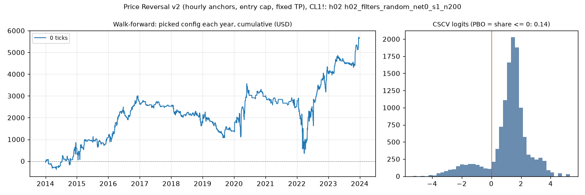

# Price Reversal v2 (hourly anchors, entry cap, fixed TP), CL1!: limit-entry validation, h02 (h02_filters_random_net0_s1_n200)

Generated 2026-11-11 20:45 UTC. Execution: limit-close-tp-expiry-owner-swings-v2. Commission included; no added slippage.

> **Development interval only, in-sample research.** The starting settings were selected using the full history. Walk-forward re-selection does not remove that exposure. Passing is not proof of a tradable edge.

Candidate: trial 70 of `results/price_reversal_v2/search/h02_filters_random_net0_s1_n200`; 200 configurations in the search universe.

## Verdict

| Check | Result | Need |
|---|---|---|
| Walk-forward net profit | 5,648.28 USD | > 0 |
| Positive years | 6 of 10 | >= 7 |
| PBO | 0.137 | <= 0.5 |
| DSR | 0.414 | >= 0.95 |

Procedure: **fail**. Candidate: **fail**. Advance to F4: False.

Engine runs: 200 matrix configurations + 20 fold runs, baseline only.

## Walk-forward, anchored

Each test year starts flat. Selection uses prior development data only, net profit plus open P&L, and the scaled minimum trade count. Sensitivities cannot rescue a failure.

| Year | Picked trial | Configuration | Training result | Net profit | Trades | Frozen candidate (in-sample) |
|---|---|---|---|---|---|---|
| 2014 | 71 | range_ratio >= 0.9 | 3,608.62 USD | 582.42 USD | 79 | 1,338.30 USD |
| 2015 | 71 | range_ratio >= 0.9 | 4,191.04 USD | 496.34 USD | 83 | 403.28 USD |
| 2016 | 20 | anchor_body_atr <= 1.4 | 5,079.52 USD | 1,543.68 USD | 116 | 1,892.02 USD |
| 2017 | 20 | anchor_body_atr <= 1.4 | 6,623.20 USD | -95.12 USD | 56 | 27.14 USD |
| 2018 | 20 | anchor_body_atr <= 1.4 | 6,528.08 USD | -687.98 USD | 99 | 226.34 USD |
| 2019 | 18 | range_ratio >= 0.7 | 6,490.84 USD | -485.92 USD | 96 | -245.92 USD |
| 2020 | 73 | risk_atr <= 5.75, risk_ticks >= 8 | 6,052.80 USD | 1,648.50 USD | 75 | 289.56 USD |
| 2021 | 73 | risk_atr <= 5.75, risk_ticks >= 8 | 7,701.30 USD | -386.78 USD | 39 | -34.46 USD |
| 2022 | 73 | risk_atr <= 5.75, risk_ticks >= 8 | 7,314.52 USD | 1,449.36 USD | 132 | 3,814.54 USD |
| 2023 | 70 | minutes_from_open <= 50, range_ratio <= 1.9 | 9,472.70 USD | 1,583.78 USD | 111 | 1,583.78 USD |
| Total | | | | 5,648.28 USD | 886 | |

Walk-forward efficiency: 0.69. Fold-end open positions: 0.
Fold/full-history boundary difference: 0.00 USD.

## Sensitivity: rolling four-year training

Each test year starts flat. Selection uses prior development data only, net profit plus open P&L, and the scaled minimum trade count. Sensitivities cannot rescue a failure.

| Year | Picked trial | Configuration | Training result | Net profit | Trades | Frozen candidate (in-sample) |
|---|---|---|---|---|---|---|
| 2014 | 71 | range_ratio >= 0.9 | 3,608.62 USD | 582.42 USD | 79 | 1,338.30 USD |
| 2015 | 36 | range_ratio >= 1.3 | 4,155.94 USD | 737.44 USD | 28 | 403.28 USD |
| 2016 | 62 | anchor_body_atr <= 1, range_ratio >= 1.2, risk_ticks <= 46 | 2,527.80 USD | 203.42 USD | 29 | 1,892.02 USD |
| 2017 | 155 | anchor_body_atr <= 0.8 | 2,779.94 USD | -68.84 USD | 42 | 27.14 USD |
| 2018 | 168 | anchor_body_atr <= 1.9, risk_ticks <= 20 | 3,849.44 USD | -416.02 USD | 101 | 226.34 USD |
| 2019 | 161 | risk_atr >= 1 | 3,105.12 USD | -326.62 USD | 131 | -245.92 USD |
| 2020 | 144 | minutes_from_open <= 45, risk_ticks <= 16 | 2,243.90 USD | -472.20 USD | 110 | 289.56 USD |
| 2021 | 73 | risk_atr <= 5.75, risk_ticks >= 8 | 2,983.38 USD | -386.78 USD | 39 | -34.46 USD |
| 2022 | 73 | risk_atr <= 5.75, risk_ticks >= 8 | 2,708.66 USD | 1,449.36 USD | 132 | 3,814.54 USD |
| 2023 | 185 | anchor_body_atr <= 1.3, risk_atr <= 5.25, risk_ticks <= 36 | 4,410.66 USD | 1,601.52 USD | 124 | 1,583.78 USD |
| Total | | | | 2,903.70 USD | 815 | |

Walk-forward efficiency: 0.35. Fold-end open positions: 0.
Fold/full-history boundary difference: 0.00 USD.

## Probability of backtest overfitting

Daily marked-to-market P&L, split into complementary halves. PBO is the fraction where the in-sample winner ranks at or below the out-of-sample median. This diagnostic is not time ordered.

| Version | PBO | P(OOS loss) | Median logit | Skipped |
|---|---|---|---|---|
| primary | 0.137 | 0.125 | 1.393 | 0 |
| eligible_only | 0.400 | 0.125 | 0.239 | 0 |

## Deflated Sharpe

Daily returns use fixed starting capital, idle days included, and are not annualized. The luck bar uses the search universe's Sharpe spread. Broader-N sensitivities reuse that spread as an assumption.

| Version | N | Luck bar | DSR |
|---|---|---|---|
| primary | 200 | 0.0466 | 0.414 |
| variant_n | 269 | 0.0482 | 0.371 |
| strategy_n | 2129 | 0.0583 | 0.148 |
| monthly | 200 | 0.2356 | 0.373 |

Daily Sharpe: 0.0435. PSR above zero: 0.999. 90% block-bootstrap Sharpe interval: (0.017217498462196217, 0.06768371454042597). Identical paths: 42.

Raw files: `results/price_reversal_v2/validate/h02_filters_random_net0_s1_n200`. The statistical formula assumes independent returns; the block bootstrap checks sensitivity to dependence.
