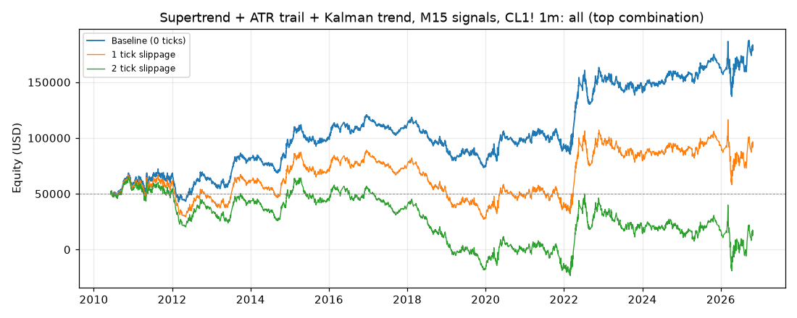
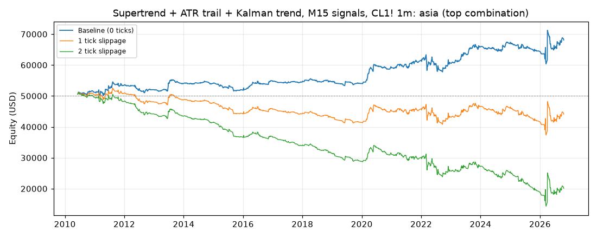
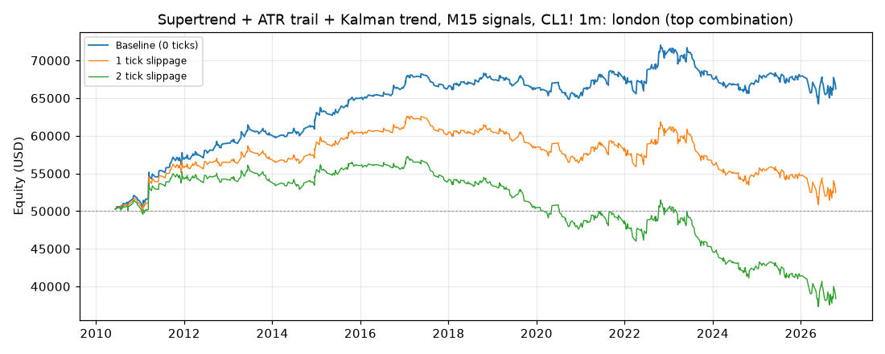
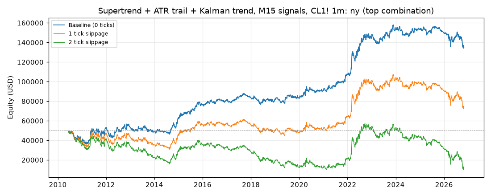

# Supertrend + ATR trail + Kalman trend, M15 signals, CL1! 1m: results

Generated 2026-10-31 10:25 UTC by `python -m tvtester.cli test supertrend_kalman`.

Owner idea: Supertrend plus an ATR trailing stop on M15, a Kalman filter for the trend, a volatility filter so it
does not trade with a wide stop, stop at the swing high / low, target 1:2 to 1:3. The owner left every design fork
open, so each fork is a grid parameter (`trigger`, `vol`, `exit`) or a variant (trading hours). Plan and Codex
review: [`docs/research/supertrend_kalman_plan.md`](../../research/supertrend_kalman_plan.md).

**M15 on a 1-minute chart.** M15 bars are the 1m bars grouped by UTC time floored to 15 minutes (CL's 18:00 New
York session open is a 15-minute boundary). A bucket's values are used only after it is complete: from the first
1m bar of the next bucket, which decides at its close, so a market entry fills at the next 1m open (normally
hh:16 for the hh:00-hh:15 bucket). Pine twin: `request.security(.., "15", expr[1], lookahead = barmerge.lookahead_on)`.

**Indicators (M15):** Supertrend(`st_factor`, ATR 10, Pine `ta.supertrend`); UT Bot ATR trailing stop
(ATR 10 x `trail_mult`, close source); 2-state constant-velocity Kalman filter on close (`kalman_q` = 0.01 or
0.0001, R = 1, P0 = 100 I, Joseph update), trend = sign of its slope. q = 0.01 alone agreed with about 97% of
Supertrend flips on 2023 bars (hardly a filter), so the slower 0.0001 (about 40%) was added; that choice used
signal counts only, no profit numbers; ATR14, ATR100, TradingView RVI(10, 14); swing highs /
lows with `swing` bars each side (strictly above / below), last confirmed value.

**Entry (`trigger`), only when flat, Kalman slope on the trade side:**
- `st`: Supertrend flips to the trade side.
- `trail`: UT Bot buy / sell (close crosses the trailing stop) while Supertrend points the trade side.
- `both`: Supertrend and the close-vs-UT-stop side agree on this bucket and did not on the previous one.

**Stop and target:** stop = last confirmed M15 swing low (long) / high (short); no trade when it is not beyond the
decision close. Target = `rr` x signal risk (risk = decision close to stop) in ticks from the actual fill. The
fill is one minute after the decision, so the realised initial RR differs slightly from `rr`.

**Volatility filter (`vol`):** `none`; `stop_atr:X` skips when the risk is wider than X x ATR14 (M15), the direct
"no wide stop" rule; `atr_ratio:X` skips when ATR14 / ATR100 > X (volatile regime); `rvi` takes longs only when
RVI > 50 and shorts only when RVI < 50 (RVI is directional volatility, not a stop-width measure). CBOE OVX (crude
oil VIX) is not tested: it is not in the repo's data.

**Exit (`exit`):** `fixed` = swing stop + target; `trail` = the stop also moves to the UT trailing stop at each new
M15 bucket when that is tighter and still on the right side of the close (never looser, target unchanged);
`flip` = fixed bracket, plus a market close when Supertrend flips against the position (the bracket is cancelled
first, so only the close works at the next open).

**Hours (variant):** `all` = any time, no forced flat (holds through the daily halt and weekends; only the owner
roll exit); `asia` / `london` / `ny` = decision bar inside the sessions.py session [open, flat - 1 min), open
positions closed at the next open after it, as fair_price_reversal (the bracket is cancelled first, as for `flip`).

A runnable Pine v6 twin is in [`strategies/supertrend_kalman.pine`](../../../strategies/supertrend_kalman.pine).
The twin does not have the owner roll exit, so trades open at a contract roll differ from TradingView: mostly in `all`,
but a contract's last bar can fall inside a session too (NY: 10 roll exits 2010-2023).

## Test settings (TradingView Properties)

| Setting | Value |
|---|---|
| Symbol | CL1! (NYMEX Light Crude Oil, front month), 1-minute bars |
| Data | 2010-06-07 00:00:00+00:00 to 2026-10-27 20:59:00+00:00 UTC, 5,667,487 bars (manifest written 2026-10-29T06:25:08+00:00) |
| Initial capital | 50,000.00 USD |
| Order size | 1 contract |
| Commission | 2.01 USD per contract per order (4.02 USD round trip) |
| Slippage | 0 ticks baseline; 1 tick, 2 ticks shown separately (market and stop fills only, as TradingView) |
| Pyramiding | 0 (one position) |
| Fills | TradingView broker emulator, Bar Magnifier off, limits fill on touch |
| Roll rule | position closed at the last bar of a contract (exit reason `roll`) |

## How the top combination was chosen

Every variant ran all 1728 combinations of the grid below at 0 ticks slippage. The combination with the highest **net profit** is the top combination (ties: higher profit factor, then grid order). Its slippage results use the same parameters, never a re-optimized set.

| Parameter | Values |
|---|---|
| `trigger` | st, trail, both |
| `vol` | none, stop_atr:1.5, stop_atr:3, atr_ratio:1.0, atr_ratio:1.3, rvi |
| `exit` | fixed, trail, flip |
| `rr` | 2, 3 |
| `swing` | 3, 5 |
| `trail_mult` | 1, 2 |
| `st_factor` | 2, 3 |
| `kalman_q` | 0.01, 0.0001 |

> **Read this first.** The top combination is the best of 1728 tries on the same data it is reported on (in-sample). Picking the best of many tries makes the result look better than what the same rules can be expected to earn on new data. Treat these numbers as an upper bound, not as a forecast.

## Summary: top combination per variant

| Variant | Parameters | Net profit (0 / 1 / 2 ticks) | Trades | % profitable | Profit factor | Max DD |
|---|---|---|---|---|---|---|
| all | trigger=both, vol=atr_ratio:1.3, exit=fixed, rr=3, swing=3, trail_mult=1, st_factor=3, kalman_q=0.0001 | 128,886.58 USD / 42,086.78 USD / -37,224.68 USD | 4,471 | 26.64% | 1.070 | 51,168.74 USD |
| asia | trigger=trail, vol=none, exit=trail, rr=3, swing=3, trail_mult=2, st_factor=3, kalman_q=0.01 | 18,111.68 USD / -5,888.32 USD / -29,888.32 USD | 1,216 | 44.33% | 1.160 | 7,818.28 USD |
| london | trigger=both, vol=stop_atr:3, exit=trail, rr=2, swing=5, trail_mult=2, st_factor=3, kalman_q=0.0001 | 16,241.58 USD / 2,481.58 USD / -11,618.42 USD | 721 | 42.16% | 1.183 | 8,685.46 USD |
| ny | trigger=both, vol=rvi, exit=flip, rr=3, swing=5, trail_mult=1, st_factor=2, kalman_q=0.0001 | 84,714.24 USD / 22,574.24 USD / -39,555.76 USD | 3,188 | 43.48% | 1.105 | 24,275.52 USD |

## Conclusion

**No tradable edge on CL.** The top combination of every variant loses money at 2 ticks of slippage; `all`,
London and New York stay above zero at 1 tick, Asia does not. These are the best of 1,728 combinations per variant (6,912 in
all) on the same 16 years they are reported on (in-sample), so even the 0-tick numbers are an upper bound.

- **`all` (24 h):** +128,887 / +42,087 / -37,225 USD at 0 / 1 / 2 ticks over 4,471 trades (+28.83 USD per
  trade before slippage, while 1 tick costs 20 USD per trade). Max drawdown 51,169 USD = 102% of the 50,000 USD
  account: it would have been wiped out on the way. 1,264 of 1,728 combinations lose money at 0 ticks (grid
  median -20,476 USD). The ten best trades earn 101,700 USD, 79% of the total.
- **`ny`:** +84,714 / +22,574 / -39,556 USD, 3,188 trades; 2022 alone is 37,586 USD. The only variant where the
  grid median is above zero at 0 ticks (+959 USD), still far below the cost of 1 tick.
- **`asia`, `london`:** small at 0 ticks (+18,112, +16,242 USD) and gone by 1 to 2 ticks.
- **The owner's filters:** the "no wide stop" rule (`stop_atr`) only tops London; the Kalman filter helps mainly
  in its slow setting (q = 0.0001, in 3 of 4 tops); `trail` exits top only Asia and London.

**Independent check:** Codex rebuilt the `all` top combination with its own code from the raw parquet files:
4,471 trades, +128,886.58 USD at 0 ticks; 4,461 trades, +42,086.78 USD at 1 tick. Every trade matched
(docs/REVIEWS.md, R8). Not checked on TradingView itself yet: run the Pine twin on NYMEX:CL1! 1m to confirm.

## Variant: all

**Top combination:** `hours=all`, `trigger=both`, `vol=atr_ratio:1.3`, `exit=fixed`, `rr=3`, `swing=3`, `trail_mult=1`, `st_factor=3`, `kalman_q=0.0001`

Files: [grid](../../../results/supertrend_kalman/all/grid.csv), [trades 0 ticks](../../../results/supertrend_kalman/all/trades_slippage0.csv), [trades 1 ticks](../../../results/supertrend_kalman/all/trades_slippage1.csv), [trades 2 ticks](../../../results/supertrend_kalman/all/trades_slippage2.csv), [summary](../../../results/supertrend_kalman/all/summary.json)

### Baseline: 0 ticks slippage

#### Overview

| Metric | Value |
|---|---|
| Net profit | 128,886.58 USD (257.77%) |
| Total closed trades | 4,471 |
| Percent profitable | 26.64% |
| Profit factor | 1.070 |
| Max equity drawdown | 51,168.74 USD (102.34%) |
| Avg trade | 28.83 USD |
| Avg # bars in trades | 853 |

#### Performance

| Metric | All | Long | Short |
|---|---|---|---|
| Net profit | 128,886.58 USD (257.77%) | 55,264.50 USD (110.53%) | 73,622.08 USD (147.24%) |
| Gross profit | 1,974,412.18 USD (3,948.82%) | 1,007,916.14 USD (2,015.83%) | 966,496.04 USD (1,932.99%) |
| Gross loss | 1,845,525.60 USD (3,691.05%) | 952,651.64 USD (1,905.30%) | 892,873.96 USD (1,785.75%) |
| Commission paid | 17,973.42 USD | 9,145.50 USD | 8,827.92 USD |

| Account | Value |
|---|---|
| Initial capital | 50,000.00 USD |
| Buy & hold return (TV-style, all capital at the first entry) | 19,641.37 USD (39.28%) |
| Max equity run-up (intrabar) | 147,118.12 USD (294.24%) |
| Max equity drawdown (intrabar) | 51,168.74 USD (102.34%) |
| Open P&L | 0.00 USD |
| Max contracts held | 1 |

#### Trades analysis

| Metric | All | Long | Short |
|---|---|---|---|
| Total closed trades | 4,471 | 2,275 | 2,196 |
| Winning trades | 1,191 | 593 | 598 |
| Losing trades | 3,280 | 1,682 | 1,598 |
| Even trades | 0 | 0 | 0 |
| Percent profitable | 26.64% | 26.07% | 27.23% |
| Avg P&L | 28.83 USD | 24.29 USD | 33.53 USD |
| Avg P&L % | 0.05% | 0.05% | 0.04% |
| Avg winning trade | 1,657.78 USD | 1,699.69 USD | 1,616.21 USD |
| Avg losing trade | 562.66 USD | 566.38 USD | 558.74 USD |
| Ratio avg win / avg loss | 2.946 | 3.001 | 2.893 |
| Largest winning trade | 13,485.98 USD | 13,485.98 USD | 11,485.98 USD |
| Largest winning trade % | 46.65% | 46.65% | 25.97% |
| Largest losing trade | 4,644.02 USD | 4,584.02 USD | 4,644.02 USD |
| Largest losing trade % | 27.92% | 27.92% | 18.47% |
| Avg # bars in trades | 853 | 936 | 766 |
| Avg # bars in winning trades | 1,470 | 1,663 | 1,278 |
| Avg # bars in losing trades | 628 | 680 | 574 |

#### Risk/performance ratios

| Metric | Value |
|---|---|
| Sharpe ratio | 0.107 |
| Sortino ratio | 0.187 |
| Profit factor | 1.070 |
| Margin calls | 0 |

#### List of trades (last 10, newest first; full list in the trades CSV)

| Trade # | Type | Signal | Date/Time (UTC) | Price | Contracts | Profit | Cum. profit | Run-up | Drawdown |
|---|---|---|---|---|---|---|---|---|---|
| 4471 | Exit long | Exit | 2026-10-27 14:33 | 100.33 | 1 | -1,914.02 USD (-1.87%) | 128,886.58 USD | 890.00 USD | 1,910.00 USD |
|  | Entry long | Long | 2026-10-26 15:31 | 102.24 | 1 |  |  |  |  |
| 4470 | Exit long | Exit | 2026-10-26 14:33 | 100.63 | 1 | -1,514.02 USD (-1.48%) | 130,800.60 USD | 50.00 USD | 1,510.00 USD |
|  | Entry long | Long | 2026-10-26 13:16 | 102.14 | 1 |  |  |  |  |
| 4469 | Exit short | Exit | 2026-10-26 13:07 | 101.62 | 1 | -774.02 USD (-0.77%) | 132,314.62 USD | 220.00 USD | 770.00 USD |
|  | Entry short | Short | 2026-10-26 11:01 | 100.85 | 1 |  |  |  |  |
| 4468 | Exit short | Exit | 2026-10-26 08:17 | 101.34 | 1 | -64.02 USD (-0.06%) | 133,088.64 USD | 40.00 USD | 60.00 USD |
|  | Entry short | Short | 2026-10-26 08:16 | 101.28 | 1 |  |  |  |  |
| 4467 | Exit short | Exit | 2026-10-26 06:30 | 101.10 | 1 | -264.02 USD (-0.26%) | 133,152.66 USD | 0.00 USD | 260.00 USD |
|  | Entry short | Short | 2026-10-26 06:01 | 100.84 | 1 |  |  |  |  |
| 4466 | Exit long | Exit | 2026-10-23 18:45 | 103.48 | 1 | 5,395.98 USD (5.50%) | 133,416.68 USD | 5,400.00 USD | 290.00 USD |
|  | Entry long | Long | 2026-10-21 22:31 | 98.08 | 1 |  |  |  |  |
| 4465 | Exit long | Exit | 2026-10-21 12:19 | 98.19 | 1 | -1,444.02 USD (-1.45%) | 128,020.70 USD | 770.00 USD | 1,440.00 USD |
|  | Entry long | Long | 2026-10-21 10:01 | 99.63 | 1 |  |  |  |  |
| 4464 | Exit long | Exit | 2026-10-21 07:09 | 98.99 | 1 | -234.02 USD (-0.24%) | 129,464.72 USD | 180.00 USD | 230.00 USD |
|  | Entry long | Long | 2026-10-21 05:46 | 99.22 | 1 |  |  |  |  |
| 4463 | Exit long | Exit | 2026-10-20 14:22 | 97.10 | 1 | -1,714.02 USD (-1.73%) | 129,698.74 USD | 2,560.00 USD | 1,710.00 USD |
|  | Entry long | Long | 2026-10-19 16:31 | 98.81 | 1 |  |  |  |  |
| 4462 | Exit short | Exit | 2026-10-19 09:09 | 98.11 | 1 | -564.02 USD (-0.58%) | 131,412.76 USD | 830.00 USD | 560.00 USD |
|  | Entry short | Short | 2026-10-19 02:01 | 97.55 | 1 |  |  |  |  |

#### By year (extra, not a TV tab)

| Year | Trades | Net profit | % profitable | Profit factor |
|---|---|---|---|---|
| 2010 | 154 | 9,430.92 USD | 27.27% | 1.175 |
| 2011 | 280 | 8,344.40 USD | 28.21% | 1.058 |
| 2012 | 264 | -6,021.28 USD | 24.62% | 0.942 |
| 2013 | 261 | 19,980.78 USD | 29.12% | 1.243 |
| 2014 | 271 | 11,710.58 USD | 26.94% | 1.137 |
| 2015 | 273 | 6,092.54 USD | 26.01% | 1.065 |
| 2016 | 271 | 19,770.58 USD | 30.26% | 1.262 |
| 2017 | 261 | -8,669.22 USD | 25.67% | 0.852 |
| 2018 | 322 | -20,214.44 USD | 22.98% | 0.790 |
| 2019 | 307 | -15,684.14 USD | 21.82% | 0.838 |
| 2020 | 253 | 21,772.94 USD | 28.06% | 1.215 |
| 2021 | 270 | -4,395.40 USD | 26.30% | 0.964 |
| 2022 | 262 | 58,946.76 USD | 28.24% | 1.289 |
| 2023 | 279 | -9,611.58 USD | 22.58% | 0.926 |
| 2024 | 267 | 13,386.66 USD | 30.34% | 1.144 |
| 2025 | 263 | 7,882.74 USD | 27.76% | 1.081 |
| 2026 | 213 | 16,163.74 USD | 29.11% | 1.077 |

#### Exit reasons (extra)

| Reason | Trades |
|---|---|
| stop | 3253 |
| limit | 1097 |
| roll | 121 |

- Roll exits (owner rule, not in TradingView): 121.
- Median bars in trade: 312.

### Slippage scenarios (same parameters)

| Metric | Baseline (0 ticks) | 1 tick | 2 ticks |
|---|---|---|---|
| Net profit | 128,886.58 USD | 42,086.78 USD | -37,224.68 USD |
| Total closed trades | 4,471 | 4,461 | 4,434 |
| Percent profitable | 26.64% | 26.43% | 26.12% |
| Profit factor | 1.070 | 1.022 | 0.981 |
| Avg trade | 28.83 USD | 9.43 USD | -8.40 USD |
| Max equity drawdown | 51,168.74 USD | 61,951.62 USD | 89,957.68 USD |
| Sharpe ratio | 0.107 | 0.061 | 0.063 |
| Sortino ratio | 0.187 | 0.117 | 0.219 |

#### 1 tick slippage: full report

##### Overview

| Metric | Value |
|---|---|
| Net profit | 42,086.78 USD (84.17%) |
| Total closed trades | 4,461 |
| Percent profitable | 26.43% |
| Profit factor | 1.022 |
| Max equity drawdown | 61,951.62 USD (123.90%) |
| Avg trade | 9.43 USD |
| Avg # bars in trades | 856 |

##### Performance

| Metric | All | Long | Short |
|---|---|---|---|
| Net profit | 42,086.78 USD (84.17%) | 5,712.54 USD (11.43%) | 36,374.24 USD (72.75%) |
| Gross profit | 1,954,360.42 USD (3,908.72%) | 994,576.24 USD (1,989.15%) | 959,784.18 USD (1,919.57%) |
| Gross loss | 1,912,273.64 USD (3,824.55%) | 988,863.70 USD (1,977.73%) | 923,409.94 USD (1,846.82%) |
| Commission paid | 17,933.22 USD | 9,137.46 USD | 8,795.76 USD |

| Account | Value |
|---|---|
| Initial capital | 50,000.00 USD |
| Buy & hold return (TV-style, all capital at the first entry) | 19,631.69 USD (39.26%) |
| Max equity run-up (intrabar) | 92,463.18 USD (184.93%) |
| Max equity drawdown (intrabar) | 61,951.62 USD (123.90%) |
| Open P&L | 0.00 USD |
| Max contracts held | 1 |

##### Trades analysis

| Metric | All | Long | Short |
|---|---|---|---|
| Total closed trades | 4,461 | 2,273 | 2,188 |
| Winning trades | 1,179 | 588 | 591 |
| Losing trades | 3,282 | 1,685 | 1,597 |
| Even trades | 0 | 0 | 0 |
| Percent profitable | 26.43% | 25.87% | 27.01% |
| Avg P&L | 9.43 USD | 2.51 USD | 16.62 USD |
| Avg P&L % | 0.02% | 0.02% | 0.01% |
| Avg winning trade | 1,657.64 USD | 1,691.46 USD | 1,624.00 USD |
| Avg losing trade | 582.65 USD | 586.86 USD | 578.22 USD |
| Ratio avg win / avg loss | 2.845 | 2.882 | 2.809 |
| Largest winning trade | 13,475.98 USD | 13,475.98 USD | 11,485.98 USD |
| Largest winning trade % | 46.62% | 46.62% | 25.98% |
| Largest losing trade | 4,664.02 USD | 4,604.02 USD | 4,664.02 USD |
| Largest losing trade % | 28.03% | 28.03% | 18.66% |
| Avg # bars in trades | 856 | 942 | 767 |
| Avg # bars in winning trades | 1,487 | 1,677 | 1,297 |
| Avg # bars in losing trades | 630 | 685 | 571 |

##### Risk/performance ratios

| Metric | Value |
|---|---|
| Sharpe ratio | 0.061 |
| Sortino ratio | 0.117 |
| Profit factor | 1.022 |
| Margin calls | 0 |

#### 2 ticks slippage: full report

##### Overview

| Metric | Value |
|---|---|
| Net profit | -37,224.68 USD (-74.45%) |
| Total closed trades | 4,434 |
| Percent profitable | 26.12% |
| Profit factor | 0.981 |
| Max equity drawdown | 89,957.68 USD (179.92%) |
| Avg trade | -8.40 USD |
| Avg # bars in trades | 864 |

##### Performance

| Metric | All | Long | Short |
|---|---|---|---|
| Net profit | -37,224.68 USD (-74.45%) | -33,329.22 USD (-66.66%) | -3,895.46 USD (-7.79%) |
| Gross profit | 1,932,174.84 USD (3,864.35%) | 986,106.44 USD (1,972.21%) | 946,068.40 USD (1,892.14%) |
| Gross loss | 1,969,399.52 USD (3,938.80%) | 1,019,435.66 USD (2,038.87%) | 949,963.86 USD (1,899.93%) |
| Commission paid | 17,824.68 USD | 9,089.22 USD | 8,735.46 USD |

| Account | Value |
|---|---|
| Initial capital | 50,000.00 USD |
| Buy & hold return (TV-style, all capital at the first entry) | 19,622.01 USD (39.24%) |
| Max equity run-up (intrabar) | 74,472.52 USD (148.95%) |
| Max equity drawdown (intrabar) | 89,957.68 USD (179.92%) |
| Open P&L | 0.00 USD |
| Max contracts held | 1 |

##### Trades analysis

| Metric | All | Long | Short |
|---|---|---|---|
| Total closed trades | 4,434 | 2,261 | 2,173 |
| Winning trades | 1,158 | 578 | 580 |
| Losing trades | 3,276 | 1,683 | 1,593 |
| Even trades | 0 | 0 | 0 |
| Percent profitable | 26.12% | 25.56% | 26.69% |
| Avg P&L | -8.40 USD | -14.74 USD | -1.79 USD |
| Avg P&L % | -0.01% | -0.00% | -0.02% |
| Avg winning trade | 1,668.54 USD | 1,706.07 USD | 1,631.15 USD |
| Avg losing trade | 601.16 USD | 605.73 USD | 596.34 USD |
| Ratio avg win / avg loss | 2.776 | 2.817 | 2.735 |
| Largest winning trade | 13,465.98 USD | 13,465.98 USD | 11,485.98 USD |
| Largest winning trade % | 46.59% | 46.59% | 25.99% |
| Largest losing trade | 4,684.02 USD | 4,624.02 USD | 4,684.02 USD |
| Largest losing trade % | 28.15% | 28.15% | 18.85% |
| Avg # bars in trades | 864 | 951 | 772 |
| Avg # bars in winning trades | 1,528 | 1,727 | 1,329 |
| Avg # bars in losing trades | 629 | 685 | 570 |

##### Risk/performance ratios

| Metric | Value |
|---|---|
| Sharpe ratio | 0.063 |
| Sortino ratio | 0.219 |
| Profit factor | 0.981 |
| Margin calls | 0 |

### Top 10 combinations (0 ticks)

| # | trigger | vol | exit | rr | swing | trail_mult | st_factor | kalman_q | Net profit | Trades | % profitable | Profit factor | Max DD |
|---|---|---|---|---|---|---|---|---|---|---|---|---|---|
| 1 | both | atr_ratio:1.3 | fixed | 3 | 3 | 1 | 3 | 0.0001 | 128,886.58 USD | 4,471 | 26.64% | 1.070 | 51,168.74 USD |
| 2 | st | none | fixed | 3 | 5 | 1 | 3 | 0.0001 | 128,389.86 USD | 2,107 | 28.00% | 1.107 | 38,662.78 USD |
| 3 | st | none | fixed | 3 | 5 | 2 | 3 | 0.0001 | 128,389.86 USD | 2,107 | 28.00% | 1.107 | 38,662.78 USD |
| 4 | st | none | fixed | 2 | 5 | 1 | 3 | 0.0001 | 127,233.06 USD | 2,447 | 35.55% | 1.101 | 35,228.92 USD |
| 5 | st | none | fixed | 2 | 5 | 2 | 3 | 0.0001 | 127,233.06 USD | 2,447 | 35.55% | 1.101 | 35,228.92 USD |
| 6 | st | atr_ratio:1.3 | fixed | 2 | 5 | 1 | 3 | 0.0001 | 121,587.74 USD | 2,513 | 35.42% | 1.110 | 34,065.56 USD |
| 7 | st | atr_ratio:1.3 | fixed | 2 | 5 | 2 | 3 | 0.0001 | 121,587.74 USD | 2,513 | 35.42% | 1.110 | 34,065.56 USD |
| 8 | st | atr_ratio:1.3 | flip | 3 | 5 | 1 | 3 | 0.0001 | 121,030.26 USD | 3,087 | 31.45% | 1.133 | 30,822.08 USD |
| 9 | st | atr_ratio:1.3 | flip | 3 | 5 | 2 | 3 | 0.0001 | 121,030.26 USD | 3,087 | 31.45% | 1.133 | 30,822.08 USD |
| 10 | st | atr_ratio:1.3 | fixed | 3 | 5 | 1 | 3 | 0.0001 | 119,471.38 USD | 2,231 | 27.84% | 1.110 | 26,302.00 USD |

Profitable combinations: 464 of 1728.

## Variant: asia

**Top combination:** `hours=asia`, `trigger=trail`, `vol=none`, `exit=trail`, `rr=3`, `swing=3`, `trail_mult=2`, `st_factor=3`, `kalman_q=0.01`

Files: [grid](../../../results/supertrend_kalman/asia/grid.csv), [trades 0 ticks](../../../results/supertrend_kalman/asia/trades_slippage0.csv), [trades 1 ticks](../../../results/supertrend_kalman/asia/trades_slippage1.csv), [trades 2 ticks](../../../results/supertrend_kalman/asia/trades_slippage2.csv), [summary](../../../results/supertrend_kalman/asia/summary.json)

### Baseline: 0 ticks slippage

#### Overview

| Metric | Value |
|---|---|
| Net profit | 18,111.68 USD (36.22%) |
| Total closed trades | 1,216 |
| Percent profitable | 44.33% |
| Profit factor | 1.160 |
| Max equity drawdown | 7,818.28 USD (15.64%) |
| Avg trade | 14.89 USD |
| Avg # bars in trades | 116 |

#### Performance

| Metric | All | Long | Short |
|---|---|---|---|
| Net profit | 18,111.68 USD (36.22%) | 12,343.48 USD (24.69%) | 5,768.20 USD (11.54%) |
| Gross profit | 131,423.22 USD (262.85%) | 64,840.48 USD (129.68%) | 66,582.74 USD (133.17%) |
| Gross loss | 113,311.54 USD (226.62%) | 52,497.00 USD (104.99%) | 60,814.54 USD (121.63%) |
| Commission paid | 4,888.32 USD | 2,516.52 USD | 2,371.80 USD |

| Account | Value |
|---|---|
| Initial capital | 50,000.00 USD |
| Buy & hold return (TV-style, all capital at the first entry) | 20,079.73 USD (40.16%) |
| Max equity run-up (intrabar) | 21,938.66 USD (43.88%) |
| Max equity drawdown (intrabar) | 7,818.28 USD (15.64%) |
| Open P&L | 0.00 USD |
| Max contracts held | 1 |

#### Trades analysis

| Metric | All | Long | Short |
|---|---|---|---|
| Total closed trades | 1,216 | 626 | 590 |
| Winning trades | 539 | 276 | 263 |
| Losing trades | 677 | 350 | 327 |
| Even trades | 0 | 0 | 0 |
| Percent profitable | 44.33% | 44.09% | 44.58% |
| Avg P&L | 14.89 USD | 19.72 USD | 9.78 USD |
| Avg P&L % | 0.03% | 0.04% | 0.01% |
| Avg winning trade | 243.83 USD | 234.93 USD | 253.17 USD |
| Avg losing trade | 167.37 USD | 149.99 USD | 185.98 USD |
| Ratio avg win / avg loss | 1.457 | 1.566 | 1.361 |
| Largest winning trade | 5,285.98 USD | 5,285.98 USD | 4,285.98 USD |
| Largest winning trade % | 5.25% | 5.25% | 5.18% |
| Largest losing trade | 3,994.02 USD | 884.02 USD | 3,994.02 USD |
| Largest losing trade % | 4.71% | 1.24% | 4.71% |
| Avg # bars in trades | 116 | 111 | 122 |
| Avg # bars in winning trades | 145 | 138 | 153 |
| Avg # bars in losing trades | 93 | 89 | 98 |

#### Risk/performance ratios

| Metric | Value |
|---|---|
| Sharpe ratio | 0.000 |
| Sortino ratio | 0.001 |
| Profit factor | 1.160 |
| Margin calls | 0 |

#### List of trades (last 10, newest first; full list in the trades CSV)

| Trade # | Type | Signal | Date/Time (UTC) | Price | Contracts | Profit | Cum. profit | Run-up | Drawdown |
|---|---|---|---|---|---|---|---|---|---|
| 1216 | Exit long | Exit | 2026-10-20 02:16 | 98.45 | 1 | -384.02 USD (-0.39%) | 18,111.68 USD | 170.00 USD | 380.00 USD |
|  | Entry long | Long | 2026-10-20 01:16 | 98.83 | 1 |  |  |  |  |
| 1215 | Exit long | Exit | 2026-10-16 02:00 | 97.40 | 1 | -344.02 USD (-0.35%) | 18,495.70 USD | 40.00 USD | 340.00 USD |
|  | Entry long | Long | 2026-10-16 01:46 | 97.74 | 1 |  |  |  |  |
| 1214 | Exit short | Exit | 2026-10-01 05:46 | 89.29 | 1 | 665.98 USD (0.74%) | 18,839.72 USD | 1,170.00 USD | 50.00 USD |
|  | Entry short | Short | 2026-10-01 02:31 | 89.96 | 1 |  |  |  |  |
| 1213 | Exit long | Session end | 2026-09-24 07:00 | 92.76 | 1 | 675.98 USD (0.73%) | 18,173.74 USD | 790.00 USD | 180.00 USD |
|  | Entry long | Long | 2026-09-24 05:46 | 92.08 | 1 |  |  |  |  |
| 1212 | Exit short | Exit | 2026-09-23 05:30 | 89.48 | 1 | 195.98 USD (0.22%) | 17,497.76 USD | 970.00 USD | 200.00 USD |
|  | Entry short | Short | 2026-09-23 03:01 | 89.68 | 1 |  |  |  |  |
| 1211 | Exit long | Exit | 2026-09-18 04:43 | 100.88 | 1 | -504.02 USD (-0.50%) | 17,301.78 USD | 190.00 USD | 560.00 USD |
|  | Entry long | Long | 2026-09-18 01:31 | 101.38 | 1 |  |  |  |  |
| 1210 | Exit long | Session end | 2026-09-09 07:00 | 94.23 | 1 | -94.02 USD (-0.10%) | 17,805.80 USD | 170.00 USD | 100.00 USD |
|  | Entry long | Long | 2026-09-09 06:31 | 94.32 | 1 |  |  |  |  |
| 1209 | Exit long | Exit | 2026-09-08 06:18 | 94.10 | 1 | 1,345.98 USD (1.45%) | 17,899.82 USD | 1,350.00 USD | 80.00 USD |
|  | Entry long | Long | 2026-09-08 03:01 | 92.75 | 1 |  |  |  |  |
| 1208 | Exit long | Exit | 2026-09-03 03:56 | 90.89 | 1 | -224.02 USD (-0.25%) | 16,553.84 USD | 350.00 USD | 220.00 USD |
|  | Entry long | Long | 2026-09-03 01:46 | 91.11 | 1 |  |  |  |  |
| 1207 | Exit short | Session end | 2026-08-27 07:00 | 81.03 | 1 | 355.98 USD (0.44%) | 16,777.86 USD | 370.00 USD | 120.00 USD |
|  | Entry short | Short | 2026-08-27 06:01 | 81.39 | 1 |  |  |  |  |

#### By year (extra, not a TV tab)

| Year | Trades | Net profit | % profitable | Profit factor |
|---|---|---|---|---|
| 2010 | 41 | 1,205.18 USD | 53.66% | 1.455 |
| 2011 | 91 | 2,184.18 USD | 41.76% | 1.240 |
| 2012 | 67 | -1,349.34 USD | 40.30% | 0.763 |
| 2013 | 68 | 1,916.64 USD | 47.06% | 1.435 |
| 2014 | 54 | 112.92 USD | 44.44% | 1.044 |
| 2015 | 65 | -2,211.30 USD | 32.31% | 0.560 |
| 2016 | 71 | 2,844.58 USD | 49.30% | 1.762 |
| 2017 | 63 | -203.26 USD | 49.21% | 0.908 |
| 2018 | 66 | 94.68 USD | 46.97% | 1.028 |
| 2019 | 52 | -569.04 USD | 34.62% | 0.826 |
| 2020 | 71 | 5,104.58 USD | 43.66% | 2.065 |
| 2021 | 86 | 2,404.28 USD | 51.16% | 1.369 |
| 2022 | 87 | -869.74 USD | 48.28% | 0.952 |
| 2023 | 97 | 5,180.06 USD | 50.52% | 1.675 |
| 2024 | 81 | 1,524.38 USD | 39.51% | 1.246 |
| 2025 | 92 | -2,959.84 USD | 38.04% | 0.645 |
| 2026 | 64 | 3,702.72 USD | 42.19% | 1.189 |

#### Exit reasons (extra)

| Reason | Trades |
|---|---|
| close | 713 |
| stop | 487 |
| limit | 16 |

- Roll exits (owner rule, not in TradingView): 0.
- Median bars in trade: 77.

### Slippage scenarios (same parameters)

| Metric | Baseline (0 ticks) | 1 tick | 2 ticks |
|---|---|---|---|
| Net profit | 18,111.68 USD | -5,888.32 USD | -29,888.32 USD |
| Total closed trades | 1,216 | 1,216 | 1,216 |
| Percent profitable | 44.33% | 39.47% | 35.03% |
| Profit factor | 1.160 | 0.954 | 0.790 |
| Avg trade | 14.89 USD | -4.84 USD | -24.58 USD |
| Max equity drawdown | 7,818.28 USD | 15,959.24 USD | 37,483.20 USD |
| Sharpe ratio | 0.000 | -0.102 | -0.131 |
| Sortino ratio | 0.001 | -0.167 | -0.231 |

#### 1 tick slippage: full report

##### Overview

| Metric | Value |
|---|---|
| Net profit | -5,888.32 USD (-11.78%) |
| Total closed trades | 1,216 |
| Percent profitable | 39.47% |
| Profit factor | 0.954 |
| Max equity drawdown | 15,959.24 USD (31.92%) |
| Avg trade | -4.84 USD |
| Avg # bars in trades | 116 |

##### Performance

| Metric | All | Long | Short |
|---|---|---|---|
| Net profit | -5,888.32 USD (-11.78%) | 3.48 USD (0.01%) | -5,891.80 USD (-11.78%) |
| Gross profit | 121,480.40 USD (242.96%) | 59,785.10 USD (119.57%) | 61,695.30 USD (123.39%) |
| Gross loss | 127,368.72 USD (254.74%) | 59,781.62 USD (119.56%) | 67,587.10 USD (135.17%) |
| Commission paid | 4,888.32 USD | 2,516.52 USD | 2,371.80 USD |

| Account | Value |
|---|---|
| Initial capital | 50,000.00 USD |
| Buy & hold return (TV-style, all capital at the first entry) | 20,069.93 USD (40.14%) |
| Max equity run-up (intrabar) | 11,551.96 USD (23.10%) |
| Max equity drawdown (intrabar) | 15,959.24 USD (31.92%) |
| Open P&L | 0.00 USD |
| Max contracts held | 1 |

##### Trades analysis

| Metric | All | Long | Short |
|---|---|---|---|
| Total closed trades | 1,216 | 626 | 590 |
| Winning trades | 480 | 245 | 235 |
| Losing trades | 736 | 381 | 355 |
| Even trades | 0 | 0 | 0 |
| Percent profitable | 39.47% | 39.14% | 39.83% |
| Avg P&L | -4.84 USD | 0.01 USD | -9.99 USD |
| Avg P&L % | -0.00% | 0.01% | -0.02% |
| Avg winning trade | 253.08 USD | 244.02 USD | 262.53 USD |
| Avg losing trade | 173.06 USD | 156.91 USD | 190.39 USD |
| Ratio avg win / avg loss | 1.462 | 1.555 | 1.379 |
| Largest winning trade | 5,265.98 USD | 5,265.98 USD | 4,285.98 USD |
| Largest winning trade % | 5.22% | 5.22% | 5.18% |
| Largest losing trade | 4,014.02 USD | 904.02 USD | 4,014.02 USD |
| Largest losing trade % | 4.74% | 1.27% | 4.74% |
| Avg # bars in trades | 116 | 111 | 122 |
| Avg # bars in winning trades | 149 | 143 | 157 |
| Avg # bars in losing trades | 95 | 91 | 100 |

##### Risk/performance ratios

| Metric | Value |
|---|---|
| Sharpe ratio | -0.102 |
| Sortino ratio | -0.167 |
| Profit factor | 0.954 |
| Margin calls | 0 |

#### 2 ticks slippage: full report

##### Overview

| Metric | Value |
|---|---|
| Net profit | -29,888.32 USD (-59.78%) |
| Total closed trades | 1,216 |
| Percent profitable | 35.03% |
| Profit factor | 0.790 |
| Max equity drawdown | 37,483.20 USD (74.97%) |
| Avg trade | -24.58 USD |
| Avg # bars in trades | 116 |

##### Performance

| Metric | All | Long | Short |
|---|---|---|---|
| Net profit | -29,888.32 USD (-59.78%) | -12,336.52 USD (-24.67%) | -17,551.80 USD (-35.10%) |
| Gross profit | 112,677.48 USD (225.35%) | 55,361.78 USD (110.72%) | 57,315.70 USD (114.63%) |
| Gross loss | 142,565.80 USD (285.13%) | 67,698.30 USD (135.40%) | 74,867.50 USD (149.73%) |
| Commission paid | 4,888.32 USD | 2,516.52 USD | 2,371.80 USD |

| Account | Value |
|---|---|
| Initial capital | 50,000.00 USD |
| Buy & hold return (TV-style, all capital at the first entry) | 20,060.13 USD (40.12%) |
| Max equity run-up (intrabar) | 11,521.96 USD (23.04%) |
| Max equity drawdown (intrabar) | 37,483.20 USD (74.97%) |
| Open P&L | 0.00 USD |
| Max contracts held | 1 |

##### Trades analysis

| Metric | All | Long | Short |
|---|---|---|---|
| Total closed trades | 1,216 | 626 | 590 |
| Winning trades | 426 | 211 | 215 |
| Losing trades | 790 | 415 | 375 |
| Even trades | 0 | 0 | 0 |
| Percent profitable | 35.03% | 33.71% | 36.44% |
| Avg P&L | -24.58 USD | -19.71 USD | -29.75 USD |
| Avg P&L % | -0.03% | -0.02% | -0.05% |
| Avg winning trade | 264.50 USD | 262.38 USD | 266.58 USD |
| Avg losing trade | 180.46 USD | 163.13 USD | 199.65 USD |
| Ratio avg win / avg loss | 1.466 | 1.608 | 1.335 |
| Largest winning trade | 5,245.98 USD | 5,245.98 USD | 4,285.98 USD |
| Largest winning trade % | 5.20% | 5.20% | 5.19% |
| Largest losing trade | 4,034.02 USD | 924.02 USD | 4,034.02 USD |
| Largest losing trade % | 4.76% | 1.30% | 4.76% |
| Avg # bars in trades | 116 | 111 | 122 |
| Avg # bars in winning trades | 157 | 153 | 160 |
| Avg # bars in losing trades | 95 | 89 | 101 |

##### Risk/performance ratios

| Metric | Value |
|---|---|
| Sharpe ratio | -0.131 |
| Sortino ratio | -0.231 |
| Profit factor | 0.790 |
| Margin calls | 0 |

### Top 10 combinations (0 ticks)

| # | trigger | vol | exit | rr | swing | trail_mult | st_factor | kalman_q | Net profit | Trades | % profitable | Profit factor | Max DD |
|---|---|---|---|---|---|---|---|---|---|---|---|---|---|
| 1 | trail | none | trail | 3 | 3 | 2 | 3 | 0.01 | 18,111.68 USD | 1,216 | 44.33% | 1.160 | 7,818.28 USD |
| 2 | trail | none | trail | 3 | 5 | 2 | 3 | 0.01 | 17,917.76 USD | 1,212 | 44.31% | 1.159 | 7,616.32 USD |
| 3 | trail | atr_ratio:1.0 | trail | 3 | 5 | 2 | 3 | 0.01 | 16,080.52 USD | 1,174 | 44.29% | 1.162 | 5,797.28 USD |
| 4 | trail | rvi | trail | 3 | 5 | 2 | 3 | 0.01 | 15,266.24 USD | 1,088 | 43.84% | 1.147 | 9,300.14 USD |
| 5 | trail | atr_ratio:1.0 | trail | 3 | 3 | 2 | 3 | 0.01 | 14,948.46 USD | 1,177 | 44.27% | 1.150 | 6,282.46 USD |
| 6 | trail | rvi | trail | 3 | 3 | 2 | 3 | 0.01 | 14,936.24 USD | 1,088 | 43.93% | 1.144 | 8,932.10 USD |
| 7 | trail | none | trail | 2 | 5 | 2 | 3 | 0.01 | 14,227.76 USD | 1,212 | 44.47% | 1.127 | 7,478.28 USD |
| 8 | trail | atr_ratio:1.3 | trail | 3 | 3 | 2 | 3 | 0.01 | 14,027.86 USD | 1,207 | 44.16% | 1.126 | 10,072.20 USD |
| 9 | trail | atr_ratio:1.3 | trail | 3 | 5 | 2 | 3 | 0.01 | 13,833.94 USD | 1,203 | 44.14% | 1.125 | 9,870.24 USD |
| 10 | trail | none | trail | 2 | 3 | 2 | 3 | 0.01 | 13,551.68 USD | 1,216 | 44.49% | 1.120 | 7,828.28 USD |

Profitable combinations: 266 of 1728.

## Variant: london

**Top combination:** `hours=london`, `trigger=both`, `vol=stop_atr:3`, `exit=trail`, `rr=2`, `swing=5`, `trail_mult=2`, `st_factor=3`, `kalman_q=0.0001`

Files: [grid](../../../results/supertrend_kalman/london/grid.csv), [trades 0 ticks](../../../results/supertrend_kalman/london/trades_slippage0.csv), [trades 1 ticks](../../../results/supertrend_kalman/london/trades_slippage1.csv), [trades 2 ticks](../../../results/supertrend_kalman/london/trades_slippage2.csv), [summary](../../../results/supertrend_kalman/london/summary.json)

### Baseline: 0 ticks slippage

#### Overview

| Metric | Value |
|---|---|
| Net profit | 16,241.58 USD (32.48%) |
| Total closed trades | 721 |
| Percent profitable | 42.16% |
| Profit factor | 1.183 |
| Max equity drawdown | 8,685.46 USD (17.37%) |
| Avg trade | 22.53 USD |
| Avg # bars in trades | 98 |

#### Performance

| Metric | All | Long | Short |
|---|---|---|---|
| Net profit | 16,241.58 USD (32.48%) | 6,183.20 USD (12.37%) | 10,058.38 USD (20.12%) |
| Gross profit | 105,087.92 USD (210.18%) | 45,823.08 USD (91.65%) | 59,264.84 USD (118.53%) |
| Gross loss | 88,846.34 USD (177.69%) | 39,639.88 USD (79.28%) | 49,206.46 USD (98.41%) |
| Commission paid | 2,898.42 USD | 1,366.80 USD | 1,531.62 USD |

| Account | Value |
|---|---|
| Initial capital | 50,000.00 USD |
| Buy & hold return (TV-style, all capital at the first entry) | 18,828.14 USD (37.66%) |
| Max equity run-up (intrabar) | 22,423.42 USD (44.85%) |
| Max equity drawdown (intrabar) | 8,685.46 USD (17.37%) |
| Open P&L | 0.00 USD |
| Max contracts held | 1 |

#### Trades analysis

| Metric | All | Long | Short |
|---|---|---|---|
| Total closed trades | 721 | 340 | 381 |
| Winning trades | 304 | 146 | 158 |
| Losing trades | 417 | 194 | 223 |
| Even trades | 0 | 0 | 0 |
| Percent profitable | 42.16% | 42.94% | 41.47% |
| Avg P&L | 22.53 USD | 18.19 USD | 26.40 USD |
| Avg P&L % | 0.03% | 0.03% | 0.03% |
| Avg winning trade | 345.68 USD | 313.86 USD | 375.09 USD |
| Avg losing trade | 213.06 USD | 204.33 USD | 220.66 USD |
| Ratio avg win / avg loss | 1.622 | 1.536 | 1.700 |
| Largest winning trade | 2,175.98 USD | 1,655.98 USD | 2,175.98 USD |
| Largest winning trade % | 4.51% | 4.51% | 2.83% |
| Largest losing trade | 1,904.02 USD | 1,264.02 USD | 1,904.02 USD |
| Largest losing trade % | 2.00% | 1.38% | 2.00% |
| Avg # bars in trades | 98 | 103 | 94 |
| Avg # bars in winning trades | 128 | 132 | 123 |
| Avg # bars in losing trades | 76 | 81 | 73 |

#### Risk/performance ratios

| Metric | Value |
|---|---|
| Sharpe ratio | -0.015 |
| Sortino ratio | -0.023 |
| Profit factor | 1.183 |
| Margin calls | 0 |

#### List of trades (last 10, newest first; full list in the trades CSV)

| Trade # | Type | Signal | Date/Time (UTC) | Price | Contracts | Profit | Cum. profit | Run-up | Drawdown |
|---|---|---|---|---|---|---|---|---|---|
| 721 | Exit short | Exit | 2026-10-16 09:45 | 97.44 | 1 | -364.02 USD (-0.37%) | 16,241.58 USD | 230.00 USD | 360.00 USD |
|  | Entry short | Short | 2026-10-16 08:31 | 97.08 | 1 |  |  |  |  |
| 720 | Exit short | Exit | 2026-10-15 08:29 | 94.42 | 1 | -634.02 USD (-0.68%) | 16,605.60 USD | 60.00 USD | 630.00 USD |
|  | Entry short | Short | 2026-10-15 07:31 | 93.79 | 1 |  |  |  |  |
| 719 | Exit short | Exit | 2026-10-07 09:56 | 90.13 | 1 | -514.02 USD (-0.57%) | 17,239.62 USD | 290.00 USD | 510.00 USD |
|  | Entry short | Short | 2026-10-07 08:01 | 89.62 | 1 |  |  |  |  |
| 718 | Exit long | Session end | 2026-09-28 12:00 | 95.94 | 1 | 1,655.98 USD (1.76%) | 17,753.64 USD | 2,260.00 USD | 120.00 USD |
|  | Entry long | Long | 2026-09-28 07:46 | 94.28 | 1 |  |  |  |  |
| 717 | Exit short | Session end | 2026-09-25 12:00 | 92.53 | 1 | -254.02 USD (-0.28%) | 16,097.66 USD | 140.00 USD | 840.00 USD |
|  | Entry short | Short | 2026-09-25 09:01 | 92.28 | 1 |  |  |  |  |
| 716 | Exit short | Session end | 2026-09-16 12:00 | 103.19 | 1 | 975.98 USD (0.94%) | 16,351.68 USD | 1,320.00 USD | 140.00 USD |
|  | Entry short | Short | 2026-09-16 09:46 | 104.17 | 1 |  |  |  |  |
| 715 | Exit long | Exit | 2026-09-14 08:04 | 102.24 | 1 | -1,154.02 USD (-1.12%) | 15,375.70 USD | 20.00 USD | 1,150.00 USD |
|  | Entry long | Long | 2026-09-14 07:46 | 103.39 | 1 |  |  |  |  |
| 714 | Exit long | Session end | 2026-09-01 12:00 | 87.85 | 1 | 765.98 USD (0.88%) | 16,529.72 USD | 1,050.00 USD | 180.00 USD |
|  | Entry long | Long | 2026-09-01 07:31 | 87.08 | 1 |  |  |  |  |
| 713 | Exit long | Session end | 2026-08-31 12:00 | 86.38 | 1 | 735.98 USD (0.86%) | 15,763.74 USD | 1,150.00 USD | 30.00 USD |
|  | Entry long | Long | 2026-08-31 08:31 | 85.64 | 1 |  |  |  |  |
| 712 | Exit short | Session end | 2026-08-24 12:00 | 85.38 | 1 | -444.02 USD (-0.52%) | 15,027.76 USD | 170.00 USD | 650.00 USD |
|  | Entry short | Short | 2026-08-24 09:01 | 84.94 | 1 |  |  |  |  |

#### By year (extra, not a TV tab)

| Year | Trades | Net profit | % profitable | Profit factor |
|---|---|---|---|---|
| 2010 | 21 | 1,405.58 USD | 52.38% | 1.852 |
| 2011 | 43 | 5,487.14 USD | 48.84% | 2.013 |
| 2012 | 45 | 2,109.10 USD | 44.44% | 1.678 |
| 2013 | 41 | 1,075.18 USD | 36.59% | 1.272 |
| 2014 | 37 | 1,901.26 USD | 51.35% | 1.725 |
| 2015 | 39 | 3,003.22 USD | 51.28% | 1.849 |
| 2016 | 28 | 1,327.44 USD | 42.86% | 1.634 |
| 2017 | 45 | 119.10 USD | 33.33% | 1.035 |
| 2018 | 48 | 1,147.04 USD | 43.75% | 1.293 |
| 2019 | 48 | -1,252.96 USD | 39.58% | 0.733 |
| 2020 | 41 | -1,334.82 USD | 34.15% | 0.729 |
| 2021 | 51 | 2,924.98 USD | 50.98% | 1.507 |
| 2022 | 49 | 2,833.02 USD | 48.98% | 1.293 |
| 2023 | 54 | -3,107.08 USD | 27.78% | 0.692 |
| 2024 | 49 | -226.98 USD | 36.73% | 0.960 |
| 2025 | 50 | 479.00 USD | 44.00% | 1.078 |
| 2026 | 32 | -1,648.64 USD | 37.50% | 0.865 |

#### Exit reasons (extra)

| Reason | Trades |
|---|---|
| stop | 374 |
| close | 268 |
| limit | 79 |

- Roll exits (owner rule, not in TradingView): 0.
- Median bars in trade: 83.

### Slippage scenarios (same parameters)

| Metric | Baseline (0 ticks) | 1 tick | 2 ticks |
|---|---|---|---|
| Net profit | 16,241.58 USD | 2,481.58 USD | -11,618.42 USD |
| Total closed trades | 721 | 721 | 721 |
| Percent profitable | 42.16% | 38.83% | 36.20% |
| Profit factor | 1.183 | 1.025 | 0.891 |
| Avg trade | 22.53 USD | 3.44 USD | -16.11 USD |
| Max equity drawdown | 8,685.46 USD | 12,618.80 USD | 20,818.80 USD |
| Sharpe ratio | -0.015 | -0.101 | -0.179 |
| Sortino ratio | -0.023 | -0.142 | -0.231 |

#### 1 tick slippage: full report

##### Overview

| Metric | Value |
|---|---|
| Net profit | 2,481.58 USD (4.96%) |
| Total closed trades | 721 |
| Percent profitable | 38.83% |
| Profit factor | 1.025 |
| Max equity drawdown | 12,618.80 USD (25.24%) |
| Avg trade | 3.44 USD |
| Avg # bars in trades | 98 |

##### Performance

| Metric | All | Long | Short |
|---|---|---|---|
| Net profit | 2,481.58 USD (4.96%) | 23.20 USD (0.05%) | 2,458.38 USD (4.92%) |
| Gross profit | 99,904.40 USD (199.81%) | 43,595.24 USD (87.19%) | 56,309.16 USD (112.62%) |
| Gross loss | 97,422.82 USD (194.85%) | 43,572.04 USD (87.14%) | 53,850.78 USD (107.70%) |
| Commission paid | 2,898.42 USD | 1,366.80 USD | 1,531.62 USD |

| Account | Value |
|---|---|
| Initial capital | 50,000.00 USD |
| Buy & hold return (TV-style, all capital at the first entry) | 18,818.68 USD (37.64%) |
| Max equity run-up (intrabar) | 12,848.82 USD (25.70%) |
| Max equity drawdown (intrabar) | 12,618.80 USD (25.24%) |
| Open P&L | 0.00 USD |
| Max contracts held | 1 |

##### Trades analysis

| Metric | All | Long | Short |
|---|---|---|---|
| Total closed trades | 721 | 340 | 381 |
| Winning trades | 280 | 138 | 142 |
| Losing trades | 441 | 202 | 239 |
| Even trades | 0 | 0 | 0 |
| Percent profitable | 38.83% | 40.59% | 37.27% |
| Avg P&L | 3.44 USD | 0.07 USD | 6.45 USD |
| Avg P&L % | 0.00% | 0.00% | 0.00% |
| Avg winning trade | 356.80 USD | 315.91 USD | 396.54 USD |
| Avg losing trade | 220.91 USD | 215.70 USD | 225.32 USD |
| Ratio avg win / avg loss | 1.615 | 1.465 | 1.760 |
| Largest winning trade | 2,175.98 USD | 1,635.98 USD | 2,175.98 USD |
| Largest winning trade % | 4.51% | 4.51% | 2.83% |
| Largest losing trade | 1,924.02 USD | 1,284.02 USD | 1,924.02 USD |
| Largest losing trade % | 2.02% | 1.45% | 2.02% |
| Avg # bars in trades | 98 | 103 | 94 |
| Avg # bars in winning trades | 131 | 132 | 130 |
| Avg # bars in losing trades | 78 | 83 | 73 |

##### Risk/performance ratios

| Metric | Value |
|---|---|
| Sharpe ratio | -0.101 |
| Sortino ratio | -0.142 |
| Profit factor | 1.025 |
| Margin calls | 0 |

#### 2 ticks slippage: full report

##### Overview

| Metric | Value |
|---|---|
| Net profit | -11,618.42 USD (-23.24%) |
| Total closed trades | 721 |
| Percent profitable | 36.20% |
| Profit factor | 0.891 |
| Max equity drawdown | 20,818.80 USD (41.64%) |
| Avg trade | -16.11 USD |
| Avg # bars in trades | 99 |

##### Performance

| Metric | All | Long | Short |
|---|---|---|---|
| Net profit | -11,618.42 USD (-23.24%) | -6,636.80 USD (-13.27%) | -4,981.62 USD (-9.96%) |
| Gross profit | 94,820.78 USD (189.64%) | 41,093.48 USD (82.19%) | 53,727.30 USD (107.45%) |
| Gross loss | 106,439.20 USD (212.88%) | 47,730.28 USD (95.46%) | 58,708.92 USD (117.42%) |
| Commission paid | 2,898.42 USD | 1,366.80 USD | 1,531.62 USD |

| Account | Value |
|---|---|
| Initial capital | 50,000.00 USD |
| Buy & hold return (TV-style, all capital at the first entry) | 18,809.23 USD (37.62%) |
| Max equity run-up (intrabar) | 7,915.30 USD (15.83%) |
| Max equity drawdown (intrabar) | 20,818.80 USD (41.64%) |
| Open P&L | 0.00 USD |
| Max contracts held | 1 |

##### Trades analysis

| Metric | All | Long | Short |
|---|---|---|---|
| Total closed trades | 721 | 340 | 381 |
| Winning trades | 261 | 126 | 135 |
| Losing trades | 460 | 214 | 246 |
| Even trades | 0 | 0 | 0 |
| Percent profitable | 36.20% | 37.06% | 35.43% |
| Avg P&L | -16.11 USD | -19.52 USD | -13.08 USD |
| Avg P&L % | -0.03% | -0.03% | -0.02% |
| Avg winning trade | 363.30 USD | 326.14 USD | 397.98 USD |
| Avg losing trade | 231.39 USD | 223.04 USD | 238.65 USD |
| Ratio avg win / avg loss | 1.570 | 1.462 | 1.668 |
| Largest winning trade | 2,015.98 USD | 1,615.98 USD | 2,015.98 USD |
| Largest winning trade % | 4.51% | 4.51% | 2.83% |
| Largest losing trade | 1,944.02 USD | 1,304.02 USD | 1,944.02 USD |
| Largest losing trade % | 2.04% | 1.53% | 2.04% |
| Avg # bars in trades | 99 | 103 | 95 |
| Avg # bars in winning trades | 134 | 135 | 134 |
| Avg # bars in losing trades | 79 | 85 | 74 |

##### Risk/performance ratios

| Metric | Value |
|---|---|
| Sharpe ratio | -0.179 |
| Sortino ratio | -0.231 |
| Profit factor | 0.891 |
| Margin calls | 0 |

### Top 10 combinations (0 ticks)

| # | trigger | vol | exit | rr | swing | trail_mult | st_factor | kalman_q | Net profit | Trades | % profitable | Profit factor | Max DD |
|---|---|---|---|---|---|---|---|---|---|---|---|---|---|
| 1 | both | stop_atr:3 | trail | 2 | 5 | 2 | 3 | 0.0001 | 16,241.58 USD | 721 | 42.16% | 1.183 | 8,685.46 USD |
| 2 | trail | stop_atr:3 | trail | 2 | 5 | 2 | 2 | 0.01 | 16,137.74 USD | 2,013 | 38.60% | 1.065 | 13,824.64 USD |
| 3 | both | stop_atr:3 | trail | 3 | 3 | 2 | 2 | 0.01 | 15,037.42 USD | 2,829 | 39.27% | 1.042 | 12,891.44 USD |
| 4 | both | stop_atr:3 | trail | 2 | 5 | 2 | 2 | 0.01 | 14,822.02 USD | 2,599 | 39.28% | 1.046 | 15,035.88 USD |
| 5 | both | stop_atr:3 | trail | 3 | 5 | 2 | 2 | 0.01 | 14,752.02 USD | 2,599 | 38.32% | 1.045 | 15,789.30 USD |
| 6 | trail | stop_atr:3 | trail | 3 | 5 | 2 | 2 | 0.01 | 14,537.74 USD | 2,013 | 37.51% | 1.058 | 15,564.64 USD |
| 7 | trail | stop_atr:3 | trail | 3 | 5 | 2 | 3 | 0.0001 | 14,512.86 USD | 457 | 41.58% | 1.254 | 7,121.20 USD |
| 8 | trail | stop_atr:3 | trail | 2 | 5 | 2 | 2 | 0.0001 | 14,289.86 USD | 607 | 40.36% | 1.192 | 7,956.42 USD |
| 9 | trail | stop_atr:3 | trail | 2 | 5 | 2 | 3 | 0.0001 | 14,202.86 USD | 457 | 42.01% | 1.249 | 6,923.96 USD |
| 10 | trail | stop_atr:3 | trail | 3 | 5 | 2 | 2 | 0.0001 | 13,979.86 USD | 607 | 39.87% | 1.188 | 7,396.42 USD |

Profitable combinations: 280 of 1728.

## Variant: ny

**Top combination:** `hours=ny`, `trigger=both`, `vol=rvi`, `exit=flip`, `rr=3`, `swing=5`, `trail_mult=1`, `st_factor=2`, `kalman_q=0.0001`

Files: [grid](../../../results/supertrend_kalman/ny/grid.csv), [trades 0 ticks](../../../results/supertrend_kalman/ny/trades_slippage0.csv), [trades 1 ticks](../../../results/supertrend_kalman/ny/trades_slippage1.csv), [trades 2 ticks](../../../results/supertrend_kalman/ny/trades_slippage2.csv), [summary](../../../results/supertrend_kalman/ny/summary.json)

### Baseline: 0 ticks slippage

#### Overview

| Metric | Value |
|---|---|
| Net profit | 84,714.24 USD (169.43%) |
| Total closed trades | 3,188 |
| Percent profitable | 43.48% |
| Profit factor | 1.105 |
| Max equity drawdown | 24,275.52 USD (48.55%) |
| Avg trade | 26.57 USD |
| Avg # bars in trades | 150 |

#### Performance

| Metric | All | Long | Short |
|---|---|---|---|
| Net profit | 84,714.24 USD (169.43%) | 19,800.36 USD (39.60%) | 64,913.88 USD (129.83%) |
| Gross profit | 888,398.28 USD (1,776.80%) | 412,925.80 USD (825.85%) | 475,472.48 USD (950.94%) |
| Gross loss | 803,684.04 USD (1,607.37%) | 393,125.44 USD (786.25%) | 410,558.60 USD (821.12%) |
| Commission paid | 12,815.76 USD | 6,359.64 USD | 6,456.12 USD |

| Account | Value |
|---|---|
| Initial capital | 50,000.00 USD |
| Buy & hold return (TV-style, all capital at the first entry) | 19,738.31 USD (39.48%) |
| Max equity run-up (intrabar) | 122,310.80 USD (244.62%) |
| Max equity drawdown (intrabar) | 24,275.52 USD (48.55%) |
| Open P&L | 0.00 USD |
| Max contracts held | 1 |

#### Trades analysis

| Metric | All | Long | Short |
|---|---|---|---|
| Total closed trades | 3,188 | 1,582 | 1,606 |
| Winning trades | 1,386 | 710 | 676 |
| Losing trades | 1,802 | 872 | 930 |
| Even trades | 0 | 0 | 0 |
| Percent profitable | 43.48% | 44.88% | 42.09% |
| Avg P&L | 26.57 USD | 12.52 USD | 40.42 USD |
| Avg P&L % | 0.04% | 0.02% | 0.06% |
| Avg winning trade | 640.98 USD | 581.59 USD | 703.36 USD |
| Avg losing trade | 446.00 USD | 450.83 USD | 441.46 USD |
| Ratio avg win / avg loss | 1.437 | 1.290 | 1.593 |
| Largest winning trade | 8,285.98 USD | 3,685.98 USD | 8,285.98 USD |
| Largest winning trade % | 18.33% | 14.46% | 18.33% |
| Largest losing trade | 4,444.02 USD | 4,444.02 USD | 3,004.02 USD |
| Largest losing trade % | 11.25% | 8.82% | 11.25% |
| Avg # bars in trades | 150 | 148 | 151 |
| Avg # bars in winning trades | 194 | 194 | 194 |
| Avg # bars in losing trades | 116 | 111 | 120 |

#### Risk/performance ratios

| Metric | Value |
|---|---|
| Sharpe ratio | 0.105 |
| Sortino ratio | 0.194 |
| Profit factor | 1.105 |
| Margin calls | 0 |

#### List of trades (last 10, newest first; full list in the trades CSV)

| Trade # | Type | Signal | Date/Time (UTC) | Price | Contracts | Profit | Cum. profit | Run-up | Drawdown |
|---|---|---|---|---|---|---|---|---|---|
| 3188 | Exit short | Session end | 2026-10-27 18:30 | 99.87 | 1 | 615.98 USD (0.61%) | 84,714.24 USD | 980.00 USD | 220.00 USD |
|  | Entry short | Short | 2026-10-27 14:31 | 100.49 | 1 |  |  |  |  |
| 3187 | Exit long | ST flip | 2026-10-26 18:01 | 101.93 | 1 | -314.02 USD (-0.31%) | 84,098.26 USD | 890.00 USD | 740.00 USD |
|  | Entry long | Long | 2026-10-26 15:31 | 102.24 | 1 |  |  |  |  |
| 3186 | Exit long | ST flip | 2026-10-26 14:16 | 100.75 | 1 | -1,394.02 USD (-1.36%) | 84,412.28 USD | 50.00 USD | 1,420.00 USD |
|  | Entry long | Long | 2026-10-26 13:16 | 102.14 | 1 |  |  |  |  |
| 3185 | Exit long | ST flip | 2026-10-22 14:01 | 99.04 | 1 | -714.02 USD (-0.72%) | 85,806.30 USD | 270.00 USD | 880.00 USD |
|  | Entry long | Long | 2026-10-22 13:16 | 99.75 | 1 |  |  |  |  |
| 3184 | Exit short | Session end | 2026-10-21 18:30 | 97.16 | 1 | -464.02 USD (-0.48%) | 86,520.32 USD | 440.00 USD | 680.00 USD |
|  | Entry short | Short | 2026-10-21 15:31 | 96.70 | 1 |  |  |  |  |
| 3183 | Exit long | Session end | 2026-10-19 18:30 | 98.34 | 1 | -264.02 USD (-0.27%) | 86,984.34 USD | 1,110.00 USD | 340.00 USD |
|  | Entry long | Long | 2026-10-19 16:16 | 98.60 | 1 |  |  |  |  |
| 3182 | Exit long | Session end | 2026-10-16 18:30 | 101.40 | 1 | 2,215.98 USD (2.23%) | 87,248.36 USD | 2,350.00 USD | 130.00 USD |
|  | Entry long | Long | 2026-10-16 16:01 | 99.18 | 1 |  |  |  |  |
| 3181 | Exit long | Session end | 2026-10-14 18:30 | 95.12 | 1 | -654.02 USD (-0.68%) | 85,032.38 USD | 290.00 USD | 780.00 USD |
|  | Entry long | Long | 2026-10-14 16:46 | 95.77 | 1 |  |  |  |  |
| 3180 | Exit long | ST flip | 2026-10-09 16:46 | 91.12 | 1 | -254.02 USD (-0.28%) | 85,686.40 USD | 800.00 USD | 270.00 USD |
|  | Entry long | Long | 2026-10-09 13:46 | 91.37 | 1 |  |  |  |  |
| 3179 | Exit long | Exit | 2026-10-08 16:17 | 91.53 | 1 | -1,374.02 USD (-1.48%) | 85,940.42 USD | 300.00 USD | 1,370.00 USD |
|  | Entry long | Long | 2026-10-08 15:01 | 92.90 | 1 |  |  |  |  |

#### By year (extra, not a TV tab)

| Year | Trades | Net profit | % profitable | Profit factor |
|---|---|---|---|---|
| 2010 | 105 | -11,822.10 USD | 37.14% | 0.633 |
| 2011 | 194 | 14,560.12 USD | 46.91% | 1.234 |
| 2012 | 179 | 820.42 USD | 42.46% | 1.016 |
| 2013 | 186 | -5,017.72 USD | 45.16% | 0.885 |
| 2014 | 181 | 14,302.38 USD | 46.41% | 1.408 |
| 2015 | 195 | 13,476.10 USD | 50.26% | 1.308 |
| 2016 | 200 | 4,626.00 USD | 44.50% | 1.127 |
| 2017 | 186 | 2,532.28 USD | 40.32% | 1.090 |
| 2018 | 200 | -1,374.00 USD | 40.00% | 0.967 |
| 2019 | 195 | 1,066.10 USD | 41.03% | 1.030 |
| 2020 | 209 | 7,909.82 USD | 39.71% | 1.192 |
| 2021 | 186 | 16,702.28 USD | 48.92% | 1.437 |
| 2022 | 195 | 37,586.10 USD | 48.72% | 1.475 |
| 2023 | 217 | 8,737.66 USD | 44.24% | 1.143 |
| 2024 | 207 | -1,082.14 USD | 42.51% | 0.980 |
| 2025 | 203 | -3,406.06 USD | 39.41% | 0.925 |
| 2026 | 150 | -14,903.00 USD | 38.00% | 0.796 |

#### Exit reasons (extra)

| Reason | Trades |
|---|---|
| close | 2660 |
| stop | 434 |
| limit | 84 |
| roll | 10 |

- Roll exits (owner rule, not in TradingView): 10.
- Median bars in trade: 136.

### Slippage scenarios (same parameters)

| Metric | Baseline (0 ticks) | 1 tick | 2 ticks |
|---|---|---|---|
| Net profit | 84,714.24 USD | 22,574.24 USD | -39,555.76 USD |
| Total closed trades | 3,188 | 3,188 | 3,188 |
| Percent profitable | 43.48% | 42.03% | 40.68% |
| Profit factor | 1.105 | 1.027 | 0.955 |
| Avg trade | 26.57 USD | 7.08 USD | -12.41 USD |
| Max equity drawdown | 24,275.52 USD | 35,645.52 USD | 47,852.68 USD |
| Sharpe ratio | 0.105 | 0.029 | -0.044 |
| Sortino ratio | 0.194 | 0.049 | -0.069 |

#### 1 tick slippage: full report

##### Overview

| Metric | Value |
|---|---|
| Net profit | 22,574.24 USD (45.15%) |
| Total closed trades | 3,188 |
| Percent profitable | 42.03% |
| Profit factor | 1.027 |
| Max equity drawdown | 35,645.52 USD (71.29%) |
| Avg trade | 7.08 USD |
| Avg # bars in trades | 150 |

##### Performance

| Metric | All | Long | Short |
|---|---|---|---|
| Net profit | 22,574.24 USD (45.15%) | -11,639.64 USD (-23.28%) | 34,213.88 USD (68.43%) |
| Gross profit | 862,693.20 USD (1,725.39%) | 399,116.30 USD (798.23%) | 463,576.90 USD (927.15%) |
| Gross loss | 840,118.96 USD (1,680.24%) | 410,755.94 USD (821.51%) | 429,363.02 USD (858.73%) |
| Commission paid | 12,815.76 USD | 6,359.64 USD | 6,456.12 USD |

| Account | Value |
|---|---|
| Initial capital | 50,000.00 USD |
| Buy & hold return (TV-style, all capital at the first entry) | 19,728.60 USD (39.46%) |
| Max equity run-up (intrabar) | 77,039.28 USD (154.08%) |
| Max equity drawdown (intrabar) | 35,645.52 USD (71.29%) |
| Open P&L | 0.00 USD |
| Max contracts held | 1 |

##### Trades analysis

| Metric | All | Long | Short |
|---|---|---|---|
| Total closed trades | 3,188 | 1,582 | 1,606 |
| Winning trades | 1,340 | 685 | 655 |
| Losing trades | 1,848 | 897 | 951 |
| Even trades | 0 | 0 | 0 |
| Percent profitable | 42.03% | 43.30% | 40.78% |
| Avg P&L | 7.08 USD | -7.36 USD | 21.30 USD |
| Avg P&L % | 0.01% | -0.01% | 0.03% |
| Avg winning trade | 643.80 USD | 582.65 USD | 707.75 USD |
| Avg losing trade | 454.61 USD | 457.92 USD | 451.49 USD |
| Ratio avg win / avg loss | 1.416 | 1.272 | 1.568 |
| Largest winning trade | 8,265.98 USD | 3,685.98 USD | 8,265.98 USD |
| Largest winning trade % | 18.20% | 14.45% | 18.20% |
| Largest losing trade | 4,464.02 USD | 4,464.02 USD | 3,024.02 USD |
| Largest losing trade % | 11.42% | 8.94% | 11.42% |
| Avg # bars in trades | 150 | 148 | 151 |
| Avg # bars in winning trades | 196 | 195 | 196 |
| Avg # bars in losing trades | 116 | 112 | 121 |

##### Risk/performance ratios

| Metric | Value |
|---|---|
| Sharpe ratio | 0.029 |
| Sortino ratio | 0.049 |
| Profit factor | 1.027 |
| Margin calls | 0 |

#### 2 ticks slippage: full report

##### Overview

| Metric | Value |
|---|---|
| Net profit | -39,555.76 USD (-79.11%) |
| Total closed trades | 3,188 |
| Percent profitable | 40.68% |
| Profit factor | 0.955 |
| Max equity drawdown | 47,852.68 USD (95.71%) |
| Avg trade | -12.41 USD |
| Avg # bars in trades | 150 |

##### Performance

| Metric | All | Long | Short |
|---|---|---|---|
| Net profit | -39,555.76 USD (-79.11%) | -42,679.64 USD (-85.36%) | 3,123.88 USD (6.25%) |
| Gross profit | 837,866.06 USD (1,675.73%) | 386,266.80 USD (772.53%) | 451,599.26 USD (903.20%) |
| Gross loss | 877,421.82 USD (1,754.84%) | 428,946.44 USD (857.89%) | 448,475.38 USD (896.95%) |
| Commission paid | 12,815.76 USD | 6,359.64 USD | 6,456.12 USD |

| Account | Value |
|---|---|
| Initial capital | 50,000.00 USD |
| Buy & hold return (TV-style, all capital at the first entry) | 19,718.90 USD (39.44%) |
| Max equity run-up (intrabar) | 47,600.08 USD (95.20%) |
| Max equity drawdown (intrabar) | 47,852.68 USD (95.71%) |
| Open P&L | 0.00 USD |
| Max contracts held | 1 |

##### Trades analysis

| Metric | All | Long | Short |
|---|---|---|---|
| Total closed trades | 3,188 | 1,582 | 1,606 |
| Winning trades | 1,297 | 660 | 637 |
| Losing trades | 1,891 | 922 | 969 |
| Even trades | 0 | 0 | 0 |
| Percent profitable | 40.68% | 41.72% | 39.66% |
| Avg P&L | -12.41 USD | -26.98 USD | 1.95 USD |
| Avg P&L % | -0.02% | -0.04% | -0.00% |
| Avg winning trade | 646.00 USD | 585.25 USD | 708.95 USD |
| Avg losing trade | 464.00 USD | 465.23 USD | 462.82 USD |
| Ratio avg win / avg loss | 1.392 | 1.258 | 1.532 |
| Largest winning trade | 8,245.98 USD | 3,685.98 USD | 8,245.98 USD |
| Largest winning trade % | 18.08% | 14.44% | 18.08% |
| Largest losing trade | 4,484.02 USD | 4,484.02 USD | 3,044.02 USD |
| Largest losing trade % | 11.60% | 9.07% | 11.60% |
| Avg # bars in trades | 150 | 148 | 151 |
| Avg # bars in winning trades | 198 | 197 | 198 |
| Avg # bars in losing trades | 117 | 113 | 121 |

##### Risk/performance ratios

| Metric | Value |
|---|---|
| Sharpe ratio | -0.044 |
| Sortino ratio | -0.069 |
| Profit factor | 0.955 |
| Margin calls | 0 |

### Top 10 combinations (0 ticks)

| # | trigger | vol | exit | rr | swing | trail_mult | st_factor | kalman_q | Net profit | Trades | % profitable | Profit factor | Max DD |
|---|---|---|---|---|---|---|---|---|---|---|---|---|---|
| 1 | both | rvi | flip | 3 | 5 | 1 | 2 | 0.0001 | 84,714.24 USD | 3,188 | 43.48% | 1.105 | 24,275.52 USD |
| 2 | both | rvi | flip | 3 | 3 | 1 | 2 | 0.0001 | 82,293.44 USD | 3,228 | 43.06% | 1.102 | 20,626.36 USD |
| 3 | both | rvi | flip | 2 | 5 | 1 | 2 | 0.0001 | 80,223.84 USD | 3,208 | 43.80% | 1.100 | 22,173.52 USD |
| 4 | both | rvi | fixed | 3 | 5 | 1 | 2 | 0.0001 | 77,556.44 USD | 3,078 | 46.33% | 1.091 | 25,761.36 USD |
| 5 | both | rvi | fixed | 2 | 5 | 1 | 2 | 0.0001 | 72,976.04 USD | 3,098 | 46.71% | 1.086 | 27,095.38 USD |
| 6 | both | rvi | fixed | 3 | 3 | 1 | 2 | 0.0001 | 72,166.80 USD | 3,160 | 44.94% | 1.085 | 22,754.70 USD |
| 7 | both | rvi | flip | 2 | 3 | 1 | 2 | 0.0001 | 71,978.92 USD | 3,254 | 43.48% | 1.089 | 19,770.38 USD |
| 8 | both | none | flip | 3 | 5 | 1 | 2 | 0.0001 | 67,776.74 USD | 3,563 | 43.19% | 1.074 | 34,528.58 USD |
| 9 | both | none | flip | 3 | 3 | 1 | 2 | 0.0001 | 67,161.82 USD | 3,609 | 42.70% | 1.074 | 25,260.74 USD |
| 10 | both | none | flip | 2 | 5 | 1 | 2 | 0.0001 | 64,032.22 USD | 3,589 | 43.44% | 1.070 | 30,470.64 USD |

Profitable combinations: 943 of 1728.
