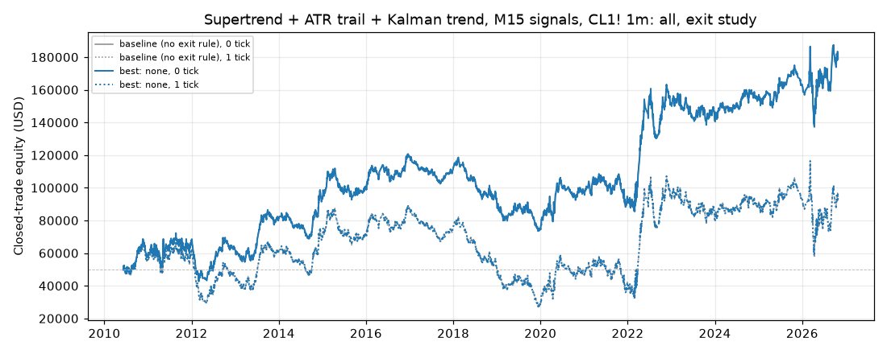
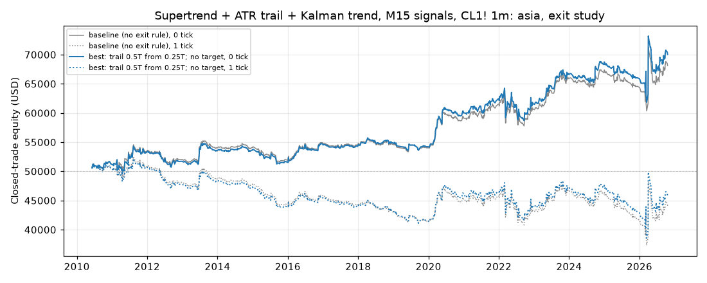
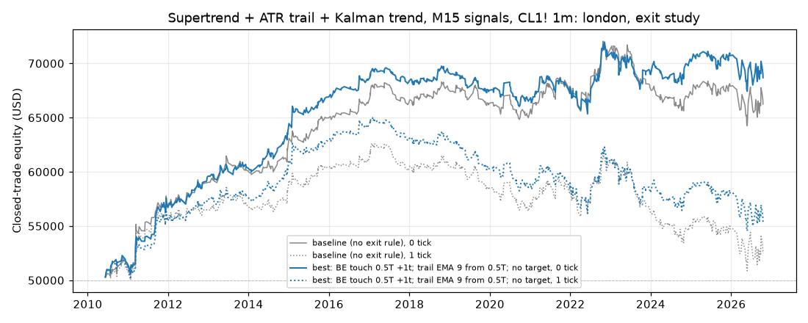
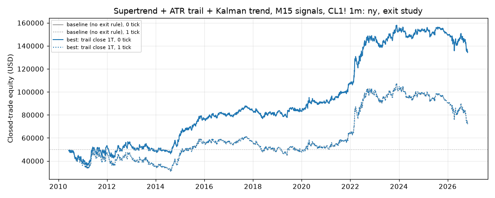

# Supertrend + ATR trail + Kalman trend, M15 signals, CL1! 1m: exit study (breakeven, trailing stop, time exit)

Generated 2026-11-01 04:41 UTC by `python -m tvtester.cli exits supertrend_kalman`.

> **Read this first.** Exploratory **in-sample** exit sweep. Each variant's feature-1 top combination is frozen and only the exit rule changes. The best rule is the **best of 428** tries per variant (each family below says its own N), conditional on baselines that were themselves the best of the feature-1 grid, and after an earlier 330-rule version of this study (ledger). The interval is the full feature-1 interval, **including the reserved 2024+ bars**, so these exit winners cannot be validated on 2024+. The slippage columns rerun the same frozen winner; they are not out-of-sample tests.

## Settings

| Setting | Value |
|---|---|
| Data | 2010-06-07 00:00:00+00:00 to 2026-10-27 20:59:00+00:00 UTC, 5,667,487 bars (data hash `d819aa714f83f298`, code hash `6f224a7bac3bb356`, grid hash `0937cd7fbd4beddd`) |
| Properties | as feature 1: $50,000, 1 contract, $2.01 per order ($4.02 round trip), slippage 0 with 1 and 2 tick scenarios |
| Objective (declared first) | net0 (net profit + open P&L at the end, 0 ticks); ties: profit factor, then rule order |
| Baseline | the variant's feature-1 top combination, unchanged (entries, initial stop and target) |
| Run | `20261101T005103Z_0937cd` (ledger `results/supertrend_kalman/ledger.jsonl`; files never overwritten) |

## Exit rules

Units: **T** = the trade's target distance in ticks (rr x signal risk). All rules run at every 1-minute bar close while in a position; a moved stop works from the next bar, a time exit fills at the next open. **best** = most favourable high (long) / low (short) since the entry bar. A stop never loosens. Trailing rules come with the target kept or removed, and most start either at once or after 0.5T. Full rules: `docs/ENGINE.md` (Exit management) and `tvtester/exits.py`.

| Family | Rule | Rules |
|---|---|---|
| `be_touch` | Breakeven when the high / low reaches be_x x T | 9 |
| `be_close` | Breakeven when a close reaches be_x x T | 6 |
| `be_time` | Breakeven after N bars if the close is in profit | 6 |
| `trail_frac` | Trail a fixed fraction of T behind the best price | 32 |
| `trail_atr` | Trail k x ATR(14) behind the best price (chandelier) | 16 |
| `trail_swing` | Trail at the last confirmed 1m swing low / high (UNVERIFIED pivots) | 12 |
| `trail_step` | Ratchet: lock one step behind every step of T reached | 4 |
| `trail_close` | Trail a fraction of T behind the best close | 16 |
| `trail_ema` | Trail at the 1m EMA while it is on the trade's side | 12 |
| `trail_sar` | Trail at the 1m Parabolic SAR while it is on the trade's side (UNVERIFIED SAR) | 8 |
| `both` | Every trailing rule with one of 3 declared breakevens: touch 0.5T +1t, close 0.5T +1t, time 30 bars +1t | 300 |
| `time_exit` | Close at market after N bars in the trade | 6 |
| | **Total (with the baseline)** | **428** |

Every rule that trails with `swing` or `sar` (their own families and the matching `both` rules, marked **(unverified)** below) uses Python transcriptions of Pine `ta.pivotlow` / `ta.sar` that have **not been checked against a TradingView export** yet.

Breakeven is a stop price, not a guaranteed result: a stop fill pays slippage, a gap can fill worse, and the round trip still costs $4.02 (1 tick offset = $10).

## Summary: best rule per variant

| Variant | Baseline net (0 / 1 / 2 ticks) | Best rule (of 428) | Family | Best net (0 / 1 / 2 ticks) | Rules beating the baseline |
|---|---|---|---|---|---|
| all | 128,886.58 USD / 42,086.78 USD / -37,224.68 USD | none | baseline | 128,886.58 USD / 42,086.78 USD / -37,224.68 USD | 0 of 427 |
| asia | 18,111.68 USD / -5,888.32 USD / -29,888.32 USD | trail 0.5T from 0.25T; no target | trail_frac | 20,041.68 USD / -4,258.32 USD / -28,688.32 USD | 133 of 427 |
| london | 16,241.58 USD / 2,481.58 USD / -11,618.42 USD | BE touch 0.5T +1t; trail EMA 9 from 0.5T; no target | both | 18,681.58 USD / 5,381.58 USD / -7,938.42 USD | 85 of 427 |
| ny | 84,714.24 USD / 22,574.24 USD / -39,555.76 USD | trail close 1T | trail_close | 84,754.24 USD / 22,614.24 USD / -39,515.76 USD | 2 of 427 |

## Variant: all

**Frozen baseline:** `hours=all`, `trigger=both`, `vol=atr_ratio:1.3`, `exit=fixed`, `rr=3`, `swing=3`, `trail_mult=1`, `st_factor=3`, `kalman_q=0.0001`

Chart: closed trades only (an open position at the end is in the Open P&L column).

Files: [grid](../../../../results/supertrend_kalman/exits/20261101T005103Z_0937cd/all/grid.csv), [summary](../../../../results/supertrend_kalman/exits/20261101T005103Z_0937cd/all/summary.json), best rule trades [0 ticks](../../../../results/supertrend_kalman/exits/20261101T005103Z_0937cd/all/best_trades_slippage0.csv), [1 ticks](../../../../results/supertrend_kalman/exits/20261101T005103Z_0937cd/all/best_trades_slippage1.csv), [2 ticks](../../../../results/supertrend_kalman/exits/20261101T005103Z_0937cd/all/best_trades_slippage2.csv)

### Best rule of each family

| Family | Best rule | Best of | Net profit (0 / 1 / 2 ticks) | Open P&L at the end (0 / 1 / 2) | Trades | % profitable | PF | Avg trade | Max DD | Trades with stop moved / closed by time exit | Family rules beating the baseline |
|---|---|---|---|---|---|---|---|---|---|---|---|
| baseline | none | 1 | 128,886.58 USD / 42,086.78 USD / -37,224.68 USD | 0.00 USD / 0.00 USD / 0.00 USD | 4,471 | 26.64% | 1.070 | 28.83 USD | 51,168.74 USD | 0 / 0 |  |
| be_touch | BE touch 0.5T +1t | 9 | 101,601.88 USD / -2,963.70 USD / -110,775.56 USD | 0.00 USD / 0.00 USD / 0.00 USD | 5,206 | 39.53% | 1.058 | 19.52 USD | 48,455.96 USD | 2,000 / 0 | 0 of 9 |
| be_close | BE close 0.5T +1t | 6 | 96,049.76 USD / -11,044.16 USD / -117,802.30 USD | 0.00 USD / 0.00 USD / 0.00 USD | 5,112 | 37.89% | 1.055 | 18.79 USD | 49,383.70 USD | 1,875 / 0 | 0 of 6 |
| be_time | BE after 60 bars +1t | 6 | -4,986.86 USD / -207,960.68 USD / -408,455.66 USD | 0.00 USD / 0.00 USD / 0.00 USD | 10,743 | 70.73% | 0.996 | -0.46 USD | 67,840.04 USD | 7,553 / 0 | 0 of 6 |
| trail_frac | trail 0.5T from 0.5T | 32 | 102,270.86 USD / -7,976.78 USD / -120,332.56 USD | 0.00 USD / 0.00 USD / 0.00 USD | 5,557 | 39.32% | 1.055 | 18.40 USD | 50,551.32 USD | 2,158 / 0 | 0 of 32 |
| trail_atr | trail 4 ATR from 0.5T | 16 | -14,999.36 USD / -141,312.68 USD / -261,162.48 USD | 0.00 USD / 0.00 USD / 0.00 USD | 6,368 | 39.35% | 0.993 | -2.36 USD | 61,637.26 USD | 2,432 / 0 | 0 of 16 |
| trail_swing | trail pivot 5 from 0.5T (unverified) | 12 | 12,536.62 USD / -119,914.74 USD / -242,854.54 USD | 0.00 USD / 0.00 USD / 0.00 USD | 6,369 | 39.10% | 1.006 | 1.97 USD | 63,799.22 USD | 2,436 / 0 | 0 of 12 |
| trail_step | trail step 0.5T | 4 | 92,462.28 USD / 404.34 USD / -110,249.28 USD | 0.00 USD / 0.00 USD / 0.00 USD | 5,186 | 20.94% | 1.053 | 17.83 USD | 48,883.90 USD | 1,994 / 0 | 0 of 4 |
| trail_close | trail close 1T | 16 | 122,354.88 USD / 35,663.12 USD / -31,320.30 USD | 0.00 USD / 0.00 USD / 0.00 USD | 4,556 | 25.83% | 1.067 | 26.86 USD | 50,218.74 USD | 1,359 / 0 | 0 of 16 |
| trail_ema | trail EMA 50 from 0.5T | 12 | -7,033.28 USD / -132,960.62 USD / -253,204.44 USD | 0.00 USD / 0.00 USD / 0.00 USD | 6,364 | 39.30% | 0.997 | -1.11 USD | 60,613.72 USD | 2,441 / 0 | 0 of 12 |
| trail_sar | trail SAR 0.01/0.01/0.1 from 0.5T (unverified) | 8 | -9,669.36 USD / -138,456.70 USD / -260,572.48 USD | 0.00 USD / 0.00 USD / 0.00 USD | 6,368 | 39.34% | 0.996 | -1.52 USD | 65,704.90 USD | 2,430 / 0 | 0 of 8 |
| both | BE close 0.5T +1t; trail 0.75T from 0.5T | 300 | 105,924.74 USD / 8,666.80 USD / -104,059.28 USD | 0.00 USD / 0.00 USD / 0.00 USD | 5,163 | 38.02% | 1.060 | 20.52 USD | 49,465.76 USD | 1,997 / 0 | 0 of 300 |
| time_exit | time exit 60 bars | 6 | 9,454.84 USD / -273,655.16 USD / -558,085.16 USD | 0.00 USD / 0.00 USD / 0.00 USD | 14,158 | 45.75% | 1.006 | 0.67 USD | 52,906.84 USD | 0 / 11,802 | 0 of 6 |
| **overall** | none | 428 | 128,886.58 USD / 42,086.78 USD / -37,224.68 USD | 0.00 USD / 0.00 USD / 0.00 USD | 4,471 | 26.64% | 1.070 | 28.83 USD | 51,168.74 USD | 0 / 0 |  |

### Top 10 of 428 (0 ticks)

| # | Rule | Family | Objective | Trades | % profitable | PF | Max DD |
|---|---|---|---|---|---|---|---|
| 1 | none | baseline | 128,886.58 USD | 4,471 | 26.64% | 1.070 | 51,168.74 USD |
| 2 | trail close 1T | trail_close | 122,354.88 USD | 4,556 | 25.83% | 1.067 | 50,218.74 USD |
| 3 | trail close 1T from 0.5T | trail_close | 122,344.88 USD | 4,556 | 25.83% | 1.067 | 50,218.74 USD |
| 4 | BE close 0.5T +1t; trail 0.75T from 0.5T | both | 105,924.74 USD | 5,163 | 38.02% | 1.060 | 49,465.76 USD |
| 5 | BE close 0.5T +1t; trail step 0.5T | both | 103,633.94 USD | 5,203 | 36.88% | 1.059 | 48,571.94 USD |
| 6 | BE touch 0.5T +1t; trail 0.5T from 0.5T | both | 102,640.86 USD | 5,557 | 39.99% | 1.055 | 50,471.32 USD |
| 7 | BE close 0.5T +1t; trail 0.5T from 0.5T | both | 102,310.86 USD | 5,557 | 39.39% | 1.055 | 50,541.32 USD |
| 8 | trail 0.5T from 0.5T | trail_frac | 102,270.86 USD | 5,557 | 39.32% | 1.055 | 50,551.32 USD |
| 9 | BE touch 0.5T +1t; trail 1T | both | 101,611.88 USD | 5,206 | 39.53% | 1.058 | 48,455.96 USD |
| 10 | BE touch 0.5T +1t; trail 1T from 0.25T | both | 101,611.88 USD | 5,206 | 39.53% | 1.058 | 48,455.96 USD |

Rules with a positive objective: 137 of 428. Rules beating the baseline: 0 of 427.

## Variant: asia

**Frozen baseline:** `hours=asia`, `trigger=trail`, `vol=none`, `exit=trail`, `rr=3`, `swing=3`, `trail_mult=2`, `st_factor=3`, `kalman_q=0.01`

Chart: closed trades only (an open position at the end is in the Open P&L column).

Files: [grid](../../../../results/supertrend_kalman/exits/20261101T005103Z_0937cd/asia/grid.csv), [summary](../../../../results/supertrend_kalman/exits/20261101T005103Z_0937cd/asia/summary.json), best rule trades [0 ticks](../../../../results/supertrend_kalman/exits/20261101T005103Z_0937cd/asia/best_trades_slippage0.csv), [1 ticks](../../../../results/supertrend_kalman/exits/20261101T005103Z_0937cd/asia/best_trades_slippage1.csv), [2 ticks](../../../../results/supertrend_kalman/exits/20261101T005103Z_0937cd/asia/best_trades_slippage2.csv)

### Best rule of each family

| Family | Best rule | Best of | Net profit (0 / 1 / 2 ticks) | Open P&L at the end (0 / 1 / 2) | Trades | % profitable | PF | Avg trade | Max DD | Trades with stop moved / closed by time exit | Family rules beating the baseline |
|---|---|---|---|---|---|---|---|---|---|---|---|
| baseline | none | 1 | 18,111.68 USD / -5,888.32 USD / -29,888.32 USD | 0.00 USD / 0.00 USD / 0.00 USD | 1,216 | 44.33% | 1.160 | 14.89 USD | 7,818.28 USD | 0 / 0 |  |
| be_touch | BE touch 0.5T +1t | 9 | 18,481.68 USD / -5,528.32 USD / -29,588.32 USD | 0.00 USD / 0.00 USD / 0.00 USD | 1,216 | 44.57% | 1.164 | 15.20 USD | 7,818.28 USD | 29 / 0 | 6 of 9 |
| be_close | BE close 0.5T +1t | 6 | 18,381.68 USD / -5,638.32 USD / -29,758.32 USD | 0.00 USD / 0.00 USD / 0.00 USD | 1,216 | 44.49% | 1.163 | 15.12 USD | 7,818.28 USD | 24 / 0 | 4 of 6 |
| be_time | BE after 30 bars +0t | 6 | 17,111.68 USD / -8,088.32 USD / -30,028.32 USD | 0.00 USD / 0.00 USD / 0.00 USD | 1,216 | 23.27% | 1.258 | 14.07 USD | 5,210.30 USD | 753 / 0 | 0 of 6 |
| trail_frac | trail 0.5T from 0.25T; no target | 32 | 20,041.68 USD / -4,258.32 USD / -28,688.32 USD | 0.00 USD / 0.00 USD / 0.00 USD | 1,216 | 44.33% | 1.178 | 16.48 USD | 7,718.28 USD | 136 / 0 | 26 of 32 |
| trail_atr | trail 3 ATR from 0.5T | 16 | 13,661.68 USD / -10,658.32 USD / -34,418.32 USD | 0.00 USD / 0.00 USD / 0.00 USD | 1,216 | 44.57% | 1.121 | 11.23 USD | 8,376.06 USD | 86 / 0 | 0 of 16 |
| trail_swing | trail pivot 2 from 0.5T (unverified) | 12 | 16,051.68 USD / -8,138.32 USD / -32,008.32 USD | 0.00 USD / 0.00 USD / 0.00 USD | 1,216 | 44.57% | 1.142 | 13.20 USD | 8,050.24 USD | 86 / 0 | 0 of 12 |
| trail_step | trail step 0.25T; no target | 4 | 19,221.68 USD / -4,368.32 USD / -27,928.32 USD | 0.00 USD / 0.00 USD / 0.00 USD | 1,216 | 42.43% | 1.174 | 15.81 USD | 8,018.28 USD | 302 / 0 | 3 of 4 |
| trail_close | trail close 0.5T; no target | 16 | 19,371.68 USD / -4,948.32 USD / -29,268.32 USD | 0.00 USD / 0.00 USD / 0.00 USD | 1,216 | 44.24% | 1.172 | 15.93 USD | 7,748.28 USD | 143 / 0 | 12 of 16 |
| trail_ema | trail EMA 50 from 0.5T | 12 | 15,091.68 USD / -9,048.32 USD / -32,688.32 USD | 0.00 USD / 0.00 USD / 0.00 USD | 1,216 | 44.41% | 1.133 | 12.41 USD | 7,980.24 USD | 86 / 0 | 0 of 12 |
| trail_sar | trail SAR 0.02/0.02/0.2 from 0.5T (unverified) | 8 | 13,491.68 USD / -10,698.32 USD / -34,718.32 USD | 0.00 USD / 0.00 USD / 0.00 USD | 1,216 | 44.49% | 1.119 | 11.10 USD | 8,496.06 USD | 86 / 0 | 0 of 8 |
| both | BE touch 0.5T +1t; trail 0.5T from 0.25T; no target | 300 | 20,041.68 USD / -4,258.32 USD / -28,688.32 USD | 0.00 USD / 0.00 USD / 0.00 USD | 1,216 | 44.33% | 1.178 | 16.48 USD | 7,718.28 USD | 136 / 0 | 82 of 300 |
| time_exit | time exit 60 bars | 6 | 11,447.66 USD / -12,752.34 USD / -36,952.34 USD | 0.00 USD / 0.00 USD / 0.00 USD | 1,217 | 45.03% | 1.142 | 9.41 USD | 5,908.66 USD | 0 / 708 | 0 of 6 |
| **overall** | trail 0.5T from 0.25T; no target | 428 | 20,041.68 USD / -4,258.32 USD / -28,688.32 USD | 0.00 USD / 0.00 USD / 0.00 USD | 1,216 | 44.33% | 1.178 | 16.48 USD | 7,718.28 USD | 136 / 0 |  |

### Top 10 of 428 (0 ticks)

| # | Rule | Family | Objective | Trades | % profitable | PF | Max DD |
|---|---|---|---|---|---|---|---|
| 1 | trail 0.5T from 0.25T; no target | trail_frac | 20,041.68 USD | 1,216 | 44.33% | 1.178 | 7,718.28 USD |
| 2 | BE touch 0.5T +1t; trail 0.5T from 0.25T; no target | both | 20,041.68 USD | 1,216 | 44.33% | 1.178 | 7,718.28 USD |
| 3 | BE close 0.5T +1t; trail 0.5T from 0.25T; no target | both | 20,041.68 USD | 1,216 | 44.33% | 1.178 | 7,718.28 USD |
| 4 | trail 0.5T; no target | trail_frac | 19,981.68 USD | 1,216 | 44.33% | 1.177 | 7,718.28 USD |
| 5 | BE touch 0.5T +1t; trail 0.5T; no target | both | 19,981.68 USD | 1,216 | 44.33% | 1.177 | 7,718.28 USD |
| 6 | BE close 0.5T +1t; trail 0.5T; no target | both | 19,981.68 USD | 1,216 | 44.33% | 1.177 | 7,718.28 USD |
| 7 | trail 0.5T from 0.5T; no target | trail_frac | 19,971.68 USD | 1,216 | 44.57% | 1.177 | 7,818.28 USD |
| 8 | BE touch 0.5T +1t; trail 0.5T from 0.5T; no target | both | 19,971.68 USD | 1,216 | 44.57% | 1.177 | 7,818.28 USD |
| 9 | BE close 0.5T +1t; trail 0.5T from 0.5T; no target | both | 19,971.68 USD | 1,216 | 44.57% | 1.177 | 7,818.28 USD |
| 10 | BE touch 0.5T +1t; trail 0.5T from 0.75T; no target | both | 19,921.68 USD | 1,216 | 44.57% | 1.176 | 7,818.28 USD |

Rules with a positive objective: 372 of 428. Rules beating the baseline: 133 of 427.

## Variant: london

**Frozen baseline:** `hours=london`, `trigger=both`, `vol=stop_atr:3`, `exit=trail`, `rr=2`, `swing=5`, `trail_mult=2`, `st_factor=3`, `kalman_q=0.0001`

Chart: closed trades only (an open position at the end is in the Open P&L column).

Files: [grid](../../../../results/supertrend_kalman/exits/20261101T005103Z_0937cd/london/grid.csv), [summary](../../../../results/supertrend_kalman/exits/20261101T005103Z_0937cd/london/summary.json), best rule trades [0 ticks](../../../../results/supertrend_kalman/exits/20261101T005103Z_0937cd/london/best_trades_slippage0.csv), [1 ticks](../../../../results/supertrend_kalman/exits/20261101T005103Z_0937cd/london/best_trades_slippage1.csv), [2 ticks](../../../../results/supertrend_kalman/exits/20261101T005103Z_0937cd/london/best_trades_slippage2.csv)

### Best rule of each family

| Family | Best rule | Best of | Net profit (0 / 1 / 2 ticks) | Open P&L at the end (0 / 1 / 2) | Trades | % profitable | PF | Avg trade | Max DD | Trades with stop moved / closed by time exit | Family rules beating the baseline |
|---|---|---|---|---|---|---|---|---|---|---|---|
| baseline | none | 1 | 16,241.58 USD / 2,481.58 USD / -11,618.42 USD | 0.00 USD / 0.00 USD / 0.00 USD | 721 | 42.16% | 1.183 | 22.53 USD | 8,685.46 USD | 0 / 0 |  |
| be_touch | BE touch 0.25T +0t | 9 | 17,491.58 USD / 3,501.58 USD / -14,378.42 USD | 0.00 USD / 0.00 USD / 0.00 USD | 721 | 32.73% | 1.247 | 24.26 USD | 6,868.78 USD | 397 / 0 | 4 of 9 |
| be_close | BE close 0.5T +1t | 6 | 16,771.58 USD / 2,491.58 USD / -11,508.42 USD | 0.00 USD / 0.00 USD / 0.00 USD | 721 | 46.74% | 1.193 | 23.26 USD | 9,005.46 USD | 194 / 0 | 2 of 6 |
| be_time | BE after 60 bars +1t | 6 | 14,331.58 USD / 1,161.58 USD / -13,948.42 USD | 0.00 USD / 0.00 USD / 0.00 USD | 721 | 61.72% | 1.215 | 19.88 USD | 8,969.68 USD | 330 / 0 | 0 of 6 |
| trail_frac | trail 0.25T from 0.5T | 32 | 17,171.58 USD / 4,471.58 USD / -9,388.42 USD | 0.00 USD / 0.00 USD / 0.00 USD | 721 | 47.99% | 1.199 | 23.82 USD | 5,761.14 USD | 243 / 0 | 9 of 32 |
| trail_atr | trail 2 ATR from 0.5T; no target | 16 | 17,691.58 USD / 4,511.58 USD / -8,778.42 USD | 0.00 USD / 0.00 USD / 0.00 USD | 721 | 47.85% | 1.205 | 24.54 USD | 5,143.40 USD | 246 / 0 | 6 of 16 |
| trail_swing | trail pivot 3 from 0.5T; no target (unverified) | 12 | 15,621.58 USD / 1,681.58 USD / -12,258.42 USD | 0.00 USD / 0.00 USD / 0.00 USD | 721 | 47.30% | 1.181 | 21.67 USD | 6,263.40 USD | 246 / 0 | 0 of 12 |
| trail_step | trail step 0.5T | 4 | 16,251.58 USD / 3,331.58 USD / -11,698.42 USD | 0.00 USD / 0.00 USD / 0.00 USD | 721 | 40.64% | 1.188 | 22.54 USD | 8,755.46 USD | 225 / 0 | 1 of 4 |
| trail_close | trail close 0.5T from 0.5T | 16 | 16,801.58 USD / 3,301.58 USD / -11,108.42 USD | 0.00 USD / 0.00 USD / 0.00 USD | 721 | 45.49% | 1.194 | 23.30 USD | 7,755.46 USD | 234 / 0 | 4 of 16 |
| trail_ema | trail EMA 9 from 0.5T; no target | 12 | 18,671.58 USD / 5,381.58 USD / -7,938.42 USD | 0.00 USD / 0.00 USD / 0.00 USD | 721 | 47.85% | 1.217 | 25.90 USD | 5,423.40 USD | 246 / 0 | 4 of 12 |
| trail_sar | trail SAR 0.01/0.01/0.1 from 0.5T; no target (unverified) | 8 | 16,581.58 USD / 2,731.58 USD / -10,818.42 USD | 0.00 USD / 0.00 USD / 0.00 USD | 721 | 47.71% | 1.192 | 23.00 USD | 5,373.40 USD | 246 / 0 | 1 of 8 |
| both | BE touch 0.5T +1t; trail EMA 9 from 0.5T; no target | 300 | 18,681.58 USD / 5,381.58 USD / -7,938.42 USD | 0.00 USD / 0.00 USD / 0.00 USD | 721 | 47.99% | 1.217 | 25.91 USD | 5,413.40 USD | 246 / 0 | 54 of 300 |
| time_exit | time exit 60 bars; no target | 6 | 13,961.58 USD / -458.42 USD / -14,878.42 USD | 0.00 USD / 0.00 USD / 0.00 USD | 721 | 50.07% | 1.221 | 19.36 USD | 6,613.40 USD | 0 / 464 | 0 of 6 |
| **overall** | BE touch 0.5T +1t; trail EMA 9 from 0.5T; no target | 428 | 18,681.58 USD / 5,381.58 USD / -7,938.42 USD | 0.00 USD / 0.00 USD / 0.00 USD | 721 | 47.99% | 1.217 | 25.91 USD | 5,413.40 USD | 246 / 0 |  |

### Top 10 of 428 (0 ticks)

| # | Rule | Family | Objective | Trades | % profitable | PF | Max DD |
|---|---|---|---|---|---|---|---|
| 1 | BE touch 0.5T +1t; trail EMA 9 from 0.5T; no target | both | 18,681.58 USD | 721 | 47.99% | 1.217 | 5,413.40 USD |
| 2 | BE close 0.5T +1t; trail EMA 9 from 0.5T; no target | both | 18,681.58 USD | 721 | 47.99% | 1.217 | 5,413.40 USD |
| 3 | trail EMA 9 from 0.5T; no target | trail_ema | 18,671.58 USD | 721 | 47.85% | 1.217 | 5,423.40 USD |
| 4 | BE touch 0.5T +1t; trail EMA 9 from 0.5T | both | 18,321.58 USD | 721 | 47.99% | 1.213 | 5,563.40 USD |
| 5 | BE close 0.5T +1t; trail EMA 9 from 0.5T | both | 18,321.58 USD | 721 | 47.99% | 1.213 | 5,563.40 USD |
| 6 | trail EMA 9 from 0.5T | trail_ema | 18,311.58 USD | 721 | 47.85% | 1.213 | 5,573.40 USD |
| 7 | BE touch 0.5T +1t; trail 2 ATR from 0.5T; no target | both | 17,721.58 USD | 721 | 47.99% | 1.206 | 5,113.40 USD |
| 8 | BE close 0.5T +1t; trail 2 ATR from 0.5T; no target | both | 17,721.58 USD | 721 | 47.99% | 1.206 | 5,113.40 USD |
| 9 | trail 2 ATR from 0.5T; no target | trail_atr | 17,691.58 USD | 721 | 47.85% | 1.205 | 5,143.40 USD |
| 10 | BE touch 0.5T +1t; trail 0.75T | both | 17,621.58 USD | 721 | 47.99% | 1.206 | 8,185.46 USD |

Rules with a positive objective: 344 of 428. Rules beating the baseline: 85 of 427.

## Variant: ny

**Frozen baseline:** `hours=ny`, `trigger=both`, `vol=rvi`, `exit=flip`, `rr=3`, `swing=5`, `trail_mult=1`, `st_factor=2`, `kalman_q=0.0001`

Chart: closed trades only (an open position at the end is in the Open P&L column).

Files: [grid](../../../../results/supertrend_kalman/exits/20261101T005103Z_0937cd/ny/grid.csv), [summary](../../../../results/supertrend_kalman/exits/20261101T005103Z_0937cd/ny/summary.json), best rule trades [0 ticks](../../../../results/supertrend_kalman/exits/20261101T005103Z_0937cd/ny/best_trades_slippage0.csv), [1 ticks](../../../../results/supertrend_kalman/exits/20261101T005103Z_0937cd/ny/best_trades_slippage1.csv), [2 ticks](../../../../results/supertrend_kalman/exits/20261101T005103Z_0937cd/ny/best_trades_slippage2.csv)

### Best rule of each family

| Family | Best rule | Best of | Net profit (0 / 1 / 2 ticks) | Open P&L at the end (0 / 1 / 2) | Trades | % profitable | PF | Avg trade | Max DD | Trades with stop moved / closed by time exit | Family rules beating the baseline |
|---|---|---|---|---|---|---|---|---|---|---|---|
| baseline | none | 1 | 84,714.24 USD / 22,574.24 USD / -39,555.76 USD | 0.00 USD / 0.00 USD / 0.00 USD | 3,188 | 43.48% | 1.105 | 26.57 USD | 24,275.52 USD | 0 / 0 |  |
| be_touch | BE touch 0.75T +2t | 9 | 84,460.22 USD / 22,340.22 USD / -40,753.80 USD | 0.00 USD / 0.00 USD / 0.00 USD | 3,189 | 43.56% | 1.105 | 26.48 USD | 24,275.52 USD | 163 / 0 | 0 of 9 |
| be_close | BE close 0.75T +1t | 6 | 84,420.22 USD / 22,280.22 USD / -39,839.78 USD | 0.00 USD / 0.00 USD / 0.00 USD | 3,189 | 43.56% | 1.105 | 26.47 USD | 24,275.52 USD | 144 / 0 | 0 of 6 |
| be_time | BE after 60 bars +0t | 6 | 67,082.26 USD / -7,377.84 USD / -72,923.82 USD | 0.00 USD / 0.00 USD / 0.00 USD | 3,487 | 25.18% | 1.110 | 19.24 USD | 19,165.10 USD | 2,117 / 0 | 0 of 6 |
| trail_frac | trail 1T | 32 | 84,694.24 USD / 22,554.24 USD / -39,575.76 USD | 0.00 USD / 0.00 USD / 0.00 USD | 3,188 | 43.48% | 1.105 | 26.57 USD | 24,275.52 USD | 202 / 0 | 0 of 32 |
| trail_atr | trail 4 ATR from 0.5T | 16 | 71,035.40 USD / 8,923.44 USD / -55,342.54 USD | 0.00 USD / 0.00 USD / 0.00 USD | 3,230 | 44.09% | 1.088 | 21.99 USD | 17,584.96 USD | 372 / 0 | 0 of 16 |
| trail_swing | trail pivot 5 from 0.5T (unverified) | 12 | 65,819.42 USD / 2,537.46 USD / -61,508.52 USD | 0.00 USD / 0.00 USD / 0.00 USD | 3,229 | 44.01% | 1.082 | 20.38 USD | 21,805.58 USD | 372 / 0 | 0 of 12 |
| trail_step | trail step 0.5T | 4 | 83,000.12 USD / 19,616.10 USD / -42,837.92 USD | 0.00 USD / 0.00 USD / 0.00 USD | 3,194 | 42.96% | 1.104 | 25.99 USD | 24,889.54 USD | 372 / 0 | 0 of 4 |
| trail_close | trail close 1T | 16 | 84,754.24 USD / 22,614.24 USD / -39,515.76 USD | 0.00 USD / 0.00 USD / 0.00 USD | 3,188 | 43.48% | 1.105 | 26.59 USD | 24,275.52 USD | 184 / 0 | 2 of 16 |
| trail_ema | trail EMA 50 from 0.5T | 12 | 70,079.42 USD / 8,317.46 USD / -56,048.52 USD | 0.00 USD / 0.00 USD / 0.00 USD | 3,229 | 44.13% | 1.087 | 21.70 USD | 18,565.58 USD | 372 / 0 | 0 of 12 |
| trail_sar | trail SAR 0.02/0.02/0.2 from 0.5T (unverified) | 8 | 64,645.40 USD / 1,443.44 USD / -63,082.54 USD | 0.00 USD / 0.00 USD / 0.00 USD | 3,230 | 44.15% | 1.080 | 20.01 USD | 18,746.82 USD | 372 / 0 | 0 of 8 |
| both | BE close 0.5T +1t; trail step 0.5T | 300 | 82,636.10 USD / 19,906.10 USD / -42,557.92 USD | 0.00 USD / 0.00 USD / 0.00 USD | 3,195 | 43.94% | 1.103 | 25.86 USD | 24,839.54 USD | 372 / 0 | 0 of 300 |
| time_exit | time exit 60 bars | 6 | 64,181.58 USD / -9,938.42 USD / -84,058.42 USD | 0.00 USD / 0.00 USD / 0.00 USD | 3,721 | 48.83% | 1.108 | 17.25 USD | 23,153.44 USD | 0 / 2,752 | 0 of 6 |
| **overall** | trail close 1T | 428 | 84,754.24 USD / 22,614.24 USD / -39,515.76 USD | 0.00 USD / 0.00 USD / 0.00 USD | 3,188 | 43.48% | 1.105 | 26.59 USD | 24,275.52 USD | 184 / 0 |  |

### Top 10 of 428 (0 ticks)

| # | Rule | Family | Objective | Trades | % profitable | PF | Max DD |
|---|---|---|---|---|---|---|---|
| 1 | trail close 1T | trail_close | 84,754.24 USD | 3,188 | 43.48% | 1.105 | 24,275.52 USD |
| 2 | trail close 1T from 0.5T | trail_close | 84,754.24 USD | 3,188 | 43.48% | 1.105 | 24,275.52 USD |
| 3 | none | baseline | 84,714.24 USD | 3,188 | 43.48% | 1.105 | 24,275.52 USD |
| 4 | trail 1T | trail_frac | 84,694.24 USD | 3,188 | 43.48% | 1.105 | 24,275.52 USD |
| 5 | trail 1T from 0.25T | trail_frac | 84,694.24 USD | 3,188 | 43.48% | 1.105 | 24,275.52 USD |
| 6 | trail 1T from 0.5T | trail_frac | 84,694.24 USD | 3,188 | 43.48% | 1.105 | 24,275.52 USD |
| 7 | trail 1T from 0.75T | trail_frac | 84,624.24 USD | 3,188 | 43.48% | 1.105 | 24,275.52 USD |
| 8 | BE touch 0.75T +2t | be_touch | 84,460.22 USD | 3,189 | 43.56% | 1.105 | 24,275.52 USD |
| 9 | BE touch 0.75T +1t | be_touch | 84,420.22 USD | 3,189 | 43.56% | 1.105 | 24,275.52 USD |
| 10 | BE close 0.75T +1t | be_close | 84,420.22 USD | 3,189 | 43.56% | 1.105 | 24,275.52 USD |

Rules with a positive objective: 340 of 428. Rules beating the baseline: 2 of 427.
