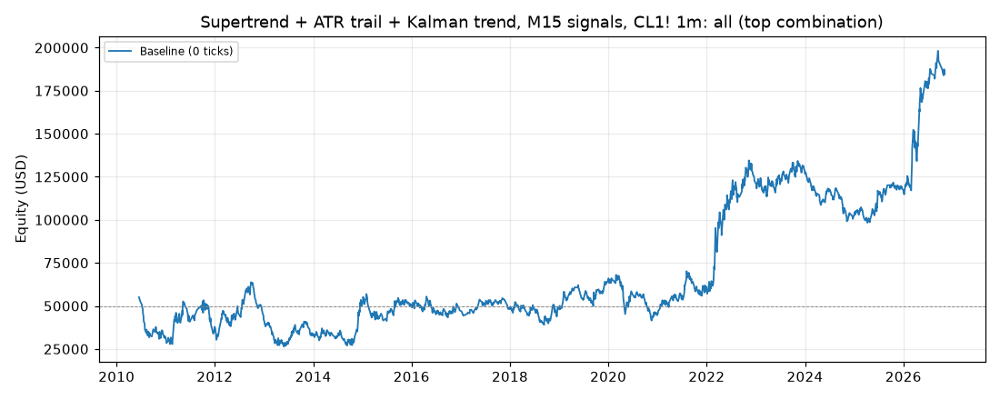
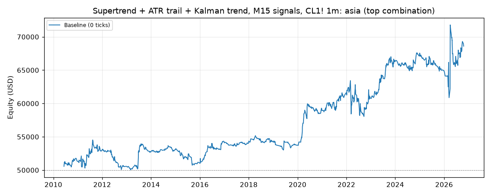
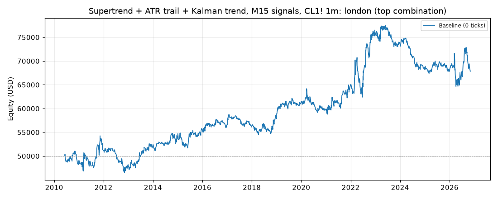
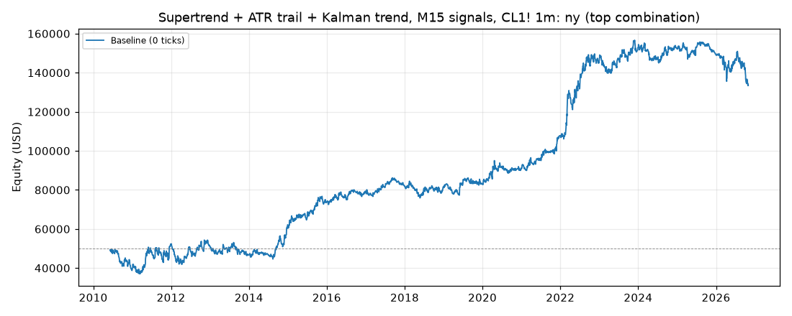

# Supertrend + ATR trail + Kalman trend, M15 signals, CL1! 1m: results

Generated 2026-11-04 07:41 UTC by `python -m tvtester.cli test supertrend_kalman`.

Owner idea: Supertrend plus an ATR trailing stop on M15, a Kalman filter for the trend, a volatility filter so it
does not trade with a wide stop, stop at the swing high / low, target 1:2 to 1:3. The owner left every design fork
open, so each fork is a grid parameter (`trigger`, `vol`, `exit`) or a variant (trading hours). Plan and Codex
review: [`docs/research/supertrend_kalman_plan.md`](../../research/supertrend_kalman_plan.md).

**M15 on a 1-minute chart.** M15 bars are the 1m bars grouped by UTC time floored to 15 minutes (CL's 18:00 New
York session open is a 15-minute boundary). A bucket's values are used only after it is complete: from the first
1m bar of the next bucket, which decides at its close, then places a limit at that decision close, active from the next 1m bar. Pine twin: `request.security(.., "15", expr[1], lookahead = barmerge.lookahead_on)`.

**Indicators (M15):** Supertrend(`st_factor`, ATR 10, Pine `ta.supertrend`); UT Bot ATR trailing stop
(ATR 10 x `trail_mult`, close source); 2-state constant-velocity Kalman filter on close (`kalman_q` = 0.01 or
0.0001, R = 1, P0 = 100 I, Joseph update), trend = sign of its slope. q = 0.01 alone agreed with about 97% of
Supertrend flips on 2023 bars (hardly a filter), so the slower 0.0001 (about 40%) was added; that choice used
signal counts only, no profit numbers; ATR14, ATR100, TradingView RVI(10, 14); swing highs /
lows with `swing` bars each side (strictly above / below), last confirmed value.

**Entry (`trigger`), only when flat, Kalman slope on the trade side:**
- `st`: Supertrend flips to the trade side.
- `trail`: UT Bot buy / sell (close crosses the trailing stop) while Supertrend points the trade side.
- `both`: Supertrend and the close-vs-UT-stop side agree on this bucket and did not on the previous one.

**Stop and target:** stop = last confirmed M15 swing low (long) / high (short); no trade when it is not beyond the
decision close. Target = `rr` x signal risk (risk = decision close to stop) in ticks from the actual fill. A fill may occur later at the limit or a better price; the target distance from the fill remains unchanged.

**Volatility filter (`vol`):** `none`; `stop_atr:X` skips when the risk is wider than X x ATR14 (M15), the direct
"no wide stop" rule; `atr_ratio:X` skips when ATR14 / ATR100 > X (volatile regime); `rvi` takes longs only when
RVI > 50 and shorts only when RVI < 50 (RVI is directional volatility, not a stop-width measure). CBOE OVX (crude
oil VIX) is not tested: it is not in the repo's data.

**Exit (`exit`):** `fixed` = swing stop + target; `trail` = the stop also moves to the UT trailing stop at each new
M15 bucket when that is tighter and still on the right side of the close (never looser, target unchanged);
`flip` = fixed bracket, plus a market close when Supertrend flips against the position (the bracket is cancelled
first, so only the close works at the next open).

**Hours (variant):** `all` = any time, no forced flat (holds through the daily halt and weekends; only the owner
roll exit); `asia` / `london` / `ny` = decision bar inside the sessions.py session [open, flat - 1 min), open
positions closed at the next open after it, as fair_price_reversal (the bracket is cancelled first, as for `flip`).

A runnable Pine v6 twin is in [`strategies/supertrend_kalman.pine`](../../../strategies/supertrend_kalman.pine).
The twin does not have the owner roll exit, so trades open at a contract roll differ from TradingView: mostly in `all`,
but a contract's last bar can fall inside a session too (NY: 10 roll exits 2010-2023).

## Test settings (TradingView Properties)

| Setting | Value |
|---|---|
| Symbol | CL1! (NYMEX Light Crude Oil, front month), 1-minute bars |
| Data | 2010-06-07 00:00:00+00:00 to 2026-11-03 18:29:00+00:00 UTC, 5,674,164 bars (manifest written 2026-11-04T02:31:15+00:00) |
| Initial capital | 50,000.00 USD |
| Order size | 1 contract |
| Commission | 2.01 USD per contract per order (4.02 USD round trip) |
| Execution | Limit entries; commission included; no added slippage |
| Pyramiding | 0 (one position) |
| Fills | TradingView broker emulator, Bar Magnifier off, limits fill on touch |
| Roll rule | position closed at the last bar of a contract (exit reason `roll`) |

## How the top combination was chosen

Every variant ran all 1728 combinations of the grid below with commission included. The combination with the highest **net profit** is the top combination (ties: higher profit factor, then grid order). This reference is retained for compatibility. Thirteen separate metric winners are also selected, with a declared minimum trade count; their values, settings and trade lists are linked below. No slippage stress runs are performed.

| Parameter | Values |
|---|---|
| `trigger` | st, trail, both |
| `vol` | none, stop_atr:1.5, stop_atr:3, atr_ratio:1.0, atr_ratio:1.3, rvi |
| `exit` | fixed, trail, flip |
| `rr` | 2, 3 |
| `swing` | 3, 5 |
| `trail_mult` | 1, 2 |
| `st_factor` | 2, 3 |
| `kalman_q` | 0.01, 0.0001 |

> **Read this first.** The top combination is the best of 1728 tries on the same data it is reported on (in-sample). Picking the best of many tries makes the result look better than what the same rules can be expected to earn on new data. Treat these numbers as an upper bound, not as a forecast.

## Summary: top combination per variant

| Variant | Parameters | Net profit | Trades | % profitable | Profit factor | Max DD |
|---|---|---|---|---|---|---|
| all | trigger=st, vol=none, exit=fixed, rr=3, swing=5, trail_mult=1, st_factor=3, kalman_q=0.0001 | 134,682.02 USD | 2,099 | 28.01% | 1.113 | 37,822.00 USD |
| asia | trigger=trail, vol=none, exit=trail, rr=3, swing=3, trail_mult=2, st_factor=3, kalman_q=0.01 | 18,597.86 USD | 1,207 | 44.57% | 1.166 | 7,478.28 USD |
| london | trigger=trail, vol=stop_atr:3, exit=trail, rr=2, swing=5, trail_mult=2, st_factor=2, kalman_q=0.01 | 17,841.86 USD | 2,007 | 38.81% | 1.072 | 13,876.60 USD |
| ny | trigger=both, vol=rvi, exit=flip, rr=3, swing=5, trail_mult=1, st_factor=2, kalman_q=0.0001 | 83,428.36 USD | 3,182 | 43.43% | 1.104 | 23,507.48 USD |

## Variant: all

**Top combination:** `hours=all`, `trigger=st`, `vol=none`, `exit=fixed`, `rr=3`, `swing=5`, `trail_mult=1`, `st_factor=3`, `kalman_q=0.0001`

Files: [grid](../../../results/supertrend_kalman/metrics/all/grid.csv), [trades 0 ticks](../../../results/supertrend_kalman/metrics/all/trades_slippage0.csv), [summary](../../../results/supertrend_kalman/metrics/all/summary.json)

### Results after commission

#### Overview

| Metric | Value |
|---|---|
| Net profit | 134,682.02 USD (269.36%) |
| Total closed trades | 2,099 |
| Percent profitable | 28.01% |
| Profit factor | 1.113 |
| Max equity drawdown | 37,822.00 USD (75.64%) |
| Avg trade | 64.16 USD |
| Avg # bars in trades | 1,506 |

#### Performance

| Metric | All | Long | Short |
|---|---|---|---|
| Net profit | 134,682.02 USD (269.36%) | 124,363.02 USD (248.73%) | 10,319.00 USD (20.64%) |
| Gross profit | 1,325,066.24 USD (2,650.13%) | 720,593.90 USD (1,441.19%) | 604,472.34 USD (1,208.94%) |
| Gross loss | 1,190,384.22 USD (2,380.77%) | 596,230.88 USD (1,192.46%) | 594,153.34 USD (1,188.31%) |
| Commission paid | 8,437.98 USD | 4,216.98 USD | 4,221.00 USD |

| Account | Value |
|---|---|
| Initial capital | 50,000.00 USD |
| Buy & hold return (TV-style, all capital at the first entry) | 16,530.64 USD (33.06%) |
| Max equity run-up (intrabar) | 175,457.56 USD (350.92%) |
| Max equity drawdown (intrabar) | 37,822.00 USD (75.64%) |
| Open P&L | 0.00 USD |
| Max contracts held | 1 |

#### Trades analysis

| Metric | All | Long | Short |
|---|---|---|---|
| Total closed trades | 2,099 | 1,049 | 1,050 |
| Winning trades | 588 | 305 | 283 |
| Losing trades | 1,511 | 744 | 767 |
| Even trades | 0 | 0 | 0 |
| Percent profitable | 28.01% | 29.08% | 26.95% |
| Avg P&L | 64.16 USD | 118.55 USD | 9.83 USD |
| Avg P&L % | 0.05% | 0.17% | -0.07% |
| Avg winning trade | 2,253.51 USD | 2,362.60 USD | 2,135.94 USD |
| Avg losing trade | 787.81 USD | 801.39 USD | 774.65 USD |
| Ratio avg win / avg loss | 2.860 | 2.948 | 2.757 |
| Largest winning trade | 24,135.98 USD | 24,135.98 USD | 10,555.98 USD |
| Largest winning trade % | 27.54% | 27.54% | 11.28% |
| Largest losing trade | 9,454.02 USD | 6,974.02 USD | 9,454.02 USD |
| Largest losing trade % | 72.00% | 28.37% | 72.00% |
| Avg # bars in trades | 1,506 | 1,562 | 1,450 |
| Avg # bars in winning trades | 2,438 | 2,735 | 2,119 |
| Avg # bars in losing trades | 1,143 | 1,081 | 1,203 |

#### Risk/performance ratios

| Metric | Value |
|---|---|
| Sharpe ratio | 0.098 |
| Sortino ratio | 0.164 |
| Profit factor | 1.113 |
| Margin calls | 0 |

#### List of trades (last 10, newest first; full list in the trades CSV)

| Trade # | Type | Signal | Date/Time (UTC) | Price | Contracts | Profit | Cum. profit | Run-up | Drawdown |
|---|---|---|---|---|---|---|---|---|---|
| 2099 | Exit long | Exit | 2026-11-03 13:29 | 96.12 | 1 | -1,304.02 USD (-1.34%) | 134,682.02 USD | 1,400.00 USD | 1,300.00 USD |
|  | Entry long | Long | 2026-11-03 06:01 | 97.42 | 1 |  |  |  |  |
| 2098 | Exit long | Exit | 2026-11-01 23:00 | 102.39 | 1 | -1,474.02 USD (-1.42%) | 135,986.04 USD | 1,120.00 USD | 1,470.00 USD |
|  | Entry long | Long | 2026-10-30 08:01 | 103.86 | 1 |  |  |  |  |
| 2097 | Exit long | Exit | 2026-10-30 01:44 | 104.55 | 1 | 3,595.98 USD (3.56%) | 137,460.06 USD | 3,600.00 USD | 1,160.00 USD |
|  | Entry long | Long | 2026-10-28 01:18 | 100.95 | 1 |  |  |  |  |
| 2096 | Exit long | Exit | 2026-10-26 14:33 | 100.63 | 1 | -1,514.02 USD (-1.48%) | 133,864.08 USD | 50.00 USD | 1,510.00 USD |
|  | Entry long | Long | 2026-10-26 13:16 | 102.14 | 1 |  |  |  |  |
| 2095 | Exit long | Exit | 2026-10-20 14:22 | 97.10 | 1 | -1,714.02 USD (-1.73%) | 135,378.10 USD | 2,560.00 USD | 1,710.00 USD |
|  | Entry long | Long | 2026-10-19 16:31 | 98.81 | 1 |  |  |  |  |
| 2094 | Exit short | Exit | 2026-10-16 17:36 | 101.08 | 1 | -5,364.02 USD (-5.60%) | 137,092.12 USD | 8,860.00 USD | 5,360.00 USD |
|  | Entry short | Short | 2026-09-21 00:16 | 95.72 | 1 |  |  |  |  |
| 2093 | Exit short | Exit | 2026-09-18 09:40 | 101.57 | 1 | -1,434.02 USD (-1.43%) | 142,456.14 USD | 750.00 USD | 1,430.00 USD |
|  | Entry short | Short | 2026-09-18 06:31 | 100.14 | 1 |  |  |  |  |
| 2092 | Exit short | Exit | 2026-09-17 16:50 | 102.12 | 1 | -1,714.02 USD (-1.71%) | 143,890.16 USD | 1,310.00 USD | 1,710.00 USD |
|  | Entry short | Short | 2026-09-17 11:16 | 100.41 | 1 |  |  |  |  |
| 2091 | Exit long | Exit | 2026-09-17 06:33 | 100.53 | 1 | -2,544.02 USD (-2.47%) | 145,604.18 USD | 3,680.00 USD | 2,540.00 USD |
|  | Entry long | Long | 2026-09-15 02:46 | 103.07 | 1 |  |  |  |  |
| 2090 | Exit long | Exit | 2026-09-14 12:35 | 104.27 | 1 | 3,715.98 USD (3.70%) | 148,148.20 USD | 3,720.00 USD | 580.00 USD |
|  | Entry long | Long | 2026-09-11 19:46 | 100.55 | 1 |  |  |  |  |

#### By year (extra, not a TV tab)

| Year | Trades | Net profit | % profitable | Profit factor |
|---|---|---|---|---|
| 2010 | 70 | -18,731.40 USD | 15.71% | 0.619 |
| 2011 | 106 | 6,603.88 USD | 29.25% | 1.075 |
| 2012 | 135 | 3,477.30 USD | 26.67% | 1.045 |
| 2013 | 127 | -7,560.54 USD | 26.77% | 0.881 |
| 2014 | 147 | 17,479.06 USD | 28.57% | 1.294 |
| 2015 | 125 | -482.50 USD | 29.60% | 0.992 |
| 2016 | 145 | -3,332.90 USD | 22.76% | 0.942 |
| 2017 | 113 | 675.74 USD | 23.01% | 1.021 |
| 2018 | 132 | 1,319.36 USD | 29.55% | 1.023 |
| 2019 | 127 | 15,389.46 USD | 30.71% | 1.321 |
| 2020 | 118 | -20,244.36 USD | 27.97% | 0.745 |
| 2021 | 129 | 13,851.42 USD | 32.56% | 1.212 |
| 2022 | 127 | 64,389.46 USD | 32.28% | 1.489 |
| 2023 | 154 | 4,920.92 USD | 26.62% | 1.053 |
| 2024 | 120 | -24,562.40 USD | 24.17% | 0.664 |
| 2025 | 132 | 13,579.36 USD | 31.82% | 1.237 |
| 2026 | 92 | 67,910.16 USD | 34.78% | 1.721 |

#### Exit reasons (extra)

| Reason | Trades |
|---|---|
| stop | 1489 |
| limit | 513 |
| roll | 97 |

- Roll exits (owner rule, not in TradingView): 97.
- Median bars in trade: 536.

### Best settings by metric

Each winner needs at least 30 closed trades. Undefined values are excluded. Ties: higher net profit, higher profit factor, then grid order. Ruin loss threshold: 25,000.00 USD from starting capital. All selections are in-sample. MAE/MFE objectives use the mean of the per-trade maxima.

| Metric | Goal | Best value | Grid order | Trades | Eligible settings | Parameters |
|---|---|---|---|---|---|---|
| Net profit | max | 134,682.02 USD | [28](../../../results/supertrend_kalman/metrics/all/metric_winners/order_28/trades_slippage0.csv) | 2099 | 1716 | trigger=st, vol=none, exit=fixed, rr=3, swing=5, trail_mult=1, st_factor=3, kalman_q=0.0001 |
| Win rate | max | 35.83% | [811](../../../results/supertrend_kalman/metrics/all/metric_winners/order_811/trades_slippage0.csv) | 5666 | 1716 | trigger=trail, vol=stop_atr:3, exit=trail, rr=2, swing=5, trail_mult=1, st_factor=3, kalman_q=0.01 |
| Expectancy | max | 64.16 USD | [28](../../../results/supertrend_kalman/metrics/all/metric_winners/order_28/trades_slippage0.csv) | 2099 | 1716 | trigger=st, vol=none, exit=fixed, rr=3, swing=5, trail_mult=1, st_factor=3, kalman_q=0.0001 |
| Profit factor | max | 1.199 | [754](../../../results/supertrend_kalman/metrics/all/metric_winners/order_754/trades_slippage0.csv) | 1716 | 1716 | trigger=trail, vol=stop_atr:1.5, exit=flip, rr=3, swing=3, trail_mult=1, st_factor=2, kalman_q=0.0001 |
| Payoff ratio | max | 3.559 | [734](../../../results/supertrend_kalman/metrics/all/metric_winners/order_734/trades_slippage0.csv) | 94 | 1716 | trigger=trail, vol=stop_atr:1.5, exit=trail, rr=3, swing=5, trail_mult=2, st_factor=2, kalman_q=0.0001 |
| Risk of ruin (estimate) | min | 0.12% | [735](../../../results/supertrend_kalman/metrics/all/metric_winners/order_735/trades_slippage0.csv) | 300 | 1716 | trigger=trail, vol=stop_atr:1.5, exit=trail, rr=3, swing=5, trail_mult=2, st_factor=3, kalman_q=0.01 |
| Maximum drawdown | min | 1,564.12 USD | [688](../../../results/supertrend_kalman/metrics/all/metric_winners/order_688/trades_slippage0.csv) | 52 | 1716 | trigger=trail, vol=stop_atr:1.5, exit=fixed, rr=2, swing=5, trail_mult=2, st_factor=3, kalman_q=0.0001 |
| Consecutive losses | min | 6.000 | [720](../../../results/supertrend_kalman/metrics/all/metric_winners/order_720/trades_slippage0.csv) | 52 | 1716 | trigger=trail, vol=stop_atr:1.5, exit=trail, rr=2, swing=5, trail_mult=2, st_factor=3, kalman_q=0.0001 |
| Sharpe ratio | max | 0.151 | [1098](../../../results/supertrend_kalman/metrics/all/metric_winners/order_1098/trades_slippage0.csv) | 9551 | 1716 | trigger=trail, vol=rvi, exit=trail, rr=2, swing=5, trail_mult=1, st_factor=2, kalman_q=0.0001 |
| Sortino ratio | max | 772.072 | [1671](../../../results/supertrend_kalman/metrics/all/metric_winners/order_1671/trades_slippage0.csv) | 12654 | 1716 | trigger=both, vol=rvi, exit=trail, rr=2, swing=3, trail_mult=2, st_factor=3, kalman_q=0.01 |
| R-multiple | max | 0.075 | [220](../../../results/supertrend_kalman/metrics/all/metric_winners/order_220/trades_slippage0.csv) | 809 | 803 | trigger=st, vol=stop_atr:3, exit=fixed, rr=3, swing=5, trail_mult=1, st_factor=3, kalman_q=0.0001 |
| Maximum adverse excursion (MAE) | min | 93.81 USD | [715](../../../results/supertrend_kalman/metrics/all/metric_winners/order_715/trades_slippage0.csv) | 931 | 1716 | trigger=trail, vol=stop_atr:1.5, exit=trail, rr=2, swing=5, trail_mult=1, st_factor=3, kalman_q=0.01 |
| Maximum favorable excursion (MFE) | max | 1,341.56 USD | [1180](../../../results/supertrend_kalman/metrics/all/metric_winners/order_1180/trades_slippage0.csv) | 2150 | 1716 | trigger=both, vol=none, exit=fixed, rr=3, swing=5, trail_mult=1, st_factor=3, kalman_q=0.0001 |

- **Net profit:** Sum of closed-trade profit after commission; excludes open P&L.
- **Win rate:** Winning closed trades divided by all closed trades, including breakevens.
- **Expectancy:** Mean net profit per closed trade, including losses and breakevens.
- **Profit factor:** Gross winning profit divided by gross losing profit, both after commission. Undefined without losses.
- **Payoff ratio:** Average net winning trade divided by the absolute average net losing trade. Requires wins and losses.
- **Risk of ruin (estimate):** Infinite-horizon diffusion estimate of losing the declared amount from starting capital. Assumes independent, stationary, fixed-size net trade P&L; ignores intratrade losses and margin.
- **Maximum drawdown:** Largest equity drawdown under the tester's intrabar TradingView convention, including an open trade at the end.
- **Consecutive losses:** Longest streak of losing closed trades in execution order. A win or breakeven resets the streak.
- **Sharpe ratio:** Monthly marked-to-market excess return divided by population standard deviation, using 2% annual risk-free rate; not annualized.
- **Sortino ratio:** Monthly marked-to-market excess return divided by downside deviation about the risk-free rate; not annualized.
- **R-multiple:** Mean net trade profit / initial stop risk in dollars. Risk is actual fill to initial stop, before costs. Requires positive initial risk for every closed trade; R standard deviation and mean / standard deviation describe consistency.
- **Maximum adverse excursion (MAE):** Mean of each closed trade's maximum adverse price excursion in dollars, before commission; only the exposed intrabar path counts.
- **Maximum favorable excursion (MFE):** Mean of each closed trade's maximum favorable price excursion in dollars, before commission; only the exposed intrabar path counts. Unrealized opportunity, not realized profit.

Full selection metadata: [metric_winners.json](../../../results/supertrend_kalman/metrics/all/metric_winners.json).

### Top 10 combinations

| # | trigger | vol | exit | rr | swing | trail_mult | st_factor | kalman_q | Net profit | Trades | % profitable | Profit factor | Max DD |
|---|---|---|---|---|---|---|---|---|---|---|---|---|---|
| 1 | st | none | fixed | 3 | 5 | 1 | 3 | 0.0001 | 134,682.02 USD | 2,099 | 28.01% | 1.113 | 37,822.00 USD |
| 2 | st | none | fixed | 3 | 5 | 2 | 3 | 0.0001 | 134,682.02 USD | 2,099 | 28.01% | 1.113 | 37,822.00 USD |
| 3 | both | atr_ratio:1.3 | fixed | 3 | 3 | 1 | 3 | 0.0001 | 133,788.74 USD | 4,463 | 26.46% | 1.073 | 50,888.74 USD |
| 4 | st | none | fixed | 2 | 5 | 1 | 3 | 0.0001 | 132,461.00 USD | 2,450 | 35.59% | 1.106 | 34,782.94 USD |
| 5 | st | none | fixed | 2 | 5 | 2 | 3 | 0.0001 | 132,461.00 USD | 2,450 | 35.59% | 1.106 | 34,782.94 USD |
| 6 | st | atr_ratio:1.3 | fixed | 2 | 5 | 1 | 3 | 0.0001 | 126,723.72 USD | 2,514 | 35.52% | 1.115 | 33,819.58 USD |
| 7 | st | atr_ratio:1.3 | fixed | 2 | 5 | 2 | 3 | 0.0001 | 126,723.72 USD | 2,514 | 35.52% | 1.115 | 33,819.58 USD |
| 8 | st | rvi | fixed | 2 | 5 | 1 | 3 | 0.0001 | 124,566.32 USD | 2,384 | 35.49% | 1.102 | 31,573.66 USD |
| 9 | st | rvi | fixed | 2 | 5 | 2 | 3 | 0.0001 | 124,566.32 USD | 2,384 | 35.49% | 1.102 | 31,573.66 USD |
| 10 | st | atr_ratio:1.3 | fixed | 3 | 5 | 1 | 3 | 0.0001 | 123,291.38 USD | 2,231 | 27.84% | 1.113 | 26,062.00 USD |

Profitable combinations: 528 of 1728.

## Variant: asia

**Top combination:** `hours=asia`, `trigger=trail`, `vol=none`, `exit=trail`, `rr=3`, `swing=3`, `trail_mult=2`, `st_factor=3`, `kalman_q=0.01`

Files: [grid](../../../results/supertrend_kalman/metrics/asia/grid.csv), [trades 0 ticks](../../../results/supertrend_kalman/metrics/asia/trades_slippage0.csv), [summary](../../../results/supertrend_kalman/metrics/asia/summary.json)

### Results after commission

#### Overview

| Metric | Value |
|---|---|
| Net profit | 18,597.86 USD (37.20%) |
| Total closed trades | 1,207 |
| Percent profitable | 44.57% |
| Profit factor | 1.166 |
| Max equity drawdown | 7,478.28 USD (14.96%) |
| Avg trade | 15.41 USD |
| Avg # bars in trades | 116 |

#### Performance

| Metric | All | Long | Short |
|---|---|---|---|
| Net profit | 18,597.86 USD (37.20%) | 13,095.54 USD (26.19%) | 5,502.32 USD (11.00%) |
| Gross profit | 130,357.24 USD (260.71%) | 64,694.50 USD (129.39%) | 65,662.74 USD (131.33%) |
| Gross loss | 111,759.38 USD (223.52%) | 51,598.96 USD (103.20%) | 60,160.42 USD (120.32%) |
| Commission paid | 4,852.14 USD | 2,504.46 USD | 2,347.68 USD |

| Account | Value |
|---|---|
| Initial capital | 50,000.00 USD |
| Buy & hold return (TV-style, all capital at the first entry) | 17,275.14 USD (34.55%) |
| Max equity run-up (intrabar) | 22,470.82 USD (44.94%) |
| Max equity drawdown (intrabar) | 7,478.28 USD (14.96%) |
| Open P&L | 0.00 USD |
| Max contracts held | 1 |

#### Trades analysis

| Metric | All | Long | Short |
|---|---|---|---|
| Total closed trades | 1,207 | 623 | 584 |
| Winning trades | 538 | 275 | 263 |
| Losing trades | 669 | 348 | 321 |
| Even trades | 0 | 0 | 0 |
| Percent profitable | 44.57% | 44.14% | 45.03% |
| Avg P&L | 15.41 USD | 21.02 USD | 9.42 USD |
| Avg P&L % | 0.03% | 0.04% | 0.01% |
| Avg winning trade | 242.30 USD | 235.25 USD | 249.67 USD |
| Avg losing trade | 167.05 USD | 148.27 USD | 187.42 USD |
| Ratio avg win / avg loss | 1.450 | 1.587 | 1.332 |
| Largest winning trade | 5,305.98 USD | 5,305.98 USD | 4,285.98 USD |
| Largest winning trade % | 5.27% | 5.27% | 5.18% |
| Largest losing trade | 3,984.02 USD | 884.02 USD | 3,984.02 USD |
| Largest losing trade % | 4.70% | 1.24% | 4.70% |
| Avg # bars in trades | 116 | 111 | 122 |
| Avg # bars in winning trades | 146 | 138 | 153 |
| Avg # bars in losing trades | 93 | 89 | 97 |

#### Risk/performance ratios

| Metric | Value |
|---|---|
| Sharpe ratio | 0.002 |
| Sortino ratio | 0.004 |
| Profit factor | 1.166 |
| Margin calls | 0 |

#### List of trades (last 10, newest first; full list in the trades CSV)

| Trade # | Type | Signal | Date/Time (UTC) | Price | Contracts | Profit | Cum. profit | Run-up | Drawdown |
|---|---|---|---|---|---|---|---|---|---|
| 1207 | Exit long | Exit | 2026-10-20 02:16 | 98.45 | 1 | -374.02 USD (-0.38%) | 18,597.86 USD | 180.00 USD | 370.00 USD |
|  | Entry long | Long | 2026-10-20 01:16 | 98.82 | 1 |  |  |  |  |
| 1206 | Exit long | Exit | 2026-10-16 02:00 | 97.40 | 1 | -334.02 USD (-0.34%) | 18,971.88 USD | 50.00 USD | 330.00 USD |
|  | Entry long | Long | 2026-10-16 01:46 | 97.73 | 1 |  |  |  |  |
| 1205 | Exit short | Exit | 2026-10-01 05:46 | 89.29 | 1 | 675.98 USD (0.75%) | 19,305.90 USD | 1,180.00 USD | 40.00 USD |
|  | Entry short | Short | 2026-10-01 02:31 | 89.97 | 1 |  |  |  |  |
| 1204 | Exit long | Session end | 2026-09-24 07:00 | 92.76 | 1 | 675.98 USD (0.73%) | 18,629.92 USD | 790.00 USD | 180.00 USD |
|  | Entry long | Long | 2026-09-24 05:46 | 92.08 | 1 |  |  |  |  |
| 1203 | Exit short | Exit | 2026-09-23 05:30 | 89.48 | 1 | 195.98 USD (0.22%) | 17,953.94 USD | 970.00 USD | 200.00 USD |
|  | Entry short | Short | 2026-09-23 03:01 | 89.68 | 1 |  |  |  |  |
| 1202 | Exit long | Exit | 2026-09-18 04:43 | 100.88 | 1 | -504.02 USD (-0.50%) | 17,757.96 USD | 190.00 USD | 560.00 USD |
|  | Entry long | Long | 2026-09-18 01:31 | 101.38 | 1 |  |  |  |  |
| 1201 | Exit long | Session end | 2026-09-09 07:00 | 94.23 | 1 | -94.02 USD (-0.10%) | 18,261.98 USD | 170.00 USD | 100.00 USD |
|  | Entry long | Long | 2026-09-09 06:31 | 94.32 | 1 |  |  |  |  |
| 1200 | Exit long | Exit | 2026-09-08 06:18 | 94.07 | 1 | 1,345.98 USD (1.45%) | 18,356.00 USD | 1,350.00 USD | 50.00 USD |
|  | Entry long | Long | 2026-09-08 03:02 | 92.72 | 1 |  |  |  |  |
| 1199 | Exit long | Exit | 2026-09-03 03:56 | 90.89 | 1 | -224.02 USD (-0.25%) | 17,010.02 USD | 350.00 USD | 220.00 USD |
|  | Entry long | Long | 2026-09-03 01:46 | 91.11 | 1 |  |  |  |  |
| 1198 | Exit short | Session end | 2026-08-27 07:00 | 81.03 | 1 | 355.98 USD (0.44%) | 17,234.04 USD | 370.00 USD | 120.00 USD |
|  | Entry short | Short | 2026-08-27 06:01 | 81.39 | 1 |  |  |  |  |

#### By year (extra, not a TV tab)

| Year | Trades | Net profit | % profitable | Profit factor |
|---|---|---|---|---|
| 2010 | 41 | 1,325.18 USD | 53.66% | 1.505 |
| 2011 | 87 | 1,580.26 USD | 39.08% | 1.171 |
| 2012 | 65 | -2,331.30 USD | 38.46% | 0.584 |
| 2013 | 68 | 2,126.64 USD | 47.06% | 1.495 |
| 2014 | 54 | 372.92 USD | 46.30% | 1.154 |
| 2015 | 65 | -2,051.30 USD | 33.85% | 0.582 |
| 2016 | 71 | 3,074.58 USD | 52.11% | 1.845 |
| 2017 | 63 | -53.26 USD | 50.79% | 0.976 |
| 2018 | 66 | 204.68 USD | 46.97% | 1.060 |
| 2019 | 52 | -499.04 USD | 34.62% | 0.845 |
| 2020 | 71 | 5,234.58 USD | 43.66% | 2.111 |
| 2021 | 86 | 2,624.28 USD | 51.16% | 1.409 |
| 2022 | 86 | -765.72 USD | 48.84% | 0.957 |
| 2023 | 97 | 5,440.06 USD | 50.52% | 1.728 |
| 2024 | 80 | 1,278.40 USD | 38.75% | 1.209 |
| 2025 | 92 | -2,669.84 USD | 40.22% | 0.673 |
| 2026 | 63 | 3,706.74 USD | 41.27% | 1.191 |

#### Exit reasons (extra)

| Reason | Trades |
|---|---|
| close | 707 |
| stop | 484 |
| limit | 16 |

- Roll exits (owner rule, not in TradingView): 0.
- Median bars in trade: 78.

### Best settings by metric

Each winner needs at least 30 closed trades. Undefined values are excluded. Ties: higher net profit, higher profit factor, then grid order. Ruin loss threshold: 25,000.00 USD from starting capital. All selections are in-sample. MAE/MFE objectives use the mean of the per-trade maxima.

| Metric | Goal | Best value | Grid order | Trades | Eligible settings | Parameters |
|---|---|---|---|---|---|---|
| Net profit | max | 18,597.86 USD | [631](../../../results/supertrend_kalman/metrics/asia/metric_winners/order_631/trades_slippage0.csv) | 1207 | 1650 | trigger=trail, vol=none, exit=trail, rr=3, swing=3, trail_mult=2, st_factor=3, kalman_q=0.01 |
| Win rate | max | 49.19% | [840](../../../results/supertrend_kalman/metrics/asia/metric_winners/order_840/trades_slippage0.csv) | 372 | 1650 | trigger=trail, vol=stop_atr:3, exit=flip, rr=2, swing=3, trail_mult=2, st_factor=3, kalman_q=0.0001 |
| Expectancy | max | 35.57 USD | [687](../../../results/supertrend_kalman/metrics/asia/metric_winners/order_687/trades_slippage0.csv) | 73 | 1650 | trigger=trail, vol=stop_atr:1.5, exit=fixed, rr=2, swing=5, trail_mult=2, st_factor=3, kalman_q=0.01 |
| Profit factor | max | 1.575 | [687](../../../results/supertrend_kalman/metrics/asia/metric_winners/order_687/trades_slippage0.csv) | 73 | 1650 | trigger=trail, vol=stop_atr:1.5, exit=fixed, rr=2, swing=5, trail_mult=2, st_factor=3, kalman_q=0.01 |
| Payoff ratio | max | 2.775 | [147](../../../results/supertrend_kalman/metrics/asia/metric_winners/order_147/trades_slippage0.csv) | 37 | 1650 | trigger=st, vol=stop_atr:1.5, exit=trail, rr=3, swing=3, trail_mult=1, st_factor=3, kalman_q=0.01 |
| Risk of ruin (estimate) | min | 0.00% | [687](../../../results/supertrend_kalman/metrics/asia/metric_winners/order_687/trades_slippage0.csv) | 73 | 1650 | trigger=trail, vol=stop_atr:1.5, exit=fixed, rr=2, swing=5, trail_mult=2, st_factor=3, kalman_q=0.01 |
| Maximum drawdown | min | 676.48 USD | [131](../../../results/supertrend_kalman/metrics/asia/metric_winners/order_131/trades_slippage0.csv) | 37 | 1650 | trigger=st, vol=stop_atr:1.5, exit=trail, rr=2, swing=3, trail_mult=1, st_factor=3, kalman_q=0.01 |
| Consecutive losses | min | 5.000 | [1256](../../../results/supertrend_kalman/metrics/asia/metric_winners/order_1256/trades_slippage0.csv) | 44 | 1650 | trigger=both, vol=stop_atr:1.5, exit=fixed, rr=2, swing=3, trail_mult=2, st_factor=3, kalman_q=0.0001 |
| Sharpe ratio | max | 0.068 | [1473](../../../results/supertrend_kalman/metrics/asia/metric_winners/order_1473/trades_slippage0.csv) | 5631 | 1650 | trigger=both, vol=atr_ratio:1.0, exit=trail, rr=2, swing=3, trail_mult=1, st_factor=2, kalman_q=0.01 |
| Sortino ratio | max | 0.242 | [1473](../../../results/supertrend_kalman/metrics/asia/metric_winners/order_1473/trades_slippage0.csv) | 5631 | 1650 | trigger=both, vol=atr_ratio:1.0, exit=trail, rr=2, swing=3, trail_mult=1, st_factor=2, kalman_q=0.01 |
| R-multiple | max | 0.306 | [703](../../../results/supertrend_kalman/metrics/asia/metric_winners/order_703/trades_slippage0.csv) | 73 | 1060 | trigger=trail, vol=stop_atr:1.5, exit=fixed, rr=3, swing=5, trail_mult=2, st_factor=3, kalman_q=0.01 |
| Maximum adverse excursion (MAE) | min | 70.98 USD | [713](../../../results/supertrend_kalman/metrics/asia/metric_winners/order_713/trades_slippage0.csv) | 366 | 1650 | trigger=trail, vol=stop_atr:1.5, exit=trail, rr=2, swing=5, trail_mult=1, st_factor=2, kalman_q=0.01 |
| Maximum favorable excursion (MFE) | max | 251.75 USD | [864](../../../results/supertrend_kalman/metrics/asia/metric_winners/order_864/trades_slippage0.csv) | 246 | 1650 | trigger=trail, vol=stop_atr:3, exit=flip, rr=3, swing=5, trail_mult=2, st_factor=3, kalman_q=0.0001 |

- **Net profit:** Sum of closed-trade profit after commission; excludes open P&L.
- **Win rate:** Winning closed trades divided by all closed trades, including breakevens.
- **Expectancy:** Mean net profit per closed trade, including losses and breakevens.
- **Profit factor:** Gross winning profit divided by gross losing profit, both after commission. Undefined without losses.
- **Payoff ratio:** Average net winning trade divided by the absolute average net losing trade. Requires wins and losses.
- **Risk of ruin (estimate):** Infinite-horizon diffusion estimate of losing the declared amount from starting capital. Assumes independent, stationary, fixed-size net trade P&L; ignores intratrade losses and margin.
- **Maximum drawdown:** Largest equity drawdown under the tester's intrabar TradingView convention, including an open trade at the end.
- **Consecutive losses:** Longest streak of losing closed trades in execution order. A win or breakeven resets the streak.
- **Sharpe ratio:** Monthly marked-to-market excess return divided by population standard deviation, using 2% annual risk-free rate; not annualized.
- **Sortino ratio:** Monthly marked-to-market excess return divided by downside deviation about the risk-free rate; not annualized.
- **R-multiple:** Mean net trade profit / initial stop risk in dollars. Risk is actual fill to initial stop, before costs. Requires positive initial risk for every closed trade; R standard deviation and mean / standard deviation describe consistency.
- **Maximum adverse excursion (MAE):** Mean of each closed trade's maximum adverse price excursion in dollars, before commission; only the exposed intrabar path counts.
- **Maximum favorable excursion (MFE):** Mean of each closed trade's maximum favorable price excursion in dollars, before commission; only the exposed intrabar path counts. Unrealized opportunity, not realized profit.

Full selection metadata: [metric_winners.json](../../../results/supertrend_kalman/metrics/asia/metric_winners.json).

### Top 10 combinations

| # | trigger | vol | exit | rr | swing | trail_mult | st_factor | kalman_q | Net profit | Trades | % profitable | Profit factor | Max DD |
|---|---|---|---|---|---|---|---|---|---|---|---|---|---|
| 1 | trail | none | trail | 3 | 3 | 2 | 3 | 0.01 | 18,597.86 USD | 1,207 | 44.57% | 1.166 | 7,478.28 USD |
| 2 | trail | none | trail | 3 | 5 | 2 | 3 | 0.01 | 18,433.94 USD | 1,203 | 44.56% | 1.166 | 7,276.32 USD |
| 3 | trail | atr_ratio:1.0 | trail | 3 | 5 | 2 | 3 | 0.01 | 16,486.70 USD | 1,165 | 44.55% | 1.168 | 5,889.24 USD |
| 4 | trail | rvi | trail | 3 | 5 | 2 | 3 | 0.01 | 15,442.42 USD | 1,079 | 44.02% | 1.150 | 8,990.14 USD |
| 5 | trail | atr_ratio:1.0 | trail | 3 | 3 | 2 | 3 | 0.01 | 15,324.64 USD | 1,168 | 44.52% | 1.156 | 6,448.44 USD |
| 6 | trail | rvi | trail | 3 | 3 | 2 | 3 | 0.01 | 15,052.42 USD | 1,079 | 44.11% | 1.147 | 8,622.10 USD |
| 7 | trail | none | trail | 2 | 5 | 2 | 3 | 0.01 | 14,723.94 USD | 1,203 | 44.72% | 1.133 | 7,254.10 USD |
| 8 | trail | atr_ratio:1.3 | trail | 3 | 3 | 2 | 3 | 0.01 | 14,484.04 USD | 1,198 | 44.41% | 1.132 | 9,732.20 USD |
| 9 | trail | atr_ratio:1.3 | trail | 3 | 5 | 2 | 3 | 0.01 | 14,320.12 USD | 1,194 | 44.39% | 1.131 | 9,530.24 USD |
| 10 | trail | atr_ratio:1.0 | flip | 3 | 5 | 2 | 3 | 0.01 | 14,237.40 USD | 1,130 | 46.99% | 1.136 | 7,971.60 USD |

Profitable combinations: 305 of 1728.

## Variant: london

**Top combination:** `hours=london`, `trigger=trail`, `vol=stop_atr:3`, `exit=trail`, `rr=2`, `swing=5`, `trail_mult=2`, `st_factor=2`, `kalman_q=0.01`

Files: [grid](../../../results/supertrend_kalman/metrics/london/grid.csv), [trades 0 ticks](../../../results/supertrend_kalman/metrics/london/trades_slippage0.csv), [summary](../../../results/supertrend_kalman/metrics/london/summary.json)

### Results after commission

#### Overview

| Metric | Value |
|---|---|
| Net profit | 17,841.86 USD (35.68%) |
| Total closed trades | 2,007 |
| Percent profitable | 38.81% |
| Profit factor | 1.072 |
| Max equity drawdown | 13,876.60 USD (27.75%) |
| Avg trade | 8.89 USD |
| Avg # bars in trades | 80 |

#### Performance

| Metric | All | Long | Short |
|---|---|---|---|
| Net profit | 17,841.86 USD (35.68%) | 14,755.78 USD (29.51%) | 3,086.08 USD (6.17%) |
| Gross profit | 264,118.42 USD (528.24%) | 132,097.78 USD (264.20%) | 132,020.64 USD (264.04%) |
| Gross loss | 246,276.56 USD (492.55%) | 117,342.00 USD (234.68%) | 128,934.56 USD (257.87%) |
| Commission paid | 8,068.14 USD | 4,064.22 USD | 4,003.92 USD |

| Account | Value |
|---|---|
| Initial capital | 50,000.00 USD |
| Buy & hold return (TV-style, all capital at the first entry) | 17,209.33 USD (34.42%) |
| Max equity run-up (intrabar) | 31,365.66 USD (62.73%) |
| Max equity drawdown (intrabar) | 13,876.60 USD (27.75%) |
| Open P&L | 0.00 USD |
| Max contracts held | 1 |

#### Trades analysis

| Metric | All | Long | Short |
|---|---|---|---|
| Total closed trades | 2,007 | 1,011 | 996 |
| Winning trades | 779 | 411 | 368 |
| Losing trades | 1,228 | 600 | 628 |
| Even trades | 0 | 0 | 0 |
| Percent profitable | 38.81% | 40.65% | 36.95% |
| Avg P&L | 8.89 USD | 14.60 USD | 3.10 USD |
| Avg P&L % | 0.01% | 0.02% | 0.00% |
| Avg winning trade | 339.05 USD | 321.41 USD | 358.75 USD |
| Avg losing trade | 200.55 USD | 195.57 USD | 205.31 USD |
| Ratio avg win / avg loss | 1.691 | 1.643 | 1.747 |
| Largest winning trade | 3,335.98 USD | 2,715.98 USD | 3,335.98 USD |
| Largest winning trade % | 5.92% | 4.51% | 5.92% |
| Largest losing trade | 1,894.02 USD | 1,634.02 USD | 1,894.02 USD |
| Largest losing trade % | 3.86% | 3.86% | 2.22% |
| Avg # bars in trades | 80 | 81 | 78 |
| Avg # bars in winning trades | 106 | 109 | 102 |
| Avg # bars in losing trades | 63 | 62 | 64 |

#### Risk/performance ratios

| Metric | Value |
|---|---|
| Sharpe ratio | 0.003 |
| Sortino ratio | 0.005 |
| Profit factor | 1.072 |
| Margin calls | 0 |

#### List of trades (last 10, newest first; full list in the trades CSV)

| Trade # | Type | Signal | Date/Time (UTC) | Price | Contracts | Profit | Cum. profit | Run-up | Drawdown |
|---|---|---|---|---|---|---|---|---|---|
| 2007 | Exit short | Session end | 2026-11-03 13:00 | 97.28 | 1 | -64.02 USD (-0.07%) | 17,841.86 USD | 270.00 USD | 260.00 USD |
|  | Entry short | Short | 2026-11-03 12:31 | 97.22 | 1 |  |  |  |  |
| 2006 | Exit long | Exit | 2026-11-03 12:21 | 97.77 | 1 | -684.02 USD (-0.69%) | 17,905.88 USD | 370.00 USD | 680.00 USD |
|  | Entry long | Long | 2026-11-03 11:31 | 98.45 | 1 |  |  |  |  |
| 2005 | Exit short | Exit | 2026-10-23 09:22 | 100.86 | 1 | -804.02 USD (-0.80%) | 18,589.90 USD | 80.00 USD | 800.00 USD |
|  | Entry short | Short | 2026-10-23 08:46 | 100.06 | 1 |  |  |  |  |
| 2004 | Exit long | Exit | 2026-10-19 10:38 | 97.85 | 1 | 35.98 USD (0.04%) | 19,393.92 USD | 700.00 USD | 50.00 USD |
|  | Entry long | Long | 2026-10-19 09:01 | 97.81 | 1 |  |  |  |  |
| 2003 | Exit long | Session end | 2026-10-16 12:00 | 98.13 | 1 | 675.98 USD (0.69%) | 19,357.94 USD | 1,050.00 USD | 110.00 USD |
|  | Entry long | Long | 2026-10-16 10:31 | 97.45 | 1 |  |  |  |  |
| 2002 | Exit long | Exit | 2026-10-15 09:50 | 94.68 | 1 | 225.98 USD (0.24%) | 18,681.96 USD | 940.00 USD | 110.00 USD |
|  | Entry long | Long | 2026-10-15 08:31 | 94.45 | 1 |  |  |  |  |
| 2001 | Exit long | Session end | 2026-10-09 12:00 | 90.40 | 1 | -504.02 USD (-0.55%) | 18,455.98 USD | 50.00 USD | 590.00 USD |
|  | Entry long | Long | 2026-10-09 09:46 | 90.90 | 1 |  |  |  |  |
| 2000 | Exit short | Exit | 2026-10-07 09:56 | 90.13 | 1 | -214.02 USD (-0.24%) | 18,960.00 USD | 590.00 USD | 360.00 USD |
|  | Entry short | Short | 2026-10-07 07:16 | 89.92 | 1 |  |  |  |  |
| 1999 | Exit short | Session end | 2026-10-05 12:00 | 90.08 | 1 | -364.02 USD (-0.41%) | 19,174.02 USD | 50.00 USD | 720.00 USD |
|  | Entry short | Short | 2026-10-05 11:31 | 89.72 | 1 |  |  |  |  |
| 1998 | Exit short | Exit | 2026-09-30 08:30 | 89.83 | 1 | -694.02 USD (-0.78%) | 19,538.04 USD | 550.00 USD | 690.00 USD |
|  | Entry short | Short | 2026-09-30 07:16 | 89.14 | 1 |  |  |  |  |

#### By year (extra, not a TV tab)

| Year | Trades | Net profit | % profitable | Profit factor |
|---|---|---|---|---|
| 2010 | 85 | -981.70 USD | 37.65% | 0.892 |
| 2011 | 119 | 2,361.62 USD | 36.97% | 1.131 |
| 2012 | 125 | -3,342.50 USD | 38.40% | 0.761 |
| 2013 | 121 | 3,943.58 USD | 45.45% | 1.355 |
| 2014 | 111 | 1,933.78 USD | 41.44% | 1.201 |
| 2015 | 124 | 1,581.52 USD | 37.90% | 1.117 |
| 2016 | 115 | 997.70 USD | 38.26% | 1.093 |
| 2017 | 119 | -318.38 USD | 35.29% | 0.962 |
| 2018 | 138 | 1,855.24 USD | 38.41% | 1.153 |
| 2019 | 138 | 3,415.24 USD | 39.13% | 1.323 |
| 2020 | 113 | -1,544.26 USD | 34.51% | 0.886 |
| 2021 | 126 | 5,063.48 USD | 46.03% | 1.338 |
| 2022 | 125 | 10,967.50 USD | 44.00% | 1.365 |
| 2023 | 124 | -2,308.48 USD | 34.68% | 0.881 |
| 2024 | 125 | -5,342.50 USD | 33.60% | 0.647 |
| 2025 | 116 | -376.32 USD | 37.07% | 0.969 |
| 2026 | 83 | -63.66 USD | 40.96% | 0.997 |

#### Exit reasons (extra)

| Reason | Trades |
|---|---|
| stop | 1100 |
| close | 624 |
| limit | 283 |

- Roll exits (owner rule, not in TradingView): 0.
- Median bars in trade: 61.

### Best settings by metric

Each winner needs at least 30 closed trades. Undefined values are excluded. Ties: higher net profit, higher profit factor, then grid order. Ruin loss threshold: 25,000.00 USD from starting capital. All selections are in-sample. MAE/MFE objectives use the mean of the per-trade maxima.

| Metric | Goal | Best value | Grid order | Trades | Eligible settings | Parameters |
|---|---|---|---|---|---|---|
| Net profit | max | 17,841.86 USD | [813](../../../results/supertrend_kalman/metrics/london/metric_winners/order_813/trades_slippage0.csv) | 2007 | 1692 | trigger=trail, vol=stop_atr:3, exit=trail, rr=2, swing=5, trail_mult=2, st_factor=2, kalman_q=0.01 |
| Win rate | max | 46.73% | [396](../../../results/supertrend_kalman/metrics/london/metric_winners/order_396/trades_slippage0.csv) | 1314 | 1692 | trigger=st, vol=atr_ratio:1.3, exit=fixed, rr=2, swing=5, trail_mult=1, st_factor=3, kalman_q=0.0001 |
| Expectancy | max | 45.07 USD | [735](../../../results/supertrend_kalman/metrics/london/metric_winners/order_735/trades_slippage0.csv) | 132 | 1692 | trigger=trail, vol=stop_atr:1.5, exit=trail, rr=3, swing=5, trail_mult=2, st_factor=3, kalman_q=0.01 |
| Profit factor | max | 1.577 | [735](../../../results/supertrend_kalman/metrics/london/metric_winners/order_735/trades_slippage0.csv) | 132 | 1692 | trigger=trail, vol=stop_atr:1.5, exit=trail, rr=3, swing=5, trail_mult=2, st_factor=3, kalman_q=0.01 |
| Payoff ratio | max | 3.681 | [734](../../../results/supertrend_kalman/metrics/london/metric_winners/order_734/trades_slippage0.csv) | 42 | 1692 | trigger=trail, vol=stop_atr:1.5, exit=trail, rr=3, swing=5, trail_mult=2, st_factor=2, kalman_q=0.0001 |
| Risk of ruin (estimate) | min | 0.00% | [715](../../../results/supertrend_kalman/metrics/london/metric_winners/order_715/trades_slippage0.csv) | 149 | 1692 | trigger=trail, vol=stop_atr:1.5, exit=trail, rr=2, swing=5, trail_mult=1, st_factor=3, kalman_q=0.01 |
| Maximum drawdown | min | 1,270.10 USD | [1304](../../../results/supertrend_kalman/metrics/london/metric_winners/order_1304/trades_slippage0.csv) | 51 | 1692 | trigger=both, vol=stop_atr:1.5, exit=trail, rr=3, swing=3, trail_mult=2, st_factor=3, kalman_q=0.0001 |
| Consecutive losses | min | 5.000 | [712](../../../results/supertrend_kalman/metrics/london/metric_winners/order_712/trades_slippage0.csv) | 40 | 1692 | trigger=trail, vol=stop_atr:1.5, exit=trail, rr=2, swing=3, trail_mult=2, st_factor=3, kalman_q=0.0001 |
| Sharpe ratio | max | 0.124 | [604](../../../results/supertrend_kalman/metrics/london/metric_winners/order_604/trades_slippage0.csv) | 3213 | 1692 | trigger=trail, vol=none, exit=fixed, rr=3, swing=5, trail_mult=1, st_factor=3, kalman_q=0.0001 |
| Sortino ratio | max | 12.341 | [1060](../../../results/supertrend_kalman/metrics/london/metric_winners/order_1060/trades_slippage0.csv) | 2773 | 1692 | trigger=trail, vol=rvi, exit=fixed, rr=2, swing=3, trail_mult=1, st_factor=3, kalman_q=0.0001 |
| R-multiple | max | 0.247 | [712](../../../results/supertrend_kalman/metrics/london/metric_winners/order_712/trades_slippage0.csv) | 40 | 1212 | trigger=trail, vol=stop_atr:1.5, exit=trail, rr=2, swing=3, trail_mult=2, st_factor=3, kalman_q=0.0001 |
| Maximum adverse excursion (MAE) | min | 79.29 USD | [147](../../../results/supertrend_kalman/metrics/london/metric_winners/order_147/trades_slippage0.csv) | 112 | 1692 | trigger=st, vol=stop_atr:1.5, exit=trail, rr=3, swing=3, trail_mult=1, st_factor=3, kalman_q=0.01 |
| Maximum favorable excursion (MFE) | max | 348.13 USD | [1179](../../../results/supertrend_kalman/metrics/london/metric_winners/order_1179/trades_slippage0.csv) | 4818 | 1692 | trigger=both, vol=none, exit=fixed, rr=3, swing=5, trail_mult=1, st_factor=3, kalman_q=0.01 |

- **Net profit:** Sum of closed-trade profit after commission; excludes open P&L.
- **Win rate:** Winning closed trades divided by all closed trades, including breakevens.
- **Expectancy:** Mean net profit per closed trade, including losses and breakevens.
- **Profit factor:** Gross winning profit divided by gross losing profit, both after commission. Undefined without losses.
- **Payoff ratio:** Average net winning trade divided by the absolute average net losing trade. Requires wins and losses.
- **Risk of ruin (estimate):** Infinite-horizon diffusion estimate of losing the declared amount from starting capital. Assumes independent, stationary, fixed-size net trade P&L; ignores intratrade losses and margin.
- **Maximum drawdown:** Largest equity drawdown under the tester's intrabar TradingView convention, including an open trade at the end.
- **Consecutive losses:** Longest streak of losing closed trades in execution order. A win or breakeven resets the streak.
- **Sharpe ratio:** Monthly marked-to-market excess return divided by population standard deviation, using 2% annual risk-free rate; not annualized.
- **Sortino ratio:** Monthly marked-to-market excess return divided by downside deviation about the risk-free rate; not annualized.
- **R-multiple:** Mean net trade profit / initial stop risk in dollars. Risk is actual fill to initial stop, before costs. Requires positive initial risk for every closed trade; R standard deviation and mean / standard deviation describe consistency.
- **Maximum adverse excursion (MAE):** Mean of each closed trade's maximum adverse price excursion in dollars, before commission; only the exposed intrabar path counts.
- **Maximum favorable excursion (MFE):** Mean of each closed trade's maximum favorable price excursion in dollars, before commission; only the exposed intrabar path counts. Unrealized opportunity, not realized profit.

Full selection metadata: [metric_winners.json](../../../results/supertrend_kalman/metrics/london/metric_winners.json).

### Top 10 combinations

| # | trigger | vol | exit | rr | swing | trail_mult | st_factor | kalman_q | Net profit | Trades | % profitable | Profit factor | Max DD |
|---|---|---|---|---|---|---|---|---|---|---|---|---|---|
| 1 | trail | stop_atr:3 | trail | 2 | 5 | 2 | 2 | 0.01 | 17,841.86 USD | 2,007 | 38.81% | 1.072 | 13,876.60 USD |
| 2 | both | stop_atr:3 | trail | 2 | 5 | 2 | 3 | 0.0001 | 16,811.58 USD | 721 | 42.16% | 1.190 | 7,775.46 USD |
| 3 | both | stop_atr:3 | trail | 2 | 5 | 2 | 2 | 0.01 | 15,820.26 USD | 2,587 | 39.39% | 1.049 | 15,538.90 USD |
| 4 | trail | stop_atr:3 | trail | 3 | 5 | 2 | 2 | 0.01 | 15,761.86 USD | 2,007 | 37.72% | 1.064 | 15,766.60 USD |
| 5 | both | stop_atr:3 | trail | 3 | 5 | 2 | 2 | 0.01 | 15,310.26 USD | 2,587 | 38.42% | 1.047 | 16,423.22 USD |
| 6 | both | stop_atr:3 | trail | 3 | 3 | 2 | 2 | 0.01 | 14,921.54 USD | 2,823 | 39.39% | 1.041 | 12,198.86 USD |
| 7 | both | stop_atr:3 | trail | 3 | 5 | 2 | 3 | 0.0001 | 14,421.58 USD | 721 | 41.61% | 1.162 | 6,795.46 USD |
| 8 | trail | stop_atr:3 | trail | 2 | 5 | 2 | 2 | 0.0001 | 14,189.86 USD | 607 | 40.36% | 1.191 | 7,646.42 USD |
| 9 | trail | stop_atr:3 | trail | 3 | 5 | 2 | 3 | 0.0001 | 14,142.86 USD | 457 | 41.36% | 1.247 | 6,861.20 USD |
| 10 | trail | stop_atr:3 | trail | 3 | 5 | 2 | 2 | 0.0001 | 13,989.86 USD | 607 | 39.87% | 1.188 | 7,066.42 USD |

Profitable combinations: 297 of 1728.

## Variant: ny

**Top combination:** `hours=ny`, `trigger=both`, `vol=rvi`, `exit=flip`, `rr=3`, `swing=5`, `trail_mult=1`, `st_factor=2`, `kalman_q=0.0001`

Files: [grid](../../../results/supertrend_kalman/metrics/ny/grid.csv), [trades 0 ticks](../../../results/supertrend_kalman/metrics/ny/trades_slippage0.csv), [summary](../../../results/supertrend_kalman/metrics/ny/summary.json)

### Results after commission

#### Overview

| Metric | Value |
|---|---|
| Net profit | 83,428.36 USD (166.86%) |
| Total closed trades | 3,182 |
| Percent profitable | 43.43% |
| Profit factor | 1.104 |
| Max equity drawdown | 23,507.48 USD (47.01%) |
| Avg trade | 26.22 USD |
| Avg # bars in trades | 149 |

#### Performance

| Metric | All | Long | Short |
|---|---|---|---|
| Net profit | 83,428.36 USD (166.86%) | 22,996.44 USD (45.99%) | 60,431.92 USD (120.86%) |
| Gross profit | 882,464.36 USD (1,764.93%) | 413,327.86 USD (826.66%) | 469,136.50 USD (938.27%) |
| Gross loss | 799,036.00 USD (1,598.07%) | 390,331.42 USD (780.66%) | 408,704.58 USD (817.41%) |
| Commission paid | 12,791.64 USD | 6,343.56 USD | 6,448.08 USD |

| Account | Value |
|---|---|
| Initial capital | 50,000.00 USD |
| Buy & hold return (TV-style, all capital at the first entry) | 16,947.38 USD (33.89%) |
| Max equity run-up (intrabar) | 120,180.90 USD (240.36%) |
| Max equity drawdown (intrabar) | 23,507.48 USD (47.01%) |
| Open P&L | 0.00 USD |
| Max contracts held | 1 |

#### Trades analysis

| Metric | All | Long | Short |
|---|---|---|---|
| Total closed trades | 3,182 | 1,578 | 1,604 |
| Winning trades | 1,382 | 707 | 675 |
| Losing trades | 1,800 | 871 | 929 |
| Even trades | 0 | 0 | 0 |
| Percent profitable | 43.43% | 44.80% | 42.08% |
| Avg P&L | 26.22 USD | 14.57 USD | 37.68 USD |
| Avg P&L % | 0.04% | 0.03% | 0.05% |
| Avg winning trade | 638.54 USD | 584.62 USD | 695.02 USD |
| Avg losing trade | 443.91 USD | 448.14 USD | 439.94 USD |
| Ratio avg win / avg loss | 1.438 | 1.305 | 1.580 |
| Largest winning trade | 8,285.98 USD | 3,685.98 USD | 8,285.98 USD |
| Largest winning trade % | 18.33% | 14.46% | 18.33% |
| Largest losing trade | 4,444.02 USD | 4,444.02 USD | 2,994.02 USD |
| Largest losing trade % | 11.25% | 8.82% | 11.25% |
| Avg # bars in trades | 149 | 148 | 150 |
| Avg # bars in winning trades | 193 | 194 | 192 |
| Avg # bars in losing trades | 115 | 111 | 119 |

#### Risk/performance ratios

| Metric | Value |
|---|---|
| Sharpe ratio | 0.108 |
| Sortino ratio | 0.189 |
| Profit factor | 1.104 |
| Margin calls | 0 |

#### List of trades (last 10, newest first; full list in the trades CSV)

| Trade # | Type | Signal | Date/Time (UTC) | Price | Contracts | Profit | Cum. profit | Run-up | Drawdown |
|---|---|---|---|---|---|---|---|---|---|
| 3182 | Exit short | ST flip | 2026-10-29 16:31 | 101.18 | 1 | -764.02 USD (-0.76%) | 83,428.36 USD | 400.00 USD | 810.00 USD |
|  | Entry short | Short | 2026-10-29 14:46 | 100.42 | 1 |  |  |  |  |
| 3181 | Exit short | Session end | 2026-10-27 18:30 | 99.87 | 1 | 625.98 USD (0.62%) | 84,192.38 USD | 990.00 USD | 210.00 USD |
|  | Entry short | Short | 2026-10-27 14:31 | 100.50 | 1 |  |  |  |  |
| 3180 | Exit long | ST flip | 2026-10-26 18:01 | 101.93 | 1 | -304.02 USD (-0.30%) | 83,566.40 USD | 900.00 USD | 730.00 USD |
|  | Entry long | Long | 2026-10-26 15:31 | 102.23 | 1 |  |  |  |  |
| 3179 | Exit long | ST flip | 2026-10-26 14:16 | 100.75 | 1 | -1,394.02 USD (-1.36%) | 83,870.42 USD | 50.00 USD | 1,420.00 USD |
|  | Entry long | Long | 2026-10-26 13:16 | 102.14 | 1 |  |  |  |  |
| 3178 | Exit long | ST flip | 2026-10-22 14:01 | 99.04 | 1 | -714.02 USD (-0.72%) | 85,264.44 USD | 270.00 USD | 880.00 USD |
|  | Entry long | Long | 2026-10-22 13:16 | 99.75 | 1 |  |  |  |  |
| 3177 | Exit short | Session end | 2026-10-21 18:30 | 97.16 | 1 | -464.02 USD (-0.48%) | 85,978.46 USD | 440.00 USD | 680.00 USD |
|  | Entry short | Short | 2026-10-21 15:31 | 96.70 | 1 |  |  |  |  |
| 3176 | Exit long | Session end | 2026-10-19 18:30 | 98.34 | 1 | -264.02 USD (-0.27%) | 86,442.48 USD | 1,110.00 USD | 340.00 USD |
|  | Entry long | Long | 2026-10-19 16:16 | 98.60 | 1 |  |  |  |  |
| 3175 | Exit long | Session end | 2026-10-16 18:30 | 101.40 | 1 | 2,225.98 USD (2.24%) | 86,706.50 USD | 2,360.00 USD | 120.00 USD |
|  | Entry long | Long | 2026-10-16 16:01 | 99.17 | 1 |  |  |  |  |
| 3174 | Exit long | Session end | 2026-10-14 18:30 | 95.12 | 1 | -654.02 USD (-0.68%) | 84,480.52 USD | 290.00 USD | 780.00 USD |
|  | Entry long | Long | 2026-10-14 16:46 | 95.77 | 1 |  |  |  |  |
| 3173 | Exit long | ST flip | 2026-10-09 16:46 | 91.12 | 1 | -244.02 USD (-0.27%) | 85,134.54 USD | 810.00 USD | 260.00 USD |
|  | Entry long | Long | 2026-10-09 13:46 | 91.36 | 1 |  |  |  |  |

#### By year (extra, not a TV tab)

| Year | Trades | Net profit | % profitable | Profit factor |
|---|---|---|---|---|
| 2010 | 105 | -11,262.10 USD | 37.14% | 0.647 |
| 2011 | 192 | 13,098.16 USD | 46.88% | 1.213 |
| 2012 | 178 | -535.56 USD | 42.13% | 0.990 |
| 2013 | 186 | -4,627.72 USD | 45.16% | 0.894 |
| 2014 | 181 | 14,752.38 USD | 46.96% | 1.424 |
| 2015 | 194 | 12,340.12 USD | 50.00% | 1.281 |
| 2016 | 200 | 5,066.00 USD | 44.50% | 1.140 |
| 2017 | 187 | 3,068.26 USD | 40.64% | 1.110 |
| 2018 | 200 | -434.00 USD | 40.50% | 0.989 |
| 2019 | 195 | 1,496.10 USD | 41.03% | 1.042 |
| 2020 | 208 | 8,023.84 USD | 39.42% | 1.196 |
| 2021 | 186 | 16,802.28 USD | 48.39% | 1.443 |
| 2022 | 195 | 38,306.10 USD | 48.72% | 1.487 |
| 2023 | 216 | 6,761.68 USD | 43.98% | 1.111 |
| 2024 | 206 | -688.12 USD | 42.72% | 0.987 |
| 2025 | 203 | -2,846.06 USD | 39.41% | 0.937 |
| 2026 | 150 | -15,893.00 USD | 37.33% | 0.784 |

#### Exit reasons (extra)

| Reason | Trades |
|---|---|
| close | 2654 |
| stop | 434 |
| limit | 86 |
| roll | 8 |

- Roll exits (owner rule, not in TradingView): 8.
- Median bars in trade: 136.

### Best settings by metric

Each winner needs at least 30 closed trades. Undefined values are excluded. Ties: higher net profit, higher profit factor, then grid order. Ruin loss threshold: 25,000.00 USD from starting capital. All selections are in-sample. MAE/MFE objectives use the mean of the per-trade maxima.

| Metric | Goal | Best value | Grid order | Trades | Eligible settings | Parameters |
|---|---|---|---|---|---|---|
| Net profit | max | 83,428.36 USD | [1722](../../../results/supertrend_kalman/metrics/ny/metric_winners/order_1722/trades_slippage0.csv) | 3182 | 1668 | trigger=both, vol=rvi, exit=flip, rr=3, swing=5, trail_mult=1, st_factor=2, kalman_q=0.0001 |
| Win rate | max | 47.69% | [1070](../../../results/supertrend_kalman/metrics/ny/metric_winners/order_1070/trades_slippage0.csv) | 1275 | 1668 | trigger=trail, vol=rvi, exit=fixed, rr=2, swing=5, trail_mult=2, st_factor=2, kalman_q=0.0001 |
| Expectancy | max | 135.13 USD | [326](../../../results/supertrend_kalman/metrics/ny/metric_winners/order_326/trades_slippage0.csv) | 82 | 1668 | trigger=st, vol=atr_ratio:1.0, exit=trail, rr=2, swing=3, trail_mult=2, st_factor=2, kalman_q=0.0001 |
| Profit factor | max | 1.773 | [326](../../../results/supertrend_kalman/metrics/ny/metric_winners/order_326/trades_slippage0.csv) | 82 | 1668 | trigger=st, vol=atr_ratio:1.0, exit=trail, rr=2, swing=3, trail_mult=2, st_factor=2, kalman_q=0.0001 |
| Payoff ratio | max | 3.995 | [154](../../../results/supertrend_kalman/metrics/ny/metric_winners/order_154/trades_slippage0.csv) | 33 | 1668 | trigger=st, vol=stop_atr:1.5, exit=trail, rr=3, swing=5, trail_mult=1, st_factor=2, kalman_q=0.0001 |
| Risk of ruin (estimate) | min | 0.00% | [684](../../../results/supertrend_kalman/metrics/ny/metric_winners/order_684/trades_slippage0.csv) | 200 | 1668 | trigger=trail, vol=stop_atr:1.5, exit=fixed, rr=2, swing=5, trail_mult=1, st_factor=3, kalman_q=0.0001 |
| Maximum drawdown | min | 1,816.18 USD | [146](../../../results/supertrend_kalman/metrics/ny/metric_winners/order_146/trades_slippage0.csv) | 43 | 1668 | trigger=st, vol=stop_atr:1.5, exit=trail, rr=3, swing=3, trail_mult=1, st_factor=2, kalman_q=0.0001 |
| Consecutive losses | min | 5.000 | [356](../../../results/supertrend_kalman/metrics/ny/metric_winners/order_356/trades_slippage0.csv) | 71 | 1668 | trigger=st, vol=atr_ratio:1.0, exit=flip, rr=2, swing=3, trail_mult=1, st_factor=3, kalman_q=0.0001 |
| Sharpe ratio | max | 0.121 | [1211](../../../results/supertrend_kalman/metrics/ny/metric_winners/order_1211/trades_slippage0.csv) | 5899 | 1668 | trigger=both, vol=none, exit=trail, rr=3, swing=5, trail_mult=1, st_factor=3, kalman_q=0.01 |
| Sortino ratio | max | 10.993 | [1195](../../../results/supertrend_kalman/metrics/ny/metric_winners/order_1195/trades_slippage0.csv) | 5899 | 1668 | trigger=both, vol=none, exit=trail, rr=2, swing=5, trail_mult=1, st_factor=3, kalman_q=0.01 |
| R-multiple | max | 0.159 | [344](../../../results/supertrend_kalman/metrics/ny/metric_winners/order_344/trades_slippage0.csv) | 71 | 1488 | trigger=st, vol=atr_ratio:1.0, exit=trail, rr=3, swing=3, trail_mult=2, st_factor=3, kalman_q=0.0001 |
| Maximum adverse excursion (MAE) | min | 148.46 USD | [713](../../../results/supertrend_kalman/metrics/ny/metric_winners/order_713/trades_slippage0.csv) | 149 | 1668 | trigger=trail, vol=stop_atr:1.5, exit=trail, rr=2, swing=5, trail_mult=1, st_factor=2, kalman_q=0.01 |
| Maximum favorable excursion (MFE) | max | 721.23 USD | [314](../../../results/supertrend_kalman/metrics/ny/metric_winners/order_314/trades_slippage0.csv) | 81 | 1668 | trigger=st, vol=atr_ratio:1.0, exit=fixed, rr=3, swing=5, trail_mult=1, st_factor=2, kalman_q=0.0001 |

- **Net profit:** Sum of closed-trade profit after commission; excludes open P&L.
- **Win rate:** Winning closed trades divided by all closed trades, including breakevens.
- **Expectancy:** Mean net profit per closed trade, including losses and breakevens.
- **Profit factor:** Gross winning profit divided by gross losing profit, both after commission. Undefined without losses.
- **Payoff ratio:** Average net winning trade divided by the absolute average net losing trade. Requires wins and losses.
- **Risk of ruin (estimate):** Infinite-horizon diffusion estimate of losing the declared amount from starting capital. Assumes independent, stationary, fixed-size net trade P&L; ignores intratrade losses and margin.
- **Maximum drawdown:** Largest equity drawdown under the tester's intrabar TradingView convention, including an open trade at the end.
- **Consecutive losses:** Longest streak of losing closed trades in execution order. A win or breakeven resets the streak.
- **Sharpe ratio:** Monthly marked-to-market excess return divided by population standard deviation, using 2% annual risk-free rate; not annualized.
- **Sortino ratio:** Monthly marked-to-market excess return divided by downside deviation about the risk-free rate; not annualized.
- **R-multiple:** Mean net trade profit / initial stop risk in dollars. Risk is actual fill to initial stop, before costs. Requires positive initial risk for every closed trade; R standard deviation and mean / standard deviation describe consistency.
- **Maximum adverse excursion (MAE):** Mean of each closed trade's maximum adverse price excursion in dollars, before commission; only the exposed intrabar path counts.
- **Maximum favorable excursion (MFE):** Mean of each closed trade's maximum favorable price excursion in dollars, before commission; only the exposed intrabar path counts. Unrealized opportunity, not realized profit.

Full selection metadata: [metric_winners.json](../../../results/supertrend_kalman/metrics/ny/metric_winners.json).

### Top 10 combinations

| # | trigger | vol | exit | rr | swing | trail_mult | st_factor | kalman_q | Net profit | Trades | % profitable | Profit factor | Max DD |
|---|---|---|---|---|---|---|---|---|---|---|---|---|---|
| 1 | both | rvi | flip | 3 | 5 | 1 | 2 | 0.0001 | 83,428.36 USD | 3,182 | 43.43% | 1.104 | 23,507.48 USD |
| 2 | both | rvi | flip | 3 | 3 | 1 | 2 | 0.0001 | 79,501.58 USD | 3,221 | 43.00% | 1.099 | 19,936.36 USD |
| 3 | both | rvi | flip | 2 | 5 | 1 | 2 | 0.0001 | 77,016.00 USD | 3,200 | 43.69% | 1.096 | 20,969.50 USD |
| 4 | both | rvi | fixed | 3 | 5 | 1 | 2 | 0.0001 | 76,896.54 USD | 3,073 | 46.31% | 1.091 | 25,188.22 USD |
| 5 | both | rvi | fixed | 2 | 5 | 1 | 2 | 0.0001 | 69,834.18 USD | 3,091 | 46.62% | 1.083 | 26,141.54 USD |
| 6 | both | rvi | flip | 2 | 3 | 1 | 2 | 0.0001 | 69,561.08 USD | 3,246 | 43.38% | 1.087 | 19,200.28 USD |
| 7 | both | rvi | fixed | 3 | 3 | 1 | 2 | 0.0001 | 69,334.94 USD | 3,153 | 44.88% | 1.082 | 23,406.66 USD |
| 8 | both | none | flip | 3 | 5 | 1 | 2 | 0.0001 | 68,832.82 USD | 3,559 | 43.13% | 1.075 | 34,646.62 USD |
| 9 | both | none | flip | 3 | 3 | 1 | 2 | 0.0001 | 66,741.92 USD | 3,604 | 42.62% | 1.074 | 26,553.02 USD |
| 10 | both | none | flip | 2 | 5 | 1 | 2 | 0.0001 | 63,136.34 USD | 3,583 | 43.32% | 1.069 | 30,628.68 USD |

Profitable combinations: 936 of 1728.
