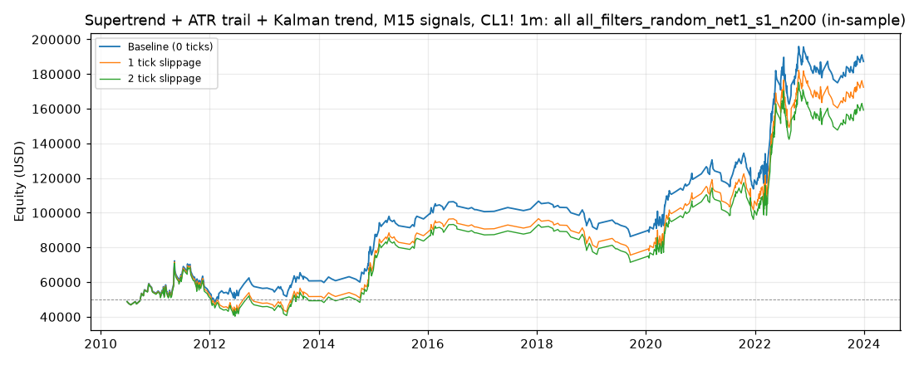

# Supertrend + ATR trail + Kalman trend, M15 signals, CL1! 1m: optimized `all` (all_filters_random_net1_s1_n200)

Generated 2026-10-31 14:04 UTC by `python -m tvtester.cli replay strategies/configs/supertrend_kalman_all_filters_random_net1_s1_n200.json`.

> **In-sample.** Development interval only (bars before 2024-01-01 UTC). Picked by search `results/supertrend_kalman/search/all_filters_random_net1_s1_n200` (trial 85, objective `net1`); see its report for how many trials it took. Nothing here shows a tradable edge: out-of-sample validation is a later feature.

**Parameters:** `exit=fixed`, `hours=all`, `kalman_q=0.0001`, `rr=3`, `st_factor=3`, `swing=3`, `trail_mult=1`, `trigger=both`, `vol=atr_ratio:1.3`

**Filters:** `risk_ticks >= 100`

Replay matches the search trial: **yes**.

## Against the baseline (same interval, same costs)

| Scenario | Baseline net | Optimized net | Baseline trades | Optimized trades | Baseline PF | Optimized PF | Baseline max DD | Optimized max DD |
|---|---|---|---|---|---|---|---|---|
| 0 ticks | 91,453.44 USD | 137,285.08 USD | 3,728 | 546 | 1.063 | 1.266 | 47,383.68 USD | 27,642.46 USD |
| 1 tick | 30,411.68 USD | 122,375.08 USD | 3,716 | 546 | 1.020 | 1.233 | 61,951.62 USD | 30,129.34 USD |
| 2 ticks | -34,755.96 USD | 109,195.08 USD | 3,698 | 546 | 0.978 | 1.205 | 89,957.68 USD | 31,279.34 USD |

## 0 ticks slippage

### Overview

| Metric | Value |
|---|---|
| Net profit | 137,285.08 USD (274.57%) |
| Total closed trades | 546 |
| Percent profitable | 35.16% |
| Profit factor | 1.266 |
| Max equity drawdown | 27,642.46 USD (55.28%) |
| Avg trade | 251.44 USD |
| Avg # bars in trades | 2,874 |

### Performance

| Metric | All | Long | Short |
|---|---|---|---|
| Net profit | 137,285.08 USD (274.57%) | 31,312.24 USD (62.62%) | 105,972.84 USD (211.95%) |
| Gross profit | 652,438.16 USD (1,304.88%) | 311,254.08 USD (622.51%) | 341,184.08 USD (682.37%) |
| Gross loss | 515,153.08 USD (1,030.31%) | 279,941.84 USD (559.88%) | 235,211.24 USD (470.42%) |
| Commission paid | 2,194.92 USD | 1,157.76 USD | 1,037.16 USD |

| Account | Value |
|---|---|
| Initial capital | 50,000.00 USD |
| Buy & hold return (TV-style, all capital at the first entry) | -4,051.79 USD (-8.10%) |
| Max equity run-up (intrabar) | 151,188.44 USD (302.38%) |
| Max equity drawdown (intrabar) | 27,642.46 USD (55.28%) |
| Open P&L | 0.00 USD |
| Max contracts held | 1 |

### Trades analysis

| Metric | All | Long | Short |
|---|---|---|---|
| Total closed trades | 546 | 288 | 258 |
| Winning trades | 192 | 96 | 96 |
| Losing trades | 354 | 192 | 162 |
| Even trades | 0 | 0 | 0 |
| Percent profitable | 35.16% | 33.33% | 37.21% |
| Avg P&L | 251.44 USD | 108.72 USD | 410.75 USD |
| Avg P&L % | 0.45% | 0.42% | 0.48% |
| Avg winning trade | 3,398.12 USD | 3,242.23 USD | 3,554.00 USD |
| Avg losing trade | 1,455.23 USD | 1,458.03 USD | 1,451.92 USD |
| Ratio avg win / avg loss | 2.335 | 2.224 | 2.448 |
| Largest winning trade | 11,485.98 USD | 10,045.98 USD | 11,485.98 USD |
| Largest winning trade % | 46.65% | 46.65% | 19.64% |
| Largest losing trade | 4,794.02 USD | 4,224.02 USD | 4,794.02 USD |
| Largest losing trade % | 27.92% | 27.92% | 18.47% |
| Avg # bars in trades | 2,874 | 3,053 | 2,675 |
| Avg # bars in winning trades | 4,389 | 4,645 | 4,134 |
| Avg # bars in losing trades | 2,052 | 2,257 | 1,810 |

### Risk/performance ratios

| Metric | Value |
|---|---|
| Sharpe ratio | 0.164 |
| Sortino ratio | 0.321 |
| Profit factor | 1.266 |
| Margin calls | 0 |

### By year (extra)

| Year | Trades | Net profit | % profitable | Profit factor |
|---|---|---|---|---|
| 2010 | 16 | 4,685.68 USD | 37.50% | 1.420 |
| 2011 | 73 | -793.46 USD | 31.51% | 0.988 |
| 2012 | 35 | 2,469.30 USD | 34.29% | 1.083 |
| 2013 | 27 | 4,331.46 USD | 33.33% | 1.201 |
| 2014 | 24 | 18,363.52 USD | 45.83% | 2.185 |
| 2015 | 23 | 17,367.54 USD | 47.83% | 2.123 |
| 2016 | 19 | 5,393.62 USD | 47.37% | 1.436 |
| 2017 | 5 | 319.90 USD | 60.00% | 1.109 |
| 2018 | 22 | -6,888.44 USD | 22.73% | 0.661 |
| 2019 | 13 | -8,972.26 USD | 23.08% | 0.380 |
| 2020 | 48 | 32,977.04 USD | 45.83% | 1.801 |
| 2021 | 49 | -336.98 USD | 30.61% | 0.993 |
| 2022 | 134 | 67,381.32 USD | 34.33% | 1.437 |
| 2023 | 58 | 986.84 USD | 29.31% | 1.017 |

## 1 tick slippage

### Overview

| Metric | Value |
|---|---|
| Net profit | 122,375.08 USD (244.75%) |
| Total closed trades | 546 |
| Percent profitable | 34.62% |
| Profit factor | 1.233 |
| Max equity drawdown | 30,129.34 USD (60.26%) |
| Avg trade | 224.13 USD |
| Avg # bars in trades | 2,855 |

### Performance

| Metric | All | Long | Short |
|---|---|---|---|
| Net profit | 122,375.08 USD (244.75%) | 22,742.24 USD (45.48%) | 99,632.84 USD (199.27%) |
| Gross profit | 646,690.22 USD (1,293.38%) | 307,552.12 USD (615.10%) | 339,138.10 USD (678.28%) |
| Gross loss | 524,315.14 USD (1,048.63%) | 284,809.88 USD (569.62%) | 239,505.26 USD (479.01%) |
| Commission paid | 2,194.92 USD | 1,157.76 USD | 1,037.16 USD |

| Account | Value |
|---|---|
| Initial capital | 50,000.00 USD |
| Buy & hold return (TV-style, all capital at the first entry) | -4,045.87 USD (-8.09%) |
| Max equity run-up (intrabar) | 142,172.60 USD (284.35%) |
| Max equity drawdown (intrabar) | 30,129.34 USD (60.26%) |
| Open P&L | 0.00 USD |
| Max contracts held | 1 |

### Trades analysis

| Metric | All | Long | Short |
|---|---|---|---|
| Total closed trades | 546 | 288 | 258 |
| Winning trades | 189 | 94 | 95 |
| Losing trades | 357 | 194 | 163 |
| Even trades | 0 | 0 | 0 |
| Percent profitable | 34.62% | 32.64% | 36.82% |
| Avg P&L | 224.13 USD | 78.97 USD | 386.17 USD |
| Avg P&L % | 0.41% | 0.38% | 0.45% |
| Avg winning trade | 3,421.64 USD | 3,271.83 USD | 3,569.87 USD |
| Avg losing trade | 1,468.67 USD | 1,468.09 USD | 1,469.36 USD |
| Ratio avg win / avg loss | 2.330 | 2.229 | 2.430 |
| Largest winning trade | 11,485.98 USD | 10,045.98 USD | 11,485.98 USD |
| Largest winning trade % | 46.62% | 46.62% | 19.65% |
| Largest losing trade | 4,814.02 USD | 4,244.02 USD | 4,814.02 USD |
| Largest losing trade % | 28.03% | 28.03% | 18.66% |
| Avg # bars in trades | 2,855 | 3,061 | 2,624 |
| Avg # bars in winning trades | 4,382 | 4,751 | 4,016 |
| Avg # bars in losing trades | 2,046 | 2,242 | 1,814 |

### Risk/performance ratios

| Metric | Value |
|---|---|
| Sharpe ratio | 0.144 |
| Sortino ratio | 0.276 |
| Profit factor | 1.233 |
| Margin calls | 0 |

## 2 ticks slippage

### Overview

| Metric | Value |
|---|---|
| Net profit | 109,195.08 USD (218.39%) |
| Total closed trades | 546 |
| Percent profitable | 34.07% |
| Profit factor | 1.205 |
| Max equity drawdown | 31,279.34 USD (62.56%) |
| Avg trade | 199.99 USD |
| Avg # bars in trades | 2,858 |

### Performance

| Metric | All | Long | Short |
|---|---|---|---|
| Net profit | 109,195.08 USD (218.39%) | 18,172.24 USD (36.34%) | 91,022.84 USD (182.05%) |
| Gross profit | 641,932.28 USD (1,283.86%) | 306,880.16 USD (613.76%) | 335,052.12 USD (670.10%) |
| Gross loss | 532,737.20 USD (1,065.47%) | 288,707.92 USD (577.42%) | 244,029.28 USD (488.06%) |
| Commission paid | 2,194.92 USD | 1,157.76 USD | 1,037.16 USD |

| Account | Value |
|---|---|
| Initial capital | 50,000.00 USD |
| Buy & hold return (TV-style, all capital at the first entry) | -4,039.95 USD (-8.08%) |
| Max equity run-up (intrabar) | 135,948.88 USD (271.90%) |
| Max equity drawdown (intrabar) | 31,279.34 USD (62.56%) |
| Open P&L | 0.00 USD |
| Max contracts held | 1 |

### Trades analysis

| Metric | All | Long | Short |
|---|---|---|---|
| Total closed trades | 546 | 288 | 258 |
| Winning trades | 186 | 92 | 94 |
| Losing trades | 360 | 196 | 164 |
| Even trades | 0 | 0 | 0 |
| Percent profitable | 34.07% | 31.94% | 36.43% |
| Avg P&L | 199.99 USD | 63.10 USD | 352.80 USD |
| Avg P&L % | 0.38% | 0.36% | 0.40% |
| Avg winning trade | 3,451.25 USD | 3,335.65 USD | 3,564.38 USD |
| Avg losing trade | 1,479.83 USD | 1,473.00 USD | 1,487.98 USD |
| Ratio avg win / avg loss | 2.332 | 2.265 | 2.395 |
| Largest winning trade | 11,485.98 USD | 10,045.98 USD | 11,485.98 USD |
| Largest winning trade % | 46.59% | 46.59% | 19.65% |
| Largest losing trade | 4,834.02 USD | 4,264.02 USD | 4,834.02 USD |
| Largest losing trade % | 28.15% | 28.15% | 18.85% |
| Avg # bars in trades | 2,858 | 3,065 | 2,628 |
| Avg # bars in winning trades | 4,457 | 4,857 | 4,066 |
| Avg # bars in losing trades | 2,032 | 2,223 | 1,804 |

### Risk/performance ratios

| Metric | Value |
|---|---|
| Sharpe ratio | 0.131 |
| Sortino ratio | 0.247 |
| Profit factor | 1.205 |
| Margin calls | 0 |
