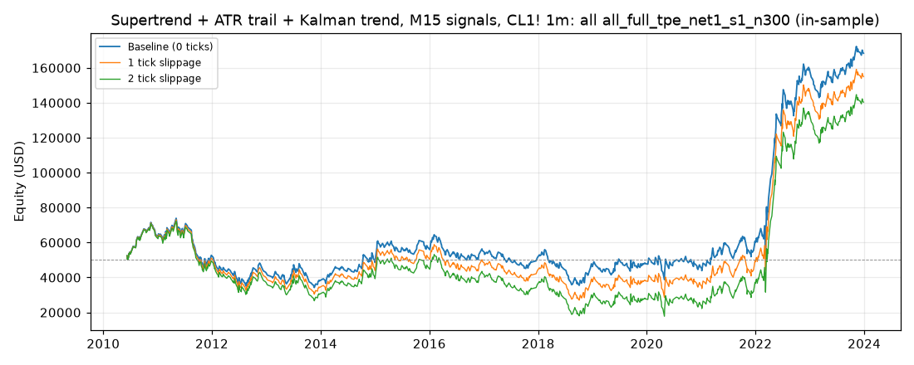

# Supertrend + ATR trail + Kalman trend, M15 signals, CL1! 1m: optimized `all` (all_full_tpe_net1_s1_n300)

Generated 2026-10-31 14:53 UTC by `python -m tvtester.cli replay strategies/configs/supertrend_kalman_all_full_tpe_net1_s1_n300.json`.

> **In-sample.** Development interval only (bars before 2024-01-01 UTC). Picked by search `results/supertrend_kalman/search/all_full_tpe_net1_s1_n300` (trial 221, objective `net1`); see its report for how many trials it took. Nothing here shows a tradable edge: out-of-sample validation is a later feature.

**Parameters:** `exit=fixed`, `hours=all`, `kalman_q=0.0001`, `rr=3`, `st_factor=3`, `swing=5`, `trail_mult=1`, `trigger=trail`, `vol=atr_ratio:1.3`

**Filters:** `atr_ratio >= 1.1`, `hours_since_open >= 8`, `risk_atr >= 1`, `risk_ticks >= 25`

Replay matches the search trial: **yes**.

## Against the baseline (same interval, same costs)

| Scenario | Baseline net | Optimized net | Baseline trades | Optimized trades | Baseline PF | Optimized PF | Baseline max DD | Optimized max DD |
|---|---|---|---|---|---|---|---|---|
| 0 ticks | 91,453.44 USD | 118,333.16 USD | 3,728 | 942 | 1.063 | 1.194 | 47,383.68 USD | 39,913.60 USD |
| 1 tick | 30,411.68 USD | 104,967.18 USD | 3,716 | 941 | 1.020 | 1.169 | 61,951.62 USD | 46,446.08 USD |
| 2 ticks | -34,755.96 USD | 90,347.18 USD | 3,698 | 941 | 0.978 | 1.142 | 89,957.68 USD | 54,596.08 USD |

## 0 ticks slippage

### Overview

| Metric | Value |
|---|---|
| Net profit | 118,333.16 USD (236.67%) |
| Total closed trades | 942 |
| Percent profitable | 29.19% |
| Profit factor | 1.194 |
| Max equity drawdown | 39,913.60 USD (79.83%) |
| Avg trade | 125.62 USD |
| Avg # bars in trades | 2,014 |

### Performance

| Metric | All | Long | Short |
|---|---|---|---|
| Net profit | 118,333.16 USD (236.67%) | 43,548.34 USD (87.10%) | 74,784.82 USD (149.57%) |
| Gross profit | 727,534.50 USD (1,455.07%) | 355,737.20 USD (711.47%) | 371,797.30 USD (743.59%) |
| Gross loss | 609,201.34 USD (1,218.40%) | 312,188.86 USD (624.38%) | 297,012.48 USD (594.02%) |
| Commission paid | 3,786.84 USD | 1,941.66 USD | 1,845.18 USD |

| Account | Value |
|---|---|
| Initial capital | 50,000.00 USD |
| Buy & hold return (TV-style, all capital at the first entry) | -588.81 USD (-1.18%) |
| Max equity run-up (intrabar) | 138,616.10 USD (277.23%) |
| Max equity drawdown (intrabar) | 39,913.60 USD (79.83%) |
| Open P&L | 2,987.99 USD |
| Max contracts held | 1 |

### Trades analysis

| Metric | All | Long | Short |
|---|---|---|---|
| Total closed trades | 942 | 483 | 459 |
| Winning trades | 275 | 140 | 135 |
| Losing trades | 667 | 343 | 324 |
| Even trades | 0 | 0 | 0 |
| Percent profitable | 29.19% | 28.99% | 29.41% |
| Avg P&L | 125.62 USD | 90.16 USD | 162.93 USD |
| Avg P&L % | 0.16% | 0.19% | 0.12% |
| Avg winning trade | 2,645.58 USD | 2,540.98 USD | 2,754.05 USD |
| Avg losing trade | 913.35 USD | 910.17 USD | 916.71 USD |
| Ratio avg win / avg loss | 2.897 | 2.792 | 3.004 |
| Largest winning trade | 24,895.98 USD | 11,035.98 USD | 24,895.98 USD |
| Largest winning trade % | 46.65% | 46.65% | 21.00% |
| Largest losing trade | 8,584.02 USD | 4,224.02 USD | 8,584.02 USD |
| Largest losing trade % | 27.92% | 27.92% | 10.67% |
| Avg # bars in trades | 2,014 | 2,141 | 1,881 |
| Avg # bars in winning trades | 3,509 | 3,786 | 3,221 |
| Avg # bars in losing trades | 1,398 | 1,470 | 1,322 |

### Risk/performance ratios

| Metric | Value |
|---|---|
| Sharpe ratio | 0.115 |
| Sortino ratio | 0.215 |
| Profit factor | 1.194 |
| Margin calls | 0 |

### By year (extra)

| Year | Trades | Net profit | % profitable | Profit factor |
|---|---|---|---|---|
| 2010 | 36 | 13,815.28 USD | 36.11% | 1.773 |
| 2011 | 69 | -11,107.38 USD | 26.09% | 0.823 |
| 2012 | 70 | -10,291.40 USD | 25.71% | 0.781 |
| 2013 | 67 | -4,479.34 USD | 25.37% | 0.880 |
| 2014 | 59 | 10,642.82 USD | 33.90% | 1.375 |
| 2015 | 57 | 8,640.86 USD | 29.82% | 1.295 |
| 2016 | 71 | -1,925.42 USD | 29.58% | 0.952 |
| 2017 | 70 | -3,891.40 USD | 24.29% | 0.852 |
| 2018 | 79 | -5,167.58 USD | 22.78% | 0.879 |
| 2019 | 71 | 1,704.58 USD | 28.17% | 1.047 |
| 2020 | 68 | -2,173.36 USD | 26.47% | 0.953 |
| 2021 | 66 | 14,224.68 USD | 30.30% | 1.294 |
| 2022 | 78 | 98,196.44 USD | 44.87% | 2.126 |
| 2023 | 81 | 10,144.38 USD | 28.40% | 1.171 |

## 1 tick slippage

### Overview

| Metric | Value |
|---|---|
| Net profit | 104,967.18 USD (209.93%) |
| Total closed trades | 941 |
| Percent profitable | 29.12% |
| Profit factor | 1.169 |
| Max equity drawdown | 46,446.08 USD (92.89%) |
| Avg trade | 111.55 USD |
| Avg # bars in trades | 2,020 |

### Performance

| Metric | All | Long | Short |
|---|---|---|---|
| Net profit | 104,967.18 USD (209.93%) | 36,782.36 USD (73.56%) | 68,184.82 USD (136.37%) |
| Gross profit | 726,738.52 USD (1,453.48%) | 355,057.20 USD (710.11%) | 371,681.32 USD (743.36%) |
| Gross loss | 621,771.34 USD (1,243.54%) | 318,274.84 USD (636.55%) | 303,496.50 USD (606.99%) |
| Commission paid | 3,782.82 USD | 1,937.64 USD | 1,845.18 USD |

| Account | Value |
|---|---|
| Initial capital | 50,000.00 USD |
| Buy & hold return (TV-style, all capital at the first entry) | -595.65 USD (-1.19%) |
| Max equity run-up (intrabar) | 132,642.60 USD (265.29%) |
| Max equity drawdown (intrabar) | 46,446.08 USD (92.89%) |
| Open P&L | 2,977.99 USD |
| Max contracts held | 1 |

### Trades analysis

| Metric | All | Long | Short |
|---|---|---|---|
| Total closed trades | 941 | 482 | 459 |
| Winning trades | 274 | 140 | 134 |
| Losing trades | 667 | 342 | 325 |
| Even trades | 0 | 0 | 0 |
| Percent profitable | 29.12% | 29.05% | 29.19% |
| Avg P&L | 111.55 USD | 76.31 USD | 148.55 USD |
| Avg P&L % | 0.13% | 0.17% | 0.10% |
| Avg winning trade | 2,652.33 USD | 2,536.12 USD | 2,773.74 USD |
| Avg losing trade | 932.19 USD | 930.63 USD | 933.84 USD |
| Ratio avg win / avg loss | 2.845 | 2.725 | 2.970 |
| Largest winning trade | 24,895.98 USD | 11,035.98 USD | 24,895.98 USD |
| Largest winning trade % | 46.62% | 46.62% | 21.00% |
| Largest losing trade | 8,604.02 USD | 4,244.02 USD | 8,604.02 USD |
| Largest losing trade % | 28.03% | 28.03% | 10.76% |
| Avg # bars in trades | 2,020 | 2,148 | 1,886 |
| Avg # bars in winning trades | 3,528 | 3,804 | 3,240 |
| Avg # bars in losing trades | 1,401 | 1,470 | 1,328 |

### Risk/performance ratios

| Metric | Value |
|---|---|
| Sharpe ratio | 0.103 |
| Sortino ratio | 0.193 |
| Profit factor | 1.169 |
| Margin calls | 0 |

## 2 ticks slippage

### Overview

| Metric | Value |
|---|---|
| Net profit | 90,347.18 USD (180.69%) |
| Total closed trades | 941 |
| Percent profitable | 29.01% |
| Profit factor | 1.142 |
| Max equity drawdown | 54,596.08 USD (109.19%) |
| Avg trade | 96.01 USD |
| Avg # bars in trades | 2,021 |

### Performance

| Metric | All | Long | Short |
|---|---|---|---|
| Net profit | 90,347.18 USD (180.69%) | 29,212.36 USD (58.42%) | 61,134.82 USD (122.27%) |
| Gross profit | 725,462.54 USD (1,450.93%) | 354,331.22 USD (708.66%) | 371,131.32 USD (742.26%) |
| Gross loss | 635,115.36 USD (1,270.23%) | 325,118.86 USD (650.24%) | 309,996.50 USD (619.99%) |
| Commission paid | 3,782.82 USD | 1,937.64 USD | 1,845.18 USD |

| Account | Value |
|---|---|
| Initial capital | 50,000.00 USD |
| Buy & hold return (TV-style, all capital at the first entry) | -602.49 USD (-1.20%) |
| Max equity run-up (intrabar) | 127,448.82 USD (254.90%) |
| Max equity drawdown (intrabar) | 54,596.08 USD (109.19%) |
| Open P&L | 2,967.99 USD |
| Max contracts held | 1 |

### Trades analysis

| Metric | All | Long | Short |
|---|---|---|---|
| Total closed trades | 941 | 482 | 459 |
| Winning trades | 273 | 139 | 134 |
| Losing trades | 668 | 343 | 325 |
| Even trades | 0 | 0 | 0 |
| Percent profitable | 29.01% | 28.84% | 29.19% |
| Avg P&L | 96.01 USD | 60.61 USD | 133.19 USD |
| Avg P&L % | 0.11% | 0.14% | 0.07% |
| Avg winning trade | 2,657.37 USD | 2,549.15 USD | 2,769.64 USD |
| Avg losing trade | 950.77 USD | 947.87 USD | 953.84 USD |
| Ratio avg win / avg loss | 2.795 | 2.689 | 2.904 |
| Largest winning trade | 24,895.98 USD | 11,035.98 USD | 24,895.98 USD |
| Largest winning trade % | 46.59% | 46.59% | 21.01% |
| Largest losing trade | 8,624.02 USD | 4,264.02 USD | 8,624.02 USD |
| Largest losing trade % | 28.15% | 28.15% | 10.85% |
| Avg # bars in trades | 2,021 | 2,149 | 1,887 |
| Avg # bars in winning trades | 3,544 | 3,833 | 3,244 |
| Avg # bars in losing trades | 1,399 | 1,466 | 1,328 |

### Risk/performance ratios

| Metric | Value |
|---|---|
| Sharpe ratio | 0.093 |
| Sortino ratio | 0.176 |
| Profit factor | 1.142 |
| Margin calls | 0 |
