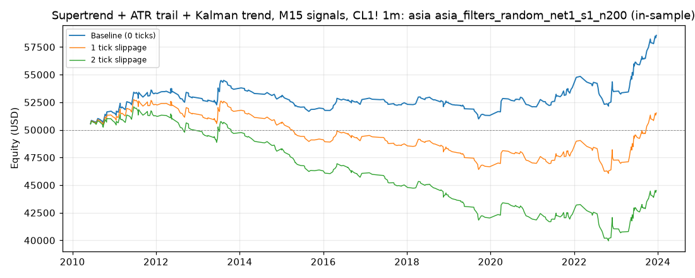

# Supertrend + ATR trail + Kalman trend, M15 signals, CL1! 1m: optimized `asia` (asia_filters_random_net1_s1_n200)

Generated 2026-10-31 14:16 UTC by `python -m tvtester.cli replay strategies/configs/supertrend_kalman_asia_filters_random_net1_s1_n200.json`.

> **In-sample.** Development interval only (bars before 2024-01-01 UTC). Picked by search `results/supertrend_kalman/search/asia_filters_random_net1_s1_n200` (trial 93, objective `net1`); see its report for how many trials it took. Nothing here shows a tradable edge: out-of-sample validation is a later feature.

**Parameters:** `exit=trail`, `hours=asia`, `kalman_q=0.01`, `rr=3`, `st_factor=3`, `swing=3`, `trail_mult=2`, `trigger=trail`, `vol=none`

**Filters:** `er >= 0.1`, `risk_atr <= 3`, `risk_ticks <= 90`

Replay matches the search trial: **yes**.

## Against the baseline (same interval, same costs)

| Scenario | Baseline net | Optimized net | Baseline trades | Optimized trades | Baseline PF | Optimized PF | Baseline max DD | Optimized max DD |
|---|---|---|---|---|---|---|---|---|
| 0 ticks | 15,844.42 USD | 8,558.88 USD | 979 | 356 | 1.200 | 1.333 | 5,922.66 USD | 3,578.68 USD |
| 1 tick | -3,495.58 USD | 1,538.88 USD | 979 | 356 | 0.961 | 1.051 | 12,015.10 USD | 6,781.48 USD |
| 2 ticks | -22,835.58 USD | -5,481.12 USD | 979 | 356 | 0.777 | 0.841 | 27,499.06 USD | 12,231.48 USD |

## 0 ticks slippage

### Overview

| Metric | Value |
|---|---|
| Net profit | 8,558.88 USD (17.12%) |
| Total closed trades | 356 |
| Percent profitable | 42.98% |
| Profit factor | 1.333 |
| Max equity drawdown | 3,578.68 USD (7.16%) |
| Avg trade | 24.04 USD |
| Avg # bars in trades | 120 |

### Performance

| Metric | All | Long | Short |
|---|---|---|---|
| Net profit | 8,558.88 USD (17.12%) | 5,148.36 USD (10.30%) | 3,410.52 USD (6.82%) |
| Gross profit | 34,264.94 USD (68.53%) | 18,588.50 USD (37.18%) | 15,676.44 USD (31.35%) |
| Gross loss | 25,706.06 USD (51.41%) | 13,440.14 USD (26.88%) | 12,265.92 USD (24.53%) |
| Commission paid | 1,431.12 USD | 731.64 USD | 699.48 USD |

| Account | Value |
|---|---|
| Initial capital | 50,000.00 USD |
| Buy & hold return (TV-style, all capital at the first entry) | -111.90 USD (-0.22%) |
| Max equity run-up (intrabar) | 8,670.94 USD (17.34%) |
| Max equity drawdown (intrabar) | 3,578.68 USD (7.16%) |
| Open P&L | 0.00 USD |
| Max contracts held | 1 |

### Trades analysis

| Metric | All | Long | Short |
|---|---|---|---|
| Total closed trades | 356 | 182 | 174 |
| Winning trades | 153 | 75 | 78 |
| Losing trades | 203 | 107 | 96 |
| Even trades | 0 | 0 | 0 |
| Percent profitable | 42.98% | 41.21% | 44.83% |
| Avg P&L | 24.04 USD | 28.29 USD | 19.60 USD |
| Avg P&L % | 0.04% | 0.06% | 0.02% |
| Avg winning trade | 223.95 USD | 247.85 USD | 200.98 USD |
| Avg losing trade | 126.63 USD | 125.61 USD | 127.77 USD |
| Ratio avg win / avg loss | 1.769 | 1.973 | 1.573 |
| Largest winning trade | 1,825.98 USD | 1,825.98 USD | 1,135.98 USD |
| Largest winning trade % | 4.51% | 4.51% | 1.23% |
| Largest losing trade | 514.02 USD | 504.02 USD | 514.02 USD |
| Largest losing trade % | 0.64% | 0.63% | 0.64% |
| Avg # bars in trades | 120 | 113 | 128 |
| Avg # bars in winning trades | 160 | 152 | 167 |
| Avg # bars in losing trades | 91 | 86 | 96 |

### Risk/performance ratios

| Metric | Value |
|---|---|
| Sharpe ratio | -0.094 |
| Sortino ratio | -0.148 |
| Profit factor | 1.333 |
| Margin calls | 0 |

### By year (extra)

| Year | Trades | Net profit | % profitable | Profit factor |
|---|---|---|---|---|
| 2010 | 20 | 1,539.60 USD | 55.00% | 2.546 |
| 2011 | 32 | 1,791.36 USD | 46.88% | 1.599 |
| 2012 | 23 | -352.46 USD | 39.13% | 0.840 |
| 2013 | 26 | 695.48 USD | 42.31% | 1.296 |
| 2014 | 20 | -690.40 USD | 30.00% | 0.519 |
| 2015 | 21 | -1,054.42 USD | 33.33% | 0.331 |
| 2016 | 26 | 815.48 USD | 42.31% | 1.715 |
| 2017 | 20 | -360.40 USD | 40.00% | 0.560 |
| 2018 | 25 | 49.50 USD | 52.00% | 1.033 |
| 2019 | 22 | -1,128.44 USD | 18.18% | 0.309 |
| 2020 | 22 | 781.56 USD | 31.82% | 1.674 |
| 2021 | 33 | 1,757.34 USD | 57.58% | 2.012 |
| 2022 | 25 | -360.50 USD | 36.00% | 0.909 |
| 2023 | 41 | 5,075.18 USD | 56.10% | 3.304 |

## 1 tick slippage

### Overview

| Metric | Value |
|---|---|
| Net profit | 1,538.88 USD (3.08%) |
| Total closed trades | 356 |
| Percent profitable | 37.92% |
| Profit factor | 1.051 |
| Max equity drawdown | 6,781.48 USD (13.56%) |
| Avg trade | 4.32 USD |
| Avg # bars in trades | 120 |

### Performance

| Metric | All | Long | Short |
|---|---|---|---|
| Net profit | 1,538.88 USD (3.08%) | 1,588.36 USD (3.18%) | -49.48 USD (-0.10%) |
| Gross profit | 31,457.30 USD (62.91%) | 17,230.66 USD (34.46%) | 14,226.64 USD (28.45%) |
| Gross loss | 29,918.42 USD (59.84%) | 15,642.30 USD (31.28%) | 14,276.12 USD (28.55%) |
| Commission paid | 1,431.12 USD | 731.64 USD | 699.48 USD |

| Account | Value |
|---|---|
| Initial capital | 50,000.00 USD |
| Buy & hold return (TV-style, all capital at the first entry) | -118.88 USD (-0.24%) |
| Max equity run-up (intrabar) | 5,649.10 USD (11.30%) |
| Max equity drawdown (intrabar) | 6,781.48 USD (13.56%) |
| Open P&L | 0.00 USD |
| Max contracts held | 1 |

### Trades analysis

| Metric | All | Long | Short |
|---|---|---|---|
| Total closed trades | 356 | 182 | 174 |
| Winning trades | 135 | 67 | 68 |
| Losing trades | 221 | 115 | 106 |
| Even trades | 0 | 0 | 0 |
| Percent profitable | 37.92% | 36.81% | 39.08% |
| Avg P&L | 4.32 USD | 8.73 USD | -0.28 USD |
| Avg P&L % | 0.01% | 0.03% | -0.01% |
| Avg winning trade | 233.02 USD | 257.17 USD | 209.22 USD |
| Avg losing trade | 135.38 USD | 136.02 USD | 134.68 USD |
| Ratio avg win / avg loss | 1.721 | 1.891 | 1.553 |
| Largest winning trade | 1,825.98 USD | 1,825.98 USD | 1,135.98 USD |
| Largest winning trade % | 4.41% | 4.41% | 1.23% |
| Largest losing trade | 534.02 USD | 524.02 USD | 534.02 USD |
| Largest losing trade % | 0.69% | 0.68% | 0.69% |
| Avg # bars in trades | 120 | 113 | 128 |
| Avg # bars in winning trades | 164 | 157 | 171 |
| Avg # bars in losing trades | 94 | 88 | 101 |

### Risk/performance ratios

| Metric | Value |
|---|---|
| Sharpe ratio | -0.188 |
| Sortino ratio | -0.264 |
| Profit factor | 1.051 |
| Margin calls | 0 |

## 2 ticks slippage

### Overview

| Metric | Value |
|---|---|
| Net profit | -5,481.12 USD (-10.96%) |
| Total closed trades | 356 |
| Percent profitable | 34.27% |
| Profit factor | 0.841 |
| Max equity drawdown | 12,231.48 USD (24.46%) |
| Avg trade | -15.40 USD |
| Avg # bars in trades | 120 |

### Performance

| Metric | All | Long | Short |
|---|---|---|---|
| Net profit | -5,481.12 USD (-10.96%) | -1,971.64 USD (-3.94%) | -3,509.48 USD (-7.02%) |
| Gross profit | 28,969.56 USD (57.94%) | 16,032.82 USD (32.07%) | 12,936.74 USD (25.87%) |
| Gross loss | 34,450.68 USD (68.90%) | 18,004.46 USD (36.01%) | 16,446.22 USD (32.89%) |
| Commission paid | 1,431.12 USD | 731.64 USD | 699.48 USD |

| Account | Value |
|---|---|
| Initial capital | 50,000.00 USD |
| Buy & hold return (TV-style, all capital at the first entry) | -125.86 USD (-0.25%) |
| Max equity run-up (intrabar) | 4,779.10 USD (9.56%) |
| Max equity drawdown (intrabar) | 12,231.48 USD (24.46%) |
| Open P&L | 0.00 USD |
| Max contracts held | 1 |

### Trades analysis

| Metric | All | Long | Short |
|---|---|---|---|
| Total closed trades | 356 | 182 | 174 |
| Winning trades | 122 | 59 | 63 |
| Losing trades | 234 | 123 | 111 |
| Even trades | 0 | 0 | 0 |
| Percent profitable | 34.27% | 32.42% | 36.21% |
| Avg P&L | -15.40 USD | -10.83 USD | -20.17 USD |
| Avg P&L % | -0.02% | -0.00% | -0.04% |
| Avg winning trade | 237.46 USD | 271.74 USD | 205.35 USD |
| Avg losing trade | 147.23 USD | 146.38 USD | 148.16 USD |
| Ratio avg win / avg loss | 1.613 | 1.856 | 1.386 |
| Largest winning trade | 1,825.98 USD | 1,825.98 USD | 1,135.98 USD |
| Largest winning trade % | 4.31% | 4.31% | 1.23% |
| Largest losing trade | 554.02 USD | 544.02 USD | 554.02 USD |
| Largest losing trade % | 0.74% | 0.73% | 0.74% |
| Avg # bars in trades | 120 | 113 | 128 |
| Avg # bars in winning trades | 170 | 168 | 173 |
| Avg # bars in losing trades | 94 | 87 | 102 |

### Risk/performance ratios

| Metric | Value |
|---|---|
| Sharpe ratio | -0.275 |
| Sortino ratio | -0.351 |
| Profit factor | 0.841 |
| Margin calls | 0 |
