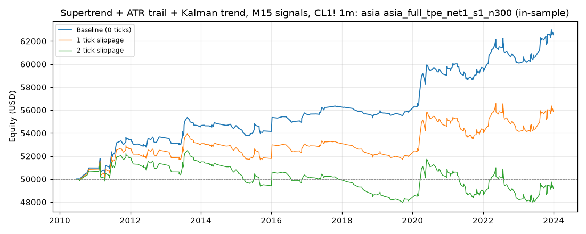

# Supertrend + ATR trail + Kalman trend, M15 signals, CL1! 1m: optimized `asia` (asia_full_tpe_net1_s1_n300)

Generated 2026-10-31 14:16 UTC by `python -m tvtester.cli replay strategies/configs/supertrend_kalman_asia_full_tpe_net1_s1_n300.json`.

> **In-sample.** Development interval only (bars before 2024-01-01 UTC). Picked by search `results/supertrend_kalman/search/asia_full_tpe_net1_s1_n300` (trial 230, objective `net1`); see its report for how many trials it took. Nothing here shows a tradable edge: out-of-sample validation is a later feature.

**Parameters:** `exit=trail`, `hours=asia`, `kalman_q=0.0001`, `rr=2`, `st_factor=3`, `swing=5`, `trail_mult=2`, `trigger=trail`, `vol=none`

**Filters:** `hours_since_open <= 12`, `risk_atr >= 2`, `risk_ticks <= 170`, `rvi_side <= 70`

Replay matches the search trial: **yes**.

## Against the baseline (same interval, same costs)

| Scenario | Baseline net | Optimized net | Baseline trades | Optimized trades | Baseline PF | Optimized PF | Baseline max DD | Optimized max DD |
|---|---|---|---|---|---|---|---|---|
| 0 ticks | 15,844.42 USD | 12,565.16 USD | 979 | 342 | 1.200 | 1.500 | 5,922.66 USD | 2,202.36 USD |
| 1 tick | -3,495.58 USD | 5,865.16 USD | 979 | 342 | 0.961 | 1.203 | 12,015.10 USD | 2,614.52 USD |
| 2 ticks | -22,835.58 USD | -834.84 USD | 979 | 342 | 0.777 | 0.975 | 27,499.06 USD | 4,628.72 USD |

## 0 ticks slippage

### Overview

| Metric | Value |
|---|---|
| Net profit | 12,565.16 USD (25.13%) |
| Total closed trades | 342 |
| Percent profitable | 47.66% |
| Profit factor | 1.500 |
| Max equity drawdown | 2,202.36 USD (4.40%) |
| Avg trade | 36.74 USD |
| Avg # bars in trades | 122 |

### Performance

| Metric | All | Long | Short |
|---|---|---|---|
| Net profit | 12,565.16 USD (25.13%) | 4,364.34 USD (8.73%) | 8,200.82 USD (16.40%) |
| Gross profit | 37,684.74 USD (75.37%) | 17,828.40 USD (35.66%) | 19,856.34 USD (39.71%) |
| Gross loss | 25,119.58 USD (50.24%) | 13,464.06 USD (26.93%) | 11,655.52 USD (23.31%) |
| Commission paid | 1,374.84 USD | 735.66 USD | 639.18 USD |

| Account | Value |
|---|---|
| Initial capital | 50,000.00 USD |
| Buy & hold return (TV-style, all capital at the first entry) | -4,386.75 USD (-8.77%) |
| Max equity run-up (intrabar) | 13,206.36 USD (26.41%) |
| Max equity drawdown (intrabar) | 2,202.36 USD (4.40%) |
| Open P&L | 0.00 USD |
| Max contracts held | 1 |

### Trades analysis

| Metric | All | Long | Short |
|---|---|---|---|
| Total closed trades | 342 | 183 | 159 |
| Winning trades | 163 | 80 | 83 |
| Losing trades | 179 | 103 | 76 |
| Even trades | 0 | 0 | 0 |
| Percent profitable | 47.66% | 43.72% | 52.20% |
| Avg P&L | 36.74 USD | 23.85 USD | 51.58 USD |
| Avg P&L % | 0.07% | 0.06% | 0.08% |
| Avg winning trade | 231.19 USD | 222.86 USD | 239.23 USD |
| Avg losing trade | 140.33 USD | 130.72 USD | 153.36 USD |
| Ratio avg win / avg loss | 1.647 | 1.705 | 1.560 |
| Largest winning trade | 1,295.98 USD | 965.98 USD | 1,295.98 USD |
| Largest winning trade % | 4.51% | 4.51% | 3.87% |
| Largest losing trade | 724.02 USD | 724.02 USD | 694.02 USD |
| Largest losing trade % | 3.19% | 0.67% | 3.19% |
| Avg # bars in trades | 122 | 120 | 125 |
| Avg # bars in winning trades | 150 | 148 | 152 |
| Avg # bars in losing trades | 96 | 98 | 94 |

### Risk/performance ratios

| Metric | Value |
|---|---|
| Sharpe ratio | -0.041 |
| Sortino ratio | -0.070 |
| Profit factor | 1.500 |
| Margin calls | 0 |

### By year (extra)

| Year | Trades | Net profit | % profitable | Profit factor |
|---|---|---|---|---|
| 2010 | 7 | 971.86 USD | 85.71% | 29.567 |
| 2011 | 33 | 2,477.34 USD | 54.55% | 1.878 |
| 2012 | 20 | 229.60 USD | 40.00% | 1.150 |
| 2013 | 22 | 861.56 USD | 36.36% | 1.429 |
| 2014 | 18 | 117.64 USD | 44.44% | 1.128 |
| 2015 | 22 | -508.44 USD | 31.82% | 0.727 |
| 2016 | 18 | 1,497.64 USD | 44.44% | 2.762 |
| 2017 | 23 | 677.54 USD | 65.22% | 2.821 |
| 2018 | 17 | -698.34 USD | 35.29% | 0.338 |
| 2019 | 19 | 183.62 USD | 42.11% | 1.257 |
| 2020 | 34 | 3,823.32 USD | 50.00% | 2.406 |
| 2021 | 41 | 85.18 USD | 48.78% | 1.028 |
| 2022 | 29 | 483.42 USD | 51.72% | 1.127 |
| 2023 | 39 | 2,363.22 USD | 48.72% | 1.699 |

## 1 tick slippage

### Overview

| Metric | Value |
|---|---|
| Net profit | 5,865.16 USD (11.73%) |
| Total closed trades | 342 |
| Percent profitable | 39.47% |
| Profit factor | 1.203 |
| Max equity drawdown | 2,614.52 USD (5.23%) |
| Avg trade | 17.15 USD |
| Avg # bars in trades | 122 |

### Performance

| Metric | All | Long | Short |
|---|---|---|---|
| Net profit | 5,865.16 USD (11.73%) | 764.34 USD (1.53%) | 5,100.82 USD (10.20%) |
| Gross profit | 34,827.30 USD (69.65%) | 16,456.74 USD (32.91%) | 18,370.56 USD (36.74%) |
| Gross loss | 28,962.14 USD (57.92%) | 15,692.40 USD (31.38%) | 13,269.74 USD (26.54%) |
| Commission paid | 1,374.84 USD | 735.66 USD | 639.18 USD |

| Account | Value |
|---|---|
| Initial capital | 50,000.00 USD |
| Buy & hold return (TV-style, all capital at the first entry) | -4,380.92 USD (-8.76%) |
| Max equity run-up (intrabar) | 7,696.36 USD (15.39%) |
| Max equity drawdown (intrabar) | 2,614.52 USD (5.23%) |
| Open P&L | 0.00 USD |
| Max contracts held | 1 |

### Trades analysis

| Metric | All | Long | Short |
|---|---|---|---|
| Total closed trades | 342 | 183 | 159 |
| Winning trades | 135 | 63 | 72 |
| Losing trades | 207 | 120 | 87 |
| Even trades | 0 | 0 | 0 |
| Percent profitable | 39.47% | 34.43% | 45.28% |
| Avg P&L | 17.15 USD | 4.18 USD | 32.08 USD |
| Avg P&L % | 0.04% | 0.03% | 0.04% |
| Avg winning trade | 257.98 USD | 261.22 USD | 255.15 USD |
| Avg losing trade | 139.91 USD | 130.77 USD | 152.53 USD |
| Ratio avg win / avg loss | 1.844 | 1.998 | 1.673 |
| Largest winning trade | 1,295.98 USD | 945.98 USD | 1,295.98 USD |
| Largest winning trade % | 4.41% | 4.41% | 3.87% |
| Largest losing trade | 744.02 USD | 744.02 USD | 714.02 USD |
| Largest losing trade % | 3.30% | 0.69% | 3.30% |
| Avg # bars in trades | 122 | 120 | 125 |
| Avg # bars in winning trades | 158 | 160 | 157 |
| Avg # bars in losing trades | 99 | 99 | 98 |

### Risk/performance ratios

| Metric | Value |
|---|---|
| Sharpe ratio | -0.138 |
| Sortino ratio | -0.209 |
| Profit factor | 1.203 |
| Margin calls | 0 |

## 2 ticks slippage

### Overview

| Metric | Value |
|---|---|
| Net profit | -834.84 USD (-1.67%) |
| Total closed trades | 342 |
| Percent profitable | 35.67% |
| Profit factor | 0.975 |
| Max equity drawdown | 4,628.72 USD (9.26%) |
| Avg trade | -2.44 USD |
| Avg # bars in trades | 122 |

### Performance

| Metric | All | Long | Short |
|---|---|---|---|
| Net profit | -834.84 USD (-1.67%) | -2,835.66 USD (-5.67%) | 2,000.82 USD (4.00%) |
| Gross profit | 32,349.56 USD (64.70%) | 15,308.90 USD (30.62%) | 17,040.66 USD (34.08%) |
| Gross loss | 33,184.40 USD (66.37%) | 18,144.56 USD (36.29%) | 15,039.84 USD (30.08%) |
| Commission paid | 1,374.84 USD | 735.66 USD | 639.18 USD |

| Account | Value |
|---|---|
| Initial capital | 50,000.00 USD |
| Buy & hold return (TV-style, all capital at the first entry) | -4,375.08 USD (-8.75%) |
| Max equity run-up (intrabar) | 4,147.64 USD (8.30%) |
| Max equity drawdown (intrabar) | 4,628.72 USD (9.26%) |
| Open P&L | 0.00 USD |
| Max contracts held | 1 |

### Trades analysis

| Metric | All | Long | Short |
|---|---|---|---|
| Total closed trades | 342 | 183 | 159 |
| Winning trades | 122 | 55 | 67 |
| Losing trades | 220 | 128 | 92 |
| Even trades | 0 | 0 | 0 |
| Percent profitable | 35.67% | 30.05% | 42.14% |
| Avg P&L | -2.44 USD | -15.50 USD | 12.58 USD |
| Avg P&L % | 0.01% | 0.00% | 0.01% |
| Avg winning trade | 265.16 USD | 278.34 USD | 254.34 USD |
| Avg losing trade | 150.84 USD | 141.75 USD | 163.48 USD |
| Ratio avg win / avg loss | 1.758 | 1.964 | 1.556 |
| Largest winning trade | 1,295.98 USD | 925.98 USD | 1,295.98 USD |
| Largest winning trade % | 4.31% | 4.31% | 3.87% |
| Largest losing trade | 764.02 USD | 764.02 USD | 734.02 USD |
| Largest losing trade % | 3.41% | 0.73% | 3.41% |
| Avg # bars in trades | 122 | 120 | 125 |
| Avg # bars in winning trades | 163 | 167 | 160 |
| Avg # bars in losing trades | 99 | 100 | 98 |

### Risk/performance ratios

| Metric | Value |
|---|---|
| Sharpe ratio | -0.235 |
| Sortino ratio | -0.317 |
| Profit factor | 0.975 |
| Margin calls | 0 |
