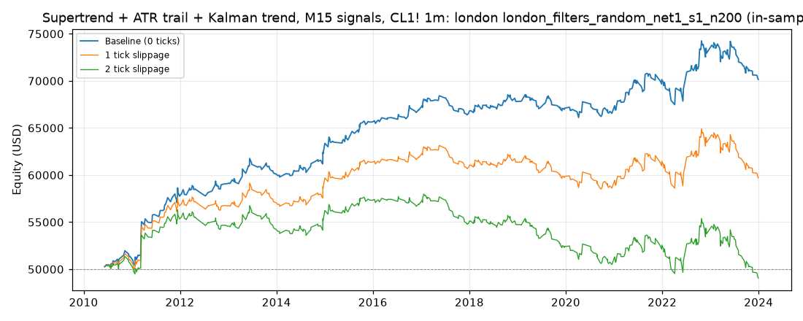

# Supertrend + ATR trail + Kalman trend, M15 signals, CL1! 1m: optimized `london` (london_filters_random_net1_s1_n200)

Generated 2026-10-31 14:15 UTC by `python -m tvtester.cli replay strategies/configs/supertrend_kalman_london_filters_random_net1_s1_n200.json`.

> **In-sample.** Development interval only (bars before 2024-01-01 UTC). Picked by search `results/supertrend_kalman/search/london_filters_random_net1_s1_n200` (trial 117, objective `net1`); see its report for how many trials it took. Nothing here shows a tradable edge: out-of-sample validation is a later feature.

**Parameters:** `exit=trail`, `hours=london`, `kalman_q=0.0001`, `rr=2`, `st_factor=3`, `swing=5`, `trail_mult=2`, `trigger=both`, `vol=stop_atr:3`

**Filters:** `hours_since_open <= 21`, `risk_atr >= 1.5`, `rvi_side <= 75`

Replay matches the search trial: **yes**.

## Against the baseline (same interval, same costs)

| Scenario | Baseline net | Optimized net | Baseline trades | Optimized trades | Baseline PF | Optimized PF | Baseline max DD | Optimized max DD |
|---|---|---|---|---|---|---|---|---|
| 0 ticks | 17,638.20 USD | 20,149.30 USD | 590 | 535 | 1.272 | 1.347 | 4,419.24 USD | 4,103.16 USD |
| 1 tick | 6,258.20 USD | 9,689.30 USD | 590 | 535 | 1.087 | 1.151 | 7,306.76 USD | 5,213.16 USD |
| 2 ticks | -5,301.80 USD | -950.70 USD | 590 | 535 | 0.933 | 0.987 | 12,512.58 USD | 9,044.20 USD |

## 0 ticks slippage

### Overview

| Metric | Value |
|---|---|
| Net profit | 20,149.30 USD (40.30%) |
| Total closed trades | 535 |
| Percent profitable | 43.74% |
| Profit factor | 1.347 |
| Max equity drawdown | 4,103.16 USD (8.21%) |
| Avg trade | 37.66 USD |
| Avg # bars in trades | 101 |

### Performance

| Metric | All | Long | Short |
|---|---|---|---|
| Net profit | 20,149.30 USD (40.30%) | 9,214.70 USD (18.43%) | 10,934.60 USD (21.87%) |
| Gross profit | 78,169.32 USD (156.34%) | 36,777.70 USD (73.56%) | 41,391.62 USD (82.78%) |
| Gross loss | 58,020.02 USD (116.04%) | 27,563.00 USD (55.13%) | 30,457.02 USD (60.91%) |
| Commission paid | 2,150.70 USD | 1,065.30 USD | 1,085.40 USD |

| Account | Value |
|---|---|
| Initial capital | 50,000.00 USD |
| Buy & hold return (TV-style, all capital at the first entry) | -1,002.89 USD (-2.01%) |
| Max equity run-up (intrabar) | 24,747.84 USD (49.50%) |
| Max equity drawdown (intrabar) | 4,103.16 USD (8.21%) |
| Open P&L | 0.00 USD |
| Max contracts held | 1 |

### Trades analysis

| Metric | All | Long | Short |
|---|---|---|---|
| Total closed trades | 535 | 265 | 270 |
| Winning trades | 234 | 115 | 119 |
| Losing trades | 301 | 150 | 151 |
| Even trades | 0 | 0 | 0 |
| Percent profitable | 43.74% | 43.40% | 44.07% |
| Avg P&L | 37.66 USD | 34.77 USD | 40.50 USD |
| Avg P&L % | 0.05% | 0.05% | 0.06% |
| Avg winning trade | 334.06 USD | 319.81 USD | 347.83 USD |
| Avg losing trade | 192.76 USD | 183.75 USD | 201.70 USD |
| Ratio avg win / avg loss | 1.733 | 1.740 | 1.724 |
| Largest winning trade | 1,895.98 USD | 1,215.98 USD | 1,895.98 USD |
| Largest winning trade % | 4.51% | 4.51% | 2.83% |
| Largest losing trade | 1,264.02 USD | 1,264.02 USD | 614.02 USD |
| Largest losing trade % | 1.38% | 1.38% | 1.04% |
| Avg # bars in trades | 101 | 105 | 98 |
| Avg # bars in winning trades | 127 | 129 | 125 |
| Avg # bars in losing trades | 81 | 86 | 76 |

### Risk/performance ratios

| Metric | Value |
|---|---|
| Sharpe ratio | 0.045 |
| Sortino ratio | 0.082 |
| Profit factor | 1.347 |
| Margin calls | 0 |

### By year (extra)

| Year | Trades | Net profit | % profitable | Profit factor |
|---|---|---|---|---|
| 2010 | 20 | 1,279.60 USD | 50.00% | 1.775 |
| 2011 | 39 | 6,483.22 USD | 53.85% | 2.466 |
| 2012 | 41 | 1,325.18 USD | 46.34% | 1.457 |
| 2013 | 39 | 1,033.22 USD | 35.90% | 1.276 |
| 2014 | 35 | 2,129.30 USD | 51.43% | 1.895 |
| 2015 | 35 | 3,389.30 USD | 54.29% | 2.140 |
| 2016 | 26 | 1,285.48 USD | 42.31% | 1.643 |
| 2017 | 42 | -298.84 USD | 30.95% | 0.910 |
| 2018 | 40 | 1,179.20 USD | 42.50% | 1.347 |
| 2019 | 43 | -692.86 USD | 41.86% | 0.826 |
| 2020 | 36 | -564.72 USD | 36.11% | 0.861 |
| 2021 | 44 | 3,593.12 USD | 54.55% | 1.742 |
| 2022 | 45 | 2,799.10 USD | 51.11% | 1.311 |
| 2023 | 50 | -2,791.00 USD | 28.00% | 0.701 |

## 1 tick slippage

### Overview

| Metric | Value |
|---|---|
| Net profit | 9,689.30 USD (19.38%) |
| Total closed trades | 535 |
| Percent profitable | 40.00% |
| Profit factor | 1.151 |
| Max equity drawdown | 5,213.16 USD (10.43%) |
| Avg trade | 18.11 USD |
| Avg # bars in trades | 102 |

### Performance

| Metric | All | Long | Short |
|---|---|---|---|
| Net profit | 9,689.30 USD (19.38%) | 4,434.70 USD (8.87%) | 5,254.60 USD (10.51%) |
| Gross profit | 73,919.72 USD (147.84%) | 35,049.86 USD (70.10%) | 38,869.86 USD (77.74%) |
| Gross loss | 64,230.42 USD (128.46%) | 30,615.16 USD (61.23%) | 33,615.26 USD (67.23%) |
| Commission paid | 2,150.70 USD | 1,065.30 USD | 1,085.40 USD |

| Account | Value |
|---|---|
| Initial capital | 50,000.00 USD |
| Buy & hold return (TV-style, all capital at the first entry) | -1,009.62 USD (-2.02%) |
| Max equity run-up (intrabar) | 15,300.90 USD (30.60%) |
| Max equity drawdown (intrabar) | 5,213.16 USD (10.43%) |
| Open P&L | 0.00 USD |
| Max contracts held | 1 |

### Trades analysis

| Metric | All | Long | Short |
|---|---|---|---|
| Total closed trades | 535 | 265 | 270 |
| Winning trades | 214 | 107 | 107 |
| Losing trades | 321 | 158 | 163 |
| Even trades | 0 | 0 | 0 |
| Percent profitable | 40.00% | 40.38% | 39.63% |
| Avg P&L | 18.11 USD | 16.73 USD | 19.46 USD |
| Avg P&L % | 0.02% | 0.02% | 0.02% |
| Avg winning trade | 345.42 USD | 327.57 USD | 363.27 USD |
| Avg losing trade | 200.09 USD | 193.77 USD | 206.23 USD |
| Ratio avg win / avg loss | 1.726 | 1.691 | 1.761 |
| Largest winning trade | 1,895.98 USD | 1,215.98 USD | 1,895.98 USD |
| Largest winning trade % | 4.51% | 4.51% | 2.83% |
| Largest losing trade | 1,284.02 USD | 1,284.02 USD | 634.02 USD |
| Largest losing trade % | 1.45% | 1.45% | 1.13% |
| Avg # bars in trades | 102 | 105 | 99 |
| Avg # bars in winning trades | 131 | 129 | 132 |
| Avg # bars in losing trades | 82 | 88 | 77 |

### Risk/performance ratios

| Metric | Value |
|---|---|
| Sharpe ratio | -0.046 |
| Sortino ratio | -0.075 |
| Profit factor | 1.151 |
| Margin calls | 0 |

## 2 ticks slippage

### Overview

| Metric | Value |
|---|---|
| Net profit | -950.70 USD (-1.90%) |
| Total closed trades | 535 |
| Percent profitable | 37.01% |
| Profit factor | 0.987 |
| Max equity drawdown | 9,044.20 USD (18.09%) |
| Avg trade | -1.78 USD |
| Avg # bars in trades | 102 |

### Performance

| Metric | All | Long | Short |
|---|---|---|---|
| Net profit | -950.70 USD (-1.90%) | -845.30 USD (-1.69%) | -105.40 USD (-0.21%) |
| Gross profit | 69,864.04 USD (139.73%) | 33,030.06 USD (66.06%) | 36,833.98 USD (73.67%) |
| Gross loss | 70,814.74 USD (141.63%) | 33,875.36 USD (67.75%) | 36,939.38 USD (73.88%) |
| Commission paid | 2,150.70 USD | 1,065.30 USD | 1,085.40 USD |

| Account | Value |
|---|---|
| Initial capital | 50,000.00 USD |
| Buy & hold return (TV-style, all capital at the first entry) | -1,016.34 USD (-2.03%) |
| Max equity run-up (intrabar) | 8,495.70 USD (16.99%) |
| Max equity drawdown (intrabar) | 9,044.20 USD (18.09%) |
| Open P&L | 0.00 USD |
| Max contracts held | 1 |

### Trades analysis

| Metric | All | Long | Short |
|---|---|---|---|
| Total closed trades | 535 | 265 | 270 |
| Winning trades | 198 | 97 | 101 |
| Losing trades | 337 | 168 | 169 |
| Even trades | 0 | 0 | 0 |
| Percent profitable | 37.01% | 36.60% | 37.41% |
| Avg P&L | -1.78 USD | -3.19 USD | -0.39 USD |
| Avg P&L % | -0.01% | -0.01% | -0.00% |
| Avg winning trade | 352.85 USD | 340.52 USD | 364.69 USD |
| Avg losing trade | 210.13 USD | 201.64 USD | 218.58 USD |
| Ratio avg win / avg loss | 1.679 | 1.689 | 1.668 |
| Largest winning trade | 1,895.98 USD | 1,215.98 USD | 1,895.98 USD |
| Largest winning trade % | 4.51% | 4.51% | 2.83% |
| Largest losing trade | 1,304.02 USD | 1,304.02 USD | 654.02 USD |
| Largest losing trade % | 1.53% | 1.53% | 1.21% |
| Avg # bars in trades | 102 | 105 | 99 |
| Avg # bars in winning trades | 134 | 133 | 135 |
| Avg # bars in losing trades | 83 | 89 | 78 |

### Risk/performance ratios

| Metric | Value |
|---|---|
| Sharpe ratio | -0.137 |
| Sortino ratio | -0.200 |
| Profit factor | 0.987 |
| Margin calls | 0 |
