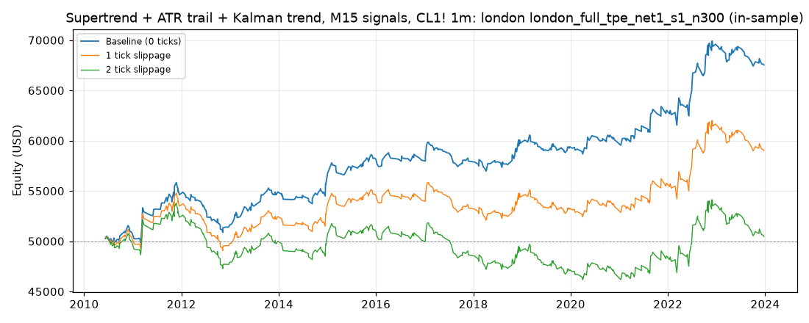

# Supertrend + ATR trail + Kalman trend, M15 signals, CL1! 1m: optimized `london` (london_full_tpe_net1_s1_n300)

Generated 2026-10-31 14:08 UTC by `python -m tvtester.cli replay strategies/configs/supertrend_kalman_london_full_tpe_net1_s1_n300.json`.

> **In-sample.** Development interval only (bars before 2024-01-01 UTC). Picked by search `results/supertrend_kalman/search/london_full_tpe_net1_s1_n300` (trial 222, objective `net1`); see its report for how many trials it took. Nothing here shows a tradable edge: out-of-sample validation is a later feature.

**Parameters:** `exit=trail`, `hours=london`, `kalman_q=0.0001`, `rr=2`, `st_factor=2`, `swing=5`, `trail_mult=2`, `trigger=trail`, `vol=stop_atr:3`

**Filters:** `er <= 0.8`, `hours_since_open >= 8`, `risk_atr >= 1.25`, `rvi_side <= 80`

Replay matches the search trial: **yes**.

## Against the baseline (same interval, same costs)

| Scenario | Baseline net | Optimized net | Baseline trades | Optimized trades | Baseline PF | Optimized PF | Baseline max DD | Optimized max DD |
|---|---|---|---|---|---|---|---|---|
| 0 ticks | 17,638.20 USD | 17,530.30 USD | 590 | 485 | 1.272 | 1.315 | 4,419.24 USD | 4,980.80 USD |
| 1 tick | 6,258.20 USD | 9,020.30 USD | 590 | 485 | 1.087 | 1.147 | 7,306.76 USD | 5,770.80 USD |
| 2 ticks | -5,301.80 USD | 470.30 USD | 590 | 485 | 0.933 | 1.007 | 12,512.58 USD | 7,876.00 USD |

## 0 ticks slippage

### Overview

| Metric | Value |
|---|---|
| Net profit | 17,530.30 USD (35.06%) |
| Total closed trades | 485 |
| Percent profitable | 42.06% |
| Profit factor | 1.315 |
| Max equity drawdown | 4,980.80 USD (9.96%) |
| Avg trade | 36.14 USD |
| Avg # bars in trades | 98 |

### Performance

| Metric | All | Long | Short |
|---|---|---|---|
| Net profit | 17,530.30 USD (35.06%) | 10,869.02 USD (21.74%) | 6,661.28 USD (13.32%) |
| Gross profit | 73,199.92 USD (146.40%) | 37,067.90 USD (74.14%) | 36,132.02 USD (72.26%) |
| Gross loss | 55,669.62 USD (111.34%) | 26,198.88 USD (52.40%) | 29,470.74 USD (58.94%) |
| Commission paid | 1,949.70 USD | 1,000.98 USD | 948.72 USD |

| Account | Value |
|---|---|
| Initial capital | 50,000.00 USD |
| Buy & hold return (TV-style, all capital at the first entry) | -1,002.89 USD (-2.01%) |
| Max equity run-up (intrabar) | 20,605.72 USD (41.21%) |
| Max equity drawdown (intrabar) | 4,980.80 USD (9.96%) |
| Open P&L | 0.00 USD |
| Max contracts held | 1 |

### Trades analysis

| Metric | All | Long | Short |
|---|---|---|---|
| Total closed trades | 485 | 249 | 236 |
| Winning trades | 204 | 105 | 99 |
| Losing trades | 281 | 144 | 137 |
| Even trades | 0 | 0 | 0 |
| Percent profitable | 42.06% | 42.17% | 41.95% |
| Avg P&L | 36.14 USD | 43.65 USD | 28.23 USD |
| Avg P&L % | 0.05% | 0.06% | 0.04% |
| Avg winning trade | 358.82 USD | 353.03 USD | 364.97 USD |
| Avg losing trade | 198.11 USD | 181.94 USD | 215.11 USD |
| Ratio avg win / avg loss | 1.811 | 1.940 | 1.697 |
| Largest winning trade | 2,715.98 USD | 2,715.98 USD | 1,895.98 USD |
| Largest winning trade % | 4.51% | 4.51% | 2.83% |
| Largest losing trade | 1,264.02 USD | 1,264.02 USD | 614.02 USD |
| Largest losing trade % | 1.33% | 1.13% | 1.33% |
| Avg # bars in trades | 98 | 99 | 97 |
| Avg # bars in winning trades | 123 | 122 | 124 |
| Avg # bars in losing trades | 80 | 83 | 77 |

### Risk/performance ratios

| Metric | Value |
|---|---|
| Sharpe ratio | 0.022 |
| Sortino ratio | 0.038 |
| Profit factor | 1.315 |
| Margin calls | 0 |

### By year (extra)

| Year | Trades | Net profit | % profitable | Profit factor |
|---|---|---|---|---|
| 2010 | 27 | 621.46 USD | 44.44% | 1.242 |
| 2011 | 35 | 3,999.30 USD | 45.71% | 1.859 |
| 2012 | 39 | -2,996.78 USD | 30.77% | 0.441 |
| 2013 | 38 | 3,267.24 USD | 50.00% | 2.207 |
| 2014 | 32 | 751.36 USD | 40.62% | 1.263 |
| 2015 | 33 | 2,497.34 USD | 45.45% | 1.797 |
| 2016 | 25 | -70.50 USD | 32.00% | 0.975 |
| 2017 | 40 | -100.80 USD | 35.00% | 0.969 |
| 2018 | 41 | 1,905.18 USD | 41.46% | 1.440 |
| 2019 | 40 | -470.80 USD | 35.00% | 0.870 |
| 2020 | 29 | 463.42 USD | 37.93% | 1.145 |
| 2021 | 33 | 3,157.34 USD | 54.55% | 1.837 |
| 2022 | 41 | 6,565.18 USD | 58.54% | 1.851 |
| 2023 | 32 | -2,058.64 USD | 34.38% | 0.634 |

## 1 tick slippage

### Overview

| Metric | Value |
|---|---|
| Net profit | 9,020.30 USD (18.04%) |
| Total closed trades | 485 |
| Percent profitable | 40.00% |
| Profit factor | 1.147 |
| Max equity drawdown | 5,770.80 USD (11.54%) |
| Avg trade | 18.60 USD |
| Avg # bars in trades | 98 |

### Performance

| Metric | All | Long | Short |
|---|---|---|---|
| Net profit | 9,020.30 USD (18.04%) | 6,519.02 USD (13.04%) | 2,501.28 USD (5.00%) |
| Gross profit | 70,390.12 USD (140.78%) | 35,619.96 USD (71.24%) | 34,770.16 USD (69.54%) |
| Gross loss | 61,369.82 USD (122.74%) | 29,100.94 USD (58.20%) | 32,268.88 USD (64.54%) |
| Commission paid | 1,949.70 USD | 1,000.98 USD | 948.72 USD |

| Account | Value |
|---|---|
| Initial capital | 50,000.00 USD |
| Buy & hold return (TV-style, all capital at the first entry) | -1,009.62 USD (-2.02%) |
| Max equity run-up (intrabar) | 13,547.02 USD (27.09%) |
| Max equity drawdown (intrabar) | 5,770.80 USD (11.54%) |
| Open P&L | 0.00 USD |
| Max contracts held | 1 |

### Trades analysis

| Metric | All | Long | Short |
|---|---|---|---|
| Total closed trades | 485 | 249 | 236 |
| Winning trades | 194 | 102 | 92 |
| Losing trades | 291 | 147 | 144 |
| Even trades | 0 | 0 | 0 |
| Percent profitable | 40.00% | 40.96% | 38.98% |
| Avg P&L | 18.60 USD | 26.18 USD | 10.60 USD |
| Avg P&L % | 0.02% | 0.03% | 0.01% |
| Avg winning trade | 362.84 USD | 349.22 USD | 377.94 USD |
| Avg losing trade | 210.89 USD | 197.97 USD | 224.09 USD |
| Ratio avg win / avg loss | 1.720 | 1.764 | 1.687 |
| Largest winning trade | 2,715.98 USD | 2,715.98 USD | 1,895.98 USD |
| Largest winning trade % | 4.51% | 4.51% | 2.83% |
| Largest losing trade | 1,284.02 USD | 1,284.02 USD | 634.02 USD |
| Largest losing trade % | 1.39% | 1.23% | 1.39% |
| Avg # bars in trades | 98 | 99 | 97 |
| Avg # bars in winning trades | 124 | 122 | 125 |
| Avg # bars in losing trades | 81 | 83 | 79 |

### Risk/performance ratios

| Metric | Value |
|---|---|
| Sharpe ratio | -0.052 |
| Sortino ratio | -0.080 |
| Profit factor | 1.147 |
| Margin calls | 0 |

## 2 ticks slippage

### Overview

| Metric | Value |
|---|---|
| Net profit | 470.30 USD (0.94%) |
| Total closed trades | 485 |
| Percent profitable | 36.70% |
| Profit factor | 1.007 |
| Max equity drawdown | 7,876.00 USD (15.75%) |
| Avg trade | 0.97 USD |
| Avg # bars in trades | 98 |

### Performance

| Metric | All | Long | Short |
|---|---|---|---|
| Net profit | 470.30 USD (0.94%) | 2,129.02 USD (4.26%) | -1,658.72 USD (-3.32%) |
| Gross profit | 67,834.44 USD (135.67%) | 34,242.12 USD (68.48%) | 33,592.32 USD (67.18%) |
| Gross loss | 67,364.14 USD (134.73%) | 32,113.10 USD (64.23%) | 35,251.04 USD (70.50%) |
| Commission paid | 1,949.70 USD | 1,000.98 USD | 948.72 USD |

| Account | Value |
|---|---|
| Initial capital | 50,000.00 USD |
| Buy & hold return (TV-style, all capital at the first entry) | -1,016.34 USD (-2.03%) |
| Max equity run-up (intrabar) | 8,632.22 USD (17.26%) |
| Max equity drawdown (intrabar) | 7,876.00 USD (15.75%) |
| Open P&L | 0.00 USD |
| Max contracts held | 1 |

### Trades analysis

| Metric | All | Long | Short |
|---|---|---|---|
| Total closed trades | 485 | 249 | 236 |
| Winning trades | 178 | 94 | 84 |
| Losing trades | 307 | 155 | 152 |
| Even trades | 0 | 0 | 0 |
| Percent profitable | 36.70% | 37.75% | 35.59% |
| Avg P&L | 0.97 USD | 8.55 USD | -7.03 USD |
| Avg P&L % | -0.00% | 0.01% | -0.01% |
| Avg winning trade | 381.09 USD | 364.28 USD | 399.91 USD |
| Avg losing trade | 219.43 USD | 207.18 USD | 231.91 USD |
| Ratio avg win / avg loss | 1.737 | 1.758 | 1.724 |
| Largest winning trade | 2,715.98 USD | 2,715.98 USD | 1,895.98 USD |
| Largest winning trade % | 4.51% | 4.51% | 2.83% |
| Largest losing trade | 1,304.02 USD | 1,304.02 USD | 654.02 USD |
| Largest losing trade % | 1.45% | 1.32% | 1.45% |
| Avg # bars in trades | 98 | 100 | 97 |
| Avg # bars in winning trades | 125 | 124 | 125 |
| Avg # bars in losing trades | 83 | 85 | 81 |

### Risk/performance ratios

| Metric | Value |
|---|---|
| Sharpe ratio | -0.124 |
| Sortino ratio | -0.176 |
| Profit factor | 1.007 |
| Margin calls | 0 |
