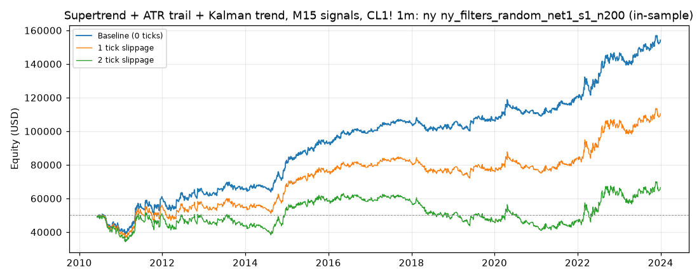

# Supertrend + ATR trail + Kalman trend, M15 signals, CL1! 1m: optimized `ny` (ny_filters_random_net1_s1_n200)

Generated 2026-10-31 13:26 UTC by `python -m tvtester.cli replay strategies/configs/supertrend_kalman_ny_filters_random_net1_s1_n200.json`.

> **In-sample.** Development interval only (bars before 2024-01-01 UTC). Picked by search `results/supertrend_kalman/search/ny_filters_random_net1_s1_n200` (trial 33, objective `net1`); see its report for how many trials it took. Nothing here shows a tradable edge: out-of-sample validation is a later feature.

**Parameters:** `exit=flip`, `hours=ny`, `kalman_q=0.0001`, `rr=3`, `st_factor=2`, `swing=5`, `trail_mult=1`, `trigger=both`, `vol=rvi`

**Filters:** `rvi_side >= 55`

Replay matches the search trial: **yes**.

## Against the baseline (same interval, same costs)

| Scenario | Baseline net | Optimized net | Baseline trades | Optimized trades | Baseline PF | Optimized PF | Baseline max DD | Optimized max DD |
|---|---|---|---|---|---|---|---|---|
| 0 ticks | 104,105.44 USD | 104,217.06 USD | 2,628 | 2,247 | 1.165 | 1.193 | 15,000.94 USD | 12,417.88 USD |
| 1 tick | 53,025.44 USD | 60,457.06 USD | 2,628 | 2,247 | 1.080 | 1.107 | 19,437.46 USD | 14,267.88 USD |
| 2 ticks | 1,955.44 USD | 16,487.06 USD | 2,628 | 2,247 | 1.003 | 1.028 | 40,007.08 USD | 22,214.34 USD |

## 0 ticks slippage

### Overview

| Metric | Value |
|---|---|
| Net profit | 104,217.06 USD (208.43%) |
| Total closed trades | 2,247 |
| Percent profitable | 45.04% |
| Profit factor | 1.193 |
| Max equity drawdown | 12,417.88 USD (24.84%) |
| Avg trade | 46.38 USD |
| Avg # bars in trades | 151 |

### Performance

| Metric | All | Long | Short |
|---|---|---|---|
| Net profit | 104,217.06 USD (208.43%) | 31,822.62 USD (63.65%) | 72,394.44 USD (144.79%) |
| Gross profit | 643,871.76 USD (1,287.74%) | 287,050.00 USD (574.10%) | 356,821.76 USD (713.64%) |
| Gross loss | 539,654.70 USD (1,079.31%) | 255,227.38 USD (510.45%) | 284,427.32 USD (568.85%) |
| Commission paid | 9,032.94 USD | 4,297.38 USD | 4,735.56 USD |

| Account | Value |
|---|---|
| Initial capital | 50,000.00 USD |
| Buy & hold return (TV-style, all capital at the first entry) | -354.96 USD (-0.71%) |
| Max equity run-up (intrabar) | 118,867.70 USD (237.74%) |
| Max equity drawdown (intrabar) | 12,417.88 USD (24.84%) |
| Open P&L | 0.00 USD |
| Max contracts held | 1 |

### Trades analysis

| Metric | All | Long | Short |
|---|---|---|---|
| Total closed trades | 2,247 | 1,069 | 1,178 |
| Winning trades | 1,012 | 500 | 512 |
| Losing trades | 1,235 | 569 | 666 |
| Even trades | 0 | 0 | 0 |
| Percent profitable | 45.04% | 46.77% | 43.46% |
| Avg P&L | 46.38 USD | 29.77 USD | 61.46 USD |
| Avg P&L % | 0.07% | 0.04% | 0.09% |
| Avg winning trade | 636.24 USD | 574.10 USD | 696.92 USD |
| Avg losing trade | 436.97 USD | 448.55 USD | 427.07 USD |
| Ratio avg win / avg loss | 1.456 | 1.280 | 1.632 |
| Largest winning trade | 5,495.98 USD | 3,685.98 USD | 5,495.98 USD |
| Largest winning trade % | 18.33% | 14.46% | 18.33% |
| Largest losing trade | 2,434.02 USD | 2,434.02 USD | 2,314.02 USD |
| Largest losing trade % | 11.25% | 6.98% | 11.25% |
| Avg # bars in trades | 151 | 151 | 151 |
| Avg # bars in winning trades | 193 | 195 | 192 |
| Avg # bars in losing trades | 117 | 112 | 121 |

### Risk/performance ratios

| Metric | Value |
|---|---|
| Sharpe ratio | 0.176 |
| Sortino ratio | 0.342 |
| Profit factor | 1.193 |
| Margin calls | 0 |

### By year (extra)

| Year | Trades | Net profit | % profitable | Profit factor |
|---|---|---|---|---|
| 2010 | 92 | -9,529.84 USD | 38.04% | 0.670 |
| 2011 | 170 | 20,136.60 USD | 48.82% | 1.387 |
| 2012 | 153 | 2,464.94 USD | 43.14% | 1.055 |
| 2013 | 150 | 2,387.00 USD | 48.00% | 1.074 |
| 2014 | 157 | 16,588.86 USD | 49.04% | 1.544 |
| 2015 | 167 | 10,878.66 USD | 50.90% | 1.287 |
| 2016 | 166 | 6,832.68 USD | 45.18% | 1.233 |
| 2017 | 148 | 4,845.04 USD | 43.92% | 1.233 |
| 2018 | 175 | -533.50 USD | 40.57% | 0.985 |
| 2019 | 170 | 2,246.60 USD | 40.59% | 1.071 |
| 2020 | 177 | 4,158.46 USD | 39.55% | 1.117 |
| 2021 | 162 | 10,298.76 USD | 48.15% | 1.294 |
| 2022 | 171 | 22,922.58 USD | 47.95% | 1.317 |
| 2023 | 189 | 10,520.22 USD | 44.44% | 1.199 |

## 1 tick slippage

### Overview

| Metric | Value |
|---|---|
| Net profit | 60,457.06 USD (120.91%) |
| Total closed trades | 2,247 |
| Percent profitable | 43.84% |
| Profit factor | 1.107 |
| Max equity drawdown | 14,267.88 USD (28.54%) |
| Avg trade | 26.91 USD |
| Avg # bars in trades | 151 |

### Performance

| Metric | All | Long | Short |
|---|---|---|---|
| Net profit | 60,457.06 USD (120.91%) | 10,902.62 USD (21.81%) | 49,554.44 USD (99.11%) |
| Gross profit | 625,040.30 USD (1,250.08%) | 277,620.30 USD (555.24%) | 347,420.00 USD (694.84%) |
| Gross loss | 564,583.24 USD (1,129.17%) | 266,717.68 USD (533.44%) | 297,865.56 USD (595.73%) |
| Commission paid | 9,032.94 USD | 4,297.38 USD | 4,735.56 USD |

| Account | Value |
|---|---|
| Initial capital | 50,000.00 USD |
| Buy & hold return (TV-style, all capital at the first entry) | -361.86 USD (-0.72%) |
| Max equity run-up (intrabar) | 77,657.70 USD (155.32%) |
| Max equity drawdown (intrabar) | 14,267.88 USD (28.54%) |
| Open P&L | 0.00 USD |
| Max contracts held | 1 |

### Trades analysis

| Metric | All | Long | Short |
|---|---|---|---|
| Total closed trades | 2,247 | 1,069 | 1,178 |
| Winning trades | 985 | 485 | 500 |
| Losing trades | 1,262 | 584 | 678 |
| Even trades | 0 | 0 | 0 |
| Percent profitable | 43.84% | 45.37% | 42.44% |
| Avg P&L | 26.91 USD | 10.20 USD | 42.07 USD |
| Avg P&L % | 0.04% | 0.01% | 0.06% |
| Avg winning trade | 634.56 USD | 572.41 USD | 694.84 USD |
| Avg losing trade | 447.37 USD | 456.71 USD | 439.33 USD |
| Ratio avg win / avg loss | 1.418 | 1.253 | 1.582 |
| Largest winning trade | 5,475.98 USD | 3,685.98 USD | 5,475.98 USD |
| Largest winning trade % | 18.20% | 14.45% | 18.20% |
| Largest losing trade | 2,454.02 USD | 2,454.02 USD | 2,334.02 USD |
| Largest losing trade % | 11.42% | 7.10% | 11.42% |
| Avg # bars in trades | 151 | 151 | 151 |
| Avg # bars in winning trades | 195 | 198 | 193 |
| Avg # bars in losing trades | 117 | 112 | 121 |

### Risk/performance ratios

| Metric | Value |
|---|---|
| Sharpe ratio | 0.103 |
| Sortino ratio | 0.186 |
| Profit factor | 1.107 |
| Margin calls | 0 |

## 2 ticks slippage

### Overview

| Metric | Value |
|---|---|
| Net profit | 16,487.06 USD (32.97%) |
| Total closed trades | 2,247 |
| Percent profitable | 42.46% |
| Profit factor | 1.028 |
| Max equity drawdown | 22,214.34 USD (44.43%) |
| Avg trade | 7.34 USD |
| Avg # bars in trades | 151 |

### Performance

| Metric | All | Long | Short |
|---|---|---|---|
| Net profit | 16,487.06 USD (32.97%) | -10,287.38 USD (-20.57%) | 26,774.44 USD (53.55%) |
| Gross profit | 606,574.92 USD (1,213.15%) | 268,302.66 USD (536.61%) | 338,272.26 USD (676.54%) |
| Gross loss | 590,087.86 USD (1,180.18%) | 278,590.04 USD (557.18%) | 311,497.82 USD (623.00%) |
| Commission paid | 9,032.94 USD | 4,297.38 USD | 4,735.56 USD |

| Account | Value |
|---|---|
| Initial capital | 50,000.00 USD |
| Buy & hold return (TV-style, all capital at the first entry) | -368.77 USD (-0.74%) |
| Max equity run-up (intrabar) | 36,247.80 USD (72.50%) |
| Max equity drawdown (intrabar) | 22,214.34 USD (44.43%) |
| Open P&L | 0.00 USD |
| Max contracts held | 1 |

### Trades analysis

| Metric | All | Long | Short |
|---|---|---|---|
| Total closed trades | 2,247 | 1,069 | 1,178 |
| Winning trades | 954 | 467 | 487 |
| Losing trades | 1,293 | 602 | 691 |
| Even trades | 0 | 0 | 0 |
| Percent profitable | 42.46% | 43.69% | 41.34% |
| Avg P&L | 7.34 USD | -9.62 USD | 22.73 USD |
| Avg P&L % | 0.01% | -0.02% | 0.03% |
| Avg winning trade | 635.82 USD | 574.52 USD | 694.60 USD |
| Avg losing trade | 456.37 USD | 462.77 USD | 450.79 USD |
| Ratio avg win / avg loss | 1.393 | 1.241 | 1.541 |
| Largest winning trade | 5,455.98 USD | 3,685.98 USD | 5,455.98 USD |
| Largest winning trade % | 18.08% | 14.44% | 18.08% |
| Largest losing trade | 2,474.02 USD | 2,474.02 USD | 2,354.02 USD |
| Largest losing trade % | 11.60% | 7.22% | 11.60% |
| Avg # bars in trades | 151 | 151 | 151 |
| Avg # bars in winning trades | 197 | 199 | 195 |
| Avg # bars in losing trades | 118 | 114 | 121 |

### Risk/performance ratios

| Metric | Value |
|---|---|
| Sharpe ratio | 0.025 |
| Sortino ratio | 0.042 |
| Profit factor | 1.028 |
| Margin calls | 0 |
