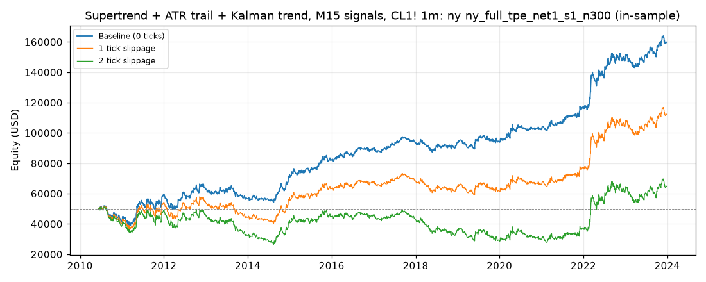

# Supertrend + ATR trail + Kalman trend, M15 signals, CL1! 1m: optimized `ny` (ny_full_tpe_net1_s1_n300)

Generated 2026-10-31 14:05 UTC by `python -m tvtester.cli replay strategies/configs/supertrend_kalman_ny_full_tpe_net1_s1_n300.json`.

> **In-sample.** Development interval only (bars before 2024-01-01 UTC). Picked by search `results/supertrend_kalman/search/ny_full_tpe_net1_s1_n300` (trial 121, objective `net1`); see its report for how many trials it took. Nothing here shows a tradable edge: out-of-sample validation is a later feature.

**Parameters:** `exit=flip`, `hours=ny`, `kalman_q=0.0001`, `rr=3`, `st_factor=2`, `swing=5`, `trail_mult=1`, `trigger=both`, `vol=rvi`

**Filters:** `hours_since_open >= 1`, `risk_atr >= 2`

Replay matches the search trial: **yes**.

## Against the baseline (same interval, same costs)

| Scenario | Baseline net | Optimized net | Baseline trades | Optimized trades | Baseline PF | Optimized PF | Baseline max DD | Optimized max DD |
|---|---|---|---|---|---|---|---|---|
| 0 ticks | 104,105.44 USD | 109,927.48 USD | 2,628 | 2,426 | 1.165 | 1.187 | 15,000.94 USD | 14,056.12 USD |
| 1 tick | 53,025.44 USD | 62,427.48 USD | 2,628 | 2,426 | 1.080 | 1.102 | 19,437.46 USD | 17,915.70 USD |
| 2 ticks | 1,955.44 USD | 14,937.48 USD | 2,628 | 2,426 | 1.003 | 1.023 | 40,007.08 USD | 24,861.54 USD |

## 0 ticks slippage

### Overview

| Metric | Value |
|---|---|
| Net profit | 109,927.48 USD (219.85%) |
| Total closed trades | 2,426 |
| Percent profitable | 45.26% |
| Profit factor | 1.187 |
| Max equity drawdown | 14,056.12 USD (28.11%) |
| Avg trade | 45.31 USD |
| Avg # bars in trades | 154 |

### Performance

| Metric | All | Long | Short |
|---|---|---|---|
| Net profit | 109,927.48 USD (219.85%) | 25,172.08 USD (50.34%) | 84,755.40 USD (169.51%) |
| Gross profit | 696,806.04 USD (1,393.61%) | 315,236.84 USD (630.47%) | 381,569.20 USD (763.14%) |
| Gross loss | 586,878.56 USD (1,173.76%) | 290,064.76 USD (580.13%) | 296,813.80 USD (593.63%) |
| Commission paid | 9,752.52 USD | 4,807.92 USD | 4,944.60 USD |

| Account | Value |
|---|---|
| Initial capital | 50,000.00 USD |
| Buy & hold return (TV-style, all capital at the first entry) | -341.13 USD (-0.68%) |
| Max equity run-up (intrabar) | 125,480.38 USD (250.96%) |
| Max equity drawdown (intrabar) | 14,056.12 USD (28.11%) |
| Open P&L | 0.00 USD |
| Max contracts held | 1 |

### Trades analysis

| Metric | All | Long | Short |
|---|---|---|---|
| Total closed trades | 2,426 | 1,196 | 1,230 |
| Winning trades | 1,098 | 558 | 540 |
| Losing trades | 1,328 | 638 | 690 |
| Even trades | 0 | 0 | 0 |
| Percent profitable | 45.26% | 46.66% | 43.90% |
| Avg P&L | 45.31 USD | 21.05 USD | 68.91 USD |
| Avg P&L % | 0.07% | 0.04% | 0.10% |
| Avg winning trade | 634.61 USD | 564.94 USD | 706.61 USD |
| Avg losing trade | 441.93 USD | 454.65 USD | 430.16 USD |
| Ratio avg win / avg loss | 1.436 | 1.243 | 1.643 |
| Largest winning trade | 8,285.98 USD | 3,685.98 USD | 8,285.98 USD |
| Largest winning trade % | 18.33% | 14.46% | 18.33% |
| Largest losing trade | 2,434.02 USD | 2,434.02 USD | 2,084.02 USD |
| Largest losing trade % | 11.25% | 8.82% | 11.25% |
| Avg # bars in trades | 154 | 153 | 156 |
| Avg # bars in winning trades | 195 | 194 | 196 |
| Avg # bars in losing trades | 120 | 116 | 124 |

### Risk/performance ratios

| Metric | Value |
|---|---|
| Sharpe ratio | 0.166 |
| Sortino ratio | 0.322 |
| Profit factor | 1.187 |
| Margin calls | 0 |

### By year (extra)

| Year | Trades | Net profit | % profitable | Profit factor |
|---|---|---|---|---|
| 2010 | 86 | -8,255.72 USD | 39.53% | 0.676 |
| 2011 | 184 | 17,120.32 USD | 48.37% | 1.295 |
| 2012 | 166 | 4,532.68 USD | 44.58% | 1.095 |
| 2013 | 168 | -6,825.36 USD | 45.24% | 0.833 |
| 2014 | 160 | 15,406.80 USD | 48.12% | 1.493 |
| 2015 | 181 | 10,172.38 USD | 50.83% | 1.245 |
| 2016 | 183 | 7,254.34 USD | 47.54% | 1.222 |
| 2017 | 172 | 4,118.56 USD | 41.86% | 1.159 |
| 2018 | 181 | -37.62 USD | 40.33% | 0.999 |
| 2019 | 187 | 608.26 USD | 40.64% | 1.017 |
| 2020 | 192 | 8,268.16 USD | 40.62% | 1.214 |
| 2021 | 176 | 14,652.48 USD | 48.86% | 1.392 |
| 2022 | 187 | 31,808.26 USD | 48.13% | 1.412 |
| 2023 | 203 | 11,103.94 USD | 46.31% | 1.195 |

## 1 tick slippage

### Overview

| Metric | Value |
|---|---|
| Net profit | 62,427.48 USD (124.85%) |
| Total closed trades | 2,426 |
| Percent profitable | 43.73% |
| Profit factor | 1.102 |
| Max equity drawdown | 17,915.70 USD (35.83%) |
| Avg trade | 25.73 USD |
| Avg # bars in trades | 154 |

### Performance

| Metric | All | Long | Short |
|---|---|---|---|
| Net profit | 62,427.48 USD (124.85%) | 1,252.08 USD (2.50%) | 61,175.40 USD (122.35%) |
| Gross profit | 676,174.78 USD (1,352.35%) | 304,245.28 USD (608.49%) | 371,929.50 USD (743.86%) |
| Gross loss | 613,747.30 USD (1,227.49%) | 302,993.20 USD (605.99%) | 310,754.10 USD (621.51%) |
| Commission paid | 9,752.52 USD | 4,807.92 USD | 4,944.60 USD |

| Account | Value |
|---|---|
| Initial capital | 50,000.00 USD |
| Buy & hold return (TV-style, all capital at the first entry) | -348.04 USD (-0.70%) |
| Max equity run-up (intrabar) | 80,830.38 USD (161.66%) |
| Max equity drawdown (intrabar) | 17,915.70 USD (35.83%) |
| Open P&L | 0.00 USD |
| Max contracts held | 1 |

### Trades analysis

| Metric | All | Long | Short |
|---|---|---|---|
| Total closed trades | 2,426 | 1,196 | 1,230 |
| Winning trades | 1,061 | 536 | 525 |
| Losing trades | 1,365 | 660 | 705 |
| Even trades | 0 | 0 | 0 |
| Percent profitable | 43.73% | 44.82% | 42.68% |
| Avg P&L | 25.73 USD | 1.05 USD | 49.74 USD |
| Avg P&L % | 0.04% | 0.00% | 0.07% |
| Avg winning trade | 637.30 USD | 567.62 USD | 708.44 USD |
| Avg losing trade | 449.63 USD | 459.08 USD | 440.79 USD |
| Ratio avg win / avg loss | 1.417 | 1.236 | 1.607 |
| Largest winning trade | 8,265.98 USD | 3,685.98 USD | 8,265.98 USD |
| Largest winning trade % | 18.20% | 14.45% | 18.20% |
| Largest losing trade | 2,454.02 USD | 2,454.02 USD | 2,104.02 USD |
| Largest losing trade % | 11.42% | 8.94% | 11.42% |
| Avg # bars in trades | 154 | 153 | 156 |
| Avg # bars in winning trades | 197 | 196 | 197 |
| Avg # bars in losing trades | 121 | 117 | 125 |

### Risk/performance ratios

| Metric | Value |
|---|---|
| Sharpe ratio | 0.095 |
| Sortino ratio | 0.174 |
| Profit factor | 1.102 |
| Margin calls | 0 |

## 2 ticks slippage

### Overview

| Metric | Value |
|---|---|
| Net profit | 14,937.48 USD (29.87%) |
| Total closed trades | 2,426 |
| Percent profitable | 42.33% |
| Profit factor | 1.023 |
| Max equity drawdown | 24,861.54 USD (49.72%) |
| Avg trade | 6.16 USD |
| Avg # bars in trades | 154 |

### Performance

| Metric | All | Long | Short |
|---|---|---|---|
| Net profit | 14,937.48 USD (29.87%) | -22,267.92 USD (-44.54%) | 37,205.40 USD (74.41%) |
| Gross profit | 656,261.46 USD (1,312.52%) | 294,143.72 USD (588.29%) | 362,117.74 USD (724.24%) |
| Gross loss | 641,323.98 USD (1,282.65%) | 316,411.64 USD (632.82%) | 324,912.34 USD (649.82%) |
| Commission paid | 9,752.52 USD | 4,807.92 USD | 4,944.60 USD |

| Account | Value |
|---|---|
| Initial capital | 50,000.00 USD |
| Buy & hold return (TV-style, all capital at the first entry) | -354.96 USD (-0.71%) |
| Max equity run-up (intrabar) | 43,727.76 USD (87.46%) |
| Max equity drawdown (intrabar) | 24,861.54 USD (49.72%) |
| Open P&L | 0.00 USD |
| Max contracts held | 1 |

### Trades analysis

| Metric | All | Long | Short |
|---|---|---|---|
| Total closed trades | 2,426 | 1,196 | 1,230 |
| Winning trades | 1,027 | 514 | 513 |
| Losing trades | 1,399 | 682 | 717 |
| Even trades | 0 | 0 | 0 |
| Percent profitable | 42.33% | 42.98% | 41.71% |
| Avg P&L | 6.16 USD | -18.62 USD | 30.25 USD |
| Avg P&L % | 0.01% | -0.03% | 0.04% |
| Avg winning trade | 639.01 USD | 572.26 USD | 705.88 USD |
| Avg losing trade | 458.42 USD | 463.95 USD | 453.16 USD |
| Ratio avg win / avg loss | 1.394 | 1.233 | 1.558 |
| Largest winning trade | 8,245.98 USD | 3,685.98 USD | 8,245.98 USD |
| Largest winning trade % | 18.08% | 14.44% | 18.08% |
| Largest losing trade | 2,474.02 USD | 2,474.02 USD | 2,124.02 USD |
| Largest losing trade % | 11.60% | 9.07% | 11.60% |
| Avg # bars in trades | 154 | 153 | 156 |
| Avg # bars in winning trades | 199 | 198 | 199 |
| Avg # bars in losing trades | 121 | 118 | 124 |

### Risk/performance ratios

| Metric | Value |
|---|---|
| Sharpe ratio | 0.029 |
| Sortino ratio | 0.053 |
| Profit factor | 1.023 |
| Margin calls | 0 |
