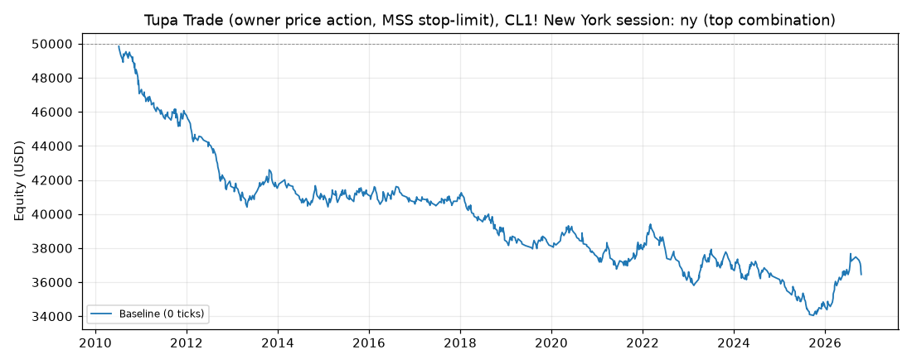

# Tupa Trade (owner price action, MSS stop-limit), CL1! New York session: results

> **Historical; superseded pending rerun (5 November 2026).** The owner swing twins now reject
> local pivots that are not leg extremes, including non-pivot candle extremes. The results below
> predate that correction. They have not been rerun or verified under the corrected detector.

Generated 2026-11-04 13:55 UTC by `python -m tvtester.cli test tupa_trade`.

Owner strategy, spec in [README.md](README.md) (sections 3b and 3c). Pure price action on the owner swing points
([`indicators/structure_swings.pine`](../../../indicators/structure_swings.pine)), New York session only
(09:00-14:30 New York = 21:00-02:30 Malaysia time in US summer time, 22:00-03:30 in US winter time). Short side
below; the long side is the mirror.

- **Bias.** Tested timeframe T = the lowest timeframe from `t_min` up to daily whose newest swing is a swing low
  (a candidate: no swing high confirmed after it). Short bias when every timeframe below T, down to 5m, is in
  downtrend (its last uptrend HL touched by a closed candle). Timeframes 5m, 15m, 1H, 4H (anchored 18:00 New York),
  daily (CME trading day). Closed candles only.
- **Entry (1m market structure shift).** Newest confirmed 1m swing is a swing high and the swing low before it is
  a HL, not touched yet. Sell **stop-limit**: trigger = that HL (touch counts), limit = the HL, or stop loss - 25
  ticks when the stop loss is more than 25 ticks away.
- **Exits.** Stop loss exactly at the 1m swing high, take profit 25 ticks from the fill, or close at the New York
  session end (next open after the 14:29 bar). An unfilled triggered limit is cancelled when the next 1m swing high
  is confirmed. One trade per session.
- **Grid.** `t_min` (lowest timeframe allowed as T) is Claude's open point, not an owner rule. Everything else is
  fixed by the owner: TP 25 ticks, max risk 25 ticks.

Stop-limit fills follow the engine's stop-limit rule (`docs/ENGINE.md`, fills rule 8), not yet checked against a
TradingView export. A runnable Pine v6 twin is in [`strategies/tupa_trade.pine`](../../../strategies/tupa_trade.pine).

## Test settings (TradingView Properties)

| Setting | Value |
|---|---|
| Symbol | CL1! (NYMEX Light Crude Oil, front month), 1-minute bars |
| Data | 2010-06-07 00:00:00+00:00 to 2026-11-03 18:29:00+00:00 UTC, 5,674,164 bars (manifest written 2026-11-04T02:31:15+00:00) |
| Initial capital | 50,000.00 USD |
| Order size | 1 contract |
| Commission | 2.01 USD per contract per order (4.02 USD round trip) |
| Execution | Limit entries; commission included; no added slippage |
| Pyramiding | 0 (one position) |
| Fills | TradingView broker emulator, Bar Magnifier off, limits fill on touch |
| Roll rule | position closed at the last bar of a contract (exit reason `roll`) |

## How the top combination was chosen

Every variant ran all 4 combinations of the grid below with commission included. The combination with the highest **net profit** is the top combination (ties: higher profit factor, then grid order). This reference is retained for compatibility. Thirteen separate metric winners are also selected, with a declared minimum trade count; their values, settings and trade lists are linked below. No slippage stress runs are performed.

| Parameter | Values |
|---|---|
| `t_min` | 15m, 1h, 4h, 1d |

> **Read this first.** The top combination is the best of 4 tries on the same data it is reported on (in-sample). Picking the best of many tries makes the result look better than what the same rules can be expected to earn on new data. Treat these numbers as an upper bound, not as a forecast.

## Summary: top combination per variant

| Variant | Parameters | Net profit | Trades | % profitable | Profit factor | Max DD |
|---|---|---|---|---|---|---|
| ny | t_min=1d | -13,547.10 USD | 855 | 31.11% | 0.824 | 16,081.98 USD |

## Variant: ny

**Top combination:** `session=ny`, `t_min=1d`

Files: [grid](../../../results/tupa_trade/ny/grid.csv), [trades 0 ticks](../../../results/tupa_trade/ny/trades_slippage0.csv), [summary](../../../results/tupa_trade/ny/summary.json)

### Results after commission

#### Overview

| Metric | Value |
|---|---|
| Net profit | -13,547.10 USD (-27.09%) |
| Total closed trades | 855 |
| Percent profitable | 31.11% |
| Profit factor | 0.824 |
| Max equity drawdown | 16,081.98 USD (32.16%) |
| Avg trade | -15.84 USD |
| Avg # bars in trades | 13 |

#### Performance

| Metric | All | Long | Short |
|---|---|---|---|
| Net profit | -13,547.10 USD (-27.09%) | -6,976.34 USD (-13.95%) | -6,570.76 USD (-13.14%) |
| Gross profit | 63,600.68 USD (127.20%) | 30,961.42 USD (61.92%) | 32,639.26 USD (65.28%) |
| Gross loss | 77,147.78 USD (154.30%) | 37,937.76 USD (75.88%) | 39,210.02 USD (78.42%) |
| Commission paid | 3,437.10 USD | 1,676.34 USD | 1,760.76 USD |

| Account | Value |
|---|---|
| Initial capital | 50,000.00 USD |
| Buy & hold return (TV-style, all capital at the first entry) | 15,195.88 USD (30.39%) |
| Max equity run-up (intrabar) | 3,867.04 USD (7.73%) |
| Max equity drawdown (intrabar) | 16,081.98 USD (32.16%) |
| Open P&L | 0.00 USD |
| Max contracts held | 1 |

#### Trades analysis

| Metric | All | Long | Short |
|---|---|---|---|
| Total closed trades | 855 | 417 | 438 |
| Winning trades | 266 | 129 | 137 |
| Losing trades | 589 | 288 | 301 |
| Even trades | 0 | 0 | 0 |
| Percent profitable | 31.11% | 30.94% | 31.28% |
| Avg P&L | -15.84 USD | -16.73 USD | -15.00 USD |
| Avg P&L % | -0.02% | -0.01% | -0.02% |
| Avg winning trade | 239.10 USD | 240.01 USD | 238.24 USD |
| Avg losing trade | 130.98 USD | 131.73 USD | 130.27 USD |
| Ratio avg win / avg loss | 1.825 | 1.822 | 1.829 |
| Largest winning trade | 245.98 USD | 245.98 USD | 245.98 USD |
| Largest winning trade % | 1.98% | 1.98% | 1.05% |
| Largest losing trade | 264.02 USD | 264.02 USD | 254.02 USD |
| Largest losing trade % | 0.72% | 0.71% | 0.72% |
| Avg # bars in trades | 13 | 14 | 12 |
| Avg # bars in winning trades | 19 | 20 | 18 |
| Avg # bars in losing trades | 11 | 11 | 10 |

#### Risk/performance ratios

| Metric | Value |
|---|---|
| Sharpe ratio | -0.322 |
| Sortino ratio | -0.367 |
| Profit factor | 0.824 |
| Margin calls | 0 |

#### List of trades (last 10, newest first; full list in the trades CSV)

| Trade # | Type | Signal | Date/Time (UTC) | Price | Contracts | Profit | Cum. profit | Run-up | Drawdown |
|---|---|---|---|---|---|---|---|---|---|
| 855 | Exit short | Exit | 2026-10-16 15:36 | 98.04 | 1 | -254.02 USD (-0.26%) | -13,547.10 USD | 0.00 USD | 250.00 USD |
|  | Entry short | Short | 2026-10-16 15:33 | 97.79 | 1 |  |  |  |  |
| 854 | Exit long | Exit | 2026-10-13 14:32 | 93.56 | 1 | -194.02 USD (-0.21%) | -13,293.08 USD | 40.00 USD | 190.00 USD |
|  | Entry long | Long | 2026-10-13 14:24 | 93.75 | 1 |  |  |  |  |
| 853 | Exit long | Exit | 2026-10-12 15:01 | 93.71 | 1 | -204.02 USD (-0.22%) | -13,099.06 USD | 70.00 USD | 200.00 USD |
|  | Entry long | Long | 2026-10-12 14:48 | 93.91 | 1 |  |  |  |  |
| 852 | Exit short | Exit | 2026-10-08 14:15 | 92.28 | 1 | -184.02 USD (-0.20%) | -12,895.04 USD | 110.00 USD | 180.00 USD |
|  | Entry short | Short | 2026-10-08 14:10 | 92.10 | 1 |  |  |  |  |
| 851 | Exit long | Exit | 2026-09-28 15:04 | 95.48 | 1 | -194.02 USD (-0.20%) | -12,711.02 USD | 10.00 USD | 190.00 USD |
|  | Entry long | Long | 2026-09-28 15:04 | 95.67 | 1 |  |  |  |  |
| 850 | Exit long | Exit | 2026-09-02 16:44 | 91.16 | 1 | 245.98 USD (0.27%) | -12,517.00 USD | 250.00 USD | 70.00 USD |
|  | Entry long | Long | 2026-09-02 16:36 | 90.91 | 1 |  |  |  |  |
| 849 | Exit long | Exit | 2026-07-29 13:21 | 84.21 | 1 | -254.02 USD (-0.30%) | -12,762.98 USD | 0.00 USD | 250.00 USD |
|  | Entry long | Long | 2026-07-29 13:20 | 84.46 | 1 |  |  |  |  |
| 848 | Exit long | Exit | 2026-07-24 18:05 | 88.78 | 1 | -184.02 USD (-0.21%) | -12,508.96 USD | 240.00 USD | 180.00 USD |
|  | Entry long | Long | 2026-07-24 17:49 | 88.96 | 1 |  |  |  |  |
| 847 | Exit long | Exit | 2026-07-23 16:33 | 92.21 | 1 | 245.98 USD (0.27%) | -12,324.94 USD | 250.00 USD | 0.00 USD |
|  | Entry long | Long | 2026-07-23 16:31 | 91.96 | 1 |  |  |  |  |
| 846 | Exit long | Exit | 2026-07-21 13:29 | 84.66 | 1 | 245.98 USD (0.29%) | -12,570.92 USD | 250.00 USD | 10.00 USD |
|  | Entry long | Long | 2026-07-21 13:24 | 84.41 | 1 |  |  |  |  |

#### By year (extra, not a TV tab)

| Year | Trades | Net profit | % profitable | Profit factor |
|---|---|---|---|---|
| 2010 | 36 | -2,934.72 USD | 25.00% | 0.430 |
| 2011 | 53 | -1,273.06 USD | 39.62% | 0.798 |
| 2012 | 48 | -4,162.96 USD | 18.75% | 0.347 |
| 2013 | 51 | -115.02 USD | 37.25% | 0.976 |
| 2014 | 45 | -670.90 USD | 28.89% | 0.827 |
| 2015 | 53 | 296.94 USD | 39.62% | 1.064 |
| 2016 | 52 | -499.04 USD | 25.00% | 0.865 |
| 2017 | 55 | 398.90 USD | 23.64% | 1.147 |
| 2018 | 68 | -2,573.36 USD | 22.06% | 0.570 |
| 2019 | 37 | -288.74 USD | 27.03% | 0.895 |
| 2020 | 42 | -618.84 USD | 28.57% | 0.818 |
| 2021 | 63 | 356.74 USD | 36.51% | 1.071 |
| 2022 | 41 | -1,554.82 USD | 36.59% | 0.704 |
| 2023 | 57 | 400.86 USD | 40.35% | 1.078 |
| 2024 | 56 | -605.12 USD | 28.57% | 0.862 |
| 2025 | 58 | -1,593.16 USD | 22.41% | 0.638 |
| 2026 | 40 | 1,889.20 USD | 52.50% | 1.577 |

#### Exit reasons (extra)

| Reason | Trades |
|---|---|
| stop | 582 |
| limit | 254 |
| close | 19 |

- Session-end exits more than 5 minutes after the flat time (missing bars / early closes): 2.
- Roll exits: 0.

### Best settings by metric

Each winner needs at least 30 closed trades. Undefined values are excluded. Ties: higher net profit, higher profit factor, then grid order. Ruin loss threshold: 25,000.00 USD from starting capital. All selections are in-sample. MAE/MFE objectives use the mean of the per-trade maxima.

| Metric | Goal | Best value | Grid order | Trades | Eligible settings | Parameters |
|---|---|---|---|---|---|---|
| Net profit | max | -13,547.10 USD | [4](../../../results/tupa_trade/ny/metric_winners/order_4/trades_slippage0.csv) | 855 | 4 | t_min=1d |
| Win rate | max | 33.27% | [1](../../../results/tupa_trade/ny/metric_winners/order_1/trades_slippage0.csv) | 4085 | 4 | t_min=15m |
| Expectancy | max | -8.24 USD | [1](../../../results/tupa_trade/ny/metric_winners/order_1/trades_slippage0.csv) | 4085 | 4 | t_min=15m |
| Profit factor | max | 0.908 | [1](../../../results/tupa_trade/ny/metric_winners/order_1/trades_slippage0.csv) | 4085 | 4 | t_min=15m |
| Payoff ratio | max | 1.847 | [3](../../../results/tupa_trade/ny/metric_winners/order_3/trades_slippage0.csv) | 1995 | 4 | t_min=4h |
| Risk of ruin (estimate) | min | 100.00% | [4](../../../results/tupa_trade/ny/metric_winners/order_4/trades_slippage0.csv) | 855 | 4 | t_min=1d |
| Maximum drawdown | min | 16,081.98 USD | [4](../../../results/tupa_trade/ny/metric_winners/order_4/trades_slippage0.csv) | 855 | 4 | t_min=1d |
| Consecutive losses | min | 12.000 | [4](../../../results/tupa_trade/ny/metric_winners/order_4/trades_slippage0.csv) | 855 | 4 | t_min=1d |
| Sharpe ratio | max | -0.169 | [1](../../../results/tupa_trade/ny/metric_winners/order_1/trades_slippage0.csv) | 4085 | 4 | t_min=15m |
| Sortino ratio | max | -0.216 | [1](../../../results/tupa_trade/ny/metric_winners/order_1/trades_slippage0.csv) | 4085 | 4 | t_min=15m |
| R-multiple | max | -0.085 | [1](../../../results/tupa_trade/ny/metric_winners/order_1/trades_slippage0.csv) | 4085 | 4 | t_min=15m |
| Maximum adverse excursion (MAE) | min | 106.28 USD | [2](../../../results/tupa_trade/ny/metric_winners/order_2/trades_slippage0.csv) | 3406 | 4 | t_min=1h |
| Maximum favorable excursion (MFE) | max | 131.53 USD | [1](../../../results/tupa_trade/ny/metric_winners/order_1/trades_slippage0.csv) | 4085 | 4 | t_min=15m |

- **Net profit:** Sum of closed-trade profit after commission; excludes open P&L.
- **Win rate:** Winning closed trades divided by all closed trades, including breakevens.
- **Expectancy:** Mean net profit per closed trade, including losses and breakevens.
- **Profit factor:** Gross winning profit divided by gross losing profit, both after commission. Undefined without losses.
- **Payoff ratio:** Average net winning trade divided by the absolute average net losing trade. Requires wins and losses.
- **Risk of ruin (estimate):** Infinite-horizon diffusion estimate of losing the declared amount from starting capital. Assumes independent, stationary, fixed-size net trade P&L; ignores intratrade losses and margin.
- **Maximum drawdown:** Largest equity drawdown under the tester's intrabar TradingView convention, including an open trade at the end.
- **Consecutive losses:** Longest streak of losing closed trades in execution order. A win or breakeven resets the streak.
- **Sharpe ratio:** Monthly marked-to-market excess return divided by population standard deviation, using 2% annual risk-free rate; not annualized.
- **Sortino ratio:** Monthly marked-to-market excess return divided by downside deviation about the risk-free rate; not annualized.
- **R-multiple:** Mean net trade profit / initial stop risk in dollars. Risk is actual fill to initial stop, before costs. Requires positive initial risk for every closed trade; R standard deviation and mean / standard deviation describe consistency.
- **Maximum adverse excursion (MAE):** Mean of each closed trade's maximum adverse price excursion in dollars, before commission; only the exposed intrabar path counts.
- **Maximum favorable excursion (MFE):** Mean of each closed trade's maximum favorable price excursion in dollars, before commission; only the exposed intrabar path counts. Unrealized opportunity, not realized profit.

Full selection metadata: [metric_winners.json](../../../results/tupa_trade/ny/metric_winners.json).

### Top 10 combinations

| # | t_min | Net profit | Trades | % profitable | Profit factor | Max DD |
|---|---|---|---|---|---|---|
| 1 | 1d | -13,547.10 USD | 855 | 31.11% | 0.824 | 16,081.98 USD |
| 2 | 4h | -33,499.90 USD | 1,995 | 30.58% | 0.814 | 35,515.54 USD |
| 3 | 15m | -33,661.70 USD | 4,085 | 33.27% | 0.908 | 37,932.80 USD |
| 4 | 1h | -36,432.12 USD | 3,406 | 32.47% | 0.880 | 39,400.84 USD |

Profitable combinations: 0 of 4.
